# 🚨 Disaster Recovery TurtleBot3 Burger

<p align="center">
  <strong>통신 단절 적응형 실내 재난 탐사 및 자율 복귀 로봇 시스템</strong><br>
  <em>(TurtleBot3 Burger · ROS 2 Humble · Kyungpook National University)</em>
</p>

<p align="center">
  
  
  
  
  
  
  
  
  
  
</p>

<p align="center">
  
</p>

---

> 통신 단절(Heartbeat 3.0 s 타임아웃) 또는 유해 가스(MQ-2 임계치) 발생 시, 외부 관제 없이 Raspberry Pi 4 온보드 연산만으로
> **LIFO 역추적 · RollingLocalGrid 2D A\* · 3채널 Context-RL ONNX · 2D LiDAR ICP · ArUco 도킹** 을 결합해 베이스캠프로 자율 복귀하는 TurtleBot3 Burger 시스템이다.

### 핵심 결과 (Gazebo 시뮬레이션 기준)

| 검증 항목 | 결과 | 비교 기준 |
| :--- | :---: | :--- |
| 15대 재난 시나리오 × 10회 **엄격 무충돌 복귀 (Strict Pass)** | **`96/150` (64.0%)** · 도착 `141/150` (94.0%) | Clean 150회 실측치 (`AUD-01~AUD-05` 이상 `0건`; `phase2b_strict_clean` 엄격 `96/150 = 64.0%` · 도착 `140/150 = 93.3%`, Baseline 엄격 `3/150 = 2.0%` · 도착 `89/150 = 59.3%`, `Ch1=Ch2=0` 입력 `max_abs_diff = 0.0`) |
| 시맨틱 회피 10-Trial A/B **엄격 무위험 복귀** | **`9/10` (90.0%)** · 저상/가스 위반 **`0회`** · `23.07 s` | Phase 2-B Blind `0/10` (`ab10` 기준, 충돌무관통 `2/10`) · 저상 `5회`/가스 `6회` · `67.79 s` |
| 시맨틱 공백(`Ch1=Ch2=0`) **비퇴행 일치** | `max_abs_diff = 0.0` | 검증 입력에서 Phase 2-B 1-Ch ONNX 출력과 최대 절대 오차 0 |
| Option 2 ONNX 크기 / CPU 추론 지연 | `415.0 KB` / `0.121–0.124 ms` | x86 CPU 실측 (`sim` `0.121 ms`, `real_tb3` `0.124 ms`; RPi 4 실측은 미수행) |
| 단위 테스트 | `56 passed` | `src/disaster_recovery/test` |

> [!NOTE]
> 위 수치는 모두 Gazebo 11 시뮬레이션 결과이며, 실물 TurtleBot3 필드 실증은 아직 수행하지 않았다([알려진 한계](#15-알려진-한계-및-해결-이슈) 참조).

---

## 목차

| 소개 · 설계 | 실험 결과 | 구축 · 운용 | 참고 |
| :--- | :--- | :--- | :--- |
| 1. [개요](#1-개요)<br>2. [핵심 기능](#2-핵심-기능)<br>3. [시스템 아키텍처](#3-시스템-아키텍처)<br>4. [상태 머신](#4-상태-머신-recovery_controller)<br>5. [알고리즘 5단계 진화](#5-알고리즘-5단계-진화-baseline--phase-3) | 6. [15대 시나리오 아틀라스 · 150회 벤치마크](#6-15대-시나리오-아틀라스--150회-엄격-무충돌-벤치마크)<br>7. [5단계 동일 맵 비교 GIF](#7-5단계-동일-맵-비교-gif)<br>8. [시맨틱 회피 10-Trial A/B](#8-gazebo-시맨틱-회피-10-trial-ab)<br>9. [Phase 3 기술 상세](#9-phase-3-기술-상세-시맨틱-slam--option-2-context-rl) | 10. [하드웨어](#10-하드웨어-구성)<br>11. [설치 · 테스트](#11-설치-및-테스트)<br>12. [실행](#12-실행)<br>13. [Gazebo 시뮬레이션](#13-gazebo-시뮬레이션)<br>14. [ROS 2 인터페이스 · 파라미터](#14-ros-2-인터페이스-및-파라미터) | 15. [알려진 한계 · 해결 이슈](#15-알려진-한계-및-해결-이슈)<br>16. [필드 테스트](#16-필드-테스트)<br>17. [저장소 구조](#17-저장소-구조)<br>18. [선행 특허](#18-선행-특허-및-ip-분석)<br>19. [참고 문헌](#19-참고-문헌) |

---

## 1. 개요

### 1.1 개발 목적

지진·건물 붕괴·연기·유해가스 누출 등으로 통신 인프라가 끊긴 실내 재난 환경에서 다음 5가지 목표를 달성하는 것을 목적으로 한다.

| # | 목표 | 핵심 구현 | 상태 |
| :-: | :--- | :--- | :-: |
| 1 | **2D 시맨틱 SLAM & 3채널 Context-RL** | 단안 RGB(YOLO26n) + 2D LiDAR 투영 퓨전(`/map` 영구 마커) · Frozen 백본 + Pre-Tanh 잔차 + 하드 배리어 25-ray Safety Shield (`ab10` 엄격 무위험 `9/10` vs Blind `0/10`) | ✅ 시뮬 완료 |
| 2 | **통신 단절 시 비퇴행 온보드 자율 복귀** | Heartbeat 워치독 + LIFO 역추적 + `RollingLocalGrid 2D A*` + Option 2 ONNX (`Ch1=Ch2=0` 비퇴행 `max_abs_diff=0.0`, Clean 150회 엄격 `96/150 = 64.0%` · 도착 `141/150 = 94.0%`) | ✅ 완료 |
| 3 | **극한 재난 환경 강인성 확보** | LiDAR 이웃 각도 잡음 필터(연기) + 동적 잔상 빠른 소거 + 2D LiDAR SVD ICP 슬립 보정 (`3.5 ms`) | ✅ 완료 |
| 4 | **베이스캠프 정밀 도킹** | ArUco + `solvePnP` 비주얼 서보잉 + 10초 타임아웃 세이프티 가드 | ✅ 완료 |
| 5 | **저지연 AI 재난 관제** | YOLO26n (GPU FP16 · 최대 15 FPS) + Faster-Whisper (CUDA INT8 · CPU 폴백) | ✅ 완료 |

### 1.2 개발 현황

| 구분 | 항목 | 상태 |
| :--- | :--- | :-: |
| Phase 3 시맨틱 SLAM & RL (Option 2) | `semantic_map_node` + Frozen-Backbone 2단 직렬 3-Ch ONNX (`415.0 KB`, `0.12 ms`, `max_abs_diff=0.0`) | ✅ 시뮬 완료 |
| Phase 2-B 자율 복귀 (기저 백본) | `RollingLocalGrid + 2D A*` · `ContextRLStudent` · Layer-0 필터 · 2D ICP (Clean 150회 엄격 `64.0%` / 물리 도착 `93.3%`; 과거 Legacy(충돌 허용) 기록 `149/150 = 99.33%`, 원본 JSON 미보관) | ✅ 완료 |
| 제어 · 도킹 | Heartbeat 워치독, LIFO 역추적, LiDAR 긴급 정지, ArUco 정밀 도킹 | ✅ 구현 |
| AI 관제 · 운용 | YOLO26n 탐지, Faster-Whisper 음성 인식, 원터치 런처 `start.py` / `stop.py` | ✅ 실차 검증 |
| 시뮬레이션 · 벤치마크 | `sim.py` (`slam_toolbox`/Cartographer, `--yolo`), 엄격 무충돌 15종 벤치마크, `run_phase3_semantic_suite.py` | ✅ 구현 |
| 센서 | MQ-2 + ADS1115 가스 센서 | ⏳ 드라이버 완료, 결선 예정 |

### 1.3 최근 변경사항

| 일자 | 요약 |
| :--- | :--- |
| 2026-11-21 (`최신`) | 4대 구조 개선(PPO 쉴드 개입 페널티, `hard_sem` 하드 배리어, `VAL_SEEDS`/`TEST_SEEDS` 독립 분리, 제어기 연속 `sem_prox` 램프) · V100 재학습(`real_tb3` TEST Gas-Free `73.3%`, `ab10` 엄격 `9/10` · 위반 `0회`) · Clean 150-trial 무결성 감사(`AUD-01~AUD-05` 이상 `0건`, `phase2b_strict_clean` vs `phase3_option2_clean` 엄격 무충돌 `96/150 = 64.0%` 비퇴행 검증 및 `lidar_collision` 53건 병목 분석 동기화) · Phase 4 후속 연구 설계 문서화 |
| 2026-11-21 (`cf8f7e2`) | Option 2 구조 통일(Pre-Tanh 잔차 + 후단 Safety Shield, `Ch1/Ch2` 기울기 격리, `scale_gate` 영속화) · V100 재학습(`real_tb3` Gas-Free `26.7%→60.0%`) · Gazebo 재검증 |
| 2026-11-20 (`6bd2bbf`) | Phase 3 **Option 2 (`frozen_residual`)** 채택 · V100 Dual-Track 학습 · 150회 비퇴행 벤치마크 |
| 2026-11-20 (`2eea2e4`) | 15종 궤적 아틀라스 5-Stage 확장 · `house_hard` 퇴행 분석 |
| 2026-11-20 (`08833e1`) | Phase 3 v3 Warm-Start · 엄격 무충돌 판정(`collision_free`) 도입 · 3패널 E2E 시맨틱 SLAM |
| 2026-11-20 (`3849fce`) | 2D LiDAR-단안 RGB 투영 시맨틱 SLAM & 3채널 Context-RL 초기 통합 |
| 2026-11-15 | 15대 시나리오 150회 확장 벤치마크 · 연기/동적 잔상 필터 · Clearance-Gated Blending |

전체 이력: [`CHANGELOG.md`](CHANGELOG.md)

### 1.4 관련 문서

> 처음 보는 경우 **① 설계 → ② 알고리즘·결과 → ③ 차세대 고도화** 순서로 읽는 것을 권장한다.

| 분류 | 문서 | 내용 |
| :--- | :--- | :--- |
| **① 설계** | [종합 설계 가이드북](docs/DISASTER_RECOVERY_GUIDEBOOK.md) | 전체 구조 · 동작 원리 · 상태 머신 |
| | [통합 구축 보고서](docs/Disaster_Recovery_TurtleBot3_Integration_Report.md) ([docx](docs/Disaster_Recovery_TurtleBot3_Integration_Report.docx)) | YOLO26n · 오디오 · ArUco 연동 구축 내역 |
| **② 알고리즘·결과** | [단계별 알고리즘·RL 변천사](docs/알고리즘_및_강화학습_기법_단계별_변천사.md) | Baseline → Phase 3 기법 총정리 |
| | [자율복귀 원리 해설·벤치마크](docs/재난환경_자율복귀_알고리즘_원리_해설_및_보고서.md) | 15종 150회 Clean A/B 결과 (엄격 `64.0%` vs `64.0%`, 도착 `93.3%/94.0%`; 과거 Legacy 기록 `99.33%`, 원본 JSON 미보관) · Phase 3 요약 |
| | [2D 라이다 스캔매칭 보고서](docs/2D_라이다_스캔매칭_및_자율복귀_보고서.md) | ICP 오차 보정 · Layer-0 필터 · 시맨틱 투영 |
| **③ 차세대** | [시맨틱 SLAM·RL 재학습 보고서](docs/차세대_고도화_시맨틱_SLAM_및_RL_재학습_계획.md) | 논문 기반 Phase 3 설계·구현·시뮬 검증 완료 |
| | [Phase 4 후속 연구 검토·설계](docs/Phase4_후속_연구_방향_검토_및_설계.md) | GRU·World Model·Risk-Sensitive RL·Safety Shield 기술 타당성 및 로드맵 |
| | [Phase 4 재검증 연구설계·구현계획](docs/Phase4_재검증_연구설계_및_구현계획.md) | 코드·실측 기반 비판적 재검증, Soft-CBF-QP·CVaR-RL 수식 및 5자 Ablation 마스터 블루프린트 |
| **④ 설치·운용** | [WSL 네트워크 설정](docs/WSL_NETWORK_SETUP.md) | 미러드 네트워킹 · ROS 2 · CUDA |
| | [회로·카메라 캘리브레이션](docs/CIRCUIT_AND_CALIBRATION.md) | MQ-2 분압 회로 · 카메라 보정 |
| | [ArUco 도킹 가이드](docs/TURTLEBOT3_ARUCO_GUIDE.md) | 마커 생성 · 도킹 절차 |
| | [필드 테스트 체크리스트](docs/FIELD_TEST_CHECKLIST.md) | 실행 순서 · 검증 항목 |
| **⑤ 이력·아카이브** | [변경 이력 (CHANGELOG)](CHANGELOG.md) | 2026-11-05 ~ 최신 누적 패치노트 |
| | [트러블슈팅 총정리](docs/2026-11-10_통신단절_재난대응_터틀봇3_프로젝트_시도내역_및_트러블슈팅_총정리.md) | `#01` ~ `#42` 시도 내역 통합 |
| | [서버 이관 체크포인트](docs/2026-11-14_중간상황_및_서버이관_체크포인트.md) | 2026-11-14 중간 점검 기록 |
| | [붕괴건물 15회 분석 (초기)](docs/붕괴건물_15회_자율복귀_벤치마크_분석보고서.md) | 2026-11-13 초기 실패 원인 진단 |
| **⑥ 지식재산권** | [선행 특허 분석](docs/PATENT_ANALYSIS_AND_PRIOR_ART.md) | 선행 특허 · 진보성 분석 (v3.0) |

---

## 2. 핵심 기능

| 기능 | 설명 | 실행 위치 |
| :--- | :--- | :--- |
| Heartbeat 워치독 | `/heartbeat` 3.0 s 미수신 시 즉시 정지(v=0, ω=0) 후 원격 명령 차단 | RPi 4 |
| 가스 워치독 | MQ-2 → ADS1115(I2C) → `/gas/level` ≥ 0.40 이면 동일한 비상 복귀 시퀀스 진입 | RPi 4 |
| 오도메트리 로거 | 탐색 중 Δd ≥ 0.3 m 또는 \|Δθ\| ≥ 25°마다 (x, y, θ, scan_pts)를 LIFO 스택에 push | RPi 4 |
| LIFO 백트래킹 & 로컬 A\* | 스택 pop 및 비파괴 위상 지름길, `RollingLocalGrid(6.0m×6.0m, 0.04m) + 2D A*` 우회, `BACKTRACKING_HYBRID` 내부 서브모드(`ESCAPE` 탈출 · `DYNAMIC_HOLD` 대기), Regulated Pure Pursuit + Residual TD3 하이브리드 추종 | RPi 4 |
| LiDAR 스캔 매칭 (ICP) | 경유지 45 cm 이내에서 저장 스캔과 현재 스캔을 대조해 바퀴 슬립 누적 오차를 보정 | RPi 4 |
| LiDAR 긴급 정지 | 복귀 중 전방 ±20°, 0.12–0.25 m 장애물 감지 시 정지·대기, 해제 시 재개 | RPi 4 |
| ArUco 정밀 도킹 | 원점 0.5 m 진입 시 ArUco(ID 0, 시뮬레이션 `0.10 m = 10 cm` / 실차 `0.05 m = 5 cm`)를 `solvePnP`로 추정해 2 cm 이내 도킹 | RPi 4 |
| 도킹 세이프티 가드 | 마커 미배치·가림 시 무한 회전 없이 10초 후 정지 및 미션 완료 처리 | RPi 4 |
| 로컬 블랙박스 | 비상 전환 시 MicroSD에 영상(mp4)과 텔레메트리(csv) 기록 | RPi 4 |
| 오디오 캡처 | AB13X USB 마이크(`plughw:1,0`, 48 kHz S16_LE mono)를 `arecord`로 읽어 `/audio/raw`로 송신 | RPi 4 |
| 비전 AI | YOLO26n(최대 15 FPS)으로 조난자(`person`) 탐지 · 270° 회전 보정 · Zero-Lag 워커 | Host PC (GPU) |
| 음성 AI | 16 kHz 다운샘플 → RMS VAD → Faster-Whisper(`base`, `int8`)로 구조 요청 키워드 검출 | Host PC (CUDA / CPU 폴백) |
| 원터치 런처 | SSH 로봇 원격 기동 + 호스트 AI + SLAM + 텔레옵 통합 실행 | Host PC |
| RViz2 관제 | `disaster_cartographer.rviz` (SLAM + `RobotModel`) / `disaster_station.rviz` (`/detection/image`) | Host PC |

> **설계 원칙:** 생존·복귀에 필요한 모든 제어 루프는 로봇 내부에서 닫힌다. Host PC는 관제·AI·Heartbeat만 담당하며, Host PC가 사라져도 복귀 기능은 영향을 받지 않는다 (Brooks, 1986의 계층형 제어 구조 개념 참고).

---

## 3. 시스템 아키텍처

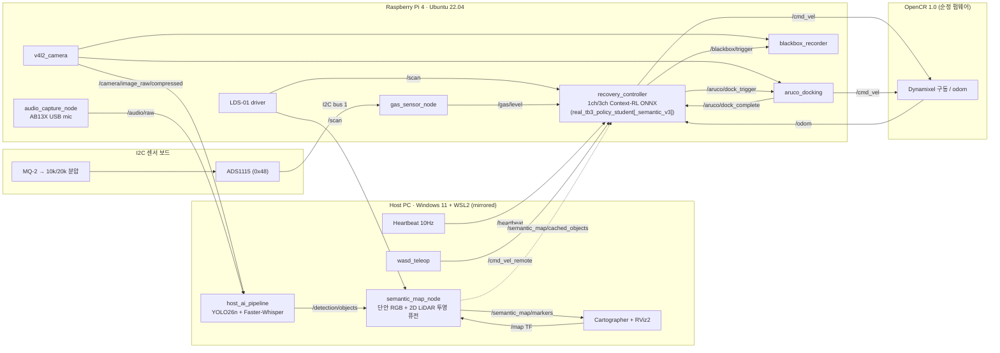

### 3.1 네트워크 (Dual NIC)

```
 [학교 벽면 LAN] ── 유선 NIC ──┐
                              ├── Host PC (Windows 11) ── WSL2 (networkingMode=mirrored)
 [연구실 공유기 192.168.0.x] ── USB Wi-Fi 동글 ──┘
            │
            └── Wi-Fi ── Raspberry Pi 4 (TurtleBot3)

 공통: ROS_DOMAIN_ID=0, ROS_LOCALHOST_ONLY=0, DDS 멀티캐스트 디스커버리 (Fast DDS 기본)
```

- 학교 망 인증(고정 IP/MAC)은 유선 NIC에서 유지하고, ROS 2 트래픽은 사설 공유기로만 흐른다.
- WSL2 미러드 모드는 Windows의 NIC/IP를 Linux에 그대로 노출하므로 NAT 포트포워딩 없이 DDS 멀티캐스트가 동작한다. 단, Windows 방화벽(Hyper-V firewall)에서 UDP 수신을 허용해야 할 수 있다. 상세: [`docs/WSL_NETWORK_SETUP.md`](docs/WSL_NETWORK_SETUP.md)
- 공유기에 직접 붙을 수 없는 경우 Tailscale + CycloneDDS 유니캐스트 피어로도 운용할 수 있으나, 지연(50–150 ms)·지터로 Heartbeat 타임아웃 오작동 위험이 있어 현장 시험에는 사설 Wi-Fi 직결을 권장한다 (`WSL_NETWORK_SETUP.md` §6).

---

## 4. 상태 머신 (`recovery_controller`)

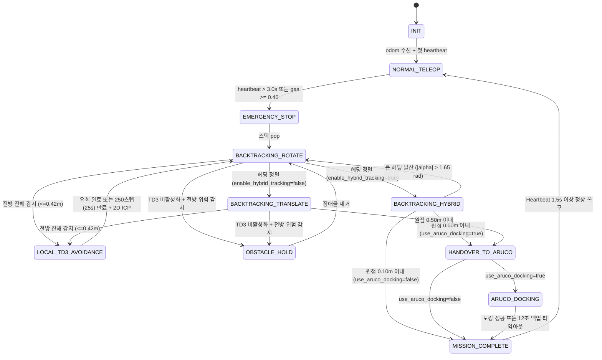

**제어 법칙 요약** (`recovery_params.yaml` 기본값 기준)

- 회전 단계 (`|e_θ| > 0.12 rad`): `v = 0`, `ω = clamp(1.40 · e_θ, ±0.65)`
- 하이브리드 연속 추종 (`BACKTRACKING_HYBRID`, 기본 활성): Lookahead 거리 `L_d = clip(d_target, 0.25, 0.45) m` 기반 Regulated Pure Pursuit(`κ = 2 sin(α) / L_d`, `v_reg = clip(v_max / (1 + 0.6|κ|), 0.14, 0.20)`)과 Residual TD3 출력을 블렌딩한다 (`d_front ≤ 0.42 m` 시 `0.85·ω_TD3 + 0.15·ω_PP`, 평시 `0.55·ω_PP + 0.45·ω_TD3`).
- 레거시 직진 단계 (`BACKTRACKING_TRANSLATE`, `enable_hybrid_tracking=false`): `v = clamp(0.60 · d, 0.03, 0.20)`, `ω = clamp(0.5 · 1.40 · e_θ, ±0.65)`
- 스캔 매칭: 경유지 `45 cm` (`scan_match_max_dist_m: 0.45`) 이내 접근 시 저장 스캔과 현재 스캔을 ICP로 정합하고, 결과를 `/odom` → 보정 좌표계 간 SE(2) 오프셋에 상보필터(α = 0.40)로 누적 반영한다. 오프셋은 이후 수신되는 `/odom`에도 계속 적용된다.
- 도킹 수렴 조건: `|Z − 0.20| ≤ 0.02 m`, `|X| ≤ 0.02 m`, `|yaw| ≤ 0.05 rad`를 10프레임 연속 만족 (`use_aruco_docking`은 `recovery_params.yaml` 기본 `false`, `sim.py --yolo` 실행 시 `true` 활성화)
- 도킹 세이프티 가드: 마커 미감지 시 10.0초 후 정지 및 `MISSION_COMPLETE` 전이 (제어기 측 12.0초 2차 백업)

---

## 5. 알고리즘 5단계 진화 (Baseline → Phase 3)

**Baseline** → **Phase 1**(2D A\* + 지름길) → **Phase 2-A**(1-Ch RL 단순 혼합) → **Phase 2-B**(Layer-0 필터 + 안전 포락선 + 1-Ch RL) → **Phase 3 Option 2**(시맨틱 SLAM 캐시 + Frozen 백본 2단 직렬 3-Ch RL) 순으로 발전했다. 마지막 열은 [7.1 Semantic Rescue](#71-semantic-rescue-동일-맵-5단계-비교) 동일 맵 결과다.

| 단계 | 핵심 제어 구조 | 장점 | 한계 | Semantic Rescue 결과 |
| :--- | :--- | :--- | :--- | :--- |
| **Baseline**<br>(`baseline`) | 4계층 반응형 + 단순 TD3 + LIFO + 2D ICP | 구조 단순, 최저 연산 부하 | 격자 플래너·`ESCAPE` 부재로 U자 함정·2차 붕괴 정체 (`150회 엄격 2.0% / 도착 59.3%`) | **FAIL** (미도착·저상 충돌)<br>`low=0.172m`, `135.14s` |
| **Phase 1**<br>(`proposed`) | `RollingLocalGrid` 2D A\* + 위상 지름길 + `ESCAPE` | 3D 벽·낙석 우회 및 U자 함정 탈출 강인 | 연기 잡음·동적 잔상에 과차단, 저상·가스·조난자 인지 불가 | **FAIL** (도착·저상 충돌)<br>`low=0.195m`, `27.32s` |
| **Phase 2-A**<br>(`proposed_rl`,<br>`envelope=false`) | 1-Ch Context-RL + A\* 단순 블렌딩 | A\* 재계획 지연 구간 연속 조향 | 좁은 문틀·낙석 구간에서 RL 조향이 A\*와 간섭, 저상·가스 미인지 | **FAIL** (타임아웃)<br>`low=0.282m`, `135.3s` |
| **Phase 2-B**<br>(`proposed_rl`,<br>`envelope=true`, 1-Ch) | **Layer-0 연기·잔상 필터 + 안전 포락선** + 1-Ch ONNX | 2D LiDAR(`z=0.171m`) 평면 장애물·연기·이동체 회피 상위 (`150회 엄격 64.0% / 도착 93.3%`) | 스캔 평면 아래 저상 장애물(`h<0.17m`)과 유독가스·조난자 미인지 (`ab10 0/10`) | **FAIL** (도착·저상/벽 충돌)<br>`low=0.182m`, `46.90s` |
| **Phase 3 (Option 2)**<br>(`use_semantic=true`, 3-Ch) | **`/map` 시맨틱 캐시** + **Frozen 백본 + Pre-Tanh 잔차 + 하드 배리어 Safety Shield** | `Ch1=Ch2=0` 비퇴행(`max_abs_diff=0.0`, `150회 엄격 64.0% / 도착 94.0%`) + 저상·가스·조난자 선제 회피 (`ab10 9/10`, 저상/가스 위반 `0회`) | 통신 단절 이후 신규 등장하는 조난자는 Host YOLO 중단으로 추가 탐지 불가 | **PASS** (최단시간·무위반)<br>`low=0.480m`, `gas=1.016m`, **`12.06s`** |

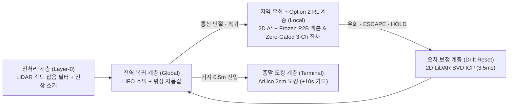

---

## 6. 15대 시나리오 아틀라스 · 150회 엄격 무충돌 벤치마크

### 6.1 15종 재난 시나리오 2D 궤적 아틀라스 (5-Stage)

각 패널은 Gazebo 월드에서 추출한 벽·장애물 단면 위에 Outbound 경로, 낙하 잔해, 5단계(`BAS`·`P1`·`P2A`·`P2B`·`P3`) 복귀 궤적을 겹쳐 그린 것이다. 패널 제목의 `T#`는 대표 Trial 번호, `O`/`X`는 해당 Trial의 단계별 성공/실패다.

<p align="center">
  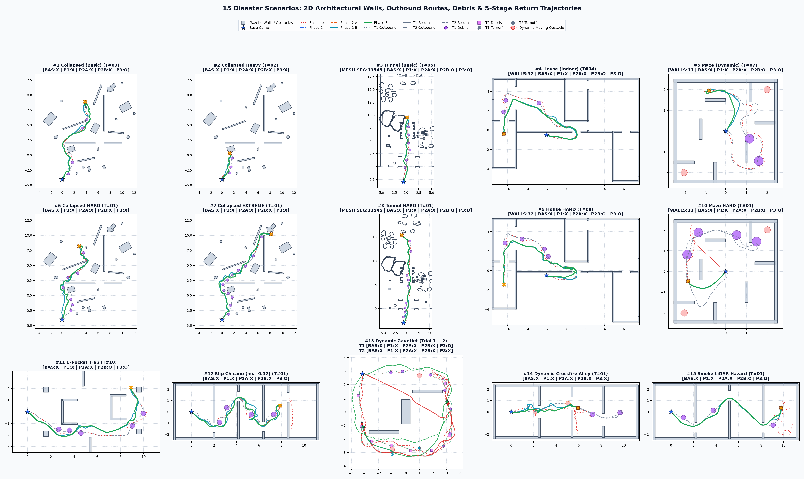
</p>

<details>
<summary><strong>15대 시나리오 3D Gazebo 월드 (9개 고유 맵) 펼쳐보기</strong></summary>

<p align="center">
  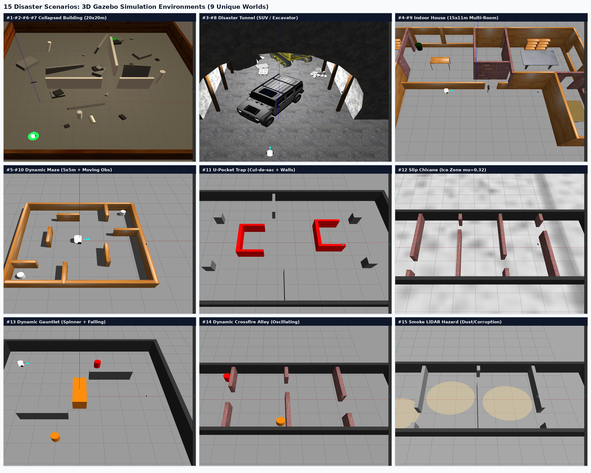
</p>

</details>

### 6.2 150회 엄격 무충돌 비퇴행 벤치마크 (Clean 150-Trial Audit)

도착 여부만 보던 기존(Legacy) 기준 대신 **Strict Pass 판정 기준**을 적용하고, 15개 전 시나리오(150회) 무결성 검증(`AUD-01~AUD-05`: 리셋 실패·음수 시간·25 cm 초과 성공·`return_path` 점프·Baseline 불일치 모두 **`0건`**) 하에 `phase2b_strict_clean`과 **100% 동일한 잔해 시드·배치(`same_debris = 150/150`)** 로 검증한 결과다([`phase2b_strict_clean/`](benchmark_results/phase2b_strict_clean/), [`phase3_semantic_v3/`](benchmark_results/phase3_semantic_v3/), [`phase3_option2_clean/`](benchmark_results/phase3_option2_clean/)).

- **Strict Pass (`success`) 판정 기준**:
  1. **기지 도착 (`arrival_success`)**: 종말 기지 거리 `terminal_error_cm <= 25.0 cm` (`final_dist_to_base_m <= 0.25 m`)
  2. **무충돌 (`collision_free = not debris_collision and not lidar_collision`)**:
     - `debris_collision`: 복귀 중 낙하 잔해 중심 거리 `min_debris_dist_m < 0.265 m` 발생 시 충돌 판정
     - `lidar_collision`: 복귀 중 360° 유효 LiDAR 최소 거리 `scan_all_min <= 0.121 m` (`0.120 <= r <= 3.5 m`)가 누적 **4스텝 이상**(`lidar_collision_steps >= 4`) 발생 시 벽·기둥·동적 장애물 스침 충돌 판정

#### (1) 전체 150-Trial 종합 집계표 (`AUD-01~AUD-05` 이상 `0건`)

| 전략 (모델) | Strict Pass<br>(엄격 무충돌 복귀) | Arrival<br>(물리 도착 ≤ 25 cm) | 전체 충돌 (`coll`)<br>(`debris` / `lidar`) | Strict Pass 평균 복귀시간<br>(전체 150회 평균) | Strict Pass 종말오차<br>(전체 150회 평균) | Strict Pass 평균 이동경로 |
| :--- | :---: | :---: | :---: | :---: | :---: | :---: |
| **Baseline** (`baseline`) | `3/150` (**`2.0%`**) | `89/150` (`59.3%`) | `136건` (`debris=69`, `lidar=136`) | `104.30 s` (`180.28 s`) | `4.73 cm` (`241.77 cm`) | `15.13 m` |
| **Phase 2-B Strict Clean** (`sim_policy_student.onnx`, 1-Ch) | **`96/150` (`64.0%`)** | `140/150` (`93.3%`) | `54건` (`debris=10`, `lidar=53`) | **`79.72 s`** (`109.00 s`) | `9.05 cm` (`38.85 cm`) | **`12.18 m`** |
| **Phase 3 Option 2 Clean** (`sim_policy_student_semantic_v3.onnx`, 3-Ch) | **`96/150` (`64.0%`)** | **`141/150` (`94.0%`)** | `54건` (`debris=8`, `lidar=53`) | `81.57 s` (`106.97 s`) | `9.08 cm` (`43.02 cm`) | `12.48 m` |

#### (2) 15대 시나리오별 세부 비교표 (각 10 Trials)

| # | 시나리오 ID | Baseline<br>(도착 / 엄격 무충돌) | Phase 2-B Strict Clean<br>(도착 / 엄격 무충돌) | Phase 3 v3 Warm-Start (구버전·아카이브)<br>(도착 / 엄격 무충돌) | **Phase 3 Option 2 Clean (최신)**<br>**(도착 / 엄격 무충돌)** | Option 2 무충돌 평균시간<br>(전체 평균시간) · 종말오차 |
| :-: | :--- | :---: | :---: | :---: | :---: | :---: |
| **1** | `collapsed` | `5/10` / `1/10` | `10/10` / `5/10` | `10/10` / `7/10` | `9/10` / **`5/10`** | `91.5 s` (`135.3 s`) · `13.4 cm` |
| **2** | `collapsed_hard` | `5/10` / `0/10` | `10/10` / `5/10` | `9/10` / `7/10` | `10/10` / **`5/10`** | `94.5 s` (`105.4 s`) · `10.3 cm` |
| **3** | `collapsed_heavy` | `5/10` / `0/10` | `10/10` / `8/10` | `10/10` / `7/10` | `10/10` / **`9/10`** | `92.7 s` (`87.0 s`) · `12.5 cm` |
| **4** | `collapsed_heavy_hard` | `2/10` / `1/10` | `10/10` / `3/10` | `10/10` / `5/10` | `10/10` / **`3/10`** | `131.0 s` (`147.0 s`) · `12.0 cm` |
| **5** | `dynamic_crossfire_alley` | `4/10` / `0/10` | `5/10` / `0/10` | `10/10` / `2/10` | `7/10` / `0/10` | `-` (`167.4 s`) · `-` |
| **6** | `dynamic_gauntlet` | `8/10` / `0/10` | `6/10` / `2/10` | `10/10` / `3/10` | `8/10` / **`4/10`** | `111.3 s` (`160.5 s`) · `8.4 cm` |
| **7** | `house` | `7/10` / `0/10` | `9/10` / **`6/10`** | `8/10` / `1/10` | `10/10` / `5/10` | `100.9 s` (`113.5 s`) · `8.7 cm` |
| **8** | `house_hard` | `8/10` / `0/10` | `10/10` / **`6/10`** | `7/10` / `2/10` | `9/10` / `5/10` | `111.3 s` (`141.6 s`) · `8.7 cm` |
| **9** | `maze` | `10/10` / `0/10` | `10/10` / `10/10` | `10/10` / `8/10` | `10/10` / **`10/10`** | `22.7 s` (`22.7 s`) · `8.0 cm` |
| **10** | `maze_hard` | `9/10` / `0/10` | `10/10` / `10/10` | `9/10` / `4/10` | `10/10` / **`10/10`** | `22.6 s` (`22.6 s`) · `8.1 cm` |
| **11** | `slip_chicane` | `2/10` / `0/10` | `10/10` / `4/10` | `10/10` / `3/10` | `10/10` / **`5/10`** | `109.1 s` (`116.2 s`) · `7.8 cm` |
| **12** | `smoke_lidar_corruption` | `0/10` / `0/10` | `10/10` / `8/10` | `10/10` / `9/10` | `10/10` / **`8/10`** | `74.9 s` (`76.2 s`) · `7.8 cm` |
| **13** | `tunnel` | `9/10` / `1/10` | `10/10` / **`9/10`** | `10/10` / `10/10` | `8/10` / `8/10` | `81.7 s` (`109.4 s`) · `8.3 cm` |
| **14** | `tunnel_hard` | `7/10` / `0/10` | `10/10` / `10/10` | `10/10` / `9/10` | `10/10` / **`10/10`** | `110.5 s` (`110.5 s`) · `8.3 cm` |
| **15** | `u_pocket_trap` | `8/10` / `0/10` | `10/10` / **`10/10`** | `10/10` / `10/10` | `10/10` / `9/10` | `90.0 s` (`89.3 s`) · `8.1 cm` |
| **합계** | **150 Trials (`same_debris=150/150`)** | **`89/150 (59.3%)` / `3/150 (2.0%)`** | **`140/150 (93.3%)` / `96/150 (64.0%)`** | **`143/150 (95.3%)` / `87/150 (58.0%)`** | **`141/150 (94.0%)` / `96/150 (64.0%)`** | **`81.57 s` (`106.97 s`) · `9.08 cm`** |

> **Baseline 열 및 모델 명칭 기준 안내:**
> - 위 표의 `Baseline (도착 / 엄격 무충돌)` 열(`89/150 = 59.3%` / `3/150 = 2.0%`, `coll=136 [debris=69, lidar=136]`)은 [`phase2b_strict_clean/`](benchmark_results/phase2b_strict_clean/) 및 [`phase3_option2_clean/`](benchmark_results/phase3_option2_clean/) 원본 JSON 기준이다(두 디렉터리 간 Baseline `150/150` 완전 일치; 별도 실행된 아카이브 [`phase3_semantic_v3/`](benchmark_results/phase3_semantic_v3/) 폴더 내 baseline `57/150 = 38.0%`는 **엄격 무충돌(`Strict Pass`, `passes`)** 기준).
> - `Phase 3 v3 Warm-Start (구버전·아카이브)`는 단일 3-Ch 네트워크 전체 미세조정 구버전의 별도 아카이브 실행치이며, 동일 잔해 시드(`same_debris=150/150`)·클린 감사(`AUD-01~AUD-05`) 조건의 엄밀한 비교는 **Baseline vs Phase 2-B Strict Clean vs Phase 3 Option 2 Clean** 3자 간에 성립한다.
> - 최신 Option 2 모델의 ONNX 파일명이 여전히 `*_semantic_v3.onnx`인 이유는 기존 런치·파라미터 드롭인 호환을 위해 파일명을 유지했기 때문이며, 내부 아키텍처는 `frozen_residual` Option 2다.

- **핵심 분석 및 결과 해석 (Known Bottlenecks)**:
  1. **비시맨틱 퇴행 방지를 위한 구조적 보존 및 완전 비퇴행 실증**: Option 2는 Phase 2-B 백본을 동결하고 `Ch1=Ch2=0`에서 잔차·쉴드를 소거해 기준 정책 출력을 보존한다(`max_abs_diff = 0.0`). Clean 150회 동일 잔해 시드(`same_debris=150/150`) 실행에서도 Phase 2-B Strict(`96/150 = 64.0%`, 도착 `140/150 = 93.3%`)와 Phase 3 Option 2(`96/150 = 64.0%`, 도착 `141/150 = 94.0%`)가 정확히 동일한 Strict Pass를 기록해 비시맨틱 환경 비퇴행이 입증되었으며, 시나리오별 미세 차이는 동일 정책(`max_abs_diff = 0.0`) 실행 간 Gazebo 물리 비결정성에 기인한 차이로 해석된다.
  2. **도착률(`93.3%~94.0%`) 대비 Strict Pass(`64.0%`) 격차의 주원인**: Option 2 기준 전체 실패 54건 중 미도착은 9건이며, 나머지 **45건은 기지 도착(`<= 25 cm`)에 성공했으나 복귀 중 스침 충돌 판정**을 받았다. 전체 충돌 54건 중 **53건이 `lidar_collision`(`min_scan_m = 0.120 m`, `scan_all_min <= 0.121 m` 4스텝 이상)** 이며(`debris_collision`은 8건), 협소 문틀·코너·잔해 통과 시 차체 측면/대각선이 장애물에 `0.120 m`까지 근접해 스치는 현상이 주원인이다.
  3. **근접 구간 RL 게이팅(`alpha_rl = 0.0`)으로 인한 공통 로컬 플래너 수렴**: `recovery_controller.py`의 `compute_rl_blend_weight` 및 안전 포락선 가드는 `used_tight_pass == True`, `front_min < 0.24 m`, `side_clearance < 0.62 m`, `min_side < 0.17 m` 구간에서 `alpha_rl = 0.0`으로 강제해 제어를 `local_grid_planner.py`(`step()`)에 일임한다. 이로 인해 두 모델의 근접 회피 성능은 공통 로컬 플래너 한계(`tight_radius_m = min(inflation, 0.058 m)` 및 측면 반발 조향 부재)에 수렴한다.
  4. **교차 동적 장애물에 대한 측면 회피 부재**: `DYNAMIC_HOLD`(1.2초 정지)는 정면 급접근(`|ω| < 0.35`, `df_dt < -0.25 m/s`, `0.20 <= front_min <= 0.55 m`)에만 반응하므로, `dynamic_crossfire_alley`(횡단 동적 기둥, 두 모델 모두 Strict Pass `0/10` · `lidar_collision` `10/10`) 및 `dynamic_gauntlet`(`2/10`, `4/10`)에서 측면으로 접근·교차하는 동적 장애물 회피가 부재하다.

<details>
<summary><strong>[GIF] · [PNG] Non-Regression `dynamic_gauntlet #01` 주행 증거 펼쳐보기</strong></summary>

| `[GIF]` `dynamic_gauntlet #01` (`49.7s`, 오차 `8.0cm`) | `[PNG]` 장애물 조우 (`encounter`) | `[PNG]` 기지 복귀 완주 (`outcome`) |
| :---: | :---: | :---: |
|  | 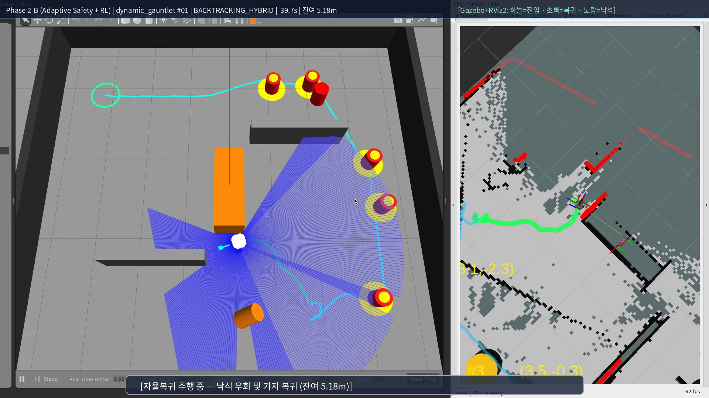 | 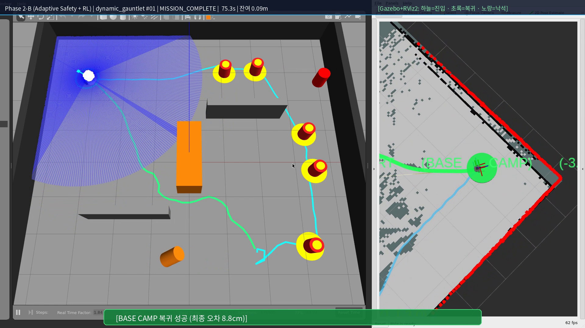 |

</details>

---

## 7. 5단계 동일 맵 비교 GIF

### 7.1 Semantic Rescue 동일 맵 5단계 비교

[`disaster_semantic_rescue_world.world`](src/disaster_recovery/worlds/disaster_semantic_rescue_world.world) 에서 **조난자(`person`)·저상 장애물 2개(`h=0.095m`)·유독가스 구역(`r=0.55m`)** 을 배치하고, Outbound SLAM+YOLO26n 좌표 스탬핑 후 Blackout 시점에 **2차 붕괴 3D 낙석(`box_obs_1`)** 이 퇴로를 막았을 때 5개 알고리즘의 주행 비교다([`comp5_semantic_rescue.json`](benchmark_results/phase3_semantic_v3/comp5_semantic_rescue.json), [`run_comp5_semantic_rescue.py`](scripts/host/run_comp5_semantic_rescue.py)).

| `[GIF]` Semantic Rescue 동일 `/map` 위 5단계 비교 (`BAS` ~ `P3 Option 2`) | `[PNG]` RViz2 `/map` + YOLO26n 실제 좌표 스탬핑 (`person`, `chair`, `GAS_HAZARD`) |
| :---: | :---: |
| 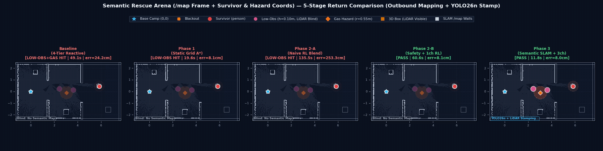 | 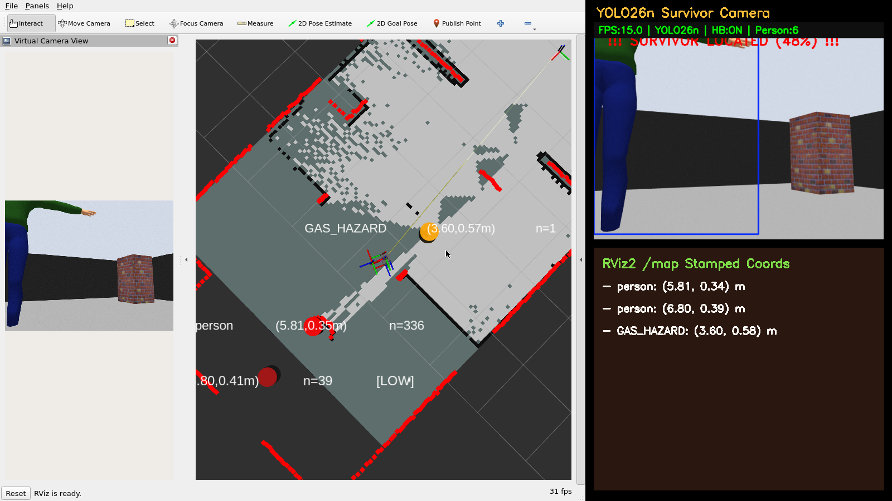 |

- **결과 판독**: `Baseline`(`low=0.172m`, 미도착 `256.9cm`), `Phase 1`(`low=0.195m`, `27.32s`), `Phase 2-A`(`low=0.282m`, 타임아웃 `135.3s`), `Phase 2-B`(`low=0.182m`, 벽·저상 충돌 `46.90s`)는 모두 저상 장애물 충돌 또는 타임아웃으로 엄격 기준(`strict`)을 통과하지 못했다. 반면 **`Phase 3 (Option 2)`는 `/map`에 캐싱된 저상·가스 좌표를 3채널 잔차 어댑터와 하드 배리어 Safety Shield로 반영해 충분한 안전 마진(`low=0.480m`, `gas=1.016m`)을 유지하며 `12.06s` 만에 유일하게 무충돌·무위반 최단시간 복귀(`PASS`)** 했다.

### 7.2 극한 3대 시나리오 5단계 비교

동일 시드 조건에서 연막 LiDAR 오염(`smoke_lidar_corruption`), 교차 이동 기둥(`dynamic_crossfire_alley`), U자 함정(`u_pocket_trap`)에 대한 5단계 비교다.

| `[GIF]` `#12 smoke_lidar_corruption` (Seed 2127) | `[GIF]` `#5 dynamic_crossfire_alley` (Seed 2127) | `[GIF]` `#15 u_pocket_trap` (Seed 3036) |
| :---: | :---: | :---: |
| 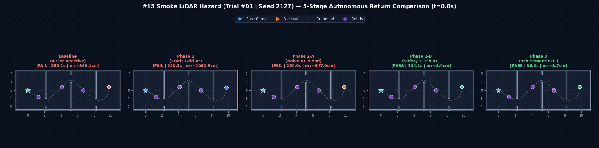 | 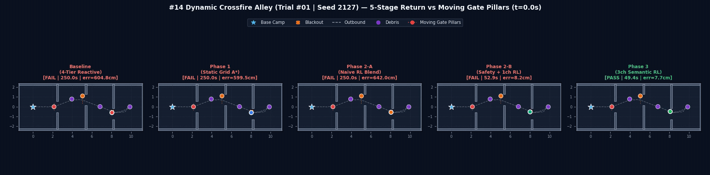 | 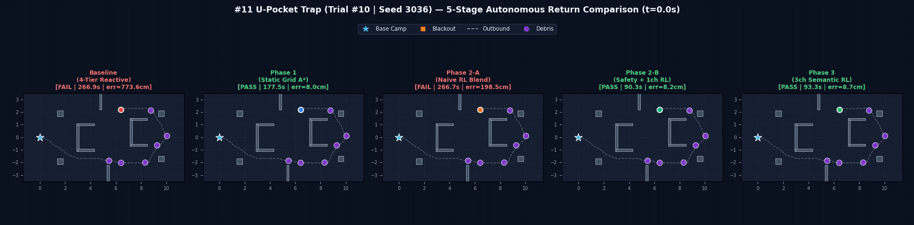 |

<details>
<summary><strong>[GIF] · [PNG] Phase 2-B 3D Dual-View 영상 및 초기 학습 곡선 아카이브 펼쳐보기</strong></summary>

| `[GIF]` `dynamic_crossfire_alley` 3D Dual-View | `[GIF]` `smoke_lidar_corruption` 3D Dual-View | `[PNG]` Phase 2-B V100 학습 곡선 (`44.24M` steps/track) |
| :---: | :---: | :---: |
| 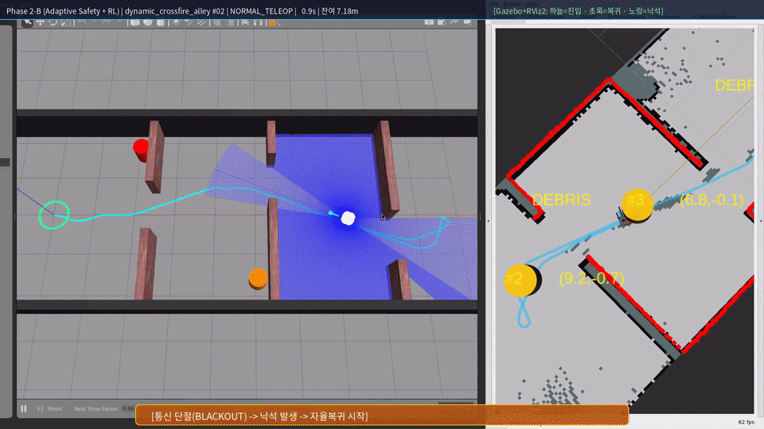 |  | 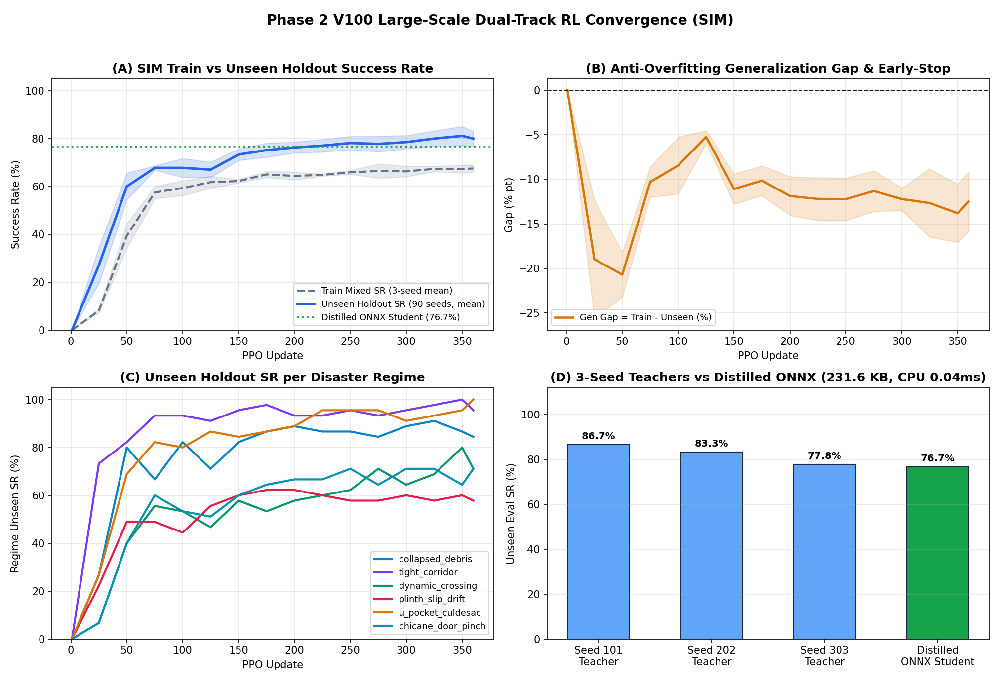 |

- 아카이브 문서: [초기 15회 분석](docs/붕괴건물_15회_자율복귀_벤치마크_분석보고서.md) · [원리 해설](docs/재난환경_자율복귀_알고리즘_원리_해설_및_보고서.md) · [Phase 2-B 요약](docs/phase2b_comparison_summary.txt) · [`benchmark_results/`](benchmark_results/)

</details>

---

## 8. Gazebo 시맨틱 회피 10-Trial A/B

[`disaster_semantic_rescue_world.world`](src/disaster_recovery/worlds/disaster_semantic_rescue_world.world) 에서 저상 장애물(`h=0.095m`) 2개와 유해 가스(`r=0.55m`)를 복귀 경로에 배치하고, **Phase 2-B Blind (`use_semantic_rl_policy:=false`)** 와 **Phase 3 Option 2 Semantic-Aware (`use_semantic_rl_policy:=true`)** 간 10회 반복 A/B 비교를 수행했다([`semantic_avoidance_ab_10trials.json`](benchmark_results/phase3_semantic_v3/semantic_avoidance_ab_10trials.json)).

| 평가 지표 (`10 Trials`) | Phase 2-B Blind<br>(`use_semantic_rl_policy:=false`) | Phase 3 Option 2 Semantic-Aware<br>(`use_semantic_rl_policy:=true`) | 개선 폭 |
| :--- | :---: | :---: | :---: |
| **도착 성공률 (Arrival)** | `6/10` (`60.0%`) | **`9/10` (`90.0%`)** | **`+30.0%p` (`1.50×`)** |
| **무충돌 복귀 성공률 (Collision-Free)** | `2/10` (`20.0%`) | **`9/10` (`90.0%`)** | **`+70.0%p` (`4.50×`)** |
| **엄격 위험무관통 성공률 (Strict Hazard-Free)** | `0/10` (`0.0%`) | **`9/10` (`90.0%`)** | **`+90.0%p` (완전 무위반 통과)** |
| **저상 장애물 충돌 / 가스 구역 침범 횟수** | 저상 충돌 `5회` / 가스 침범 `6회` | **저상 충돌 `0회` / 가스 침범 `0회`** | **저상·가스 위반 모두 완전 제거** |
| **평균 최소 이격 (저상 장애물 / 가스 중심)** | `0.3082 m` / `0.4325 m` | **`0.5939 m` / `0.8199 m`** | **`+28.57 cm` / `+38.74 cm`** |
| **평균 복귀 소요 시간** | `67.79 s` | **`23.07 s`** | **`2.94×` 단축 (`-44.72 s`)** |

| `[GIF]` Phase 2-B **Blind** (`1-Ch RL` · 저상/가스 미인지) | `[GIF]` Phase 3 **Semantic-Aware** (`Option 2 3-Ch RL` · 선제 우회) |
| :---: | :---: |
| 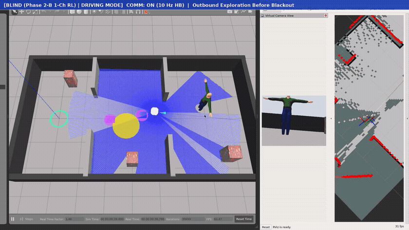 |  |

<p align="center">
  
</p>

---

## 9. Phase 3 기술 상세: 시맨틱 SLAM · Option 2 Context-RL

> 📄 **상세 설계 및 트러블슈팅**: [`docs/차세대_고도화_시맨틱_SLAM_및_RL_재학습_계획.md`](docs/차세대_고도화_시맨틱_SLAM_및_RL_재학습_계획.md) · [트러블슈팅 백서 #42](docs/2026-11-10_통신단절_재난대응_터틀봇3_프로젝트_시도내역_및_트러블슈팅_총정리.md#420-42-phase-3-2d-lidar-단안-rgb-투영-시맨틱-slam-e2e-및-3채널-context-rl-회피-정책-통합-검증)

### 9.1 단안 RGB-2D LiDAR 투영 퓨전 & 통신 단절 캐시

- **선행 논문 수식 3 오타 정정 & 270° CCW 역변환**: 이은원·김진현(2025) 수식 (3)의 `X · f_y` 오타를 `Y · f_y` (`v = (Y · f_y) / Z + c_y`)로 바로잡고, 실차 카메라 90° 시계방향 장착에 맞춘 270° CCW 역변환(`unrotate_point`, `unrotate_bbox_xyxy`)을 정합했다 ([`semantic_mapper_core.py`](src/disaster_recovery/disaster_recovery/semantic_mapper_core.py)).
- **전경 클러스터링(`+0.25 m`) & 영구 아티팩트 저장**: 바운딩 박스 가로 중앙 70% 내 LaserScan 투영점 중 `Z ≤ min(Z) + 0.25 m` 전경 클러스터 중앙값으로 배경 벽면 오인을 차단하고, `/semantic_map/save_map` 호출 시 `raw_map.png`, `raw_map.yaml`, `semantic_objects.json`, `semantic_map_overlay.png`를 원자적으로 저장한다 ([`semantic_map_node.py`](src/disaster_recovery/disaster_recovery/semantic_map_node.py)).
- **통신 단절 캐시 동작**:
  - **통신 연결 중 (Outbound)**: Host PC의 `YOLO26n` + `semantic_map_node`가 `/map`에 좌표를 기록하고 `/semantic_map/cached_objects`로 로봇 온보드 `SemanticObjectCache`에 실시간 백업한다.
  - **통신 단절 후 (Return)**: Host 링크가 끊겨도 백업된 조난자(`r=0.55 m`)·저상 장애물(`Ch1`)·가스(`Ch2`) 좌표가 유지되며, 복귀 중 새로 감지되는 유독가스는 온보드 MQ-2(`/gas/level`)가 [`cb_gas()`](src/disaster_recovery/disaster_recovery/recovery_controller.py#L886-L894)로 즉시 추가한다.

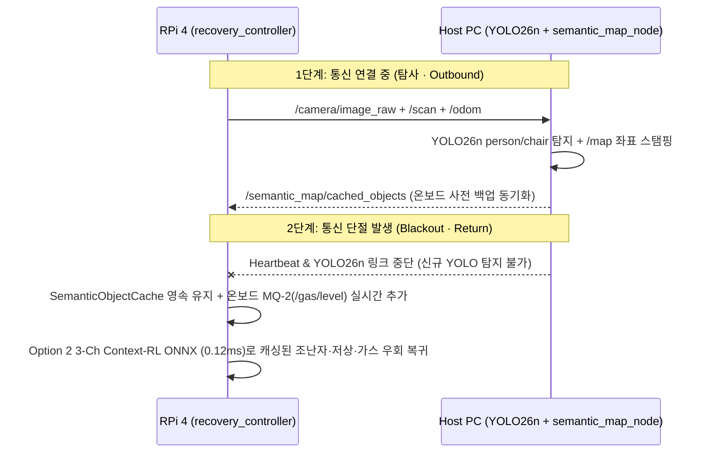

| `[GIF]` 3패널 E2E 시맨틱 SLAM (Gazebo 3D + YOLO26n + RViz2 `/map` · `DRIVING → COMM LOST → RECOVERY → COMPLETE`) |
| :---: |
|  |

| `[PNG]` E2E 3패널 실시간 스냅샷 (YOLO26n 조난자 검출) | `[PNG]` 2D `/map` 시맨틱 좌표 영구 오버레이 |
| :---: | :---: |
| 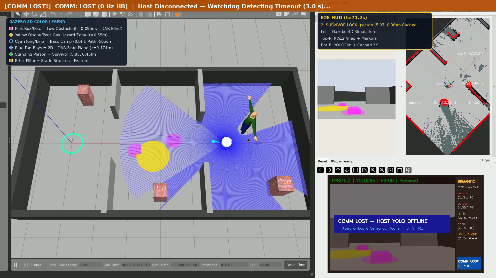 | 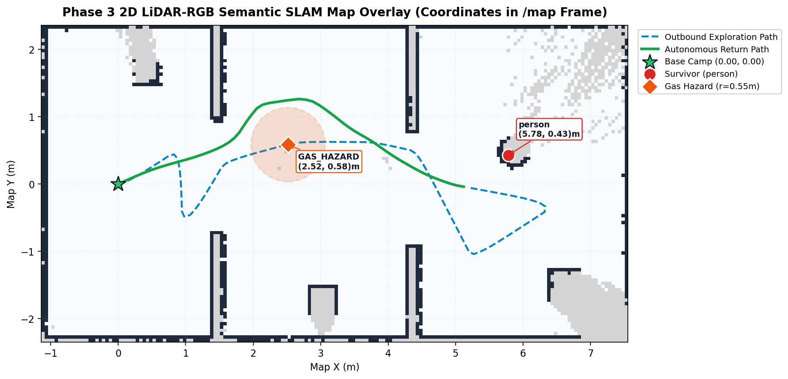 |

> **Gazebo 3D 색상 범례**: **분홍 사각/원반** = 저상 장애물(`h=0.095m`, 2D LiDAR 사각지대) · **노란 원반** = 유독가스 구역(`r=0.55m`) · **하늘색 링/리본** = Base Camp `(0,0)` & 탐색 경로 · **파란 부채꼴** = 2D LiDAR 스캔 평면(`z=0.171m`) · **서 있는 사람** = 조난자(`person`)

### 9.2 비퇴행 설계: Option 1 vs Option 2

Phase 2-B 1채널 격자를 3채널(`12×12×3 = 432`셀 + 544차원 시계열 스칼라 = `976`차원: `Ch0` 2D LiDAR, `Ch1` 저상 장애물, `Ch2` 가스/조난자 보호반경)로 확장할 때, 초기 단일 네트워크 Warm-Start(`Phase 3 v3`)는 공유 백본 변형으로 비시맨틱 150회 엄격 무충돌 성공률이 `58.0% (87/150)`에 머물렀다. 이를 해결하기 위해 두 후보를 비교하고 **Option 2**를 채택해 클린 150회 평가에서 Phase 2-B Strict와 완전히 동일한 `64.0% (96/150)` 비퇴행을 검증했다.

| 비교 항목 | Option 1: Hard Channel Gating<br>(Dual-ONNX 조건부 스위칭) | Option 2: Frozen Backbone + Zero-Gated Residual + 후단 Safety Shield (**채택**) |
| :--- | :--- | :--- |
| **구조** | 제어기가 매 스텝 `Ch1/Ch2` 활성 여부로 1-Ch / 3-Ch ONNX를 교차 호출 | 단일 ONNX 내부에 동결 Phase 2-B 1-Ch 백본 + Pre-Tanh 잔차 어댑터 + 후단 25-ray `SemanticCorridorSafetyHead` 직렬 결합 (`--arch frozen_residual`) |
| **비시맨틱 구간 (`Ch1=Ch2=0`)** | 1-Ch ONNX 직접 호출 (`max_abs_diff = 0.0`) | `g_res = g_safe = 0`으로 잔차·쉴드·시맨틱 기울기 모두 소거 (`non_regression_max_abs_diff = 0.0`) |
| **경계 연속성** | 1.8×1.8 m 패치 경계에서 서로 다른 두 정책 간 하드 스위칭 불연속 | ONNX 내부 `pre-tanh` 연속 램프 + 하드 배리어 코리더 쉴드 + 상위 제어기 연속 `sem_prox ∈ [0, 1]` 램프 |
| **배포 복잡도** | ONNX 세션 2개 동시 로드·전환 관리 필요 | 단일 ONNX (`415.0 KB`, x86 CPU `0.121–0.124 ms`) 드롭인 교체 |
| **결정** | ❌ 기각 | ✅ 채택 |

#### Option 2 2단 직렬 정책 및 이중 게이트 수식

Teacher(`FrozenBackboneSemanticTeacher`)와 배포 ONNX Student(`FrozenBackboneSemanticStudent`)는 `atanh` 왕복 없이 동일한 `pre-tanh` 잔차 합성 및 후단 Safety Shield 구조를 사용한다 ([`train_phase2_v100.py`](scripts/host/train_phase2_v100.py)).

$$
a_{\text{cand}} = \mathrm{scale}\left(\tanh\left(z_{\text{P2B}}(s_{\text{1ch}}) + g_{\text{res}} \cdot \Delta_{\text{sem}}(s_{\text{sem}})\right)\right)
$$

$$
a_{\text{final}} = \mathcal{S}_{\text{safe}}\left(s, a_{\text{cand}}, g_{\text{safe}}\right)
$$

- **잔차 게이트** (`g_res`, 전방위 12×12 패치 `Ch1, Ch2` 피크 기준):

$$
g_{\text{res}} = \mathrm{clamp}\left(\frac{\max(\lvert Ch_1 \rvert, \lvert Ch_2 \rvert) - 10^{-4}}{0.04}, 0, 1\right)
$$

- **안전 쉴드 게이트** (`g_safe`, 전방 25-ray 코리더 투영 비용 `c_sem` 기준, `γ_gate`는 영속 버퍼 `scale_gate`로 ONNX 상수 `1.0`):

$$
g_{\text{safe}} = \mathrm{clamp}\left(\frac{\max(c_{\text{sem}}) - 0.08}{0.14}, 0, 1\right) \cdot \gamma_{\text{gate}}
$$

### 9.3 Option 2 V100 Dual-Track 학습 및 ONNX 검증

[`train_phase2_v100.py`](scripts/host/train_phase2_v100.py)에서 Phase 2-B 1-Ch ONNX 가중치를 동결 백본에 로드한 뒤 Tesla V100 32GB로 Dual-Track(`sim` / `real_tb3`, 각 3 시드 × `3.54M` = `10.62M` steps/track) 학습 및 DAgger 증류를 수행했다 ([`phase3_option2_training_summary.json`](benchmark_results/phase3_option2_training_summary.json)). 체크포인트 선정(`VAL_SEEDS = 10000..10119`)과 최종 ONNX 평가(`TEST_SEEDS = 20000..20119`)를 독립 시드 풀로 분리해 선택 편향을 제거했으며, 아래 표는 `TEST_SEEDS` 기준 수치다.

| 트랙 (ONNX 모델) | 크기 / 아키텍처 | `Ch1=Ch2=0`<br>`max_abs_diff` | Unseen SR | Base-6 SR | Fallback SR | Sem-2 SR | Low-Obs CF | Gas-Free / Corridor | CPU 지연 (mean / p95) |
| :--- | :---: | :---: | :---: | :---: | :---: | :---: | :---: | :---: | :---: |
| **`sim`** ([onnx](src/disaster_recovery/config/sim_policy_student_semantic_v3.onnx)) | `415.0 KB` / `frozen_residual` | **0.0** | 94.2% | 97.8% | 98.3% | 83.3% | 86.7% | **66.7%** / 80.0% | `0.121 ms` / `0.128 ms` |
| **`real_tb3`** ([onnx](src/disaster_recovery/config/real_tb3_policy_student_semantic_v3.onnx)) | `415.0 KB` / `frozen_residual` | **0.0** | 94.2% | 95.6% | 93.3% | **90.0%** | **93.3%** | **73.3%** / 86.7% | `0.124 ms` / `0.135 ms` |

> [!NOTE]
> `VAL_SEEDS(10000..10119)` 검증 결과는 `sim` Unseen `95.0%` (`Base-6 97.8%`, `Low-Obs CF 93.3%`, `Gas-Free 66.7%`), `real_tb3` Unseen `95.0%` (`Base-6 98.9%`, `Low-Obs CF 93.3%`, `Gas-Free 66.7%`)이며, 독립 물리 시뮬레이터 일반화는 §8 Gazebo `ab10`(`9/10` 엄격 무위험) 및 §7.1 `comp5`(`12.06 s` PASS)에서 확인된다.

| `[PNG]` Option 2 V100 `sim` 트랙 학습 곡선 | `[PNG]` Option 2 V100 `real_tb3` 트랙 학습 곡선 | `[PNG]` Option 2 Final Student 3D Rollout (`PASS`) |
| :---: | :---: | :---: |
| 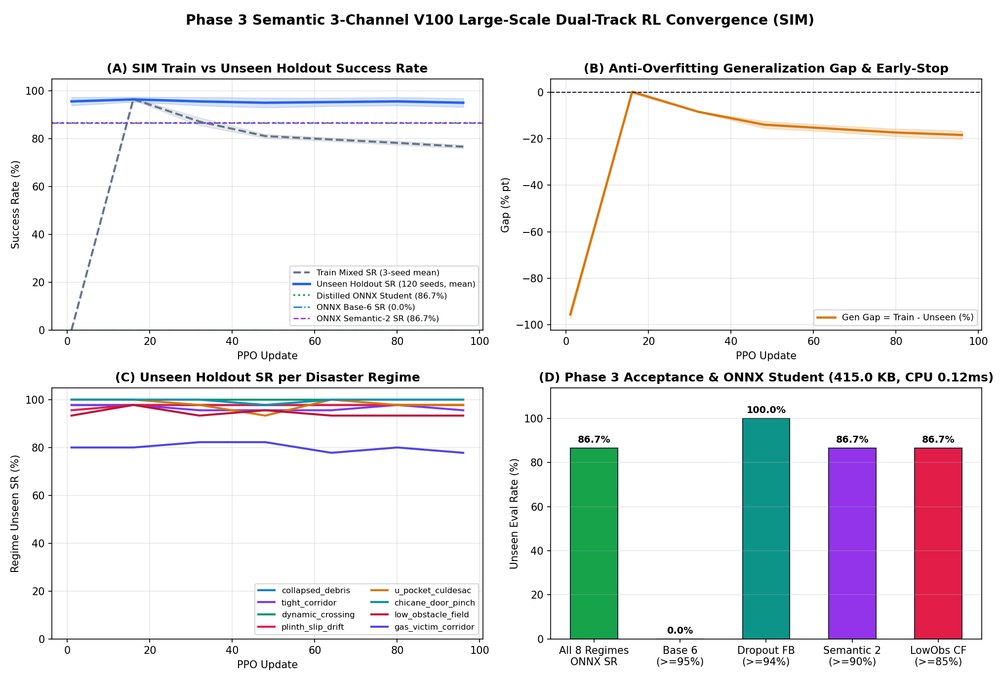 | 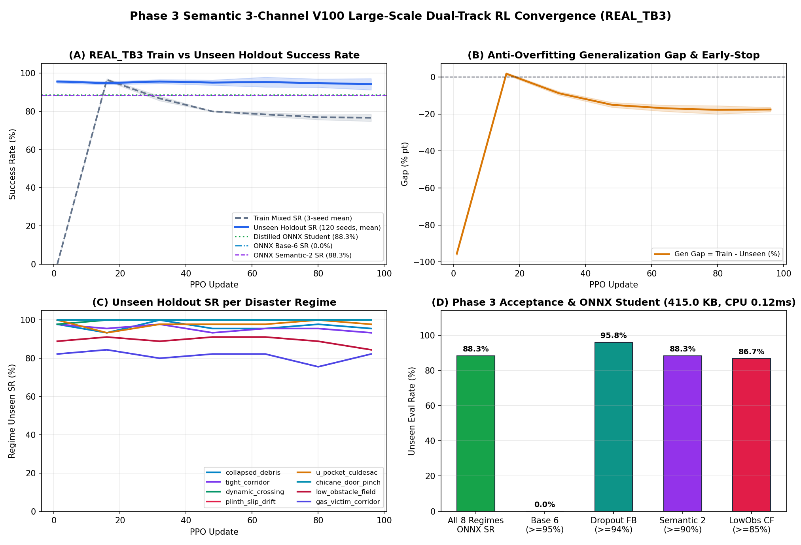 | 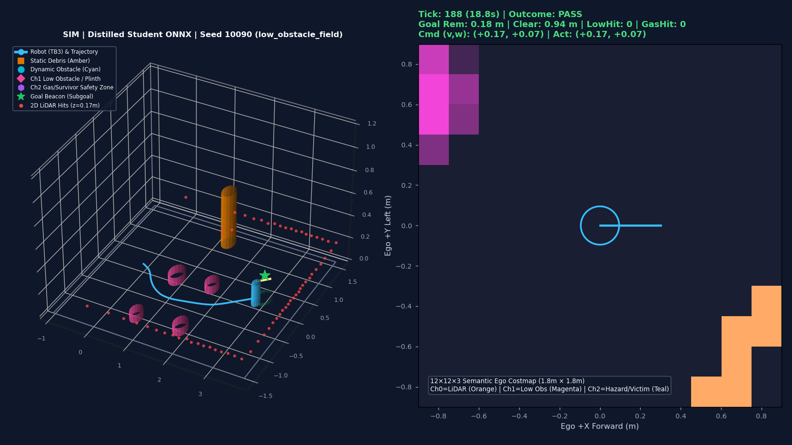 |

<details>
<summary><strong>[GIF] Phase 3 동일 시드(`seed=10118`) 3D 주행 진화 비교 (`Early` → `Mid` → `Final Student`) 펼쳐보기</strong></summary>

| `[GIF]` Early (`upd=0`, `LOW-OBS HIT (x6)`, `159 steps`) | `[GIF]` Mid (`upd=24 Teacher`, `PASS`, `213 steps`) | `[GIF]` Final Student ONNX (`Option 2`, `PASS`, `210 steps`) |
| :---: | :---: | :---: |
| 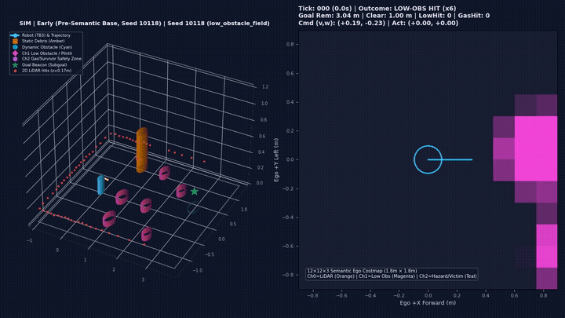 |  |  |

</details>

---

## 10. 하드웨어 구성

<p align="center">
  
  <br>
  <em>▲ 3D 프린팅 맞춤형 보호 외피(Outer Shell) 및 센서 마운팅 하드웨어 구상도</em>
</p>

| 구분 | 사양 |
| :--- | :--- |
| 로봇 | TurtleBot3 Burger (OpenCR 1.0 + Raspberry Pi 4 4GB) |
| LiDAR | LDS-01 (USB2LDS) |
| 카메라 | Raspberry Pi Camera Module (CSI, 640×480) — 케이블 배선상 90° 옆으로 장착, 소프트웨어에서 270° 회전 보정 |
| 가스 센서 | MQ-2 (5 V 구동) → 10k/20k 분압 → ADS1115 16-bit I2C ADC → RPi 4 |
| 마이크 | Generic AB13X USB Audio (card 1, device 0 = `plughw:1,0`, S16_LE · mono · 48 kHz) |
| Host PC (관제/로컬 시뮬) | Intel Core i7-8700 (6C/12T) / DDR4 16GB 2666MHz / NVIDIA GTX 1050 Ti 4GB / Windows 11 + WSL2 Ubuntu 22.04 / PyTorch 2.5.1 + CUDA 12.1 |
| 학습 서버 (대규모 RL) | Intel Core i9-10900X (10C/20T) / DDR4 256GB 2666MHz (Non-ECC) / NVIDIA Tesla V100-PCIE-32GB / Ubuntu 20.04.6 LTS Host + Ubuntu 22.04 Docker (ROS 2 Humble) — 병렬 시뮬 검증 & Dual-Track RL 학습 |

### 10.1 MQ-2 + ADS1115 회로

OpenCR은 TurtleBot3 순정 펌웨어(모터·`/odom`)를 그대로 유지하고, 가스 센서는 RPi 4의 I2C로 읽는다. ADS1115는 **반드시 3.3 V로 급전**한다 (RPi GPIO는 5 V 비허용).

```
 RPi Pin 1 (3.3V) ──── ADS1115 VDD
 RPi Pin 3 (SDA)  ──── ADS1115 SDA
 RPi Pin 5 (SCL)  ──── ADS1115 SCL
 RPi Pin 6 (GND)  ──┬─ ADS1115 GND, ADDR (→ 0x48)
                    ├─ MQ-2 GND
 RPi Pin 2 (5V)   ──┼─ MQ-2 VCC
                    │  MQ-2 AOUT ── [R1 10kΩ] ──┬── ADS1115 AIN0
                    │                          [R2 20kΩ]
                    └──────────────────────────┘

 V_AIN0 = V_out × 20k / (10k + 20k) ≤ 3.33 V   (ADS1115 허용: VDD + 0.3 V = 3.6 V)
 PGA = ±4.096 V, 128 SPS, 연속 변환
```

```bash
sudo apt install -y i2c-tools python3-smbus && sudo usermod -aG i2c $USER
i2cdetect -y 1        # 48 이 보여야 정상
```

상세 결선 및 카메라 캘리브레이션: [`docs/CIRCUIT_AND_CALIBRATION.md`](docs/CIRCUIT_AND_CALIBRATION.md)

---

## 11. 설치 및 테스트

### 11.1 공통 (Host PC · RPi 4) — `~/.bashrc`

```bash
source /opt/ros/humble/setup.bash
export ROS_DOMAIN_ID=0
export ROS_LOCALHOST_ONLY=0
export TURTLEBOT3_MODEL=burger
export LDS_MODEL=LDS-01          # RPi 4
```

### 11.2 Host PC (WSL2)

`C:\Users\<user>\.wslconfig`

```ini
[wsl2]
networkingMode=mirrored
dnsTunneling=true
firewall=true
autoProxy=true
```

```bash
# PowerShell: wsl --shutdown 후 WSL 재진입
sudo apt install -y ros-humble-desktop ros-humble-cv-bridge \
                    ros-humble-teleop-twist-keyboard ros-humble-camera-calibration \
                    ros-humble-turtlebot3-cartographer ros-humble-turtlebot3-gazebo
pip3 install torch torchvision --index-url https://download.pytorch.org/whl/cu121
pip3 install ultralytics faster-whisper
pip3 install "numpy==1.26.4" "opencv-python==4.10.0.84"     # cv_bridge(NumPy 1.x) 호환 고정
python3 -c "import torch; print(torch.cuda.is_available())"   # True 확인
```

> WSL2 내부에 Linux용 NVIDIA 드라이버를 설치하지 않는다. Windows 드라이버가 WSL로 전달된다.
>
> `yolo26n.pt`는 첫 실행 시 Ultralytics가 자동 다운로드한다 (저장소에는 포함하지 않음). NumPy 2.x가 설치되면 `cv_bridge` import가 실패하므로 위 버전 고정을 유지한다.

### 11.3 RPi 4

```bash
sudo apt install -y ros-humble-v4l2-camera ros-humble-cv-bridge python3-opencv \
                    ros-humble-image-transport-plugins \
                    python3-smbus i2c-tools alsa-utils
sudo usermod -aG i2c,audio $USER   # 재로그인 필요
arecord -l                          # card 1: AB13X USB Audio 확인 (번호가 다르면 alsa_device 수정)
```

### 11.4 빌드 (양쪽 모두)

```bash
mkdir -p ~/disaster_recovery_ws && cd ~/disaster_recovery_ws
git clone https://github.com/rjw136-lab/disaster_recovery_ws.git .
colcon build --symlink-install --packages-select disaster_recovery
source install/setup.bash
```

### 11.5 단위 테스트

```bash
source /opt/ros/humble/setup.bash && source install/setup.bash
python3 -m pytest -p no:anyio src/disaster_recovery/test -q   # ADS1115(8) + 하이브리드(9) + 로컬A*(9) + 시맨틱제어기(4) + 시맨틱매퍼(17) + 시맨틱RL(9) = 총 56개 전수 PASS
```

---

## 12. 실행

### 12.1 원터치 통합 실행 (권장)

```bash
# Host PC에서 실행: RPi 4 원격 브링업 + Host AI(YOLO26n + Whisper CUDA) + SLAM(RobotModel RViz2) + WASD 텔레옵
python3 scripts/host/start.py

python3 scripts/host/start.py --tmux             # tmux 3분할 콕핏 대시보드
python3 scripts/host/start.py --host-only        # 로봇 원격 기동 생략
python3 scripts/host/start.py --no-cartographer  # SLAM/RViz2 생략
python3 scripts/host/start.py --status           # 네트워크 및 노드 상태 점검
python3 scripts/host/stop.py                     # 전체 종료
```

### 12.2 단계별 수동 실행

| # | 기기 | 명령 |
| :-: | :--- | :--- |
| 1 | RPi 4 | `ros2 launch turtlebot3_bringup robot.launch.py` (또는 `bash scripts/rpi/start_all.sh`) |
| 2 | RPi 4 | `ros2 run camera_ros camera_node --ros-args -p width:=640 -p height:=480 -p format:=BGR888` (또는 `bash scripts/rpi/start_camera.sh`) |
| 3 | RPi 4 | `ros2 launch disaster_recovery robot_onboard.launch.py` |
| 4 | Host | `ros2 launch disaster_recovery host_station.launch.py` (RViz 동시 실행: `use_rviz:=true`) |
| 5 | Host | `python3 scripts/host/wasd_teleop.py topic:=/cmd_vel_remote` (또는 `teleop_twist_keyboard --ros-args -r cmd_vel:=/cmd_vel_remote`) |
| 6 | Host | `ros2 launch turtlebot3_cartographer cartographer.launch.py use_rviz:=false` + `ros2 run rviz2 rviz2 -d src/disaster_recovery/config/disaster_cartographer.rviz` |

> ⚠ 텔레옵은 반드시 `/cmd_vel_remote`로 리매핑한다. `/cmd_vel`에 직접 발행하면 워치독의 원격 명령 차단이 무력화된다.

상태 모니터링:

```bash
ros2 topic echo /recovery/status
ros2 topic echo /disaster/victim_alert
ros2 topic echo /disaster/audio_alert
```

### 12.3 `host_station.launch.py` 인자

| 인자 | 기본값 | 설명 |
| :--- | :-: | :--- |
| `yolo_model_path` | `yolo26n.pt` | YOLO 가중치 경로/이름 |
| `image_topic` | `/camera/image_raw/compressed` | 카메라 토픽 |
| `use_compressed` | `true` | `CompressedImage` 구독 (Wi-Fi 대역폭 절약) |
| `rotation_angle` | `270` | 영상 회전 (0/90/180/270) |
| `show_window` | `true` | OpenCV 탐지 창 표시 |
| `heartbeat_rate_hz` | `10.0` | Heartbeat 주기 |
| `confidence_threshold` | `0.40` | YOLO 추론 임계값 |
| `person_conf_threshold` | `0.55` | 조난자 알림 임계값 |
| `only_person_detection` | `false` | COCO class 0(person)만 추론 (`host_ai_pipeline` 노드 단독 기본값은 `True`) |
| `min_consecutive_detections` | `2` | 알림 발행에 필요한 연속 탐지 프레임 수 |
| `cuda_device` | `0` | GPU 번호 |
| `whisper_model_size` | `base` | Faster-Whisper 모델 크기 (tiny/base/small) |
| `whisper_device` | `cuda` | Whisper 연산 디바이스 (`cuda` INT8 기본, cuBLAS/cuDNN 프리로드 후 실패 시 `cpu` 자동 폴백) |
| `whisper_compute_type` | `int8` | Whisper 양자화 타입 (`int8`, `int8_float32`, `float32`) |
| `use_rviz` | `false` | `disaster_station.rviz`로 RViz2 동시 실행 |

> 참고: `host_ai_pipeline` 노드는 추가 내부 파라미터 `yolo_max_fps`(기본값 `15.0`)로 비전 추론 주기를 조절해 GPU/CPU 여유를 확보한다.

---

## 13. Gazebo 시뮬레이션

실차 없이 Host PC에서 **Phase 3 2D 시맨틱 SLAM(`semantic_map_node` · YOLO26n · `slam_toolbox`/Cartographer `/map`)** 과 **3채널 Context-RL 자율 복귀(`recovery_controller`)**, 15대 시나리오 엄격 무충돌 벤치마크를 검증하기 위한 환경이다.

### 13.1 인터랙티브 시뮬레이션 실행 (`sim.py`)

```bash
python3 scripts/host/sim.py                # 기본값: 지진 붕괴 건물 재난 맵 (--collapsed)
python3 scripts/host/sim.py --tunnel       # 지하 터널 재난 맵
python3 scripts/host/sim.py --house        # 방·복도 구조의 house 맵
python3 scripts/host/sim.py --maze         # 좁은 내부 격벽 미로 맵
python3 scripts/host/sim.py --world world  # 기본 turtlebot3_world 맵 (empty 가능)
python3 scripts/host/sim.py --yolo         # 가상 카메라(/camera/image_raw, rotation_angle:=0) + YOLO26n + semantic_map_node
python3 scripts/host/sim.py --no-slam      # SLAM/RViz 없이 실행
python3 scripts/host/sim.py --no-teleop    # 내장 텔레옵 비활성화
python3 scripts/host/sim.py --software     # GPU 가속 대신 llvmpipe 소프트웨어 렌더링 강제
python3 scripts/host/sim.py --headless     # gzclient 3D GUI 없이 물리 서버만 구동
python3 scripts/host/sim.py --stop         # 시뮬레이션 프로세스 일괄 종료
python3 scripts/host/start.py --sim        # start.py 경유 실행
```

| 키 | 동작 |
| :-: | :--- |
| `W` `A` `S` `D` | 전진 / 좌회전 / 후진 / 우회전 |
| `Space` | 정지 |
| `H` | Heartbeat 송신 중단 (통신 단절 재현 → 3초 후 Phase 3/2-B 자율 복귀 진입) |
| `R` | Heartbeat 복구 |
| `O` | 지나온 복귀 경로에 랜덤 붕괴 암석(`disaster_debris`) 3~6개 투하 / 일괄 제거 토글 |
| `Q` | 종료 |

### 13.2 엄격 무충돌 150-Trial 벤치마크 및 Phase 3 시맨틱 검증 재현

```bash
# 15대 재난 시나리오 엄격 무충돌(Strict Collision-Free) 벤치마크 (기본값: 무충돌 판정 활성)
python3 scripts/host/ab_disaster_benchmark.py --scenario collapsed --trials 10 \
  --proposed-strategy proposed_rl \
  --context-rl-onnx src/disaster_recovery/config/sim_policy_student_semantic_v3.onnx

# Phase 3 시맨틱 구조·회피 10-Trial A/B & 3패널 E2E /map+YOLO+좌표 녹화
python3 scripts/host/run_phase3_semantic_suite.py --mode check-yolo
python3 scripts/host/run_phase3_semantic_suite.py --mode ab10 --trials 10
python3 scripts/host/run_phase3_semantic_suite.py --mode record-e2e
python3 scripts/host/run_phase3_semantic_suite.py --mode record-ab
```

> WSL2(WSLg) 환경에서 `scripts/host/sim.py`는 `MESA_D3D12_DEFAULT_ADAPTER_NAME=NVIDIA`를 설정해 Direct3D12 GPU 가속으로 `gzclient`와 `rviz2`를 구동하며(`--software`로 `llvmpipe` 강제 가능), Docker/Xvfb 헤드리스 녹화 시에는 `unset QT_QPA_PLATFORM_PLUGIN_PATH QT_PLUGIN_PATH` 및 `vglrun -d egl`로 Tesla V100 EGL 가속을 사용한다.

---

## 14. ROS 2 인터페이스 및 파라미터

### 14.1 토픽 · 서비스

| 토픽 | 타입 | 발행 → 구독 |
| :--- | :--- | :--- |
| `/heartbeat` | `std_msgs/Header` | host_ai_pipeline → recovery_controller (10 Hz) |
| `/cmd_vel_remote` | `geometry_msgs/Twist` | teleop → recovery_controller |
| `/cmd_vel` | `geometry_msgs/Twist` | recovery_controller, aruco_docking → turtlebot3_node |
| `/odom` | `nav_msgs/Odometry` | turtlebot3_node → recovery_controller, blackbox |
| `/scan` | `sensor_msgs/LaserScan` | LDS-01 → recovery_controller, blackbox |
| `/gas/level` | `std_msgs/Float32` | gas_sensor_node → recovery_controller, blackbox (예열·기준 측정 후 발행) |
| `/gas/voltage` | `std_msgs/Float32` | gas_sensor_node → (모니터링) MQ-2 출력 전압 |
| `/gas/rs_ro` | `std_msgs/Float32` | gas_sensor_node → (모니터링) 데이터시트 ppm 곡선용 Rs/Ro |
| `/gas/sensor_ok` | `std_msgs/Bool` | gas_sensor_node → (모니터링) I2C 읽기 실패 시 false |
| `/camera/image_raw` | `sensor_msgs/Image` | v4l2_camera → aruco_docking, blackbox |
| `/camera/image_raw/compressed` | `sensor_msgs/CompressedImage` | image_transport → host_ai_pipeline (BEST_EFFORT, depth 1) |
| `/camera/camera_info` | `sensor_msgs/CameraInfo` | v4l2_camera → aruco_docking |
| `/detection/image` | `sensor_msgs/Image` | host_ai_pipeline → RViz2 (바운딩 박스 + SURVIVOR 배너) |
| `/audio/raw` | `std_msgs/UInt8MultiArray` | audio_capture_node → host_ai_pipeline (48 kHz S16_LE mono, 0.5 s/msg) |
| `/aruco/debug_image` | `sensor_msgs/Image` | aruco_docking → (모니터링) |
| `/aruco/dock_trigger` | `std_msgs/Bool` | recovery_controller → aruco_docking |
| `/aruco/dock_complete` | `std_msgs/Bool` | aruco_docking → recovery_controller |
| `/blackbox/trigger` | `std_msgs/Bool` | recovery_controller → blackbox_recorder |
| `/recovery/status` | `std_msgs/String` | recovery_controller → (모니터링) |
| `/disaster/victim_alert` | `std_msgs/String` | host_ai_pipeline → (관제) |
| `/disaster/audio_alert` | `std_msgs/String` | host_ai_pipeline → (관제) |
| `/detection/objects` | `std_msgs/String` | host_ai_pipeline → semantic_map_node (YOLO 감지 객체 JSON + stamp) |
| `/semantic_map/markers` | `visualization_msgs/MarkerArray` | semantic_map_node → RViz2 (조난자·장애물·가스·음성 4종 영구 마커) |
| `/semantic_map/cached_objects` | `std_msgs/String` | semantic_map_node → recovery_controller (RPi 4 온보드 캐시 동기화) |
| `/semantic_map/save_map` | `std_srvs/srv/Trigger` | 관제/사용자 → semantic_map_node (raw_map, yaml, json, overlay 4종 아티팩트 저장 서비스) |

### 14.2 주요 파라미터

<details>
<summary><strong><code>recovery_params.yaml</code> 파라미터 표 펼쳐보기</strong></summary>

[`config/recovery_params.yaml`](src/disaster_recovery/config/recovery_params.yaml) (시뮬레이션 YAML 기준; `--params-file` 미지정 시 [`recovery_controller.py`](src/disaster_recovery/disaster_recovery/recovery_controller.py)·[`aruco_docking.py`](src/disaster_recovery/disaster_recovery/aruco_docking.py) 코드 내장 폴백 기본값 및 실차 [`config/recovery_params_real.yaml`](src/disaster_recovery/config/recovery_params_real.yaml) 값을 함께 표기)

| 파라미터 | 기본값 (`recovery_params.yaml` / 실차 YAML / 코드 폴백) | 의미 |
| :--- | :-: | :--- |
| `heartbeat_timeout_sec` | 3.0 | 통신 단절 판정 시간 |
| `gas_threshold` | 0.40 | 가스 위험 판정값 (`1 − Rs/Rs_air`, ppm 아님 · 현장 보정 필요) |
| `gas_stale_timeout_sec` / `gas_stale_triggers_recovery` | 2.0 / false | `/gas/level` 끊김 경고 / 끊김 시 복귀 여부 |
| `warmup_sec` / `baseline_samples` | 60 / 100 | MQ-2 예열 시간 / 기준 측정 샘플 수 |
| `rs_air_kohm` | 0.0 | 0보다 크면 저장된 기준값 재사용 |
| `log_dist_threshold_m` / `log_angle_threshold_deg` | 0.30 / 25.0 | 경유지 기록 간격 (거리 / 회전) |
| `waypoint_reach_radius_m` / `heading_tolerance_rad` | 0.10 / 0.12 (실차 `0.12 / 0.12`, 코드 폴백 `0.08 / 0.08`) | 경유지 도달 판정 반경 / 정렬 허용 각도 |
| `linear_speed_max` / `angular_speed_max` | 0.20 / 0.65 (실차 `0.15 / 0.55`, 코드 폴백 `0.12 / 0.45`) | 복귀 속도 상한 (m/s, rad/s) |
| `kp_linear` / `kp_angular` | 0.60 / 1.40 (실차 `0.55 / 1.30`, 코드 폴백 `0.50 / 1.20`) | 직진 / 회전 비례 제어 게인 |
| `lidar_min_range_m` / `lidar_max_danger_range_m` | 0.12 / 0.25 (실차 `0.12 / 0.28`) | 정지 거리 구간 |
| `lidar_fov_half_deg` | 20.0 (실차 `22.0`) | 전방 감시 반각 |
| `local_grid_size_m` / `local_grid_res_m` / `local_grid_inflation_m` | 6.0 / 0.04 / 0.085 (실차 팽창 `0.095`) | `RollingLocalGrid` 런타임 크기(`6.0m×6.0m`) · 해상도 · 팽창 반경 |
| `docking_start_distance_m` | 0.50 | ArUco 도킹 전환 거리 |
| `enable_scan_matching` | true | 2D ICP 스캔 매칭 보정 활성화 |
| `scan_match_weight` | 0.40 | 상보필터 가중치 (0 = 오도메트리만, 1 = 라이다만) |
| `scan_match_max_dist_m` | 0.45 (코드 폴백 `0.40`) | ICP 매칭 발동 반경 |
| `enable_hybrid_tracking` / `lookahead_dist_m` | true / 0.45 | Regulated Pure Pursuit 연속 추종 / 전방 주시 거리 |
| `enable_td3_avoidance` / `td3_clearance_dist_m` | true / 0.42 (코드 폴백 `0.38`) | Residual TD3 국소 우회 / 장애물 회피 반경 |
| `td3_max_avoid_steps` | 250 (코드 폴백 `150`) | TD3 우회 최대 스텝 수 (10 Hz 기준 25초) |
| `use_semantic_rl_policy` | false | `true` 시 Phase 3 3채널 시맨틱 RL 정책 활성화 (`false` = Phase 2-B 1채널 기본) |
| `semantic_rl_onnx_path` | `""` | 비어 있으면 시뮬 `sim_policy_student_semantic_v3.onnx` / 실차 `real_tb3_policy_student_semantic_v3.onnx` 자동 탐색 |
| `use_aruco_docking` | false (실차·코드 폴백 `true`) | `true` 시 ArUco 도킹 전환 (`sim.py --yolo`는 `true` 오버라이드) |
| `aruco_docking_timeout_sec` | 12.0 | 제어기 측 도킹 2차 백업 타임아웃 |
| `search_timeout_sec` (aruco_docking) | 10.0 | 마커 미감지 시 미션 완료 처리까지의 시간 |
| `marker_size_m` / `target_dock_dist_m` | 0.10 (시뮬) · 0.05 (실차) / 0.20 | ArUco 마커 한 변 크기(시뮬 `10 cm` / 실차 `5 cm`) / 마커 앞 정지 거리 |
| `camera_rotation_deg` (aruco_docking) | 270 (코드 폴백 `0`) | 카메라 장착 회전 보정 |
| `alsa_device` / `sample_rate` (audio_capture_node) | `plughw:1,0` / 48000 | USB 마이크 장치 / 샘플레이트 |
| `chunk_duration_sec` (audio_capture_node) | 0.5 | `/audio/raw` 메시지 1개 길이 |

Host AI 파라미터 (`host_ai_pipeline` 코드 기본값): `yolo_max_fps=15.0`, `whisper_device='cuda'`, `whisper_compute_type='int8'`, `audio_sample_rate=48000`, `sample_rate_hz=16000`, `audio_buffer_sec=2.0`(50% 중첩), `voice_activity_threshold=0.012`(RMS).  
시맨틱 매핑 파라미터 상세(`cluster_radius_m=0.45`, `ch1_obstacle_radius_m=0.22`, `ch2_hazard_radius_m=0.55` 등): [`config/semantic_map_params.yaml`](src/disaster_recovery/config/semantic_map_params.yaml) · 실차 보수적 프로파일: [`config/recovery_params_real.yaml`](src/disaster_recovery/config/recovery_params_real.yaml).

</details>

---

## 15. 알려진 한계 및 해결 이슈

본 저장소는 실차 검증 및 고도화가 진행 중인 프로토타입이다.

**현재 남아 있는 한계 및 향후 과제**

1. **도킹 기하 가정**: 마커가 출발 위치 정면 벽에 있다고 가정한다. 출발 자세와 마커의 상대 위치는 현장에서 실측해 `target_dock_dist_m`을 조정해야 한다.
2. **가스 센서 미결선**: 회로 설계와 드라이버는 완료되었으나 실물 결선 전이므로 `gas_stale_triggers_recovery: false`로 둔다.
3. **블랙박스 Wi-Fi 스트리밍 차단 미구현**: 현재는 로컬 기록만 시작한다.
4. **통신 단절 중 신규 조난자 비전 탐지 불가 (YOLO Host 의존성)**: `host_ai_pipeline`(YOLO26n)은 Host PC에서 실행되므로, 통신 단절 이후(Return 단계) 시야에 새로 등장한 조난자를 실시간 탐지할 수 없다. 단절 직전까지 `/semantic_map/cached_objects`로 백업된 조난자·저상 장애물 좌표 유지 및 온보드 MQ-2(`/gas/level`) 실시간 가스 감지만 수행하며, 완전 단절 심부 탐지 확장을 위해서는 RPi 4 온보드 경량 비전 가속기(예: NPU/Hailo) 탑재가 필요하다.
5. **실물 TurtleBot3 Burger Track B 필드 실증 예정**: V100 Clean Phase 2-B(`150회 엄격 96/150 = 64.0% / 도착 140/150 = 93.3%`) 및 Phase 3 Option 2(`150회 엄격 96/150 = 64.0% / 도착 141/150 = 94.0%`, 현 `415.0 KB` ONNX `Ch1=Ch2=0` `max_abs_diff = 0.0`, 10-Trial 시맨틱 A/B 엄격 무위험 `9/10` · 위반 `0회`) 검증을 완료했다. 실물 RPi 4 온보드 환경에서의 Track B(`real_tb3_policy_student_semantic_v3.onnx`, `415.0 KB`, x86 CPU `0.124 ms`) 추론 지연 실측 및 현장 주행은 실물 결합 시험에서 수행 예정이다.
6. **150-Trial 클린 벤치마크 잔여 충돌 병목 (Known Bottlenecks)**: Option 2 기준 실패 54건 중 45건이 기지 도착 후 복귀 중 `lidar_collision`(총 53건, `min_scan_m = 0.120 m`)으로 판정되었으며, 근접 구간 `alpha_rl = 0.0` 게이팅에 따른 로컬 플래너 수렴과 교차 동적 장애물 측면 회피 부재가 주원인이다(세부 수치 및 원인 분석은 [§6.2](#62-150회-엄격-무충돌-비퇴행-벤치마크-clean-150-trial-audit) 참조).
7. **절차적 환경 잔여 가스 침범률(`real_tb3` TEST 26.7%)**: PPO 쉴드 페널티·`hard_sem` 하드 배리어·`VAL/TEST` 분리·연속 `sem_prox` 적용으로 `real_tb3` `gas_hazard_free_rate`가 `60.0% → 73.3%`(Gazebo `ab10` `9/10` · 가스 위반 `0회`)로 개선되었으나, `1.8×1.8 m` 로컬 패치 시야 한계와 고정 16스텝(1.6초) 단기 윈도우 1D-TCN 문맥으로 인해 절차적 가스 회랑 테스트의 `26.7%`에서는 경계 진입이 남는다.
8. **향후 과제 (Next Steps — 미검증 개선안)**:
   - `local_grid_planner.py`의 협소 폴백 팽창 반경(`tight_radius_m`) 상향, `_sector_clearances` 사각지대(`±18°~24°`, `±95°~145°`) 보완, `step()` 내 측면/대각선 근접 반발 가드 추가는 현재 미검증 상태이며 향후 로컬 플래너 고도화 과제로 분리한다.
   - 동적 장애물 속도·궤적 예측(`Ch3`) 및 장기 순환 상태 추론·위험 민감 RL·Soft-CBF-QP 확장은 [`docs/Phase4_후속_연구_방향_검토_및_설계.md`](docs/Phase4_후속_연구_방향_검토_및_설계.md) 및 [`docs/Phase4_재검증_연구설계_및_구현계획.md`](docs/Phase4_재검증_연구설계_및_구현계획.md)에 정리했다.

<details>
<summary><strong>해결된 이슈 (26건) 펼쳐보기</strong></summary>

| 이슈 | 해결 방법 |
| :--- | :--- |
| Option 2 쉴드 마스킹·`0.88` 소프트 블렌드 잔존·평가 시드 선택 편향·제어기 `has_nearby_sem` 불리언 분기 | PPO 쉴드 개입 페널티 + `hard_sem` 하드 배리어(`w_blend → 0`) + `VAL_SEEDS(10000..10119)`/`TEST_SEEDS(20000..20119)` 분리 + `recovery_controller.py` 연속 `sem_prox ∈ [0, 1]` 램프 적용 |
| Phase 3 초기 3-Ch 미세조정(`v3`)의 비시맨틱 환경(`Ch1=Ch2=0`) 엄격 무충돌 퇴행 (`58.0%`) | **Option 2**(동결 Phase 2-B 백본 + Pre-Tanh Zero-Gated Residual + 후단 25-ray Safety Shield) 채택·재학습으로 `Ch1=Ch2=0`에서 `max_abs_diff = 0.0` 완전 일치 복원 및 Clean 150회 엄격 무충돌 `96/150 (64.0%)` 검증 (`phase2b_strict_clean` `96/150 (64.0%)`과 완전 비퇴행 일치) |
| Phase 2 고정 블렌딩(`0.70·RL`)의 `house` 협소 문틀 진동·지체 | 섹터 여유 거리·협소 패스 여부 기반 **Clearance-Gated Blending** 및 `ESCAPE` 중 시계열 버퍼 유지로 재학습 없이 **`48/50 (96.0%)`**, `house` `8/10 → 9/10` |
| Phase 1 `house` `~0.28m` 틈새 과차단 & Phase 2 RL 수렴 정체·앙상블 상쇄 | `_virtual_obstacles` `±0.03m`/9s 튜닝으로 **5대 환경 `49/50 (98.0%)`** 달성; Phase 2 V100 **`ret_norm=25` + `nav_dist` + 선택적 DAgger 증류**로 `sim`/`real_tb3` ONNX 추출 및 **공식 Gazebo S2S `47/50 (94.0%)`** 검증 완료 (`#30~#36`) |
| 붕괴 건물 교착 및 다회차 `corr_y` 오프셋 누적 | `/recovery/reset_episode`로 에피소드 상태 초기화 및 `RollingLocalGrid(0.04m) + 2D A* + 위상 지름길 + ESCAPE` 도입 |
| 저상 장애물·벽 너머 단축 및 전방 밀착 정지 | 진입(`NORMAL_TELEOP`) 선행 관측, 실내 벽 너머 단축 차단, 전방 unpin 및 `_virtual_obstacles` 가상 접촉 장벽 추가 |
| 병렬 벤치마크 포트 충돌 및 `/home/lab` 경로 하드코딩 | `--gz-port` / `--ros-domain-id` 워커별 격리 및 7개 파일 동적 경로 탐색 전환 |
| 복귀로 상 신규 낙하 잔해 앞 영구 대기 | 초경량 TD3 연속 제어 국소 우회(Layer 2) 및 2D ICP 슬립 소거(Layer 3)를 연동한 4계층 하이브리드 아키텍처 구현 및 회피 복귀 검증 완료 |
| OpenCR 펌웨어 충돌 | MQ-2를 ADS1115(I2C)로 RPi 4에 직결, OpenCR은 순정 펌웨어 유지 |
| `audio_capture_node` 스텁 | `arecord` 기반 48 kHz PCM 스트리밍 및 Host 측 VAD + Whisper 연동 구현 |
| 바퀴 슬립 누적 오차 | 2D ICP 스캔 매칭 구현. 이후 초기 추정값 부호 오류와 `/odom` 수신 시 보정값이 덮어써지는 문제를 수정하고 지속형 SE(2) 오프셋 방식으로 변경 |
| ArUco 마커 부재 시 무한 회전 | 10초 타임아웃 세이프티 가드 추가 |
| 다중 터미널 수동 실행 | `start.py` / `stop.py` 원터치 실행·종료 |
| WSL2 Gazebo 렌더링 및 호환성 | `sim.py` 기본 모드를 WSLg `MESA_D3D12_DEFAULT_ADAPTER_NAME=NVIDIA` 하드웨어 GPU 가속으로 전환하고, 드라이버 호환 문제 시 `--software`(`llvmpipe`) 폴백 지원 |
| Faster-Whisper CPU 전용 실행 지연 | `_preload_nvidia_cuda_libs()`로 pip cuBLAS/cuDNN 프리로드 후 CUDA INT8 GPU 가속 적용 (미가용 시 CPU 자동 폴백) |
| RViz2 터틀봇3 3D 모델 미표시 & YOLO CPU 병목 | `disaster_cartographer.rviz`(`RobotModel` + `/robot_description`) 분리 적용 및 `yolo_max_fps=15.0` 추론 상한 도입 |
| Gazebo 런치 월드 경로 하드코딩 | `disaster_world.launch.py` 신규 제작을 통해 다중 월드 및 초기 위치 인자 동적 바인딩 |
| 대형 복합 메쉬 월드 엔티티 스폰 실패 | 19개 메쉬 로딩 지연 대응 `spawn_entity.py -timeout 120.0` 플래그 적용 |
| 근거리 웨이포인트 제자리 회전 발산 | `d ≤ 0.08 m` 도달 시 즉시 pop 및 불감대 예외 처리로 `atan2` 특이점 진동 해소 |
| 타임아웃 발생 후 제어기 상태 데드락 | Heartbeat 1.2초 이상 연속 정상 수신 시 `NORMAL_TELEOP`으로 완전 복구하는 글로벌 리셋 워치독 구현 |
| 터널 노면 휠슬립 외부 측정 왜곡 | `/recovery/status`에 ICP 보정 좌표계(`POSE:x,y,th`) 실시간 브로드캐스팅 동기화 |
| RViz2 SLAM 점유 격자 지도 미동기화 (검은 화면) | Cartographer `occupancy_grid_node`의 `/map` 토픽이 `Durability: Volatile`인데 반해, RViz2 설정이 `Transient Local`로 지정되어 발생한 ROS 2 DDS QoS 정책 충돌을 진단하고, `disaster_station.rviz` 및 RViz 설정을 `Volatile`로 동기화하여 실시간 맵 렌더링 정상화 |
| 터널 +Y 축 주행 시 횡방향 조향 부호 역전 (우측 벽 쏠림) | Gazebo 터널 좌표계에서 로봇이 +Y(헤딩 `π/2`) 방향으로 전진할 때 `-X`가 좌측, `+X`가 우측임에 따라 단순 횡오차(`e_x`) 적용 시 조향이 역전되던 문제를 헤딩 기반 스탠리 조향(`θ_target = 1.57 + 0.45(x - x_target)`)으로 전환하여 중앙 차선(`x = -0.75`) 정밀 추종 달성 |
| Gazebo 시뮬레이션 중 동적 낙석(Debris) 런타임 투하/삭제 | 물리 월드 재기동 없이 통신 단절 시점마다 `gazebo_ros spawn_entity.py` 및 `/delete_entity` 서비스 호출을 결합하고, 로컬호스트 도메인 환경변수를 주입하여 실시간 낙석 투하 및 라이다 회피 연동 검증 |
| ROS 2 백그라운드 데몬 XML-RPC 소켓 타임아웃 (`Errno 110`) | 반복된 CLI 호출로 백그라운드 데몬 응답 지연 발생 시 `pkill -9 -f "ros2.*daemon"` 자동 플러시 및 `--no-daemon` 플래그/직접 rclpy 노드 통신을 적용하여 무중단 연속 벤치마크 안정화 |
| 국소 회피 제어기(TD3) 스텝 버짓 초과 후 무한 정지 데드락 | 복합 낙석 구간에서 회피 스텝 한도 초과 시 `OBSTACLE_HOLD`로 멈추던 구조를 보완하여, `td3_max_avoid_steps`를 250스텝(25초)으로 확장하고 스텝 만료 시 2D ICP 보정 후 다음 웨이포인트로 자동 전진(Pop)하여 복귀 지속 처리 |

</details>

---

## 16. 필드 테스트

전체 체크리스트: [`docs/FIELD_TEST_CHECKLIST.md`](docs/FIELD_TEST_CHECKLIST.md)

- [ ] 텔레옵 주행 중 `[ODOM LOGGER] Recorded Waypoint` 로그가 0.3 m / 25° 간격으로 출력되는가
- [ ] Host PC의 `host_station.launch.py`를 `Ctrl+C`로 종료하면 약 3초 후 정지하는가
- [ ] 정지 이후 텔레옵 키 입력이 무시되는가
- [ ] `~/blackbox_logs/session_*/`에 mp4·csv가 생성되는가
- [ ] 제자리 회전 → 직진으로 경유지를 역순 추종하는가
- [ ] 복귀 중 `[LIDAR SCAN MATCH]` 로그가 출력되는가
- [ ] 복귀 중 전방 약 15 cm에 장애물을 두면 정지하고, 치우면 재개하는가
- [ ] 원점 0.5 m 이내에서 ArUco 도킹으로 전환되고 최종 위치가 출발점 15 cm 이내인가
- [ ] 라이터 가스(점화 금지)를 MQ-2에 근접시켰을 때 동일한 복귀 시퀀스가 시작되는가
- [x] Host 탐지 창/`/detection/image`가 정방향(270° 보정)으로 표시되고 사람 앞에서 `SURVIVOR LOCATED` 배너가 뜨는가
- [ ] 마이크 앞에서 "살려주세요"라고 말하면 `/disaster/audio_alert`가 발행되는가

---

## 17. 저장소 구조

<details>
<summary><strong>디렉터리 트리 펼쳐보기</strong></summary>

```
disaster_recovery_ws/
├── README.md
├── CHANGELOG.md                         # 초기 업로드~최신 전체 누적 변경 이력
├── LICENSE
├── scripts/
│   ├── host/                            # Host PC 관제·AI·시뮬레이션·벤치마크 스크립트
│   │   ├── start.py                     # 원터치 통합 런처 (--sim, --rviz, --tmux, --stop 등)
│   │   ├── stop.py                      # 호스트 + 로봇 프로세스 일괄 종료
│   │   ├── sim.py                       # Gazebo + SLAM + 복귀 제어기 + 랜덤 낙석([O]키) 시뮬레이터
│   │   ├── wasd_teleop.py               # WASD 텔레옵 (/cmd_vel_remote 발행)
│   │   ├── ab_disaster_benchmark.py     # 15대 재난 시나리오 고정 시드 A/B·RL S2S 하네스 (--gz-port, --ros-domain-id)
│   │   ├── plot_ab_comparison.py        # 5대 환경 맵·KPI·10회 궤적 비교 시각화 생성기
│   │   ├── record_3d_evidence.py        # Gazebo 3D + RViz2(slam_toolbox /map) 30 FPS .mp4/.png 증거 캡처기
│   │   ├── refresh_visual_evidence.sh   # 대표 10편 3D 증거 영상 일괄 재녹화
│   │   ├── start_novnc_gui.sh           # 브라우저(noVNC) 기반 GPU 가속 Gazebo/RViz2 원격 GUI
│   │   ├── train_phase2_v100.py         # V100 Dual-Track PPO+PLR 대규모 학습 & 선택적 DAgger ONNX 증류기
│   │   ├── render_option2_evolution_gifs.py # 동일 시드 Early/Mid/Final Student 3D 진화 GIF 렌더러
│   │   ├── rl_procedural_env.py         # CUDA 벡터 절차적 재난 시뮬레이터 (SIM_TRACK / REAL_TB3_TRACK)
│   │   ├── sync_to_gdrive.sh            # /hdd 증거 영상·그래프·JSON Google Drive 자동 동기화
│   │   ├── world_map_geometry.py        # Gazebo .world/.sdf/.dae/.obj 충돌 벽체 단면 추출기
│   │   ├── auto_disaster_trials.py      # Gazebo 다회차 자율복귀 & 동적 낙석 자동 벤치마크
│   │   ├── debris_utils.py              # Gazebo 동적 붕괴 암석 스폰/정리 유틸리티 (도메인 격리 · 좀비 차단)
│   │   ├── plot_tunnel_trials.py        # 터널 벤치마크 궤적·오차 고해상도 시각화 스크립트
│   │   ├── train_td3.py                 # Phase 1.5 TD3 국소 회피 제어기 DRL 학습 & ONNX 변환기
│   │   ├── verify_hybrid_recovery.py    # 초기 개발 단계 4개 비교군 50회 검증 스크립트 (아카이브)
│   │   └── verify_extreme_stress.py     # 다중 낙석·고슬립·라이다 노이즈 극한 스트레스 검증기
│   └── rpi/                             # RPi 4 온보드 실행·보조 스크립트
│       ├── start.py / stop.py           # 로봇 단독 올인원 기동 / 종료 스크립트
│       ├── start_all.sh / stop_all.sh   # Bringup + camera_ros + 복귀 패키지 일괄 실행/종료
│       ├── start_camera.sh              # camera_ros (640x480 @ 30 FPS)
│       ├── start_audio.sh               # AB13X USB 마이크 캡처 노드
│       ├── aruco_detector.py            # ArUco 3D 포즈 추정 & 웹 스트리밍 보조 스크립트
│       ├── audio_capture_node.py        # 단독 실행용 USB 마이크 캡처 노드
│       └── generate_marker.py           # ArUco 마커 이미지 생성기
├── docs/
│   ├── DISASTER_RECOVERY_GUIDEBOOK.md   # 종합 설계 문서
│   ├── WSL_NETWORK_SETUP.md             # 미러드 네트워킹, ROS 2, CUDA 설정
│   ├── CIRCUIT_AND_CALIBRATION.md       # MQ-2 분압 회로 및 카메라 캘리브레이션
│   ├── FIELD_TEST_CHECKLIST.md          # 실행 순서 및 검증 체크리스트
│   ├── TURTLEBOT3_ARUCO_GUIDE.md        # ArUco 마커 생성 및 도킹 가이드
│   ├── PATENT_ANALYSIS_AND_PRIOR_ART.md # 선행 특허 분석 보고서
│   ├── 2D_라이다_스캔매칭_및_자율복귀_보고서.md
│   ├── 2026-11-10_통신단절_재난대응_터틀봇3_프로젝트_시도내역_및_트러블슈팅_총정리.md
│   ├── 붕괴건물_15회_자율복귀_벤치마크_분석보고서.md
│   ├── 알고리즘_및_강화학습_기법_단계별_변천사.md
│   ├── 재난환경_자율복귀_알고리즘_원리_해설_및_보고서.md
│   ├── 차세대_고도화_시맨틱_SLAM_및_RL_재학습_계획.md
│   ├── Phase4_후속_연구_방향_검토_및_설계.md
│   ├── Phase4_재검증_연구설계_및_구현계획.md
│   ├── Disaster_Recovery_TurtleBot3_Integration_Report.{md,docx}
│   └── images/                          # 배너, 3D 쉘, A/B 그래프 & evidence[,_v3,_v4]/(3D 스냅샷·데모 GIF·Option 2 학습 곡선)
├── benchmark_results/                   # phase2b_strict_clean · phase3_option2_clean · phase3_semantic_v3 결과 JSON
└── src/disaster_recovery/
    ├── package.xml / setup.py / setup.cfg
    ├── config/
    │   ├── recovery_params.yaml         # 시뮬레이션 기본 파라미터 (로컬 A*, 1ch/3ch RL ONNX, ICP, 도킹)
    │   ├── recovery_params_real.yaml    # 실물 TurtleBot3 Burger(Track B) 보수적 안전 프로파일
    │   ├── semantic_map_params.yaml     # Phase 3 단안-LiDAR 투영·마커 승격·위험 반경 파라미터
    │   ├── debris_obstacle.sdf          # Gazebo 시뮬레이션용 낙하 붕괴 잔해(Debris) SDF 모델
    │   ├── sim_policy_student.onnx      # Phase 2-B Track A 시뮬용 1ch 신경망 (231.6 KB)
    │   ├── real_tb3_policy_student.onnx # Phase 2-B Track B 실물 TB3용 1ch 신경망 (231.6 KB)
    │   ├── sim_policy_student_semantic_v3.onnx      # Phase 3 Option 2 Track A 시뮬용 3ch 신경망 (415.0 KB, frozen_residual)
    │   ├── real_tb3_policy_student_semantic_v3.onnx # Phase 3 Option 2 Track B 실물 TB3용 3ch 신경망 (415.0 KB, frozen_residual)
    │   ├── recovery_td3.onnx            # Phase 1.5 TD3 Baseline ONNX 신경망 (99.1 KB)
    │   ├── recovery_td3.pth             # PyTorch 학습 가중치 체크포인트
    │   ├── camera_info_sample.yaml      # 예시값 (직접 캘리브레이션 값으로 교체 권장)
    │   ├── disaster_cartographer.rviz   # SLAM + RobotModel (/robot_description) RViz2 레이아웃
    │   └── disaster_station.rviz        # AI 영상·시맨틱 마커 포함 관제용 RViz2 레이아웃
    ├── launch/
    │   ├── disaster_world.launch.py     # 다중 재난 월드 + 커스텀 버거 모델 스폰 런치
    │   ├── robot_onboard.launch.py      # RPi 4 온보드 기본 런치 (recovery / aruco / gas / blackbox / audio)
    │   ├── robot_onboard_real.launch.py # 실물 TurtleBot3 Burger(Track B) 전용 온보드 런치
    │   └── host_station.launch.py       # Host PC (AI 파이프라인 · semantic_map_node · use_rviz)
    ├── models/turtlebot3_burger/        # LiDAR <visualize>true</visualize> 및 카메라 포함 SDF
    ├── worlds/                          # 붕괴 건물·터널·하우스·미로·U포켓·시케인·교차로·연기 등 Gazebo 월드 (10종)
    ├── disaster_recovery/
    │   ├── recovery_controller.py       # 계층형 복귀 제어기 (로컬 격자 A* · 1ch/3ch RL · Pure Pursuit · 2D ICP · LIFO)
    │   ├── local_grid_planner.py        # RollingLocalGrid(0.04m) + 2D A* + 위상 지름길 + ESCAPE/_virtual_obstacles
    │   ├── rl_context_policy.py         # 16스텝 시계열 + 1ch/3ch 12×12 Ego 코스트맵 ONNX 추론기 (`ContextRLStudentPolicy`)
    │   ├── semantic_mapper_core.py      # 단안 RGB-2D LiDAR 투영 퓨전(Eq.3 보정·270° CCW·전경 클러스터링·Alg.1/2)
    │   ├── semantic_map_node.py         # ROS 2 시맨틱 SLAM 관제 노드 (/semantic_map/markers·cached_objects·save_map)
    │   ├── td3_policy.py                # 28차원 상태 추출기 및 TD3 ONNX 엣지 추론 엔진
    │   ├── aruco_docking.py             # solvePnP 도킹 P-제어 + 10초 세이프티 가드
    │   ├── host_ai_pipeline.py          # YOLO26n(15 FPS 안정화) + Faster-Whisper(CUDA INT8) + Heartbeat 10Hz
    │   ├── gas_sensor_node.py           # ADS1115 → EMA → /gas/level
    │   ├── ads1115_mq2.py               # ADS1115 드라이버 + MQ-2 계산 (ROS 비의존)
    │   ├── blackbox_recorder.py         # MicroSD 영상·CSV 기록
    │   └── audio_capture_node.py        # arecord → /audio/raw
    └── test/
        ├── test_ads1115_mq2.py          # ADS1115/MQ-2 단위 테스트 (8개)
        ├── test_hybrid_recovery.py      # 2D ICP, TD3, Dual-ONNX 지연, Clearance-Gate, 실차 프로파일 테스트 (9개)
        ├── test_local_grid_planner.py   # RollingLocalGrid, A*, 지름길, 가상 접촉 장벽 테스트 (9개)
        ├── test_semantic_controller.py  # 1ch/3ch ONNX 자동 판별, 시맨틱 캐시, 스위치 테스트 (4개)
        ├── test_semantic_mapper.py      # 단안-LiDAR 투영, Eq.3 보정, Alg.1/2 단위 테스트 (17개)
        └── test_semantic_rl_env.py      # 3ch 관측 공간, Modality Dropout, Option 2 Exact Parity 테스트 (9개)
```

</details>

---

## 18. 선행 특허 및 IP 분석

본 프로젝트의 신규성(Novelty)·진보성(Inventive Step)을 확인하고 향후 출원 및 침해 회피(FTO) 설계를 위해, 대한민국 특허청(KIPRIS)과 미국 특허청(USPTO)의 핵심 선행 특허 **13개 패밀리(14개 문헌)** 를 분석하였다. (`#02` 등록공보와 `#07` 공개공보는 동일 패밀리이다.)

> 📄 **상세 선행 특허 보고서 전문**: [`docs/PATENT_ANALYSIS_AND_PRIOR_ART.md`](docs/PATENT_ANALYSIS_AND_PRIOR_ART.md)

| # | 문헌 (출원인, 연도) | 핵심 내용 | 본 프로젝트의 차별점 / 회피설계 |
| :-: | :--- | :--- | :--- |
| 01 | [KR 10-2041139 B1](https://patents.google.com/patent/KR102041139B1/ko) (한국로봇융합연구원, 2019) | 드론을 이용한 중계기 설치 및 로봇 위치 인식 | 외부 중계기 없이 로봇 단독 온보드 연산으로 비상 정지·역추적 복귀 |
| 02 / 07 | [KR 10-2982472 B1](https://patents.google.com/patent/KR102982472B1/ko) · [KR 10-2025-0137210 A](https://patents.google.com/patent/KR20250137210A/ko) (금오공대 산학협력단, 2026) | 분리형 재난로봇 (등록공보 · 공개공보, 동일 패밀리) | 물리적 와이어 회수 장치 대신 단일 소형 로봇의 온보드 상태 머신 제어 |
| 03 | [KR 10-2174445 B1](https://patents.google.com/patent/KR102174445B1/ko) (경북대 산학협력단, 2020) | 다중 드론 네트워크 자가 복구 | 드론 재배치 대신 Heartbeat 3.0 s 타임아웃 즉시 제어권 차단 및 안전 귀환 |
| 04 | [KR 10-2251025 B1](https://patents.google.com/patent/KR102251025B1/ko) (한국로봇융합연구원, 2021) | 재난 구조 로봇 제어시스템 | 로봇 팔 동작 제한 대신 이동 로봇 주행 명령 선택(Command Mux) 구조 |
| 05 | [KR 10-2358427 B1](https://patents.google.com/patent/KR102358427B1/ko) (삼성물산, 2022) | 지능형 화재감지 소화용 로봇 | 복합 비상 신호 우선순위 및 가스 감지 시 진입 차단·안전 역추적 |
| 06 | [KR 10-2095630 B1](https://patents.google.com/patent/KR102095630B1/ko) (정용진, 2020) | 재난구호용 안내 로봇 | 스피커 안내 대신 VAD + Whisper 음성 인식 기반 구조 요청 검출 |
| 08 | [KR 10-2013-0045291 A](https://patents.google.com/patent/KR20130045291A/ko) (엔티리서치 외, 2013, 소멸) | 자율주행 이동로봇 및 주행 제어 방법 | 원격 제어 차단 + 가스(복귀)/음성(대기) 분리 + 우선순위 상태 머신 |
| 09 | [KR 10-1116033 B1](https://patents.google.com/patent/KR101116033B1/ko) (국방과학연구소, 2012) | 통신 단절 시 이동 궤적 역추적(Retrotraverse) | 단순 오도메트리 역추적의 휠 슬립 누적 오차를 2D LiDAR SVD ICP + 상보필터(α = 0.40)로 상쇄 |
| 10 | [US 8,122,982 B2](https://patents.google.com/patent/US8122982B2/en) (Foster-Miller / QinetiQ, 2012) | TALON 로봇 통신 두절 시 Retrotraverse | 동일 (+ 로컬 격자 `A*` 우회 · RL 블렌딩으로 신규 낙석 대응) |
| 11 | [KR 10-2242653 B1](https://patents.google.com/patent/KR102242653B1/ko) (KAIST, 2021) | 지상 로봇 움직임을 고려한 레이저 스캐너 매칭 | RPi 4에서 3.5 ms 내 수렴하는 초경량 SVD 2D ICP 폐루프 |
| 12 | [US 10,304,237 B2](https://patents.google.com/patent/US10304237B2/en) (NavVis GmbH, 2019) | 실시간 매핑·위치 추정 | 전역 지도 없이 키프레임 스캔 대조만으로 드리프트 보정 |
| 13 | [US 2017/0105592 A1](https://patents.google.com/patent/US20170105592A1/en) (iRobot, 2017) | 복수 마커 기반 도킹 스테이션 포즈 추정 | 단일 ArUco(4×4) + `solvePnP`(IPPE_SQUARE) + 270° 회전 보정 + Coupled P-Control, ±2 cm 도킹 |
| 14 | [KR 10-2602743 B1](https://patents.google.com/patent/KR102602743B1/ko) (KETI, 2023) | 영상분석 기반 충전단자 도킹 | 동일 (+ 10초 세이프티 가드) |

---

## 19. 참고 문헌

### 로봇 제어 · 위치 추정 · 경로 계획

1. Brooks, R. A. (1986). A robust layered control system for a mobile robot. *IEEE Journal on Robotics and Automation*, 2(1), 14–23. — 계층형 제어 구조
2. Borenstein, J., & Feng, L. (1996). Measurement and correction of systematic odometry errors in mobile robots. *IEEE Transactions on Robotics and Automation*, 12(6), 869–881. — 오도메트리 오차
3. Siegwart, R., Nourbakhsh, I. R., & Scaramuzza, D. (2011). *Introduction to Autonomous Mobile Robots* (2nd ed.). MIT Press.
4. Arun, K. S., Huang, T. S., & Blostein, S. D. (1987). Least-squares fitting of two 3-D point sets. *IEEE Transactions on Pattern Analysis and Machine Intelligence*, 9(5), 698–700. — SVD 강체 정합
5. Besl, P. J., & McKay, N. D. (1992). A method for registration of 3-D shapes. *IEEE Transactions on Pattern Analysis and Machine Intelligence*, 14(2), 239–256. — ICP
6. Lu, F., & Milios, E. (1997). Robot pose estimation in unknown environments by matching 2D range scans. *Journal of Intelligent and Robotic Systems*, 18(3), 249–275. — 2D 스캔 매칭
7. Elfes, A. (1989). Using occupancy grids for mobile robot perception and navigation. *Computer*, 22(6), 46–57. — 점유 격자 (`RollingLocalGrid`)
8. Hart, P. E., Nilsson, N. J., & Raphael, B. (1968). A formal basis for the heuristic determination of minimum cost paths. *IEEE Transactions on Systems Science and Cybernetics*, 4(2), 100–107. — `A*`
9. Coulter, R. C. (1992). *Implementation of the Pure Pursuit path tracking algorithm* (CMU-RI-TR-92-01). Carnegie Mellon University. — Pure Pursuit
10. Macenski, S., Singh, S., Martín, F., & Ginés, J. (2023). Regulated pure pursuit for robot path tracking. *Autonomous Robots*, 47, 685–694. — Regulated Pure Pursuit
11. Thrun, S., et al. (2006). Stanley: The robot that won the DARPA Grand Challenge. *Journal of Field Robotics*, 23(9), 661–692. — Stanley 조향 (터널 벤치마크 하네스)

### 강화학습 · 모방학습 · Sim-to-Sim 전이

12. Fujimoto, S., van Hoof, H., & Meger, D. (2018). Addressing function approximation error in actor-critic methods. *Proceedings of ICML*, PMLR 80, 1587–1596. — TD3 (Baseline 국소 회피)
13. Schulman, J., Wolski, F., Dhariwal, P., Radford, A., & Klimov, O. (2017). Proximal policy optimization algorithms. *arXiv:1707.06347*. — PPO (Phase 2 Teacher)
14. Jiang, M., Grefenstette, E., & Rocktäschel, T. (2021). Prioritized level replay. *Proceedings of ICML*, PMLR 139, 4940–4950. — PLR 커리큘럼
15. Kumar, A., Fu, Z., Pathak, D., & Malik, J. (2021). RMA: Rapid motor adaptation for legged robots. *Robotics: Science and Systems (RSS)*. — 시계열 문맥 기반 능동 적응
16. Tobin, J., Fong, R., Ray, A., Schneider, J., Zaremba, W., & Abbeel, P. (2017). Domain randomization for transferring deep neural networks from simulation to the real world. *IEEE/RSJ IROS*, 23–30. — 도메인 무작위화 (Track B)
17. Ross, S., Gordon, G., & Bagnell, D. (2011). A reduction of imitation learning and structured prediction to no-regret online learning. *Proceedings of AISTATS*, PMLR 15, 627–635. — DAgger
18. Rusu, A. A., et al. (2016). Policy distillation. *International Conference on Learning Representations (ICLR)*. — Teacher→Student 증류

### SLAM · 시뮬레이션 · 미들웨어

19. Hess, W., Kohler, D., Rapp, H., & Andor, D. (2016). Real-time loop closure in 2D LIDAR SLAM. *IEEE ICRA*, 1271–1278. — Cartographer
20. Macenski, S., & Jambrecic, I. (2021). SLAM Toolbox: SLAM for the dynamic world. *Journal of Open Source Software*, 6(61), 2783. — `slam_toolbox` (3D 증거 `/map`)
21. Macenski, S., Foote, T., Gerkey, B., Lalancette, C., & Woodall, W. (2022). Robot Operating System 2: Design, architecture, and uses in the wild. *Science Robotics*, 7(66), eabm6074. — ROS 2
22. Koenig, N., & Howard, A. (2004). Design and use paradigms for Gazebo, an open-source multi-robot simulator. *IEEE/RSJ IROS*, 2149–2154. — Gazebo

### 비전 · 음성 · 도킹

23. Redmon, J., Divvala, S., Girshick, R., & Farhadi, A. (2016). You only look once: Unified, real-time object detection. *IEEE CVPR*, 779–788. — YOLO 계열
24. Radford, A., Kim, J. W., Xu, T., Brockman, G., McLeavey, C., & Sutskever, I. (2023). Robust speech recognition via large-scale weak supervision. *Proceedings of ICML*, PMLR 202, 28492–28518. — Whisper
25. Garrido-Jurado, S., Muñoz-Salinas, R., Madrid-Cuevas, F. J., & Marín-Jiménez, M. J. (2014). Automatic generation and detection of highly reliable fiducial markers under occlusion. *Pattern Recognition*, 47(6), 2280–2292. — ArUco
26. Collins, T., & Bartoli, A. (2014). Infinitesimal plane-based pose estimation. *International Journal of Computer Vision*, 109(3), 252–286. — IPPE (`solvePnP`)
27. Zhang, Z. (2000). A flexible new technique for camera calibration. *IEEE Transactions on Pattern Analysis and Machine Intelligence*, 22(11), 1330–1334. — 카메라 캘리브레이션
28. 이은원, & 김진현 (2025). 장애물 정보를 포함한 SLAM 기반 실시간 환경 맵핑 알고리즘의 개발 및 구현. *로봇학회 논문지 (Journal of Korea Robotics Society)*, 20(2), 245–251. — 2D 시맨틱 SLAM 마커 승격·오버레이 (Phase 3 기반)

### 소프트웨어

- [Ultralytics YOLO](https://github.com/ultralytics/ultralytics) (YOLO26n) · [faster-whisper](https://github.com/SYSTRAN/faster-whisper) (CTranslate2 INT8) · [ONNX Runtime](https://onnxruntime.ai/) · [PyTorch](https://pytorch.org/) · [OpenCV](https://opencv.org/) · [VirtualGL](https://virtualgl.org/)

---

## License

[Apache License 2.0](LICENSE) © 2026 Jongwoo Ro (Kyungpook National University)
