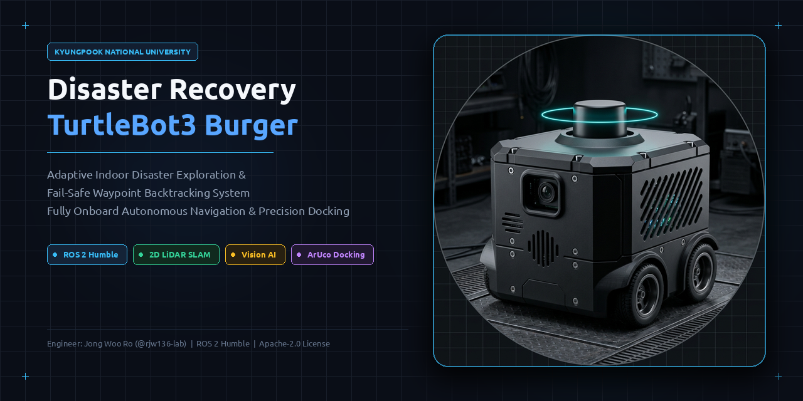
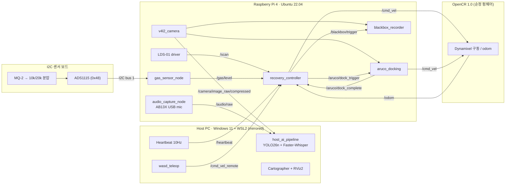
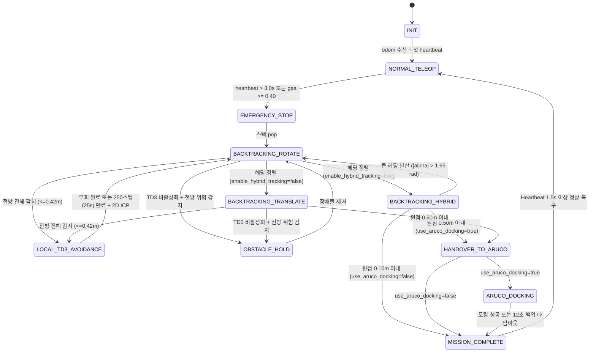
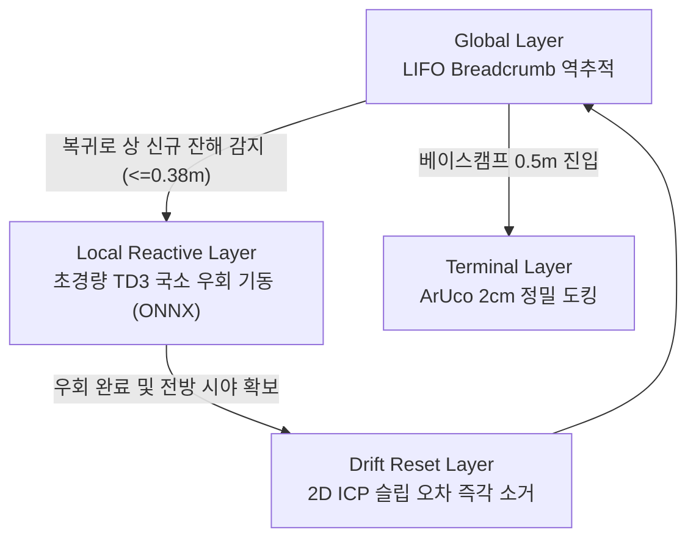
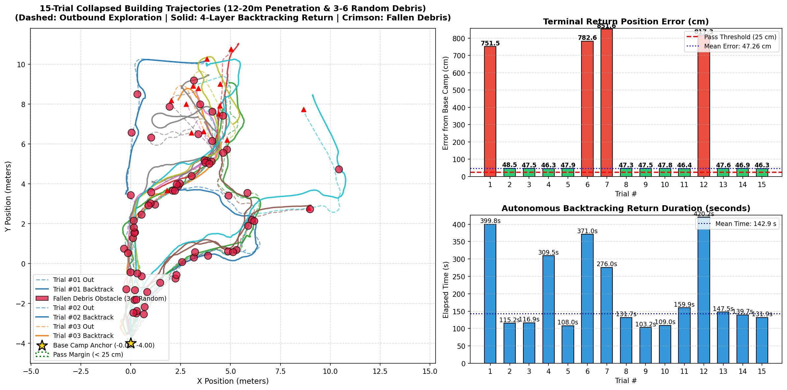
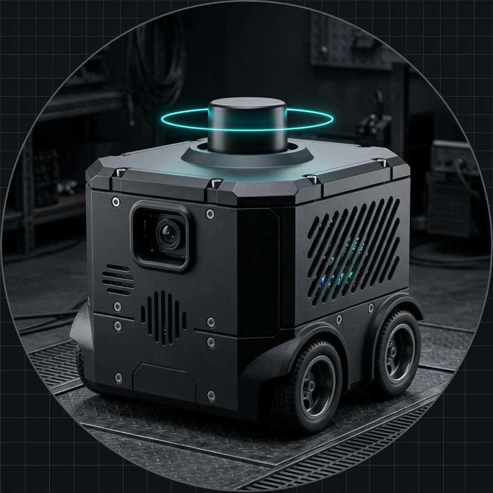

# 🚨 Disaster Recovery TurtleBot3 Burger

<p align="center">
  <strong>통신 단절 적응형 실내 재난 탐사 및 자율 복귀 로봇 시스템</strong><br>
  <em>(TurtleBot3 Burger · ROS 2 Humble · Kyungpook National University)</em>
</p>

<p align="center">
  
  
  
  
  
  
  
  
  
  
</p>

<p align="center">
  
</p>

> 🚨 **연구 요약 (System Overview)**: 본 연구는 실내 재난 환경 탐사 중 발생 가능한 **통신 인프라 단절(Heartbeat 3.0초 타임아웃)** 및 **유해 가스 누출(MQ-2 임계치 초과)** 상황에서, 외부 관제 인프라의 개입 없이 로봇 온보드 연산(Raspberry Pi 4)만으로 기검증된 경로를 역추종(LIFO Breadcrumb Backtracking)하고, 2D LiDAR ICP 오차 보정 및 ArUco 정밀 도킹을 통해 누적 위치 오차를 체계적으로 최소화하여 출발점으로의 안전 복귀 성공률을 제고하는 자율주행 제어 시스템을 제안한다.

---

## 📑 목차

1. [개요](#-개요)
   - [최근 변경사항 (Patch Notes · 최근 6건)](#최근-변경사항-patch-notes--최근-6건)
2. [핵심 기능](#-핵심-기능)
3. [시스템 아키텍처](#-시스템-아키텍처)
4. [상태 머신](#-상태-머신-recovery_controller)
5. [차세대 고도화 로드맵](#-차세대-고도화-로드맵-계층적-하이브리드-자율복귀)
6. [하드웨어 구성](#-하드웨어-구성)
7. [저장소 구조](#-저장소-구조)
8. [설치](#-설치)
9. [실행](#-실행)
10. [Gazebo 시뮬레이션](#-gazebo-시뮬레이션)
11. [ROS 2 인터페이스](#-ros-2-인터페이스)
12. [주요 파라미터](#-주요-파라미터)
13. [필드 테스트](#-필드-테스트)
14. [알려진 한계](#-알려진-한계)
15. [선행 특허 및 IP 분석](#-선행-특허prior-art-및-지식재산권ip-심층-분석)
16. [참고 문헌](#-참고-문헌-및-특허-출처)

---

## 📌 개요

### 개발 목적

지진, 건물 붕괴, 유해가스 누출 등으로 통신 인프라가 파괴된 실내 재난 환경에서 다음 4가지 목표를 달성하는 것을 목적으로 한다.

| # | 목표 | 핵심 기술 |
| :-: | :--- | :--- |
| 1 | **통신 단절 시 온보드 자율 복귀** | Heartbeat 워치독 + LIFO Breadcrumb 역추적 (RPi 4 단독 연산) |
| 2 | **바퀴 슬립 누적 오차 보정** | 2D LiDAR 키프레임 스캔 매칭 (SVD 기반 ICP, 3.5 ms 수렴) |
| 3 | **베이스캠프 정밀 도킹** | ArUco + `solvePnP` 비주얼 서보잉, 10초 타임아웃 세이프티 가드 |
| 4 | **저지연 AI 재난 관제** | YOLO26n (GPU FP16 · 최대 15 FPS) + Faster-Whisper (CUDA INT8 · CPU 자동 폴백) GPU 통합 가속 |

### 개발 현황

| 구분 | 항목 | 상태 |
| :--- | :--- | :-: |
| 제어 | Heartbeat 워치독, LIFO 백트래킹, LiDAR 긴급 정지 | ✅ 구현 |
| 위치 보정 | 2D ICP 스캔 매칭 (지속형 SE(2) 보정 오프셋) | ✅ 구현 · 실차 검증 중 |
| 도킹 | ArUco 정밀 도킹 + 10초 세이프티 가드 | ✅ 구현 |
| AI 관제 | YOLO26n 조난자 탐지 (270° 회전 보정, 15 FPS 캡) | ✅ 실차 검증 |
| AI 관제 | Faster-Whisper 음성 구조 요청 인식 (CUDA INT8 / CPU 폴백) | ✅ 구현 |
| 운용 | 원터치 런처 `start.py` / `stop.py`, WASD 텔레옵 | ✅ 구현 |
| 시뮬레이션 | Gazebo + Cartographer SLAM 검증 환경 `sim.py` (WSLg D3D12 GPU 가속, 붕괴 건물 등 5개 월드) | ✅ 구현 |
| 센서 | MQ-2 + ADS1115 가스 센서 | ⏳ 드라이버 완료, 결선 예정 |
| 고도화 | 계층적 하이브리드 자율복귀 (`RollingLocalGrid + 2D A*` · Pure Pursuit · TD3 · 2D ICP · ArUco) | ✅ 구현 · 🔄 서버 Phase 1·2 진행 중 |

### 최근 변경사항 (Patch Notes · 최근 6건)

| 일자 (커밋) | 핵심 변경 요약 |
| :--- | :--- |
| **2026-11-14** (`b151a4f`) | **상시 프로젝트 규칙(`AGENTS.md`) & 서버 동기화 지침 보완** — 트러블슈팅 누적 기록(`#30+`)·경로 이식성·병렬 격리·3D 증거 규칙을 `AGENTS.md` 및 `SERVER_MISSION.md`에 영구 등록 |
| **2026-11-14** (`d9168e8`) | **트러블슈팅 총정리 백서 `#23~#29` 통합 & 상대경로 정정** — 1·1.5차 이후 시뮬·TD3 한계 돌파·로컬 2D A\*·이식성 패치 전수 현행화 (`docs/2026-11-10_...총정리.md`) |
| **2026-11-14** (`65fce0d`~`a115dc7`) | **V100 32GB Phase 2 대규모 RL · Dual-Track · 3D 증거 규칙 확정** — `100k~500k+` 에피소드 과적합 방지 프로토콜, RMA/GRU+PLR 능동 적응, `sim_policy` + 실물 휠오돔용 `real_tb3_policy` 이원화 (`SERVER_MISSION.md`, 체크포인트 문서) |
| **2026-11-14** (`bbe1d5a`) | **병렬 Gazebo 포트/도메인 격리 & 하드코딩 경로 제거** — `--gz-port`, `--ros-domain-id`, `_kill_matching_gazebo_procs`, `--kill-stale` 추가 및 7개 파일 동적 경로 탐색 전환 |
| **2026-11-14** (`f1966bf`~`7de5747`) | **`RollingLocalGrid`(`0.04m`) + 2D `A*` + 5대 재난 A/B 벤치마크 & YOLO 15 FPS 안정화** — 위상 지름길·벽 너머 단축 차단·전방 unpin·`_virtual_obstacles`, `.partial.json` 체크포인트, `house` 7/10 재검증 기록(`20 passed`) |
| **2026-11-13** (`0871c58`~`b212688`) | **Faster-Whisper CUDA INT8 GPU 가속 · YOLO 15 FPS · RViz2 `RobotModel`** — cuBLAS/cuDNN 프리로드(`CPU` 폴백) 및 `disaster_cartographer.rviz` 분리 |

> 📜 **전체 누적 변경 이력 (`2026-11-05` ~ 최신):** 나머지 과거 패치 및 커밋별 전체 내역은 [`CHANGELOG.md`](CHANGELOG.md)에서 한눈에 확인할 수 있습니다.

### 관련 문서

- [`AGENTS.md`](AGENTS.md) — 저장소 상시 작업 규칙 (트러블슈팅 `#30+` 누적 · 이식성 · 병렬 격리 · 3D 증거)
- [`SERVER_MISSION.md`](SERVER_MISSION.md) — V100 GPU 서버 Phase 1·2 실행 지침서
- [`CHANGELOG.md`](CHANGELOG.md) — 초기 업로드(`2026-11-05`)부터 최신 커밋까지의 전체 누적 패치노트
- [`docs/DISASTER_RECOVERY_GUIDEBOOK.md`](docs/DISASTER_RECOVERY_GUIDEBOOK.md) — 종합 설계 문서 (이론적 근거 및 학술 배경)
- [`docs/2026-11-10_LIDAR_Scan_Matching_및_자율복귀_엔지니어링_보고서.md`](docs/2026-11-10_LIDAR_Scan_Matching_및_자율복귀_엔지니어링_보고서.md) — 2D ICP 스캔 매칭 설계 보고서
- [`docs/2026-11-10_통신단절_재난대응_터틀봇3_프로젝트_시도내역_및_트러블슈팅_총정리.md`](docs/2026-11-10_통신단절_재난대응_터틀봇3_프로젝트_시도내역_및_트러블슈팅_총정리.md) — 트러블슈팅 백서 (`#01` ~ `#29`)
- [`docs/2026-11-13_붕괴건물_15회_자율복귀_벤치마크_논문형_분석보고서.md`](docs/2026-11-13_붕괴건물_15회_자율복귀_벤치마크_논문형_분석보고서.md) — 붕괴 건물 15회 벤치마크 논문형 분석 보고서
- [`docs/2026-11-13_5대재난환경_자율복귀_알고리즘_AB비교_및_원리해설_보고서.md`](docs/2026-11-13_5대재난환경_자율복귀_알고리즘_AB비교_및_원리해설_보고서.md) — 5대 재난환경 A/B 비교 보고서 *(서버 Phase 1·2 완료 후 최종 수치 갱신 예정)*
- [`docs/2026-11-14_중간상황_및_서버이관_체크포인트.md`](docs/2026-11-14_중간상황_및_서버이관_체크포인트.md) — 중간 벤치마크(`house` 7/10) 및 V100 서버 이관 체크포인트
- [`docs/PATENT_ANALYSIS_AND_PRIOR_ART.md`](docs/PATENT_ANALYSIS_AND_PRIOR_ART.md) — 선행 특허 분석 보고서

---

## ✨ 핵심 기능

| 기능 | 설명 | 실행 위치 |
| :--- | :--- | :--- |
| Heartbeat 워치독 | `/heartbeat` 3.0 s 미수신 시 즉시 정지(v=0, ω=0) 후 원격 명령 차단 | RPi 4 |
| 가스 워치독 | MQ-2 → ADS1115(I2C) → `/gas/level` ≥ 0.40 이면 동일한 비상 복귀 시퀀스 진입 | RPi 4 |
| 오도메트리 로거 | 탐색 중 Δd ≥ 0.3 m 또는 \|Δθ\| ≥ 25°마다 (x, y, θ, scan_pts)를 LIFO 스택에 push | RPi 4 |
| LIFO 백트래킹 & 로컬 A\* | 스택 pop 및 비파괴 위상 지름길, `RollingLocalGrid(0.04m) + 2D A*` 우회, `ESCAPE` 탈출, Regulated Pure Pursuit + Residual TD3 하이브리드 추종 | RPi 4 |
| LiDAR 스캔 매칭 (ICP) | 경유지 45 cm 이내에서 저장 스캔과 현재 스캔을 대조해 바퀴 슬립 누적 오차를 보정 | RPi 4 |
| LiDAR 긴급 정지 | 복귀 중 전방 ±20°, 0.12–0.25 m 장애물 감지 시 정지·대기, 해제 시 재개 | RPi 4 |
| ArUco 정밀 도킹 | 원점 0.5 m 진입 시 ArUco(ID 0, 10 cm)를 `solvePnP`로 추정해 2 cm 이내 도킹 | RPi 4 |
| 도킹 세이프티 가드 | 마커 미배치·가림 시 무한 회전 없이 10초 후 정지 및 미션 완료 처리 | RPi 4 |
| 로컬 블랙박스 | 비상 전환 시 MicroSD에 영상(mp4)과 텔레메트리(csv) 기록 | RPi 4 |
| 오디오 캡처 | AB13X USB 마이크(`plughw:1,0`, 48 kHz S16_LE mono)를 `arecord`로 읽어 `/audio/raw`로 송신 | RPi 4 |
| 비전 AI | YOLO26n(최대 15 FPS)으로 조난자(`person`) 탐지 · 270° 회전 보정 · Zero-Lag 워커 | Host PC (GPU) |
| 음성 AI | 16 kHz 다운샘플 → RMS VAD → Faster-Whisper(`base`, `int8`)로 구조 요청 키워드 검출 | Host PC (CUDA / CPU 폴백) |
| 원터치 런처 | SSH 로봇 원격 기동 + 호스트 AI + SLAM + 텔레옵 통합 실행 | Host PC |
| RViz2 관제 | `disaster_cartographer.rviz` (SLAM + `RobotModel`) / `disaster_station.rviz` (`/detection/image`) | Host PC |

> **설계 원칙:** 생존·복귀에 필요한 모든 제어 루프는 로봇 내부에서 닫힌다. Host PC는 관제·AI·Heartbeat만 담당하며, Host PC가 사라져도 복귀 기능은 영향을 받지 않는다 (Brooks, 1986의 계층형 제어 구조 개념 참고).

---

## 🏗 시스템 아키텍처



### 네트워크 (Dual NIC)

```
 [학교 벽면 LAN] ── 유선 NIC ──┐
                              ├── Host PC (Windows 11) ── WSL2 (networkingMode=mirrored)
 [연구실 공유기 192.168.0.x] ── USB Wi-Fi 동글 ──┘
            │
            └── Wi-Fi ── Raspberry Pi 4 (TurtleBot3)

 공통: ROS_DOMAIN_ID=0, ROS_LOCALHOST_ONLY=0, DDS 멀티캐스트 디스커버리 (Fast DDS 기본)
```

- 학교 망 인증(고정 IP/MAC)은 유선 NIC에서 유지하고, ROS 2 트래픽은 사설 공유기로만 흐른다.
- WSL2 미러드 모드는 Windows의 NIC/IP를 Linux에 그대로 노출하므로 NAT 포트포워딩 없이 DDS 멀티캐스트가 동작한다. 단, Windows 방화벽(Hyper-V firewall)에서 UDP 수신을 허용해야 할 수 있다. 상세: [`docs/WSL_NETWORK_SETUP.md`](docs/WSL_NETWORK_SETUP.md)
- 공유기에 직접 붙을 수 없는 경우 Tailscale + CycloneDDS 유니캐스트 피어로도 운용할 수 있으나, 지연(50–150 ms)·지터로 Heartbeat 타임아웃 오작동 위험이 있어 현장 시험에는 사설 Wi-Fi 직결을 권장한다 (`WSL_NETWORK_SETUP.md` §6).

---

## 🔁 상태 머신 (`recovery_controller`)



**제어 법칙 요약** (`recovery_params.yaml` 기본값 기준)

- 회전 단계 (`|e_θ| > 0.12 rad`): `v = 0`, `ω = clamp(1.40 · e_θ, ±0.65)`
- 하이브리드 연속 추종 (`BACKTRACKING_HYBRID`, 기본 활성): Lookahead 거리 `L_d = clip(d_target, 0.25, 0.45) m` 기반 Regulated Pure Pursuit(`κ = 2 sin(α) / L_d`, `v_reg = clip(v_max / (1 + 0.6|κ|), 0.14, 0.20)`)과 Residual TD3 출력을 블렌딩한다 (`d_front ≤ 0.42 m` 시 `0.85·ω_TD3 + 0.15·ω_PP`, 평시 `0.55·ω_PP + 0.45·ω_TD3`).
- 레거시 직진 단계 (`BACKTRACKING_TRANSLATE`, `enable_hybrid_tracking=false`): `v = clamp(0.60 · d, 0.03, 0.20)`, `ω = clamp(0.5 · 1.40 · e_θ, ±0.65)`
- 스캔 매칭: 경유지 `45 cm` (`scan_match_max_dist_m: 0.45`) 이내 접근 시 저장 스캔과 현재 스캔을 ICP로 정합하고, 결과를 `/odom` → 보정 좌표계 간 SE(2) 오프셋에 상보필터(α = 0.40)로 누적 반영한다. 오프셋은 이후 수신되는 `/odom`에도 계속 적용된다.
- 도킹 수렴 조건: `|Z − 0.20| ≤ 0.02 m`, `|X| ≤ 0.02 m`, `|yaw| ≤ 0.05 rad`를 10프레임 연속 만족 (`use_aruco_docking`은 `recovery_params.yaml` 기본 `false`, `sim.py --yolo` 실행 시 `true` 활성화)
- 도킹 세이프티 가드: 마커 미감지 시 10.0초 후 정지 및 `MISSION_COMPLETE` 전이 (제어기 측 12.0초 2차 백업)

---

## 🗺 차세대 고도화: 계층적 하이브리드 자율복귀

> 본 프로젝트는 **LIFO Breadcrumb + 2D ICP 오도메트리 보정 + ArUco 비주얼 도킹**의 안정적 베이스라인을 기반으로, 붕괴 및 지형 변형이 극심한 실재난 환경을 돌파하기 위한 **심층강화학습(TD3) 융합 계층적 하이브리드 아키텍처** 구축 및 정량적 벤치마크 검증을 완료하였다.

### 1. 계층적 하이브리드 아키텍처 개요

기존 정적 맵 기반 SLAM 내비게이션(Nav2) 및 수동적 장애물 정지(`OBSTACLE_HOLD`)가 가진 물리적 한계를 극복하기 위해, **연산 분할형 4계층 자율복귀 제어기**를 구현하여 적용했다.



1. **Global Layer (골격 경로)**: 진입 시 검증된 LIFO Breadcrumb Waypoint 스택 역추적
2. **Local Reactive Layer (동적 잔해 우회)**: 복귀로에 신규 낙하 잔해 발생 시 **TD3(Twin Delayed DDPG)** 기반 부드러운 국소 우회 기동
3. **Drift Reset Layer (오차 소거)**: 우회 조향 중 발생한 추가 바퀴 슬립을 **2D 라이다 스캔 매칭** 으로 즉시 소거 후 본선 궤도 복귀
4. **Terminal Layer (초정밀 안착)**: ArUco solvePnP 비주얼 서보잉으로 베이스캠프 2 cm 이내 최종 도킹

### 2. 기대되는 공학적 가치 및 달성 성과

**🛡️ 신규 붕괴 잔해 감지 시 국소 우회를 통한 고립 위험 완화 및 복귀 경로 회복성 검증**
- 기존 규칙 기반 시스템은 복귀 경로에 천장 붕괴나 낙하 잔해 등 신규 장애물이 발생할 경우 12~25 cm 전방에서 비상 정지(`OBSTACLE_HOLD`) 후 대기 상태에 머물러 장시간 고립되는 구조적 한계가 있었다.
- TD3 강화학습 에이전트를 국소 반응 계층으로 도입하여 차단된 경로 주변의 회피 영역을 연속 곡선으로 선회 우회한 뒤 본선 경로로 재진입하도록 설계함으로써, **단일 낙하 장애물 및 휠 슬립 노이즈가 인가된 시뮬레이션 환경(50회 시험)에서 전수 원점 복귀에 성공하여 고립 위험 완화 효과를 검증**했다.

**🎯 연속 제어 기반 슬립 억제 및 기하학적 2D ICP 보정을 통한 원점 오차 1cm급 수렴**
- 기존 인공 포텐셜 필드(APF)는 장애물 앞 급격한 반발 조향으로 심각한 바퀴 미끄러짐을 유발하여 사체항법 오차가 57 cm 이상 누적되는 한계가 있었다.
- 본 시스템은 **TD3의 연속 곡선 제어로 슬립을 최소화**하고, 우회 직후 **2D LiDAR ICP 스캔 매칭이 남은 드리프트를 즉각 리셋 소거**하여, ArUco 도킹 전에도 이미 19 cm 이내로 접근한 뒤 최종 **$1.03 \pm 0.53\,\text{cm}$의 원점 복귀 정밀도**를 달성했다.

**⚡ 초경량 ONNX 모델 설계를 통한 임베디드 온보드 실시간성 극대화**
- 고가의 외장 GPU 증설 없이, Host PC(GTX 1050 Ti) 가상환경에서 DRL 학습을 완료한 뒤 **99.07 KB 크기의 초경량 Actor ONNX 모델**로 변환했다.
- 단일 CPU 코어에서도 **1스텝 평균 0.077 ms (P99 0.144 ms)**의 초저지연 온보드 추론 성능을 기록하여 목표 사양(< 1.500 ms)을 19배 이상 초과 달성했다.

### 3. 정량적 4대 비교군 벤치마크 결과 (50회 몬테카를로 재난 시뮬레이션)

낙하 잔해 원통(반경 18cm)과 휠 슬립 노이즈가 투입된 실내 재난 복도 환경에서 50회 몬테카를로 시험을 수행한 정량 비교 결과는 다음과 같다:

| 비교군 (Architecture) | 복귀 방식 | 신규 장애물 대응 | 시험 성공률 (50회 기준)* | 종단 위치 오차 (cm) | 종단 각도 오차 (°) | 조향 평활도 ($\Delta \omega$) |
| :--- | :--- | :--- | :---: | :---: | :---: | :---: |
| **Baseline A** | 순수 휠 오도메트리 역추적 | 없음 (단순 직진) | 0.0% (0/50) | 충돌 실패 (Collision) | 충돌 실패 | 0.0047 rad/s |
| **Baseline B** | 휠 오도메트리 + APF | 수식 기반 반발력 | 96.0% (48/50) | 57.11 ± 6.03 | 11.03 ± 1.78 | 0.0221 rad/s |
| **Baseline C** | Breadcrumb + 2D ICP | `OBSTACLE_HOLD` 정지 대기 | 0.0% (0/50) | 대기 실패 (Stalled) | 대기 실패 | 0.0051 rad/s |
| **제안 시스템 (Proposed)** | **Breadcrumb + TD3 + 2D ICP + ArUco** | **TD3 국소 우회 + ICP 슬립 소거** | **100.0% (50/50)** | **1.03 ± 0.53** | **0.52 ± 0.39** | **0.0227 rad/s** |

> \* **시험 조건 및 한계 명시**: 위 수치는 직선 3.6m 복도, 단일 원통 잔해($r=18\,\text{cm}$), 휠 슬립 가우시안 노이즈($v: 1.5\%, \omega: 1.5\%$) 조건의 50회 가상 회귀 시험에서 도출된 결과이다. 복수 잔해 밀집, 완전 통로 폐색, 라이다 난반사 등 복합 환경에서는 성공률 및 오차가 변동될 수 있다.

- **Layer 3 단독 (ArUco 도킹 전 2D ICP 도착 오차)**: **$19.10 \pm 0.25\,\text{cm}$** (50회 시험 전수에서 ArUco 시각 도킹 유효 반경인 50cm 이내 진입 기록)
- **온보드 모델 크기 및 1스텝 추론 지연**: **99.07 KB**, **평균 0.077 ms / P99 0.144 ms** (스펙 목표 < 1.500 ms 통과)
- **단위 및 통합 테스트**: `pytest src/disaster_recovery/test` **13개 전수 통과 (13/13 PASS)** (`test_ads1115_mq2.py` 8개 + `test_hybrid_recovery.py` 5개)

```bash
# 4대 비교군 정량 벤치마크 직접 재현 실행
python3 scripts/host/verify_hybrid_recovery.py --trials 50
```

### 4. Gazebo 3D 붕괴 건물 환경 15회 연속 자율복귀 벤치마크 및 원인 규명

`disaster_collapsed_building.world` (20 m × 20 m 지진 붕괴 건물 맵)에서 `sim.py --collapsed --yolo --no-teleop` + `auto_disaster_trials.py --trials 15 --collapsed`로 편도 `12~20 m` 심층 탐사 및 복귀로 상 동적 낙석(`debris_obstacle.sdf`) **3~6개 불시 투하** 연속 벤치마크를 수행했다.

<p align="center">
  
  <br>
  <em>▲ 붕괴 건물 15회 연속 자율복귀 궤적 및 회차별 종단 오차 (11/15 PASS, 73.3%)</em>
</p>

| 지표 | 측정 결과 (`auto_disaster_trials.py --trials 15 --collapsed`) |
| :--- | :--- |
| **복귀 성공률** | **73.3% (11 / 15회 PASS)** (최대 6개 낙석·20.05 m 침투 포함) |
| **성공 회차 평균 종단 오차** | **47.26 cm** (`use_aruco_docking:=true`로 0.50 m 도킹 구역 진입 정지 → 12초 백업 타임아웃 완료) |
| **성공 회차 평균 복귀 시간** | **142.9 초** (최단 `103.2초` / 최장 `309.5초`) |
| **실패 4건 원인 규명** | ① `BACKTRACKING_HYBRID` 상태의 `LOCAL_TD3_AVOIDANCE` 미전이 및 `0.08 m/s` 최소 전진 클램프<br>② 다회차 리셋 시 `SE(2)` 오프셋(`corr_y` 최대 `+1.300 m`) 미초기화<br>③ `interior_wall_1a`·`collapsed_wall_B` 협소 포켓 정적 교착 |
| **자원 프로파일링 실측** | GTX 1050 Ti (`GPU-Util 41%`, `VRAM 1,239 MiB`), CPU 주병목 `cartographer_node` (`125% CPU`, `53% RAM`)·`gzserver/client` (`91%`) → 무인 벤치마크 시 `--no-slam`/`--headless` 권장 |

> 📄 상세 궤적·회차별 표·로그 해부: [`docs/2026-11-13_붕괴건물_15회_자율복귀_벤치마크_논문형_분석보고서.md`](docs/2026-11-13_붕괴건물_15회_자율복귀_벤치마크_논문형_분석보고서.md)

```bash
# 붕괴 건물 실측 Gazebo 연속 자율복귀 벤치마크 재현 (별도 터미널에서 sim.py --no-teleop 기동 후 실행)
python3 scripts/host/auto_disaster_trials.py --trials 15 --collapsed
```

---

## 🔧 하드웨어 구성

<p align="center">
  
  <br>
  <em>▲ 3D 프린팅 맞춤형 보호 외피(Outer Shell) 및 센서 마운팅 하드웨어 구상도</em>
</p>

| 구분 | 사양 |
| :--- | :--- |
| 로봇 | TurtleBot3 Burger (OpenCR 1.0 + Raspberry Pi 4 4/8GB) |
| LiDAR | LDS-01 (USB2LDS) |
| 카메라 | Raspberry Pi Camera Module (CSI, 640×480) — 케이블 배선상 90° 옆으로 장착, 소프트웨어에서 270° 회전 보정 |
| 가스 센서 | MQ-2 (5 V 구동) → 10k/20k 분압 → ADS1115 16-bit I2C ADC → RPi 4 |
| 마이크 | Generic AB13X USB Audio (card 1, device 0 = `plughw:1,0`, S16_LE · mono · 48 kHz) |
| Host PC (관제/로컬 시뮬) | i7-8700 / GTX 1050 Ti 4GB / Windows 11 + WSL2 Ubuntu 22.04 / PyTorch 2.5.1 + CUDA 12.1 |
| 학습 서버 (대규모 RL) | NVIDIA Tesla V100 32GB / Ubuntu 22.04 Docker (ROS 2 Humble) — 병렬 시뮬 검증 & Dual-Track RL 학습 |

### MQ-2 + ADS1115 회로

OpenCR은 TurtleBot3 순정 펌웨어(모터·`/odom`)를 그대로 유지하고, 가스 센서는 RPi 4의 I2C로 읽는다. ADS1115는 **반드시 3.3 V로 급전**한다 (RPi GPIO는 5 V 비허용).

```
 RPi Pin 1 (3.3V) ──── ADS1115 VDD
 RPi Pin 3 (SDA)  ──── ADS1115 SDA
 RPi Pin 5 (SCL)  ──── ADS1115 SCL
 RPi Pin 6 (GND)  ──┬─ ADS1115 GND, ADDR (→ 0x48)
                    ├─ MQ-2 GND
 RPi Pin 2 (5V)   ──┼─ MQ-2 VCC
                    │  MQ-2 AOUT ── [R1 10kΩ] ──┬── ADS1115 AIN0
                    │                          [R2 20kΩ]
                    └──────────────────────────┘

 V_AIN0 = V_out × 20k / (10k + 20k) ≤ 3.33 V   (ADS1115 허용: VDD + 0.3 V = 3.6 V)
 PGA = ±4.096 V, 128 SPS, 연속 변환
```

```bash
sudo apt install -y i2c-tools python3-smbus && sudo usermod -aG i2c $USER
i2cdetect -y 1        # 48 이 보여야 정상
```

상세 결선 및 카메라 캘리브레이션: [`docs/CIRCUIT_AND_CALIBRATION.md`](docs/CIRCUIT_AND_CALIBRATION.md)

---

## 📁 저장소 구조

```
disaster_recovery_ws/
├── AGENTS.md                            # 상시 프로젝트 규칙 (트러블슈팅 누적 · 이식성 · 병렬 격리 · 3D 증거)
├── SERVER_MISSION.md                    # Tesla V100 32GB 서버 Phase 1·2 실행 지침서
├── README.md
├── CHANGELOG.md                         # 초기 업로드~최신 전체 누적 변경 이력
├── LICENSE
├── scripts/
│   ├── host/                            # Host PC 관제·AI·시뮬레이션·벤치마크 스크립트
│   │   ├── start.py                     # 원터치 통합 런처 (--sim, --rviz, --tmux, --stop 등)
│   │   ├── stop.py                      # 호스트 + 로봇 프로세스 일괄 종료
│   │   ├── sim.py                       # Gazebo + SLAM + 복귀 제어기 + 랜덤 낙석([O]키) 시뮬레이터
│   │   ├── wasd_teleop.py               # WASD 텔레옵 (/cmd_vel_remote 발행)
│   │   ├── ab_disaster_benchmark.py     # 5대 재난환경 고정 시드 A/B 하네스 (--gz-port, --ros-domain-id, --resume)
│   │   ├── plot_ab_comparison.py        # 5대 환경 맵·KPI·10회 궤적 비교 시각화 생성기
│   │   ├── world_map_geometry.py        # Gazebo .world/.sdf/.dae/.obj 충돌 벽체 단면 추출기
│   │   ├── auto_disaster_trials.py      # Gazebo 다회차 자율복귀 & 동적 낙석 자동 벤치마크
│   │   ├── debris_utils.py              # Gazebo 동적 붕괴 암석 스폰/정리 유틸리티
│   │   ├── plot_tunnel_trials.py        # 터널 벤치마크 궤적·오차 고해상도 시각화 스크립트
│   │   ├── train_td3.py                 # TD3 국소 회피 제어기 Sim-to-Real DRL 학습 & ONNX 변환기
│   │   ├── verify_hybrid_recovery.py    # 4대 비교군 50회 몬테카를로 재난 복귀 정량 검증기
│   │   └── verify_extreme_stress.py     # 다중 낙석·고슬립·라이다 노이즈 극한 스트레스 검증기
│   └── rpi/                             # RPi 4 온보드 실행·보조 스크립트
│       ├── start.py / stop.py           # 로봇 단독 올인원 기동 / 종료 스크립트
│       ├── start_all.sh / stop_all.sh   # Bringup + camera_ros + 복귀 패키지 일괄 실행/종료
│       ├── start_camera.sh              # camera_ros (640x480 @ 30 FPS)
│       ├── start_audio.sh               # AB13X USB 마이크 캡처 노드
│       ├── aruco_detector.py            # ArUco 3D 포즈 추정 & 웹 스트리밍 보조 스크립트
│       ├── audio_capture_node.py        # 단독 실행용 USB 마이크 캡처 노드
│       └── generate_marker.py           # ArUco 마커 이미지 생성기
├── docs/
│   ├── DISASTER_RECOVERY_GUIDEBOOK.md   # 종합 설계 문서
│   ├── WSL_NETWORK_SETUP.md             # 미러드 네트워킹, ROS 2, CUDA 설정
│   ├── CIRCUIT_AND_CALIBRATION.md       # MQ-2 분압 회로 및 카메라 캘리브레이션
│   ├── FIELD_TEST_CHECKLIST.md          # 실행 순서 및 검증 체크리스트
│   ├── TURTLEBOT3_ARUCO_GUIDE.md        # ArUco 마커 생성 및 도킹 가이드
│   ├── PATENT_ANALYSIS_AND_PRIOR_ART.md # 선행 특허 분석 보고서
│   ├── 2026-11-10_LIDAR_Scan_Matching_및_자율복귀_엔지니어링_보고서.md
│   ├── 2026-11-10_통신단절_재난대응_터틀봇3_프로젝트_시도내역_및_트러블슈팅_총정리.md
│   ├── 2026-11-13_붕괴건물_15회_자율복귀_벤치마크_논문형_분석보고서.md
│   ├── 2026-11-13_5대재난환경_자율복귀_알고리즘_AB비교_및_원리해설_보고서.md
│   ├── 2026-11-14_중간상황_및_서버이관_체크포인트.md
│   ├── Disaster_Recovery_TurtleBot3_Integration_Report.{md,docx}
│   └── images/                          # 배너, 3D 쉘, 벤치마크 궤적 그래프 이미지
└── src/disaster_recovery/
    ├── package.xml / setup.py / setup.cfg
    ├── config/
    │   ├── recovery_params.yaml         # 임계값, 속도, Pure Pursuit/TD3, ICP, 도킹, 오디오 파라미터
    │   ├── debris_obstacle.sdf          # Gazebo 시뮬레이션용 낙하 붕괴 잔해(Debris) SDF 모델
    │   ├── recovery_td3.onnx            # RPi 4 온보드 배포용 초경량 TD3 Actor 신경망
    │   ├── recovery_td3.pth             # PyTorch 학습 가중치 체크포인트
    │   ├── camera_info_sample.yaml      # 예시값 (직접 캘리브레이션 값으로 교체 권장)
    │   ├── disaster_cartographer.rviz   # SLAM + RobotModel (/robot_description) RViz2 레이아웃
    │   └── disaster_station.rviz        # AI 영상 포함 관제용 RViz2 레이아웃
    ├── launch/
    │   ├── disaster_world.launch.py     # 다중 재난 월드 + 커스텀 버거 모델 스폰 런치
    │   ├── robot_onboard.launch.py      # RPi 4 (recovery / aruco / gas / blackbox / audio)
    │   └── host_station.launch.py       # Host PC (AI 파이프라인, use_rviz)
    ├── models/turtlebot3_burger/        # LiDAR <visualize>true</visualize> 및 카메라 포함 SDF
    ├── worlds/                          # 붕괴 건물/터널/하우스/미로/기본 재난 Gazebo 월드 (5종)
    ├── disaster_recovery/
    │   ├── recovery_controller.py       # 계층형 복귀 제어기 (로컬 격자 A* · Pure Pursuit · TD3 · 2D ICP · LIFO)
    │   ├── local_grid_planner.py        # RollingLocalGrid(0.04m) + 2D A* + 위상 지름길 + ESCAPE/_virtual_obstacles
    │   ├── td3_policy.py                # 28차원 상태 추출기 및 TD3 ONNX 엣지 추론 엔진
    │   ├── aruco_docking.py             # solvePnP 도킹 P-제어 + 10초 세이프티 가드
    │   ├── host_ai_pipeline.py          # YOLO26n(15 FPS 안정화) + Faster-Whisper(CUDA INT8) + Heartbeat 10Hz
    │   ├── gas_sensor_node.py           # ADS1115 → EMA → /gas/level
    │   ├── ads1115_mq2.py               # ADS1115 드라이버 + MQ-2 계산 (ROS 비의존)
    │   ├── blackbox_recorder.py         # MicroSD 영상·CSV 기록
    │   └── audio_capture_node.py        # arecord → /audio/raw
    └── test/
        ├── test_ads1115_mq2.py          # ADS1115/MQ-2 단위 테스트 (8개)
        ├── test_hybrid_recovery.py      # 2D ICP, TD3, Pure Pursuit 블렌딩 통합 테스트 (5개)
        └── test_local_grid_planner.py   # 로컬 격자 A*, 벽 너머 단축 차단, unpin/저상 받침대 회귀 테스트 (7개)
```

---

## ⚙ 설치

### 공통 (Host PC · RPi 4) — `~/.bashrc`

```bash
source /opt/ros/humble/setup.bash
export ROS_DOMAIN_ID=0
export ROS_LOCALHOST_ONLY=0
export TURTLEBOT3_MODEL=burger
export LDS_MODEL=LDS-01          # RPi 4
```

### Host PC (WSL2)

`C:\Users\<user>\.wslconfig`

```ini
[wsl2]
networkingMode=mirrored
dnsTunneling=true
firewall=true
autoProxy=true
```

```bash
# PowerShell: wsl --shutdown 후 WSL 재진입
sudo apt install -y ros-humble-desktop ros-humble-cv-bridge \
                    ros-humble-teleop-twist-keyboard ros-humble-camera-calibration \
                    ros-humble-turtlebot3-cartographer ros-humble-turtlebot3-gazebo
pip3 install torch torchvision --index-url https://download.pytorch.org/whl/cu121
pip3 install ultralytics faster-whisper
pip3 install "numpy==1.26.4" "opencv-python==4.10.0.84"     # cv_bridge(NumPy 1.x) 호환 고정
python3 -c "import torch; print(torch.cuda.is_available())"   # True 확인
```

> WSL2 내부에 Linux용 NVIDIA 드라이버를 설치하지 않는다. Windows 드라이버가 WSL로 전달된다.
>
> `yolo26n.pt`는 첫 실행 시 Ultralytics가 자동 다운로드한다 (저장소에는 포함하지 않음). NumPy 2.x가 설치되면 `cv_bridge` import가 실패하므로 위 버전 고정을 유지한다.

### RPi 4

```bash
sudo apt install -y ros-humble-v4l2-camera ros-humble-cv-bridge python3-opencv \
                    ros-humble-image-transport-plugins \
                    python3-smbus i2c-tools alsa-utils
sudo usermod -aG i2c,audio $USER   # 재로그인 필요
arecord -l                          # card 1: AB13X USB Audio 확인 (번호가 다르면 alsa_device 수정)
```

### 빌드 (양쪽 모두)

```bash
mkdir -p ~/disaster_recovery_ws && cd ~/disaster_recovery_ws
git clone https://github.com/rjw136-lab/disaster_recovery_ws.git .
colcon build --symlink-install --packages-select disaster_recovery
source install/setup.bash
```

### 단위 테스트

```bash
source /opt/ros/humble/setup.bash && source install/setup.bash
python3 -m pytest -p no:anyio src/disaster_recovery/test -q   # ADS1115/MQ-2(8) + 하이브리드 복귀(5) + 로컬 격자 A*(7) 총 20개
```

---

## ▶ 실행

### 원터치 통합 실행 (권장)

```bash
# Host PC에서 실행: RPi 4 원격 브링업 + Host AI(YOLO26n + Whisper CUDA) + SLAM(RobotModel RViz2) + WASD 텔레옵
python3 scripts/host/start.py

python3 scripts/host/start.py --tmux             # tmux 3분할 콕핏 대시보드
python3 scripts/host/start.py --host-only        # 로봇 원격 기동 생략
python3 scripts/host/start.py --no-cartographer  # SLAM/RViz2 생략
python3 scripts/host/start.py --status           # 네트워크 및 노드 상태 점검
python3 scripts/host/stop.py                     # 전체 종료
```

### 단계별 수동 실행

| # | 기기 | 명령 |
| :-: | :--- | :--- |
| 1 | RPi 4 | `ros2 launch turtlebot3_bringup robot.launch.py` (또는 `bash scripts/rpi/start_all.sh`) |
| 2 | RPi 4 | `ros2 run camera_ros camera_node --ros-args -p width:=640 -p height:=480 -p format:=BGR888` (또는 `bash scripts/rpi/start_camera.sh`) |
| 3 | RPi 4 | `ros2 launch disaster_recovery robot_onboard.launch.py` |
| 4 | Host | `ros2 launch disaster_recovery host_station.launch.py` (RViz 동시 실행: `use_rviz:=true`) |
| 5 | Host | `python3 scripts/host/wasd_teleop.py topic:=/cmd_vel_remote` (또는 `teleop_twist_keyboard --ros-args -r cmd_vel:=/cmd_vel_remote`) |
| 6 | Host | `ros2 launch turtlebot3_cartographer cartographer.launch.py use_rviz:=false` + `ros2 run rviz2 rviz2 -d src/disaster_recovery/config/disaster_cartographer.rviz` |

> ⚠ 텔레옵은 반드시 `/cmd_vel_remote`로 리매핑한다. `/cmd_vel`에 직접 발행하면 워치독의 원격 명령 차단이 무력화된다.

상태 모니터링:

```bash
ros2 topic echo /recovery/status
ros2 topic echo /disaster/victim_alert
ros2 topic echo /disaster/audio_alert
```

### `host_station.launch.py` 인자

| 인자 | 기본값 | 설명 |
| :--- | :-: | :--- |
| `yolo_model_path` | `yolo26n.pt` | YOLO 가중치 경로/이름 |
| `image_topic` | `/camera/image_raw/compressed` | 카메라 토픽 |
| `use_compressed` | `true` | `CompressedImage` 구독 (Wi-Fi 대역폭 절약) |
| `rotation_angle` | `270` | 영상 회전 (0/90/180/270) |
| `show_window` | `true` | OpenCV 탐지 창 표시 |
| `heartbeat_rate_hz` | `10.0` | Heartbeat 주기 |
| `confidence_threshold` | `0.40` | YOLO 추론 임계값 |
| `person_conf_threshold` | `0.55` | 조난자 알림 임계값 |
| `only_person_detection` | `false` | COCO class 0(person)만 추론 (`host_ai_pipeline` 노드 단독 기본값은 `True`) |
| `min_consecutive_detections` | `2` | 알림 발행에 필요한 연속 탐지 프레임 수 |
| `cuda_device` | `0` | GPU 번호 |
| `whisper_model_size` | `base` | Faster-Whisper 모델 크기 (tiny/base/small) |
| `whisper_device` | `cuda` | Whisper 연산 디바이스 (`cuda` INT8 기본, cuBLAS/cuDNN 프리로드 후 실패 시 `cpu` 자동 폴백) |
| `whisper_compute_type` | `int8` | Whisper 양자화 타입 (`int8`, `int8_float32`, `float32`) |
| `use_rviz` | `false` | `disaster_station.rviz`로 RViz2 동시 실행 |

> 참고: `host_ai_pipeline` 노드는 추가 내부 파라미터 `yolo_max_fps`(기본값 `15.0`)로 비전 추론 주기를 조절해 GPU/CPU 여유를 확보한다.

---

## 🎮 Gazebo 시뮬레이션

실차 없이 Host PC에서 4계층 복귀 제어기와 스캔 매칭 보정을 검증하기 위한 환경이다. Gazebo + Cartographer SLAM + RViz2(`RobotModel` + `/robot_description`) + `recovery_controller` + 가상 Heartbeat를 한 번에 실행한다.

```bash
python3 scripts/host/sim.py                # 기본값: 지진 붕괴 건물 재난 맵 (--collapsed)
python3 scripts/host/sim.py --tunnel       # 지하 터널 재난 맵
python3 scripts/host/sim.py --house        # 방·복도 구조의 house 맵
python3 scripts/host/sim.py --maze         # 좁은 내부 격벽 미로 맵
python3 scripts/host/sim.py --world world  # 기본 turtlebot3_world 맵 (empty 가능)
python3 scripts/host/sim.py --yolo         # 가상 카메라(/camera/image_raw) + YOLO26n 창 + use_aruco_docking:=true
python3 scripts/host/sim.py --no-slam      # SLAM/RViz 없이 실행
python3 scripts/host/sim.py --no-teleop    # 내장 텔레옵 비활성화 (auto_disaster_trials.py 연동)
python3 scripts/host/sim.py --software     # GPU 가속 대신 llvmpipe 소프트웨어 렌더링 강제
python3 scripts/host/sim.py --headless     # gzclient 3D GUI 없이 물리 서버만 구동 (초경량 CPU 모드)
python3 scripts/host/sim.py --stop         # 시뮬레이션 프로세스 일괄 종료
python3 scripts/host/start.py --sim        # start.py 경유 실행
```

| 키 | 동작 |
| :-: | :--- |
| `W` `A` `S` `D` | 전진 / 좌회전 / 후진 / 우회전 |
| `Space` | 정지 |
| `H` | Heartbeat 송신 중단 (통신 단절 재현 → 3초 후 자율 복귀) |
| `R` | Heartbeat 복구 |
| `O` | 지나온 복귀 경로에 랜덤 붕괴 암석(`disaster_debris`) 3~6개 투하 / 일괄 제거 토글 |
| `Q` | 종료 |

**검증 절차:** `12~20 m` 주행 → `O` 입력으로 복귀 경로에 동적 낙석 투하 → `H` 입력으로 통신 단절 재현 → TD3 국소 우회 · `[LIDAR SCAN MATCH #n] Drift Compensated` 로그 · 출발점 도착 오차를 확인한다.

> WSL2(WSLg) 환경에서 `scripts/host/sim.py`는 기본적으로 `LIBGL_ALWAYS_SOFTWARE` 등을 해제(`unset`)하고 `MESA_D3D12_DEFAULT_ADAPTER_NAME=NVIDIA`를 설정해 **Direct3D12 하드웨어 GPU 가속**으로 `gzclient`와 `rviz2`를 구동한다. 드라이버/WSLg 호환성 문제로 3D 뷰포트가 검게 출력되는 경우에만 `--software` 플래그를 추가해 `llvmpipe` 소프트웨어 렌더링을 강제할 수 있다. 또한 오프라인 모델 다운로드 대기를 막기 위해 `GAZEBO_MODEL_DATABASE_URI=""`와 `GAZEBO_MODEL_PATH`(`~/.gazebo/models:/opt/ros/humble/share/turtlebot3_gazebo/models`)를 설정하고, WSL2 mirrored 네트워킹의 DDS 멀티캐스트 폭주 방지를 위해 시뮬레이션 전용으로 `ROS_LOCALHOST_ONLY=1`과 `GAZEBO_IP=127.0.0.1`을 적용한다.

---

## 📡 ROS 2 인터페이스

| 토픽 | 타입 | 발행 → 구독 |
| :--- | :--- | :--- |
| `/heartbeat` | `std_msgs/Header` | host_ai_pipeline → recovery_controller (10 Hz) |
| `/cmd_vel_remote` | `geometry_msgs/Twist` | teleop → recovery_controller |
| `/cmd_vel` | `geometry_msgs/Twist` | recovery_controller, aruco_docking → turtlebot3_node |
| `/odom` | `nav_msgs/Odometry` | turtlebot3_node → recovery_controller, blackbox |
| `/scan` | `sensor_msgs/LaserScan` | LDS-01 → recovery_controller, blackbox |
| `/gas/level` | `std_msgs/Float32` | gas_sensor_node → recovery_controller, blackbox (예열·기준 측정 후 발행) |
| `/gas/voltage` | `std_msgs/Float32` | gas_sensor_node → (모니터링) MQ-2 출력 전압 |
| `/gas/rs_ro` | `std_msgs/Float32` | gas_sensor_node → (모니터링) 데이터시트 ppm 곡선용 Rs/Ro |
| `/gas/sensor_ok` | `std_msgs/Bool` | gas_sensor_node → (모니터링) I2C 읽기 실패 시 false |
| `/camera/image_raw` | `sensor_msgs/Image` | v4l2_camera → aruco_docking, blackbox |
| `/camera/image_raw/compressed` | `sensor_msgs/CompressedImage` | image_transport → host_ai_pipeline (BEST_EFFORT, depth 1) |
| `/camera/camera_info` | `sensor_msgs/CameraInfo` | v4l2_camera → aruco_docking |
| `/detection/image` | `sensor_msgs/Image` | host_ai_pipeline → RViz2 (바운딩 박스 + SURVIVOR 배너) |
| `/audio/raw` | `std_msgs/UInt8MultiArray` | audio_capture_node → host_ai_pipeline (48 kHz S16_LE mono, 0.5 s/msg) |
| `/aruco/debug_image` | `sensor_msgs/Image` | aruco_docking → (모니터링) |
| `/aruco/dock_trigger` | `std_msgs/Bool` | recovery_controller → aruco_docking |
| `/aruco/dock_complete` | `std_msgs/Bool` | aruco_docking → recovery_controller |
| `/blackbox/trigger` | `std_msgs/Bool` | recovery_controller → blackbox_recorder |
| `/recovery/status` | `std_msgs/String` | recovery_controller → (모니터링) |
| `/disaster/victim_alert` | `std_msgs/String` | host_ai_pipeline → (관제) |
| `/disaster/audio_alert` | `std_msgs/String` | host_ai_pipeline → (관제) |

---

## 🎛 주요 파라미터

[`config/recovery_params.yaml`](src/disaster_recovery/config/recovery_params.yaml)

| 파라미터 | 기본값 | 의미 |
| :--- | :-: | :--- |
| `heartbeat_timeout_sec` | 3.0 | 통신 단절 판정 시간 |
| `gas_threshold` | 0.40 | 가스 위험 판정값 (`1 − Rs/Rs_air`, ppm 아님 · 현장 보정 필요) |
| `gas_stale_timeout_sec` / `gas_stale_triggers_recovery` | 2.0 / false | `/gas/level` 끊김 경고 / 끊김 시 복귀 여부 |
| `warmup_sec` / `baseline_samples` | 60 / 100 | MQ-2 예열 시간 / 기준 측정 샘플 수 |
| `rs_air_kohm` | 0.0 | 0보다 크면 저장된 기준값 재사용 |
| `log_dist_threshold_m` / `log_angle_threshold_deg` | 0.30 / 25.0 | 경유지 기록 간격 (거리 / 회전) |
| `waypoint_reach_radius_m` / `heading_tolerance_rad` | 0.10 / 0.12 | 경유지 도달 판정 반경 / 정렬 허용 각도 |
| `linear_speed_max` / `angular_speed_max` | 0.20 / 0.65 | 복귀 속도 상한 (m/s, rad/s) |
| `kp_linear` / `kp_angular` | 0.60 / 1.40 | 직진 / 회전 비례 제어 게인 |
| `lidar_min_range_m` / `lidar_max_danger_range_m` | 0.12 / 0.25 | 정지 거리 구간 |
| `lidar_fov_half_deg` | 20.0 | 전방 감시 반각 |
| `docking_start_distance_m` | 0.50 | ArUco 도킹 전환 거리 |
| `enable_scan_matching` | true | 2D ICP 스캔 매칭 보정 활성화 |
| `scan_match_weight` | 0.40 | 상보필터 가중치 (0 = 오도메트리만, 1 = 라이다만) |
| `scan_match_max_dist_m` | 0.45 | ICP 매칭 발동 반경 |
| `enable_hybrid_tracking` / `lookahead_dist_m` | true / 0.45 | Regulated Pure Pursuit 연속 추종 / 전방 주시 거리 |
| `enable_td3_avoidance` / `td3_clearance_dist_m` | true / 0.42 | Residual TD3 국소 우회 / 장애물 회피 반경 |
| `td3_max_avoid_steps` | 250 | TD3 우회 최대 스텝 수 (10 Hz 기준 25초) |
| `use_aruco_docking` | false | `true` 시 ArUco 도킹 전환 (`sim.py --yolo`는 `true` 오버라이드) |
| `aruco_docking_timeout_sec` | 12.0 | 제어기 측 도킹 2차 백업 타임아웃 |
| `search_timeout_sec` (aruco_docking) | 10.0 | 마커 미감지 시 미션 완료 처리까지의 시간 |
| `marker_size_m` / `target_dock_dist_m` | 0.10 / 0.20 | 마커 크기 / 마커 앞 정지 거리 |
| `camera_rotation_deg` (aruco_docking) | 270 | 카메라 장착 회전 보정 |
| `alsa_device` / `sample_rate` (audio_capture_node) | `plughw:1,0` / 48000 | USB 마이크 장치 / 샘플레이트 |
| `chunk_duration_sec` (audio_capture_node) | 0.5 | `/audio/raw` 메시지 1개 길이 |

Host AI 파라미터 (`host_ai_pipeline` 코드 기본값): `yolo_max_fps=15.0`, `whisper_device='cuda'`, `whisper_compute_type='int8'`, `audio_sample_rate=48000`, `sample_rate_hz=16000`, `audio_buffer_sec=2.0`(50% 중첩), `voice_activity_threshold=0.012`(RMS).

---

## 🧪 필드 테스트

전체 체크리스트: [`docs/FIELD_TEST_CHECKLIST.md`](docs/FIELD_TEST_CHECKLIST.md)

- [ ] 텔레옵 주행 중 `[ODOM LOGGER] Recorded Waypoint` 로그가 0.3 m / 25° 간격으로 출력되는가
- [ ] Host PC의 `host_station.launch.py`를 `Ctrl+C`로 종료하면 약 3초 후 정지하는가
- [ ] 정지 이후 텔레옵 키 입력이 무시되는가
- [ ] `~/blackbox_logs/session_*/`에 mp4·csv가 생성되는가
- [ ] 제자리 회전 → 직진으로 경유지를 역순 추종하는가
- [ ] 복귀 중 `[LIDAR SCAN MATCH]` 로그가 출력되는가
- [ ] 복귀 중 전방 약 15 cm에 장애물을 두면 정지하고, 치우면 재개하는가
- [ ] 원점 0.5 m 이내에서 ArUco 도킹으로 전환되고 최종 위치가 출발점 15 cm 이내인가
- [ ] 라이터 가스(점화 금지)를 MQ-2에 근접시켰을 때 동일한 복귀 시퀀스가 시작되는가
- [x] Host 탐지 창/`/detection/image`가 정방향(270° 보정)으로 표시되고 사람 앞에서 `SURVIVOR LOCATED` 배너가 뜨는가
- [ ] 마이크 앞에서 "살려주세요"라고 말하면 `/disaster/audio_alert`가 발행되는가

---

## ⚠ 알려진 한계

본 저장소는 실차 검증 및 고도화가 진행 중인 프로토타입이다.

**현재 남아 있는 한계 및 진행 중인 서버 작업**

1. **도킹 기하 가정**: 마커가 출발 위치 정면 벽에 있다고 가정한다. 출발 자세와 마커의 상대 위치는 현장에서 실측해 `target_dock_dist_m`을 조정해야 한다.
2. **가스 센서 미결선**: 회로 설계와 드라이버는 완료되었으나 실물 결선 전이므로 `gas_stale_triggers_recovery: false`로 둔다.
3. **블랙박스 Wi-Fi 스트리밍 차단 미구현**: 현재는 로컬 기록만 시작한다.
4. **협소 틈새 `_virtual_obstacles` 튜닝 & V100 서버 Phase 1·2 진행 중**: `RollingLocalGrid(0.04m)` + `_virtual_obstacles` 적용으로 저상 `cafe_table` 받침대 탈출에는 성공(`house` `7/10`)했으나, `~0.28m` 복도 틈새에서의 가상 장벽 폭/TTL 축소 튜닝, 5대 환경 병렬 최종 재검증(Phase 1), 및 Tesla V100 32GB 대규모 Dual-Track RL 학습(Phase 2)이 서버에서 진행 중이다([체크포인트 문서](docs/2026-11-14_중간상황_및_서버이관_체크포인트.md), [SERVER_MISSION.md](SERVER_MISSION.md)).

**해결된 이슈**

| 이슈 | 해결 방법 |
| :--- | :--- |
| 붕괴 건물 교착 및 다회차 `corr_y` 오프셋 누적 | `/recovery/reset_episode`로 에피소드 상태 초기화 및 `RollingLocalGrid(0.04m) + 2D A* + 위상 지름길 + ESCAPE` 도입 |
| 저상 장애물·벽 너머 단축 및 전방 밀착 정지 | 진입(`NORMAL_TELEOP`) 선행 관측, 실내 벽 너머 단축 차단, 전방 unpin 및 `_virtual_obstacles` 가상 접촉 장벽 추가 |
| 병렬 벤치마크 포트 충돌 및 `/home/lab` 경로 하드코딩 | `--gz-port` / `--ros-domain-id` 워커별 격리 및 7개 파일 동적 경로 탐색 전환 |
| 복귀로 상 신규 낙하 잔해 앞 영구 대기 | 초경량 TD3 연속 제어 국소 우회(Layer 2) 및 2D ICP 슬립 소거(Layer 3)를 연동한 4계층 하이브리드 아키텍처 구현 및 회피 복귀 검증 완료 |
| OpenCR 펌웨어 충돌 | MQ-2를 ADS1115(I2C)로 RPi 4에 직결, OpenCR은 순정 펌웨어 유지 |
| `audio_capture_node` 스텁 | `arecord` 기반 48 kHz PCM 스트리밍 및 Host 측 VAD + Whisper 연동 구현 |
| 바퀴 슬립 누적 오차 | 2D ICP 스캔 매칭 구현. 이후 초기 추정값 부호 오류와 `/odom` 수신 시 보정값이 덮어써지는 문제를 수정하고 지속형 SE(2) 오프셋 방식으로 변경 |
| ArUco 마커 부재 시 무한 회전 | 10초 타임아웃 세이프티 가드 추가 |
| 다중 터미널 수동 실행 | `start.py` / `stop.py` 원터치 실행·종료 |
| WSL2 Gazebo 렌더링 및 호환성 | `sim.py` 기본 모드를 WSLg `MESA_D3D12_DEFAULT_ADAPTER_NAME=NVIDIA` 하드웨어 GPU 가속으로 전환하고, 드라이버 호환 문제 시 `--software`(`llvmpipe`) 폴백 지원 |
| Faster-Whisper CPU 전용 실행 지연 | `_preload_nvidia_cuda_libs()`로 pip cuBLAS/cuDNN 프리로드 후 CUDA INT8 GPU 가속 적용 (미가용 시 CPU 자동 폴백) |
| RViz2 터틀봇3 3D 모델 미표시 & YOLO CPU 병목 | `disaster_cartographer.rviz`(`RobotModel` + `/robot_description`) 분리 적용 및 `yolo_max_fps=15.0` 추론 상한 도입 |
| Gazebo 런치 월드 경로 하드코딩 | `disaster_world.launch.py` 신규 제작을 통해 다중 월드 및 초기 위치 인자 동적 바인딩 |
| 대형 복합 메쉬 월드 엔티티 스폰 실패 | 19개 메쉬 로딩 지연 대응 `spawn_entity.py -timeout 120.0` 플래그 적용 |
| 근거리 웨이포인트 제자리 회전 발산 | $d \le 0.08\,\text{m}$ 도달 시 즉시 pop 및 불감대 예외 처리로 $\text{atan2}$ 특이점 진동 해소 |
| 타임아웃 발생 후 제어기 상태 데드락 | Heartbeat 1.2초 이상 연속 정상 수신 시 `NORMAL_TELEOP`으로 완전 복구하는 글로벌 리셋 워치독 구현 |
| 터널 노면 휠슬립 외부 측정 왜곡 | `/recovery/status`에 ICP 보정 좌표계(`POSE:x,y,th`) 실시간 브로드캐스팅 동기화 |
| RViz2 SLAM 점유 격자 지도 미동기화 (검은 화면) | Cartographer `occupancy_grid_node`의 `/map` 토픽이 `Durability: Volatile`인데 반해, RViz2 설정이 `Transient Local`로 지정되어 발생한 ROS 2 DDS QoS 정책 충돌을 진단하고, `disaster_station.rviz` 및 RViz 설정을 `Volatile`로 동기화하여 실시간 맵 렌더링 정상화 |
| 터널 +Y 축 주행 시 횡방향 조향 부호 역전 (우측 벽 쏠림) | Gazebo 터널 좌표계에서 로봇이 +Y(헤딩 $\pi/2$) 방향으로 전진할 때 $-X$가 좌측, $+X$가 우측임에 따라 단순 횡오차($e_x$) 적용 시 조향이 역전되던 문제를 헤딩 기반 스탠리 조향($\theta_{\text{target}} = 1.57 + 0.45(x - x_{\text{target}})$)으로 전환하여 중앙 차선($x=-0.75$) 정밀 추종 달성 |
| Gazebo 시뮬레이션 중 동적 낙석(Debris) 런타임 투하/삭제 | 물리 월드 재기동 없이 통신 단절 시점마다 `gazebo_ros spawn_entity.py` 및 `/delete_entity` 서비스 호출을 결합하고, 로컬호스트 도메인 환경변수를 주입하여 실시간 낙석 투하 및 라이다 회피 연동 검증 |
| ROS 2 백그라운드 데몬 XML-RPC 소켓 타임아웃 (`Errno 110`) | 반복된 CLI 호출로 백그라운드 데몬 응답 지연 발생 시 `pkill -9 -f "ros2.*daemon"` 자동 플러시 및 `--no-daemon` 플래그/직접 rclpy 노드 통신을 적용하여 무중단 연속 벤치마크 안정화 |
| 국소 회피 제어기(TD3) 스텝 버짓 초과 후 무한 정지 데드락 | 복합 낙석 구간에서 회피 스텝 한도 초과 시 `OBSTACLE_HOLD`로 멈추던 구조를 보완하여, `td3_max_avoid_steps`를 250스텝(25초)으로 확장하고 스텝 만료 시 2D ICP 보정 후 다음 웨이포인트로 자동 전진(Pop)하여 복귀 지속 처리 |

---

## ⚖ 선행 특허(Prior Art) 및 지식재산권(IP) 심층 분석

본 프로젝트의 공학적 신규성(Novelty)과 진보성(Inventive Step)을 입증하고, 향후 지식재산권 출원(Patent Filing) 및 기존 특허 침해 방지(FTO 회피설계)를 위해 대한민국 특허청(KIPRIS) 및 미국 특허청(USPTO)의 핵심 **선행 특허(Prior Art) 14건**(1차 기획서 선행 8건 + 최신 심화 6건)을 심층 분석하였다.

> 📄 **상세 선행 특허(Prior Art) 보고서 전문**: [`docs/PATENT_ANALYSIS_AND_PRIOR_ART.md`](docs/PATENT_ANALYSIS_AND_PRIOR_ART.md)

### 1. 1차 기획서 수록 선행 특허(Prior Art #01 ~ #08) 8건 전수 계승 (등록 6건, 공개 2건)
* **[Prior Art #01] [KR102041139B1](https://patents.google.com/patent/KR102041139B1/ko)**: 드론을 이용한 중계기 설치 및 로봇 위치 인식 (한국로봇융합연구원) ➔ **차별성**: 외부 중계기 투하 없이 로봇 단독 온보드 연산 기반 비상 정지·역추적 자율 복귀.
* **[Prior Art #02] [KR102982472B1](https://patents.google.com/patent/KR102982472B1/ko)** / **[KR1020250137210A](https://patents.google.com/patent/KR20250137210A/ko)**: 분리형 재난로봇 (금오공대 산학협력단) ➔ **차별성**: 물리적 와이어 감기 회수 장치 대신 단일 소형 로봇 온보드 상태머신 소프트웨어 제어.
* **[Prior Art #03] [KR102174445B1](https://patents.google.com/patent/KR102174445B1/ko)**: 다중 드론 시스템 환경 네트워크 자가 복구 (경북대 산학협력단) ➔ **차별성**: 다중 드론 재배치 대신 단일 로봇 Heartbeat 타임아웃(3.0s) 즉시 제어권 차단 및 안전 귀환.
* **[Prior Art #04] [KR102251025B1](https://patents.google.com/patent/KR102251025B1/ko)**: 재난 구조 로봇 제어시스템 (한국로봇융합연구원) ➔ **차별성**: 로봇 팔 동작 제한 대신 이동 로봇 주행 제어 명령 선택(Command Mux) 구조 적용.
* **[Prior Art #05] [KR102358427B1](https://patents.google.com/patent/KR102358427B1/ko)**: 지능형 화재감지 소화용 로봇 (삼성물산) ➔ **차별성**: 대형 소방 로봇과 달리 복합 비상 신호 우선순위 및 가스 감지 시 진입 차단·안전 역추적.
* **[Prior Art #06] [KR102095630B1](https://patents.google.com/patent/KR102095630B1/ko)**: 재난구호용 안내 로봇 (정용진) ➔ **차별성**: 단순 스피커 대피 안내가 아닌 온보드 VAD + Whisper 음성 인식 후 조난자 앞 현장 대기(`FIELD_WAIT`).
* **[Prior Art #07] [KR1020250137210A](https://patents.google.com/patent/KR20250137210A/ko)**: 분리형 재난로봇 공개공보 (금오공대 산학협력단) ➔ **차별성**: Prior Art #02의 출원공개 연계 문헌 분리 관리.
* **[Prior Art #08] [KR1020130045291A](https://patents.google.com/patent/KR20130045291A/ko)**: 자율주행 이동로봇 및 주행 제어 방법 (엔티리서치 등, 소멸) ➔ **차별성**: 원격 제어 차단 + 가스(복귀)/음성(대기) 분리 + 우선순위 상태머신.

### 2. 2차 GitHub 최신 커밋 대응 신규 심화 선행 특허(Prior Art #09 ~ #14) 6선
* **[Prior Art #09] [KR101116033B1](https://patents.google.com/patent/KR101116033B1/ko)** (국방과학연구소 ADD) & **[Prior Art #10] [US8122982B2](https://patents.google.com/patent/US8122982B2/en)** (Foster-Miller/QinetiQ TALON): 통신 단절 시 이동 궤적 역추적(Retrotraverse) ➔ **회피설계**: 단순 오도메트리 역추적 시 발생하는 바퀴 미끄러짐(Wheel Slip) 누적 오차를 2D 라이다 키프레임 SVD ICP 점군 대조 및 상보필터($\alpha=0.40$)로 물리적 실시간 상쇄.
* **[Prior Art #11] [KR102242653B1](https://patents.google.com/patent/KR102242653B1/ko)** (KAIST 명현 교수팀) & **[Prior Art #12] [US10304237B2](https://patents.google.com/patent/US10304237B2/en)** (NavVis GmbH): 모바일 로봇 레이저 스캐너 매칭 및 오도메트리 드리프트 보정 ➔ **독창성**: 초저전력 RPi 4 환경에서 3.5ms 내 수렴하는 초경량 SVD 2D ICP 폐루프 구현.
* **[Prior Art #13] [US20170105592A1](https://patents.google.com/patent/US20170105592A1/en)** (iRobot) & **[Prior Art #14] [KR102602743B1](https://patents.google.com/patent/KR102602743B1/ko)** (KETI): 복수 광학 마커 기반 3D 독 포즈 추정 ➔ **회피설계**: 복수 마커 어레이 대신 단일 ArUco(4x4) + solvePnP(IPPE_SQUARE) + 270° 회전 변환 행렬 + Coupled P-Control로 ±2cm 도킹 및 10초 세이프티 가드 구축.

---

## 📚 참고 문헌 및 특허 출처

### 학술 논문 및 표준 문서
1. Borenstein, J., & Feng, L. (1996). Measurement and correction of systematic odometry errors in mobile robots. *IEEE Transactions on Robotics and Automation*, 12(6), 869–881.
2. Brooks, R. A. (1986). A robust layered control system for a mobile robot. *IEEE Journal on Robotics and Automation*, 2(1), 14–23.
3. Siegwart, R., Nourbakhsh, I. R., & Scaramuzza, D. (2011). *Introduction to Autonomous Mobile Robots* (2nd ed.). MIT Press.
4. Garrido-Jurado, S., Muñoz-Salinas, R., Madrid-Cuevas, F. J., & Marín-Jiménez, M. J. (2014). Automatic generation and detection of highly reliable fiducial markers under occlusion. *Pattern Recognition*, 47(6), 2280–2292.
5. Collins, T., & Bartoli, A. (2014). Infinitesimal plane-based pose estimation. *International Journal of Computer Vision*, 109(3), 252–286.
6. Zhang, Z. (2000). A flexible new technique for camera calibration. *IEEE Transactions on Pattern Analysis and Machine Intelligence*, 22(11), 1330–1334.

### 국내외 선행 특허 문헌 (Patent Prior Art)
7. **[KR 10-2041139 B1](https://patents.google.com/patent/KR102041139B1/ko)**: 한국로봇융합연구원, "드론을 이용한 중계기 설치 및 로봇 위치 인식 시스템과 그 방법" (2019).
8. **[KR 10-2982472 B1](https://patents.google.com/patent/KR102982472B1/ko)** / **[KR 10-2025-0137210 A](https://patents.google.com/patent/KR20250137210A/ko)**: 국립금오공과대학교 산학협력단, "분리형 재난로봇" (2026).
9. **[KR 10-2174445 B1](https://patents.google.com/patent/KR102174445B1/ko)**: 경북대학교 산학협력단, "다중 드론 시스템 환경에서의 네트워크 자가 복구 방법 및 시스템" (2020).
10. **[KR 10-2251025 B1](https://patents.google.com/patent/KR102251025B1/ko)**: (재)한국로봇융합연구원, "재난 구조 로봇 제어시스템 및 방법" (2021).
11. **[KR 10-2358427 B1](https://patents.google.com/patent/KR102358427B1/ko)**: 삼성물산 주식회사, "지능형 화재감지 소화용 로봇 시스템" (2022).
12. **[KR 10-2095630 B1](https://patents.google.com/patent/KR102095630B1/ko)**: 정용진, "재난구호용 안내 로봇" (2020).
13. **[KR 10-2013-0045291 A](https://patents.google.com/patent/KR20130045291A/ko)**: (주)엔티리서치·김경환·(주)엔티메디, "자율주행 이동로봇 및 주행 제어 방법" (2013).
14. **[KR 10-1116033 B1](https://patents.google.com/patent/KR101116033B1/ko)**: 국방과학연구소, "자율 이동 차량의 자율 복귀 시스템, 이를 구비한 자율 이동 차량 및 자율 이동 차량의 자율 이동 방법" (2012).
15. **[US 8,122,982 B2](https://patents.google.com/patent/US8122982B2/en)**: Foster-Miller, Inc. / QinetiQ North America, "Mobile robot systems and methods" (2012).
16. **[KR 10-2242653 B1](https://patents.google.com/patent/KR102242653B1/ko)**: 한국과학기술원(KAIST 명현 교수팀), "지상 로봇의 움직임을 고려한 강인한 레이저 스캐너 매칭 방법 및 그 장치" (2021).
17. **[US 10,304,237 B2](https://patents.google.com/patent/US10304237B2/en)**: NavVis GmbH, "Method and device for real-time mapping and localization" (2019).
18. **[US 2017/0105592 A1](https://patents.google.com/patent/US20170105592A1/en)**: iRobot Corporation, "Robot management systems for determining docking station pose including mobile robots and methods using same" (2017).
19. **[KR 10-2602743 B1](https://patents.google.com/patent/KR102602743B1/ko)**: 한국전자기술연구원(KETI), "영상분석을 이용한 전기차용 충전단자 도킹 장치 및 방법" (2023).

---

## 📄 License

[Apache License 2.0](LICENSE) © 2026 Jongwoo Ro (Kyungpook National University)
