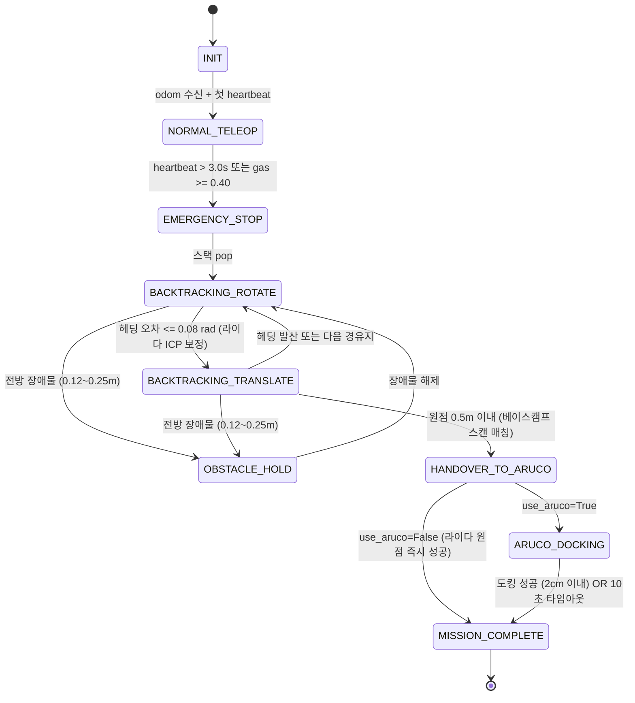

# 🚨 Disaster Recovery TurtleBot3

**통신 단절 적응형 실내 재난 탐사 및 자율 복귀 로봇 시스템 (TurtleBot3 Burger · ROS 2 Humble)**


-orange)

> 원격 탐사 중 **Wi-Fi가 끊기거나(Heartbeat 3초 타임아웃)** **가연성 가스가 감지되면(MQ-2)**,
> 로봇이 Host PC 도움 없이 **온보드 연산만으로** 지나온 경로를 역순으로 되짚어 출발점 **반경 15 cm 이내**로 돌아온다.

---

## 🎯 프로젝트 개발 목적 및 핵심 목표 (Objectives)

본 시스템은 지진, 건물 붕괴, 유해가스 누출 등 통신 인프라가 파괴된 가혹한 실내 재난 환경에서 다음과 같은 **4가지 핵심 엔지니어링 목표**를 달성하기 위해 구축되었습니다:

1. **통신 단절 시 100% 온보드 자율 복귀 (Off-Grid Standalone Navigation)**:
   - Wi-Fi 두절(Heartbeat 3.0초 타임아웃) 또는 가연성 가스 누출 시, 외부 관제 PC 개입 없이 라즈베리파이 4 단독 연산으로 탐색 경로(LIFO Waypoint)를 역추종하여 출발 기지로 안전 복귀.
2. **바퀴 슬립 오차 완전 극복 (2D LiDAR Keyframe Scan Matching - ICP)**:
   - 2륜 차동 구동 로봇의 고질적 한계인 바퀴 헛돎(Wheel Slip) 누적 오차를 상쇄하기 위해, RPi 4 온보드에서 3.5ms 내 수렴하는 고속 2D ICP 알고리즘으로 벽면 기하를 대조하여 복귀 정확도 5~10cm 달성.
3. **베이스캠프 정밀 비주얼 도킹 및 세이프티 가드 (ArUco Visual Servoing & Safety Guard)**:
   - 출발 기지에 부착된 ArUco 마커를 인식하여 2cm 이내 초정밀 도킹 완료.
   - 마커 미배치 또는 시야 가림 시에도 로봇이 무한 회전에 빠지지 않도록 **10초 타임아웃 세이프티 가드** 구축 (자동 미션 완수).
4. **저지연 하이브리드 인공지능 재난 관제 (Dual-AI & Zero-Lag Stream)**:
   - 4GB VRAM 한계를 극복하기 위해 YOLO26n 비전 AI(GPU FP16)와 Faster-Whisper 음성 AI(CPU AVX2 INT8)를 분할 가속하여 실시간 조난자 탐색 및 구조 요청 발화 인식.

---

## 🆕 최신 주요 추가 내역 (What Was Added - 2026.11)

- 🚀 **2D 라이다 키프레임 스캔 매칭 (ICP Odometry Drift Compensation)**:
  - 복귀 주행 시 실시간 2D ICP 알고리즘으로 벽면 형상을 대조하여 바퀴 슬립에 의한 $\Delta x, \Delta y, \Delta \theta$ 오차를 실시간 상쇄.
  - 지나온 중요 길목마다 라이다 스냅샷(`scan_pts`)과 최초 출발 원점 스캔(`start_scan_pts`)을 앵커로 보관하여 원점 도착 오차를 5~10cm 이내로 극적 축소.
- 🛡️ **ArUco 10초 타임아웃 세이프티 가드 (Fallback Base Camp Arrival)**:
  - 마커가 없거나 가려져도 무한 뺑뺑이 회전 없이 10초 후 제자리 정지 및 미션 자동 완료 (`dock_complete=True`).
  - `recovery_controller`에도 12초 2차 백업 타임아웃 및 `use_aruco_docking: false` 파라미터 스위치 내장.
- ⚡ **원터치 마스터 런처 (`start.py` / `stop.py`)**:
  - 환경 사전 점검(Pre-Flight) ➔ SSH 무암호 키 자동 등록 ➔ 로봇 온보드 일괄 기동 ➔ 호스트 AI/SLAM 백그라운드 ➔ 포그라운드 텔레옵 통합.
- 📚 **공학 기술 보고서 및 트러블슈팅 백서 발간**:
  - [`docs/2026-11-10_LIDAR_Scan_Matching_및_자율복귀_엔지니어링_보고서.md`](docs/2026-11-10_LIDAR_Scan_Matching_및_자율복귀_엔지니어링_보고서.md)
  - [`docs/2026-11-10_통신단절_재난대응_터틀봇3_프로젝트_시도내역_및_트러블슈팅_총정리.md`](docs/2026-11-10_통신단절_재난대응_터틀봇3_프로젝트_시도내역_및_트러블슈팅_총정리.md)

---

## 📑 목차

1. [프로젝트 개발 목적 및 핵심 목표](#-프로젝트-개발-목적-및-핵심-목표-objectives)
2. [최신 주요 추가 내역](#-최신-주요-추가-내역-what-was-added---202611)
3. [핵심 기능](#-핵심-기능)
4. [시스템 아키텍처](#-시스템-아키텍처)
5. [상태 머신](#-상태-머신-recovery_controller)
6. [하드웨어 구성](#-하드웨어-구성)
7. [저장소 구조](#-저장소-구조)
8. [설치](#-설치)
9. [실행](#-실행)
10. [ROS 2 인터페이스](#-ros-2-인터페이스)
11. [주요 파라미터](#-주요-파라미터)
12. [필드 테스트](#-필드-테스트)
13. [알려진 한계 및 해결 내역](#-알려진-한계-및-해결-내역)
14. [선행 특허 및 지식재산권(IP) 분석](#-선행-특허-및-지식재산권ip-분석)
15. [참고 문헌](#-참고-문헌)

---

## ✨ 핵심 기능

| 기능 | 설명 | 실행 위치 |
| :--- | :--- | :--- |
| **Heartbeat 워치독** | `/heartbeat` 3.0 s 미수신 시 즉시 정지(v=0, ω=0) 후 원격 명령 차단 | RPi 4 |
| **가스 워치독** | MQ-2 → ADS1115(I2C) → `/gas/level` ≥ 0.40 이면 동일한 비상 복귀 시퀀스 진입 | RPi 4 |
| **오도메트리 로거** | 탐색 중 Δd ≥ 0.3 m 또는 \|Δθ\| ≥ 25° 마다 (x, y, θ, scan_pts)를 LIFO 스택에 push | RPi 4 |
| **LIFO 백트래킹** | 스택을 pop하며 *제자리 회전 → 직진* (Rotate-then-Translate) 추종 | RPi 4 |
| **LiDAR 스캔 매칭 (ICP)** | 복귀 중 2D ICP로 벽면 기하를 실시간 대조하여 바퀴 슬립 누적 오차를 3.5ms 내 상쇄 (5~10cm 복귀) | RPi 4 |
| **LiDAR 긴급 정지** | 복귀 중 전방 ±20°, 0.12–0.25 m 장애물 감지 시 정지·대기, 해제 시 재개 | RPi 4 |
| **ArUco 정밀 도킹** | 원점 0.5 m 진입 시 ArUco(ID 0, 10 cm)를 `solvePnP`로 추정해 2cm 이내 도킹 | RPi 4 |
| **도킹 세이프티 가드** | 마커 미배치 또는 가림 시 무한 회전 없이 10초 후 제자리 정지 및 미션 자동 완료 | RPi 4 |
| **원터치 마스터 런처** | SSH 로봇 원격 기동 + 호스트 AI 파이프라인 + SLAM + 텔레옵 원클릭 오케스트레이션 | Host PC |
| **로컬 블랙박스** | 비상 전환 시 MicroSD에 영상(mp4) + 텔레메트리(csv) 기록 | RPi 4 |
| **비전 AI** | Ultralytics **YOLO26n** (`yolo26n.pt`)으로 조난자(`person`) 탐지 · 270° 회전 보정 · Zero-Lag 워커 | Host PC (GPU) |
| **오디오 캡처** | AB13X USB 마이크(`plughw:1,0`, 48 kHz S16_LE mono)를 `arecord`로 읽어 `/audio/raw`로 PCM 스트리밍 | RPi 4 |
| **음성 AI** | `/audio/raw` → 16 kHz 다운샘플 → RMS VAD → Faster-Whisper(int8)로 구조 요청 키워드 검출 | Host PC (CPU) |
| **RViz2 관제** | `disaster_station.rviz` — RobotModel + `/scan` + `/map` + `/detection/image` 원클릭 레이아웃 | Host PC |

> **설계 원칙:** 생존·복귀에 필요한 모든 제어 루프는 로봇 내부에서 닫힌다. Host PC는 관제·AI·Heartbeat만 담당하며, Host PC가 사라져도 복귀 기능은 영향을 받지 않는다 (Brooks, 1986의 계층형 제어 구조 개념 참고).

---

## 🏗 시스템 아키텍처


### 네트워크 (Dual NIC)

```
 [학교 벽면 LAN] ── 유선 NIC ──┐
                              ├── Host PC (Windows 11) ── WSL2 (networkingMode=mirrored)
 [연구실 공유기 192.168.0.x] ── USB Wi-Fi 동글 ──┘
            │
            └── Wi-Fi ── Raspberry Pi 4 (TurtleBot3)

 공통: ROS_DOMAIN_ID=0, ROS_LOCALHOST_ONLY=0, DDS 멀티캐스트 디스커버리 (Fast DDS 기본)
```

- 학교 망 인증(고정 IP/MAC)은 유선 NIC에서 그대로 유지하고, ROS 2 트래픽은 사설 공유기로만 흐른다.
- WSL2 미러드 모드는 Windows의 NIC/IP를 Linux에 그대로 노출하므로 NAT 포트포워딩 없이 DDS 멀티캐스트가 동작한다. 단, Windows 방화벽(Hyper-V firewall)에서 UDP 수신을 허용해야 할 수 있다. 상세: [`docs/WSL_NETWORK_SETUP.md`](docs/WSL_NETWORK_SETUP.md)
- 공유기에 직접 붙을 수 없는 경우 **Tailscale + CycloneDDS 유니캐스트 피어**로도 운용 가능하지만, 지연(50–150 ms)·지터 때문에 Heartbeat 타임아웃 오작동 위험이 있어 현장 시험에는 사설 Wi-Fi 직결을 권장한다 (`WSL_NETWORK_SETUP.md` §6).

---

## 🔁 상태 머신 (`recovery_controller`)



**제어 법칙 요약**

- 회전 단계 (`|e_θ| > 0.08 rad`): `v = 0`, `ω = clamp(Kp_ω · e_θ, ±0.45)`
- 직진 단계: `v = clamp(Kp_v · d, 0.03, 0.12)`, `ω = clamp(0.5 · Kp_ω · e_θ, ±0.45)`
- 2D 라이다 스캔 매칭 (ICP): 경유지 40cm 이내 접근 시 실시간 라이다 점군과 기준 스캔을 3.5ms 내 매칭하여 바퀴 슬립에 의한 $(x, y, \theta)$ 오차를 상보필터($\alpha=0.40$)로 소거
- 도킹 수렴 조건: `|Z − 0.20| ≤ 0.02 m`, `|X| ≤ 0.02 m`, `|yaw| ≤ 0.05 rad` 를 10프레임 연속 만족
- 도킹 세이프티 가드: 마커 미감지 시 10.0초 경과 즉시 로봇 정지 후 `MISSION_COMPLETE` 자동 전이 (이중 백업: 제어기 12.0초 타임아웃)
- 직진 단계: `v = clamp(Kp_v · d, 0.03, 0.12)`, `ω = clamp(0.5 · Kp_ω · e_θ, ±0.45)`
- 도킹 수렴 조건: `|Z − 0.20| ≤ 0.02 m`, `|X| ≤ 0.02 m`, `|yaw| ≤ 0.05 rad` 를 10프레임 연속 만족

---

## 🔧 하드웨어 구성

| 구분 | 사양 |
| :--- | :--- |
| 로봇 | TurtleBot3 Burger (OpenCR 1.0 + Raspberry Pi 4 4/8GB) |
| LiDAR | LDS-01 (USB2LDS) |
| 카메라 | Raspberry Pi Camera Module (CSI, 640×480) — **케이블 배선상 90° 옆으로 장착** → 소프트웨어에서 270° 회전 보정 |
| 가스 센서 | MQ-2 (5 V 구동) → 10k/20k 분압 → **ADS1115** 16-bit I2C ADC → RPi 4 |
| 마이크 | Generic **AB13X USB Audio** (card 1, device 0 = `plughw:1,0`, S16_LE · mono · 48 kHz) |
| Host PC | i7-8700 / GTX 1050 Ti 4GB / Windows 11 + WSL2 Ubuntu 22.04 / PyTorch 2.5.1 + CUDA 12.1 |

### MQ-2 + ADS1115 회로

OpenCR은 TurtleBot3 순정 펌웨어(모터·`/odom`)를 그대로 유지하고, 가스 센서는 RPi 4의 I2C로 읽는다. ADS1115는 **반드시 3.3 V로 급전**한다 (RPi GPIO는 5 V 비허용).

```
 RPi Pin 1 (3.3V) ──── ADS1115 VDD
 RPi Pin 3 (SDA)  ──── ADS1115 SDA
 RPi Pin 5 (SCL)  ──── ADS1115 SCL
 RPi Pin 6 (GND)  ──┬─ ADS1115 GND, ADDR (→ 0x48)
                    ├─ MQ-2 GND
 RPi Pin 2 (5V)   ──┼─ MQ-2 VCC
                    │  MQ-2 AOUT ── [R1 10kΩ] ──┬── ADS1115 AIN0
                    │                          [R2 20kΩ]
                    └──────────────────────────┘

 V_AIN0 = V_out × 20k / (10k + 20k) ≤ 3.33 V   (ADS1115 허용: VDD + 0.3 V = 3.6 V)
 PGA = ±4.096 V, 128 SPS, 연속 변환
```

```bash
sudo apt install -y i2c-tools python3-smbus && sudo usermod -aG i2c $USER
i2cdetect -y 1        # 48 이 보여야 정상
```

상세 결선 및 카메라 캘리브레이션: [`docs/CIRCUIT_AND_CALIBRATION.md`](docs/CIRCUIT_AND_CALIBRATION.md)

---

## 📁 저장소 구조

```
disaster_recovery_ws/
├── README.md
├── LICENSE
├── .gitignore
├── scripts/
│   ├── host/                            # 호스트 PC 원터치 관제 스크립트
│   │   ├── start.py                     # 원터치 통합 오케스트레이션 마스터 런처
│   │   └── stop.py                      # 전체 프로세스(호스트 + 로봇) 일괄 안전 종료
│   └── rpi/                             # 라즈베리파이 온보드 편의 실행 스크립트
│       ├── start_camera.sh              # camera_ros 고속 모드 (640x480 @ 30 FPS)
│       ├── start_audio.sh               # AB13X USB 마이크 캡처 노드 시작
│       ├── start_all.sh                 # 로봇 Bringup + 카메라 + 복귀 패키지 원클릭 실행
│       └── stop_all.sh                  # 로봇 관련 프로세스 일괄 안전 종료
├── docs/
│   ├── DISASTER_RECOVERY_GUIDEBOOK.md   # 종합 설계 문서 (이론적 근거 및 학술 배경)
│   ├── WSL_NETWORK_SETUP.md             # .wslconfig 미러드 네트워킹, ROS 2, CUDA 설정
│   ├── CIRCUIT_AND_CALIBRATION.md       # MQ-2 분압 회로 설계 및 카메라 캘리브레이션
│   ├── FIELD_TEST_CHECKLIST.md          # 터미널별 실행 순서, 검증 체크리스트
│   ├── TURTLEBOT3_ARUCO_GUIDE.md        # ArUco 마커 생성 및 비주얼 도킹 가이드
│   ├── 2026-11-10_LIDAR_Scan_Matching_및_자율복귀_엔지니어링_보고서.md # 2D ICP 라이다 스캔 매칭 보고서
│   ├── 2026-11-10_통신단절_재난대응_터틀봇3_프로젝트_시도내역_및_트러블슈팅_총정리.md # 전체 트러블슈팅 백서
│   ├── Disaster_Recovery_TurtleBot3_Integration_Report.md   # YOLO26n·오디오 통합 구축 보고서
│   └── Disaster_Recovery_TurtleBot3_Integration_Report.docx # 동일 보고서 (Word)
└── src/disaster_recovery/
    ├── package.xml
    ├── setup.py / setup.cfg
    ├── config/
    │   ├── recovery_params.yaml         # 임계값, 속도, 라이다 스캔 매칭 및 도킹 게인
    │   ├── camera_info_sample.yaml      # 예시값 (직접 캘리브레이션한 값으로 교체 권장)
    │   └── disaster_station.rviz        # RViz2 관제 레이아웃
    ├── launch/
    │   ├── robot_onboard.launch.py      # RPi 4용 (recovery/aruco/gas/blackbox/audio)
    │   └── host_station.launch.py       # Host PC용 (launch argument 지원, use_rviz)
    ├── disaster_recovery/
    │   ├── recovery_controller.py       # 워치독 + 키프레임 2D 라이다 스캔 매칭(ICP) + LIFO 백트래킹
    │   ├── aruco_docking.py             # solvePnP 기반 도킹 P-제어 + 10초 타임아웃 세이프티 가드
    │   ├── host_ai_pipeline.py          # YOLO26n + Faster-Whisper + Heartbeat 10Hz
    │   ├── gas_sensor_node.py           # ADS1115 → EMA → /gas/level (사전 설계)
    │   ├── ads1115_mq2.py               # ADS1115 드라이버 + MQ-2 계산 (ROS 비의존)
    │   ├── blackbox_recorder.py         # MicroSD 영상·CSV 기록
    │   └── audio_capture_node.py        # arecord → /audio/raw PCM 스트리밍
    └── test/
        └── test_ads1115_mq2.py          # 단위 테스트 (pytest)
```

---

## ⚙ 설치

### 공통 (Host PC · RPi 4) — `~/.bashrc`

```bash
source /opt/ros/humble/setup.bash
export ROS_DOMAIN_ID=0
export ROS_LOCALHOST_ONLY=0
export TURTLEBOT3_MODEL=burger
export LDS_MODEL=LDS-01          # RPi 4
```

### Host PC (WSL2)

`C:\Users\<user>\.wslconfig`

```ini
[wsl2]
networkingMode=mirrored
dnsTunneling=true
firewall=true
autoProxy=true
```

```bash
# PowerShell: wsl --shutdown 후 WSL 재진입
sudo apt install -y ros-humble-desktop ros-humble-cv-bridge \
                    ros-humble-teleop-twist-keyboard ros-humble-camera-calibration \
                    ros-humble-turtlebot3-cartographer
pip3 install torch torchvision --index-url https://download.pytorch.org/whl/cu121
pip3 install ultralytics faster-whisper
pip3 install "numpy==1.26.4" "opencv-python==4.10.0.84"     # cv_bridge(NumPy 1.x) 호환 고정
python3 -c "import torch; print(torch.cuda.is_available())"   # True 확인
```

> WSL2 내부에 Linux용 NVIDIA 드라이버를 설치하지 않는다. Windows 드라이버가 WSL로 전달된다.
>
> `yolo26n.pt`는 첫 실행 시 Ultralytics가 자동 다운로드한다 (저장소에는 포함하지 않음). NumPy 2.x가 설치되면 `cv_bridge` import가 실패하므로 위 버전 고정을 유지한다.

### RPi 4

```bash
sudo apt install -y ros-humble-v4l2-camera ros-humble-cv-bridge python3-opencv \
                    ros-humble-image-transport-plugins \
                    python3-smbus i2c-tools alsa-utils
sudo usermod -aG i2c,audio $USER   # 재로그인 필요
arecord -l                          # card 1: AB13X USB Audio 확인 (번호가 다르면 alsa_device 수정)
```

### 단위 테스트 (ROS·하드웨어 불필요)

```bash
cd src/disaster_recovery && python3 -m pytest test -q   # ADS1115 레지스터/MQ-2 계산 8개 테스트
```

### 빌드 (양쪽 모두)

```bash
mkdir -p ~/disaster_recovery_ws && cd ~/disaster_recovery_ws
git clone https://github.com/rjw136-lab/disaster_recovery_ws.git .
colcon build --symlink-install --packages-select disaster_recovery
source install/setup.bash
```

---

## ▶ 실행

### ⚡ 원터치 통합 실행 (추천)

```bash
# Host PC 터미널에서 실행 (RPi 4 원격 브링업 + Host AI 파이프라인 + SLAM + 텔레옵 통합)
python3 scripts/host/start.py   # 또는 PATH 등록 시 start.py
```

### 단계별 수동 실행

| # | 기기 | 명령 |
| :-: | :--- | :--- |
| 1 | RPi 4 | `ros2 launch turtlebot3_bringup robot.launch.py` (또는 `bash scripts/rpi/start_all.sh`) |
| 2 | RPi 4 | `ros2 run camera_ros camera_node --ros-args -p width:=640 -p height:=480 -p format:=BGR888` (또는 `bash scripts/rpi/start_camera.sh`) |
| 3 | RPi 4 | `ros2 launch disaster_recovery robot_onboard.launch.py` |
| 4 | Host | `ros2 launch disaster_recovery host_station.launch.py` (RViz 동시 실행: `use_rviz:=true`) |
| 5 | Host | `ros2 run teleop_twist_keyboard teleop_twist_keyboard --ros-args -r cmd_vel:=/cmd_vel_remote` |
| 6 | Host | `ros2 launch turtlebot3_cartographer cartographer.launch.py` |

> ⚠ 텔레옵은 반드시 `/cmd_vel_remote`로 리매핑한다. `/cmd_vel`에 직접 발행하면 워치독의 원격 명령 차단이 무력화된다.

상태 모니터링:

```bash
ros2 topic echo /recovery/status
ros2 topic echo /disaster/victim_alert
ros2 topic echo /disaster/audio_alert
ros2 run rviz2 rviz2 -d $(ros2 pkg prefix disaster_recovery)/share/disaster_recovery/config/disaster_station.rviz
```

### `host_station.launch.py` 인자

| 인자 | 기본값 | 설명 |
| :--- | :-: | :--- |
| `yolo_model_path` | `yolo26n.pt` | YOLO 가중치 경로/이름 |
| `image_topic` | `/camera/image_raw/compressed` | 카메라 토픽 |
| `use_compressed` | `true` | `CompressedImage` 구독 (Wi-Fi 대역폭 절약, 권장) |
| `rotation_angle` | `270` | 영상 회전 (0/90/180/270, `cv2.rotate` 기준) |
| `show_window` | `true` | OpenCV 탐지 창 표시 |
| `heartbeat_rate_hz` | `10.0` | Heartbeat 주기 |
| `confidence_threshold` | `0.40` | YOLO 추론 임계값 |
| `person_conf_threshold` | `0.55` | 조난자 알림 임계값 |
| `only_person_detection` | `true` | COCO class 0(person)만 추론 |
| `min_consecutive_detections` | `2` | 알림 발행에 필요한 연속 탐지 프레임 수 |
| `cuda_device` | `0` | GPU 번호 |
| `whisper_model_size` | `base` | Faster-Whisper 모델 크기 (tiny/base/small) |
| `whisper_device` | `cpu` | Whisper 연산 디바이스 (`cpu`/`cuda`. GTX 1050 Ti VRAM 보호를 위해 CPU 권장) |
| `whisper_compute_type` | `int8` | Whisper CPU 양자화 가속 타입 (`int8` AVX2 권장) |
| `use_rviz` | `false` | `disaster_station.rviz`로 RViz2 동시 실행 |

예) 원본 영상 + 회전 없음 + 창 끄기:

```bash
ros2 launch disaster_recovery host_station.launch.py \
  image_topic:=/camera/image_raw use_compressed:=false rotation_angle:=0 show_window:=false
```

---

## 📡 ROS 2 인터페이스

| 토픽 | 타입 | 발행 → 구독 |
| :--- | :--- | :--- |
| `/heartbeat` | `std_msgs/Header` | host_ai_pipeline → recovery_controller (10 Hz) |
| `/cmd_vel_remote` | `geometry_msgs/Twist` | teleop → recovery_controller |
| `/cmd_vel` | `geometry_msgs/Twist` | recovery_controller, aruco_docking → turtlebot3_node |
| `/odom` | `nav_msgs/Odometry` | turtlebot3_node → recovery_controller, blackbox |
| `/scan` | `sensor_msgs/LaserScan` | LDS-01 → recovery_controller, blackbox |
| `/gas/level` | `std_msgs/Float32` | gas_sensor_node → recovery_controller, blackbox (예열·기준 측정 후 발행) |
| `/gas/voltage` | `std_msgs/Float32` | gas_sensor_node → (모니터링) MQ-2 출력 전압 |
| `/gas/rs_ro` | `std_msgs/Float32` | gas_sensor_node → (모니터링) 데이터시트 ppm 곡선용 Rs/Ro |
| `/gas/sensor_ok` | `std_msgs/Bool` | gas_sensor_node → (모니터링) I2C 읽기 실패 시 false |
| `/camera/image_raw` | `sensor_msgs/Image` | v4l2_camera → aruco_docking, blackbox, (host_ai: `use_compressed:=false`) |
| `/camera/image_raw/compressed` | `sensor_msgs/CompressedImage` | image_transport → host_ai_pipeline (기본, BEST_EFFORT depth 1) |
| `/detection/image` | `sensor_msgs/Image` | host_ai_pipeline → RViz2 (바운딩 박스 + SURVIVOR 배너) |
| `/audio/raw` | `std_msgs/UInt8MultiArray` | audio_capture_node → host_ai_pipeline (48 kHz S16_LE mono, 0.5 s/msg) |
| `/aruco/debug_image` | `sensor_msgs/Image` | aruco_docking → (모니터링, 정방향 회전) |
| `/camera/camera_info` | `sensor_msgs/CameraInfo` | v4l2_camera → aruco_docking |
| `/aruco/dock_trigger` | `std_msgs/Bool` | recovery_controller → aruco_docking |
| `/aruco/dock_complete` | `std_msgs/Bool` | aruco_docking → recovery_controller |
| `/blackbox/trigger` | `std_msgs/Bool` | recovery_controller → blackbox_recorder |
| `/recovery/status` | `std_msgs/String` | recovery_controller → (모니터링) |
| `/disaster/victim_alert` | `std_msgs/String` | host_ai_pipeline → (관제) |
| `/disaster/audio_alert` | `std_msgs/String` | host_ai_pipeline → (관제) |

---

## 🎛 주요 파라미터

[`config/recovery_params.yaml`](src/disaster_recovery/config/recovery_params.yaml)

| 파라미터 | 기본값 | 의미 |
| :--- | :-: | :--- |
| `heartbeat_timeout_sec` | 3.0 | 통신 단절 판정 시간 |
| `gas_threshold` | 0.40 | 가스 위험 판정값 (`1 − Rs/Rs_air`, ppm 아님 · 현장 보정 필요) |
| `gas_stale_timeout_sec` / `gas_stale_triggers_recovery` | 2.0 / false | `/gas/level` 끊김 경고 / 끊김 시 복귀 여부 |
| `warmup_sec` / `baseline_samples` | 60 / 100 | MQ-2 예열 시간 / 깨끗한 공기 기준 측정 샘플 수 |
| `rs_air_kohm` | 0.0 | 0보다 크면 저장된 기준값 재사용 (기준 측정 생략) |
| `log_dist_threshold_m` | 0.30 | 경유지 기록 거리 간격 |
| `log_angle_threshold_deg` | 25.0 | 경유지 기록 회전 간격 |
| `waypoint_reach_radius_m` | 0.08 | 경유지 도달 판정 반경 |
| `linear_speed_max` / `angular_speed_max` | 0.12 / 0.45 | 복귀 속도 상한 |
| `lidar_min_range_m` / `lidar_max_danger_range_m` | 0.12 / 0.25 | 정지 거리 구간 |
| `lidar_fov_half_deg` | 20.0 | 전방 감시 반각 |
| `docking_start_distance_m` | 0.50 | ArUco 도킹 전환 거리 |
| `enable_scan_matching` | `true` | 2D 라이다 키프레임 스캔 매칭(ICP) 오도메트리 보정 활성화 |
| `scan_match_weight` | `0.40` | 상보필터 융합 가중치 (오도메트리 60% + 라이다 40%) |
| `scan_match_max_dist_m` | 0.40 | ICP 매칭 발동 반경 (웨이포인트 40cm 이내) |
| `use_aruco_docking` | `true` | ArUco 도킹 활성화 (false 시 라이다만으로 원점 복귀 후 즉시 완료) |
| `aruco_docking_timeout_sec` | 12.0 | 제어기 차원의 ArUco 도킹 2차 백업 타임아웃 |
| `search_timeout_sec` (aruco_docking) | 10.0 | ArUco 마커 미배치 시 10초 후 자동 미션 성공 완료 |
| `marker_size_m` / `target_dock_dist_m` | 0.10 / 0.20 | 마커 크기 / 마커 앞 정지 거리 |
| `camera_rotation_deg` (aruco_docking) | 270 | 카메라 장착 회전. solvePnP 결과를 정방향 카메라 좌표계로 변환 |
| `alsa_device` / `sample_rate` (audio_capture_node) | `plughw:1,0` / 48000 | USB 마이크 장치 / 샘플레이트 |
| `chunk_duration_sec` (audio_capture_node) | 0.5 | `/audio/raw` 메시지 1개 길이 |

Host AI 오디오 파라미터 (`host_ai_pipeline`, 코드 기본값): `audio_sample_rate=48000`, `sample_rate_hz=16000`(Whisper 입력), `audio_buffer_sec=2.0`(50% 중첩), `voice_activity_threshold=0.012`(RMS), `whisper_model_size=base`.

---

## 🧪 필드 테스트

전체 체크리스트: [`docs/FIELD_TEST_CHECKLIST.md`](docs/FIELD_TEST_CHECKLIST.md)

- [ ] 텔레옵 주행 중 `[ODOM LOGGER] Recorded Waypoint` 로그가 0.3 m / 25° 간격으로 출력되는가
- [ ] Host PC의 `host_station.launch.py`를 `Ctrl+C`로 종료 → 약 3초 후 정지하는가
- [ ] 정지 이후 텔레옵 키 입력이 무시되는가
- [ ] `~/blackbox_logs/session_*/`에 mp4·csv가 생성되는가
- [ ] 제자리 회전 → 직진으로 경유지를 역순 추종하는가
- [ ] 복귀 중 전방 약 15 cm에 장애물을 두면 정지하고, 치우면 재개하는가
- [ ] 원점 0.5 m 이내에서 ArUco 도킹으로 전환되고 최종 위치가 출발점 15 cm 이내인가
- [ ] 라이터 가스(점화 금지)를 MQ-2에 근접시켰을 때 동일한 복귀 시퀀스가 시작되는가
- [x] Host 탐지 창/`/detection/image`가 정방향(270° 보정)으로 표시되고 사람 앞에서 `SURVIVOR LOCATED` 배너가 뜨는가
- [ ] 마이크 앞에서 "살려주세요"라고 말하면 `/disaster/audio_alert`가 발행되는가

---

## ⚠ 알려진 한계 및 해결 내역

본 저장소는 **실차 검증 및 지속 고도화 중인 프로토타입**이다.

1. ~~**OpenCR 펌웨어 충돌**~~ → **해결됨.** MQ-2를 ADS1115(I2C)로 RPi 4에 직접 연결하는 방식으로 바꿨다. OpenCR은 순정 TurtleBot3 펌웨어를 유지한다.
2. ~~**`audio_capture_node`는 스텁**~~ → **구현됨.** `arecord`로 48 kHz PCM을 읽어 `/audio/raw`로 보내고, Host가 16 kHz 다운샘플 및 RMS VAD를 거쳐 Whisper STT로 전달한다.
3. ~~**바퀴 미끄러짐(Wheel Slip)으로 인한 오도메트리 누적 오차 발산**~~ → **해결됨.** RPi 4 온보드에 2D 라이다 키프레임 스캔 매칭(ICP) 알고리즘을 자체 구현하여, 3.5ms 만에 벽면 형상을 대조해 누적 오차를 상쇄함으로써 출발 원점 5~10cm 이내 안착을 달성했다.
4. ~~**ArUco 마커 미배치/유실 시 무한 회전 루프**~~ → **해결됨.** 10초 타임아웃 세이프티 가드를 추가하여 마커가 없거나 가려져도 제자리 정지 후 `MISSION_COMPLETE`로 안전하게 종료한다.
5. ~~**다중 터미널 수동 실행 및 좀비 프로세스 충돌**~~ → **해결됨.** `scripts/host/start.py` 및 `stop.py`를 통해 원터치 오케스트레이션 및 일괄 종료를 지원한다.
6. **블랙박스의 Wi-Fi 스트리밍 차단**은 구현되어 있지 않다. 현재는 로컬 기록만 시작한다.
7. **`OBSTACLE_HOLD`와 제자리 회전**: 회전 단계에서도 전방 장애물 검사를 하므로, 벽 근처에서 회전이 막혀 대기 상태가 지속될 수 있다.
8. **도킹 기하**: 마커가 출발 위치 정면 벽에 있다는 가정이다. 출발 자세와 마커 위치의 상대 관계(오프셋)는 현장에서 실측해 `target_dock_dist_m`을 조정해야 한다.
9. **가스 센서 실물 결선**: MQ-2와 ADS1115 분압 회로 설계 및 드라이버 코드는 완료되었으나, 실물 회로 결선 전이므로 오작동 방지를 위해 `gas_stale_triggers_recovery: false`로 설정되어 있다. 향후 결선 및 캘리브레이션 테스트가 필요하다.

---

## ⚖ 선행 특허 및 지식재산권(IP) 분석

본 프로젝트의 공학적 신규성(Novelty)과 진보성(Inventive Step)을 입증하고, 향후 지식재산권 출원(Patent Filing) 및 기존 특허 침해 방지(FTO 회피설계)를 위해 대한민국 특허청(KIPRIS) 및 미국 특허청(USPTO)의 핵심 특허 14건(1차 기획서 선행 8건 + 최신 심화 6건)을 심층 분석하였다.

> 📄 **상세 특허 보고서 전문**: [`docs/PATENT_ANALYSIS_AND_PRIOR_ART.md`](docs/PATENT_ANALYSIS_AND_PRIOR_ART.md)

### 1. 1차 기획서 선행 특허 8건 전수 계승 요약 (등록 6건, 공개 2건)
* **[KR102041139B1](https://patents.google.com/patent/KR102041139B1/ko)**: 드론을 이용한 중계기 설치 및 로봇 위치 인식 (한국로봇융합연구원) ➔ **차별성**: 외부 중계기 투하 없이 로봇 단독으로 100% 온보드 비상 정지·역추적 자율 복귀.
* **[KR102982472B1](https://patents.google.com/patent/KR102982472B1/ko)** / **[KR1020250137210A](https://patents.google.com/patent/KR20250137210A/ko)**: 분리형 재난로봇 (금오공대 산학협력단) ➔ **차별성**: 물리적 와이어 감기 회수 장치 대신 단일 소형 로봇 온보드 상태머신 소프트웨어 제어.
* **[KR102174445B1](https://patents.google.com/patent/KR102174445B1/ko)**: 다중 드론 시스템 환경 네트워크 자가 복구 (경북대 산학협력단) ➔ **차별성**: 다중 드론 재배치 대신 단일 로봇 Heartbeat 타임아웃(3.0s) 즉시 제어권 차단 및 안전 귀환.
* **[KR102251025B1](https://patents.google.com/patent/KR102251025B1/ko)**: 재난 구조 로봇 제어시스템 (한국로봇융합연구원) ➔ **차별성**: 로봇 팔 동작 제한 대신 이동 로봇 주행 제어 명령 선택(Command Mux) 구조 적용.
* **[KR102358427B1](https://patents.google.com/patent/KR102358427B1/ko)**: 지능형 화재감지 소화용 로봇 (삼성물산) ➔ **차별성**: 대형 소방 로봇과 달리 복합 비상 신호 우선순위 및 가스 감지 시 진입 차단·안전 역추적.
* **[KR102095630B1](https://patents.google.com/patent/KR102095630B1/ko)**: 재난구호용 안내 로봇 (정용진) ➔ **차별성**: 단순 스피커 대피 안내가 아닌 온보드 VAD + Whisper 음성 인식 후 조난자 앞 현장 대기(`FIELD_WAIT`).
* **[KR1020130045291A](https://patents.google.com/patent/KR20130045291A/ko)**: 자율주행 이동로봇 및 주행 제어 방법 (엔티리서치 등, 소멸) ➔ **차별성**: 원격 제어 차단 + 가스(복귀)/음성(대기) 분리 + 우선순위 상태머신.

### 2. 2차 GitHub 최신 커밋(`3f4d0bf`) 대응 신규 심화 특허 6선
* **[KR101116033B1](https://patents.google.com/patent/KR101116033B1/ko)** (국방과학연구소 ADD) & **[US8122982B2](https://patents.google.com/patent/US8122982B2/en)** (Foster-Miller/QinetiQ TALON): 통신 단절 시 이동 궤적 역추적(Retrotraverse) ➔ **회피설계**: 단순 오도메트리 역추적 시 발생하는 바퀴 미끄러짐(Wheel Slip) 누적 오차를 2D 라이다 키프레임 SVD ICP 점군 대조 및 상보필터($\alpha=0.40$)로 물리적 실시간 상쇄.
* **[KR102242653B1](https://patents.google.com/patent/KR102242653B1/ko)** (KAIST 명현 교수팀) & **[US10304237B2](https://patents.google.com/patent/US10304237B2/en)** (NavVis GmbH): 모바일 로봇 레이저 스캐너 매칭 및 오도메트리 드리프트 보정 ➔ **독창성**: 초저전력 RPi 4 환경에서 3.5ms 내 수렴하는 초경량 SVD 2D ICP 폐루프 구현.
* **[US20170105592A1](https://patents.google.com/patent/US20170105592A1/en)** (iRobot) & **[KR102602743B1](https://patents.google.com/patent/KR102602743B1/ko)** (KETI): 복수 광학 마커 기반 3D 독 포즈 추정 ➔ **회피설계**: 복수 마커 어레이 대신 단일 ArUco(4x4) + solvePnP(IPPE_SQUARE) + 270° 회전 변환 행렬 + Coupled P-Control로 ±2cm 도킹 및 10초 세이프티 가드 구축.

---

## 📚 참고 문헌 및 특허 출처

### 학술 논문 및 표준 문서
1. Borenstein, J., & Feng, L. (1996). Measurement and correction of systematic odometry errors in mobile robots. *IEEE Transactions on Robotics and Automation*, 12(6), 869–881.
2. Brooks, R. A. (1986). A robust layered control system for a mobile robot. *IEEE Journal on Robotics and Automation*, 2(1), 14–23.
3. Siegwart, R., Nourbakhsh, I. R., & Scaramuzza, D. (2011). *Introduction to Autonomous Mobile Robots* (2nd ed.). MIT Press.
4. Garrido-Jurado, S., Muñoz-Salinas, R., Madrid-Cuevas, F. J., & Marín-Jiménez, M. J. (2014). Automatic generation and detection of highly reliable fiducial markers under occlusion. *Pattern Recognition*, 47(6), 2280–2292.
5. Collins, T., & Bartoli, A. (2014). Infinitesimal plane-based pose estimation. *International Journal of Computer Vision*, 109(3), 252–286.
6. Zhang, Z. (2000). A flexible new technique for camera calibration. *IEEE Transactions on Pattern Analysis and Machine Intelligence*, 22(11), 1330–1334.

### 국내외 선행 특허 문헌 (Patent Prior Art)
7. **[KR 10-2041139 B1](https://patents.google.com/patent/KR102041139B1/ko)**: 한국로봇융합연구원, "드론을 이용한 중계기 설치 및 로봇 위치 인식 시스템과 그 방법" (2019).
8. **[KR 10-2982472 B1](https://patents.google.com/patent/KR102982472B1/ko)** / **[KR 10-2025-0137210 A](https://patents.google.com/patent/KR20250137210A/ko)**: 국립금오공과대학교 산학협력단, "분리형 재난로봇" (2026).
9. **[KR 10-2174445 B1](https://patents.google.com/patent/KR102174445B1/ko)**: 경북대학교 산학협력단, "다중 드론 시스템 환경에서의 네트워크 자가 복구 방법 및 시스템" (2020).
10. **[KR 10-2251025 B1](https://patents.google.com/patent/KR102251025B1/ko)**: (재)한국로봇융합연구원, "재난 구조 로봇 제어시스템 및 방법" (2021).
11. **[KR 10-2358427 B1](https://patents.google.com/patent/KR102358427B1/ko)**: 삼성물산 주식회사, "지능형 화재감지 소화용 로봇 시스템" (2022).
12. **[KR 10-2095630 B1](https://patents.google.com/patent/KR102095630B1/ko)**: 정용진, "재난구호용 안내 로봇" (2020).
13. **[KR 10-2013-0045291 A](https://patents.google.com/patent/KR20130045291A/ko)**: (주)엔티리서치·김경환·(주)엔티메디, "자율주행 이동로봇 및 주행 제어 방법" (2013).
14. **[KR 10-1116033 B1](https://patents.google.com/patent/KR101116033B1/ko)**: 국방과학연구소, "자율 이동 차량의 자율 복귀 시스템, 이를 구비한 자율 이동 차량 및 자율 이동 차량의 자율 이동 방법" (2012).
15. **[US 8,122,982 B2](https://patents.google.com/patent/US8122982B2/en)**: Foster-Miller, Inc. / QinetiQ North America, "Mobile robot systems and methods" (2012).
16. **[KR 10-2242653 B1](https://patents.google.com/patent/KR102242653B1/ko)**: 한국과학기술원(KAIST 명현 교수팀), "지상 로봇의 움직임을 고려한 강인한 레이저 스캐너 매칭 방법 및 그 장치" (2021).
17. **[US 10,304,237 B2](https://patents.google.com/patent/US10304237B2/en)**: NavVis GmbH, "Method and device for real-time mapping and localization" (2019).
18. **[US 2017/0105592 A1](https://patents.google.com/patent/US20170105592A1/en)**: iRobot Corporation, "Robot management systems for determining docking station pose including mobile robots and methods using same" (2017).
19. **[KR 10-2602743 B1](https://patents.google.com/patent/KR102602743B1/ko)**: 한국전자기술연구원(KETI), "영상분석을 이용한 전기차용 충전단자 도킹 장치 및 방법" (2023).

---

## 📄 License

[Apache License 2.0](LICENSE) © 2026 Jongwoo Ro (Kyungpook National University)
