# 🚨 Disaster Recovery TurtleBot3 Burger

<p align="center">
  <strong>통신 단절 적응형 실내 재난 탐사 및 자율 복귀 로봇 시스템</strong><br>
  <em>(TurtleBot3 Burger · ROS 2 Humble · Kyungpook National University)</em>
</p>

<p align="center">
  
  
  
  
  
  
  
  
  
  
</p>

<p align="center">
  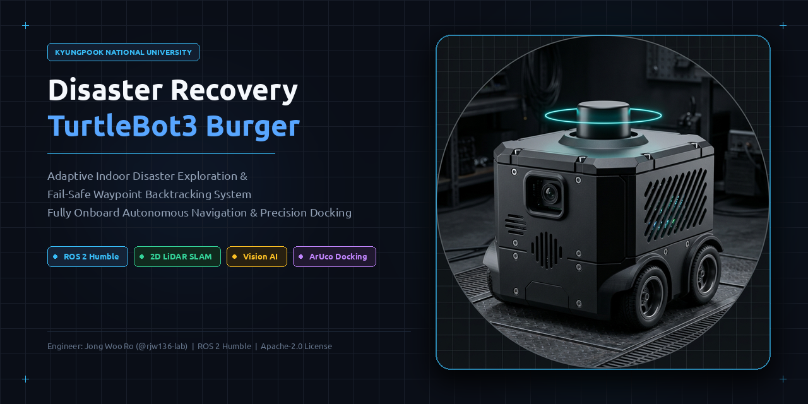
</p>

> 🚨 **시스템 요약 (System Overview)**: 실내 재난 환경 탐사 중 **통신 단절(Heartbeat 3.0초 타임아웃)** 또는 **유해 가스 누출(MQ-2 임계치 초과)** 이 발생했을 때, 외부 관제 없이 온보드 연산(Raspberry Pi 4)만으로 **Phase 2-B 계층형 자율복귀(LIFO 역추적 · `RollingLocalGrid 2D A*` · `Context-RL ONNX` · 2D LiDAR ICP 보정 · 연기/동적잔상 필터 · ArUco 정밀 도킹)** 를 수행해 출발 지점까지 복귀하는 TurtleBot3 Burger 제어 시스템이다. (15대 재난 시나리오 150회 벤치마크 **`99.33%`** 달성 · 차기 **Phase 3 시맨틱 맵핑/RL** 예정)

---

## 📑 목차

**🧭 프로젝트 소개**

1. [개요](#-개요)
   - [개발 목적](#개발-목적) · [개발 현황](#개발-현황) · [최근 변경사항](#최근-변경사항-patch-notes--최근-6건) · [관련 문서](#관련-문서)
2. [핵심 기능](#-핵심-기능)
3. [시스템 아키텍처](#-시스템-아키텍처)
4. [상태 머신](#-상태-머신-recovery_controller)

**📊 성능 검증 & 로드맵**

5. [차세대 고도화: 15대 시나리오 150회 벤치마크 & Phase 2-B (`99.33%`)](#-차세대-고도화-15대-재난-시나리오-150회-확장-벤치마크--phase-2-b-자율-복귀-검증-9933)
   - [1. 계층형 자율 복귀 구조](#1-phase-2-b-계층형-자율-복귀-구조)
   - [2. #14·#15 난제 추가 배경](#2-왜-15개-시나리오14-15-포함로-확장했는가)
   - [3. 15대 시나리오 3D · 2D 맵 & 경로 지도](#3-15대-재난-시나리오별-맵-구성3d--2d--진입-경로--유리한-복귀-방식)
   - [4. 150회 4단계 정량 비교](#4-15대-시나리오--10회-150회-4단계-정량-비교)
   - [5. 4-Way 비교 GIF · 3D 주행 영상 · V100 재학습](#-5-4-way-복귀-궤적-비교-gif-baseline-vs-phase-1-vs-phase-2-a-vs-phase-2-b-및-3d-주행-영상)
   - [6. 이전 단계 벤치마크 및 문서 아카이브](#6-이전-단계-벤치마크-및-문서-아카이브)
6. [향후 고도화 계획 (논문 기반 시맨틱 맵핑 & Phase 3 RL)](#-향후-고도화-계획-논문-기반-시맨틱-맵핑--phase-3-rl)

**🛠 하드웨어 · 설치 · 실행**

7. [하드웨어 구성](#-하드웨어-구성)
8. [저장소 구조](#-저장소-구조)
9. [설치](#-설치)
10. [실행](#-실행)
11. [Gazebo 시뮬레이션](#-gazebo-시뮬레이션)

**📖 레퍼런스**

12. [ROS 2 인터페이스](#-ros-2-인터페이스)
13. [주요 파라미터](#-주요-파라미터)
14. [필드 테스트](#-필드-테스트)
15. [알려진 한계](#-알려진-한계)
16. [선행 특허 및 IP 분석](#-선행-특허prior-art-및-지식재산권ip-분석)
17. [참고 문헌](#-참고-문헌)

---

## 📌 개요

### 개발 목적

지진, 건물 붕괴, 연기·분진, 유해가스 누출 등으로 통신 인프라가 파괴된 실내 재난 환경에서 다음 목표를 달성하는 것을 목적으로 한다.

| # | 목표 | 핵심 기술 (최신 패치 반영) | 상태 |
| :-: | :--- | :--- | :-: |
| 1 | **통신 단절 시 온보드 자율 복귀** | Heartbeat 워치독 + LIFO 역추적 + **Phase 2-B 계층형 제어(`RollingLocalGrid 2D A*` · `Context-RL ONNX` · Clearance-Gate)** (RPi 4 단독 연산, 15종 150회 `99.33%`) | ✅ 완료 |
| 2 | **극한 재난 환경 강인성 확보** | **LiDAR 이웃 각도 잡음 필터(연기·분진 대응) + 개방 광선 잔상 빠른 소거(동적 장애물 대응) + 2D LiDAR SVD ICP 슬립 보정(3.5 ms)** | ✅ 완료 |
| 3 | **베이스캠프 정밀 도킹** | ArUco + `solvePnP` 비주얼 서보잉, 10초 타임아웃 세이프티 가드 | ✅ 완료 |
| 4 | **저지연 AI 재난 관제** | YOLO26n (GPU FP16 · 최대 15 FPS) + Faster-Whisper (CUDA INT8 · CPU 자동 폴백) GPU 통합 가속 | ✅ 완료 |
| 5 | **2D 시맨틱 맵핑 & Phase 3 RL** | 논문 기반 단안 RGB + 2D LiDAR 퓨전 마커 지도 생성 & 3채널 미니맵 기반 사전 우회 RL 재학습 ([계획서](docs/차세대_고도화_시맨틱_SLAM_및_RL_재학습_계획.md)) | 📋 예정 |

### 개발 현황

| 구분 | 항목 | 상태 |
| :--- | :--- | :-: |
| 제어 | Heartbeat 워치독, LIFO 백트래킹, LiDAR 긴급 정지 | ✅ 구현 |
| 위치 보정 | 2D ICP 스캔 매칭 (지속형 SE(2) 보정 오프셋) | ✅ 구현 · 실차 검증 중 |
| 도킹 | ArUco 정밀 도킹 + 10초 세이프티 가드 | ✅ 구현 |
| AI 관제 | YOLO26n 조난자 탐지 (270° 회전 보정, 15 FPS 캡) | ✅ 실차 검증 |
| AI 관제 | Faster-Whisper 음성 구조 요청 인식 (CUDA INT8 / CPU 폴백) | ✅ 구현 |
| 운용 | 원터치 런처 `start.py` / `stop.py`, WASD 텔레옵 | ✅ 구현 |
| 시뮬레이션 | Gazebo + Cartographer SLAM 검증 환경 `sim.py` (WSLg D3D12 GPU 가속, 붕괴 건물 등 5개 월드) | ✅ 구현 |
| 센서 | MQ-2 + ADS1115 가스 센서 | ⏳ 드라이버 완료, 결선 예정 |
| 고도화 | 계층적 하이브리드 자율복귀 (`RollingLocalGrid + 2D A*` · Phase 2-B Adaptive Perception & Safety Envelope `ContextRLStudent` · 2D ICP · ArUco) | ✅ 15종 150회 Baseline(`80/150`) · Phase 1(`129/150`) · Phase 2-A(`124/150`) · **Phase 2-B(`149/150 = 99.33%`)** 완료 |
| 차기 고도화 | 논문 기반 2D 재난 시맨틱 맵핑(단안 RGB + 2D LiDAR 퓨전) & Phase 3 Semantic-Aware RL 재학습 | 📋 설계 완료 · 적용 예정 ([계획서](docs/차세대_고도화_시맨틱_SLAM_및_RL_재학습_계획.md)) |

### 최근 변경사항 (Patch Notes · 최근 6건)

| 일자 (커밋) | 핵심 변경 요약 |
| :--- | :--- |
| **2026-11-19** (`e4e211d`~`be558d1`, 최신) | **논문 기반 2D 재난 시맨틱 맵핑 & Phase 3 Semantic-Aware RL 재학습 고도화 계획 수립** — 선행 논문(이은원·김진현, 2025)을 참고하여 추가 3D Depth 카메라 없이 단안 RGB(YOLO26n) + 2D LiDAR(`/scan`) 퓨전으로 조난자·장애물·가스·음성 경보를 2D 점유 지도 위에 실시간 마커로 영구 보존하는 `semantic_map_node` 아키텍처를 설계했다. 또한 저상 장애물 선제 회피 및 위험 구역 우회를 위해 로컬 코스트맵 패치를 3채널로 확장하고 Modality Dropout으로 통신 단절 폴백을 보장하는 Phase 3 RL 재학습 계획을 수립했다 ([상세 계획서](docs/차세대_고도화_시맨틱_SLAM_및_RL_재학습_계획.md)). |
| **2026-11-15** | **15대 재난 시나리오 × 10회(150회) 자율 복귀 비교 & 추가 난제 2종(`#14`, `#15`) 검증 (`149/150 = 99.33%`, 평균 `103.70 s`)** — 이동 장애물 잔상(`#14`)과 연기·분진 LiDAR 난반사(`#15`) 환경에서 Baseline(`3/10`, `0/10`), Phase 1(`0/10`, `0/10`), Phase 2-A(`1/10`, `0/10`)의 복귀 실패 원인을 분석하고, 격자 잔상 빠른 소거(`carve_decay=0.25`) 및 LiDAR 이웃 각도 기반 잡음 필터(`_despike_lidar_ranges`)를 적용해 두 시나리오 모두 `10/10` 복귀를 기록했다(`collapsed_hard #09` 1건 미완). 15종 이동 경로 지도(`scenario_routes_15_atlas.png`), 4-Way 비교 GIF 5종, 3D Gazebo+RViz2 영상·GIF를 추가했다. |
| **2026-11-15** (`0560e21`~`2b5dfce`) | **Phase 2-A Clearance-Gated Blending (`48/50 = 96.0%`) · `/map` 30 FPS 3D 증거 전수 재녹화 · README 데모 GIF** — 재학습 없이 협소 구간 `A*` 자동 양보로 `house` `8/10 → 9/10`(`118.29 s → 98.22 s`), `slam_toolbox` + VirtualGL V100 30 FPS 재녹화, 알고리즘 장단점 표·하드웨어 사양 정밀화 (`24 passed`) |
| **2026-11-14** (`4dd00f1`) | **V100 서버 Phase 1(`49/50 = 98.0%`) · Phase 2 Dual-Track RL(`88.47M` 스텝 · Sim-to-Sim `47/50 = 94.0%`) 자율 복귀 검증 완료** — `_virtual_obstacles` `±0.03m/9s` 튜닝, FastDDS/`debris_utils` 격리, `sim`/`real_tb3_policy_student.onnx`(`231.6 KB`, `0.036~0.039 ms`), 3D Gazebo+RViz2 & 롤아웃 `.mp4`/`.png` 증거, 트러블슈팅 `#30~#36` 통합 |
| **2026-11-14** (`b151a4f`) | **상시 프로젝트 규칙(`AGENTS.md`) & 서버 동기화 지침 보완** — 트러블슈팅 누적 기록(`#30+`)·경로 이식성·병렬 격리·3D 증거 규칙을 `AGENTS.md` 및 `SERVER_MISSION.md`에 영구 등록 |
| **2026-11-14** (`d9168e8`) | **트러블슈팅 총정리 백서 `#23~#29` 통합 & 상대경로 정정** — 1·1.5차 이후 시뮬·TD3 한계 해소·로컬 2D A\*·이식성 패치 전수 현행화 (`docs/2026-11-10_...총정리.md`) |

> 📜 **전체 누적 변경 이력 (`2026-11-05` ~ 최신):** 나머지 과거 패치 및 커밋별 전체 내역은 [`CHANGELOG.md`](CHANGELOG.md)에서 한눈에 확인할 수 있습니다.

### 관련 문서

> 처음 보는 경우 **① 설계 → ② 알고리즘·결과 → ③ 차세대 계획** 순서로 읽는 것을 권장한다.

| 분류 | 문서 | 설명 |
| :---: | :--- | :--- |
| **① 설계** | [DISASTER_RECOVERY_GUIDEBOOK](docs/DISASTER_RECOVERY_GUIDEBOOK.md) | 종합 설계 문서 (전체 구조 및 동작 원리) |
| **① 설계** | [Integration_Report](docs/Disaster_Recovery_TurtleBot3_Integration_Report.md) | 통합 구축 보고서 ([docx](docs/Disaster_Recovery_TurtleBot3_Integration_Report.docx) 동일본) |
| **② 알고리즘** | [알고리즘_및_강화학습_기법_단계별_변천사](docs/알고리즘_및_강화학습_기법_단계별_변천사.md) | Baseline → Phase 1 → 2-A → 2-B → Phase 3 알고리즘·RL 기법 총정리 |
| **② 알고리즘** | [재난환경_자율복귀_알고리즘_원리_해설_및_보고서](docs/재난환경_자율복귀_알고리즘_원리_해설_및_보고서.md) | 원리 해설 및 5대·15대 A/B 150회 `99.33%` 벤치마크 보고서 |
| **② 알고리즘** | [2D_라이다_스캔매칭_및_자율복귀_보고서](docs/2D_라이다_스캔매칭_및_자율복귀_보고서.md) | 2D 라이다 ICP 스캔 매칭 및 Layer-0 필터 설계 보고서 |
| **③ 차세대** | [차세대_고도화_시맨틱_SLAM_및_RL_재학습_계획](docs/차세대_고도화_시맨틱_SLAM_및_RL_재학습_계획.md) | 논문 기반 2D 시맨틱 맵핑 & Phase 3 강화학습 재학습 계획서 (적용 예정) |
| **④ 운용** | [WSL_NETWORK_SETUP](docs/WSL_NETWORK_SETUP.md) | 미러드 네트워킹, ROS 2, CUDA 설정 |
| **④ 운용** | [CIRCUIT_AND_CALIBRATION](docs/CIRCUIT_AND_CALIBRATION.md) | MQ-2 분압 회로 및 카메라 캘리브레이션 |
| **④ 운용** | [TURTLEBOT3_ARUCO_GUIDE](docs/TURTLEBOT3_ARUCO_GUIDE.md) | ArUco 마커 생성 및 도킹 가이드 |
| **④ 운용** | [FIELD_TEST_CHECKLIST](docs/FIELD_TEST_CHECKLIST.md) | 실행 순서 및 검증 체크리스트 |
| **⑤ 이력** | [CHANGELOG](CHANGELOG.md) | 초기 업로드(`2026-11-05`)부터 최신까지 전체 누적 패치노트 |
| **⑤ 이력** | [트러블슈팅_총정리](docs/2026-11-10_통신단절_재난대응_터틀봇3_프로젝트_시도내역_및_트러블슈팅_총정리.md) | 트러블슈팅 백서 (`#01` ~ `#41` 전수 통합) |
| **⑤ 이력** | [서버이관_체크포인트](docs/2026-11-14_중간상황_및_서버이관_체크포인트.md) | 중간 상황 및 서버 이관 체크포인트 (`2026-11-14`) |
| **⑤ 이력** | [붕괴건물_15회_벤치마크_분석보고서](docs/붕괴건물_15회_자율복귀_벤치마크_분석보고서.md) | 초기 제어기 15회 실패 원인 진단 기록 (아카이브 · `2026-11-13`) |
| **⑥ 특허** | [PATENT_ANALYSIS_AND_PRIOR_ART](docs/PATENT_ANALYSIS_AND_PRIOR_ART.md) | 선행 특허·진보성 분석 보고서 (v3.0) |

---

## ✨ 핵심 기능

| 기능 | 설명 | 실행 위치 |
| :--- | :--- | :--- |
| Heartbeat 워치독 | `/heartbeat` 3.0 s 미수신 시 즉시 정지(v=0, ω=0) 후 원격 명령 차단 | RPi 4 |
| 가스 워치독 | MQ-2 → ADS1115(I2C) → `/gas/level` ≥ 0.40 이면 동일한 비상 복귀 시퀀스 진입 | RPi 4 |
| 오도메트리 로거 | 탐색 중 Δd ≥ 0.3 m 또는 \|Δθ\| ≥ 25°마다 (x, y, θ, scan_pts)를 LIFO 스택에 push | RPi 4 |
| LIFO 백트래킹 & 로컬 A\* | 스택 pop 및 비파괴 위상 지름길, `RollingLocalGrid(0.04m) + 2D A*` 우회, `ESCAPE` 탈출, Regulated Pure Pursuit + Residual TD3 하이브리드 추종 | RPi 4 |
| LiDAR 스캔 매칭 (ICP) | 경유지 45 cm 이내에서 저장 스캔과 현재 스캔을 대조해 바퀴 슬립 누적 오차를 보정 | RPi 4 |
| LiDAR 긴급 정지 | 복귀 중 전방 ±20°, 0.12–0.25 m 장애물 감지 시 정지·대기, 해제 시 재개 | RPi 4 |
| ArUco 정밀 도킹 | 원점 0.5 m 진입 시 ArUco(ID 0, 10 cm)를 `solvePnP`로 추정해 2 cm 이내 도킹 | RPi 4 |
| 도킹 세이프티 가드 | 마커 미배치·가림 시 무한 회전 없이 10초 후 정지 및 미션 완료 처리 | RPi 4 |
| 로컬 블랙박스 | 비상 전환 시 MicroSD에 영상(mp4)과 텔레메트리(csv) 기록 | RPi 4 |
| 오디오 캡처 | AB13X USB 마이크(`plughw:1,0`, 48 kHz S16_LE mono)를 `arecord`로 읽어 `/audio/raw`로 송신 | RPi 4 |
| 비전 AI | YOLO26n(최대 15 FPS)으로 조난자(`person`) 탐지 · 270° 회전 보정 · Zero-Lag 워커 | Host PC (GPU) |
| 음성 AI | 16 kHz 다운샘플 → RMS VAD → Faster-Whisper(`base`, `int8`)로 구조 요청 키워드 검출 | Host PC (CUDA / CPU 폴백) |
| 원터치 런처 | SSH 로봇 원격 기동 + 호스트 AI + SLAM + 텔레옵 통합 실행 | Host PC |
| RViz2 관제 | `disaster_cartographer.rviz` (SLAM + `RobotModel`) / `disaster_station.rviz` (`/detection/image`) | Host PC |

> **설계 원칙:** 생존·복귀에 필요한 모든 제어 루프는 로봇 내부에서 닫힌다. Host PC는 관제·AI·Heartbeat만 담당하며, Host PC가 사라져도 복귀 기능은 영향을 받지 않는다 (Brooks, 1986의 계층형 제어 구조 개념 참고).

---

## 🏗 시스템 아키텍처

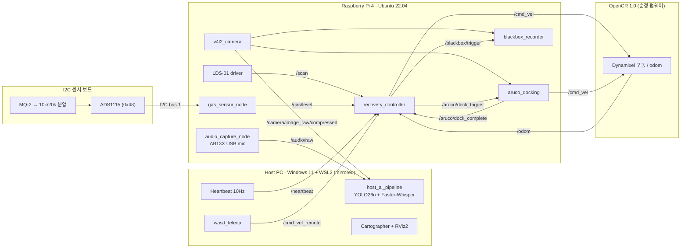

### 네트워크 (Dual NIC)

```
 [학교 벽면 LAN] ── 유선 NIC ──┐
                              ├── Host PC (Windows 11) ── WSL2 (networkingMode=mirrored)
 [연구실 공유기 192.168.0.x] ── USB Wi-Fi 동글 ──┘
            │
            └── Wi-Fi ── Raspberry Pi 4 (TurtleBot3)

 공통: ROS_DOMAIN_ID=0, ROS_LOCALHOST_ONLY=0, DDS 멀티캐스트 디스커버리 (Fast DDS 기본)
```

- 학교 망 인증(고정 IP/MAC)은 유선 NIC에서 유지하고, ROS 2 트래픽은 사설 공유기로만 흐른다.
- WSL2 미러드 모드는 Windows의 NIC/IP를 Linux에 그대로 노출하므로 NAT 포트포워딩 없이 DDS 멀티캐스트가 동작한다. 단, Windows 방화벽(Hyper-V firewall)에서 UDP 수신을 허용해야 할 수 있다. 상세: [`docs/WSL_NETWORK_SETUP.md`](docs/WSL_NETWORK_SETUP.md)
- 공유기에 직접 붙을 수 없는 경우 Tailscale + CycloneDDS 유니캐스트 피어로도 운용할 수 있으나, 지연(50–150 ms)·지터로 Heartbeat 타임아웃 오작동 위험이 있어 현장 시험에는 사설 Wi-Fi 직결을 권장한다 (`WSL_NETWORK_SETUP.md` §6).

---

## 🔁 상태 머신 (`recovery_controller`)

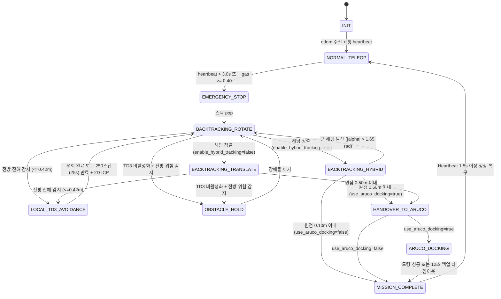

**제어 법칙 요약** (`recovery_params.yaml` 기본값 기준)

- 회전 단계 (`|e_θ| > 0.12 rad`): `v = 0`, `ω = clamp(1.40 · e_θ, ±0.65)`
- 하이브리드 연속 추종 (`BACKTRACKING_HYBRID`, 기본 활성): Lookahead 거리 `L_d = clip(d_target, 0.25, 0.45) m` 기반 Regulated Pure Pursuit(`κ = 2 sin(α) / L_d`, `v_reg = clip(v_max / (1 + 0.6|κ|), 0.14, 0.20)`)과 Residual TD3 출력을 블렌딩한다 (`d_front ≤ 0.42 m` 시 `0.85·ω_TD3 + 0.15·ω_PP`, 평시 `0.55·ω_PP + 0.45·ω_TD3`).
- 레거시 직진 단계 (`BACKTRACKING_TRANSLATE`, `enable_hybrid_tracking=false`): `v = clamp(0.60 · d, 0.03, 0.20)`, `ω = clamp(0.5 · 1.40 · e_θ, ±0.65)`
- 스캔 매칭: 경유지 `45 cm` (`scan_match_max_dist_m: 0.45`) 이내 접근 시 저장 스캔과 현재 스캔을 ICP로 정합하고, 결과를 `/odom` → 보정 좌표계 간 SE(2) 오프셋에 상보필터(α = 0.40)로 누적 반영한다. 오프셋은 이후 수신되는 `/odom`에도 계속 적용된다.
- 도킹 수렴 조건: `|Z − 0.20| ≤ 0.02 m`, `|X| ≤ 0.02 m`, `|yaw| ≤ 0.05 rad`를 10프레임 연속 만족 (`use_aruco_docking`은 `recovery_params.yaml` 기본 `false`, `sim.py --yolo` 실행 시 `true` 활성화)
- 도킹 세이프티 가드: 마커 미감지 시 10.0초 후 정지 및 `MISSION_COMPLETE` 전이 (제어기 측 12.0초 2차 백업)

---

## 🗺 차세대 고도화: 15대 재난 시나리오 150회 확장 벤치마크 & Phase 2-B 자율 복귀 검증 (`99.33%`)

> 본 프로젝트는 **역추적(LIFO) + 2D ICP 위치 보정 + ArUco 정밀 도킹** 기본 방식(`Baseline`, `80/150 = 53.33%`)에서 출발해, Phase 1 **로컬 격자 지도 + 2D `A*` 우회 + 지름길 복귀(`129/150 = 86.00%`)**, Phase 2-A **V100 강화학습 정책 단순 혼합(`124/150 = 82.67%`)**, 그리고 Phase 2-B **적응형 센서 필터 및 안전 제어(`149/150 = 99.33%`, 평균 `103.70 s`)** 로 자율 복귀 성능을 단계별로 개선했다.
> *(초기 5대 환경 50쌍 비교 이력 및 구버전 데모 영상은 [`docs/재난환경_자율복귀_알고리즘_원리_해설_및_보고서.md`](docs/재난환경_자율복귀_알고리즘_원리_해설_및_보고서.md) §1·§5.3·§6.2에 보관되어 있다.)*

### 1. Phase 2-B 계층형 자율 복귀 구조

기존 정적 격자 A\*(Phase 1)와 고정 혼합 RL(Phase 2-A)은 움직이는 장애물의 잔상이나 연기 속 LiDAR 오검출에 취약했다. 이를 보완하기 위해 **센서 잡음 제거 + 동적 격자 소거 + 안전 속도 제한 + Context-RL ONNX 제어기**를 한 파이프라인으로 묶었다.

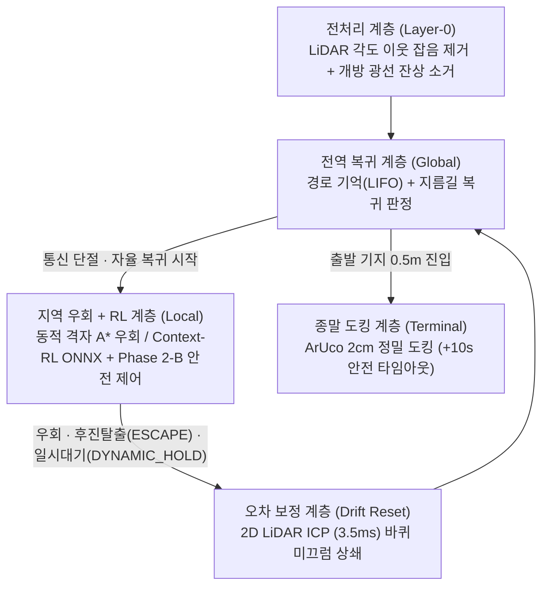

#### 지름길 복귀 전략 & Context-RL 보상함수 설계 원리

독자가 데모 영상(`dynamic_gauntlet #01/#02`, `Seed 10068`)을 볼 때 *"왜 왔던 길을 그대로 되돌아가지 않고 지름길로 질러가는가?"*, *"왜 모든 기둥 사이를 지그재그로 통과하지 않고 최단 틈으로 가는가?"* 에 대한 설계 근거는 아래 두 계층에 있다.

1. **전역 계층 — 비파괴 위상 지름길 (`_plan_topological_astar`, `local_grid_planner.py`)**
   - 단순 LIFO 역추적은 U턴이나 외곽 순환 탐사 후에도 먼 길을 그대로 되밟는다. 반면 본 제어기는 현재 위치 반경 `shortcut_rejoin_dist_m = 3.2m`·로컬 격자 내로 들어온 경유지 중 **출발 기지(`idx=0`)에 가장 가까운 안전 도달 가능 웨이포인트**를 우선 탐색한다.
   - 단, 벽 너머나 미관측 구역으로 무리하게 질러가지 않도록 **경로 셀의 관측 자유공간(`observed_free > 0.25`) 비율 `65%`(장거리 점프 `80%`) 이상**, **경로 길이 ≤ 직선 `1.40~1.75배`**, **비파괴 스택 팝(실제 도달 `0.55m` 이내 진입 시에만 중간 경유지 제거)** 조건을 모두 만족하는 **이미 안전이 검증된 열린 통로**에서만 지름길을 연다.
2. **지역 계층 — V100 Context-RL 보상함수 (`rl_procedural_env.py`)**
   - 지역 RL 제어기는 기둥 사이를 전부 통과하는 슬라럼 과제가 아니라, **재난 환경에서 최소 시간 내 충돌 없이 목표에 복귀**하도록 아래 보상·페널티 합을 최대화해 학습되었다.

| 보상 / 페널티 항목 | 수식 및 값 | 설계 의도 |
| :--- | :--- | :--- |
| **항법 진행 보상 (`progress`)** | `clamp(prev_dist - nav_dist, -0.30, 0.30) × 14.0` | 중간 게이트·목표까지 경로 거리를 줄이는 방향으로 전진 유도 |
| **최단 기록 경신 (`record_gain`)** | `clamp(min_dist_seen - nav_dist, 0.0, 0.40) × 8.0` | 제자리 왕복으로 진행 보상을 중복 취득하는 꼼수(oscillation farming) 차단 |
| **협로·게이트·저상 통과 보너스** | 협로 안전(`min_clear < 0.34m`) `+3.5` · 게이트 `+2.0` · 저상 탈출 `+6.0` | 좁은 문틀·ㄷ자 함정·미끄러운 턱을 회피하지 않고 과감히 돌파 |
| **목표 도달 & 속도 보너스 (`reached`)** | **`+75.0 + 20.0 × (1 - steps / max_steps)`** (최대 `+95.0`) | 불필요한 외곽 우회 없이 **가장 빠르고 짧은 안전 경로** 선택 유도 |
| **안전 여유·정체·평활 페널티** | `min_clear < 0.20m` 시 `(min_clear - 0.20)×5.0` · 정체 `-0.08` · 급조향 감점 | 장애물 스침·교착·진동 조향 억제 (`Smooth Curvature`) |
| **충돌 / 타임아웃 페널티** | 충돌 **`-22.0`** · 타임아웃 **`-10.0`** | 안전한 회피 경계 유지 및 제한 시간 내 복귀 강제 |

### 2. 왜 15개 시나리오(`#14`, `#15` 포함)로 확장했는가?

기존 13개 시나리오에서는 지형이 거의 고정되어 있어 정적 격자 기반인 Phase 1(`129/130 = 99.23%`)도 높은 복귀율을 보였다. 실제 재난 현장의 **이동 장애물 잔상**과 **연기 속 LiDAR 오검출** 조건에서 알고리즘 간 차이를 분명히 확인하기 위해 아래 2개 시나리오를 추가했다.

1. **`#14 dynamic_crossfire_alley` (좁은 게이트 앞 교차 이동 장애물)**
   - **문제 상황:** `x = 2.3m, 5.2m, 8.2m`에 배치된 좁은 게이트 앞을 이동 장애물 2기가 왕복하며 가로지른다.
   - **기존 방식 실패 이유 (`Baseline 3/10`, `Phase 1 0/10`, `Phase 2-A 1/10`):** 장애물이 지나간 자리의 점유 셀이 격자에서 바로 지워지지 않아, 장애물이 비킨 뒤에도 게이트 앞을 가로막는 **가짜 벽(잔상)** 으로 남아 복귀에 실패한다.
   - **Phase 2-B 해결 (`10/10`, 평균 `79.3 s`):** 비관측 셀 점유를 빠르게 감쇠(`0.955`)하고 광선 소거(`carve_decay = 0.25`, `step_cap = 110`)를 적용했으며, 최대 사거리 개방 광선(`3.40 m`)으로 점유(`occ`)만 지워(`observed_free` 및 ICP 미오염) 장애물이 비키는 즉시 게이트를 통과해 복귀한다.
2. **`#15 smoke_lidar_corruption` (연기·분진에 의한 LiDAR 난반사)**
   - **문제 상황:** 복귀 중 매 스캔 `14%` 확률(`smoke_noise_prob=0.14`)로 근거리 허상 점과 결측이 주입된다.
   - **기존 방식 실패 이유 (`Baseline 0/10`, `Phase 1 0/10`, `Phase 2-A 0/10`):** 허상 점을 실제 벽으로 오인해 정지·후진을 반복하거나, 전방에 팽창된 가짜 벽을 그려 모든 회차에서 복귀에 실패한다.
   - **Phase 2-B 해결 (`10/10`, 평균 `101.8 s`):** **LiDAR 각도 이웃 검사 필터(`_despike_lidar_ranges`)**가 인접 광선과 거리가 이어지지 않는 고립 스파이크만 제거하고 실제 벽·낙석 윤곽은 유지해 안정적으로 복귀한다.

---

### 3. 15대 재난 시나리오별 맵 구성(3D · 2D) · 진입 경로 · 유리한 복귀 방식

#### 3-1) 3D Gazebo 시뮬레이션 환경 맵 (9개 고유 월드 · 15대 시나리오 대응)

<p align="center">
  
  <br>
  <em>▲ Gazebo 3D 기반 9개 고유 재난 시뮬레이션 환경 조감도 (붕괴 건물·터널·다실 가옥·동적 미로·U자 포켓·저마찰 시케인·동적 회랑·교차 골목·연기 복도, `docs/images/scenario_worlds_15_3d.png`)</em>
</p>

#### 3-2) 2D 구조 단면 및 시나리오별 이동·복귀 경로 지도

<p align="center">
  
  <br>
  <em>▲ 15개 시나리오 2D 벽체·구조 단면 및 이동 경로 지도: 고정 벽체·구조물(회색 단면), 출발 기지(★), 진입 경로(회색 점선), 통신 단절 지점(✖), 낙석(보라색 원), 알고리즘별 복귀 궤적 (`docs/images/scenario_routes_15_atlas.png`)</em>
</p>

> **Selected Trial Visualization (`Trial 1` · `Trial 2` 궤적 비교 기준):**
> - 본 Atlas(`docs/images/scenario_routes_15_atlas.png`)는 각 실험 단계별 **10회 반복 시행 중 선정된 `Trial 1` 및 `Trial 2`의 실제 기록 궤적(`outbound_path`, `return_path`)** 을 보정 없이 그대로 시각화한 궤적 단위(trajectory-level) 비교 자료입니다.
> - 선정된 궤적은 10회 전체 시행의 평균 성능이나 통계적 대표 표본을 의미하지 않습니다.
> - `#13 dynamic_gauntlet`의 **Phase 2-A**는 총 `8/10 (80%)` 성공률을 기록했으며(`Trial 2 (Seed 2228)` 및 `Trial 5 (Seed 2531)` 실패), 본 Atlas에는 실제 실패 사례인 `Trial 2`의 기록 궤적이 수정 없이 포함되어 있습니다.
> - `#13 dynamic_gauntlet` 패널은 동일 시드(`Trial 1=2127`, `Trial 2=2228`)의 `Baseline` · `Phase 1` · `Phase 2-A` 경로와 함께, **Phase 2-B**가 중앙 배플 상단 및 서측 위상 지름길(`_plan_topological_astar`)로 직결 복귀(`46.8s` / `79.2s`)하는 실측 궤적(`docs/data/dynamic_gauntlet_shortcut_traces.json`)을 반영했습니다.

| # | 시나리오 ID | 맵 특징 | 시작 좌표 | 주요 진입 경로 (Outbound) | 단절 거리 | 추가 장애물 조건 |
| :-: | :--- | :--- | :---: | :--- | :---: | :--- |
| **1** | `collapsed` | `20×20m` 붕괴 실내 | `(0.0, -4.0)` | 남측 기지 ➔ 중앙 잔해 통로 ➔ 북측 구역 | `12.0-20.0m` | 낙석 `3-6`개 |
| **2** | `collapsed_heavy` | `20×20m` 붕괴 실내 | `(0.0, -4.0)` | 남측 기지 ➔ 협소 격벽 통로 ➔ 심층 구역 | `14.0-20.0m` | 낙석 `6-9`개 |
| **3** | `tunnel` | `폭 10.2m` 아치 터널 | `(-0.5, -3.0)` | 터널 입구 SUV·굴삭기 우회 북진 | `10.0-16.0m` | 낙석 `3-6`개 |
| **4** | `house` | `15×11m` 다실 가옥 | `(-2.0, -0.5)` | 거실 ➔ 중앙 복도 ➔ 다실 문틀 순차 진입 | `14.8-17.8m` | 낙석 `2-4`개 |
| **5** | `maze` | `5×5m` 격벽 미로 | `(0.0, 0.0)` | 중앙 ➔ 외곽 루프 회전 ➔ 서측 통로 | `9.0-12.5m` | 낙석 `2-3`개 + 이동체 2기 |
| **6** | `collapsed_hard` | `20×20m` 심층 붕괴 | `(0.0, -4.0)` | 남측 기지 ➔ 중앙 협곡 ➔ 북동 심층부 | `15.0-22.0m` | 낙석 `6-9`개 |
| **7** | `collapsed_heavy_hard` | `20×20m` 고밀도 붕괴 | `(0.0, -4.0)` | 남측 기지 ➔ 다중 협곡 ➔ 최심부 | `16.0-23.0m` | 낙석 `10-13`개 |
| **8** | `tunnel_hard` | `폭 10.2m` 심층 터널 | `(-0.5, -3.0)` | 직선 터널 심층 북진 | `14.0-21.0m` | 낙석 `7-10`개 |
| **9** | `house_hard` | `15×11m` 다실 가옥 | `(-2.0, -0.5)` | 거실 ➔ 다중 문틀 ➔ 북서 심층 방 | `16.5-21.0m` | 낙석 `4-7`개 |
| **10** | `maze_hard` | `5×5m` 격벽 미로 | `(0.0, 0.0)` | 중앙 ➔ 동북 코너 ➔ 서측 심층 통로 | `11.5-16.0m` | 낙석 `4-6`개 + 이동체 2기 |
| **11** | `u_pocket_trap` | `13.2×8.4m` ㄷ자 홀 | `(0.0, 0.0)` | 기지 ➔ 하단 통로`(5.5,-1.8)` ➔ 상단 U자 포켓 | `13.5-18.5m` | 낙석 `4-7`개 |
| **12** | `slip_chicane` | `저마찰(mu=0.32)` S자 복도 | `(0.0, 0.0)` | 4연속 S자 문틀`(2.0,-1.4)..(8.6,1.3)` | `12.5-17.5m` | 저마찰 바닥 + 낙석 `4-6`개 |
| **13** | `dynamic_gauntlet` | `8.8×8.8m` 교차 홀 | `(-3.2, 2.8)` | 북서 기지 ➔ 동측 외곽 ➔ 남서 교차 홀 | `13.0-18.5m` | 낙석 `5-8`개 + 이동체 2기 |
| **14** | `dynamic_crossfire_alley` | `12.7×4.6m` 3게이트 복도 | `(0.0, 0.0)` | 3연속 게이트`(2.3,0)➔(5.2,0.72)➔(8.2,-0.72)` | `12.5-16.5m` | 낙석 `3-5`개 + 교차 이동체 2기 |
| **15** | `smoke_lidar_corruption` | `12.7×4.8m` 연기 복도 | `(0.0, 0.0)` | 3연속 방화문`(2.2,-1.42)➔(5.2,1.42)➔(8.2,-1.42)` | `12.5-16.5m` | 낙석 `3-5`개 + 연기 잡음(`14%`) |

#### 시나리오별 맵 설명 · 가정한 재난 상황 · 유리한 복귀 방식
- **붕괴 건물 (`#1 collapsed`, `#2 collapsed_heavy`, `#6 collapsed_hard`, `#7 collapsed_heavy_hard`):**
  - **맵 및 가정 상황:** 기울어진 내벽과 기둥 잔해가 있는 `20 m × 20 m` 건물 내부에 여진으로 무작위 낙석(`#1` `3~6개` → `#2·#6` `6~9개` → `#7` `10~13개`)이 추가로 쏟아져 통로가 군집 차단된 지진 붕괴 현장을 가정한다.
  - **유리한 복귀 방식:** 벽과 낙석이 겹쳐 오목한 덫을 만들기 쉬우므로, 눈앞 장애물만 피해 도는 반사 주행보다 **주변 지도를 실시간으로 그리며 막힌 구역을 통째로 우회하는 격자 경로 탐색(A\*)**과 **진행 정체 시 후진 탈출 기동**이 유리하다.
- **지하 터널 (`#3 tunnel`, `#8 tunnel_hard`):**
  - **맵 및 가정 상황:** 폭 약 `10.2 m` 아치형 지하 터널 입구에 버려진 SUV와 굴삭기, 시멘트 블록이 놓여 있고 내부로 진입할수록 `#3`(`3~6개`)~`#8`(`7~10개`)의 낙석이 교대로 떨어진 지하 매몰 현장을 가정한다.
  - **유리한 복귀 방식:** 차량과 터널 벽 사이의 좁은 틈을 따라 길게 후퇴해야 하므로, **좌우 벽면과의 최소 여유 거리를 유지하는 조향·속도 제어**와 **긴 직선 구간에서 바퀴 오차를 보정하는 스캔 정합**이 유리하다.
- **실내 다실 가옥 (`#4 house`, `#9 house_hard`):**
  - **맵 및 가정 상황:** 거실과 여러 방이 내벽과 좁은 문틀로 나뉘어 있고 가구(저상 테이블 등)가 놓인 `15 m × 11 m` 주거·사무 공간에서 지진·화재로 `#4`(`2~4개`)~`#9`(`4~7개`)의 낙석이 문 앞과 직각 복도에 떨어진 상황을 가정한다.
  - **유리한 복귀 방식:** 좁은 문틀을 스치지 않고 통과해야 하므로 **고해상도 격자 기반의 정밀 문틀 정렬**과 **직각 코너 회전 시 바깥쪽으로 밀리지 않도록 선속도를 줄이는 제어**가 유리하다.
- **격벽 미로 (`#5 maze`, `#10 maze_hard`):**
  - **맵 및 가정 상황:** 좁은 내부 격벽 7개가 얽힌 `5 m × 5 m` 미로 구역에서 고정 낙석(`#5` `2~3개`, `#10` `4~6개`)과 내부를 오가는 **이동 장애물 2기**를 피해 복귀하는 복합 장애 환경을 가정한다.
  - **유리한 복귀 방식:** 탐사 중 외곽을 돌아 기지 부근을 다시 스쳐 가는 구간이 생기므로, **왔던 길을 끝까지 되밟지 않고 안전이 확인된 앞쪽 경유지로 건너뛰는 지름길 복귀**가 복귀 거리와 시간을 크게 줄이는 데 유리하다.
- **U자 막다른 함정 (`#11 u_pocket_trap`):**
  - **맵 및 가정 상황:** `13.2 m × 8.4 m` 실내 홀 안에 깊게 파인 ㄷ자 막다른 구역과 낙석 `4~7개`가 놓여, 기지 방향 직선으로만 가면 막힌 벽 안쪽에 갇히는 붕괴 함정을 가정한다.
  - **유리한 복귀 방식:** 기지와 직선상 가깝더라도 바로 넘을 수 없으므로, **진입했던 열린 갈림길까지 충분히 되돌아 빠져나오는 후진 탈출 + 격자 기반 대우회 경로 탐색**이 유리하다.
- **저마찰 S자 연속 문틀 (`#12 slip_chicane`):**
  - **맵 및 가정 상황:** 물·진흙·기름 등으로 바닥이 매우 미끄러운 상태(`mu = 0.32`)에서 4연속 S자 문틀과 낙석 `4~6개`를 지그재그로 빠져나와야 하는 침수·누출 재난 현장을 가정한다.
  - **유리한 복귀 방식:** 바퀴 헛돌림으로 회전 각도 오차가 빠르게 누적되므로 **주변 벽체 형상 대조(ICP)를 통한 실시간 위치·각도 보정**과 **S자 연속 커브에서 감속하며 곡률을 유지하는 주행 제어**가 유리하다.
- **동적 교차 홀 (`#13 dynamic_gauntlet`):**
  - **맵 및 가정 상황:** `8.8 m × 8.8 m` 홀 내부의 엇갈린 격벽 사이로 낙석 `5~8개`가 깔려 있고, 이동 장애물 2기가 복도 중앙을 왕복하며 경로를 가로지르는 상황을 가정한다.
  - **유리한 복귀 방식:** 정면에서 다가오는 이동체를 피해 무리하게 후진하면 격벽 모서리에 몰리기 쉬우므로, **충돌 위험 거리에서 잠깐 멈춰 이동체가 지나가기를 기다리는 일시 대기 제어**가 유리하다.
- **3연속 게이트 교차 복도 (`#14 dynamic_crossfire_alley`):**
  - **맵 및 가정 상황:** `12.7 m × 4.6 m` 복도의 좁은 게이트 3곳(`x = 2.3, 5.2, 8.2 m`) 앞을 이동 장애물 2기가 반복해 가로질러 통로가 열렸다 닫혔다를 반복하는 혼잡 복도를 가정한다.
  - **유리한 복귀 방식:** 이동체가 지나간 뒤에도 지도에 장애물 흔적이 오래 남으면 열린 게이트를 막힌 벽으로 착각하므로, **열린 방향 관측에 따라 지도 잔상을 빠르게 지우는 동적 격자 갱신**이 유리하다.
- **화재 연기·분진 복도 (`#15 smoke_lidar_corruption`):**
  - **맵 및 가정 상황:** 짙은 연기와 분진이 찬 `12.7 m × 4.8 m` 3연속 방화문 복도에서 라이다 레이저가 공기 중 입자에 부딪혀 근거리에 헛점(`14%` 확률)과 거리 누락이 섞이는 화재 현장을 가정한다.
  - **유리한 복귀 방식:** 헛점을 실제 벽으로 오인하면 출발 지점에서 제자리 정체를 겪으므로, **이웃 광선들과 이어지지 않는 고립 잡음만 먼저 걸러낸 뒤 실제 문틀·낙석 모양으로 주행하는 센서 전처리**가 유리하다.

---

### 4. 15대 시나리오 × 10회 (150회) 4단계 정량 비교

<p align="center">
  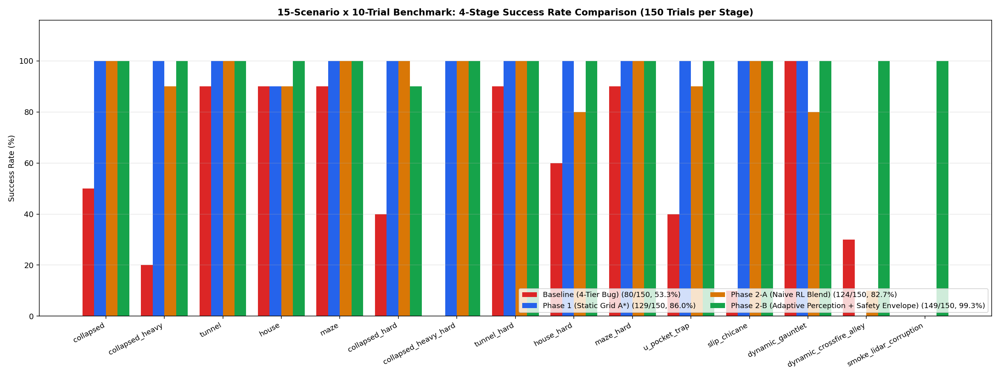
  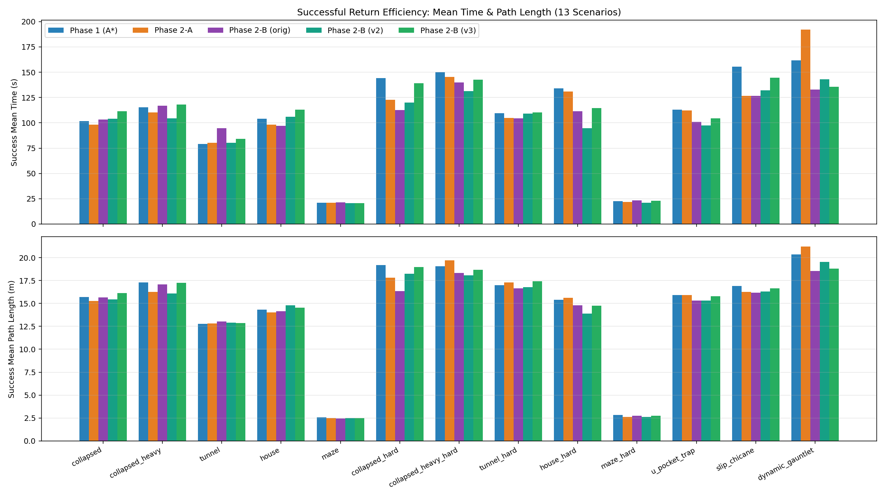
  <br>
  <em>▲ 15개 시나리오 × 10회(150회) 복귀 성공률 비교(좌) 및 복귀 시간·경로 효율 비교(우)</em>
</p>

#### (1) 4단계 알고리즘 종합 성적 (`150회` 합산)

| 알고리즘 단계 | 전체 성공률 (`150회`) | 기존 13종 (`130회`) | 신규 2종 (`#14+#15`, `20회`) | 전체 평균 시간 | 성공 평균 시간 | 성공 평균 경로 |
| :--- | :---: | :---: | :---: | :---: | :---: | :---: |
| **Baseline (반사형 4계층)** | 80 / 150 (`53.33%`) | 77 / 130 (`59.23%`) | 3 / 20 (`15.0%`) | 193.05 s | 131.54 s | 15.01 m |
| **Phase 1 (`proposed` 정적 A\*)** | 129 / 150 (`86.00%`) | 129 / 130 (`99.23%`) | **0 / 20 (`0.0%`)** | 128.60 s | 108.63 s | 14.56 m |
| **Phase 2-A (`proposed_rl` 단순 혼합)** | 124 / 150 (`82.67%`) | 123 / 130 (`94.62%`) | **1 / 20 (`5.0%`)** | 130.92 s | 103.80 s | 14.24 m |
| **Phase 2-B (`proposed_rl` 적응형 제어)** | **149 / 150 (`99.33%`)** | **129 / 130 (`99.23%`)** | **20 / 20 (`100.0%`)** | **103.70 s** | **102.58 s** | **13.93 m** |

#### (2) 시나리오(맵)별 복귀 성공률 및 평균 시간 비교 (각 10회)

| # | 시나리오 | Baseline | Phase 1 (`A*`) | Phase 2-A | Phase 2-B |
| :---: | :--- | :---: | :---: | :---: | :---: |
| **1** | `collapsed` | `5/10` (`164.5s`) | `10/10` (`101.8s`) | `10/10` (`98.0s`) | **`10/10`** (`111.5s`) |
| **2** | `collapsed_heavy` | `2/10` (`238.5s`) | `10/10` (`115.3s`) | `9/10` (`125.3s`) | **`10/10`** (`118.1s`) |
| **3** | `tunnel` | `9/10` (`98.5s`) | `10/10` (`79.2s`) | `10/10` (`80.1s`) | **`10/10`** (`84.1s`) |
| **4** | `house` | `9/10` (`135.5s`) | `9/10` (`121.3s`) | `9/10` (`112.6s`) | **`10/10`** (`113.0s`) |
| **5** | `maze` | `9/10` (`110.5s`) | `10/10` (`21.0s`) | `10/10` (`21.2s`) | **`10/10`** (`20.5s`) |
| **6** | `collapsed_hard` | `4/10` (`242.1s`) | **`10/10`** (`144.1s`) | **`10/10`** (`122.9s`) | `9/10` (`152.1s`) |
| **7** | `collapsed_heavy_hard` | `0/10` (`308.2s`) | `10/10` (`149.9s`) | `10/10` (`145.4s`) | **`10/10`** (`142.8s`) |
| **8** | `tunnel_hard` | `9/10` (`129.9s`) | `10/10` (`109.4s`) | `10/10` (`105.0s`) | **`10/10`** (`110.2s`) |
| **9** | `house_hard` | `6/10` (`219.0s`) | `10/10` (`133.9s`) | `8/10` (`166.8s`) | **`10/10`** (`114.5s`) |
| **10** | `maze_hard` | `9/10` (`139.2s`) | `10/10` (`22.8s`) | `10/10` (`21.8s`) | **`10/10`** (`22.9s`) |
| **11** | `u_pocket_trap` | `4/10` (`210.9s`) | `10/10` (`113.0s`) | `9/10` (`127.6s`) | **`10/10`** (`104.6s`) |
| **12** | `slip_chicane` | `1/10` (`262.0s`) | `10/10` (`155.6s`) | `10/10` (`126.6s`) | **`10/10`** (`144.6s`) |
| **13** | `dynamic_gauntlet` | `10/10` (`152.5s`) | `10/10` (`161.5s`) | `8/10` (`216.3s`) | **`10/10`** (`135.5s`) |
| **14** | `dynamic_crossfire_alley` | `3/10` (`234.5s`) | `0/10` (`250.0s`) | `1/10` (`244.1s`) | **`10/10`** (`79.3s`) |
| **15** | `smoke_lidar_corruption` | `0/10` (`250.0s`) | `0/10` (`250.0s`) | `0/10` (`250.0s`) | **`10/10`** (`101.8s`) |

#### 알고리즘 단계별 한계 및 비교 요약
- **Baseline:** 단순 역추적과 반사 회피만 사용해 고밀도 낙석(`0~2/10`), U자 포켓(`4/10`), 저마찰 시케인(`1/10`), 연기 잡음(`0/10`) 등에서 다수 교착되었다.
- **Phase 1 (`proposed` A\*):** 정적 환경 13종에서는 `129/130 (99.23%)`를 기록했으나, 이동체 잔상이 남는 `#14`(`0/10`)와 연기 난반사 `#15`(`0/10`)에서는 복귀하지 못했다.
- **Phase 2-A (`proposed_rl` 단순 혼합):** `house_hard`(`8/10`)·`dynamic_gauntlet`(`8/10`) 등 협로·동적 구간 충돌과 `#14`(`1/10`), `#15`(`0/10`)의 인지 오류로 전체 성공률이 `82.67%`에 머물렀다.
- **Phase 2-B (`proposed_rl` 적응형 제어):** 전처리 잡음 필터, 동적 잔상 소거, 안전 속도 포락선을 결합해 **15개 중 14개 시나리오에서 `10/10`, 총 `149/150 (99.33%)`** 을 달성했고 전체 평균 복귀 시간도 `103.70 s`로 가장 짧았다(유일 미완 `collapsed_hard #09` 1건).

> **상세 회차별 실패 목록·경로 길이·원리 해설 보기:**  
> 각 시나리오의 실패 회차 번호(`fails`), 성공 평균 시간·경로 길이, 그리고 Phase 1 → Phase 2-A → Phase 2-B 제어기 개선 원리는 **[재난환경 자율복귀 알고리즘 원리 해설 및 보고서 §6.3](docs/재난환경_자율복귀_알고리즘_원리_해설_및_보고서.md#63-phase-2-b-15개-시나리오-150회-벤치마크-및-적응형-센서-필터안전-제어-v2_fixed--v3_dynfix)** 및 원본 집계 파일([`docs/phase2b_comparison_summary.txt`](docs/phase2b_comparison_summary.txt))에서 확인할 수 있다.

---

### 🎬 5. 4-Way 복귀 궤적 비교 GIF (`Baseline vs Phase 1 vs Phase 2-A vs Phase 2-B`) 및 3D 주행 영상

#### 1) [4-Way 비교] 신규 난제 시나리오 2종 (`#14 dynamic_crossfire_alley` & `#15 smoke_lidar_corruption`)
| `#14 dynamic_crossfire_alley` (동적 교차 협곡 비교) | `#15 smoke_lidar_corruption` (연기 LiDAR 잡음 비교) |
| :---: | :---: |
| 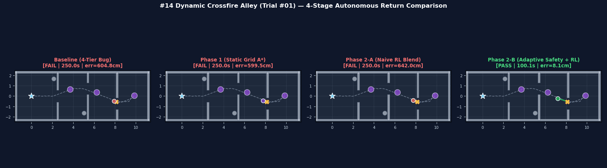 | 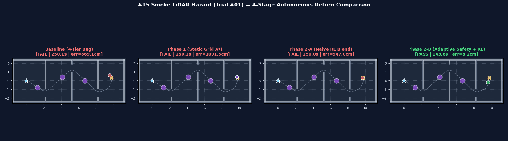 |
| *Baseline·Phase 1·Phase 2-A는 게이트 앞 이동 장애물의 가짜 벽 잔상에 막혀 `x=5.2m` 부근에서 멈추지만(`FAIL`), **Phase 2-B(초록)는 광선 소거로 잔상을 지우고 `100.1s` 만에 복귀(`PASS`)**한다.* | *Baseline·Phase 1·Phase 2-A는 연기 난반사(`0.18m-0.68m`) 허상 벽 때문에 출발 직후 멈추지만(`FAIL`), **Phase 2-B(초록)는 각도 이웃 잡음 제거 후 `86.4s` 만에 복귀(`PASS`)**한다.* |

#### 2) [4-Way 비교] 비정형 시나리오 3종 (`u_pocket_trap` · `house_hard` · `slip_chicane`)
| `#11 u_pocket_trap` (ㄷ자 함정 4단계 비교) | `#9 house_hard` (다실 가옥 HARD 4단계 비교) | `#12 slip_chicane` (저마찰 시케인 4단계 비교) |
| :---: | :---: | :---: |
| 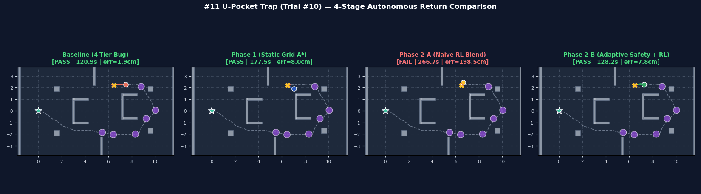 | 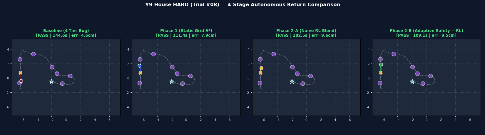 | 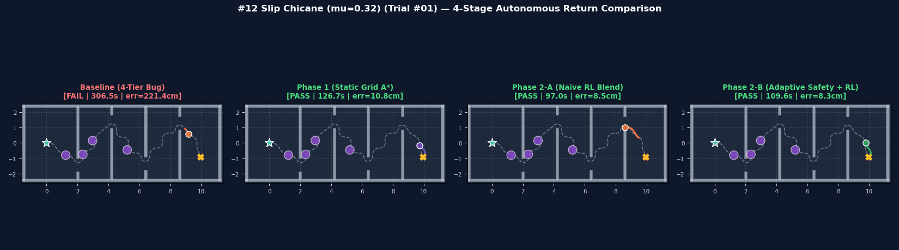 |

#### 3) [3D Gazebo + RViz2 `/map` 듀얼 뷰] 신규 재난 시나리오 2종 (`#14` & `#15`) 실시간 복귀 영상
| `#14 dynamic_crossfire_alley` (`Trial #01 · PASS · 46.4s · err 8.0cm`) | `#15 smoke_lidar_corruption` (`Trial #02 · PASS · 70.4s · err 7.1cm`) |
| :---: | :---: |
|  |  |

#### 4) [3D Gazebo + RViz2 `/map` 듀얼 뷰] 비정형·동적 장애물 4개 시나리오 5편 (`u_pocket_trap` · `slip_chicane` · `house_hard` · `dynamic_gauntlet`)
| U자 함정 탈출 (`u_pocket_trap #10 · PASS · 43.3s`) | 저마찰 시케인 (`slip_chicane #01 · PASS · 94.3s`) | 고난도 다실 가옥 (`house_hard #09 · PASS · 87.7s`) |
| :---: | :---: | :---: |
| 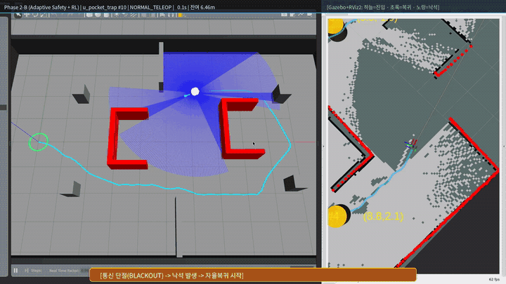 |  |  |

| 동적 배플 교차 #01 (`dynamic_gauntlet #01 · PASS · 46.9s`) | 동적 배플 교차 #02 (`dynamic_gauntlet #02 · PASS · 45.3s`) |
| :---: | :---: |
|  | 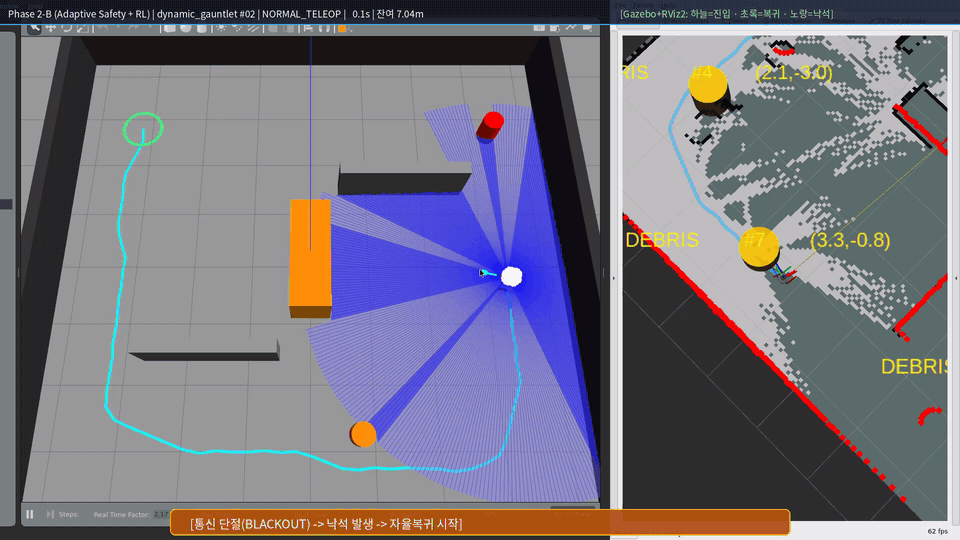 |

> *모든 3D Gazebo+RViz2 영상에는 흰색 3D TurtleBot3 Burger 본체·주황색 LDS 라이다·전방 시안 방향 화살표·바닥 진입선(하늘색)·실시간 복귀선(초록색)·Base Camp 링이 함께 렌더링되며 GitHub 표시 규격(`7.8MB` 이하)으로 압축되었다. (`#15 smoke_lidar_corruption` 바닥의 반투명 연황갈색 원형 영역은 연기·분진으로 LiDAR 난반사 잡음이 주입되는 위험 구역을 뜻한다.)*  
> *특히 `dynamic_gauntlet #01`(시계 진입 → 서측 지름길 `46.9s`)과 `#02`(반시계 진입 → 중앙 배플 상단 지름길 `45.3s`)는 단순 역주행 대신, 위에서 설명한 **비파괴 위상 지름길(`_plan_topological_astar`, `observed_free` 검증 완료 통로) + 최단 복귀 보상**이 결합되어 가장 빠른 안전 경로로 직결 복귀한 사례다.*

#### 5) Phase 2-B V100 커리큘럼 재학습 진화 과정 (`Early → Mid → Final Student` · `Seed 10068 collapsed_debris` 기둥 7개) & 학습 곡선
| Early (`upd 25` · `TIMEOUT`, 321스텝) | Mid (`upd 150` · `PASS`, 310스텝) | Final Phase 2-B Student (`PASS`, 208스텝) |
| :---: | :---: | :---: |
| 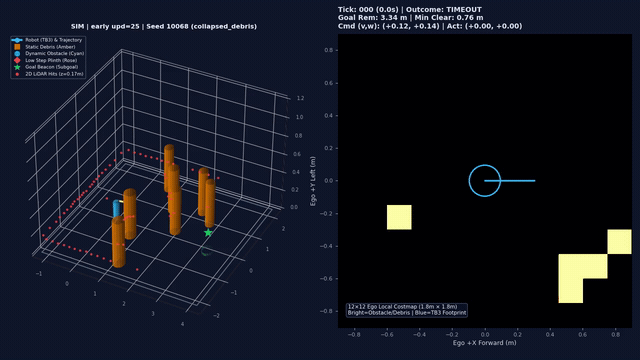 | 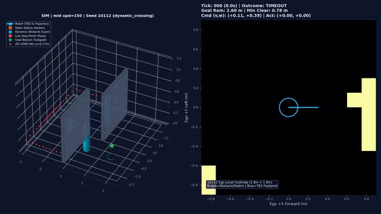 |  |

> *동일 홀드아웃 `Seed 10068 (collapsed_debris · 주황색 기둥 7개)` 기준 (`Start (0.00, -0.06) → Goal (3.33, -0.21)`): **Early**는 중앙 기둥 틈을 통과한 뒤 목표 수렴에 실패해 시간 초과(`TIMEOUT`, 321스텝), **Mid**는 목표 부근을 지나쳐 외곽으로 크게 우회(`5.14m`, 310스텝)한 끝에 통과(`PASS`), **Final Student**는 최단 도달 시간 보상(`time_bonus`)과 안전 여유 제약에 따라 불필요한 외곽 기둥 슬라럼 대신 중앙 기둥 사이 틈을 S자로 가로지르는 최단 안전 경로(`3.60m`, `102스텝` 단축)로 복귀한다.*

<p align="center">
  
  <br>
  <em>▲ Tesla V100 32GB Phase 2-B 커리큘럼 재학습 수렴 곡선 (`docs/images/evidence/phase2b_learning_curves_sim.png`)</em>
</p>

#### 벤치마크 재현 명령어

```bash
# 15대 재난 시나리오 4단계(Baseline / Phase 1 / Phase 2-A / Phase 2-B) 벤치마크 재현
python3 scripts/host/ab_disaster_benchmark.py --scenario all --trials 10 --proposed-strategy proposed
python3 scripts/host/ab_disaster_benchmark.py --scenario all --trials 10 --proposed-only --proposed-strategy proposed_rl --disable-phase2b-envelope
python3 scripts/host/ab_disaster_benchmark.py --scenario all --trials 10 --proposed-only --proposed-strategy proposed_rl
```

### 6. 이전 단계 벤치마크 및 문서 아카이브

프로젝트 초기 실험부터 5대·15대 재난환경 벤치마크까지의 상세 기록·원시 JSON·구버전 데모 아카이브는 아래 문서에 단계별로 정리되어 있다.

| 개발 단계 | 검증 범위 · 결과 요약 | 상세 문서 및 데이터 |
| :--- | :--- | :--- |
| **초기 프로토타입** | 붕괴 건물 초기 Residual TD3 `15회` 연속 벤치마크 (`11/15 = 73.3%`) & 교착 원인 진단 | [`붕괴건물_15회_자율복귀_벤치마크_분석보고서.md`](docs/붕괴건물_15회_자율복귀_벤치마크_분석보고서.md) |
| **Phase 1 · 2 · 2-A (5대 환경)** | 기본 5대 월드 `50쌍` 비교 — Phase 1(`49/50 = 98.0%`) · Phase 2 S2S(`47/50 = 94.0%`) · Phase 2-A(`48/50 = 96.0%`) | [`재난환경_자율복귀_알고리즘_원리_해설_및_보고서.md`](docs/재난환경_자율복귀_알고리즘_원리_해설_및_보고서.md) |
| **Phase 2-B (15대 환경 150회)** | 15개 시나리오 × 10회 4단계 통합 집계 (`149/150 = 99.33%`, 회차별 `fails`·소요시간·경로장) | [`phase2b_comparison_summary.txt`](docs/phase2b_comparison_summary.txt) · [`phase2b_comparison_summary.json`](docs/phase2b_comparison_summary.json) |

<details>
<summary>📂 원시 JSON 결과 디렉터리 및 구형 5대 환경 GIF 자산 위치 보기</summary>

- **Phase 1 (`proposed` A\*) vs Baseline 결과 JSON (`benchmark_results/ab_comparison/`)**: 기본 5대 환경 + 확장 환경 회차별 궤적/오차 JSON 보관
- **Phase 2 S2S 원시 결과 JSON (`benchmark_results/phase2_sim2sim/`)**: `8,847만` 스텝 Dual-Track PPO+PLR 증류 정책 5대 환경 검증 로그
- **Phase 2-A S2S 원시 결과 JSON (`benchmark_results/phase2a_sim2sim/`)**: Clearance-Gated Blending 적용 후 5대 환경(`48/50`) 검증 로그
- **구형 5대 환경 데모 GIF (`p1_*`, `p2_sim2sim_*`)**: `docs/images/evidence/` 및 위 A/B 원리해설 보고서 §5.3·§6.2에 보존

</details>

---

## 🔮 향후 고도화 계획 (논문 기반 시맨틱 맵핑 & Phase 3 RL)

> 📄 **상세 계획서(쉬운 설명 포함)**: [`docs/차세대_고도화_시맨틱_SLAM_및_RL_재학습_계획.md`](docs/차세대_고도화_시맨틱_SLAM_및_RL_재학습_계획.md)

기존 Phase 2-B 자율 복귀 시스템(`149/150 = 99.33%`)에 더해, 장애물 인식·SLAM 지도 통합에 관한 선행 논문(이은원·김진현, *로봇학회 논문지*, 2025)을 참고해 다음과 같이 기존 알고리즘을 변경 및 추가할 예정이다.

| 구분 | 현재 상태 (Phase 2-B) | 추가·변경 예정 사항 (Phase 3) | 기대 효과 |
| :--- | :--- | :--- | :--- |
| **비전·센서 지도 연동** | YOLO26n이 조난자(`person`)를 찾으면 화면 박스와 텍스트 알람만 출력 | Host PC에 **`semantic_map_node` 신규 추가**: 카메라 박스와 2D LiDAR(`/scan`) 거리를 퓨전해 조난자·장애물·가스·구조요청 좌표를 `/map` 위 영구 마커로 표시 및 2D 지도 이미지 저장 | 관제자가 조난자·위험 지점의 정확한 위치를 2D 지도에서 즉시 파악 가능 (추가 Depth 카메라 불필요) |
| **강화학습(RL) 입력 및 재학습** | 12×12 미니 지도 1장(2D LiDAR 점유 정보만 입력) 기반 회피 | 미니 지도를 **3장(LiDAR + 라이다 아래 낮은 장애물 + 가스/조난자 보호 구역)** 으로 확장하고, 기존 Phase 2-B 모델을 이어받아(Warm-Start) Phase 3 재학습 진행 (`*_semantic_v3.onnx`) | 낮은 장애물에 부딪히기 전에 미리 우회하고, 가스 누출·조난자 주변을 안전하게 비켜 가는 주행 학습 |
| **통신 단절 안전성** | RPi 4 단독 온보드 폐루프로 자율 복귀 | 시맨틱 마커 생성은 Host PC에만 두고 RPi 4는 마커 캐시만 유지. **시맨틱 입력이 0으로 끊겨도(Modality Dropout 훈련)** 기존 Phase 2-B 수준으로 폴백 | 통신 단절 시 기존 99.33% 자율 복귀 안정성을 그대로 유지하면서 추가 기능만 안전하게 결합 |

---

## 🔧 하드웨어 구성

<p align="center">
  
  <br>
  <em>▲ 3D 프린팅 맞춤형 보호 외피(Outer Shell) 및 센서 마운팅 하드웨어 구상도</em>
</p>

| 구분 | 사양 |
| :--- | :--- |
| 로봇 | TurtleBot3 Burger (OpenCR 1.0 + Raspberry Pi 4 4GB) |
| LiDAR | LDS-01 (USB2LDS) |
| 카메라 | Raspberry Pi Camera Module (CSI, 640×480) — 케이블 배선상 90° 옆으로 장착, 소프트웨어에서 270° 회전 보정 |
| 가스 센서 | MQ-2 (5 V 구동) → 10k/20k 분압 → ADS1115 16-bit I2C ADC → RPi 4 |
| 마이크 | Generic AB13X USB Audio (card 1, device 0 = `plughw:1,0`, S16_LE · mono · 48 kHz) |
| Host PC (관제/로컬 시뮬) | Intel Core i7-8700 (6C/12T) / DDR4 16GB 2666MHz / NVIDIA GTX 1050 Ti 4GB / Windows 11 + WSL2 Ubuntu 22.04 / PyTorch 2.5.1 + CUDA 12.1 |
| 학습 서버 (대규모 RL) | Intel Core i9-10900X (10C/20T) / DDR4 256GB 2666MHz (Non-ECC) / NVIDIA Tesla V100-PCIE-32GB / Ubuntu 20.04.6 LTS Host + Ubuntu 22.04 Docker (ROS 2 Humble) — 병렬 시뮬 검증 & Dual-Track RL 학습 |

### MQ-2 + ADS1115 회로

OpenCR은 TurtleBot3 순정 펌웨어(모터·`/odom`)를 그대로 유지하고, 가스 센서는 RPi 4의 I2C로 읽는다. ADS1115는 **반드시 3.3 V로 급전**한다 (RPi GPIO는 5 V 비허용).

```
 RPi Pin 1 (3.3V) ──── ADS1115 VDD
 RPi Pin 3 (SDA)  ──── ADS1115 SDA
 RPi Pin 5 (SCL)  ──── ADS1115 SCL
 RPi Pin 6 (GND)  ──┬─ ADS1115 GND, ADDR (→ 0x48)
                    ├─ MQ-2 GND
 RPi Pin 2 (5V)   ──┼─ MQ-2 VCC
                    │  MQ-2 AOUT ── [R1 10kΩ] ──┬── ADS1115 AIN0
                    │                          [R2 20kΩ]
                    └──────────────────────────┘

 V_AIN0 = V_out × 20k / (10k + 20k) ≤ 3.33 V   (ADS1115 허용: VDD + 0.3 V = 3.6 V)
 PGA = ±4.096 V, 128 SPS, 연속 변환
```

```bash
sudo apt install -y i2c-tools python3-smbus && sudo usermod -aG i2c $USER
i2cdetect -y 1        # 48 이 보여야 정상
```

상세 결선 및 카메라 캘리브레이션: [`docs/CIRCUIT_AND_CALIBRATION.md`](docs/CIRCUIT_AND_CALIBRATION.md)

---

## 📁 저장소 구조

```
disaster_recovery_ws/
├── README.md
├── CHANGELOG.md                         # 초기 업로드~최신 전체 누적 변경 이력
├── LICENSE
├── scripts/
│   ├── host/                            # Host PC 관제·AI·시뮬레이션·벤치마크 스크립트
│   │   ├── start.py                     # 원터치 통합 런처 (--sim, --rviz, --tmux, --stop 등)
│   │   ├── stop.py                      # 호스트 + 로봇 프로세스 일괄 종료
│   │   ├── sim.py                       # Gazebo + SLAM + 복귀 제어기 + 랜덤 낙석([O]키) 시뮬레이터
│   │   ├── wasd_teleop.py               # WASD 텔레옵 (/cmd_vel_remote 발행)
│   │   ├── ab_disaster_benchmark.py     # 5대 재난환경 고정 시드 A/B·RL S2S 하네스 (--gz-port, --ros-domain-id)
│   │   ├── plot_ab_comparison.py        # 5대 환경 맵·KPI·10회 궤적 비교 시각화 생성기
│   │   ├── record_3d_evidence.py        # Gazebo 3D + RViz2(slam_toolbox /map) 30 FPS .mp4/.png 증거 캡처기
│   │   ├── refresh_visual_evidence.sh   # 대표 10편 3D 증거 영상 일괄 재녹화
│   │   ├── start_novnc_gui.sh           # 브라우저(noVNC) 기반 GPU 가속 Gazebo/RViz2 원격 GUI
│   │   ├── train_phase2_v100.py         # V100 Dual-Track PPO+PLR 대규모 학습 & 선택적 DAgger ONNX 증류기
│   │   ├── rl_procedural_env.py         # CUDA 벡터 절차적 재난 시뮬레이터 (SIM_TRACK / REAL_TB3_TRACK)
│   │   ├── sync_to_gdrive.sh            # /hdd 증거 영상·그래프·JSON Google Drive 자동 동기화
│   │   ├── world_map_geometry.py        # Gazebo .world/.sdf/.dae/.obj 충돌 벽체 단면 추출기
│   │   ├── auto_disaster_trials.py      # Gazebo 다회차 자율복귀 & 동적 낙석 자동 벤치마크
│   │   ├── debris_utils.py              # Gazebo 동적 붕괴 암석 스폰/정리 유틸리티 (도메인 격리 · 좀비 차단)
│   │   ├── plot_tunnel_trials.py        # 터널 벤치마크 궤적·오차 고해상도 시각화 스크립트
│   │   ├── train_td3.py                 # Phase 1.5 TD3 국소 회피 제어기 DRL 학습 & ONNX 변환기
│   │   ├── verify_hybrid_recovery.py    # 초기 개발 단계 4개 비교군 50회 검증 스크립트 (아카이브)
│   │   └── verify_extreme_stress.py     # 다중 낙석·고슬립·라이다 노이즈 극한 스트레스 검증기
│   └── rpi/                             # RPi 4 온보드 실행·보조 스크립트
│       ├── start.py / stop.py           # 로봇 단독 올인원 기동 / 종료 스크립트
│       ├── start_all.sh / stop_all.sh   # Bringup + camera_ros + 복귀 패키지 일괄 실행/종료
│       ├── start_camera.sh              # camera_ros (640x480 @ 30 FPS)
│       ├── start_audio.sh               # AB13X USB 마이크 캡처 노드
│       ├── aruco_detector.py            # ArUco 3D 포즈 추정 & 웹 스트리밍 보조 스크립트
│       ├── audio_capture_node.py        # 단독 실행용 USB 마이크 캡처 노드
│       └── generate_marker.py           # ArUco 마커 이미지 생성기
├── docs/
│   ├── DISASTER_RECOVERY_GUIDEBOOK.md   # 종합 설계 문서
│   ├── WSL_NETWORK_SETUP.md             # 미러드 네트워킹, ROS 2, CUDA 설정
│   ├── CIRCUIT_AND_CALIBRATION.md       # MQ-2 분압 회로 및 카메라 캘리브레이션
│   ├── FIELD_TEST_CHECKLIST.md          # 실행 순서 및 검증 체크리스트
│   ├── TURTLEBOT3_ARUCO_GUIDE.md        # ArUco 마커 생성 및 도킹 가이드
│   ├── PATENT_ANALYSIS_AND_PRIOR_ART.md # 선행 특허 분석 보고서
│   ├── 2D_라이다_스캔매칭_및_자율복귀_보고서.md
│   ├── 2026-11-10_통신단절_재난대응_터틀봇3_프로젝트_시도내역_및_트러블슈팅_총정리.md
│   ├── 붕괴건물_15회_자율복귀_벤치마크_분석보고서.md
│   ├── 재난환경_자율복귀_알고리즘_원리_해설_및_보고서.md
│   ├── Disaster_Recovery_TurtleBot3_Integration_Report.{md,docx}
│   └── images/                          # 배너, 3D 쉘, A/B 그래프 5종 & evidence/(3D 스냅샷·데모 GIF·RL 학습곡선)
├── benchmark_results/                   # ab_comparison(Phase 1) · phase2_sim2sim · phase2a_sim2sim 결과 JSON
└── src/disaster_recovery/
    ├── package.xml / setup.py / setup.cfg
    ├── config/
    │   ├── recovery_params.yaml         # 임계값, 속도, 로컬 A*, Phase 2 RL ONNX 경로, ICP, 도킹 파라미터
    │   ├── debris_obstacle.sdf          # Gazebo 시뮬레이션용 낙하 붕괴 잔해(Debris) SDF 모델
    │   ├── sim_policy_student.onnx      # Phase 2 Track A 시뮬용 초경량 신경망 (231.6 KB, 0.036 ms)
    │   ├── real_tb3_policy_student.onnx # Phase 2 Track B 실물 TurtleBot3 휠/슬립 잔차용 ONNX (231.6 KB, 0.0385 ms)
    │   ├── recovery_td3.onnx            # Phase 1.5 TD3 Baseline ONNX 신경망
    │   ├── recovery_td3.pth             # PyTorch 학습 가중치 체크포인트
    │   ├── camera_info_sample.yaml      # 예시값 (직접 캘리브레이션 값으로 교체 권장)
    │   ├── disaster_cartographer.rviz   # SLAM + RobotModel (/robot_description) RViz2 레이아웃
    │   └── disaster_station.rviz        # AI 영상 포함 관제용 RViz2 레이아웃
    ├── launch/
    │   ├── disaster_world.launch.py     # 다중 재난 월드 + 커스텀 버거 모델 스폰 런치
    │   ├── robot_onboard.launch.py      # RPi 4 (recovery / aruco / gas / blackbox / audio)
    │   └── host_station.launch.py       # Host PC (AI 파이프라인, use_rviz)
    ├── models/turtlebot3_burger/        # LiDAR <visualize>true</visualize> 및 카메라 포함 SDF
    ├── worlds/                          # 붕괴 건물/터널/하우스/미로/기본 재난 Gazebo 월드 (5종)
    ├── disaster_recovery/
    │   ├── recovery_controller.py       # 계층형 복귀 제어기 (로컬 격자 A* · Phase 2 RL · Pure Pursuit · 2D ICP · LIFO)
    │   ├── local_grid_planner.py        # RollingLocalGrid(0.04m) + 2D A* + 위상 지름길 + ESCAPE/_virtual_obstacles
    │   ├── rl_context_policy.py         # 16스텝 시계열 + 12×12 Ego 코스트맵 ONNX 추론기 (`ContextRLStudentPolicy`)
    │   ├── td3_policy.py                # 28차원 상태 추출기 및 TD3 ONNX 엣지 추론 엔진
    │   ├── aruco_docking.py             # solvePnP 도킹 P-제어 + 10초 세이프티 가드
    │   ├── host_ai_pipeline.py          # YOLO26n(15 FPS 안정화) + Faster-Whisper(CUDA INT8) + Heartbeat 10Hz
    │   ├── gas_sensor_node.py           # ADS1115 → EMA → /gas/level
    │   ├── ads1115_mq2.py               # ADS1115 드라이버 + MQ-2 계산 (ROS 비의존)
    │   ├── blackbox_recorder.py         # MicroSD 영상·CSV 기록
    │   └── audio_capture_node.py        # arecord → /audio/raw
    └── test/
        ├── test_ads1115_mq2.py          # ADS1115/MQ-2 단위 테스트 (8개)
        ├── test_hybrid_recovery.py      # 2D ICP, TD3, Dual-ONNX 지연, Clearance-Gate 블렌딩 테스트 (7개)
        └── test_local_grid_planner.py   # RollingLocalGrid, A*, 지름길, 가상 접촉 장벽 테스트 (9개)
```

---

## ⚙ 설치

### 공통 (Host PC · RPi 4) — `~/.bashrc`

```bash
source /opt/ros/humble/setup.bash
export ROS_DOMAIN_ID=0
export ROS_LOCALHOST_ONLY=0
export TURTLEBOT3_MODEL=burger
export LDS_MODEL=LDS-01          # RPi 4
```

### Host PC (WSL2)

`C:\Users\<user>\.wslconfig`

```ini
[wsl2]
networkingMode=mirrored
dnsTunneling=true
firewall=true
autoProxy=true
```

```bash
# PowerShell: wsl --shutdown 후 WSL 재진입
sudo apt install -y ros-humble-desktop ros-humble-cv-bridge \
                    ros-humble-teleop-twist-keyboard ros-humble-camera-calibration \
                    ros-humble-turtlebot3-cartographer ros-humble-turtlebot3-gazebo
pip3 install torch torchvision --index-url https://download.pytorch.org/whl/cu121
pip3 install ultralytics faster-whisper
pip3 install "numpy==1.26.4" "opencv-python==4.10.0.84"     # cv_bridge(NumPy 1.x) 호환 고정
python3 -c "import torch; print(torch.cuda.is_available())"   # True 확인
```

> WSL2 내부에 Linux용 NVIDIA 드라이버를 설치하지 않는다. Windows 드라이버가 WSL로 전달된다.
>
> `yolo26n.pt`는 첫 실행 시 Ultralytics가 자동 다운로드한다 (저장소에는 포함하지 않음). NumPy 2.x가 설치되면 `cv_bridge` import가 실패하므로 위 버전 고정을 유지한다.

### RPi 4

```bash
sudo apt install -y ros-humble-v4l2-camera ros-humble-cv-bridge python3-opencv \
                    ros-humble-image-transport-plugins \
                    python3-smbus i2c-tools alsa-utils
sudo usermod -aG i2c,audio $USER   # 재로그인 필요
arecord -l                          # card 1: AB13X USB Audio 확인 (번호가 다르면 alsa_device 수정)
```

### 빌드 (양쪽 모두)

```bash
mkdir -p ~/disaster_recovery_ws && cd ~/disaster_recovery_ws
git clone https://github.com/rjw136-lab/disaster_recovery_ws.git .
colcon build --symlink-install --packages-select disaster_recovery
source install/setup.bash
```

### 단위 테스트

```bash
source /opt/ros/humble/setup.bash && source install/setup.bash
python3 -m pytest -p no:anyio src/disaster_recovery/test -q   # ADS1115/MQ-2(8) + 하이브리드·Dual-ONNX·Clearance-Gate(7) + 로컬 격자 A*(9) 총 24개
```

---

## ▶ 실행

### 원터치 통합 실행 (권장)

```bash
# Host PC에서 실행: RPi 4 원격 브링업 + Host AI(YOLO26n + Whisper CUDA) + SLAM(RobotModel RViz2) + WASD 텔레옵
python3 scripts/host/start.py

python3 scripts/host/start.py --tmux             # tmux 3분할 콕핏 대시보드
python3 scripts/host/start.py --host-only        # 로봇 원격 기동 생략
python3 scripts/host/start.py --no-cartographer  # SLAM/RViz2 생략
python3 scripts/host/start.py --status           # 네트워크 및 노드 상태 점검
python3 scripts/host/stop.py                     # 전체 종료
```

### 단계별 수동 실행

| # | 기기 | 명령 |
| :-: | :--- | :--- |
| 1 | RPi 4 | `ros2 launch turtlebot3_bringup robot.launch.py` (또는 `bash scripts/rpi/start_all.sh`) |
| 2 | RPi 4 | `ros2 run camera_ros camera_node --ros-args -p width:=640 -p height:=480 -p format:=BGR888` (또는 `bash scripts/rpi/start_camera.sh`) |
| 3 | RPi 4 | `ros2 launch disaster_recovery robot_onboard.launch.py` |
| 4 | Host | `ros2 launch disaster_recovery host_station.launch.py` (RViz 동시 실행: `use_rviz:=true`) |
| 5 | Host | `python3 scripts/host/wasd_teleop.py topic:=/cmd_vel_remote` (또는 `teleop_twist_keyboard --ros-args -r cmd_vel:=/cmd_vel_remote`) |
| 6 | Host | `ros2 launch turtlebot3_cartographer cartographer.launch.py use_rviz:=false` + `ros2 run rviz2 rviz2 -d src/disaster_recovery/config/disaster_cartographer.rviz` |

> ⚠ 텔레옵은 반드시 `/cmd_vel_remote`로 리매핑한다. `/cmd_vel`에 직접 발행하면 워치독의 원격 명령 차단이 무력화된다.

상태 모니터링:

```bash
ros2 topic echo /recovery/status
ros2 topic echo /disaster/victim_alert
ros2 topic echo /disaster/audio_alert
```

### `host_station.launch.py` 인자

| 인자 | 기본값 | 설명 |
| :--- | :-: | :--- |
| `yolo_model_path` | `yolo26n.pt` | YOLO 가중치 경로/이름 |
| `image_topic` | `/camera/image_raw/compressed` | 카메라 토픽 |
| `use_compressed` | `true` | `CompressedImage` 구독 (Wi-Fi 대역폭 절약) |
| `rotation_angle` | `270` | 영상 회전 (0/90/180/270) |
| `show_window` | `true` | OpenCV 탐지 창 표시 |
| `heartbeat_rate_hz` | `10.0` | Heartbeat 주기 |
| `confidence_threshold` | `0.40` | YOLO 추론 임계값 |
| `person_conf_threshold` | `0.55` | 조난자 알림 임계값 |
| `only_person_detection` | `false` | COCO class 0(person)만 추론 (`host_ai_pipeline` 노드 단독 기본값은 `True`) |
| `min_consecutive_detections` | `2` | 알림 발행에 필요한 연속 탐지 프레임 수 |
| `cuda_device` | `0` | GPU 번호 |
| `whisper_model_size` | `base` | Faster-Whisper 모델 크기 (tiny/base/small) |
| `whisper_device` | `cuda` | Whisper 연산 디바이스 (`cuda` INT8 기본, cuBLAS/cuDNN 프리로드 후 실패 시 `cpu` 자동 폴백) |
| `whisper_compute_type` | `int8` | Whisper 양자화 타입 (`int8`, `int8_float32`, `float32`) |
| `use_rviz` | `false` | `disaster_station.rviz`로 RViz2 동시 실행 |

> 참고: `host_ai_pipeline` 노드는 추가 내부 파라미터 `yolo_max_fps`(기본값 `15.0`)로 비전 추론 주기를 조절해 GPU/CPU 여유를 확보한다.

---

## 🎮 Gazebo 시뮬레이션

실차 없이 Host PC에서 4계층 복귀 제어기와 스캔 매칭 보정을 검증하기 위한 환경이다. Gazebo + Cartographer SLAM + RViz2(`RobotModel` + `/robot_description`) + `recovery_controller` + 가상 Heartbeat를 한 번에 실행한다.

```bash
python3 scripts/host/sim.py                # 기본값: 지진 붕괴 건물 재난 맵 (--collapsed)
python3 scripts/host/sim.py --tunnel       # 지하 터널 재난 맵
python3 scripts/host/sim.py --house        # 방·복도 구조의 house 맵
python3 scripts/host/sim.py --maze         # 좁은 내부 격벽 미로 맵
python3 scripts/host/sim.py --world world  # 기본 turtlebot3_world 맵 (empty 가능)
python3 scripts/host/sim.py --yolo         # 가상 카메라(/camera/image_raw) + YOLO26n 창 + use_aruco_docking:=true
python3 scripts/host/sim.py --no-slam      # SLAM/RViz 없이 실행
python3 scripts/host/sim.py --no-teleop    # 내장 텔레옵 비활성화 (auto_disaster_trials.py 연동)
python3 scripts/host/sim.py --software     # GPU 가속 대신 llvmpipe 소프트웨어 렌더링 강제
python3 scripts/host/sim.py --headless     # gzclient 3D GUI 없이 물리 서버만 구동 (초경량 CPU 모드)
python3 scripts/host/sim.py --stop         # 시뮬레이션 프로세스 일괄 종료
python3 scripts/host/start.py --sim        # start.py 경유 실행
```

| 키 | 동작 |
| :-: | :--- |
| `W` `A` `S` `D` | 전진 / 좌회전 / 후진 / 우회전 |
| `Space` | 정지 |
| `H` | Heartbeat 송신 중단 (통신 단절 재현 → 3초 후 자율 복귀) |
| `R` | Heartbeat 복구 |
| `O` | 지나온 복귀 경로에 랜덤 붕괴 암석(`disaster_debris`) 3~6개 투하 / 일괄 제거 토글 |
| `Q` | 종료 |

**검증 절차:** `12~20 m` 주행 → `O` 입력으로 복귀 경로에 동적 낙석 투하 → `H` 입력으로 통신 단절 재현 → TD3 국소 우회 · `[LIDAR SCAN MATCH #n] Drift Compensated` 로그 · 출발점 도착 오차를 확인한다.

> WSL2(WSLg) 환경에서 `scripts/host/sim.py`는 기본적으로 `LIBGL_ALWAYS_SOFTWARE` 등을 해제(`unset`)하고 `MESA_D3D12_DEFAULT_ADAPTER_NAME=NVIDIA`를 설정해 **Direct3D12 하드웨어 GPU 가속**으로 `gzclient`와 `rviz2`를 구동한다. 드라이버/WSLg 호환성 문제로 3D 뷰포트가 검게 출력되는 경우에만 `--software` 플래그를 추가해 `llvmpipe` 소프트웨어 렌더링을 강제할 수 있다. 또한 오프라인 모델 다운로드 대기를 막기 위해 `GAZEBO_MODEL_DATABASE_URI=""`와 `GAZEBO_MODEL_PATH`(`~/.gazebo/models:/opt/ros/humble/share/turtlebot3_gazebo/models`)를 설정하고, WSL2 mirrored 네트워킹의 DDS 멀티캐스트 폭주 방지를 위해 시뮬레이션 전용으로 `ROS_LOCALHOST_ONLY=1`과 `GAZEBO_IP=127.0.0.1`을 적용한다.

---

## 📡 ROS 2 인터페이스

| 토픽 | 타입 | 발행 → 구독 |
| :--- | :--- | :--- |
| `/heartbeat` | `std_msgs/Header` | host_ai_pipeline → recovery_controller (10 Hz) |
| `/cmd_vel_remote` | `geometry_msgs/Twist` | teleop → recovery_controller |
| `/cmd_vel` | `geometry_msgs/Twist` | recovery_controller, aruco_docking → turtlebot3_node |
| `/odom` | `nav_msgs/Odometry` | turtlebot3_node → recovery_controller, blackbox |
| `/scan` | `sensor_msgs/LaserScan` | LDS-01 → recovery_controller, blackbox |
| `/gas/level` | `std_msgs/Float32` | gas_sensor_node → recovery_controller, blackbox (예열·기준 측정 후 발행) |
| `/gas/voltage` | `std_msgs/Float32` | gas_sensor_node → (모니터링) MQ-2 출력 전압 |
| `/gas/rs_ro` | `std_msgs/Float32` | gas_sensor_node → (모니터링) 데이터시트 ppm 곡선용 Rs/Ro |
| `/gas/sensor_ok` | `std_msgs/Bool` | gas_sensor_node → (모니터링) I2C 읽기 실패 시 false |
| `/camera/image_raw` | `sensor_msgs/Image` | v4l2_camera → aruco_docking, blackbox |
| `/camera/image_raw/compressed` | `sensor_msgs/CompressedImage` | image_transport → host_ai_pipeline (BEST_EFFORT, depth 1) |
| `/camera/camera_info` | `sensor_msgs/CameraInfo` | v4l2_camera → aruco_docking |
| `/detection/image` | `sensor_msgs/Image` | host_ai_pipeline → RViz2 (바운딩 박스 + SURVIVOR 배너) |
| `/audio/raw` | `std_msgs/UInt8MultiArray` | audio_capture_node → host_ai_pipeline (48 kHz S16_LE mono, 0.5 s/msg) |
| `/aruco/debug_image` | `sensor_msgs/Image` | aruco_docking → (모니터링) |
| `/aruco/dock_trigger` | `std_msgs/Bool` | recovery_controller → aruco_docking |
| `/aruco/dock_complete` | `std_msgs/Bool` | aruco_docking → recovery_controller |
| `/blackbox/trigger` | `std_msgs/Bool` | recovery_controller → blackbox_recorder |
| `/recovery/status` | `std_msgs/String` | recovery_controller → (모니터링) |
| `/disaster/victim_alert` | `std_msgs/String` | host_ai_pipeline → (관제) |
| `/disaster/audio_alert` | `std_msgs/String` | host_ai_pipeline → (관제) |

---

## 🎛 주요 파라미터

[`config/recovery_params.yaml`](src/disaster_recovery/config/recovery_params.yaml)

| 파라미터 | 기본값 | 의미 |
| :--- | :-: | :--- |
| `heartbeat_timeout_sec` | 3.0 | 통신 단절 판정 시간 |
| `gas_threshold` | 0.40 | 가스 위험 판정값 (`1 − Rs/Rs_air`, ppm 아님 · 현장 보정 필요) |
| `gas_stale_timeout_sec` / `gas_stale_triggers_recovery` | 2.0 / false | `/gas/level` 끊김 경고 / 끊김 시 복귀 여부 |
| `warmup_sec` / `baseline_samples` | 60 / 100 | MQ-2 예열 시간 / 기준 측정 샘플 수 |
| `rs_air_kohm` | 0.0 | 0보다 크면 저장된 기준값 재사용 |
| `log_dist_threshold_m` / `log_angle_threshold_deg` | 0.30 / 25.0 | 경유지 기록 간격 (거리 / 회전) |
| `waypoint_reach_radius_m` / `heading_tolerance_rad` | 0.10 / 0.12 | 경유지 도달 판정 반경 / 정렬 허용 각도 |
| `linear_speed_max` / `angular_speed_max` | 0.20 / 0.65 | 복귀 속도 상한 (m/s, rad/s) |
| `kp_linear` / `kp_angular` | 0.60 / 1.40 | 직진 / 회전 비례 제어 게인 |
| `lidar_min_range_m` / `lidar_max_danger_range_m` | 0.12 / 0.25 | 정지 거리 구간 |
| `lidar_fov_half_deg` | 20.0 | 전방 감시 반각 |
| `docking_start_distance_m` | 0.50 | ArUco 도킹 전환 거리 |
| `enable_scan_matching` | true | 2D ICP 스캔 매칭 보정 활성화 |
| `scan_match_weight` | 0.40 | 상보필터 가중치 (0 = 오도메트리만, 1 = 라이다만) |
| `scan_match_max_dist_m` | 0.45 | ICP 매칭 발동 반경 |
| `enable_hybrid_tracking` / `lookahead_dist_m` | true / 0.45 | Regulated Pure Pursuit 연속 추종 / 전방 주시 거리 |
| `enable_td3_avoidance` / `td3_clearance_dist_m` | true / 0.42 | Residual TD3 국소 우회 / 장애물 회피 반경 |
| `td3_max_avoid_steps` | 250 | TD3 우회 최대 스텝 수 (10 Hz 기준 25초) |
| `use_aruco_docking` | false | `true` 시 ArUco 도킹 전환 (`sim.py --yolo`는 `true` 오버라이드) |
| `aruco_docking_timeout_sec` | 12.0 | 제어기 측 도킹 2차 백업 타임아웃 |
| `search_timeout_sec` (aruco_docking) | 10.0 | 마커 미감지 시 미션 완료 처리까지의 시간 |
| `marker_size_m` / `target_dock_dist_m` | 0.10 / 0.20 | 마커 크기 / 마커 앞 정지 거리 |
| `camera_rotation_deg` (aruco_docking) | 270 | 카메라 장착 회전 보정 |
| `alsa_device` / `sample_rate` (audio_capture_node) | `plughw:1,0` / 48000 | USB 마이크 장치 / 샘플레이트 |
| `chunk_duration_sec` (audio_capture_node) | 0.5 | `/audio/raw` 메시지 1개 길이 |

Host AI 파라미터 (`host_ai_pipeline` 코드 기본값): `yolo_max_fps=15.0`, `whisper_device='cuda'`, `whisper_compute_type='int8'`, `audio_sample_rate=48000`, `sample_rate_hz=16000`, `audio_buffer_sec=2.0`(50% 중첩), `voice_activity_threshold=0.012`(RMS).

---

## 🧪 필드 테스트

전체 체크리스트: [`docs/FIELD_TEST_CHECKLIST.md`](docs/FIELD_TEST_CHECKLIST.md)

- [ ] 텔레옵 주행 중 `[ODOM LOGGER] Recorded Waypoint` 로그가 0.3 m / 25° 간격으로 출력되는가
- [ ] Host PC의 `host_station.launch.py`를 `Ctrl+C`로 종료하면 약 3초 후 정지하는가
- [ ] 정지 이후 텔레옵 키 입력이 무시되는가
- [ ] `~/blackbox_logs/session_*/`에 mp4·csv가 생성되는가
- [ ] 제자리 회전 → 직진으로 경유지를 역순 추종하는가
- [ ] 복귀 중 `[LIDAR SCAN MATCH]` 로그가 출력되는가
- [ ] 복귀 중 전방 약 15 cm에 장애물을 두면 정지하고, 치우면 재개하는가
- [ ] 원점 0.5 m 이내에서 ArUco 도킹으로 전환되고 최종 위치가 출발점 15 cm 이내인가
- [ ] 라이터 가스(점화 금지)를 MQ-2에 근접시켰을 때 동일한 복귀 시퀀스가 시작되는가
- [x] Host 탐지 창/`/detection/image`가 정방향(270° 보정)으로 표시되고 사람 앞에서 `SURVIVOR LOCATED` 배너가 뜨는가
- [ ] 마이크 앞에서 "살려주세요"라고 말하면 `/disaster/audio_alert`가 발행되는가

---

## ⚠ 알려진 한계

본 저장소는 실차 검증 및 고도화가 진행 중인 프로토타입이다.

**현재 남아 있는 한계 및 진행 중인 서버 작업**

1. **도킹 기하 가정**: 마커가 출발 위치 정면 벽에 있다고 가정한다. 출발 자세와 마커의 상대 위치는 현장에서 실측해 `target_dock_dist_m`을 조정해야 한다.
2. **가스 센서 미결선**: 회로 설계와 드라이버는 완료되었으나 실물 결선 전이므로 `gas_stale_triggers_recovery: false`로 둔다.
3. **블랙박스 Wi-Fi 스트리밍 차단 미구현**: 현재는 로컬 기록만 시작한다.
4. **실물 TurtleBot3 Burger Track B 필드 실증 예정**: V100 서버 Phase 1(`49/50 = 98.0%`) 및 Phase 2 `8,847만` 스텝 Dual-Track RL 학습·Phase 2-A Gazebo Sim-to-Sim(`48/50 = 96.0%`) 검증을 완료했으며, 실물 RPi 4 온보드 환경에서의 Track B(`real_tb3_policy_student.onnx`) 슬립·낙석 현장 주행 검증은 실물 결합 시험에서 수행 예정이다.

**해결된 이슈**

| 이슈 | 해결 방법 |
| :--- | :--- |
| Phase 2 고정 블렌딩(`0.70·RL`)의 `house` 협소 문틀 진동·지체 | 섹터 여유 거리·협소 패스 여부 기반 **Clearance-Gated Blending** 및 `ESCAPE` 중 시계열 버퍼 유지로 재학습 없이 **`48/50 (96.0%)`**, `house` `8/10 → 9/10` |
| Phase 1 `house` `~0.28m` 틈새 과차단 & Phase 2 RL 수렴 정체·앙상블 상쇄 | `_virtual_obstacles` `±0.03m`/9s 튜닝으로 **5대 환경 `49/50 (98.0%)`** 달성; Phase 2 V100 **`ret_norm=25` + `nav_dist` + 선택적 DAgger 증류**로 `sim`/`real_tb3` ONNX 추출 및 **공식 Gazebo S2S `47/50 (94.0%)`** 검증 완료 (`#30~#36`) |
| 붕괴 건물 교착 및 다회차 `corr_y` 오프셋 누적 | `/recovery/reset_episode`로 에피소드 상태 초기화 및 `RollingLocalGrid(0.04m) + 2D A* + 위상 지름길 + ESCAPE` 도입 |
| 저상 장애물·벽 너머 단축 및 전방 밀착 정지 | 진입(`NORMAL_TELEOP`) 선행 관측, 실내 벽 너머 단축 차단, 전방 unpin 및 `_virtual_obstacles` 가상 접촉 장벽 추가 |
| 병렬 벤치마크 포트 충돌 및 `/home/lab` 경로 하드코딩 | `--gz-port` / `--ros-domain-id` 워커별 격리 및 7개 파일 동적 경로 탐색 전환 |
| 복귀로 상 신규 낙하 잔해 앞 영구 대기 | 초경량 TD3 연속 제어 국소 우회(Layer 2) 및 2D ICP 슬립 소거(Layer 3)를 연동한 4계층 하이브리드 아키텍처 구현 및 회피 복귀 검증 완료 |
| OpenCR 펌웨어 충돌 | MQ-2를 ADS1115(I2C)로 RPi 4에 직결, OpenCR은 순정 펌웨어 유지 |
| `audio_capture_node` 스텁 | `arecord` 기반 48 kHz PCM 스트리밍 및 Host 측 VAD + Whisper 연동 구현 |
| 바퀴 슬립 누적 오차 | 2D ICP 스캔 매칭 구현. 이후 초기 추정값 부호 오류와 `/odom` 수신 시 보정값이 덮어써지는 문제를 수정하고 지속형 SE(2) 오프셋 방식으로 변경 |
| ArUco 마커 부재 시 무한 회전 | 10초 타임아웃 세이프티 가드 추가 |
| 다중 터미널 수동 실행 | `start.py` / `stop.py` 원터치 실행·종료 |
| WSL2 Gazebo 렌더링 및 호환성 | `sim.py` 기본 모드를 WSLg `MESA_D3D12_DEFAULT_ADAPTER_NAME=NVIDIA` 하드웨어 GPU 가속으로 전환하고, 드라이버 호환 문제 시 `--software`(`llvmpipe`) 폴백 지원 |
| Faster-Whisper CPU 전용 실행 지연 | `_preload_nvidia_cuda_libs()`로 pip cuBLAS/cuDNN 프리로드 후 CUDA INT8 GPU 가속 적용 (미가용 시 CPU 자동 폴백) |
| RViz2 터틀봇3 3D 모델 미표시 & YOLO CPU 병목 | `disaster_cartographer.rviz`(`RobotModel` + `/robot_description`) 분리 적용 및 `yolo_max_fps=15.0` 추론 상한 도입 |
| Gazebo 런치 월드 경로 하드코딩 | `disaster_world.launch.py` 신규 제작을 통해 다중 월드 및 초기 위치 인자 동적 바인딩 |
| 대형 복합 메쉬 월드 엔티티 스폰 실패 | 19개 메쉬 로딩 지연 대응 `spawn_entity.py -timeout 120.0` 플래그 적용 |
| 근거리 웨이포인트 제자리 회전 발산 | $d \le 0.08\,\text{m}$ 도달 시 즉시 pop 및 불감대 예외 처리로 $\text{atan2}$ 특이점 진동 해소 |
| 타임아웃 발생 후 제어기 상태 데드락 | Heartbeat 1.2초 이상 연속 정상 수신 시 `NORMAL_TELEOP`으로 완전 복구하는 글로벌 리셋 워치독 구현 |
| 터널 노면 휠슬립 외부 측정 왜곡 | `/recovery/status`에 ICP 보정 좌표계(`POSE:x,y,th`) 실시간 브로드캐스팅 동기화 |
| RViz2 SLAM 점유 격자 지도 미동기화 (검은 화면) | Cartographer `occupancy_grid_node`의 `/map` 토픽이 `Durability: Volatile`인데 반해, RViz2 설정이 `Transient Local`로 지정되어 발생한 ROS 2 DDS QoS 정책 충돌을 진단하고, `disaster_station.rviz` 및 RViz 설정을 `Volatile`로 동기화하여 실시간 맵 렌더링 정상화 |
| 터널 +Y 축 주행 시 횡방향 조향 부호 역전 (우측 벽 쏠림) | Gazebo 터널 좌표계에서 로봇이 +Y(헤딩 $\pi/2$) 방향으로 전진할 때 $-X$가 좌측, $+X$가 우측임에 따라 단순 횡오차($e_x$) 적용 시 조향이 역전되던 문제를 헤딩 기반 스탠리 조향($\theta_{\text{target}} = 1.57 + 0.45(x - x_{\text{target}})$)으로 전환하여 중앙 차선($x=-0.75$) 정밀 추종 달성 |
| Gazebo 시뮬레이션 중 동적 낙석(Debris) 런타임 투하/삭제 | 물리 월드 재기동 없이 통신 단절 시점마다 `gazebo_ros spawn_entity.py` 및 `/delete_entity` 서비스 호출을 결합하고, 로컬호스트 도메인 환경변수를 주입하여 실시간 낙석 투하 및 라이다 회피 연동 검증 |
| ROS 2 백그라운드 데몬 XML-RPC 소켓 타임아웃 (`Errno 110`) | 반복된 CLI 호출로 백그라운드 데몬 응답 지연 발생 시 `pkill -9 -f "ros2.*daemon"` 자동 플러시 및 `--no-daemon` 플래그/직접 rclpy 노드 통신을 적용하여 무중단 연속 벤치마크 안정화 |
| 국소 회피 제어기(TD3) 스텝 버짓 초과 후 무한 정지 데드락 | 복합 낙석 구간에서 회피 스텝 한도 초과 시 `OBSTACLE_HOLD`로 멈추던 구조를 보완하여, `td3_max_avoid_steps`를 250스텝(25초)으로 확장하고 스텝 만료 시 2D ICP 보정 후 다음 웨이포인트로 자동 전진(Pop)하여 복귀 지속 처리 |

---

## ⚖ 선행 특허(Prior Art) 및 지식재산권(IP) 분석

본 프로젝트의 신규성(Novelty)·진보성(Inventive Step)을 확인하고 향후 출원 및 침해 회피(FTO) 설계를 위해, 대한민국 특허청(KIPRIS)과 미국 특허청(USPTO)의 핵심 선행 특허 **13개 패밀리(14개 문헌)** 를 분석하였다. (`#02` 등록공보와 `#07` 공개공보는 동일 패밀리이다.)

> 📄 **상세 선행 특허 보고서 전문**: [`docs/PATENT_ANALYSIS_AND_PRIOR_ART.md`](docs/PATENT_ANALYSIS_AND_PRIOR_ART.md)

| # | 문헌 (출원인, 연도) | 핵심 내용 | 본 프로젝트의 차별점 / 회피설계 |
| :-: | :--- | :--- | :--- |
| 01 | [KR 10-2041139 B1](https://patents.google.com/patent/KR102041139B1/ko) (한국로봇융합연구원, 2019) | 드론을 이용한 중계기 설치 및 로봇 위치 인식 | 외부 중계기 없이 로봇 단독 온보드 연산으로 비상 정지·역추적 복귀 |
| 02 / 07 | [KR 10-2982472 B1](https://patents.google.com/patent/KR102982472B1/ko) · [KR 10-2025-0137210 A](https://patents.google.com/patent/KR20250137210A/ko) (금오공대 산학협력단, 2026) | 분리형 재난로봇 (등록공보 · 공개공보, 동일 패밀리) | 물리적 와이어 회수 장치 대신 단일 소형 로봇의 온보드 상태 머신 제어 |
| 03 | [KR 10-2174445 B1](https://patents.google.com/patent/KR102174445B1/ko) (경북대 산학협력단, 2020) | 다중 드론 네트워크 자가 복구 | 드론 재배치 대신 Heartbeat 3.0 s 타임아웃 즉시 제어권 차단 및 안전 귀환 |
| 04 | [KR 10-2251025 B1](https://patents.google.com/patent/KR102251025B1/ko) (한국로봇융합연구원, 2021) | 재난 구조 로봇 제어시스템 | 로봇 팔 동작 제한 대신 이동 로봇 주행 명령 선택(Command Mux) 구조 |
| 05 | [KR 10-2358427 B1](https://patents.google.com/patent/KR102358427B1/ko) (삼성물산, 2022) | 지능형 화재감지 소화용 로봇 | 복합 비상 신호 우선순위 및 가스 감지 시 진입 차단·안전 역추적 |
| 06 | [KR 10-2095630 B1](https://patents.google.com/patent/KR102095630B1/ko) (정용진, 2020) | 재난구호용 안내 로봇 | 스피커 안내 대신 VAD + Whisper 음성 인식 기반 구조 요청 검출 |
| 08 | [KR 10-2013-0045291 A](https://patents.google.com/patent/KR20130045291A/ko) (엔티리서치 외, 2013, 소멸) | 자율주행 이동로봇 및 주행 제어 방법 | 원격 제어 차단 + 가스(복귀)/음성(대기) 분리 + 우선순위 상태 머신 |
| 09 | [KR 10-1116033 B1](https://patents.google.com/patent/KR101116033B1/ko) (국방과학연구소, 2012) | 통신 단절 시 이동 궤적 역추적(Retrotraverse) | 단순 오도메트리 역추적의 휠 슬립 누적 오차를 2D LiDAR SVD ICP + 상보필터(α = 0.40)로 상쇄 |
| 10 | [US 8,122,982 B2](https://patents.google.com/patent/US8122982B2/en) (Foster-Miller / QinetiQ, 2012) | TALON 로봇 통신 두절 시 Retrotraverse | 동일 (+ 로컬 격자 `A*` 우회 · RL 블렌딩으로 신규 낙석 대응) |
| 11 | [KR 10-2242653 B1](https://patents.google.com/patent/KR102242653B1/ko) (KAIST, 2021) | 지상 로봇 움직임을 고려한 레이저 스캐너 매칭 | RPi 4에서 3.5 ms 내 수렴하는 초경량 SVD 2D ICP 폐루프 |
| 12 | [US 10,304,237 B2](https://patents.google.com/patent/US10304237B2/en) (NavVis GmbH, 2019) | 실시간 매핑·위치 추정 | 전역 지도 없이 키프레임 스캔 대조만으로 드리프트 보정 |
| 13 | [US 2017/0105592 A1](https://patents.google.com/patent/US20170105592A1/en) (iRobot, 2017) | 복수 마커 기반 도킹 스테이션 포즈 추정 | 단일 ArUco(4×4) + `solvePnP`(IPPE_SQUARE) + 270° 회전 보정 + Coupled P-Control, ±2 cm 도킹 |
| 14 | [KR 10-2602743 B1](https://patents.google.com/patent/KR102602743B1/ko) (KETI, 2023) | 영상분석 기반 충전단자 도킹 | 동일 (+ 10초 세이프티 가드) |

---

## 📚 참고 문헌

### 로봇 제어 · 위치 추정 · 경로 계획

1. Brooks, R. A. (1986). A robust layered control system for a mobile robot. *IEEE Journal on Robotics and Automation*, 2(1), 14–23. — 계층형 제어 구조
2. Borenstein, J., & Feng, L. (1996). Measurement and correction of systematic odometry errors in mobile robots. *IEEE Transactions on Robotics and Automation*, 12(6), 869–881. — 오도메트리 오차
3. Siegwart, R., Nourbakhsh, I. R., & Scaramuzza, D. (2011). *Introduction to Autonomous Mobile Robots* (2nd ed.). MIT Press.
4. Arun, K. S., Huang, T. S., & Blostein, S. D. (1987). Least-squares fitting of two 3-D point sets. *IEEE Transactions on Pattern Analysis and Machine Intelligence*, 9(5), 698–700. — SVD 강체 정합
5. Besl, P. J., & McKay, N. D. (1992). A method for registration of 3-D shapes. *IEEE Transactions on Pattern Analysis and Machine Intelligence*, 14(2), 239–256. — ICP
6. Lu, F., & Milios, E. (1997). Robot pose estimation in unknown environments by matching 2D range scans. *Journal of Intelligent and Robotic Systems*, 18(3), 249–275. — 2D 스캔 매칭
7. Elfes, A. (1989). Using occupancy grids for mobile robot perception and navigation. *Computer*, 22(6), 46–57. — 점유 격자 (`RollingLocalGrid`)
8. Hart, P. E., Nilsson, N. J., & Raphael, B. (1968). A formal basis for the heuristic determination of minimum cost paths. *IEEE Transactions on Systems Science and Cybernetics*, 4(2), 100–107. — `A*`
9. Coulter, R. C. (1992). *Implementation of the Pure Pursuit path tracking algorithm* (CMU-RI-TR-92-01). Carnegie Mellon University. — Pure Pursuit
10. Macenski, S., Singh, S., Martín, F., & Ginés, J. (2023). Regulated pure pursuit for robot path tracking. *Autonomous Robots*, 47, 685–694. — Regulated Pure Pursuit
11. Thrun, S., et al. (2006). Stanley: The robot that won the DARPA Grand Challenge. *Journal of Field Robotics*, 23(9), 661–692. — Stanley 조향 (터널 벤치마크 하네스)

### 강화학습 · 모방학습 · Sim-to-Sim 전이

12. Fujimoto, S., van Hoof, H., & Meger, D. (2018). Addressing function approximation error in actor-critic methods. *Proceedings of ICML*, PMLR 80, 1587–1596. — TD3 (Baseline 국소 회피)
13. Schulman, J., Wolski, F., Dhariwal, P., Radford, A., & Klimov, O. (2017). Proximal policy optimization algorithms. *arXiv:1707.06347*. — PPO (Phase 2 Teacher)
14. Jiang, M., Grefenstette, E., & Rocktäschel, T. (2021). Prioritized level replay. *Proceedings of ICML*, PMLR 139, 4940–4950. — PLR 커리큘럼
15. Kumar, A., Fu, Z., Pathak, D., & Malik, J. (2021). RMA: Rapid motor adaptation for legged robots. *Robotics: Science and Systems (RSS)*. — 시계열 문맥 기반 능동 적응
16. Tobin, J., Fong, R., Ray, A., Schneider, J., Zaremba, W., & Abbeel, P. (2017). Domain randomization for transferring deep neural networks from simulation to the real world. *IEEE/RSJ IROS*, 23–30. — 도메인 무작위화 (Track B)
17. Ross, S., Gordon, G., & Bagnell, D. (2011). A reduction of imitation learning and structured prediction to no-regret online learning. *Proceedings of AISTATS*, PMLR 15, 627–635. — DAgger
18. Rusu, A. A., et al. (2016). Policy distillation. *International Conference on Learning Representations (ICLR)*. — Teacher→Student 증류

### SLAM · 시뮬레이션 · 미들웨어

19. Hess, W., Kohler, D., Rapp, H., & Andor, D. (2016). Real-time loop closure in 2D LIDAR SLAM. *IEEE ICRA*, 1271–1278. — Cartographer
20. Macenski, S., & Jambrecic, I. (2021). SLAM Toolbox: SLAM for the dynamic world. *Journal of Open Source Software*, 6(61), 2783. — `slam_toolbox` (3D 증거 `/map`)
21. Macenski, S., Foote, T., Gerkey, B., Lalancette, C., & Woodall, W. (2022). Robot Operating System 2: Design, architecture, and uses in the wild. *Science Robotics*, 7(66), eabm6074. — ROS 2
22. Koenig, N., & Howard, A. (2004). Design and use paradigms for Gazebo, an open-source multi-robot simulator. *IEEE/RSJ IROS*, 2149–2154. — Gazebo

### 비전 · 음성 · 도킹

23. Redmon, J., Divvala, S., Girshick, R., & Farhadi, A. (2016). You only look once: Unified, real-time object detection. *IEEE CVPR*, 779–788. — YOLO 계열
24. Radford, A., Kim, J. W., Xu, T., Brockman, G., McLeavey, C., & Sutskever, I. (2023). Robust speech recognition via large-scale weak supervision. *Proceedings of ICML*, PMLR 202, 28492–28518. — Whisper
25. Garrido-Jurado, S., Muñoz-Salinas, R., Madrid-Cuevas, F. J., & Marín-Jiménez, M. J. (2014). Automatic generation and detection of highly reliable fiducial markers under occlusion. *Pattern Recognition*, 47(6), 2280–2292. — ArUco
26. Collins, T., & Bartoli, A. (2014). Infinitesimal plane-based pose estimation. *International Journal of Computer Vision*, 109(3), 252–286. — IPPE (`solvePnP`)
27. Zhang, Z. (2000). A flexible new technique for camera calibration. *IEEE Transactions on Pattern Analysis and Machine Intelligence*, 22(11), 1330–1334. — 카메라 캘리브레이션

### 소프트웨어

- [Ultralytics YOLO](https://github.com/ultralytics/ultralytics) (YOLO26n) · [faster-whisper](https://github.com/SYSTRAN/faster-whisper) (CTranslate2 INT8) · [ONNX Runtime](https://onnxruntime.ai/) · [PyTorch](https://pytorch.org/) · [OpenCV](https://opencv.org/) · [VirtualGL](https://virtualgl.org/)

---

## 📄 License

[Apache License 2.0](LICENSE) © 2026 Jongwoo Ro (Kyungpook National University)
