# 🚨 Disaster Recovery TurtleBot3 Burger

<p align="center">
  <strong>통신 단절 적응형 실내 재난 탐사 및 자율 복귀 로봇 시스템</strong><br>
  <em>(TurtleBot3 Burger · ROS 2 Humble · Kyungpook National University)</em>
</p>

<p align="center">
  
  
  
  
  
  
  
  
  
  
</p>

<p align="center">
  
</p>

---

> 통신 단절(Heartbeat 3.0 s 타임아웃) 또는 유해 가스(MQ-2 임계치) 발생 시, 외부 관제 없이 Raspberry Pi 4 온보드 연산만으로
> **LIFO 역추적 · RollingLocalGrid 2D A\* · 4채널 Context-RL ONNX · 2-Circle Soft CBF-QP · 5 Hz 스캔 + 10 Hz 비파괴 외삽 CV+Harmonic IMM · 정적 벽체 조각 공선성 필터 · 2D 시공간 측면 레인 스케줄러 · 순수 관측 2분기 2D LiDAR ICP · Semantic A\* · ArUco 도킹** 을 결합해 베이스캠프로 자율 복귀하는 TurtleBot3 Burger 시스템이다.

### 핵심 성과 요약 (Gazebo 11 · ROS 2 Humble 실측)

| 검증 항목 | 핵심 결과 | 비교 기준 및 실시간 지표 |
| :--- | :---: | :--- |
| **Phase 4 (`Step B-4` + Option 1) 100-Trial 동적·강건성 성적** | **`89/100` (`89.0%`)** · 도착 `94/100` (`94.0%`)<br>Option 1 Gate 1 **`31/40` (`77.5%`)** (충돌 `6/40`)<br>Gate 2 **`59/60` (`98.3%`)** · 충돌 **`0/60`** | Ablation OFF Gate 1 `7/40` (`17.5%`, 양측 Fisher `p = 3.93×10⁻⁷`, Option 1 후 `p = 1.11×10⁻⁷`) · Phase 3 Option 2 Gate 1 `4/20` (`20.0%`, `p = 7.53×10⁻⁵`) · Gate 2 `22/30` (`73.3%`, `p = 5.17×10⁻⁴`) · `ctrl_hz_min 12.959 Hz` |
| **Phase 4 시맨틱 10-Trial 최종 성적** (`enable_semantic_astar_cost:=true`) | **`phase4_sim 10/10` (`100.0%`)**<br>**`phase4_real 10/10` (`100.0%`)**<br>`low/wall/gas = 0/0/0` · `mq2 = 0` · `max_dyn = 0` | 동일 개선 `out_wps` 하네스 기준 `blind_phase2b 2/10` (`20.0%`, 개별 비교 양측 Fisher `p = 7.14×10⁻⁴`; Sim+Real `20/20` 통합 탐색적 비교 시 `p = 7.69×10⁻⁶`, 동일 시드 공유), `semantic_phase3 10/10` (`100.0%`) · 평균 종말오차 **`3.50-3.54 cm`** · 정적 월드 동적 오탐 **`0건`** |
| **Phase 4 4-Ch ONNX 경량성 · CBF-QP 지연** | Sim v4.4 `574.2 KB` (`0.091 ms`)<br>Real TB3 v3 `403.8 KB` (`0.062 ms`)<br>CBF-QP **`0.407 ms`** (max `1.941 ms < 2.0 ms`) | `frozen_residual` 4-Ch (`1120`차원), `Ch1=Ch2=Ch3=0` 비퇴행 `max_abs_diff = 0.0` (x86 CPU 실측; RPi 4 온보드 실측은 미수행) |
| **단위 테스트 (핵심 런타임·안전·회귀 8스위트)** | **`101/101 PASS`**<br>(전체 10스위트 `124/126 passed`) | ADS1115 `8` · CBF `19` · DynamicTracker `14` · Hybrid `9` · LocalGrid `13` · Phase4회귀 `17` · SemCtrl `4` · SemMapper `17` = `101/101` (구버전 학습/환경 테스트 2건 실패) |
| *(보조)* **Phase 3 Clean 150-Trial 비퇴행 벤치마크** (15대 시나리오 × 10회) | **`96/150` (`64.0%`)** · 도착 `141/150` (`94.0%`) | `phase2b_strict_clean` 엄격 `96/150` (`64.0%`) · 도착 `140/150` (`93.3%`), Baseline `3/150` (`2.0%`), `AUD-01`-`AUD-05` 이상 `0건`, Option 2 ONNX `415.0 KB` (`0.121-0.124 ms`, `max_abs_diff = 0.0`) |

> [!NOTE]
> 위 수치는 모두 Gazebo 11 시뮬레이션 및 ROS 2 Humble 컨테이너 실측 결과이며, 실물 TurtleBot3 Burger (RPi 4) 필드 실증은 아직 수행하지 않았다([§7 알려진 한계](#7-알려진-한계-및-해결-이슈) 참조).

### 목차

| 핵심 아키텍처 · Phase 4 연구 성과 | 진화 검증 · 실행 · 하드웨어 · 참고 |
| :--- | :--- |
| 1. [시스템 개요 및 Phase 4 통합 아키텍처](#1-시스템-개요-및-phase-4-통합-아키텍처)<br>2. [Phase 4 핵심 알고리즘 (5대 기술 축)](#2-phase-4-핵심-알고리즘-5대-기술-축)<br>3. [Phase 4 통합 실험 결과 및 3D 쇼케이스](#3-phase-4-통합-실험-결과-및-3d-쇼케이스)<br>4. [알고리즘 진화(Baseline → Phase 4) 및 Phase 3 비퇴행 검증](#4-알고리즘-진화baseline--phase-4-및-phase-3-비퇴행-검증) | 5. [빠른 시작 (설치 · 시뮬레이션 · Phase 4 벤치마크 재현 · 테스트)](#5-빠른-시작-설치--시뮬레이션--phase-4-벤치마크-재현--테스트)<br>6. [하드웨어 구성 및 ROS 2 인터페이스](#6-하드웨어-구성-및-ros-2-인터페이스)<br>7. [알려진 한계 및 해결 이슈](#7-알려진-한계-및-해결-이슈)<br>8. [관련 문서 · 선행 특허 · 참고 문헌 · 라이선스](#8-관련-문서--선행-특허--참고-문헌--라이선스) |

---

## 1. 시스템 개요 및 Phase 4 통합 아키텍처

### 1.1 개발 목적 및 현황

지진·건물 붕괴·연기·유해가스 누출·동적 교차 장애물 등으로 통신 인프라가 끊긴 실내 재난 환경에서 다음 5가지 목표를 달성하는 것을 목적으로 한다.

| # | 목표 | 핵심 구현 및 검증 수준 | 상태 |
| :-: | :--- | :--- | :-: |
| 1 | **Phase 4 실시간 안전 차폐 · 시공간 동적 회피 · 4-Ch Context-RL** | `4-Ch Context-RL` (`Ch3` 동적 예측 투영) + **2-Circle Soft CBF-QP** (`mean 0.407 ms`, `max 1.941 ms`) + **5 Hz/10 Hz CV+Harmonic IMM & 정적 벽체 공선성 필터** + **2D 시공간 측면 레인 스케줄러 · 축방향 스윕 A\*** (`Step B-4` 100-Trial **`89/100`**, Option 1 Gate 1 **`31/40`**, 시맨틱 **`phase4_sim 10/10` · `phase4_real 10/10`**) | ✅ 시뮬 완료 |
| 2 | **2D 시맨틱 SLAM & 비퇴행 Context-RL** | 단안 RGB(YOLO26n) + 2D LiDAR 투영 퓨전(`/map` 영구 마커) · Frozen 백본 + Pre-Tanh 잔차 + Semantic A\* (`Ch1=Ch2=0` 비퇴행 `max_abs_diff = 0.0`, Clean 150회 `96/150 = 64.0%`, 개선 하네스 `semantic_phase3 10/10` vs Blind `2/10`) | ✅ 시뮬 완료 |
| 3 | **극한 재난 환경 강인성 확보** | LiDAR 이웃 각도 잡음 필터(연기) + 동적 잔상 빠른 소거 + 순수 관측 2분기 2D LiDAR SVD ICP (`Step A-2`, `smoke_lidar_corruption 20/20`, `u_pocket_trap 20/20`, Gate 2 충돌 `0/60`) | ✅ 완료 |
| 4 | **베이스캠프 정밀 도킹** | ArUco(ID 0, 시뮬 `0.10 m` / 실차 `0.05 m`) + `solvePnP` 비주얼 서보잉 + 10초 타임아웃 세이프티 가드 (제어기 12초 2차 백업) | ✅ 완료 |
| 5 | **저지연 AI 재난 관제** | YOLO26n (GPU FP16 · 최대 15 FPS · 270° 회전 보정) + Faster-Whisper (CUDA INT8 · CPU 자동 폴백) + 원터치 런처 `start.py` / `stop.py` | ✅ 실차 검증 |

| 구분 | 구성 모듈 및 현황 | 상태 |
| :--- | :--- | :-: |
| **온보드 자율 복귀 (RPi 4)** | Heartbeat(3.0 s)·가스(`/gas/level >= 0.40`) 워치독, LIFO 오도메트리 로거(0.30 m / 25°), `RollingLocalGrid(6.0m×6.0m, 0.04m) + 2D A*`, 4-Ch CPPO ONNX, 2-Circle Soft CBF-QP, CV+Harmonic IMM, `CrossingLaneScheduler`, 순수 관측 2분기 2D ICP, ArUco 도킹, MicroSD 블랙박스, AB13X USB 오디오 캡처 | ✅ 시뮬 완료 |
| **관제 · AI · 시뮬 (Host PC)** | `host_ai_pipeline` (YOLO26n + Faster-Whisper), `semantic_map_node` (`/semantic_map/markers` · `cached_objects`), Cartographer/`slam_toolbox` + RViz2, `sim.py`, `ab_disaster_benchmark.py`, `run_phase4_semantic_benchmark.py`, `record_phase4_semantic_3d.py` | ✅ 구현 · 실차 관제 검증 |
| **하드웨어 가스 센서** | MQ-2 → 10k/20k 분압 → ADS1115(I2C `0x48`) 드라이버(`ads1115_mq2.py`, `8/8 PASS`) | ⏳ 결선 예정 |

> **설계 원칙:** 생존·복귀에 필요한 모든 제어 루프는 로봇 내부(RPi 4)에서 닫힌다. Host PC는 관제·AI·Heartbeat만 담당하며, Host PC 링크가 끊겨도 온보드 복귀 제어는 영향을 받지 않는다 (Brooks, 1986의 계층형 제어 구조 개념 참고).

**최근 주요 마일스톤** (전체 패치노트: [`CHANGELOG.md`](CHANGELOG.md))

| 일자 | 마일스톤 요약 |
| :--- | :--- |
| **2026-11-26 - 2026-11-27 (`최신`)** | **Phase 4 완결 (`Step A-2` · `Step B-B-4` · 시맨틱 안정화 · Option 1 안정화)**: ① 순수 관측 2분기 `is_start_match` ICP 가드(`Step A-2`, `smoke_lidar_noise_prob` 참조 AST 제거), ② 2-Circle Soft CBF-QP(`0.407 ms`) · 5 Hz/10 Hz CV+Harmonic IMM · `CrossingLaneScheduler` · 축방향 스윕 연성 비용맵 결합(`Step B-4` 100-Trial **`89/100`**, Gate 2 충돌 `0/60`), ③ `mq2_escape` 클래스·깊은 내부 분리 및 현 관통 금지 · 후방 `sem_prox` 감쇠 · 초근접 광선 클램프 · `cb_reset_episode` 원자적 초기화, ④ Option 1 정적 벽체 조각 공선성 필터(`_is_static_wall_fragment`)·회전 순변위 게이트·구역 HOLD 상한(`14.0 s`) 도입 → 시맨틱 **`phase4_sim 10/10` · `phase4_real 10/10` (`mq2=0`, 동적 오탐 `2 → 0`)** 및 Gate 1 **`31/40` (충돌 `8 → 6`)** 달성 |
| 2026-11-21 | Phase 3 Option 2 4대 구조 개선(PPO 쉴드 개입 페널티, `hard_sem` 하드 배리어, `VAL_SEEDS`/`TEST_SEEDS` 독립 분리, 연속 `sem_prox` 램프) · Clean 150-Trial 무결성 감사(`AUD-01`-`AUD-05` 이상 `0건`, 엄격 무충돌 `96/150 = 64.0%` 비퇴행 입증) · Phase 4 연구설계 문서화 |
| 2026-11-20 | Phase 3 **Option 2 (`frozen_residual`)** 채택 (`Ch1=Ch2=0` `max_abs_diff = 0.0`) · 2D LiDAR-단안 RGB 시맨틱 SLAM E2E 통합 · 엄격 무충돌(`collision_free`) 판정 도입 |

---

### 1.2 Phase 4 최종 제어 파이프라인 및 시스템 아키텍처

#### Phase 4 온보드 제어 파이프라인

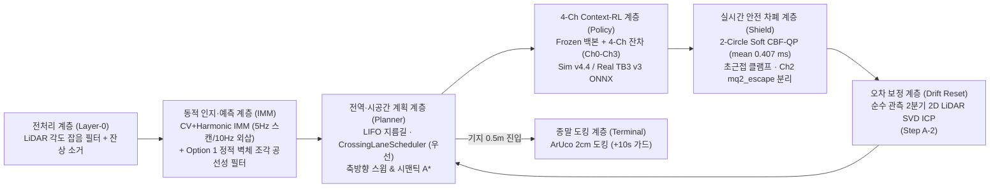

#### Host PC · RPi 4 · 센서 통합 ROS 2 토폴로지

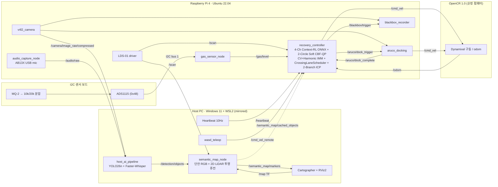

---

### 1.3 상태 머신 (`recovery_controller`) 및 핵심 제어 법칙

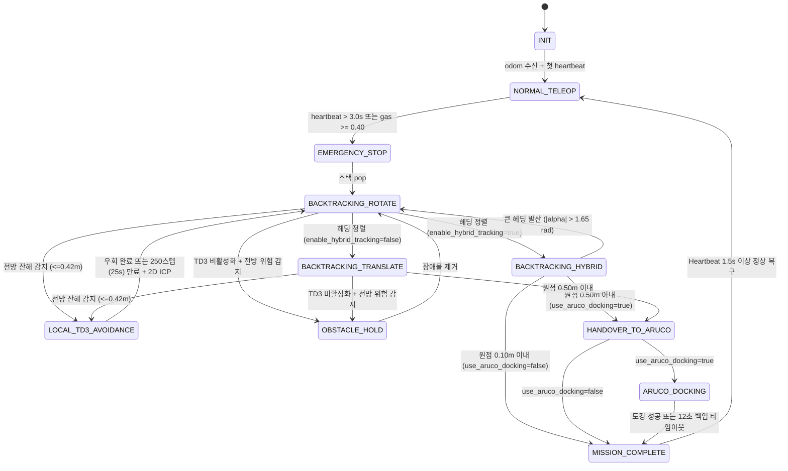

**핵심 제어 법칙 요약** (`recovery_params.yaml` 기본값 기준)

- **회전 정렬 (`|e_θ| > 0.12 rad`)**: $v = 0$, $\omega = \mathrm{clamp}(1.40 \cdot e_\theta,\; \pm 0.65)$
- **하이브리드 연속 추종 (`BACKTRACKING_HYBRID`, 기본 활성)**: Lookahead 거리 $L_d = \mathrm{clip}(d_{\text{target}}, 0.25, 0.45)\,\text{m}$ 기반 Regulated Pure Pursuit($\kappa = 2\sin\alpha / L_d$, $v_{\text{reg}} = \mathrm{clip}(v_{\max} / (1 + 0.6|\kappa|), 0.14, 0.20)$)와 로컬 `A*`·Context-RL(또는 TD3) 출력을 블렌딩한다 (`d_front <= 0.42 m` 시 TD3 `0.85·ω_TD3 + 0.15·ω_PP`, 평시 `0.55·ω_PP + 0.45·ω_TD3`; Phase 4에서는 4-Ch Homotopy-RL과 명목 일관성 가드 적용).
- **레거시 직진 단계 (`BACKTRACKING_TRANSLATE`, `enable_hybrid_tracking=false`)**: $v = \mathrm{clamp}(0.60 \cdot d,\; 0.03,\; 0.20)$, $\omega = \mathrm{clamp}(0.5 \cdot 1.40 \cdot e_\theta,\; \pm 0.65)$
- **Phase 4 안전 차폐 · 시공간 스케줄링 (`enable_dynamic_tracker:=true`, `enable_cbf_safety_shield:=true`)**: `BACKTRACKING_HYBRID`에서 `CV+Harmonic IMM`이 5 Hz 스캔 동기 갱신 및 10 Hz 비파괴 외삽을 수행하고, 협소 개구부 횡단(`CrossingLaneScheduler`, 우선 분기) 또는 광폭 회랑 축방향 스윕 연성 비용맵(`w_band = 3.8`)과 4-Ch RL이 명목 속도 $(v_{\text{ref}}, \omega_{\text{ref}})$를 생성하면 최후단 **2-Circle Soft CBF-QP**(`10.0 Hz`, `mean 0.407 ms`)가 안전 투영을 적용한다.
- **2D LiDAR ICP 스캔 매칭**: 경유지 `45 cm` (`scan_match_max_dist_m: 0.45`) 이내에서 저장 스캔과 현재 스캔을 SVD ICP로 정합해 `/odom` → 보정 좌표계 SE(2) 오프셋에 상보필터($\alpha = 0.40$)로 반영한다. Phase 4(`Step A-2`)는 시작 앵커(`is_start_match`)에서 순수 센서·ICP 관측만으로 오염 스캔(`0.12 m / 0.16 m`, `corr_y` 차단)과 정상 고품질 스캔(`0.38 m / 0.42 m`, `corr_y` 허용)을 2분기한다.
- **ArUco 도킹 수렴 및 세이프티 가드**: $|Z - 0.20| \le 0.02\,\text{m}$, $|X| \le 0.02\,\text{m}$, $|\text{yaw}| \le 0.05\,\text{rad}$를 10프레임 연속 만족 시 완료 (`use_aruco_docking`은 시뮬 YAML 기본 `false`, `sim.py --yolo` 및 실차 프로파일 `true`). 마커 미감지 시 10.0 s 후 정지 및 `MISSION_COMPLETE` 전이 (제어기 12.0 s 2차 백업).

---

## 2. Phase 4 핵심 알고리즘 (5대 기술 축)

> 📄 **설계 · 검증 근거**: [`docs/Phase4_재검증_연구설계_및_구현계획.md`](docs/Phase4_재검증_연구설계_및_구현계획.md) · [`benchmark_results/stepB4_gate1_sim/`](benchmark_results/stepB4_gate1_sim/) · [`benchmark_results/stepB4_gate2_sim/`](benchmark_results/stepB4_gate2_sim/) · [`benchmark_results/phase4_semantic/`](benchmark_results/phase4_semantic/)

Phase 4는 Phase 3 Clean 150-Trial 감사에서 식별된 두 핵심 병목(① 근접 구간 `lidar_collision` 53건, ② 동적 교차·왕복 장애물 시공간 회피 부재 `dynamic_crossfire_alley 0/10`)을 해소하고, 시맨틱 회피·연기 LiDAR 오염·U자 함정까지 단일 제어 파이프라인으로 통합한 완결 단계다.

### 2.1 4-Ch Context-RL (`1120`차원) 및 V100 Dual-Track 학습

- **4채널 관측 공간 및 비퇴행 구조**: 관측 공간을 `12×12×4 = 576`셀 Ego 코스트맵 + `544`차원 시계열 스칼라(16스텝) = **`1120`차원** (`Ch0` 2D LiDAR, `Ch1` 저상 장애물, `Ch2` 가스/조난자, **`Ch3` 동적 장애물 미래 예측 투영**)으로 확장하고, `frozen_residual` 구조로 비시맨틱·비동적(`Ch1=Ch2=Ch3=0`) 비퇴행(`non_regression_max_abs_diff = 0.0`)을 유지한다 ([`rl_context_policy.py`](src/disaster_recovery/disaster_recovery/rl_context_policy.py)).
- **트랙별 `cbf_v_min` 정합**: 학습 환경과 실전 CBF-QP의 후진 하한을 일치시킨다 — **`Sim v4.4` (`cbf_v_min = -0.06 m/s`)**, **`Real TB3 v3` (`cbf_v_min = -0.08 m/s`)**.
- **후방 생존자 `sem_prox` 방향 감쇠** ([`recovery_controller.py`](src/disaster_recovery/disaster_recovery/recovery_controller.py#L2601-L2658)): 복귀 개시 시 이미 로봇 후방에 위치한 조난자(`cos <= -0.35`)의 방향 가중치 `dir_w`를 `0`으로 선형 감쇠해 불필요한 `sem_prox` 포화와 명목 일관성 가드 해제를 차단한다.

**V100 Dual-Track 4-Ch CPPO 학습 및 배포 ONNX 요약** — Tesla V100 32GB에서 각 트랙당 3시드 × `22.12M` = **`66.36M` steps** 학습 후 DAgger 증류로 추출 ([`phase4_cppo_v4_4_full_training_summary.json`](benchmark_results/phase4_cppo_v4_4_full_training_summary.json), [`phase4_cppo_v3_training_summary.json`](benchmark_results/phase4_cppo_v3_training_summary.json)):

| 트랙 (배포 ONNX 모델) | 버전 / `cbf_v_min` | 크기 / 구조 (`dim`) | 비퇴행<br>`max_abs_diff` | TEST Unseen SR<br>(CBF OFF / ON) | TEST Safe SR<br>(CBF OFF / ON) | Low-Obs CF<br>(CBF ON) | x86 CPU 지연<br>(mean / p95) |
| :--- | :---: | :---: | :---: | :---: | :---: | :---: | :---: |
| **`Sim`** ([`sim_policy_student_phase4.onnx`](src/disaster_recovery/config/sim_policy_student_phase4.onnx)) | v4.4 / `-0.06 m/s` | `574.2 KB` / `frozen_residual` (`1120`) | **`0.0`** | `91.5%` / `87.3%` | `86.0%` / `86.8%` | **`98.0%`** | `0.091 ms` / `0.102 ms` |
| **`Real TB3`** ([`real_tb3_policy_student_phase4.onnx`](src/disaster_recovery/config/real_tb3_policy_student_phase4.onnx)) | v3 / `-0.08 m/s` | `403.8 KB` / `frozen_residual` (`1120`) | **`0.0`** | `80.5%` / `74.5%` | `73.0%` / `71.8%` | `80.0%` | `0.062 ms` / `0.069 ms` |

---

### 2.2 2-Circle Soft CBF-QP 실시간 안전 필터 ([`cbf_safety_shield.py`](src/disaster_recovery/disaster_recovery/cbf_safety_shield.py))

Ames et al. (2017)의 **연속시간 제어 장벽 함수(Zeroing CBF, ZCBF)** 를 TurtleBot3 Burger 차체 기하에 맞춘 전·후 2-원 커버링으로 정식화하고, **10 Hz 제어 주기**($\Delta t = 0.1\,\text{s}$, $\gamma_j \Delta t \in \{0.3, 0.6, 0.8\} < 1$)로 매 스텝 적용한다.

- **전·후 오프셋 원 중심 및 차동구동 속도** ($i \in \{f, r\}$, 반경 $r_c = 0.098\,\text{m}$):

$$
p_i(x) = \begin{bmatrix} x_r + l_i \cos\theta \\ y_r + l_i \sin\theta \end{bmatrix}, \qquad \dot{p}_i(x, u) = \begin{bmatrix} v\cos\theta - l_i\omega\sin\theta \\ v\sin\theta + l_i\omega\cos\theta \end{bmatrix}
$$

여기서 $l_f = +0.020\,\text{m}$, $l_r = -\text{cbf\_rear\_offset\_m} = -0.060\,\text{m}$이다.

- **제어 장벽 함수 및 동적 장애물 속도항 포함 시간 미분**:

$$
h_{ij}(x, t) = \bigl\lVert p_i(x) - o_j(t) \bigr\rVert^2 - r_{\text{safe},j}^2, \qquad \dot{h}_{ij}(x, u, t) = 2\bigl(p_i(x) - o_j(t)\bigr)^\top\bigl(\dot{p}_i(x, u) - \dot{o}_j(t)\bigr)
$$

- **쌍별 독립 완화 변수 기반 2-Circle Soft CBF-QP**: 구현에서는 두 원 $i \in \{f, r\}$ 간 완화 변수를 공유하지 않고 각 $(i, j)$ 제약 행마다 독립 완화 변수 $\delta_{ij} \ge 0$을 정의한다(전방 원 조향 지렛대 비대칭 보정을 위해 $p_{\delta,fj} = 2\,p_{\delta,rj}$ 부여).

$$
\min_{u = (v, \omega),\; \delta_{ij} \ge 0} \; w_v (v - v_{\text{ref}})^2 + w_\omega (\omega - \omega_{\text{ref}})^2 + \sum_{i \in \{f, r\}} \sum_j p_{\delta,ij}\,\delta_{ij}^2
$$

$$
\text{s.t.} \quad \dot{h}_{ij}(x, u, t) + \gamma_j\,h_{ij}(x, t) \ge -\delta_{ij}, \qquad v \in [v_{\min}, v_{\max}], \qquad |\omega| \le \omega_{\max}
$$

- **계층별 감쇠율 및 실시간 풀이**:
  - 감쇠율 계층: $\gamma_{\text{dyn}} = 3.0 < \gamma_{\text{static}} = 6.0 \le \gamma_{\text{gas}} = 8.0\,\text{s}^{-1}$ (10 Hz 실행 시 $\gamma_j \Delta t \in \{0.3, 0.6, 0.8\} < 1$; 코드 구현에서는 주기 불변 계수 $\tilde{\gamma}_j(\Delta t) = (1 - e^{-\gamma_j \Delta t})/\Delta t$ 및 스텝 간 곡률·슬립 여유항 $\varepsilon_{\Delta t,\text{slip},ij}$ 반영).
  - 비대칭 가중치 $w_v = 1.0$, $w_\omega = 0.05$, 0.10 m 복셀 최근접 16점 다운샘플링, 완화 변수 해석적 소거 후 Pure-NumPy $2\times 2$ PDAS(Semismooth Newton) + Armijo 선탐색으로 **`Step B-4` 100-Trial 실측 `cbf_mean = 0.407 ms` / `cbf_max = 1.941 ms` (`< 2.0 ms`)** 를 달성했다.
- **`prefer_no_reverse` · Ch2 `mq2_escape` 분기 · 초근접 광선 클램프**:
  - `prefer_no_reverse`: 협소 교차 `HOLD`/`DASH` 중 안전 경계($h \ge 0$)에서 불필요한 후진을 차단하되 $h < 0$ 침범 시 비상 후진을 보존한다.
  - **`mq2_escape` 예외 분기**: `GAS_HAZARD` 클래스 전용(`person`/`AUDIO_DISTRESS` 제외)이면서 장벽 침범($h_{\min} < 0$)이 발생한 경우 아래 두 분기 중 하나를 만족할 때만 발동한다(여기서 $h_r$은 가스 구역 반경 기본 `0.55 m`, $r_c = 0.098\,\text{m}$는 차체 커버링 원 반경, $m_{\text{sem}} = 0.05\,\text{m}$는 시맨틱 안전 여유 반경 `semantic_margin`):
    1. **로컬 MQ-2 실측 가스 구역**: 로봇 중심 거리 $d < h_r$
    2. **캐시된 원격 가스 구역**: 깊은 내부 $d < \mathrm{clip}\bigl(h_r - r_c - m_{\text{sem}},\; 0.50\,h_r,\; 0.75\,h_r\bigr)$
    - 외곽 패딩 구간($h_r \le d < r_{\text{safe}}$)에서는 일반 Ch2 CBF 반발을 유지해 오발동을 원천 차단하며, `_select_safe_lifo_waypoint`가 가스 구역을 가로지르는 현(chord) 경로를 금지한다.
  - **초근접 광선 래치 및 원자적 초기화**: `_apply_near_ray_latch`가 LDS-01 사각지대 초근접 양수 반환($0 < r < 0.120\,\text{m}$)을 `0/inf/nan` 드롭아웃과 구분해 `0.120 m`로 클램프·래치하고, 에피소드 전환 시 [`cb_reset_episode`](src/disaster_recovery/disaster_recovery/recovery_controller.py#L2776-L2791)가 트래커·CBF·스케줄러·시맨틱 캐시를 원자적으로 초기화한다.

---

### 2.3 5 Hz 스캔 / 10 Hz 비파괴 외삽 CV+Harmonic IMM & Option 1 정적 벽체 조각 공선성 필터 ([`dynamic_tracker.py`](src/disaster_recovery/disaster_recovery/dynamic_tracker.py))

Blom & Bar-Shalom (1988)의 상호작용 다중 모델(IMM)을 실기 `LDS-01` 스캔 사양(`5 Hz`)과 제어 주기(`10 Hz`)에 맞춰 등속(CV) + 1D 조화왕복(Harmonic) 2-모델 경량 구조로 구현했다.

- **5 Hz 스캔 게이팅 & 10 Hz 비파괴 외삽**: `scan.header.stamp`가 전진할 때만 관측 갱신(5 Hz)하고, 중간 제어 틱(10 Hz)에서는 내부 공분산·이력을 변형하지 않고 비파괴 외삽한다.
- **Option 1 정적 벽체 조각 공선성 필터(`_is_static_wall_fragment`) & 회전 순변위 게이트**:
  - 연속 정적 벽체에서 사선 광선 카빙으로 떨어져 나온 조각을 양단 정적 인접성·공분산 평탄도(`spread_ratio < 0.008`)·연장 현 길이로 $O(1)$-$O(k)$ 기각한다.
  - 회전 가드 활성 시 트랙 확정 요구 순변위를 `max(confirm_min_disp_m, 0.25 m)`로 상향해 제자리 회전 중 정적 벽체·기둥 오탐을 제거했다(정적 시맨틱 월드 동적 오탐 **`2 → 0건`**).
- **장기 4.5 s 궤적 예측 정밀도**: 5 Hz 잡음 LiDAR 기준 $\tau = 4.5\,\text{s}$ 장기 예측 FDE `4.4 mm` (`crossfire`형, $A=0.38\,\text{m},\,\omega=0.95\,\text{rad/s}$) / `11.4 cm` (`gauntlet`형, $A=0.93\,\text{m},\,\omega=0.45\,\text{rad/s}$) 수준으로 수렴하며 단위 테스트(`test_imm_harmonic_fit_and_45s_rollout_accuracy`)에서 매 틱 `< 0.50 ms` 이내 검증을 통과한다.

---

### 2.4 기하 조건부 시공간 회피 분리 (`CrossingLaneScheduler` + 축방향 스윕/시맨틱 A\*)

Fiorini & Shiller (1998)의 속도 장애물 시공간 회피 원리에 기반해, 하드코딩된 월드 좌표나 시나리오명 없이 동적 장애물 주축 단위벡터 $\hat{u}$, 로봇 진행 방향(지역 $\hat{d}_{\text{path}}$ · 거시 $\hat{d}_{\text{macro}}$), 로컬 점유 격자 개구부 폭만으로 아래 우선순위에 따라 회피 전략을 자동 분기한다.

1. **1순위 (우선 분기) — 협소 개구부 횡단 (`CrossingLaneScheduler`, [`recovery_controller.py`](src/disaster_recovery/disaster_recovery/recovery_controller.py#L683-L777))**:
   - **발동 조건**: 로컬 격자에서 좌·우 정적 벽체가 모두 검출되고 **개구부 폭 `< 1.85 m`** 이며, 횡단 교차 조건($|\hat{d}_{\text{path}} \cdot \hat{u}| \le 0.55$ 및 $|\hat{d}_{\text{macro}} \cdot \hat{u}| \le 0.60$)을 충족할 때 최우선 분기하여 명목 속도 $(v_{\text{ref}}, \omega_{\text{ref}})$를 직접 생성한다 (`dynamic_crossfire_alley`형).
   - **동작**: 좌·우 벽 이격 $\ge 0.17\,\text{m}$인 2D 양측 측면 레인(표준 협곡 $y = \pm 0.38\,\text{m}$, 벽 이격 $0.195\,\text{m}$)을 산출해 사전 정렬(`APPROACH`) → 정지 대기(`HOLD`, 전주기 위상 탐색으로 안전 출발 창 `33.9%` · 최악 대기 `2.19 s`) → 연속 돌파(`DASH`)를 수행한다.
   - **Option 1 기아 방지**: 구역 반경 `0.85 m` 내 누적 HOLD 상한 `max_zone_hold_s = 14.0 s` 및 해제 쿨다운 `zone_cooldown_s = 4.0 s`를 적용해 교착·기아를 차단한다.
2. **2순위 — 광폭 회랑 정면 왕복 (축방향 스윕 연성 비용맵, [`local_grid_planner.py`](src/disaster_recovery/disaster_recovery/local_grid_planner.py#L457-L567))**:
   - **발동 조건**: 협소 개구부 스케줄러가 비활성이고 정면 왕복 조건($|\hat{d}_{\text{path}} \cdot \hat{u}| \ge 0.65$, 진폭 $\ge 0.06\,\text{m}$)을 충족하는 측방 우회 가능 회랑에서 작동한다 (`dynamic_gauntlet`형).
   - **동작**: 반폭 $\text{band\_half\_w} = r_{\text{track}} + 0.34 \approx 0.52\,\text{m}$ (여기서 $r_{\text{track}} = \max(0.10\,\text{m},\, r_{\text{obs}})$는 IMM이 추정한 동적 장애물 트랙의 물리 반경으로, 표준 동적 기둥 기준 약 `0.18 m`), 가중치 `w_band = 3.8 (> max_soft 3.6)`의 축방향 스윕 연성 비용맵을 부과해 `A*`가 측면 안전 차선으로 이탈하도록 유도한다.
   - 정면 근접 폐쇄(`d_dyn < 0.85 m`, 접근 속도 `closing > 0.25 m/s`) 감지 시 선속도 상한을 `0.09 m/s`로 제한한다(`Step B-4` 축방향 비용맵 + IMM + 스케줄러 총 추가 연산 지연 `0.3283 ms < 1.0 ms`).
3. **시맨틱 미션 A\* 비용 연동**: `recovery_params.yaml` 및 `recovery_params_real.yaml` 기본값은 비시맨틱 15-시나리오 재현성 보존을 위해 `enable_semantic_astar_cost: false`를 유지하며, 시맨틱 미션 런치·벤치마크에서만 CLI로 `true`를 주입한다.

---

### 2.5 `Step A-2` 순수 관측 2분기 2D LiDAR SVD ICP ([`recovery_controller.py`](src/disaster_recovery/disaster_recovery/recovery_controller.py#L4092-L4180))

- 시뮬레이션 전용 파라미터 `smoke_lidar_noise_prob` 직접 참조를 코드에서 완전히 제거했다(AST·소스 단위 테스트 `test_phase4_batch_regression_fixes.py` 검증 완료).
- 시작 앵커(`is_start_match`)에서 순수 센서·ICP 관측 지표(`spike_ratio >= 0.03` 또는 `icp_inlier_ratio < 0.65` 또는 `icp_mean_err > 0.08 m`)만으로 스캔 오염 여부를 2분기한다:
  - **오염/저품질 스캔**: 보수적 가드(`max_p_jump = 0.12 m`, `drift_cap = 0.16 m`, `corr_y` 차단) 유지 → 연기 오염 스캔 차단 `54/54` 적중.
  - **정상 고품질 스캔(`inliers >= 25`)**: `0.38 m` coarse-to-fine ICP 및 완화 가드(`max_p_jump = 0.38 m`, `drift_cap = 0.42 m`, `corr_y` 허용) 적용 → 30 cm급 누적 드리프트 흡수(`0/40` 오탐) 양립.

---

## 3. Phase 4 통합 실험 결과 및 3D 쇼케이스

모든 벤치마크는 도착 여부만 보던 구 기준 대신 **엄격 무충돌 판정(`Strict Pass`)** 으로 집계했다:
1. **기지 도착 (`arrival_success`)**: `terminal_error_cm <= 25.0 cm` (`final_dist_to_base_m <= 0.25 m`)
2. **무충돌 (`collision_free`)**: 복귀 중 낙하 잔해 중심 거리 `min_debris_dist_m >= 0.265 m` (`not debris_collision`) **및** 360° 유효 LiDAR 최소 거리 `scan_all_min <= 0.121 m` (`0.120 <= r <= 3.5 m`) 누적 4스텝 미만 (`not lidar_collision`)

### 3.1 `Step B-4` 100-Trial 동적·강건성 통합 성적표

| 평가 그룹 | `[맵 이름 + 모델]` | Trials | Strict Pass | Arrival | 충돌 (`coll`)<br>(`debris` / `lidar`) | Pass 평균시간<br>(전체 평균) | Pass 평균오차 |
| :--- | :--- | :-: | :---: | :---: | :---: | :---: | :---: |
| **Gate 1 (`Step B-4`)** | `dynamic_crossfire_alley + Sim` | 10 | `7/10` (`70.0%`) | `9/10` | `2` (`0` / `2`) | `62.49 s` (`65.00 s`) | `9.29 cm` |
| | `dynamic_gauntlet + Sim` | 10 | `7/10` (`70.0%`) | `8/10` | `3` (`0` / `3`) | `101.40 s` (`137.23 s`) | `4.63 cm` |
| | `dynamic_crossfire_alley + Real` | 10 | `7/10` (`70.0%`) | `8/10` | `2` (`0` / `2`) | `63.01 s` (`83.66 s`) | `12.23 cm` |
| | `dynamic_gauntlet + Real` | 10 | **`9/10` (`90.0%`)** | `10/10` | `1` (`0` / `1`) | `99.57 s` (`101.26 s`) | `4.76 cm` |
| **Gate 1 소계 (`Step B-4`)** | 동적 2대 맵 × Sim/Real | **40** | **`30/40` (`75.0%`)** | **`35/40` (`87.5%`)** | **`8` (`0` / `8`)** | **`82.81 s`** | **`7.53 cm`** |
| **Gate 2 (`Step B-4`)** | `collapsed + Sim` | 10 | `9/10` (`90.0%`) | `9/10` | **`0`** (`0` / `0`) | `103.62 s` (`100.39 s`) | `6.08 cm` |
| | `smoke_lidar_corruption + Sim` | 10 | **`10/10` (`100.0%`)** | `10/10` | **`0`** (`0` / `0`) | `76.69 s` (`76.69 s`) | `6.38 cm` |
| | `u_pocket_trap + Sim` | 10 | **`10/10` (`100.0%`)** | `10/10` | **`0`** (`0` / `0`) | `101.03 s` (`101.03 s`) | `3.68 cm` |
| | `collapsed + Real` | 10 | **`10/10` (`100.0%`)** | `10/10` | **`0`** (`0` / `0`) | `98.46 s` (`98.46 s`) | `7.64 cm` |
| | `smoke_lidar_corruption + Real` | 10 | **`10/10` (`100.0%`)** | `10/10` | **`0`** (`0` / `0`) | `75.02 s` (`75.02 s`) | `5.43 cm` |
| | `u_pocket_trap + Real` | 10 | **`10/10` (`100.0%`)** | `10/10` | **`0`** (`0` / `0`) | `91.35 s` (`91.35 s`) | `5.00 cm` |
| **Gate 2 소계 (`Step B-4`)** | 강건성 3대 맵 × Sim/Real | **60** | **`59/60` (`98.3%`)** | **`59/60` (`98.3%`)** | **`0` (`0` / `0`)** | **`90.82 s`** | **`5.70 cm`** |
| **`Step B-4` 전체 합계** | **5대 맵 × Sim/Real** | **100** | **`89/100` (`89.0%`)** | **`94/100` (`94.0%`)** | **`8` (`0` / `8`)** | **`88.12 s`** | **`6.31 cm`** |

- **`Step B-4` 100-Trial 실시간 제어 텔레메트리**: `cbf_mean = 0.407 ms` (`Gate 1: 0.444 ms`, `Gate 2: 0.382 ms`), `cbf_max = 1.941 ms` (`< 2.0 ms`), `ctrl_hz_min = 12.959 Hz` (전체 평균 `59.34 Hz`).

### 3.2 Gate 1 대조군 · Option 1 안정화 회귀 비교 (양측 Fisher 정확 검정)

| 비교 구성 (Gate 1 동적 2대 맵) | `dynamic_crossfire_alley + Sim` | `dynamic_gauntlet + Sim` | `dynamic_crossfire_alley + Real` | `dynamic_gauntlet + Real` | 합계 Strict Pass | 충돌 (`coll`) | 대조군 대비 양측 Fisher `p` |
| :--- | :---: | :---: | :---: | :---: | :---: | :---: | :---: |
| **Phase 3 Option 2 Clean** (Sim 20T) | `0/10` | `4/10` | — | — | `4/20` (`20.0%`) | `16/20` | 기준 대조군 A |
| **Phase 4 Ablation OFF** (`stepB4_ablation_off_*`) | `0/10` | `2/10` | `1/10` | `4/10` | `7/40` (`17.5%`) | `30/40` | 기준 대조군 B |
| **Phase 4 `Step B-4`** (`stepB4_gate1_*`) | `7/10` | `7/10` | `7/10` | `9/10` | **`30/40` (`75.0%`)** | `8/40` | vs B: **`3.93×10⁻⁷`**<br>vs A: **`7.53×10⁻⁵`** |
| **Phase 4 Option 1 안정화 (`opt1_fix_*`, 최신)** | **`8/10`** | `7/10` | `7/10` | **`9/10`** | **`31/40` (`77.5%`)** | **`6/40`** | vs B: **`1.11×10⁻⁷`**<br>vs `Step B-4`: `1.00` (비퇴행 + 충돌 `8 → 6`) |

- Gate 2(강건성 3대 맵) 역시 `Step B-4` **`59/60` (`98.3%`, 충돌 `0/60`)** 가 Phase 3 Option 2 Clean `22/30` (`73.3%`, 충돌 `8/30`) 대비 통계적으로 유의한 개선(양측 Fisher **`p = 5.17×10⁻⁴`**)을 기록했다.

---

### 3.3 시맨틱 10-Trial 4-모드 통합 비교 (동일 개선 `out_wps` 하네스)

[`disaster_semantic_rescue_world.world`](src/disaster_recovery/worlds/disaster_semantic_rescue_world.world) 에서 저상 장애물(`h=0.095 m`) 2개와 유해 가스(`r=0.55 m`)를 복귀 경로에 배치하고, 개선된 Outbound 경유지(`out_wps`, `10/10` 도달) 하네스(`enable_semantic_astar_cost: true`)에서 4개 모드를 공정 비교한 결과다 ([`semantic_avoidance_ab_10trials.json`](benchmark_results/phase3_semantic_v3/semantic_avoidance_ab_10trials.json), [`semantic_avoidance_phase4_10trials.json`](benchmark_results/phase4_semantic/semantic_avoidance_phase4_10trials.json)).

| 모드 | Outbound | Arrival | Collision-Free | **Strict Hazard-Free** | 위반 (`low/wall/gas`) | `mq2_escape` 스텝 | `max_dyn` (정적 오탐) | 평균 최소 저상 이격 | 평균 최소 가스 이격 | 평균 복귀시간 | 평균 종말오차 |
| :--- | :-: | :-: | :-: | :---: | :---: | :-: | :-: | :---: | :---: | :---: | :---: |
| **`blind_phase2b`** | `10/10` | `9/10` | `6/10` | `2/10` (`20.0%`) | `4 / 2 / 5` | `0` | `0` | `0.2935 m` | `0.4644 m` | `56.91 s` | `28.40 cm` |
| **`semantic_phase3`** | `10/10` | `10/10` | `10/10` | **`10/10` (`100.0%`)** | **`0 / 0 / 0`** | `0` | `0` | `0.5838 m` | `0.8196 m` | `38.26 s` | `3.51 cm` |
| **`phase4_sim`** (`Sim v4.4`) | `10/10` | `10/10` | `10/10` | **`10/10` (`100.0%`)** | **`0 / 0 / 0`** | **`0`** | **`0`** | `0.5881 m` | **`0.8548 m`** | `38.92 s` | **`3.50 cm`** |
| **`phase4_real`** (`Real TB3 v3`) | `10/10` | `10/10` | `10/10` | **`10/10` (`100.0%`)** | **`0 / 0 / 0`** | **`0`** | **`0`** | **`0.6037 m`** | `0.8320 m` | `38.35 s` | **`3.54 cm`** |

- **통계적 유의성 및 Option 1 개선 효과**:
  - `blind_phase2b` (`2/10`) 대비 개별 모드(`semantic_phase3`, `phase4_sim`, `phase4_real` 각 `10/10`) 비교의 정확한 양측 Fisher 검정 결과는 **`p = 7.14×10⁻⁴`** 이다 (`phase4_sim + phase4_real 20/20` 통합 탐색적 비교 시 `p = 7.69×10⁻⁶`, 동일 시드 공유).
  - Option 1 정적 벽체 조각 공선성 필터 적용 전(`semantic_avoidance_phase4_sim_sem_astar_10trials.json`)에는 정적 시맨틱 월드에서 동적 오탐 `max_dyn = 2` 및 `8/10` 통과가 발생했으나, Option 1 적용 후 `phase4_sim`·`phase4_real` 모두 **`max_dyn = 0`, `mq2 = 0`, `10/10` (`100.0%`)** 을 달성했다.
  - (참고: 초기 구버전 `out_wps` 하네스 초판 기록에서는 `blind_phase2b 0/10` vs `semantic_phase3 9/10`이었으며, 개선된 동일 `out_wps` 하네스 재평가에서 위 4-모드 통합 수치를 확증했다.)

<details>
<summary><strong>[GIF] · [PNG] Phase 2-B Blind vs Phase 3 Semantic-Aware 10-Trial A/B 시각화 펼쳐보기</strong></summary>

| `[GIF]` Phase 2-B **Blind** (`1-Ch RL` · 저상/가스 미인지) | `[GIF]` Phase 3 **Semantic-Aware** (`Option 2 3-Ch RL` · 선제 우회) |
| :---: | :---: |
|  | 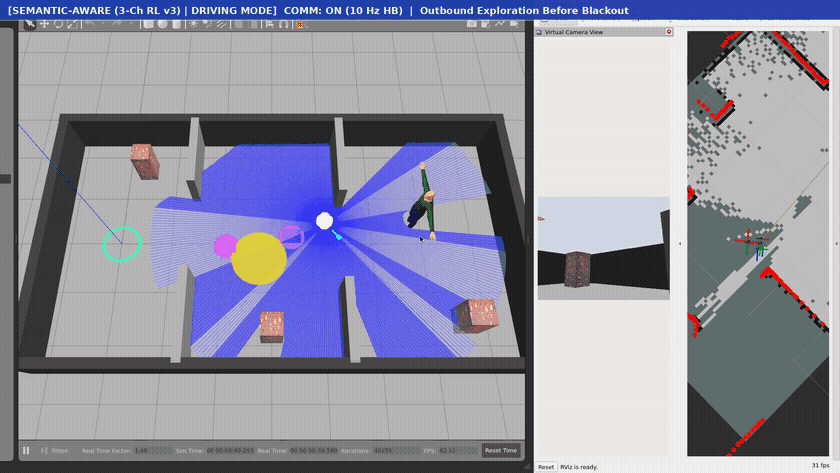 |

<p align="center">
  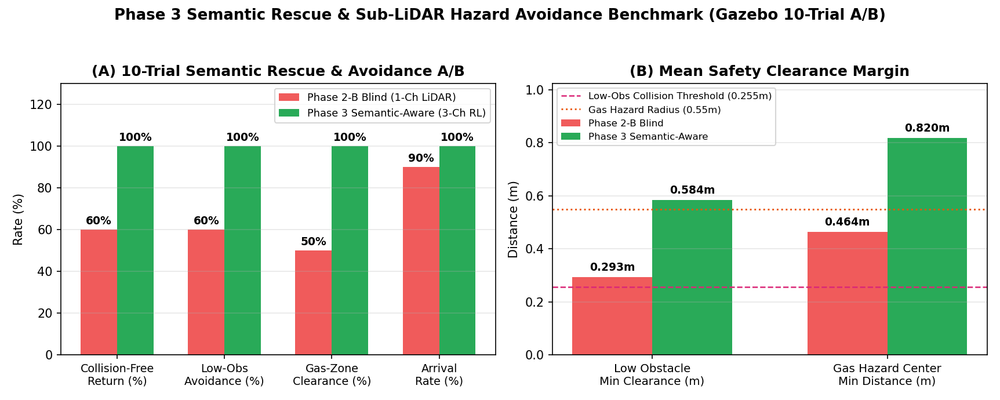
</p>

</details>

---

### 3.4 Phase 4 3D E2E 시맨틱 증빙 및 `Step B-4` 3D/2D 쇼케이스 GIF

#### (1) Phase 4 시맨틱 3D E2E 증빙 (`phase4_real` Trial #10 · Seed 3336 · `38.0 s` · 오차 `3.42 cm`)

| `[GIF]` Phase 4 Real TB3 시맨틱 E2E 3D (`low=0.690 m`, `gas=0.704 m`, `mq2=0`, `max_dyn=0`) | `[PNG]` 2D 궤적·위험반경 오버레이 |
| :---: | :---: |
| 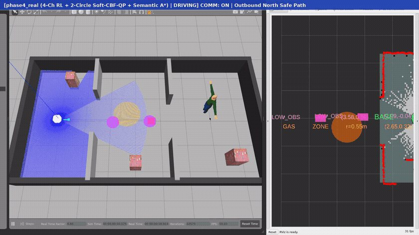 | 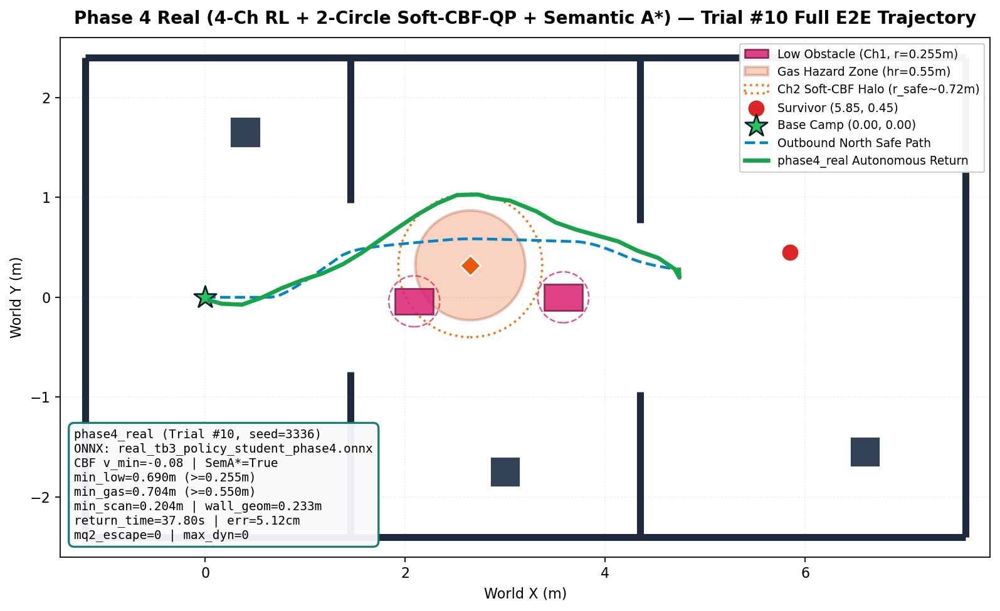 |

<details>
<summary><strong>[PNG] Phase 4 시맨틱 E2E 키프레임 3장 펼쳐보기 (`Outbound` → `CBF Avoidance` → `Complete`)</strong></summary>

| `[PNG]` 1. Outbound 탐사·좌표 스탬핑 | `[PNG]` 2. CBF-QP + Semantic A\* 선제 우회 | `[PNG]` 3. 기지 무위반 복귀 완료 (`3.42 cm`) |
| :---: | :---: | :---: |
| 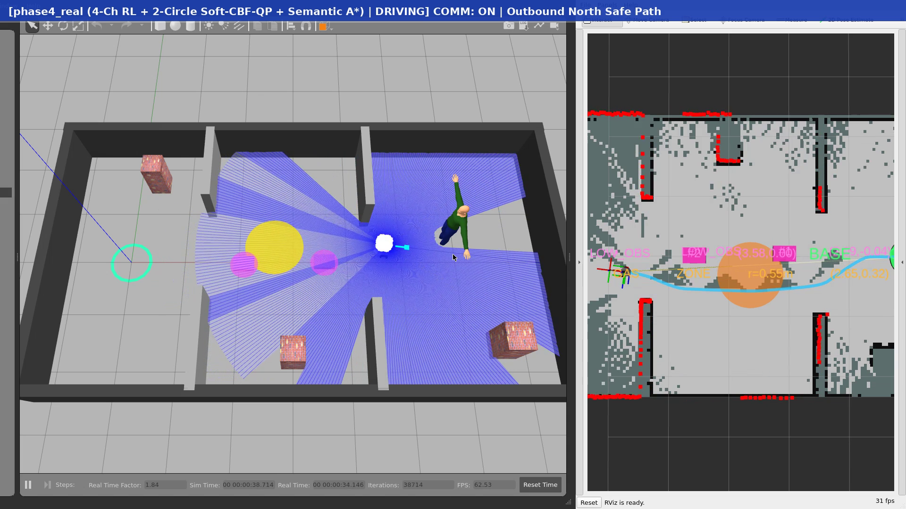 | 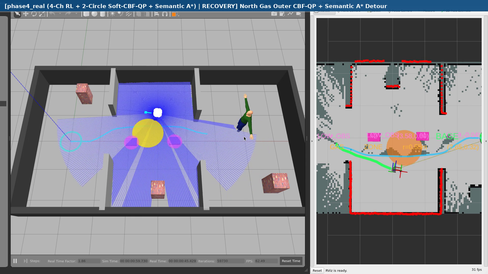 | 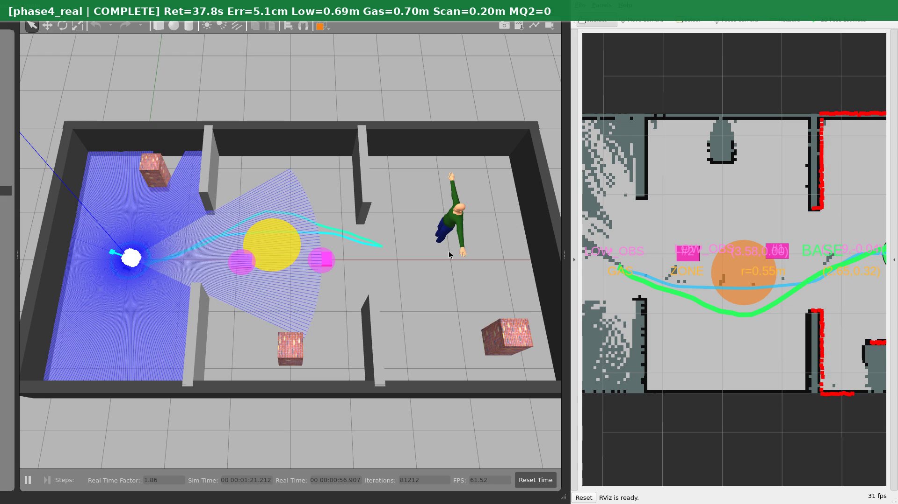 |

</details>

#### (2) Phase 4 `Step B-4` 3D 통일 HUD 및 2D 보완 쇼케이스 GIF

| `[GIF 3D]` `dynamic_crossfire_alley + Sim`<br>(Seed 2228 · `55.2 s` · 오차 `4.54 cm` · `min_scan 0.252 m`) | `[GIF 3D]` `smoke_lidar_corruption + Real`<br>(Seed 2834 · `71.7 s` · 오차 `4.42 cm` · `min_scan 0.198 m`) | `[GIF 3D]` `u_pocket_trap + Sim`<br>(Seed 2834 · `93.1 s` · 오차 `1.93 cm` · `min_scan 0.143 m`) |
| :---: | :---: | :---: |
| 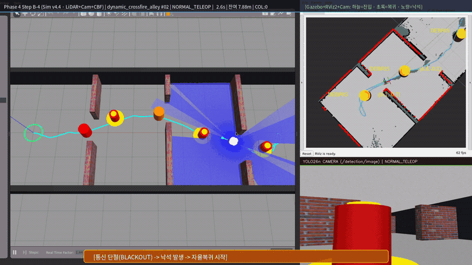 | 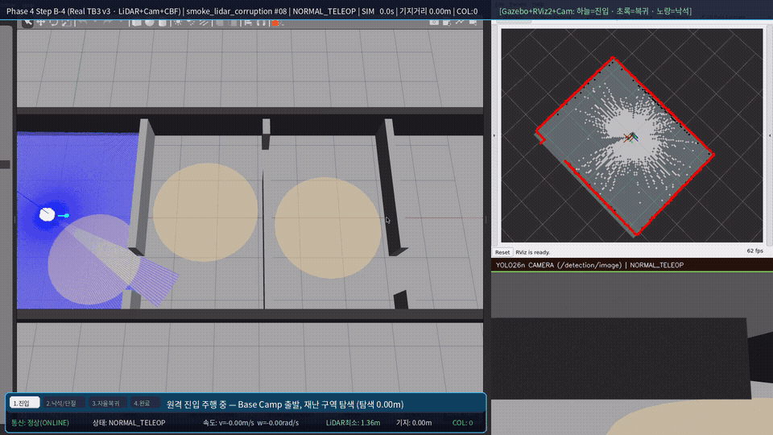 | 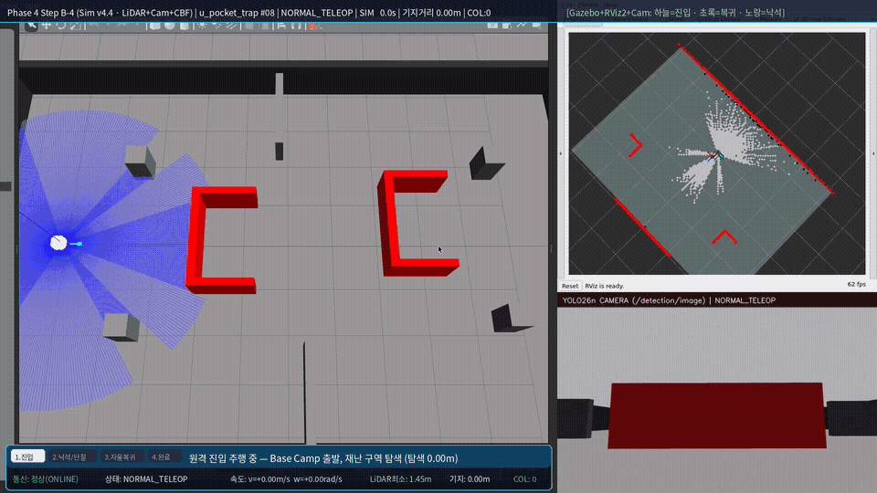 |

| `[GIF 3D]` `dynamic_gauntlet + Real`<br>(Seed 2733 · `117.2 s` · 오차 `2.25 cm` · `min_scan 0.134 m`) | `[GIF 2D]` `dynamic_gauntlet + Real` (2D 경량 보완)<br>(Seed 2733 · 축방향 스윕 회피) | `[GIF 2D]` `collapsed + Sim` (2D 경량 보완)<br>(Seed 2329 · `104.0 s` · 오차 `2.54 cm` · `min_scan 0.198 m`) |
| :---: | :---: | :---: |
| 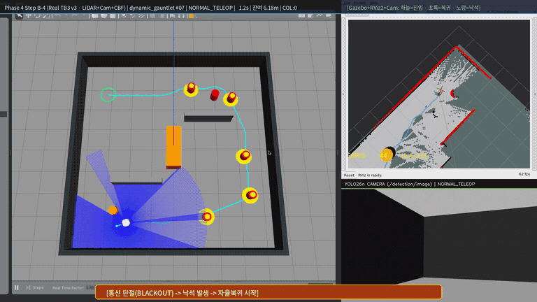 | 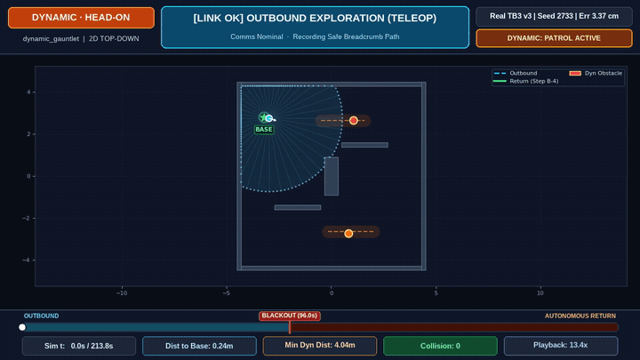 | 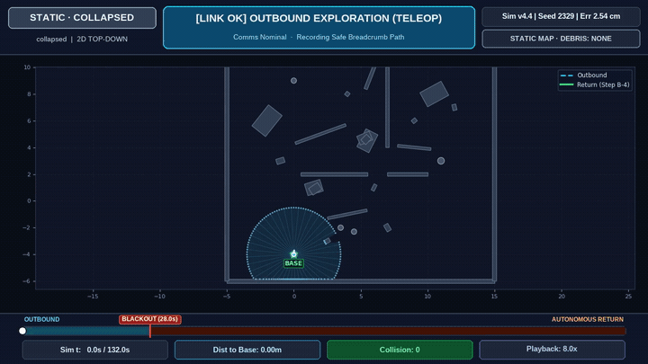 |

> [!NOTE]
> 고해상도 1080p 3D 원본 MP4(`50 MiB` 초과)는 GitHub 용량 정책에 따라 원격 저장소 푸시에서 제외되며, 로컬 워크스페이스 경로 `benchmark_results/stepB4_showcase_videos/` (`dynamic_crossfire_sim_seed2228_3d.mp4`, `dynamic_gauntlet_real_seed2733_3d.mp4`, `smoke_lidar_real_seed2834_3d.mp4`, `u_pocket_trap_sim_seed2834_3d.mp4`)에 보관된다.

---

## 4. 알고리즘 진화(Baseline → Phase 4) 및 Phase 3 비퇴행 검증

### 4.1 알고리즘 6단계 진화 비교표

**Baseline** → **Phase 1**(2D A\* + 지름길) → **Phase 2-A**(1-Ch RL 단순 혼합) → **Phase 2-B**(Layer-0 필터 + 안전 포락선 + 1-Ch RL) → **Phase 3 Option 2**(시맨틱 SLAM 캐시 + Frozen 백본 2단 직렬 3-Ch RL) → **Phase 4**(4-Ch CPPO + 2-Circle Soft CBF-QP + 5 Hz/10 Hz CV+Harmonic IMM/정적 벽체 필터 + 2D 시공간 스케줄러·축방향 스윕/시맨틱 A\* + 순수 관측 2분기 2D ICP) 순으로 발전했다.

| 단계 | 핵심 제어 구조 | 장점 | 한계 | Semantic Rescue 동일 맵 결과 |
| :--- | :--- | :--- | :--- | :--- |
| **Baseline**<br>(`baseline`) | 4계층 반응형 + 단순 TD3 + LIFO + 2D ICP | 구조 단순, 최저 연산 부하 | 격자 플래너·`ESCAPE` 부재로 U자 함정·2차 붕괴 정체 (`150회 엄격 2.0% / 도착 59.3%`) | **FAIL** (미도착·저상/벽 충돌)<br>`low=0.204m`, `135.0s` |
| **Phase 1**<br>(`proposed`) | `RollingLocalGrid` 2D A\* + 위상 지름길 + `ESCAPE` | 3D 벽·낙석 우회 및 U자 함정 탈출 강인 | 연기 잡음·동적 잔상에 과차단, 저상·가스·조난자 인지 불가 | **FAIL** (미도착·저상/가스 위반)<br>`low=0.191m`, `gas=0.537m` |
| **Phase 2-A**<br>(`proposed_rl`,<br>`envelope=false`) | 1-Ch Context-RL + A\* 단순 블렌딩 | A\* 재계획 지연 구간 연속 조향 | 좁은 문틀·낙석 구간에서 RL 조향이 A\*와 간섭, 저상·가스 미인지 | **FAIL** (미도착·저상 충돌)<br>`low=0.248m`, `135.0s` |
| **Phase 2-B**<br>(`proposed_rl`,<br>`envelope=true`, 1-Ch) | **Layer-0 연기·잔상 필터 + 안전 포락선** + 1-Ch ONNX | 2D LiDAR(`z=0.171m`) 평면 장애물·연기·이동체 회피 상위 (`150회 엄격 64.0% / 도착 93.3%`) | 스캔 평면 아래 저상 장애물(`h<0.17m`)과 유독가스·조난자 미인지 (`ab10 2/10`) | **FAIL** (미도착·저상 충돌)<br>`low=0.239m`, `135.0s` |
| **Phase 3 (Option 2)**<br>(`use_semantic=true`, 3-Ch) | **`/map` 시맨틱 캐시** + **Frozen 백본 + Pre-Tanh 잔차 + 하드 배리어 Safety Shield** | `Ch1=Ch2=0` 비퇴행(`max_abs_diff=0.0`, `150회 엄격 64.0% / 도착 94.0%`) + 저상·가스·조난자 선제 회피 (개선 하네스 `ab10 10/10`) | 근접 `lidar_collision` 53건 및 동적 교차·왕복 장애물 시공간 회피 부재 (`crossfire 0/10`) | **PASS** (무위반 복귀)<br>`low=0.449m`, `gas=0.888m`, `37.4s` |
| **Phase 4 (`Step B-4` + Option 1)**<br>(`phase4` / `phase4_real`, 4-Ch) | **4-Ch Context-RL (`Ch3`) + 2-Circle Soft CBF-QP + 5 Hz/10 Hz CV+Harmonic IMM(정적 벽체 필터) + 2D 시공간 스케줄러·축방향 스윕/시맨틱 A\* + 순수 관측 2분기 ICP** | **`Step B-4` 100-Trial `89/100 (89.0%)`**, Option 1 후 Gate 1 **`31/40`**, Gate 2 **`59/60` (충돌 `0/60`)**, 시맨틱 **`phase4_sim 10/10` · `phase4_real 10/10`** (`mq2=0`, 동적 오탐 `0`), CBF `0.407 ms` | 실물 RPi 4 필드 미수행, 비주기·의도 기반 보행자 한계, 초고속(`2.8-3.0×`) 장애물 물리 한계 | **PASS** (최대 저상 마진·무위반)<br>`low=0.543m`, `gas=0.787m`, `min_scan=0.127m` |

### 4.2 `Semantic Rescue` 6단계 동일 맵 비교

[`disaster_semantic_rescue_world.world`](src/disaster_recovery/worlds/disaster_semantic_rescue_world.world) 에서 **조난자(`person`)·저상 장애물 2개(`h=0.095 m`)·유독가스 구역(`r=0.55 m`)** 을 배치하고, Outbound SLAM+YOLO26n 좌표 스탬핑 후 Blackout 시점에 **2차 붕괴 3D 낙석(`box_obs_1`)** 이 퇴로를 막았을 때 6개 알고리즘의 동일 맵 주행 비교다 ([`comp5_semantic_rescue.json`](benchmark_results/phase3_semantic_v3/comp5_semantic_rescue.json), [`run_comp5_semantic_rescue.py`](scripts/host/run_comp5_semantic_rescue.py)).

| `[GIF]` Semantic Rescue 동일 `/map` 위 단계별 비교 (`BAS` - `P3/P4`) | `[PNG]` RViz2 `/map` + YOLO26n 실제 좌표 스탬핑 (`person`, `chair`, `GAS_HAZARD`) |
| :---: | :---: |
|  |  |

- **결과 판독**: `Baseline`(`low=0.204 m`, 벽 충돌, 미도착 `259.7 cm`), `Phase 1`(`low=0.191 m`, `gas=0.537 m`, 미도착 `265.5 cm`), `Phase 2-A`(`low=0.248 m`, 미도착 `279.7 cm`), `Phase 2-B`(`low=0.239 m`, 미도착 `260.0 cm`)는 모두 저상 장애물 충돌 및 미도착으로 실패했다. **`Phase 3 (Option 2)`(`low=0.449 m`, `gas=0.888 m`, `37.4 s`, 오차 `7.64 cm`)와 `Phase 4`(`low=0.543 m`, `gas=0.787 m`, `min_scan=0.127 m`, 오차 `8.03 cm`)만이 저상·가스·벽체 무위반 엄격 복귀(`PASS`)** 에 성공했다.

### 4.3 Phase 3 Clean 150-Trial 비퇴행 검증 (3자 종합 집계표)

15개 재난 시나리오 × 10회(150 Trials) 무결성 감사(`AUD-01`-`AUD-05`: 리셋 실패·음수 시간·25 cm 초과 성공·`return_path` 점프·Baseline 불일치 모두 **`0건`**, 동일 잔해 시드 `same_debris = 150/150`) 기준 3자 종합 비교다 ([`phase2b_strict_clean/`](benchmark_results/phase2b_strict_clean/), [`phase3_option2_clean/`](benchmark_results/phase3_option2_clean/)).

| 전략 (모델) | Strict Pass<br>(엄격 무충돌 복귀) | Arrival<br>(물리 도착 ≤ 25 cm) | 전체 충돌 (`coll`)<br>(`debris` / `lidar`) | Strict Pass 평균 복귀시간<br>(전체 150회 평균) | Strict Pass 종말오차<br>(전체 150회 평균) | Strict Pass 평균 이동경로 |
| :--- | :---: | :---: | :---: | :---: | :---: | :---: |
| **Baseline** (`baseline`) | `3/150` (**`2.0%`**) | `89/150` (`59.3%`) | `136건` (`debris=69`, `lidar=136`) | `104.30 s` (`180.28 s`) | `4.73 cm` (`241.77 cm`) | `15.13 m` |
| **Phase 2-B Strict Clean** (`sim_policy_student.onnx`, 1-Ch) | **`96/150` (`64.0%`)** | `140/150` (`93.3%`) | `54건` (`debris=10`, `lidar=53`) | **`79.72 s`** (`109.00 s`) | `9.05 cm` (`38.85 cm`) | **`12.18 m`** |
| **Phase 3 Option 2 Clean** (`sim_policy_student_semantic_v3.onnx`, 3-Ch) | **`96/150` (`64.0%`)** | **`141/150` (`94.0%`)** | `54건` (`debris=8`, `lidar=53`) | `81.57 s` (`106.97 s`) | `9.08 cm` (`43.02 cm`) | `12.48 m` |

- **Phase 4 개발 동기**: Option 2는 비시맨틱 환경 완전 비퇴행(`96/150 = 64.0%`, `max_abs_diff = 0.0`)을 입증했으나, 도착률(`94.0%`) 대비 엄격 무충돌 격차의 대부분이 근접 `lidar_collision`(`53건`)과 동적 교차 회피 부재(`dynamic_crossfire_alley 0/10`)에서 기인함이 확인되어 [§2](#2-phase-4-핵심-알고리즘-5대-기술-축)-[§3](#3-phase-4-통합-실험-결과-및-3d-쇼케이스)의 Phase 4 2-Circle Soft CBF-QP + CV+Harmonic IMM + 시공간 스케줄러 설계로 직결되었다.

---

#### Phase 3 · Phase 2-B 상세 검증 아카이브 (접힘)

<details>
<summary><strong>15대 시나리오별 세부 비교표(각 10 Trials) · 15종 2D/3D 아틀라스 · 병목 분석 · Non-Regression 증빙 펼쳐보기</strong></summary>

#### (1) 15대 시나리오별 세부 비교표 (각 10 Trials)

| # | 시나리오 ID | Baseline<br>(도착 / 엄격 무충돌) | Phase 2-B Strict Clean<br>(도착 / 엄격 무충돌) | Phase 3 v3 Warm-Start (구버전·아카이브)<br>(도착 / 엄격 무충돌) | **Phase 3 Option 2 Clean (최신)**<br>**(도착 / 엄격 무충돌)** | Option 2 무충돌 평균시간<br>(전체 평균시간) · 종말오차 |
| :-: | :--- | :---: | :---: | :---: | :---: | :---: |
| **1** | `collapsed` | `5/10` / `1/10` | `10/10` / `5/10` | `10/10` / `7/10` | `9/10` / **`5/10`** | `91.5 s` (`135.3 s`) · `13.4 cm` |
| **2** | `collapsed_hard` | `5/10` / `0/10` | `10/10` / `5/10` | `9/10` / `7/10` | `10/10` / **`5/10`** | `94.5 s` (`105.4 s`) · `10.3 cm` |
| **3** | `collapsed_heavy` | `5/10` / `0/10` | `10/10` / `8/10` | `10/10` / `7/10` | `10/10` / **`9/10`** | `92.7 s` (`87.0 s`) · `12.5 cm` |
| **4** | `collapsed_heavy_hard` | `2/10` / `1/10` | `10/10` / `3/10` | `10/10` / `5/10` | `10/10` / **`3/10`** | `131.0 s` (`147.0 s`) · `12.0 cm` |
| **5** | `dynamic_crossfire_alley` | `4/10` / `0/10` | `5/10` / `0/10` | `10/10` / `2/10` | `7/10` / `0/10` | `-` (`167.4 s`) · `-` |
| **6** | `dynamic_gauntlet` | `8/10` / `0/10` | `6/10` / `2/10` | `10/10` / `3/10` | `8/10` / **`4/10`** | `111.3 s` (`160.5 s`) · `8.4 cm` |
| **7** | `house` | `7/10` / `0/10` | `9/10` / **`6/10`** | `8/10` / `1/10` | `10/10` / `5/10` | `100.9 s` (`113.5 s`) · `8.7 cm` |
| **8** | `house_hard` | `8/10` / `0/10` | `10/10` / **`6/10`** | `7/10` / `2/10` | `9/10` / `5/10` | `111.3 s` (`141.6 s`) · `8.7 cm` |
| **9** | `maze` | `10/10` / `0/10` | `10/10` / `10/10` | `10/10` / `8/10` | `10/10` / **`10/10`** | `22.7 s` (`22.7 s`) · `8.0 cm` |
| **10** | `maze_hard` | `9/10` / `0/10` | `10/10` / `10/10` | `9/10` / `4/10` | `10/10` / **`10/10`** | `22.6 s` (`22.6 s`) · `8.1 cm` |
| **11** | `slip_chicane` | `2/10` / `0/10` | `10/10` / `4/10` | `10/10` / `3/10` | `10/10` / **`5/10`** | `109.1 s` (`116.2 s`) · `7.8 cm` |
| **12** | `smoke_lidar_corruption` | `0/10` / `0/10` | `10/10` / `8/10` | `10/10` / `9/10` | `10/10` / **`8/10`** | `74.9 s` (`76.2 s`) · `7.8 cm` |
| **13** | `tunnel` | `9/10` / `1/10` | `10/10` / **`9/10`** | `10/10` / `10/10` | `8/10` / `8/10` | `81.7 s` (`109.4 s`) · `8.3 cm` |
| **14** | `tunnel_hard` | `7/10` / `0/10` | `10/10` / `10/10` | `10/10` / `9/10` | `10/10` / **`10/10`** | `110.5 s` (`110.5 s`) · `8.3 cm` |
| **15** | `u_pocket_trap` | `8/10` / `0/10` | `10/10` / **`10/10`** | `10/10` / `10/10` | `10/10` / `9/10` | `90.0 s` (`89.3 s`) · `8.1 cm` |
| **합계** | **150 Trials (`same_debris=150/150`)** | **`89/150 (59.3%)` / `3/150 (2.0%)`** | **`140/150 (93.3%)` / `96/150 (64.0%)`** | **`143/150 (95.3%)` / `87/150 (58.0%)`** | **`141/150 (94.0%)` / `96/150 (64.0%)`** | **`81.57 s` (`106.97 s`) · `9.08 cm`** |

> **Baseline 열 및 모델 명칭 기준 안내:**
> - `Baseline` 열(`89/150 = 59.3%` / `3/150 = 2.0%`, `coll=136 [debris=69, lidar=136]`)은 [`phase2b_strict_clean/`](benchmark_results/phase2b_strict_clean/) 및 [`phase3_option2_clean/`](benchmark_results/phase3_option2_clean/) 원본 JSON 기준이다(두 디렉터리 간 Baseline `150/150` 완전 일치). 반면 구버전 아카이브 [`phase3_semantic_v3/`](benchmark_results/phase3_semantic_v3/) 내 baseline `passes` 합계(`57/150`)는 구버전 도착 기준(`<= 85 cm`) JSON 재사용 및 `AUD-03`(`<= 25 cm`) 감사 이전 기록이 혼재된 수치다.
> - 동일 잔해 시드(`same_debris=150/150`)·클린 감사(`AUD-01`-`AUD-05`) 조건의 엄밀한 비교는 **Baseline vs Phase 2-B Strict Clean vs Phase 3 Option 2 Clean** 3자 간에 성립한다.
> - 최신 Option 2 모델의 ONNX 파일명이 `*_semantic_v3.onnx`인 이유는 기존 런치·파라미터 드롭인 호환을 유지하기 위함이며, 내부 아키텍처는 `frozen_residual` Option 2다.

#### (2) 핵심 병목 진단 (Known Bottlenecks)
1. **비퇴행 실증**: Option 2는 Phase 2-B 백본을 동결하고 `Ch1=Ch2=0`에서 잔차·쉴드를 소거(`max_abs_diff = 0.0`)해 Phase 2-B Strict(`96/150 = 64.0%`)와 정확히 동일한 Strict Pass를 기록했다(시나리오별 미세 차이는 Gazebo 물리 비결정성).
2. **도착률(`93.3%-94.0%`) 대비 Strict Pass(`64.0%`) 격차**: Option 2 전체 실패 54건 중 미도착은 9건이며, **45건은 기지 도착(`<= 25 cm`)에 성공했으나 복귀 중 스침 충돌** 판정을 받았다. 충돌 54건 중 **53건이 `lidar_collision`(`scan_all_min <= 0.121 m` 4스텝 이상)** 이며(`debris_collision` 8건), 협소 문틀·코너 통과 시 측면/대각선 스침이 주원인이다.
3. **근접 구간 RL 게이팅 수렴**: `compute_rl_blend_weight`는 `used_tight_pass == True`, `front_min < 0.28 m`, `side_clearance < 0.62 m`, `min_side < 0.19 m`에서 목표 가중치를 `0.0`으로 게이팅하고 `front_min < 0.24 m` 또는 `min_side < 0.17 m`에서 즉시 `alpha_rl = 0.0`으로 차단해 제어를 `local_grid_planner.py`에 일임하므로, 근접 성능이 공통 로컬 플래너 한계(`tight_radius_m = min(inflation, 0.058 m)`)에 수렴한다.
4. **교차 동적 장애물 회피 부재**: `DYNAMIC_HOLD`(1.2초 정지)는 정면 급접근에만 반응하므로 `dynamic_crossfire_alley`(양 모델 `0/10`)·`dynamic_gauntlet`(`2/10`, `4/10`)에서 측면 교차 회피가 부재했다.

#### (3) 15종 재난 시나리오 2D 궤적 아틀라스 (5-Stage) 및 3D Gazebo 월드 (9개 고유 맵)

<p align="center">
  
</p>

<p align="center">
  
</p>

#### (4) Non-Regression `dynamic_gauntlet #01` 주행 증빙

| `[GIF]` `dynamic_gauntlet #01` (`49.7s`, 오차 `8.0cm`) | `[PNG]` 장애물 조우 (`encounter`) | `[PNG]` 기지 복귀 완주 (`outcome`) |
| :---: | :---: | :---: |
| 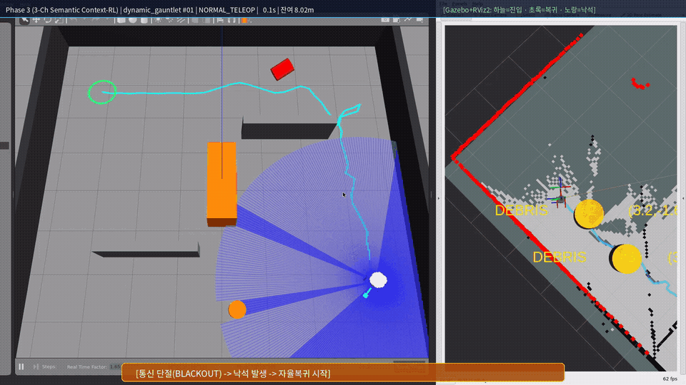 |  |  |

</details>

<details>
<summary><strong>Phase 3 기술 상세: 시맨틱 SLAM · Option 2 수식(보강) · V100 학습 곡선 · 3D 진화 GIF 펼쳐보기</strong></summary>

> 📄 **상세 설계 및 트러블슈팅**: [`docs/차세대_고도화_시맨틱_SLAM_및_RL_재학습_계획.md`](docs/차세대_고도화_시맨틱_SLAM_및_RL_재학습_계획.md) · [트러블슈팅 백서 #42](docs/2026-11-10_통신단절_재난대응_터틀봇3_프로젝트_시도내역_및_트러블슈팅_총정리.md#420-42-phase-3-2d-lidar-단안-rgb-투영-시맨틱-slam-e2e-및-3채널-context-rl-회피-정책-통합-검증)

#### (1) 단안 RGB-2D LiDAR 투영 퓨전 & 통신 단절 캐시

- **선행 논문 수식 3 오타 정정 & 270° CCW 역변환**: 이은원·김진현(2025) 수식 (3)의 `X · f_y` 오타를 `Y · f_y` ($v = (Y \cdot f_y) / Z + c_y$)로 바로잡고, 실차 카메라 90° 시계방향 장착에 맞춘 270° CCW 역변환(`unrotate_point`, `unrotate_bbox_xyxy`)을 정합했다 ([`semantic_mapper_core.py`](src/disaster_recovery/disaster_recovery/semantic_mapper_core.py)).
- **전경 클러스터링(`+0.25 m`) & 영구 아티팩트 저장**: 바운딩 박스 가로 중앙 70% 내 LaserScan 투영점 중 $Z \le \min(Z) + 0.25\,\text{m}$ 전경 클러스터 중앙값으로 배경 벽면 오인을 차단하고, `/semantic_map/save_map` 호출 시 `raw_map.png`, `raw_map.yaml`, `semantic_objects.json`, `semantic_map_overlay.png`를 원자적으로 저장한다 ([`semantic_map_node.py`](src/disaster_recovery/disaster_recovery/semantic_map_node.py)).
- **통신 단절 캐시 동작**: Outbound 중 Host PC의 `YOLO26n` + `semantic_map_node`가 `/semantic_map/cached_objects`로 온보드 `SemanticObjectCache`에 실시간 백업하며, 통신 단절 후에도 조난자(`r=0.55 m`)·저상 장애물(`Ch1`)·가스(`Ch2`) 좌표가 유지되고 복귀 중 신규 유독가스는 온보드 MQ-2(`/gas/level`)가 [`cb_gas()`](src/disaster_recovery/disaster_recovery/recovery_controller.py#L2844-L2860)로 즉시 추가한다.

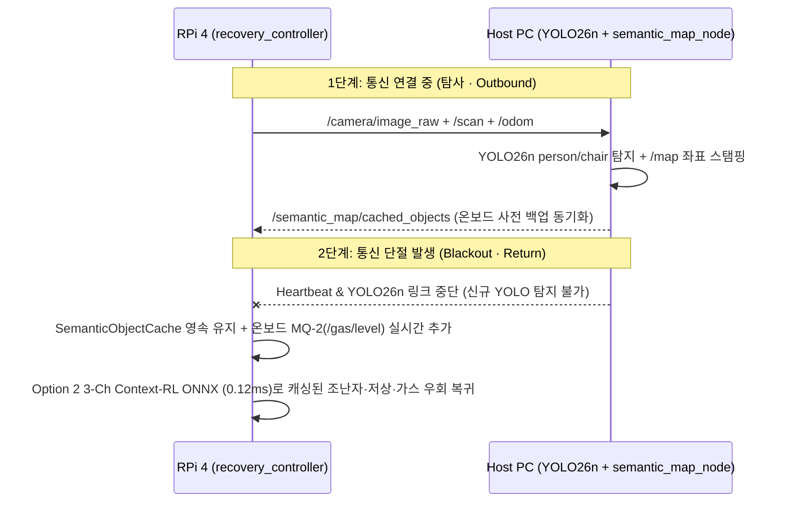

| `[GIF]` 3패널 E2E 시맨틱 SLAM (Gazebo 3D + YOLO26n + RViz2 `/map` · `DRIVING → COMM LOST → RECOVERY → COMPLETE`) |
| :---: |
|  |

| `[PNG]` E2E 3패널 실시간 스냅샷 (YOLO26n 조난자 검출) | `[PNG]` 2D `/map` 시맨틱 좌표 영구 오버레이 |
| :---: | :---: |
|  |  |

> **Gazebo 3D 색상 범례**: **분홍 사각/원반** = 저상 장애물(`h=0.095 m`, 2D LiDAR 사각지대) · **노란 원반** = 유독가스 구역(`r=0.55 m`) · **하늘색 링/리본** = Base Camp `(0,0)` & 탐색 경로 · **파란 부채꼴** = 2D LiDAR 스캔 평면(`z=0.171 m`) · **서 있는 사람** = 조난자(`person`)

#### (2) 비퇴행 설계: Option 1 vs Option 2 및 이중 게이트 수식

| 비교 항목 | Option 1: Hard Channel Gating<br>(Dual-ONNX 조건부 스위칭) | Option 2: Frozen Backbone + Zero-Gated Residual + 후단 Safety Shield (**채택**) |
| :--- | :--- | :--- |
| **구조** | 제어기가 매 스텝 `Ch1/Ch2` 활성 여부로 1-Ch / 3-Ch ONNX 교차 호출 | 단일 ONNX 내부에 동결 Phase 2-B 1-Ch 백본 + Pre-Tanh 잔차 어댑터 + 후단 25-ray `SemanticCorridorSafetyHead` 직렬 결합 (`--arch frozen_residual`, `12×12×3 + 544 = 976`차원) |
| **비시맨틱 구간 (`Ch1=Ch2=0`)** | 1-Ch ONNX 직접 호출 (`max_abs_diff = 0.0`) | $g_{\text{res}} = g_{\text{safe}} = 0$으로 잔차·쉴드·시맨틱 기울기 모두 소거 (`non_regression_max_abs_diff = 0.0`) |
| **경계 연속성 / 배포** | 1.8×1.8 m 패치 경계 하드 스위칭 / ONNX 2개 관리 | ONNX 내부 `pre-tanh` 연속 램프 + 단일 ONNX (`415.0 KB`, `0.121-0.124 ms`) 드롭인 교체 |
| **결정** | ❌ 기각 | ✅ 채택 |

Teacher(`FrozenBackboneSemanticTeacher`)와 배포 ONNX Student(`FrozenBackboneSemanticStudent`)는 `atanh` 왕복 없이 동일한 `pre-tanh` 잔차 합성 및 후단 Safety Shield 구조를 사용한다 ([`train_phase2_v100.py`](scripts/host/train_phase2_v100.py)):

$$
a_{\text{cand}} = \mathrm{scale}\Bigl(\tanh\bigl(z_{\text{P2B}}(s_{\text{1ch}}) + g_{\text{res}} \cdot \Delta_{\text{sem}}(s_{\text{sem}})\bigr)\Bigr), \qquad a_{\text{final}} = \mathcal{S}_{\text{safe}}\bigl(s,\, a_{\text{cand}},\, g_{\text{safe}}\bigr)
$$

- **잔차 게이트** ($g_{\text{res}}$, 전방위 12×12 패치 `Ch1`, `Ch2` 스칼라 무한 노름 피크 기준):

$$
g_{\text{res}} = \mathrm{clamp}\left(\frac{\max\bigl(\lVert Ch_1 \rVert_\infty,\, \lVert Ch_2 \rVert_\infty\bigr) - 10^{-4}}{0.04},\; 0,\; 1\right)
$$

- **안전 쉴드 게이트** ($g_{\text{safe}}$, 전방 25-ray 코리더 투영 비용 $c_{\text{sem}}$ 기준, $\gamma_{\text{gate}}$는 영속 버퍼 `scale_gate`로 ONNX 상수 `1.0`):

$$
g_{\text{safe}} = \mathrm{clamp}\left(\frac{\max(c_{\text{sem}}) - 0.08}{0.14},\; 0,\; 1\right) \cdot \gamma_{\text{gate}}
$$

- **비시맨틱 항등 보존 조건**: $Ch_1 = Ch_2 = 0 \implies c_{\text{sem}} = 0$ 이므로 $g_{\text{res}} = 0$, $g_{\text{safe}} = 0$이 성립하며, $\mathcal{S}_{\text{safe}}(s,\, a_{\text{cand}},\, 0) = a_{\text{cand}}$ 항등 사상 조건에 의해 Phase 2-B 1-Ch 출력과 수치적으로 완전히 일치한다(`max_abs_diff = 0.0`).

#### (3) Option 2 V100 Dual-Track 학습 및 ONNX 검증 (`TEST_SEEDS = 20000..20119`)

[`train_phase2_v100.py`](scripts/host/train_phase2_v100.py)에서 Tesla V100 32GB로 Dual-Track(각 3시드 × `3.54M` = `10.62M` steps/track) 학습·증류 및 `VAL_SEEDS(10000..10119)` / `TEST_SEEDS(20000..20119)` 독립 분리 평가를 수행했다 ([`phase3_option2_training_summary.json`](benchmark_results/phase3_option2_training_summary.json)).

| 트랙 (ONNX 모델) | 크기 / 아키텍처 | `Ch1=Ch2=0`<br>`max_abs_diff` | Unseen SR | Base-6 SR | Fallback SR | Sem-2 SR | Low-Obs CF | Gas-Free / Corridor | CPU 지연 (mean / p95) |
| :--- | :---: | :---: | :---: | :---: | :---: | :---: | :---: | :---: | :---: |
| **`sim`** ([onnx](src/disaster_recovery/config/sim_policy_student_semantic_v3.onnx)) | `415.0 KB` / `frozen_residual` | **0.0** | 94.2% | 97.8% | 98.3% | 83.3% | 86.7% | **66.7%** / 80.0% | `0.121 ms` / `0.128 ms` |
| **`real_tb3`** ([onnx](src/disaster_recovery/config/real_tb3_policy_student_semantic_v3.onnx)) | `415.0 KB` / `frozen_residual` | **0.0** | 94.2% | 95.6% | 93.3% | **90.0%** | **93.3%** | **73.3%** / 86.7% | `0.124 ms` / `0.135 ms` |

> [!NOTE]
> `VAL_SEEDS(10000..10119)` 검증 결과는 `sim` Unseen `95.0%` (`Base-6 97.8%`, `Low-Obs CF 93.3%`, `Gas-Free 66.7%`), `real_tb3` Unseen `95.0%` (`Base-6 98.9%`, `Low-Obs CF 93.3%`, `Gas-Free 66.7%`)이며, 최신 개선 `out_wps` 하네스 기준 독립 물리 시뮬레이터 일반화는 [§3.3](#33-시맨틱-10-trial-4-모드-통합-비교-동일-개선-out_wps-하네스) Gazebo `ab10`(`10/10` 엄격 무위험 · `38.26 s`) 및 [§4.2](#42-semantic-rescue-6단계-동일-맵-비교) `comp5`(`37.4 s` PASS)에서 확인된다.

| `[PNG]` Option 2 V100 `sim` 트랙 학습 곡선 | `[PNG]` Option 2 V100 `real_tb3` 트랙 학습 곡선 | `[PNG]` Option 2 Final Student 3D Rollout (`PASS`) |
| :---: | :---: | :---: |
|  |  |  |

| `[GIF]` Early (`upd=0`, `LOW-OBS HIT (x6)`, `159 steps`) | `[GIF]` Mid (`upd=24 Teacher`, `PASS`, `213 steps`) | `[GIF]` Final Student ONNX (`Option 2`, `PASS`, `210 steps`) |
| :---: | :---: | :---: |
|  | 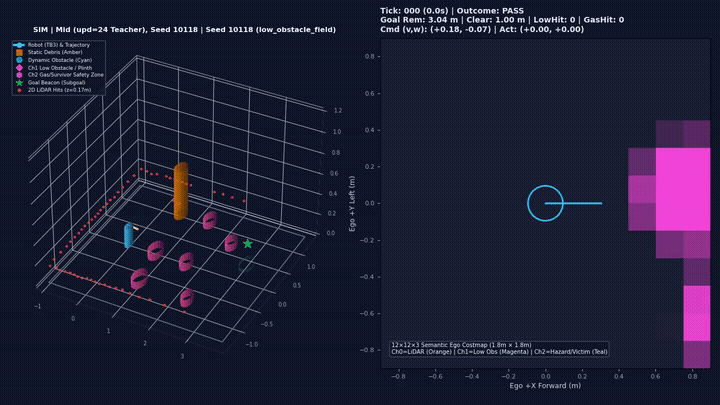 | 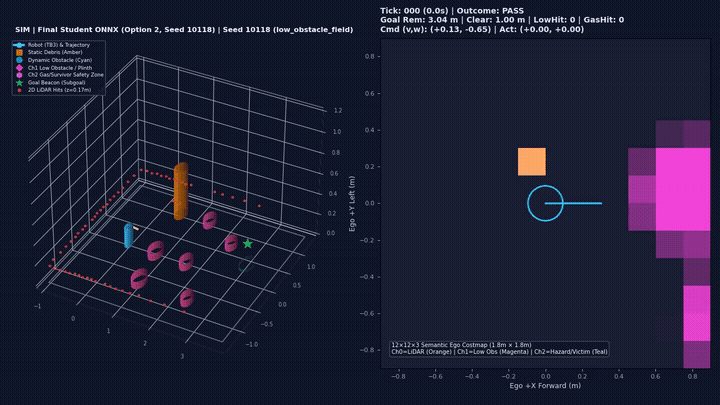 |

</details>

<details>
<summary><strong>극한 3대 시나리오 5단계 비교 GIF · Phase 2-B 3D Dual-View 및 초기 학습 곡선 아카이브 펼쳐보기</strong></summary>

동일 시드 조건에서 연막 LiDAR 오염(`smoke_lidar_corruption`), 교차 이동 기둥(`dynamic_crossfire_alley`), U자 함정(`u_pocket_trap`)에 대한 Phase 3 시점 5단계 비교 및 Phase 2-B 아카이브다 (Phase 4 3D 통일 HUD 쇼케이스 GIF는 [§3.4](#34-phase-4-3d-e2e-시맨틱-증빙-및-step-b-4-3d2d-쇼케이스-gif) 참조).

| `[GIF]` `#12 smoke_lidar_corruption` (Seed 2127) | `[GIF]` `#5 dynamic_crossfire_alley` (Seed 2127) | `[GIF]` `#15 u_pocket_trap` (Seed 3036) |
| :---: | :---: | :---: |
|  |  |  |

| `[GIF]` `dynamic_crossfire_alley` 3D Dual-View (Phase 2-B) | `[GIF]` `smoke_lidar_corruption` 3D Dual-View (Phase 2-B) | `[PNG]` Phase 2-B V100 학습 곡선 (`44.24M` steps/track) |
| :---: | :---: | :---: |
|  |  |  |

- 아카이브 문서: [초기 15회 분석](docs/붕괴건물_15회_자율복귀_벤치마크_분석보고서.md) · [원리 해설](docs/재난환경_자율복귀_알고리즘_원리_해설_및_보고서.md) · [Phase 2-B 요약](docs/phase2b_comparison_summary.txt) · [`benchmark_results/`](benchmark_results/)

</details>

---

## 5. 빠른 시작 (설치 · 시뮬레이션 · Phase 4 벤치마크 재현 · 테스트)

### 5.1 Phase 4 벤치마크 및 3D 증빙 재현

```bash
# Phase 4 동적·강건성 엄격 무충돌 벤치마크 (phase4 = Sim v4.4 / phase4_real = Real TB3 v3, CBF+IMM 자동 활성)
python3 scripts/host/ab_disaster_benchmark.py --scenario dynamic_crossfire_alley --trials 10 \
  --proposed-strategy phase4
python3 scripts/host/ab_disaster_benchmark.py --scenario dynamic_gauntlet --trials 10 \
  --proposed-strategy phase4_real

# Phase 4 시맨틱 10-Trial 공정 벤치마크 (enable_semantic_astar_cost:=true 기본 활성)
python3 scripts/host/run_phase4_semantic_benchmark.py --modes phase4_sim,phase4_real --trials 10

# Phase 4 시맨틱 3D E2E 증빙 녹화 (Trial #10, VirtualGL / Xvfb)
python3 scripts/host/record_phase4_semantic_3d.py --display :98 --rtf 2.0
```

<details>
<summary><strong>Phase 3 비퇴행 · 시맨틱 스위트 재현 명령어 펼쳐보기</strong></summary>

```bash
# Phase 3 15대 재난 시나리오 비퇴행 엄격 무충돌 벤치마크
python3 scripts/host/ab_disaster_benchmark.py --scenario collapsed --trials 10 \
  --proposed-strategy proposed_rl \
  --context-rl-onnx src/disaster_recovery/config/sim_policy_student_semantic_v3.onnx

# Phase 3 시맨틱 구조·회피 10-Trial A/B & 3패널 E2E /map+YOLO+좌표 녹화
python3 scripts/host/run_phase3_semantic_suite.py --mode check-yolo
python3 scripts/host/run_phase3_semantic_suite.py --mode ab10 --trials 10
python3 scripts/host/run_phase3_semantic_suite.py --mode record-e2e
python3 scripts/host/run_phase3_semantic_suite.py --mode record-ab
```

</details>

### 5.2 인터랙티브 Gazebo 시뮬레이션 (`sim.py`) 및 원터치 실행 (`start.py`)

```bash
# Gazebo 인터랙티브 시뮬레이션
python3 scripts/host/sim.py                # 기본값: 지진 붕괴 건물 재난 맵 (--collapsed)
python3 scripts/host/sim.py --tunnel       # 지하 터널 (--house / --maze / --world world 가능)
python3 scripts/host/sim.py --yolo         # 가상 카메라(/camera/image_raw, rotation_angle:=0) + YOLO26n + semantic_map_node
python3 scripts/host/sim.py --headless     # gzclient 없이 물리 서버만 구동 (--no-slam / --no-teleop / --software / --stop)

# 실차 원터치 통합 실행 (Host PC: RPi 4 원격 브링업 + Host AI + SLAM + WASD 텔레옵)
python3 scripts/host/start.py              # 옵션: --sim / --tmux / --host-only / --no-cartographer / --status
python3 scripts/host/stop.py               # 전체 종료
```

- **시뮬레이션 텔레옵 키**: `W`/`A`/`S`/`D`(이동) · `Space`(정지) · `H`(Heartbeat 중단 → 3초 후 자율 복귀) · `R`(Heartbeat 복구) · `O`(경로상 랜덤 붕괴 암석 `disaster_debris` 3-6개 투하/제거 토글) · `Q`(종료).
- WSL2(WSLg)에서 `sim.py`는 `MESA_D3D12_DEFAULT_ADAPTER_NAME=NVIDIA`로 D3D12 GPU 가속을 사용하며(`--software`로 `llvmpipe` 강제), Docker/Xvfb 헤드리스 녹화는 `unset QT_QPA_PLATFORM_PLUGIN_PATH QT_PLUGIN_PATH` 및 `vglrun -d egl`로 V100 EGL 가속을 사용한다.

<details>
<summary><strong>설치 · 빌드 · 단계별 수동 실행 및 <code>host_station.launch.py</code> 인자 펼쳐보기</strong></summary>

#### 1) 공통 환경 (`~/.bashrc` — Host PC · RPi 4)

```bash
source /opt/ros/humble/setup.bash
export ROS_DOMAIN_ID=0
export ROS_LOCALHOST_ONLY=0
export TURTLEBOT3_MODEL=burger
export LDS_MODEL=LDS-01          # RPi 4
```

#### 2) Host PC (WSL2) 및 RPi 4 패키지 설치 · 빌드

`C:\Users\<user>\.wslconfig`:
```ini
[wsl2]
networkingMode=mirrored
dnsTunneling=true
firewall=true
autoProxy=true
```

```bash
# Host PC (WSL2: wsl --shutdown 후 재진입, Linux용 NVIDIA 드라이버 별도 설치 금지)
sudo apt install -y ros-humble-desktop ros-humble-cv-bridge \
                    ros-humble-teleop-twist-keyboard ros-humble-camera-calibration \
                    ros-humble-turtlebot3-cartographer ros-humble-turtlebot3-gazebo
pip3 install torch torchvision --index-url https://download.pytorch.org/whl/cu121
pip3 install ultralytics faster-whisper
pip3 install "numpy==1.26.4" "opencv-python==4.10.0.84"     # cv_bridge(NumPy 1.x) 호환 고정
python3 -c "import torch; print(torch.cuda.is_available())"   # True 확인

# RPi 4
sudo apt install -y ros-humble-v4l2-camera ros-humble-cv-bridge python3-opencv \
                    ros-humble-image-transport-plugins \
                    python3-smbus i2c-tools alsa-utils
sudo usermod -aG i2c,audio $USER   # 재로그인 필요
arecord -l                          # card 1: AB13X USB Audio 확인

# 빌드 (Host PC · RPi 4 공통)
mkdir -p ~/disaster_recovery_ws && cd ~/disaster_recovery_ws
git clone https://github.com/rjw136-lab/disaster_recovery_ws.git .
colcon build --symlink-install --packages-select disaster_recovery
source install/setup.bash
```

> `yolo26n.pt`는 첫 실행 시 Ultralytics가 자동 다운로드한다(저장소 미포함). NumPy 2.x 설치 시 `cv_bridge` import가 실패하므로 위 버전 고정을 유지한다.

#### 3) 단계별 수동 실행 및 상태 모니터링

| # | 기기 | 명령 |
| :-: | :--- | :--- |
| 1 | RPi 4 | `ros2 launch turtlebot3_bringup robot.launch.py` (또는 `bash scripts/rpi/start_all.sh`) |
| 2 | RPi 4 | `ros2 run camera_ros camera_node --ros-args -p width:=640 -p height:=480 -p format:=BGR888` (또는 `bash scripts/rpi/start_camera.sh`) |
| 3 | RPi 4 | `ros2 launch disaster_recovery robot_onboard.launch.py` |
| 4 | Host | `ros2 launch disaster_recovery host_station.launch.py` (RViz 동시 실행: `use_rviz:=true`) |
| 5 | Host | `python3 scripts/host/wasd_teleop.py topic:=/cmd_vel_remote` (또는 `teleop_twist_keyboard --ros-args -r cmd_vel:=/cmd_vel_remote`) |
| 6 | Host | `ros2 launch turtlebot3_cartographer cartographer.launch.py use_rviz:=false` + `ros2 run rviz2 rviz2 -d src/disaster_recovery/config/disaster_cartographer.rviz` |

> ⚠ 텔레옵은 반드시 `/cmd_vel_remote`로 리매핑한다. `/cmd_vel` 직접 발행 시 워치독 원격 차단이 무력화된다.

```bash
ros2 topic echo /recovery/status
ros2 topic echo /disaster/victim_alert
ros2 topic echo /disaster/audio_alert
```

#### 4) `host_station.launch.py` 주요 인자

| 인자 | 기본값 | 설명 |
| :--- | :-: | :--- |
| `yolo_model_path` | `yolo26n.pt` | YOLO 가중치 경로/이름 |
| `image_topic` / `use_compressed` | `/camera/image_raw/compressed` / `true` | 카메라 토픽 및 압축 이미지 구독 (Wi-Fi 대역폭 절약) |
| `rotation_angle` / `show_window` | `270` / `true` | 영상 회전 (0/90/180/270) / OpenCV 탐지 창 표시 |
| `heartbeat_rate_hz` | `10.0` | Heartbeat 발행 주기 |
| `confidence_threshold` / `person_conf_threshold` | `0.40` / `0.55` | YOLO 추론 임계값 / 조난자 알림 임계값 |
| `only_person_detection` / `min_consecutive_detections` | `false` / `2` | COCO person 단독 추론 여부 (노드 단독 기본 `True`) / 연속 탐지 프레임 수 |
| `cuda_device` | `0` | GPU 번호 (`host_ai_pipeline` 내부 `yolo_max_fps` 기본 `15.0`) |
| `whisper_model_size` / `whisper_device` / `whisper_compute_type` | `base` / `cuda` / `int8` | Faster-Whisper 모델·디바이스(실패 시 `cpu` 자동 폴백)·양자화 |
| `use_rviz` | `false` | `disaster_station.rviz`로 RViz2 동시 실행 |

</details>

### 5.3 단위 테스트 (`101/101 PASS` / 전체 `124/126`)

```bash
source /opt/ros/humble/setup.bash && source install/setup.bash
# 핵심 런타임·안전·회귀 8개 스위트 (101/101 전수 PASS)
python3 -m pytest -p no:anyio \
  src/disaster_recovery/test/test_ads1115_mq2.py \
  src/disaster_recovery/test/test_cbf_safety_shield.py \
  src/disaster_recovery/test/test_dynamic_tracker.py \
  src/disaster_recovery/test/test_hybrid_recovery.py \
  src/disaster_recovery/test/test_local_grid_planner.py \
  src/disaster_recovery/test/test_phase4_batch_regression_fixes.py \
  src/disaster_recovery/test/test_semantic_controller.py \
  src/disaster_recovery/test/test_semantic_mapper.py -q

# 전체 10개 스위트 (124/126 passed; 구버전 학습/환경 테스트 2건 실패 — 아래 표 참조)
python3 -m pytest -p no:anyio src/disaster_recovery/test -q
```

| 테스트 스위트 | 실측 결과 | 주요 검증 범위 |
| :--- | :---: | :--- |
| `test_ads1115_mq2.py` | **`8/8 PASS`** | ADS1115 I2C ADC 읽기 · MQ-2 위험도 산출 |
| `test_cbf_safety_shield.py` | **`19/19 PASS`** | 2-Circle Soft CBF-QP · 감쇠율 계층 · `mq2_escape` 분리 · 초근접 클램프 · `< 0.25 ms` 지연 |
| `test_dynamic_tracker.py` | **`14/14 PASS`** | 5 Hz/10 Hz CV+Harmonic IMM · 4.5 s 장기 예측 FDE/ADE · `_is_static_wall_fragment` 공선성 필터 |
| `test_hybrid_recovery.py` | **`9/9 PASS`** | 2D ICP · TD3 · ONNX 추론 지연 · Clearance-Gate · 실차 프로파일 |
| `test_local_grid_planner.py` | **`13/13 PASS`** | `RollingLocalGrid` · 2D A\* · 위상 지름길 · 축방향 스윕 밴드 · 시맨틱 비용맵 |
| `test_phase4_batch_regression_fixes.py` | **`17/17 PASS`** | `Step A-2` 순수 관측 2분기 ICP(AST 검증) · `CrossingLaneScheduler` · Option 1 HOLD 상한 · `cb_reset_episode` |
| `test_semantic_controller.py` | **`4/4 PASS`** | 1ch/3ch/4ch ONNX 자동 판별 · 시맨틱 캐시 · 스위치 전환 |
| `test_semantic_mapper.py` | **`17/17 PASS`** | 단안-LiDAR 투영 · Eq.3 보정 · 270° CCW · Alg.1/2 마커 승격 |
| `test_phase4_cvar_env.py` | `15/16 passed` | 4-Ch CVaR 절차적 환경 (1건 실패: `test_sinusoidal_reciprocating_regime_and_ch3_plicp_dr`, 튜닝 후 `sin_env_frac=0.77` vs 구 상한 `0.75`) |
| `test_semantic_rl_env.py` | `8/9 passed` | Phase 3 3-Ch 환경 (1건 실패: `test_frozen_residual_option2_exact_phase2b_parity_and_semantic_grad`, Phase 4 `train_phase2_v100.py` `load_warm_start` 키 변경 미동기화) |

---

## 6. 하드웨어 구성 및 ROS 2 인터페이스

### 6.1 하드웨어 사양

<p align="center">
  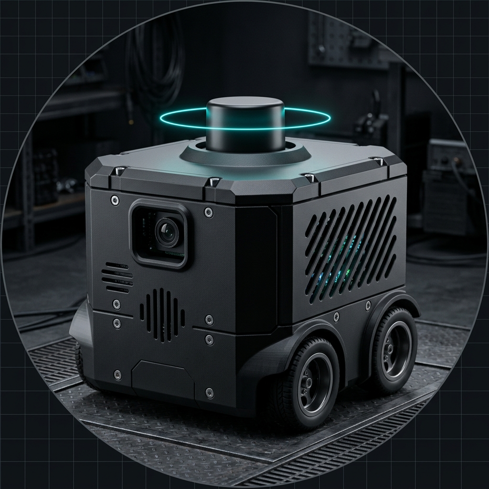
  <br>
  <em>▲ 3D 프린팅 맞춤형 보호 외피(Outer Shell) 및 센서 마운팅 하드웨어 구상도</em>
</p>

| 구분 | 사양 |
| :--- | :--- |
| 로봇 | TurtleBot3 Burger (OpenCR 1.0 + Raspberry Pi 4 4GB) |
| LiDAR | LDS-01 (USB2LDS) |
| 카메라 | Raspberry Pi Camera Module (CSI, 640×480) — 케이블 배선상 90° 옆으로 장착, 소프트웨어에서 270° 회전 보정 |
| 가스 센서 | MQ-2 (5 V 구동) → 10k/20k 분압 → ADS1115 16-bit I2C ADC → RPi 4 |
| 마이크 | Generic AB13X USB Audio (card 1, device 0 = `plughw:1,0`, S16_LE · mono · 48 kHz) |
| Host PC (관제/로컬 시뮬) | Intel Core i7-8700 (6C/12T) / DDR4 16GB 2666MHz / NVIDIA GTX 1050 Ti 4GB / Windows 11 + WSL2 Ubuntu 22.04 / PyTorch 2.5.1 + CUDA 12.1 |
| 학습 서버 (대규모 RL) | Intel Core i9-10900X (10C/20T) / DDR4 256GB 2666MHz (Non-ECC) / NVIDIA Tesla V100-PCIE-32GB / Ubuntu 20.04.6 LTS Host + Ubuntu 22.04 Docker (ROS 2 Humble) |

### 6.2 MQ-2 + ADS1115 회로 및 Dual NIC 네트워크

OpenCR은 TurtleBot3 순정 펌웨어(모터·`/odom`)를 그대로 유지하고, 가스 센서는 RPi 4 I2C로 읽는다. ADS1115는 **반드시 3.3 V로 급전**한다 (RPi GPIO 5 V 비허용). 상세 결선·보정: [`docs/CIRCUIT_AND_CALIBRATION.md`](docs/CIRCUIT_AND_CALIBRATION.md)

```
 RPi Pin 1 (3.3V) ──── ADS1115 VDD          |  [학교 벽면 LAN] ── 유선 NIC ──┐
 RPi Pin 3 (SDA)  ──── ADS1115 SDA          |                               ├── Host PC (Win 11 + WSL2 mirrored)
 RPi Pin 5 (SCL)  ──── ADS1115 SCL          |  [사설 공유기 192.168.0.x] ── USB Wi-Fi ──┘
 RPi Pin 6 (GND)  ──┬─ ADS1115 GND, ADDR(0x48)        │
                    ├─ MQ-2 GND             |         └── Wi-Fi ── RPi 4 (TurtleBot3)
 RPi Pin 2 (5V)   ──┼─ MQ-2 VCC             |
                    │  MQ-2 AOUT ─[10kΩ]─┬─ AIN0   공통: ROS_DOMAIN_ID=0, ROS_LOCALHOST_ONLY=0
                    │                  [20kΩ]      Fast DDS 멀티캐스트 (Hyper-V UDP 허용 필요)
                    └────────────────────┘
 V_AIN0 = V_out × 20k/(10k+20k) ≤ 3.33 V (허용 3.6 V) · PGA ±4.096 V · 128 SPS · i2cdetect -y 1 → 48
```

- 학교 망 인증(고정 IP/MAC)은 유선 NIC에서 유지하고 ROS 2 트래픽은 사설 공유기로 분리한다. Tailscale + CycloneDDS 유니캐스트도 가능하나 지연(50-150 ms)·지터로 Heartbeat 오작동 위험이 있어 현장 시험에는 사설 Wi-Fi 직결을 권장한다 ([`docs/WSL_NETWORK_SETUP.md`](docs/WSL_NETWORK_SETUP.md)).

### 6.3 ROS 2 토픽 · 서비스 및 주요 파라미터

<details>
<summary><strong>ROS 2 토픽 · 서비스 표 (25개) 펼쳐보기</strong></summary>

| 토픽 | 타입 | 발행 → 구독 |
| :--- | :--- | :--- |
| `/heartbeat` | `std_msgs/Header` | host_ai_pipeline → recovery_controller (10 Hz) |
| `/cmd_vel_remote` | `geometry_msgs/Twist` | teleop → recovery_controller |
| `/cmd_vel` | `geometry_msgs/Twist` | recovery_controller, aruco_docking → turtlebot3_node |
| `/odom` | `nav_msgs/Odometry` | turtlebot3_node → recovery_controller, blackbox |
| `/scan` | `sensor_msgs/LaserScan` | LDS-01 → recovery_controller, blackbox |
| `/gas/level` | `std_msgs/Float32` | gas_sensor_node → recovery_controller, blackbox (예열·기준 측정 후 발행) |
| `/gas/voltage` | `std_msgs/Float32` | gas_sensor_node → (모니터링) MQ-2 출력 전압 |
| `/gas/rs_ro` | `std_msgs/Float32` | gas_sensor_node → (모니터링) 데이터시트 ppm 곡선용 Rs/Ro |
| `/gas/sensor_ok` | `std_msgs/Bool` | gas_sensor_node → (모니터링) I2C 읽기 실패 시 false |
| `/camera/image_raw` | `sensor_msgs/Image` | v4l2_camera → aruco_docking, blackbox |
| `/camera/image_raw/compressed` | `sensor_msgs/CompressedImage` | image_transport → host_ai_pipeline (BEST_EFFORT, depth 1) |
| `/camera/camera_info` | `sensor_msgs/CameraInfo` | v4l2_camera → aruco_docking |
| `/detection/image` | `sensor_msgs/Image` | host_ai_pipeline → RViz2 (바운딩 박스 + SURVIVOR 배너) |
| `/audio/raw` | `std_msgs/UInt8MultiArray` | audio_capture_node → host_ai_pipeline (48 kHz S16_LE mono, 0.5 s/msg) |
| `/aruco/debug_image` | `sensor_msgs/Image` | aruco_docking → (모니터링) |
| `/aruco/dock_trigger` | `std_msgs/Bool` | recovery_controller → aruco_docking |
| `/aruco/dock_complete` | `std_msgs/Bool` | aruco_docking → recovery_controller |
| `/blackbox/trigger` | `std_msgs/Bool` | recovery_controller → blackbox_recorder |
| `/recovery/status` | `std_msgs/String` | recovery_controller → (모니터링) |
| `/disaster/victim_alert` | `std_msgs/String` | host_ai_pipeline → (관제) |
| `/disaster/audio_alert` | `std_msgs/String` | host_ai_pipeline → (관제) |
| `/detection/objects` | `std_msgs/String` | host_ai_pipeline → semantic_map_node (YOLO 감지 객체 JSON + stamp) |
| `/semantic_map/markers` | `visualization_msgs/MarkerArray` | semantic_map_node → RViz2 (조난자·장애물·가스·음성 4종 영구 마커) |
| `/semantic_map/cached_objects` | `std_msgs/String` | semantic_map_node → recovery_controller (RPi 4 온보드 캐시 동기화) |
| `/semantic_map/save_map` | `std_srvs/srv/Trigger` | 관제/사용자 → semantic_map_node (raw_map, yaml, json, overlay 4종 아티팩트 저장 서비스) |

</details>

<details>
<summary><strong><code>recovery_params.yaml</code> · <code>recovery_params_real.yaml</code> 주요 파라미터 표 펼쳐보기</strong></summary>

[`config/recovery_params.yaml`](src/disaster_recovery/config/recovery_params.yaml) (시뮬레이션 YAML 기준; `--params-file` 미지정 시 [`recovery_controller.py`](src/disaster_recovery/disaster_recovery/recovery_controller.py)·[`aruco_docking.py`](src/disaster_recovery/disaster_recovery/aruco_docking.py) 코드 내장 폴백 기본값 및 실차 [`config/recovery_params_real.yaml`](src/disaster_recovery/config/recovery_params_real.yaml) 값을 함께 표기)

| 파라미터 | 기본값 (`recovery_params.yaml` / 실차 YAML / 코드 폴백) | 의미 |
| :--- | :-: | :--- |
| `heartbeat_timeout_sec` | 3.0 | 통신 단절 판정 시간 |
| `gas_threshold` | 0.40 | 가스 위험 판정값 (`1 − Rs/Rs_air`, ppm 아님 · 현장 보정 필요) |
| `gas_stale_timeout_sec` / `gas_stale_triggers_recovery` | 2.0 / false | `/gas/level` 끊김 경고 / 끊김 시 복귀 여부 |
| `warmup_sec` / `baseline_samples` | 60 / 100 | MQ-2 예열 시간 / 기준 측정 샘플 수 |
| `rs_air_kohm` | 0.0 | 0보다 크면 저장된 기준값 재사용 |
| `log_dist_threshold_m` / `log_angle_threshold_deg` | 0.30 / 25.0 | 경유지 기록 간격 (거리 / 회전) |
| `waypoint_reach_radius_m` / `heading_tolerance_rad` | 0.10 / 0.12 (실차 `0.12 / 0.12`, 코드 폴백 `0.08 / 0.08`) | 경유지 도달 판정 반경 / 정렬 허용 각도 |
| `linear_speed_max` / `angular_speed_max` | 0.20 / 0.65 (실차 `0.15 / 0.55`, 코드 폴백 `0.12 / 0.45`) | 복귀 속도 상한 (m/s, rad/s) |
| `kp_linear` / `kp_angular` | 0.60 / 1.40 (실차 `0.55 / 1.30`, 코드 폴백 `0.50 / 1.20`) | 직진 / 회전 비례 제어 게인 |
| `lidar_min_range_m` / `lidar_max_danger_range_m` | 0.12 / 0.25 (실차 `0.12 / 0.28`) | 정지 거리 구간 |
| `lidar_fov_half_deg` | 20.0 (실차 `22.0`) | 전방 감시 반각 |
| `local_grid_size_m` / `local_grid_res_m` / `local_grid_inflation_m` | 6.0 / 0.04 / 0.085 (실차 팽창 `0.095`) | `RollingLocalGrid` 런타임 크기(`6.0m×6.0m`) · 해상도 · 팽창 반경 |
| `docking_start_distance_m` | 0.50 | ArUco 도킹 전환 거리 |
| `enable_scan_matching` | true | 2D ICP 스캔 매칭 보정 활성화 (`Step A-2` 순수 관측 2분기) |
| `scan_match_weight` / `scan_match_max_dist_m` | 0.40 / 0.45 (코드 폴백 `0.40`) | 상보필터 가중치 / ICP 매칭 발동 반경 |
| `enable_hybrid_tracking` / `lookahead_dist_m` | true / 0.45 | Regulated Pure Pursuit 연속 추종 / 전방 주시 거리 |
| `enable_td3_avoidance` / `td3_clearance_dist_m` / `td3_max_avoid_steps` | true / 0.42 (폴백 `0.38`) / 250 (폴백 `150`) | Residual TD3 국소 우회 / 회피 반경 / 최대 스텝 수 (10 Hz 25초) |
| `use_semantic_rl_policy` / `semantic_rl_onnx_path` | false / `""` | Phase 3/4 다채널 RL 정책 활성화 / 3-Ch ONNX 자동 탐색 경로 |
| `phase4_rl_onnx_path` | `sim_policy_student_phase4.onnx` (실차 `real_tb3_policy_student_phase4.onnx`) | Phase 4 4-Ch CPPO 배포 ONNX 모델 (`574.2 KB` / `403.8 KB`) |
| `enable_semantic_astar_cost` | `false` (양쪽 기본 `false`) | 비시맨틱 15-시나리오 재현성 보존용 기본 `false`; 시맨틱 미션·벤치마크에서 CLI `true` 주입 |
| `enable_dynamic_tracker` / `enable_cbf_safety_shield` | `false` / `false` (Phase 3 하위 호환 기본) | `true` 시 5 Hz/10 Hz CV+Harmonic IMM 및 2-Circle Soft CBF-QP 활성화 (`--proposed-strategy phase4[_real]` 시 자동 활성) |
| `cbf_inner_loop_hz` | `10.0` (양쪽 동일) | 2-Circle Soft CBF-QP 내부 안전 필터 주기 (Hz) |
| `cbf_front_offset_m` / `cbf_rear_offset_m` / `cbf_circle_radius_m` | `0.020` / `0.060` / `0.098` | TurtleBot3 Burger 전·후 2-원 근사 기하 파라미터 (m) |
| `cbf_v_min` | **`-0.06`** (실차 **`-0.08`**) | 트랙별 정합 CBF 후진 하한 (m/s) |
| `cbf_gamma_dynamic_s` / `cbf_gamma_static_s` / `cbf_gamma_gas_s` | `3.0` / `6.0` / `8.0` | 동적 / 정적 / 가스 CBF 감쇠율 ($\text{s}^{-1}$) |
| `cbf_w_v` / `cbf_w_w` / `cbf_slip_margin_mps` | `1.0` / `0.05` / `0.015` (실차 슬립 마진 `0.020`) | QP 속도·각속도 가중치 및 휠 슬립 여유 (m/s) |
| `cbf_lidar_voxel_m` / `cbf_lidar_max_points` / `cbf_enable_mq2_lifo_escape` | `0.10` / `16` / `true` | LiDAR 복셀 다운샘플링 크기 · 최대 제약점 · 가스 내부 LIFO 탈출 가드 |
| `dynamic_graze_buffer_m` | `0.06` | 동적 행 grazing 하드 플로어 버퍼 (m) |
| `alpha_max_step_base` / `alpha_max_step_sem_gain` / `alpha_valve_deadband` | `0.15` / `0.10` / `0.02` | RL 블렌딩 슬루율 기본/시맨틱 가산 및 불감대 |
| `use_aruco_docking` / `aruco_docking_timeout_sec` / `search_timeout_sec` | false (실차·폴백 `true`) / 12.0 / 10.0 | ArUco 도킹 전환 / 제어기 2차 타임아웃 / 마커 탐색 타임아웃 |
| `marker_size_m` / `target_dock_dist_m` / `camera_rotation_deg` | 0.10 (실차 `0.05`) / 0.20 / 270 (폴백 `0`) | ArUco 마커 크기 / 목표 정지 거리 / 카메라 회전 보정 |
| `alsa_device` / `sample_rate` / `chunk_duration_sec` | `plughw:1,0` / 48000 / 0.5 | USB 마이크 장치 / 샘플레이트 / `/audio/raw` 청크 길이 |

Host AI 파라미터 (`host_ai_pipeline` 기본값): `yolo_max_fps=15.0`, `whisper_device='cuda'`, `whisper_compute_type='int8'`, `audio_sample_rate=48000`, `sample_rate_hz=16000`, `audio_buffer_sec=2.0`(50% 중첩), `voice_activity_threshold=0.012`(RMS).  
시맨틱 매핑 파라미터 상세(`cluster_radius_m=0.45`, `ch1_obstacle_radius_m=0.22`, `ch2_hazard_radius_m=0.55` 등): [`config/semantic_map_params.yaml`](src/disaster_recovery/config/semantic_map_params.yaml) · 실차 프로파일: [`config/recovery_params_real.yaml`](src/disaster_recovery/config/recovery_params_real.yaml).

</details>

---

## 7. 알려진 한계 및 해결 이슈

본 저장소는 시뮬레이션 검증을 완료하고 실물 RPi 4 필드 결합 시험을 앞둔 프로토타입이다.

### Phase 4 잔여 한계 및 하드웨어 미결선 (5항목)

1. **실물 TurtleBot3 Burger (RPi 4) 필드 실증 미수행**: Gazebo 11 시뮬레이션에서는 Phase 4 `Step B-4` 100-Trial (`89/100`), Option 1 Gate 1 (`31/40`), 시맨틱 10-Trial (`phase4_sim 10/10` · `phase4_real 10/10`)을 모두 검증했으나, 실물 RPi 4 4GB 온보드에서의 4-Ch ONNX (`real_tb3_policy_student_phase4.onnx`, `403.8 KB`, x86 CPU `0.062 ms`)·2-Circle Soft CBF-QP 지연 실측 및 현장 주행은 아직 수행하지 않았다.
2. **`dynamic_gauntlet` 전역 시뮬레이션 시각(`t_sim`) 비초기화 표본 분산**: Gazebo 동적 장애물 플러그인이 에피소드 간 전역 `t_sim` 위상을 리셋하지 않아 동일 시드라도 실행 시점의 동적 기둥 초기 위상에 따른 표본 분산이 존재한다.
3. **CV+Harmonic IMM의 비주기·의도 기반 보행자 한계**: 현재 2-모델 IMM은 등속 직선(CV)과 1D 조화왕복(Harmonic) 운동학에 최적화되어 있어, 급정지·급선회·사회적 상호작용을 포함하는 비주기적·의도 기반 보행자 예측에는 한계가 있다.
4. **로봇 최대 속도 대비 `2.8-3.0배` 초고속 장애물 물리 한계**: TurtleBot3 Burger 최대 선속도(`0.15-0.20 m/s`) 대비 `2.8-3.0배` 이상 고속 접근하는 동적 장애물에서는 기구학·제동 거리 제약으로 CBF-QP와 시공간 스케줄러만으로는 물리적 회피 한계가 발생한다.
5. **하드웨어·운용 잔여 항목**: 도킹 기하 가정(출발 위치 정면 벽 마커), MQ-2 실물 미결선(`gas_stale_triggers_recovery: false`), 블랙박스 Wi-Fi 스트리밍 차단 미구현, 통신 단절 이후 신규 등장 조난자의 Host YOLO 비전 탐지 불가(단절 전 온보드 캐시 유지 + 온보드 MQ-2 실시간 감지만 동작; 완전 단절 심부 비전 탐지에는 RPi 4 온보드 NPU/Hailo 탑재 필요).

<details>
<summary><strong>해결된 이슈 (30건) 펼쳐보기</strong></summary>

| 이슈 | 해결 방법 |
| :--- | :--- |
| Phase 3 150-Trial 근접 `lidar_collision` 53건 및 동적 교차·왕복 회피 부재 (`crossfire 0/10`) | Phase 4 **2-Circle Soft CBF-QP**(`0.407 ms`) + **5 Hz/10 Hz CV+Harmonic IMM** + 기하 조건부 **2D 시공간 측면 레인 스케줄러(`CrossingLaneScheduler`) · 축방향 스윕 연성 비용맵(`w_band=3.8`)** 통합 → `Step B-4` 100-Trial **`89/100`** (Gate 1 `30/40`, Gate 2 `59/60` 충돌 `0/60`) |
| 정적 시맨틱 월드에서 사선 벽체 조각의 동적 오탐(`max_dyn=2`) 및 구역 HOLD 기아 위험 | Option 1 **정적 벽체 조각 공선성 필터(`_is_static_wall_fragment`)** · 회전 순변위 게이트(`>= 0.25 m`) 및 `CrossingLaneScheduler` 구역 누적 HOLD 상한(`14.0 s`)·쿨다운(`4.0 s`) 도입 → 시맨틱 **`phase4_sim 10/10` · `phase4_real 10/10` (동적 오탐 `0`)** 및 Gate 1 **`31/40` (충돌 `8 → 6`)** |
| 시맨틱 미션에서 `mq2_escape` 외곽 패딩 오발동·현 관통·후방 조난자 `sem_prox` 포화·초근접 광선 누락 | `mq2_escape` 클래스(`GAS_HAZARD`)·내부 반경 분리 및 현 관통 금지, 후방 방향 `sem_prox` 감쇠, `0 < r < 0.120 m` 초근접 광선 클램프·래치, `cb_reset_episode` 원자적 초기화 적용 → 시맨틱 위반 `0/0/0`, `mq2=0` |
| 연기 오염 스캔 ICP 가드의 시뮬레이션 파라미터(`smoke_lidar_noise_prob`) 직접 참조 의존성 | `Step A-2` 순수 센서·ICP 관측(`spike_ratio`, `inlier_ratio`, `mean_err`, `num_inliers >= 25`) 2분기 `is_start_match` 가드 전환(AST 검증) → 오염 차단 `54/54` & 정상 30 cm 드리프트 보정 `0/40` 오탐 양립 (`smoke_lidar_corruption 20/20`) |
| Option 2 쉴드 마스킹·`0.88` 소프트 블렌드 잔존·평가 시드 선택 편향·제어기 `has_nearby_sem` 불리언 분기 | PPO 쉴드 개입 페널티 + `hard_sem` 하드 배리어(`w_blend → 0`) + `VAL_SEEDS(10000..10119)`/`TEST_SEEDS(20000..20119)` 분리 + `recovery_controller.py` 연속 `sem_prox ∈ [0, 1]` 램프 적용 |
| Phase 3 초기 3-Ch 미세조정(`v3`)의 비시맨틱 환경(`Ch1=Ch2=0`) 엄격 무충돌 퇴행 (`58.0%`) | **Option 2**(동결 Phase 2-B 백본 + Pre-Tanh Zero-Gated Residual + 후단 25-ray Safety Shield) 채택·재학습으로 `Ch1=Ch2=0`에서 `max_abs_diff = 0.0` 완전 일치 복원 및 Clean 150회 엄격 무충돌 `96/150 (64.0%)` 검증 (`phase2b_strict_clean` `96/150 (64.0%)`과 완전 비퇴행 일치) |
| Phase 2 고정 블렌딩(`0.70·RL`)의 `house` 협소 문틀 진동·지체 | 섹터 여유 거리·협소 패스 여부 기반 **Clearance-Gated Blending** 및 `ESCAPE` 중 시계열 버퍼 유지로 재학습 없이 **`48/50 (96.0%)`**, `house` `8/10 → 9/10` |
| Phase 1 `house` 약 `0.28 m` 틈새 과차단 & Phase 2 RL 수렴 정체·앙상블 상쇄 | `_virtual_obstacles` `±0.03 m`/9s 튜닝으로 **5대 환경 `49/50 (98.0%)`** 달성; Phase 2 V100 **`ret_norm=25` + `nav_dist` + 선택적 DAgger 증류**로 `sim`/`real_tb3` ONNX 추출 및 **공식 Gazebo S2S `47/50 (94.0%)`** 검증 완료 (`#30`-`#36`) |
| 붕괴 건물 교착 및 다회차 `corr_y` 오프셋 누적 | `/recovery/reset_episode`로 에피소드 상태 초기화 및 `RollingLocalGrid(0.04m) + 2D A* + 위상 지름길 + ESCAPE` 도입 |
| 저상 장애물·벽 너머 단축 및 전방 밀착 정지 | 진입(`NORMAL_TELEOP`) 선행 관측, 실내 벽 너머 단축 차단, 전방 unpin 및 `_virtual_obstacles` 가상 접촉 장벽 추가 |
| 병렬 벤치마크 포트 충돌 및 `/home/lab` 경로 하드코딩 | `--gz-port` / `--ros-domain-id` 워커별 격리 및 7개 파일 동적 경로 탐색 전환 |
| 복귀로 상 신규 낙하 잔해 앞 영구 대기 | 초경량 TD3 연속 제어 국소 우회(Layer 2) 및 2D ICP 슬립 소거(Layer 3)를 연동한 4계층 하이브리드 아키텍처 구현 및 회피 복귀 검증 완료 |
| OpenCR 펌웨어 충돌 | MQ-2를 ADS1115(I2C)로 RPi 4에 직결, OpenCR은 순정 펌웨어 유지 |
| `audio_capture_node` 스텁 | `arecord` 기반 48 kHz PCM 스트리밍 및 Host 측 VAD + Whisper 연동 구현 |
| 바퀴 슬립 누적 오차 | 2D ICP 스캔 매칭 구현. 이후 초기 추정값 부호 오류와 `/odom` 수신 시 보정값이 덮어써지는 문제를 수정하고 지속형 SE(2) 오프셋 방식으로 변경 |
| ArUco 마커 부재 시 무한 회전 | 10초 타임아웃 세이프티 가드 추가 |
| 다중 터미널 수동 실행 | `start.py` / `stop.py` 원터치 실행·종료 |
| WSL2 Gazebo 렌더링 및 호환성 | `sim.py` 기본 모드를 WSLg `MESA_D3D12_DEFAULT_ADAPTER_NAME=NVIDIA` 하드웨어 GPU 가속으로 전환하고, 드라이버 호환 문제 시 `--software`(`llvmpipe`) 폴백 지원 |
| Faster-Whisper CPU 전용 실행 지연 | `_preload_nvidia_cuda_libs()`로 pip cuBLAS/cuDNN 프리로드 후 CUDA INT8 GPU 가속 적용 (미가용 시 CPU 자동 폴백) |
| RViz2 터틀봇3 3D 모델 미표시 & YOLO CPU 병목 | `disaster_cartographer.rviz`(`RobotModel` + `/robot_description`) 분리 적용 및 `yolo_max_fps=15.0` 추론 상한 도입 |
| Gazebo 런치 월드 경로 하드코딩 | `disaster_world.launch.py` 신규 제작을 통해 다중 월드 및 초기 위치 인자 동적 바인딩 |
| 대형 복합 메쉬 월드 엔티티 스폰 실패 | 19개 메쉬 로딩 지연 대응 `spawn_entity.py -timeout 120.0` 플래그 적용 |
| 근거리 웨이포인트 제자리 회전 발산 | `d ≤ 0.08 m` 도달 시 즉시 pop 및 불감대 예외 처리로 `atan2` 특이점 진동 해소 |
| 타임아웃 발생 후 제어기 상태 데드락 | Heartbeat 1.2초 이상 연속 정상 수신 시 `NORMAL_TELEOP`으로 완전 복구하는 글로벌 리셋 워치독 구현 |
| 터널 노면 휠슬립 외부 측정 왜곡 | `/recovery/status`에 ICP 보정 좌표계(`POSE:x,y,th`) 실시간 브로드캐스팅 동기화 |
| RViz2 SLAM 점유 격자 지도 미동기화 (검은 화면) | Cartographer `occupancy_grid_node`의 `/map` 토픽(`Durability: Volatile`)과 RViz2 설정(`Transient Local`) 간 ROS 2 DDS QoS 충돌을 진단해 `disaster_station.rviz`를 `Volatile`로 동기화 |
| 터널 +Y 축 주행 시 횡방향 조향 부호 역전 (우측 벽 쏠림) | Gazebo 터널 좌표계에서 로봇이 +Y(헤딩 `π/2`) 방향으로 전진할 때 `-X`가 좌측, `+X`가 우측임에 따라 단순 횡오차(`e_x`) 적용 시 조향이 역전되던 문제를 **선형 횡오차 헤딩 제어(Stanley 소각 근사, $\theta_{\text{target}} = 1.57 + 0.45(x - x_{\text{target}})$)** 로 전환하여 중앙 차선(`x = -0.75`) 정밀 추종 달성 |
| Gazebo 시뮬레이션 중 동적 낙석(Debris) 런타임 투하/삭제 | 물리 월드 재기동 없이 통신 단절 시점마다 `gazebo_ros spawn_entity.py` 및 `/delete_entity` 서비스 호출을 결합하고, 로컬호스트 도메인 환경변수를 주입하여 실시간 낙석 투하 및 라이다 회피 연동 검증 |
| ROS 2 백그라운드 데몬 XML-RPC 소켓 타임아웃 (`Errno 110`) | 반복된 CLI 호출로 백그라운드 데몬 응답 지연 발생 시 `pkill -9 -f "ros2.*daemon"` 자동 플러시 및 `--no-daemon` 플래그/직접 rclpy 노드 통신을 적용하여 무중단 연속 벤치마크 안정화 |
| 국소 회피 제어기(TD3) 스텝 버짓 초과 후 무한 정지 데드락 | `td3_max_avoid_steps`를 250스텝(25초)으로 확장하고 스텝 만료 시 2D ICP 보정 후 다음 웨이포인트로 자동 전진(Pop)하여 복귀 지속 처리 |

</details>

<details>
<summary><strong>필드 테스트 체크리스트 펼쳐보기</strong></summary>

전체 체크리스트: [`docs/FIELD_TEST_CHECKLIST.md`](docs/FIELD_TEST_CHECKLIST.md)

- [ ] 텔레옵 주행 중 `[ODOM LOGGER] Recorded Waypoint` 로그가 0.3 m / 25° 간격으로 출력되는가
- [ ] Host PC의 `host_station.launch.py`를 `Ctrl+C`로 종료하면 약 3초 후 정지하는가
- [ ] 정지 이후 텔레옵 키 입력이 무시되는가
- [ ] `~/blackbox_logs/session_*/`에 mp4·csv가 생성되는가
- [ ] 제자리 회전 → 직진으로 경유지를 역순 추종하는가
- [ ] 복귀 중 `[LIDAR SCAN MATCH]` 로그가 출력되는가
- [ ] 복귀 중 전방 약 15 cm에 장애물을 두면 정지하고, 치우면 재개하는가
- [ ] 원점 0.5 m 이내에서 ArUco 도킹으로 전환되고 최종 위치가 출발점 15 cm 이내인가
- [ ] 라이터 가스(점화 금지)를 MQ-2에 근접시켰을 때 동일한 복귀 시퀀스가 시작되는가
- [x] Host 탐지 창/`/detection/image`가 정방향(270° 보정)으로 표시되고 사람 앞에서 `SURVIVOR LOCATED` 배너가 뜨는가
- [ ] 마이크 앞에서 "살려주세요"라고 말하면 `/disaster/audio_alert`가 발행되는가

</details>

<details>
<summary><strong>저장소 디렉터리 구조 펼쳐보기</strong></summary>

```
disaster_recovery_ws/
├── README.md
├── CHANGELOG.md                         # 초기 업로드부터 최신 누적 변경 이력
├── LICENSE
├── scripts/
│   ├── host/                            # Host PC 관제·AI·시뮬레이션·벤치마크 스크립트
│   │   ├── start.py                     # 원터치 통합 런처 (--sim, --rviz, --tmux, --stop 등)
│   │   ├── stop.py                      # 호스트 + 로봇 프로세스 일괄 종료
│   │   ├── sim.py                       # Gazebo + SLAM + 복귀 제어기 + 랜덤 낙석([O]키) 시뮬레이터
│   │   ├── wasd_teleop.py               # WASD 텔레옵 (/cmd_vel_remote 발행)
│   │   ├── ab_disaster_benchmark.py     # 15대 재난 시나리오 고정 시드 A/B·Phase 4 하네스 (--proposed-strategy phase4[_real])
│   │   ├── run_phase3_semantic_suite.py # Phase 3 시맨틱 10-Trial A/B 및 E2E 녹화 스위트
│   │   ├── run_phase4_semantic_benchmark.py # Phase 4 시맨틱 10-Trial 공정 벤치마크 (Sim/Real, Semantic A*)
│   │   ├── record_phase4_semantic_3d.py # Phase 4 시맨틱 3D E2E 쇼케이스·키프레임 캡처기
│   │   ├── run_comp5_semantic_rescue.py # 동일 맵 6단계 Semantic Rescue 비교 하네스
│   │   ├── overlay_gazebo_hud.py        # 3D 쇼케이스 통일 4단계 텔레메트리 HUD 오버레이
│   │   ├── record_3d_evidence.py        # Gazebo 3D + RViz2(slam_toolbox /map) 30 FPS .mp4/.png 증거 캡처기
│   │   ├── plot_ab_comparison.py        # 5대 환경 맵·KPI·10회 궤적 비교 시각화 생성기
│   │   ├── summarize_all_benchmarks.py  # 15대 시나리오 통합 집계기
│   │   ├── analyze_failure_modes.py     # 전략별 실패 유형 분해 분석기
│   │   ├── refresh_visual_evidence.sh   # 대표 3D 증거 영상 일괄 재녹화
│   │   ├── start_novnc_gui.sh           # 브라우저(noVNC) 기반 GPU 가속 Gazebo/RViz2 원격 GUI
│   │   ├── train_phase2_v100.py         # V100 Dual-Track PPO/CPPO+PLR 학습 & DAgger ONNX 증류기
│   │   ├── render_option2_evolution_gifs.py # 동일 시드 Early/Mid/Final Student 3D 진화 GIF 렌더러
│   │   ├── rl_procedural_env.py         # CUDA 벡터 절차적 재난 시뮬레이터 (1ch/3ch/4ch, SIM / REAL_TB3)
│   │   ├── sync_to_gdrive.sh            # /hdd 증거 영상·그래프·JSON Google Drive 자동 동기화
│   │   ├── world_map_geometry.py        # Gazebo .world/.sdf/.dae/.obj 충돌 벽체 단면 추출기
│   │   ├── auto_disaster_trials.py      # Gazebo 다회차 자율복귀 & 동적 낙석 자동 벤치마크
│   │   ├── debris_utils.py              # Gazebo 동적 붕괴 암석 스폰/정리 유틸리티 (도메인 격리 · 좀비 차단)
│   │   ├── plot_tunnel_trials.py        # 터널 벤치마크 궤적·오차 고해상도 시각화 스크립트
│   │   ├── train_td3.py                 # Phase 1.5 TD3 국소 회피 제어기 DRL 학습 & ONNX 변환기
│   │   ├── verify_hybrid_recovery.py    # 초기 개발 단계 4개 비교군 50회 검증 스크립트 (아카이브)
│   │   └── verify_extreme_stress.py     # 다중 낙석·고슬립·라이다 노이즈 극한 스트레스 검증기
│   └── rpi/                             # RPi 4 온보드 실행·보조 스크립트
│       ├── start.py / stop.py           # 로봇 단독 올인원 기동 / 종료 스크립트
│       ├── start_all.sh / stop_all.sh   # Bringup + camera_ros + 복귀 패키지 일괄 실행/종료
│       ├── start_camera.sh              # camera_ros (640x480 @ 30 FPS)
│       ├── start_audio.sh               # AB13X USB 마이크 캡처 노드
│       ├── aruco_detector.py            # ArUco 3D 포즈 추정 & 웹 스트리밍 보조 스크립트
│       ├── audio_capture_node.py        # 단독 실행용 USB 마이크 캡처 노드
│       └── generate_marker.py           # ArUco 마커 이미지 생성기
├── docs/
│   ├── DISASTER_RECOVERY_GUIDEBOOK.md   # 종합 설계 문서
│   ├── WSL_NETWORK_SETUP.md             # 미러드 네트워킹, ROS 2, CUDA 설정
│   ├── CIRCUIT_AND_CALIBRATION.md       # MQ-2 분압 회로 및 카메라 캘리브레이션
│   ├── FIELD_TEST_CHECKLIST.md          # 실행 순서 및 검증 체크리스트
│   ├── TURTLEBOT3_ARUCO_GUIDE.md        # ArUco 마커 생성 및 도킹 가이드
│   ├── PATENT_ANALYSIS_AND_PRIOR_ART.md # 선행 특허 분석 보고서
│   ├── 2D_라이다_스캔매칭_및_자율복귀_보고서.md
│   ├── 2026-11-10_통신단절_재난대응_터틀봇3_프로젝트_시도내역_및_트러블슈팅_총정리.md
│   ├── 붕괴건물_15회_자율복귀_벤치마크_분석보고서.md
│   ├── 알고리즘_및_강화학습_기법_단계별_변천사.md
│   ├── 재난환경_자율복귀_알고리즘_원리_해설_및_보고서.md
│   ├── 차세대_고도화_시맨틱_SLAM_및_RL_재학습_계획.md
│   ├── Phase4_후속_연구_방향_검토_및_설계.md
│   ├── Phase4_재검증_연구설계_및_구현계획.md
│   ├── Disaster_Recovery_TurtleBot3_Integration_Report.{md,docx}
│   └── images/                          # 배너, 3D 쉘, 아틀라스 & evidence[,_v3,_v4,_phase4]/(3D/2D GIF·스냅샷·학습 곡선)
├── benchmark_results/                   # stepB4_gate1/2_* · opt1_fix_* · phase4_semantic · phase3_option2_clean · phase2b_strict_clean JSON
└── src/disaster_recovery/
    ├── package.xml / setup.py / setup.cfg
    ├── config/
    │   ├── recovery_params.yaml         # 시뮬레이션 기본 파라미터 (Phase 4 CBF/IMM/Semantic A* 기본-안전 설정 포함)
    │   ├── recovery_params_real.yaml    # 실물 TurtleBot3 Burger(Track B) 보수적 안전 프로파일 (`cbf_v_min: -0.08`)
    │   ├── semantic_map_params.yaml     # Phase 3/4 단안-LiDAR 투영·마커 승격·위험 반경 파라미터
    │   ├── debris_obstacle.sdf          # Gazebo 시뮬레이션용 낙하 붕괴 잔해(Debris) SDF 모델
    │   ├── sim_policy_student_phase4.onnx           # Phase 4 Track A 시뮬용 4ch CPPO 신경망 (574.2 KB, Sim v4.4)
    │   ├── real_tb3_policy_student_phase4.onnx      # Phase 4 Track B 실물 TB3용 4ch CPPO 신경망 (403.8 KB, Real v3)
    │   ├── sim_policy_student_semantic_v3.onnx      # Phase 3 Option 2 Track A 시뮬용 3ch 신경망 (415.0 KB, frozen_residual)
    │   ├── real_tb3_policy_student_semantic_v3.onnx # Phase 3 Option 2 Track B 실물 TB3용 3ch 신경망 (415.0 KB, frozen_residual)
    │   ├── sim_policy_student.onnx      # Phase 2-B Track A 시뮬용 1ch 신경망 (231.6 KB)
    │   ├── real_tb3_policy_student.onnx # Phase 2-B Track B 실물 TB3용 1ch 신경망 (231.6 KB)
    │   ├── recovery_td3.onnx            # Phase 1.5 TD3 Baseline ONNX 신경망 (99.6 KB)
    │   ├── recovery_td3.pth             # PyTorch 학습 가중치 체크포인트
    │   ├── camera_info_sample.yaml      # 예시값 (직접 캘리브레이션 값으로 교체 권장)
    │   ├── disaster_cartographer.rviz   # SLAM + RobotModel (/robot_description) RViz2 레이아웃
    │   └── disaster_station.rviz        # AI 영상·시맨틱 마커 포함 관제용 RViz2 레이아웃
    ├── launch/
    │   ├── disaster_world.launch.py     # 다중 재난 월드 + 커스텀 버거 모델 스폰 런치
    │   ├── robot_onboard.launch.py      # RPi 4 온보드 기본 런치 (recovery / aruco / gas / blackbox / audio)
    │   ├── robot_onboard_real.launch.py # 실물 TurtleBot3 Burger(Track B) 전용 온보드 런치
    │   └── host_station.launch.py       # Host PC (AI 파이프라인 · semantic_map_node · use_rviz)
    ├── models/turtlebot3_burger/        # LiDAR <visualize>true</visualize> 및 카메라 포함 SDF
    ├── worlds/                          # 붕괴 건물·터널·하우스·미로·U포켓·시케인·교차로·연기·시맨틱 등 Gazebo 월드 (11종)
    ├── disaster_recovery/
    │   ├── recovery_controller.py       # 계층형 복귀 제어기 (4ch RL · 2-Circle CBF-QP · CrossingLaneScheduler · Step A-2 ICP · LIFO)
    │   ├── cbf_safety_shield.py         # 2-Circle Soft CBF-QP 실시간 안전 필터 (`mq2_escape` 분리 · 초근접 광선 클램프)
    │   ├── dynamic_tracker.py           # 5 Hz/10 Hz CV+Harmonic IMM 동적 추적기 (`_is_static_wall_fragment` 공선성 필터)
    │   ├── local_grid_planner.py        # RollingLocalGrid(0.04m) + 2D A* + 축방향 스윕/시맨틱 비용맵 + 위상 지름길 + ESCAPE
    │   ├── rl_context_policy.py         # 16스텝 시계열 + 1ch/3ch/4ch 12×12 Ego 코스트맵 ONNX 추론기 (`ContextRLStudentPolicy`)
    │   ├── semantic_mapper_core.py      # 단안 RGB-2D LiDAR 투영 퓨전(Eq.3 보정·270° CCW·전경 클러스터링·Alg.1/2)
    │   ├── semantic_map_node.py         # ROS 2 시맨틱 SLAM 관제 노드 (/semantic_map/markers·cached_objects·save_map)
    │   ├── td3_policy.py                # 28차원 상태 추출기 및 TD3 ONNX 엣지 추론 엔진
    │   ├── aruco_docking.py             # solvePnP 도킹 P-제어 + 10초 세이프티 가드
    │   ├── host_ai_pipeline.py          # YOLO26n(15 FPS 안정화) + Faster-Whisper(CUDA INT8) + Heartbeat 10Hz
    │   ├── gas_sensor_node.py           # ADS1115 → EMA → /gas/level
    │   ├── ads1115_mq2.py               # ADS1115 드라이버 + MQ-2 계산 (ROS 비의존)
    │   ├── blackbox_recorder.py         # MicroSD 영상·CSV 기록
    │   └── audio_capture_node.py        # arecord → /audio/raw
    └── test/
        ├── test_ads1115_mq2.py          # ADS1115/MQ-2 단위 테스트 (8/8 PASS)
        ├── test_cbf_safety_shield.py    # 2-Circle Soft CBF-QP · mq2_escape · 초근접 클램프 테스트 (19/19 PASS)
        ├── test_dynamic_tracker.py      # 5 Hz/10 Hz CV+Harmonic IMM · 정적 벽체 필터 테스트 (14/14 PASS)
        ├── test_hybrid_recovery.py      # 2D ICP, TD3, Dual-ONNX 지연, Clearance-Gate, 실차 프로파일 테스트 (9/9 PASS)
        ├── test_local_grid_planner.py   # RollingLocalGrid, A*, 축방향 스윕/시맨틱 비용맵 테스트 (13/13 PASS)
        ├── test_phase4_batch_regression_fixes.py # Step A-2 ICP · CrossingLaneScheduler · Option 1 회귀 테스트 (17/17 PASS)
        ├── test_phase4_cvar_env.py      # 4-Ch CVaR 절차적 환경 테스트 (15/16 passed)
        ├── test_semantic_controller.py  # 1ch/3ch/4ch ONNX 자동 판별, 시맨틱 캐시, 스위치 테스트 (4/4 PASS)
        ├── test_semantic_mapper.py      # 단안-LiDAR 투영, Eq.3 보정, Alg.1/2 단위 테스트 (17/17 PASS)
        └── test_semantic_rl_env.py      # 3ch 관측 공간, Modality Dropout 테스트 (8/9 passed)
```

</details>

---

## 8. 관련 문서 · 선행 특허 · 참고 문헌 · 라이선스

### 8.1 관련 문서 인덱스

> 처음 읽는 경우 **① 설계 → ② 알고리즘·결과 → ③ 차세대 고도화** 순서를 권장한다.

| 분류 | 문서 | 내용 |
| :--- | :--- | :--- |
| **① 설계** | [종합 설계 가이드북](docs/DISASTER_RECOVERY_GUIDEBOOK.md) | 전체 구조 · 동작 원리 · 상태 머신 |
| | [통합 구축 보고서](docs/Disaster_Recovery_TurtleBot3_Integration_Report.md) ([docx](docs/Disaster_Recovery_TurtleBot3_Integration_Report.docx)) | YOLO26n · 오디오 · ArUco 연동 구축 내역 |
| **② 알고리즘·결과** | [단계별 알고리즘·RL 변천사](docs/알고리즘_및_강화학습_기법_단계별_변천사.md) | Baseline → Phase 4 기법 총정리 |
| | [자율복귀 원리 해설·벤치마크](docs/재난환경_자율복귀_알고리즘_원리_해설_및_보고서.md) | 15종 150회 Clean A/B 결과 (엄격 `64.0%` vs `64.0%`, 도착 `93.3%/94.0%`) · Phase 3 요약 |
| | [2D 라이다 스캔매칭 보고서](docs/2D_라이다_스캔매칭_및_자율복귀_보고서.md) | ICP 오차 보정 · Layer-0 필터 · 시맨틱 투영 |
| **③ 차세대** | [Phase 4 재검증 연구설계·구현계획](docs/Phase4_재검증_연구설계_및_구현계획.md) | 코드·실측 기반 비판적 재검증, Soft-CBF-QP·CVaR-RL 수식 및 5자 Ablation 마스터 블루프린트 |
| | [Phase 4 후속 연구 검토·설계](docs/Phase4_후속_연구_방향_검토_및_설계.md) | GRU·World Model·Risk-Sensitive RL·Safety Shield 기술 타당성 및 로드맵 |
| | [시맨틱 SLAM·RL 재학습 보고서](docs/차세대_고도화_시맨틱_SLAM_및_RL_재학습_계획.md) | 논문 기반 Phase 3 설계·구현·시뮬 검증 완료 |
| **④ 설치·운용** | [WSL 네트워크 설정](docs/WSL_NETWORK_SETUP.md) | 미러드 네트워킹 · ROS 2 · CUDA |
| | [회로·카메라 캘리브레이션](docs/CIRCUIT_AND_CALIBRATION.md) | MQ-2 분압 회로 · 카메라 보정 |
| | [ArUco 도킹 가이드](docs/TURTLEBOT3_ARUCO_GUIDE.md) | 마커 생성 · 도킹 절차 |
| | [필드 테스트 체크리스트](docs/FIELD_TEST_CHECKLIST.md) | 실행 순서 · 검증 항목 |
| **⑤ 이력·아카이브** | [변경 이력 (CHANGELOG)](CHANGELOG.md) | 2026-11-05 부터 누적 패치노트 |
| | [트러블슈팅 총정리](docs/2026-11-10_통신단절_재난대응_터틀봇3_프로젝트_시도내역_및_트러블슈팅_총정리.md) | `#01` - `#43` 시도 내역 통합 |
| | [서버 이관 체크포인트](docs/2026-11-14_중간상황_및_서버이관_체크포인트.md) | 2026-11-14 중간 점검 기록 |
| | [붕괴건물 15회 분석 (초기)](docs/붕괴건물_15회_자율복귀_벤치마크_분석보고서.md) | 2026-11-13 초기 실패 원인 진단 |
| **⑥ 지식재산권** | [선행 특허 분석](docs/PATENT_ANALYSIS_AND_PRIOR_ART.md) | 선행 특허 · 진보성 분석 (v3.0) |

### 8.2 선행 특허 및 IP 분석

본 프로젝트의 신규성(Novelty)·진보성(Inventive Step) 및 침해 회피(FTO) 설계를 위해 대한민국 특허청(KIPRIS)과 미국 특허청(USPTO)의 핵심 선행 특허 **13개 패밀리(14개 문헌)** 를 분석했다(`#02` 등록공보와 `#07` 공개공보는 동일 패밀리). 상세 전문: [`docs/PATENT_ANALYSIS_AND_PRIOR_ART.md`](docs/PATENT_ANALYSIS_AND_PRIOR_ART.md)

<details>
<summary><strong>핵심 선행 특허 13개 패밀리 (14개 문헌) 비교표 펼쳐보기</strong></summary>

| # | 문헌 (출원인, 연도) | 핵심 내용 | 본 프로젝트의 차별점 / 회피설계 |
| :-: | :--- | :--- | :--- |
| 01 | [KR 10-2041139 B1](https://patents.google.com/patent/KR102041139B1/ko) (한국로봇융합연구원, 2019) | 드론을 이용한 중계기 설치 및 로봇 위치 인식 | 외부 중계기 없이 로봇 단독 온보드 연산으로 비상 정지·역추적 복귀 |
| 02 / 07 | [KR 10-2982472 B1](https://patents.google.com/patent/KR102982472B1/ko) · [KR 10-2025-0137210 A](https://patents.google.com/patent/KR20250137210A/ko) (금오공대 산학협력단, 2026) | 분리형 재난로봇 (등록공보 · 공개공보, 동일 패밀리) | 물리적 와이어 회수 장치 대신 단일 소형 로봇의 온보드 상태 머신 제어 |
| 03 | [KR 10-2174445 B1](https://patents.google.com/patent/KR102174445B1/ko) (경북대 산학협력단, 2020) | 다중 드론 네트워크 자가 복구 | 드론 재배치 대신 Heartbeat 3.0 s 타임아웃 즉시 제어권 차단 및 안전 귀환 |
| 04 | [KR 10-2251025 B1](https://patents.google.com/patent/KR102251025B1/ko) (한국로봇융합연구원, 2021) | 재난 구조 로봇 제어시스템 | 로봇 팔 동작 제한 대신 이동 로봇 주행 명령 선택(Command Mux) 구조 |
| 05 | [KR 10-2358427 B1](https://patents.google.com/patent/KR102358427B1/ko) (삼성물산, 2022) | 지능형 화재감지 소화용 로봇 | 복합 비상 신호 우선순위 및 가스 감지 시 진입 차단·안전 역추적 |
| 06 | [KR 10-2095630 B1](https://patents.google.com/patent/KR102095630B1/ko) (정용진, 2020) | 재난구호용 안내 로봇 | 스피커 안내 대신 VAD + Whisper 음성 인식 기반 구조 요청 검출 |
| 08 | [KR 10-2013-0045291 A](https://patents.google.com/patent/KR20130045291A/ko) (엔티리서치 외, 2013, 소멸) | 자율주행 이동로봇 및 주행 제어 방법 | 원격 제어 차단 + 가스(복귀)/음성(대기) 분리 + 우선순위 상태 머신 |
| 09 | [KR 10-1116033 B1](https://patents.google.com/patent/KR101116033B1/ko) (국방과학연구소, 2012) | 통신 단절 시 이동 궤적 역추적(Retrotraverse) | 단순 오도메트리 역추적의 휠 슬립 누적 오차를 2D LiDAR SVD ICP + 상보필터($\alpha = 0.40$)로 상쇄 |
| 10 | [US 8,122,982 B2](https://patents.google.com/patent/US8122982B2/en) (Foster-Miller / QinetiQ, 2012) | TALON 로봇 통신 두절 시 Retrotraverse | 동일 (+ 로컬 격자 `A*` 우회 · RL 블렌딩으로 신규 낙석 대응) |
| 11 | [KR 10-2242653 B1](https://patents.google.com/patent/KR102242653B1/ko) (KAIST, 2021) | 지상 로봇 움직임을 고려한 레이저 스캐너 매칭 | RPi 4에서 3.5 ms 내 수렴하는 초경량 SVD 2D ICP 폐루프 |
| 12 | [US 10,304,237 B2](https://patents.google.com/patent/US10304237B2/en) (NavVis GmbH, 2019) | 실시간 매핑·위치 추정 | 전역 지도 없이 키프레임 스캔 대조만으로 드리프트 보정 |
| 13 | [US 2017/0105592 A1](https://patents.google.com/patent/US20170105592A1/en) (iRobot, 2017) | 복수 마커 기반 도킹 스테이션 포즈 추정 | 단일 ArUco(4×4) + `solvePnP`(IPPE_SQUARE) + 270° 회전 보정 + Coupled P-Control, ±2 cm 도킹 |
| 14 | [KR 10-2602743 B1](https://patents.google.com/patent/KR102602743B1/ko) (KETI, 2023) | 영상분석 기반 충전단자 도킹 | 동일 (+ 10초 세이프티 가드) |

</details>

### 8.3 참고 문헌

#### 로봇 제어 · 위치 추정 · 경로 계획 · 안전 필터 · 동적 추적

1. Brooks, R. A. (1986). A robust layered control system for a mobile robot. *IEEE Journal on Robotics and Automation*, 2(1), 14-23. — 계층형 제어 구조
2. Borenstein, J., & Feng, L. (1996). Measurement and correction of systematic odometry errors in mobile robots. *IEEE Transactions on Robotics and Automation*, 12(6), 869-881. — 오도메트리 오차
3. Siegwart, R., Nourbakhsh, I. R., & Scaramuzza, D. (2011). *Introduction to Autonomous Mobile Robots* (2nd ed.). MIT Press.
4. Arun, K. S., Huang, T. S., & Blostein, S. D. (1987). Least-squares fitting of two 3-D point sets. *IEEE Transactions on Pattern Analysis and Machine Intelligence*, 9(5), 698-700. — SVD 강체 정합
5. Besl, P. J., & McKay, N. D. (1992). A method for registration of 3-D shapes. *IEEE Transactions on Pattern Analysis and Machine Intelligence*, 14(2), 239-256. — ICP
6. Lu, F., & Milios, E. (1997). Robot pose estimation in unknown environments by matching 2D range scans. *Journal of Intelligent and Robotic Systems*, 18(3), 249-275. — 2D 스캔 매칭
7. Elfes, A. (1989). Using occupancy grids for mobile robot perception and navigation. *Computer*, 22(6), 46-57. — 점유 격자 (`RollingLocalGrid`)
8. Hart, P. E., Nilsson, N. J., & Raphael, B. (1968). A formal basis for the heuristic determination of minimum cost paths. *IEEE Transactions on Systems Science and Cybernetics*, 4(2), 100-107. — `A*`
9. Coulter, R. C. (1992). *Implementation of the Pure Pursuit path tracking algorithm* (CMU-RI-TR-92-01). Carnegie Mellon University. — Pure Pursuit
10. Macenski, S., Singh, S., Martín, F., & Ginés, J. (2023). Regulated pure pursuit for robot path tracking. *Autonomous Robots*, 47, 685-694. — Regulated Pure Pursuit
11. Thrun, S., et al. (2006). Stanley: The robot that won the DARPA Grand Challenge. *Journal of Field Robotics*, 23(9), 661-692. — Stanley 조향 (터널 벤치마크 선형 횡오차 헤딩 제어 소각 근사 참고)
12. Ames, A. D., Xu, X., Grizzle, J. W., & Tabuada, P. (2017). Control Barrier Function Based Quadratic Programs for Safety Critical Systems. *IEEE Transactions on Automatic Control*. — 2-Circle Soft CBF-QP 실시간 안전 차폐 (Phase 4)
13. Blom, H. A. P., & Bar-Shalom, Y. (1988). The Interacting Multiple Model Algorithm for Systems with Markovian Switching Coefficients. *IEEE Transactions on Automatic Control*. — 5 Hz/10 Hz CV+Harmonic IMM 동적 장애물 추적 (Phase 4)
14. Fiorini, P., & Shiller, Z. (1998). Motion Planning in Dynamic Environments Using Velocity Obstacles. *The International Journal of Robotics Research*. — 시공간 교차·축방향 동적 회피 원리 (Phase 4)

#### 강화학습 · 모방학습 · Sim-to-Sim 전이

15. Fujimoto, S., van Hoof, H., & Meger, D. (2018). Addressing function approximation error in actor-critic methods. *Proceedings of ICML*, PMLR 80, 1587-1596. — TD3 (Baseline 국소 회피)
16. Schulman, J., Wolski, F., Dhariwal, P., Radford, A., & Klimov, O. (2017). Proximal policy optimization algorithms. *arXiv:1707.06347*. — PPO (Phase 2/4 Teacher)
17. Jiang, M., Grefenstette, E., & Rocktäschel, T. (2021). Prioritized level replay. *Proceedings of ICML*, PMLR 139, 4940-4950. — PLR 커리큘럼
18. Kumar, A., Fu, Z., Pathak, D., & Malik, J. (2021). RMA: Rapid motor adaptation for legged robots. *Robotics: Science and Systems (RSS)*. — 시계열 문맥 기반 능동 적응
19. Tobin, J., Fong, R., Ray, A., Schneider, J., Zaremba, W., & Abbeel, P. (2017). Domain randomization for transferring deep neural networks from simulation to the real world. *IEEE/RSJ IROS*, 23-30. — 도메인 무작위화 (Track B)
20. Ross, S., Gordon, G., & Bagnell, D. (2011). A reduction of imitation learning and structured prediction to no-regret online learning. *Proceedings of AISTATS*, PMLR 15, 627-635. — DAgger
21. Rusu, A. A., et al. (2016). Policy distillation. *International Conference on Learning Representations (ICLR)*. — Teacher→Student 증류

#### SLAM · 시뮬레이션 · 미들웨어 · 비전 · 음성 · 도킹

22. Hess, W., Kohler, D., Rapp, H., & Andor, D. (2016). Real-time loop closure in 2D LIDAR SLAM. *IEEE ICRA*, 1271-1278. — Cartographer
23. Macenski, S., & Jambrecic, I. (2021). SLAM Toolbox: SLAM for the dynamic world. *Journal of Open Source Software*, 6(61), 2783. — `slam_toolbox` (3D 증거 `/map`)
24. Macenski, S., Foote, T., Gerkey, B., Lalancette, C., & Woodall, W. (2022). Robot Operating System 2: Design, architecture, and uses in the wild. *Science Robotics*, 7(66), eabm6074. — ROS 2
25. Koenig, N., & Howard, A. (2004). Design and use paradigms for Gazebo, an open-source multi-robot simulator. *IEEE/RSJ IROS*, 2149-2154. — Gazebo
26. Redmon, J., Divvala, S., Girshick, R., & Farhadi, A. (2016). You only look once: Unified, real-time object detection. *IEEE CVPR*, 779-788. — YOLO 계열
27. Radford, A., Kim, J. W., Xu, T., Brockman, G., McLeavey, C., & Sutskever, I. (2023). Robust speech recognition via large-scale weak supervision. *Proceedings of ICML*, PMLR 202, 28492-28518. — Whisper
28. Garrido-Jurado, S., Muñoz-Salinas, R., Madrid-Cuevas, F. J., & Marín-Jiménez, M. J. (2014). Automatic generation and detection of highly reliable fiducial markers under occlusion. *Pattern Recognition*, 47(6), 2280-2292. — ArUco
29. Collins, T., & Bartoli, A. (2014). Infinitesimal plane-based pose estimation. *International Journal of Computer Vision*, 109(3), 252-286. — IPPE (`solvePnP`)
30. Zhang, Z. (2000). A flexible new technique for camera calibration. *IEEE Transactions on Pattern Analysis and Machine Intelligence*, 22(11), 1330-1334. — 카메라 캘리브레이션
31. 이은원, & 김진현 (2025). 장애물 정보를 포함한 SLAM 기반 실시간 환경 맵핑 알고리즘의 개발 및 구현. *로봇학회 논문지 (Journal of Korea Robotics Society)*, 20(2), 245-251. — 2D 시맨틱 SLAM 마커 승격·오버레이 (Phase 3 기반)

**소프트웨어**: [Ultralytics YOLO](https://github.com/ultralytics/ultralytics) (YOLO26n) · [faster-whisper](https://github.com/SYSTRAN/faster-whisper) (CTranslate2 INT8) · [ONNX Runtime](https://onnxruntime.ai/) · [PyTorch](https://pytorch.org/) · [OpenCV](https://opencv.org/) · [VirtualGL](https://virtualgl.org/)

---

### 8.4 라이선스

[Apache License 2.0](LICENSE) © 2026 Jongwoo Ro (Kyungpook National University)
