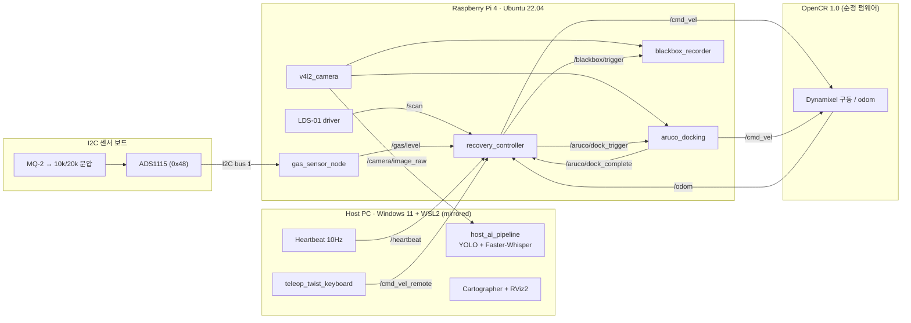
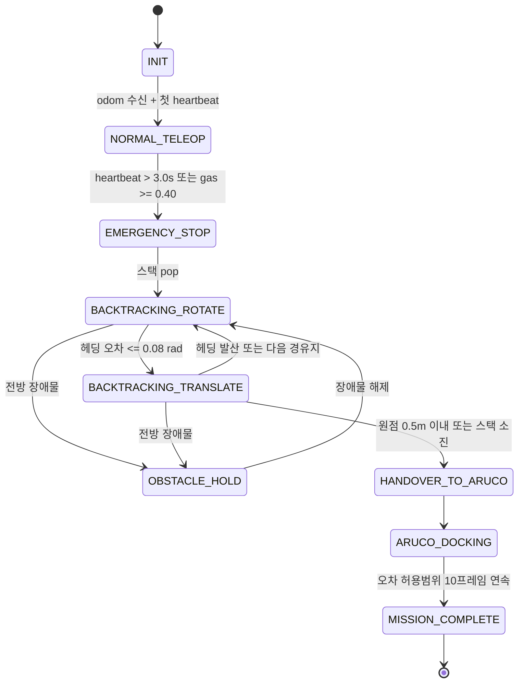

# 🚨 Disaster Recovery TurtleBot3

**통신 단절 적응형 실내 재난 탐사 및 자율 복귀 로봇 시스템 (TurtleBot3 Burger · ROS 2 Humble)**


-orange)

> 원격 탐사 중 **Wi-Fi가 끊기거나(Heartbeat 3초 타임아웃)** **가연성 가스가 감지되면(MQ-2)**,
> 로봇이 Host PC 도움 없이 **온보드 연산만으로** 지나온 경로를 역순으로 되짚어 출발점 **반경 15 cm 이내**로 돌아온다.

---

## 📑 목차

1. [핵심 기능](#-핵심-기능)
2. [시스템 아키텍처](#-시스템-아키텍처)
3. [상태 머신](#-상태-머신-recovery_controller)
4. [하드웨어 구성](#-하드웨어-구성)
5. [저장소 구조](#-저장소-구조)
6. [설치](#-설치)
7. [실행](#-실행)
8. [ROS 2 인터페이스](#-ros-2-인터페이스)
9. [주요 파라미터](#-주요-파라미터)
10. [필드 테스트](#-필드-테스트)
11. [알려진 한계 및 TODO](#-알려진-한계-및-todo)
12. [참고 문헌](#-참고-문헌)

---

## ✨ 핵심 기능

| 기능 | 설명 | 실행 위치 |
| :--- | :--- | :--- |
| **Heartbeat 워치독** | `/heartbeat` 3.0 s 미수신 시 즉시 정지(v=0, ω=0) 후 원격 명령 차단 | RPi 4 |
| **가스 워치독** | MQ-2 → ADS1115(I2C) → `/gas/level` ≥ 0.40 이면 동일한 비상 복귀 시퀀스 진입 | RPi 4 |
| **오도메트리 로거** | 탐색 중 Δd ≥ 0.3 m 또는 \|Δθ\| ≥ 25° 마다 (x, y, θ)를 LIFO 스택에 push | RPi 4 |
| **LIFO 백트래킹** | 스택을 pop하며 *제자리 회전 → 직진* (Rotate-then-Translate) 추종 | RPi 4 |
| **LiDAR 긴급 정지** | 복귀 중 전방 ±20°, 0.12–0.25 m 장애물 감지 시 정지·대기, 해제 시 재개 | RPi 4 |
| **ArUco 정밀 도킹** | 원점 0.5 m 진입 시 ArUco(ID 0, 10 cm)를 `solvePnP`로 추정해 슬립 오차 보정 | RPi 4 |
| **로컬 블랙박스** | 비상 전환 시 MicroSD에 영상(mp4) + 텔레메트리(csv) 기록 | RPi 4 |
| **비전 AI** | Ultralytics YOLO (기본 `yolov8n.pt`, `yolo26n.pt`로 교체 가능)로 조난자 탐지 | Host PC (GPU) |
| **음성 AI** | Faster-Whisper로 "살려주세요 / 도와주세요 / help" 등 구조 요청 키워드 검출 | Host PC (GPU) |

> **설계 원칙:** 생존·복귀에 필요한 모든 제어 루프는 로봇 내부에서 닫힌다. Host PC는 관제·AI·Heartbeat만 담당하며, Host PC가 사라져도 복귀 기능은 영향을 받지 않는다 (Brooks, 1986의 계층형 제어 구조 개념 참고).

---

## 🏗 시스템 아키텍처



### 네트워크 (Dual NIC)

```
 [학교 벽면 LAN] ── 유선 NIC ──┐
                              ├── Host PC (Windows 11) ── WSL2 (networkingMode=mirrored)
 [연구실 공유기 192.168.0.x] ── USB Wi-Fi 동글 ──┘
            │
            └── Wi-Fi ── Raspberry Pi 4 (TurtleBot3)

 공통: ROS_DOMAIN_ID=30, ROS_LOCALHOST_ONLY=0, DDS 멀티캐스트 디스커버리
```

- 학교 망 인증(고정 IP/MAC)은 유선 NIC에서 그대로 유지하고, ROS 2 트래픽은 사설 공유기로만 흐른다.
- WSL2 미러드 모드는 Windows의 NIC/IP를 Linux에 그대로 노출하므로 NAT 포트포워딩 없이 DDS 멀티캐스트가 동작한다. 단, Windows 방화벽(Hyper-V firewall)에서 UDP 수신을 허용해야 할 수 있다. 상세: [`docs/WSL_NETWORK_SETUP.md`](docs/WSL_NETWORK_SETUP.md)

---

## 🔁 상태 머신 (`recovery_controller`)



**제어 법칙 요약**

- 회전 단계 (`|e_θ| > 0.08 rad`): `v = 0`, `ω = clamp(Kp_ω · e_θ, ±0.45)`
- 직진 단계: `v = clamp(Kp_v · d, 0.03, 0.12)`, `ω = clamp(0.5 · Kp_ω · e_θ, ±0.45)`
- 도킹 수렴 조건: `|Z − 0.20| ≤ 0.02 m`, `|X| ≤ 0.02 m`, `|yaw| ≤ 0.05 rad` 를 10프레임 연속 만족

---

## 🔧 하드웨어 구성

| 구분 | 사양 |
| :--- | :--- |
| 로봇 | TurtleBot3 Burger (OpenCR 1.0 + Raspberry Pi 4 4/8GB) |
| LiDAR | LDS-01 (USB2LDS) |
| 카메라 | Raspberry Pi Camera Module (CSI, 640×480) |
| 가스 센서 | MQ-2 (5 V 구동) → 10k/20k 분압 → **ADS1115** 16-bit I2C ADC → RPi 4 |
| 마이크 | USB 무지향성 콘덴서 핀마이크 (16 kHz) |
| Host PC | i7-8700 / GTX 1050 Ti 4GB / Windows 11 + WSL2 Ubuntu 22.04 |

### MQ-2 + ADS1115 회로

OpenCR은 TurtleBot3 순정 펌웨어(모터·`/odom`)를 그대로 유지하고, 가스 센서는 RPi 4의 I2C로 읽는다. ADS1115는 **반드시 3.3 V로 급전**한다 (RPi GPIO는 5 V 비허용).

```
 RPi Pin 1 (3.3V) ──── ADS1115 VDD
 RPi Pin 3 (SDA)  ──── ADS1115 SDA
 RPi Pin 5 (SCL)  ──── ADS1115 SCL
 RPi Pin 6 (GND)  ──┬─ ADS1115 GND, ADDR (→ 0x48)
                    ├─ MQ-2 GND
 RPi Pin 2 (5V)   ──┼─ MQ-2 VCC
                    │  MQ-2 AOUT ── [R1 10kΩ] ──┬── ADS1115 AIN0
                    │                          [R2 20kΩ]
                    └──────────────────────────┘

 V_AIN0 = V_out × 20k / (10k + 20k) ≤ 3.33 V   (ADS1115 허용: VDD + 0.3 V = 3.6 V)
 PGA = ±4.096 V, 128 SPS, 연속 변환
```

```bash
sudo apt install -y i2c-tools python3-smbus && sudo usermod -aG i2c $USER
i2cdetect -y 1        # 48 이 보여야 정상
```

상세 결선 및 카메라 캘리브레이션: [`docs/CIRCUIT_AND_CALIBRATION.md`](docs/CIRCUIT_AND_CALIBRATION.md)

---

## 📁 저장소 구조

```
disaster_recovery_ws/
├── README.md
├── LICENSE
├── .gitignore
├── docs/
│   ├── DISASTER_RECOVERY_GUIDEBOOK.md   # 종합 설계 문서
│   ├── WSL_NETWORK_SETUP.md             # .wslconfig, ROS 2, CUDA 설정
│   ├── CIRCUIT_AND_CALIBRATION.md       # MQ-2 분압 회로, 카메라 캘리브레이션
│   └── FIELD_TEST_CHECKLIST.md          # 터미널별 실행 순서, 검증 체크리스트
└── src/disaster_recovery/
    ├── package.xml
    ├── setup.py / setup.cfg
    ├── config/
    │   ├── recovery_params.yaml         # 임계값, 속도, 게인
    │   └── camera_info_sample.yaml      # 예시값 (반드시 직접 캘리브레이션한 값으로 교체)
    ├── launch/
    │   ├── robot_onboard.launch.py      # RPi 4용
    │   └── host_station.launch.py       # Host PC용
    ├── disaster_recovery/
    │   ├── recovery_controller.py       # 워치독 + 로거 + 백트래킹 + LiDAR 정지 FSM
    │   ├── aruco_docking.py             # solvePnP 기반 도킹 P-제어
    │   ├── host_ai_pipeline.py          # YOLO + Faster-Whisper + Heartbeat
    │   ├── gas_sensor_node.py           # ADS1115 → EMA → /gas/level
    │   ├── ads1115_mq2.py               # ADS1115 드라이버 + MQ-2 계산 (ROS 비의존)
    │   ├── blackbox_recorder.py         # MicroSD 영상·CSV 기록
    │   └── audio_capture_node.py        # USB 마이크 캡처 (스텁)
    └── test/
        └── test_ads1115_mq2.py          # 단위 테스트 (pytest)
```

---

## ⚙ 설치

### 공통 (Host PC · RPi 4) — `~/.bashrc`

```bash
source /opt/ros/humble/setup.bash
export ROS_DOMAIN_ID=0
export ROS_LOCALHOST_ONLY=0
export TURTLEBOT3_MODEL=burger
export LDS_MODEL=LDS-01          # RPi 4
```

### Host PC (WSL2)

`C:\Users\<user>\.wslconfig`

```ini
[wsl2]
networkingMode=mirrored
dnsTunneling=true
firewall=true
autoProxy=true
```

```bash
# PowerShell: wsl --shutdown 후 WSL 재진입
sudo apt install -y ros-humble-desktop ros-humble-cv-bridge \
                    ros-humble-teleop-twist-keyboard ros-humble-camera-calibration \
                    ros-humble-turtlebot3-cartographer
pip3 install ultralytics faster-whisper opencv-contrib-python
python3 -c "import torch; print(torch.cuda.is_available())"   # True 확인
```

> WSL2 내부에 Linux용 NVIDIA 드라이버를 설치하지 않는다. Windows 드라이버가 WSL로 전달된다.

### RPi 4

```bash
sudo apt install -y ros-humble-v4l2-camera ros-humble-cv-bridge python3-opencv \
                    python3-smbus i2c-tools
sudo usermod -aG i2c $USER   # 재로그인 필요
```

### 단위 테스트 (ROS·하드웨어 불필요)

```bash
cd src/disaster_recovery && python3 -m pytest test -q   # ADS1115 레지스터/MQ-2 계산 8개 테스트
```

### 빌드 (양쪽 모두)

```bash
mkdir -p ~/disaster_recovery_ws && cd ~/disaster_recovery_ws
git clone https://github.com/<YOUR_ID>/<YOUR_REPO>.git .
colcon build --symlink-install --packages-select disaster_recovery
source install/setup.bash
```

---

## ▶ 실행

| # | 기기 | 명령 |
| :-: | :--- | :--- |
| 1 | RPi 4 | `ros2 launch turtlebot3_bringup robot.launch.py` |
| 2 | RPi 4 | `ros2 run v4l2_camera v4l2_camera_node --ros-args -p image_size:="[640,480]" -p camera_info_url:=file:///home/ubuntu/camera_info.yaml -r image_raw:=/camera/image_raw -r camera_info:=/camera/camera_info` |
| 3 | RPi 4 | `ros2 launch disaster_recovery robot_onboard.launch.py` |
| 4 | Host | `ros2 launch disaster_recovery host_station.launch.py` |
| 5 | Host | `ros2 run teleop_twist_keyboard teleop_twist_keyboard --ros-args -r cmd_vel:=/cmd_vel_remote` |
| 6 | Host | `ros2 launch turtlebot3_cartographer cartographer.launch.py` |

> ⚠ 텔레옵은 반드시 `/cmd_vel_remote`로 리매핑한다. `/cmd_vel`에 직접 발행하면 워치독의 원격 명령 차단이 무력화된다.

상태 모니터링:

```bash
ros2 topic echo /recovery/status
```

---

## 📡 ROS 2 인터페이스

| 토픽 | 타입 | 발행 → 구독 |
| :--- | :--- | :--- |
| `/heartbeat` | `std_msgs/Header` | host_ai_pipeline → recovery_controller (10 Hz) |
| `/cmd_vel_remote` | `geometry_msgs/Twist` | teleop → recovery_controller |
| `/cmd_vel` | `geometry_msgs/Twist` | recovery_controller, aruco_docking → turtlebot3_node |
| `/odom` | `nav_msgs/Odometry` | turtlebot3_node → recovery_controller, blackbox |
| `/scan` | `sensor_msgs/LaserScan` | LDS-01 → recovery_controller, blackbox |
| `/gas/level` | `std_msgs/Float32` | gas_sensor_node → recovery_controller, blackbox (예열·기준 측정 후 발행) |
| `/gas/voltage` | `std_msgs/Float32` | gas_sensor_node → (모니터링) MQ-2 출력 전압 |
| `/gas/rs_ro` | `std_msgs/Float32` | gas_sensor_node → (모니터링) 데이터시트 ppm 곡선용 Rs/Ro |
| `/gas/sensor_ok` | `std_msgs/Bool` | gas_sensor_node → (모니터링) I2C 읽기 실패 시 false |
| `/camera/image_raw` | `sensor_msgs/Image` | v4l2_camera → aruco_docking, blackbox, host_ai |
| `/camera/camera_info` | `sensor_msgs/CameraInfo` | v4l2_camera → aruco_docking |
| `/aruco/dock_trigger` | `std_msgs/Bool` | recovery_controller → aruco_docking |
| `/aruco/dock_complete` | `std_msgs/Bool` | aruco_docking → recovery_controller |
| `/blackbox/trigger` | `std_msgs/Bool` | recovery_controller → blackbox_recorder |
| `/recovery/status` | `std_msgs/String` | recovery_controller → (모니터링) |
| `/disaster/victim_alert` | `std_msgs/String` | host_ai_pipeline → (관제) |
| `/disaster/audio_alert` | `std_msgs/String` | host_ai_pipeline → (관제) |

---

## 🎛 주요 파라미터

[`config/recovery_params.yaml`](src/disaster_recovery/config/recovery_params.yaml)

| 파라미터 | 기본값 | 의미 |
| :--- | :-: | :--- |
| `heartbeat_timeout_sec` | 3.0 | 통신 단절 판정 시간 |
| `gas_threshold` | 0.40 | 가스 위험 판정값 (`1 − Rs/Rs_air`, ppm 아님 · 현장 보정 필요) |
| `gas_stale_timeout_sec` / `gas_stale_triggers_recovery` | 2.0 / false | `/gas/level` 끊김 경고 / 끊김 시 복귀 여부 |
| `warmup_sec` / `baseline_samples` | 60 / 100 | MQ-2 예열 시간 / 깨끗한 공기 기준 측정 샘플 수 |
| `rs_air_kohm` | 0.0 | 0보다 크면 저장된 기준값 재사용 (기준 측정 생략) |
| `log_dist_threshold_m` | 0.30 | 경유지 기록 거리 간격 |
| `log_angle_threshold_deg` | 25.0 | 경유지 기록 회전 간격 |
| `waypoint_reach_radius_m` | 0.08 | 경유지 도달 판정 반경 |
| `linear_speed_max` / `angular_speed_max` | 0.12 / 0.45 | 복귀 속도 상한 |
| `lidar_min_range_m` / `lidar_max_danger_range_m` | 0.12 / 0.25 | 정지 거리 구간 |
| `lidar_fov_half_deg` | 20.0 | 전방 감시 반각 |
| `docking_start_distance_m` | 0.50 | ArUco 도킹 전환 거리 |
| `marker_size_m` / `target_dock_dist_m` | 0.10 / 0.20 | 마커 크기 / 마커 앞 정지 거리 |

---

## 🧪 필드 테스트

전체 체크리스트: [`docs/FIELD_TEST_CHECKLIST.md`](docs/FIELD_TEST_CHECKLIST.md)

- [ ] 텔레옵 주행 중 `[ODOM LOGGER] Recorded Waypoint` 로그가 0.3 m / 25° 간격으로 출력되는가
- [ ] Host PC의 `host_station.launch.py`를 `Ctrl+C`로 종료 → 약 3초 후 정지하는가
- [ ] 정지 이후 텔레옵 키 입력이 무시되는가
- [ ] `~/blackbox_logs/session_*/`에 mp4·csv가 생성되는가
- [ ] 제자리 회전 → 직진으로 경유지를 역순 추종하는가
- [ ] 복귀 중 전방 약 15 cm에 장애물을 두면 정지하고, 치우면 재개하는가
- [ ] 원점 0.5 m 이내에서 ArUco 도킹으로 전환되고 최종 위치가 출발점 15 cm 이내인가
- [ ] 라이터 가스(점화 금지)를 MQ-2에 근접시켰을 때 동일한 복귀 시퀀스가 시작되는가

---

## ⚠ 알려진 한계 및 TODO

본 저장소는 **설계·코드 프로토타입**이며, 실제 하드웨어에서의 동작 검증은 아직 수행되지 않았다.

1. ~~**OpenCR 펌웨어 충돌**~~ → **해결됨.** MQ-2를 ADS1115(I2C)로 RPi 4에 직접 연결하는 방식으로 바꿨다. OpenCR은 순정 TurtleBot3 펌웨어를 유지한다. ADS1115 레지스터 설정과 MQ-2 계산은 단위 테스트로 검증했지만, 실제 하드웨어에서는 아직 검증하지 않았다.
2. **`audio_capture_node`는 스텁**이다. 실제 PCM 캡처 및 Host 전송 로직(예: `audio_common_msgs` 또는 `Int16MultiArray`)이 미구현이며, `host_ai_pipeline`의 Whisper 큐에도 아직 데이터가 공급되지 않는다.
3. **블랙박스의 Wi-Fi 스트리밍 차단**은 구현되어 있지 않다. 현재는 로컬 기록만 시작한다.
4. **`OBSTACLE_HOLD`와 제자리 회전**: 회전 단계에서도 전방 장애물 검사를 하므로, 벽 근처에서 회전이 막혀 대기 상태가 지속될 수 있다. 회전 단계에서는 검사를 생략하거나 회전 방향 섹터만 검사하는 개선이 필요하다.
5. **도킹 기하**: 마커가 출발 위치 정면 벽에 있다는 가정이다. 출발 자세와 마커 위치의 상대 관계(오프셋)는 현장에서 실측해 `target_dock_dist_m`을 조정해야 한다.
6. **가스 지표**: `/gas/level`은 기준 공기 대비 센서 저항 감소율(`1 − Rs/Rs_air`)이며 ppm 값이 아니다. 기동 후 60초 예열 + 5초 기준 측정 동안은 가스 감시가 비활성 상태이고, 이 시간에는 **깨끗한 공기**에 두어야 한다. 정밀 측정에는 데이터시트상 장시간 burn-in이 권장된다.
7. `camera_info_sample.yaml`의 값은 **예시**이다. 반드시 직접 캘리브레이션한 값을 사용해야 한다.

---

## 📚 참고 문헌

1. Borenstein, J., & Feng, L. (1996). Measurement and correction of systematic odometry errors in mobile robots. *IEEE Transactions on Robotics and Automation*, 12(6), 869–881.
2. Brooks, R. A. (1986). A robust layered control system for a mobile robot. *IEEE Journal on Robotics and Automation*, 2(1), 14–23.
3. Siegwart, R., Nourbakhsh, I. R., & Scaramuzza, D. (2011). *Introduction to Autonomous Mobile Robots* (2nd ed.). MIT Press.
4. Garrido-Jurado, S., Muñoz-Salinas, R., Madrid-Cuevas, F. J., & Marín-Jiménez, M. J. (2014). Automatic generation and detection of highly reliable fiducial markers under occlusion. *Pattern Recognition*, 47(6), 2280–2292.
5. Collins, T., & Bartoli, A. (2014). Infinitesimal plane-based pose estimation. *International Journal of Computer Vision*, 109(3), 252–286.
6. Zhang, Z. (2000). A flexible new technique for camera calibration. *IEEE Transactions on Pattern Analysis and Machine Intelligence*, 22(11), 1330–1334.

---

## 📄 License

[Apache License 2.0](LICENSE) © 2026 Jongwoo Ro (Kyungpook National University)
