# 🛠️ [트러블슈팅 백서] 통신 단절 적응형 재난 탐사 터틀봇3 프로젝트 개발·시도 내역 및 문제 해결 총정리

- **프로젝트명:** 통신 단절 적응형 실내 재난 탐사 및 자율 복귀 터틀봇3 버거 시스템
- **작성 일자:** 2026년 11월 14일 (1차 `#01~#11` · 1.5차 `#12~#22` · 2·3차 로컬 A\*·이식성 `#23~#29` · 4차 V100 서버 5대 완주 & Dual-Track RL `#30~#36` 전수 통합)
- **작성자:** 노종우 (Jong Woo Ro) / Kyungpook National University
- **저장 위치:** `docs/2026-11-10_통신단절_재난대응_터틀봇3_프로젝트_시도내역_및_트러블슈팅_총정리.md`

---

## 📌 목차

1. [개요 및 기술 진화 아키텍처 (1차 ➔ 1.5차 ➔ 2·3·4차 V100 완주)](#1-개요-및-기술-진화-아키텍처-1차--15차--234차-v100-완주)
   - 1.1 [단계별 트러블슈팅 통합 배경](#11-단계별-트러블슈팅-통합-배경)
   - 1.2 [트러블슈팅 기반 아키텍처 진화 계보 (Evolution Flowchart)](#12-트러블슈팅-기반-아키텍처-진화-계보-evolution-flowchart)
   - 1.3 [구현 진행 현황 구분 (완료 vs 실물 결선·필드 예정)](#13-구현-진행-현황-구분-완료-vs-실물-결선필드-예정)
2. [1차 트러블슈팅: 초기 하드웨어 복구 및 브링업 11대 난제 (#01 ~ #11)](#2-1차-트러블슈팅-초기-하드웨어-복구-및-브링업-11대-난제-01--11)
   - 2.1 [1차 트러블슈팅 전수 요약표 (#01 ~ #11)](#21-1차-트러블슈팅-전수-요약표-01--11)
   - 2.2 [1차 주요 난제 상세 분석 및 후속 단계(1.5차·현재)와의 기술적 연관성](#22-1차-주요-난제-상세-분석-및-후속-단계15차현재와의-기술적-연관성)
   - 2.3 [5V 전력 예산(Power Budget) 정밀 검토 및 전원 분리 원칙](#23-5v-전력-예산power-budget-정밀-검토-및-전원-분리-원칙)
3. [1.5차 트러블슈팅: 온보드 고도화·초저지연 통신·AI·정밀 복귀 (#12 ~ #22)](#3-15차-트러블슈팅-온보드-고도화초저지연-통신ai정밀-복귀-12--22)
   - 3.1 [[#11·#12] 하드웨어/전원: RPi 4 4GB 이식 성공, SMPS 발열 관리 및 OpenCR 보존형 I2C 가스 회로 분리](#31-1112-하드웨어전원-rpi-4-4gb-이식-성공-smps-발열-관리-및-opencr-보존형-i2c-가스-회로-분리)
   - 3.2 [[#13] 네트워크 1: WSL2 미러드 네트워킹(Mirrored) & Dual NIC 물리 망 분리](#32-13-네트워크-1-wsl2-미러드-네트워킹mirrored--dual-nic-물리-망-분리)
   - 3.3 [[#14] 네트워크 2: Tailscale + CycloneDDS 지터 오작동 ➔ 사설 Wi-Fi + Fast DDS 전환](#33-14-네트워크-2-tailscale--cyclonedds-지터-오작동--사설-wi-fi--fast-dds-전환)
   - 3.4 [[#15] 좌표계/시각화: RViz2 바퀴(`wheel_link`) TF 적색 에러 ➔ `/joint_states` 동기화 해결](#34-15-좌표계시각화-rviz2-바퀴wheel_link-tf-적색-에러--joint_states-동기화-해결)
   - 3.5 [[#16] AI / GPU: NumPy 2.x C-ABI 충돌 해결 & 4GB VRAM 하이브리드 가속 분할](#35-16-ai--gpu-numpy-2x-c-abi-충돌-해결--4gb-vram-하이브리드-가속-분할)
   - 3.6 [[#17] 스트리밍/오디오: 카메라 1초 큐 지연 ➔ Zero-Lag 워커 & 48kHz➔16kHz 리샘플링](#36-17-스트리밍오디오-카메라-1초-큐-지연--zero-lag-워커--48khz16khz-리샘플링)
   - 3.7 [[#18] 기구/카메라: 90° 회전 장착 ➔ 270° 영상 보정 및 ArUco 3D 자세 역변환 행렬](#37-18-기구카메라-90-회전-장착--270-영상-보정-및-aruco-3d-자세-역변환-행렬)
   - 3.8 [[#19] 비전 캘리브레이션: ArUco 거리 -40% 축소 오인 ➔ 핀홀 모델 초점거리(`1325px`) 실측 보정](#38-19-비전-캘리브레이션-aruco-거리--40-축소-오인--핀홀-모델-초점거리1325px-실측-보정)
   - 3.9 [[#20] 자율 복귀: 바퀴 슬립 누적 오차 & APF 기각 ➔ 키프레임 기반 2D 라이다 스캔 매칭(SVD ICP)](#39-20-자율-복귀-바퀴-슬립-누적-오차--apf-기각--키프레임-기반-2d-라이다-스캔-매칭svd-icp)
   - 3.10 [[#21] 비주얼 도킹: ArUco 마커 미배치 무한 회전 ➔ 10초 타임아웃 세이프티 가드](#310-21-비주얼-도킹-aruco-마커-미배치-무한-회전--10초-타임아웃-세이프티-가드)
   - 3.11 [[#22] 시스템 운용: 6개 다중 터미널 수동 실행 ➔ 원터치 `start.py` / `stop.py` 오케스트레이션](#311-22-시스템-운용-6개-다중-터미널-수동-실행--원터치-startpy--stoppy-오케스트레이션)
4. [2·3·4차 트러블슈팅: GPU 가속 · 로컬 2D A\* · V100 서버 5대 완주 · Dual-Track RL (#23 ~ #36)](#4-234차-트러블슈팅-gpu-가속--로컬-2d-a--v100-서버-5대-완주--dual-track-rl-23--36)
   - 4.1 [[#23] AI·시각화 고도화: Whisper CUDA INT8 GPU 가속, YOLO 15 FPS 안정화 & RViz2 `RobotModel` 복원](#41-23-ai시각화-고도화-whisper-cuda-int8-gpu-가속-yolo-15-fps-안정화--rviz2-robotmodel-복원)
   - 4.2 [[#24] 붕괴 건물 15회 교착 규명: `BACKTRACKING_HYBRID` 회피 사각지대 & 다회차 `corr_y` 누적 해결](#42-24-붕괴-건물-15회-교착-규명-backtracking_hybrid-회피-사각지대--다회차-corr_y-누적-해결)
   - 4.3 [[#25] TD3 한계 돌파: 메모리리스 U자 포켓 교착 ➔ `RollingLocalGrid` + 2D `A*` + 위상 지름길 전환](#43-25-td3-한계-돌파-메모리리스-u자-포켓-교착--rollinglocalgrid--2d-a--위상-지름길-전환)
   - 4.4 [[#26] 다실 가옥(`house`) 오작동: 실내 벽 너머 단축 점프 차단 & 전방 밀착 zero-velocity unpin](#44-26-다실-가옥house-오작동-실내-벽-너머-단축-점프-차단--전방-밀착-zero-velocity-unpin)
   - 4.5 [[#27] 2D LiDAR 사각지대 & 협소 틈새 간섭: 저상 `cafe_table` 받침대(`_virtual_obstacles`)와 `0.04m` 격자](#45-27-2d-lidar-사각지대--협소-틈새-간섭-저상-cafe_table-받침대_virtual_obstacles와-004m-격자)
   - 4.6 [[#28] 5대 재난 A/B 벤치마크 안정화: `.partial.json` 원자적 체크포인트 & 빠른 지름길 판정 누락 수정](#46-28-5대-재난-ab-벤치마크-안정화-partialjson-원자적-체크포인트--빠른-지름길-판정-누락-수정)
   - 4.7 [[#29] V100 서버 이관 & 이식성 패치: 하드코딩 경로 제거 & `--gz-port` / `--ros-domain-id` 병렬 격리](#47-29-v100-서버-이관--이식성-패치-하드코딩-경로-제거--gz-port--ros-domain-id-병렬-격리)
   - 4.8 [[#30] Phase 1 최종 확정: 좁은 통로 `_virtual_obstacles` 폭·TTL 튜닝으로 5대 환경 `49/50 (98.0%)` 돌파](#48-30-phase-1-최종-확정-좁은-통로-_virtual_obstacles-폭ttl-튜닝으로-5대-환경-4950-980-돌파)
   - 4.9 [[#31] 병렬 FastDDS `ROS_LOCALHOST_ONLY` 불일치 & `debris_utils.py` 도메인 유출·좀비 CPU 차단](#49-31-병렬-fastdds-ros_localhost_only-불일치--debris_utilspy-도메인-유출좀비-cpu-차단)
   - 4.10 [[#32] 헤드리스 V100 서버 Docker/`rclone` OAuth & 3D Gazebo+RViz2 캡처 race condition 3건 해결](#410-32-헤드리스-v100-서버-dockerrclone-oauth--3d-gazeborviz2-캡처-race-condition-3건-해결)
   - 4.11 [[#33] Phase 2 V100 RL 초기 `43%` 정체 돌파: `max_steps`·`1.8m` Ego 격자·`nav_dist` 보상 & `atanh` 야코비안](#411-33-phase-2-v100-rl-초기-43-정체-돌파-max_steps18m-ego-격자nav_dist-보상--atanh-야코비안)
   - 4.12 [[#34] PPO `v_loss` 기울기 고갈(Gradient Starvation) 해결 & 공유 백본 정규화(`ret_norm=25`)](#412-34-ppo-v_loss-기울기-고갈gradient-starvation-해결--공유-백본-정규화ret_norm25)
   - 4.13 [[#35] 이봉성 회피 앙상블 상쇄(`±0.6➔0`) 극복: 일치도 보존 선택적 DAgger 증류 & 3D 타이틀 보정](#413-35-이봉성-회피-앙상블-상쇄060-극복-일치도-보존-선택적-dagger-증류--3d-타이틀-보정)
   - 4.14 [[#36] Track B(`real_tb3`) 개루프 불능 보정 & 공식 Gazebo 5대 환경 `proposed_rl` Sim-to-Sim `47/50` 입증](#414-36-track-breal_tb3-개루프-불능-보정--공식-gazebo-5대-환경-proposed_rl-sim-to-sim-4750-입증)
5. [트러블슈팅 간 인과관계 및 아키텍처 개선 종합 매핑](#5-트러블슈팅-간-인과관계-및-아키텍처-개선-종합-매핑)
   - 5.1 [1차 ➔ 1.5차 ➔ 2·3·4차 핵심 기술 도출 매트릭스](#51-1차--15차--234차-핵심-기술-도출-매트릭스)
   - 5.2 [1차 기획(Before) vs 현재 시스템(After) 아키텍처 전면 비교](#52-1차-기획before-vs-현재-시스템after-아키텍처-전면-비교)
6. [사전 설계 완료, 해소된 기존 과제, 및 향후 실물 결선·필드 로드맵](#6-사전-설계-완료-해소된-기존-과제-및-향후-실물-결선필드-로드맵)
   - 6.1 [MQ-2 가스 센서 + ADS1115 I2C ADC 회로 구성 계획](#61-mq-2-가스-센서--ads1115-i2c-adc-회로-구성-계획)
   - 6.2 [현재 상태: 센서 미연결에 따른 페일세이프 오작동 방지 조치](#62-현재-상태-센서-미연결에-따른-페일세이프-오작동-방지-조치)
   - 6.3 [기존 잔여 과제의 해소 현황 및 향후 실물 현장 실증 로드맵](#63-기존-잔여-과제의-해소-현황-및-향후-실물-현장-실증-로드맵)

---

## 1. 개요 및 기술 진화 아키텍처 (1차 ➔ 1.5차 ➔ 2·3·4차 V100 완주)

### 1.1 단계별 트러블슈팅 통합 배경

본 문서는 통신 단절 적응형 실내 재난 탐사 및 자율 복귀 로봇(TurtleBot3 Burger)을 개발하며 마주친 **총 36건의 엔지니어링 트러블슈팅(`#01` ~ `#36`)**을 전수 통합한 기술 백서이다.

- **1차 (`#01`~`#11`):** 장기 방치된 하드웨어 복구 및 초기 ROS 2 브링업 단계 (`프로젝트_기획서_통신단절_재난탐색로봇_3차_가독성개선.html`).
- **1.5차 (`#12`~`#22`):** RPi 4 4GB Native 이식, Dual NIC + Fast DDS, NumPy ABI/AI 파이프라인 분할, 카메라/ArUco 3D 보정, 2D LiDAR SVD ICP, 원터치 런처 구축 (`2026-11-11_TURTLEBOT3_BURGER_중간발표_GitHub최신판.html`).
- **2·3차 (`#23`~`#29`, 2026-11-12 ~ 11-14 오전):** Faster-Whisper CUDA INT8 및 YOLO 15 FPS 개선, Residual TD3 하이브리드 구현 및 메모리리스 교착 발견([붕괴 건물 15회 분석 보고서](./2026-11-13_붕괴건물_15회_자율복귀_벤치마크_분석보고서.md)), `RollingLocalGrid` + 2D `A*` + 위상 지름길 + `ESCAPE` 전환, 저상 사각지대 보완 및 서버 이관 체크포인트([서버 이관 체크포인트](./2026-11-14_중간상황_및_서버이관_체크포인트.md)).
- **4차 (`#30`~`#36`, 2026-11-14 Tesla V100 서버 완주):** `_virtual_obstacles` 폭/TTL 튜닝으로 **Phase 1 5대 환경 `49/50 (98.0%)`** 최종 달성([5대 환경 A/B 및 Sim-to-Sim 보고서](./2026-11-13_5대재난환경_자율복귀_알고리즘_AB비교_및_원리해설_보고서.md)), FastDDS/`debris_utils` 병렬 격리 완전화, 헤드리스 3D Gazebo+RViz2 캡처(`1920×1080`) 파이프라인 안정화, 그리고 **Tesla V100 32GB `8,847만 스텝` Dual-Track 능동 적응 RL(Track A `sim` + Track B `real_tb3`) 학습·선택적 DAgger 증류·공식 Gazebo `47/50 (94.0%)` Sim-to-Sim 실증**까지 완결한 전체 과정을 유기적으로 기록한다.

---

### 1.2 트러블슈팅 기반 아키텍처 진화 계보 (Evolution Flowchart)

```mermaid
flowchart LR
    subgraph P1["1차 트러블슈팅 (#01~#11)<br/>초기 H/W 복구 및 프로토타이핑"]
        T1["#01~#02 배터리 0V 방전<br/>➔ 12.6V 상시전원 진단 & 교체"]
        T2["#03,#07,#10,#11 Pi 3 B+ (1GB)<br/>➔ Docker+Swap 우회 (라이다 3.7Hz 저하)"]
        T3["#04,#08 교내 Wi-Fi AP 격리<br/>➔ Tailscale VPN + CycloneDDS"]
        T4["#05,#06,#09 OpenCR USB 손상·TF 오차<br/>➔ GPIO 4핀 UART 직결 & Chrony NTP"]
    end

    subgraph P15["1.5차 트러블슈팅 (#12~#22)<br/>H/W 이식 · 통신 · ICP · 런처"]
        M1["#11,#12 RPi 4 (4GB) 이식 완수<br/>➔ OpenCR 보존 & ADS1115 I2C 분리 설계"]
        M2["#13,#14 VPN 지터(50~150ms) 오작동<br/>➔ WSL2 Mirrored + Dual NIC + Fast DDS"]
        M3["#15~#19 TF·VRAM·90° 카메라·거리 -40%<br/>➔ /joint_states · Zero-Lag · 270° · 1325px"]
        F1["#20~#22 휠 슬립 · 무한 회전 · 6터미널<br/>➔ 2D SVD ICP · 10초 가드 · start/stop.py"]
    end

    subgraph P3["2·3차 트러블슈팅 (#23~#29)<br/>TD3 한계 돌파 · 로컬 2D A* · 서버 이관"]
        R1["#23 Whisper CPU 부하 · YOLO FPS 저하<br/>➔ CUDA INT8 preload · YOLO 15FPS · RobotModel"]
        R2["#24~#25 붕괴건물 교착 & TD3 U자 포켓<br/>➔ reset_episode & RollingLocalGrid 2D A*+Shortcut"]
        R3["#26~#27 가옥 벽너머 점프 · 저상 받침대<br/>➔ 선행관측 + 전방 unpin + _virtual_obstacles(0.04m)"]
        R4["#28~#29 대용량 A/B 중단 · 경로 하드코딩<br/>➔ .partial.json & --gz-port/--ros-domain-id 격리"]
    end

    subgraph P4["4차 V100 완주 (#30~#36)<br/>Phase 1 98% · Dual-Track RL · S2S 94%"]
        S1["#30~#31 좁은 틈새 과차단 & 도메인 유출<br/>➔ ±0.03m/9s(98%) · ROS_LOCALHOST_ONLY · 좀비 차단"]
        S2["#32 헤드리스 3D 캡처 & rclone OAuth<br/>➔ RViz Panel strip & 지연 gzclient(1920x1080)"]
        S3["#33~#35 V100 RL 43% 정체·v_loss·앙상블 상쇄<br/>➔ nav_dist · ret_norm=25 · 선택적 DAgger 증류"]
        S4["#36 Track B 실물 잔차 캘리브레이션 & S2S<br/>➔ 88.47M스텝 · ONNX 0.036ms · Gazebo 47/50(94%)"]
    end

    T1 --> M1
    T2 -->|"Swap 병목 근본 해결"| M1
    T3 -->|"VPN 지터 한계 극복"| M2
    T4 --> M3
    M1 --> F1
    M2 --> F1
    M3 --> R1
    F1 -->|"TD3 한계 실증 및 대체"| R2
    R2 --> R3
    R3 --> R4
    R4 -->|"V100 서버 이관 실행"| S1
    S1 --> S2
    S2 --> S3
    S3 --> S4
```



---

### 1.3 구현 진행 현황 구분 (완료 vs 실물 결선·필드 예정)

| 구분 | 관련 ID | 모듈 / 기능 | 상태 | 비고 (인과관계 및 성과 요약) |
| :--- | :---: | :--- | :---: | :--- |
| **검증 완료** | `#01`~`#06` | **초기 전원/배선 복구 및 UART 4핀 직결** | ✅ 완료 | 0V 배터리 진단, OpenCR USB 손상 ➔ GPIO UART 직결 복구 |
| **검증 완료** | `#03`,`#07`,`#10`,`#11` | **RPi 3 B+(1GB) ➔ RPi 4(4GB) Native 전환** | ✅ 완료 | 라이다 주기 3.7Hz ➔ 5.0Hz 회복 및 멀티센서 동시 구동 |
| **검증 완료** | `#04`,`#08`,`#13`,`#14` | **WSL2 Mirrored & Dual NIC + Fast DDS** | ✅ 완료 | Tailscale 지연(50~150ms) 극복, 핑 3~13ms (손실 0%) 달성 |
| **검증 완료** | `#09`, `#15` | **Chrony NTP 동기화 & 바퀴 TF 정합** | ✅ 완료 | TF2 외삽 에러 및 `wheel_link` 적색 에러 완전 해결 |
| **검증 완료** | `#16`, `#23` | **NumPy 1.26 고정 & CUDA INT8 / YOLO 15 FPS · RobotModel** | ✅ 완료 | `cv_bridge` ABI 보호, YOLO 15FPS 안정화 + Whisper CUDA INT8(CPU 폴백) + `disaster_cartographer.rviz` |
| **검증 완료** | `#17` | **Zero-Lag 영상 워커 & 48kHz➔16kHz 오디오** | ✅ 완료 | `maxsize=1` 최신 프레임 추론 및 실시간 VAD/STT |
| **검증 완료** | `#18`, `#19` | **Pi Camera 270° 회전 & `1325px` 줄자 보정** | ✅ 완료 | `R_sensor_to_upright` 변환 및 40cm 실측 오차 ±1% 달성 |
| **검증 완료** | `#20`, `#21`, `#22` | **2D SVD ICP · ArUco 10초 가드 · `start.py`/`stop.py`** | ✅ 완료 | 3.5ms ICP + 상보필터($\alpha=0.40$), 원터치 오케스트레이션 |
| **검증 완료** | `#24`~`#26` | **`RollingLocalGrid` + 2D `A*` + 위상 지름길 + Unpin** | ✅ 완료 | `BACKTRACKING_HYBRID` 회피 전이, `reset_episode`, 벽 너머 단축 차단 |
| **검증 완료** | `#27`~`#31` | **Phase 1 서버 5대 환경 완주 (`49/50 = 98.0%`) & 병렬 격리** | ✅ 완료 | `_virtual_obstacles` `±0.03m`/9s 튜닝, `maze` 10.7m 21s 완주, FastDDS/`debris_utils` 격리 완료 |
| **검증 완료** | `#32` | **헤드리스 3D Gazebo+RViz2 캡처 & `rclone` Google Drive 아카이빙** | ✅ 완료 | `gzclient` 지연 기동·RViz Panel 정리로 Phase 1·2 3D `.mp4`/`.png` 전수 검수 및 Drive 동기화 |
| **검증 완료** | `#33`~`#36` | **Tesla V100 32GB Dual-Track RL & `proposed_rl` Sim-to-Sim** | ✅ 완료 | `8,847만 스텝`(392k 에피소드) 학습, `sim`/`real_tb3` ONNX(`0.036ms`), 공식 Gazebo **`47/50 (94.0%)`** (`23 passed`) |
| **사전 설계 (미결선)** | `#12` | **MQ-2 가스 센서 + ADS1115 + `10kΩ:20kΩ` 분압 회로** | ⏳ 실물 결선 예정 | 드라이버 및 단위 테스트 8종 PASS, 안전 잠금(`gas_stale_triggers_recovery: false`) 유지 중 |

---

## 2. 1차 트러블슈팅: 초기 하드웨어 복구 및 브링업 11대 난제 (#01 ~ #11)

> **출처 문서:** `프로젝트_기획서_통신단절_재난탐색로봇_3차_가독성개선.html` (§5 하드웨어 복구 과정 및 환경 구축 11대 난제 해결 기록, §6 소프트웨어·전원 개선 및 라즈베리 파이 4 변경 계획)

프로젝트 착수 당시 수령한 TurtleBot3 Burger 플랫폼은 장기 방치로 인해 전원조차 켜지지 않는 상태였다. 이를 물리 계층부터 미들웨어 계층까지 하나씩 복구하며 기록한 **1차 트러블슈팅 11건(`#01` ~ `#11`)**은 현재 자율 복귀 시스템이 동작할 수 있는 토대를 마련했다.

### 2.1 1차 트러블슈팅 전수 요약표 (#01 ~ #11)

| ID | 1차 문제 현상 | 공학적 원인 분석 | 1차 해결 과정 및 결과 | 현재 시스템(1.5차·최종)과의 연결 및 발전 |
| :-: | :--- | :--- | :--- | :--- |
| **`#01`** | **초기 부팅 불능 및 배선 이탈**<br/>전원 인가 시 반응 없음 | 장기 보관으로 인한 전원·다이나믹셀·통신 하네스 이탈 및 접촉 불량 | 플랫폼 전층 분해 후 전원 하네스, 모터 케이블, 포트 전수 육안·통전 진단 및 재결선 | 물리 계층 신뢰성 확보 완료 (`로봇 모습.jpg`) |
| **`#02`** | **배터리 0V 방전 및 모터 구동 시 전원 차단**<br/>충전기(LBC-010) 충전 거부, 이식 배터리로 모터 회전 시 꺼짐 | 기존 배터리 **0.01~0.02V 완전 과방전** 영구 손상. 임시 이식한 노후 JetBot 배터리(4개)는 모터 기동 전류 인가 시 급격한 전압 강하로 보드 UVLO(저전압 차단) 발동 | **12.6V 5A 상시 전원선 직결 실험**으로 모터가 정상 회전함을 입증해 모터 고장이 아닌 배터리 전압 강하 문제임을 규명 후 신품 Li-Po 교체 | 전원 계통 진단 기법 확립 및 `#12` RPi 4 전력 예산 설계로 직결 |
| **`#03`** | **플랫폼 선정 및 RPi 3 B+ 부팅 프리징**<br/>JetBot 검토 및 Pi 3 B+ Ubuntu 22.04 멈춤 | ① JetBot은 휠 엔코더가 없어 `/odom` 역추적 불가.<br/>② 저전압 불량 보드를 정상 RPi 3 B+(1GB RAM)로 1차 교체했으나 Ubuntu 22.04 직접 부팅 시 1GB RAM 한계 초과로 커널 프리징 | ① 엔코더·라이다가 구비된 **TurtleBot3 Burger**로 확정.<br/>② 1차로 경량 RPi OS 위에 **Docker 컨테이너(Ubuntu 22.04 + ROS 2 Humble)**를 올려 호환성 확보 | **`#11`·`#12`에서 RPi 4 (4GB RAM) Native Ubuntu 22.04로 전면 업그레이드**하여 Docker 오버헤드 제거 |
| **`#04`** | **교내 네트워크(KNU-WiFi) 직접 연결 불가**<br/>실습실 PC와 로봇 간 SSH 및 핑 전면 차단 | 실습실 PC 고정 IP 변경 제약 및 교내 무선랜의 **AP Isolation(클라이언트 간 P2P 격리)** 보안 정책 | 스마트폰 핫스팟과 **Tailscale VPN(`100.x.y.z`)**을 결합하여 학내망 제약 없는 가상 사설 통신망 1차 개통 | **`#13`·`#14`에서 VPN 지터 한계를 발견하고 Dual NIC + 사설 공유기(`192.168.0.x`)로 진화** |
| **`#05`** | **OpenCR USB 통신 두절 및 UART 4핀 6시간 디버깅**<br/>시리얼 접속 및 `/odom` 수신 불가 | OpenCR Micro-USB 데이터 핀 손상 및 어댑터 전원 스위치 위치·핀맵(6핀 vs 4핀) 혼선 | **6시간 집중 디버깅** 끝에 USB를 우회하여 **RPi GPIO UART 4핀(GND-Pin 6, RX-Pin 8, TX-Pin 10) 직결 배선** 및 부트로더 복구로 통신 성공 | 현재 RPi 4 ↔ OpenCR 간 흔들림 없는 시리얼 제어 기반 유지 |
| **`#06`** | **LDS-01 라이다 `/scan` 무응답**<br/>모터는 회전하나 토픽 미발행 | 기존 LDS-01 광학부 노후화 및 `USB2LDS` 변환 어댑터 통신 불량 | GPIO UART 직접 배선 테스트를 거쳐 원인을 분리하고 **신품 LDS-01 라이다 모듈로 교체**하여 `/scan` 정상 발행 확인 | `#20` 온보드 2D LiDAR ICP 스캔 매칭의 핵심 센서 데이터 공급원 확보 |
| **`#07`** | **RPi 3 B+ 메모리 부족(OOM) 및 빌드 강제 종료**<br/>8GB SD카드 용량 부족 및 `colcon build` 중 프로세스 사살 | 1GB 물리 RAM 환경에서 Docker + ROS 2 컴파일 시 메모리 즉시 고갈로 Linux OOM Killer 작동 | **32GB MicroSD 카드로 확장**하고 **2GB Swap 메모리**를 할당하여 1차로 시스템 강제 종료 방지 | Swap 디스크 I/O 병목이 `#10` 라이다 주기 저하를 유발함을 확인 ➔ **RPi 4 4GB 이식의 결정적 근거**가 됨 |
| **`#08`** | **VPN 환경에서 ROS 2 토픽 미탐색**<br/>SSH는 되나 `ros2 topic list`에서 토픽 안 보임 | 기본 DDS는 UDP 멀티캐스트를 사용하나, Tailscale 가상 인터페이스(`tailscale0`)는 멀티캐스트 미지원 | **`Cyclone DDS`(`rmw_cyclonedds_cpp`)**를 도입하고 `cyclonedds.xml`에 Unicast Peer IP를 수동 지정하여 토픽 송수신 성공 | **`#14`에서 사설 공유기 전환과 함께 무암호화 `Fast DDS` 멀티캐스트로 복귀** (백업 스크립트로 보존) |
| **`#09`** | **시각 불일치로 인한 TF2 외삽(Extrapolation) 에러**<br/>RViz2에서 `Lookup would require extrapolation` 발생 | 로봇(Docker 컨테이너) 시계와 관제 PC 시계가 수 초 어긋나 `/scan`과 `/tf` 타임스탬프 불일치 | **Chrony(NTP 클라이언트)**를 도입하여 로봇과 Host PC 간 시스템 클럭을 밀리초 단위로 동기화 | 분산 ROS 2 환경에서SLAM 및 TF2 정합의 기본 전제로 상시 유지 |
| **`#10`** | **온보드 과부하 시 라이다 스캔 속도 급감 (5.0Hz ➔ 3.7Hz)**<br/>지도 작성 시 벽면 왜곡 발생 | Pi 3 B+(1GB RAM)에서 Docker와 ROS 2를 함께 돌리면 느린 SD카드 Swap(2GB)을 계속 읽고 쓰면서 시리얼 패킷 처리 지연 발생 | **역할 분담 확정**: 무거운 SLAM·AI는 Host PC로 오프로딩하고, 로봇 본체는 센서 수집과 안전 정지·복귀만 전담하도록 아키텍처 분리 | Brooks(1986) 포섭 구조 기반 **Host 관제 계층 vs RPi 온보드 생존 계층** 이원화 아키텍처 확립 |
| **`#11`** | **1차 발표 시점 RPi 4 보드 교체 보류**<br/>보유 중인 RPi 4로 교체 시도 중 중단 | 기존 고정 나사 마모(야마) 및 기구적 고착으로 인해 무리한 분해 시 보드 파손 위험 발생 | 1차 발표는 Pi 3 B+ 경량화 구조로 완수하고, **발표 직후 정밀 공구로 고착 나사를 돌파하여 RPi 4 4GB 이식 완수** | **1.5차 및 현재 시스템의 최대 하드웨어 도약 달성** (라이다 5Hz + 카메라 30FPS + 오디오 48kHz + 2D ICP 동시 구동) |

---

### 2.2 1차 주요 난제 상세 분석 및 후속 단계(1.5차·현재)와의 기술적 연관성

1. **전원 불능 및 전압 강하 규명 (`#01`, `#02`) ➔ 현재의 전원 분리 설계(`#12`)로 진화**
   - **1차 당시의 문제**: 기존 배터리가 0V로 완전 방전되어 충전기조차 작동하지 않았고, 연구실 내 JetBot 배터리 4개를 차례로 이식해 부팅には 성공했으나 바퀴 모터를 구동하는 순간 전원이 꺼지는 현상이 반복되었다.
   - **원인 규명 및 개선**: 모터 고장 여부를 분리 진단하기 위해 **12.6V 5A 유선 전원 공급기**를 직결한 결과 양쪽 다이나믹셀(XL430) 모터가 정상 회전함을 확인했다. 즉, 노후 배터리의 내부 저항 증가로 인해 모터 기동 전류 인가 시 순간 전압 강하(Voltage Drop)가 발생하여 OpenCR의 저전압 보호 차단(UVLO)이 걸린 것이었다. 이 경험은 1.5차에서 RPi 4 이식 후 발생한 피크 전류 문제를 분석하고 가스 센서 회로를 설계하는 핵심 기반이 되었다.

2. **JetBot 본체 배제 및 TurtleBot3 Burger 확정 (`#03`) ➔ 정밀 역추적(`#20`)의 전제 조건**
   - **1차 당시의 의사결정**: 초기에는 카메라가 기본 장착된 JetBot 본체를 주행 로봇으로 사용할지 검토했으나, JetBot에는 바퀴 회전수를 측정하는 **휠 엔코더(Wheel Encoder)와 360° 라이다가 없어** 통신 단절 시 이동 거리를 적분하거나 역추적(Backtracking)하는 것이 원천적으로 불가능했다.
   - **현재와의 연관성**: 당시 엔코더(`/odom`)와 라이다(`/scan`)를 갖춘 TurtleBot3 Burger를 메인 플랫폼으로 확정한 덕분에, 현재의 **0.30m / 25° 간격 LIFO 경유지 로깅과 키프레임 기반 2D LiDAR ICP 스캔 매칭(`#20`)**을 구현할 수 있었다.

3. **Pi 3 B+ (1GB RAM + Docker + Swap)의 한계 (`#03`, `#07`, `#10`) ➔ RPi 4 (4GB) Native 전환(`#11`, `#12`)**
   - **1차 당시의 한계**: Pi 3 B+의 1GB LPDDR2 메모리에서 ROS 2 Humble을 구동하기 위해 32GB SD카드에 2GB Swap을 잡고 Docker 컨테이너를 올렸으나, 부하가 걸리면 느린 SD카드 I/O 병목으로 인해 **LDS-01 라이다 스캔 주기가 공식 5.0Hz에서 3.7Hz까지 급락**하여 지도가 뒤틀렸다.
   - **현재의 개선**: 1차에서 도출한 ① **Host PC(SLAM·AI)와 온보드(생존·복귀)의 연산 역할 분담(`#10`)** 원칙을 그대로 계승하는 동시에, 기구적 나사 고착을 돌파하고 **Raspberry Pi 4 Model B (4GB LPDDR4) + Native Ubuntu 22.04 LTS**로 전면 교체(`#11`)함으로써 라이다 5.0Hz 정격 회복은 물론 온보드 2D ICP(3.5ms)와 ArUco 도킹 연산까지 여유 있게 수용했다.

---

### 2.3 5V 전력 예산(Power Budget) 정밀 검토 및 전원 분리 원칙

1차 기획서(§6.2)에서 수립한 공식 데이터시트 기반 **5V 전력 사용량(Power Budget) 분석**과 **배선 3대 안전 원칙**은 현재 RPi 4 + ADS1115 + MQ-2 하드웨어 아키텍처의 전기적 안전성을 지탱하는 핵심 설계 기준이다.

| 장치명 (모델) | 데이터시트 근거 및 사양 | 평상시 전류 (Typical) | 최대 연속 전류 (Max) | 순간 피크 전류 (Inrush) | 전원 연결 경로 설계 (1차 ➔ 현재 현행화) |
| :--- | :--- | :---: | :---: | :---: | :--- |
| **1. OpenCR 1.0 5V 출력부** | 내장 5V Step-Down 레귤레이터 (최대 4.0A 연속 출력) | 공급원 (5.0V) | 연속 4.0A 공급 가능 | 회로 한계 5.0A | 12V 배터리/SMPS 입력 ➔ 5V 레귤레이터 출력 (모터 XL430 2개는 12V 직결) |
| **2. Raspberry Pi 4 (4GB)** | 보드 단독 600mA, 권장 3.0A (USB 4포트 합산 한계 **1.2A**) | 1.00 ~ 1.30A | 1.50 ~ 1.80A | 2.00 ~ 2.40A | OpenCR 5V 4A 출력 포트 직결 (전압 강하 방지용 AWG 20~22 굵은 배선) |
| **3. LDS-01 360° 라이다** | 동작 전압 5V DC, 평상시 400mA 이하, 초기 기동 돌입 전류 1.0A | 0.35 ~ 0.40A | 0.40A | **1.00A** (모터 기동 시) | `USB2LDS` 어댑터 경유 ➔ RPi 4 USB 포트 연결 |
| **4. AB13X USB 마이크** | 소형 USB 오디오 캡처 모듈 (`plughw:1,0`, 48kHz) | 0.02 ~ 0.05A | 0.08A | 0.10A | RPi 4 USB 포트 연결 |
| **5. ADS1115 16-bit ADC** | 1차의 Arduino(50~100mA)를 대체한 초저전력 I2C ADC | **< 0.001A** (150µA) | 0.001A | 0.002A | **RPi 4 Pin 1 (3.3V)** 급전 및 I2C Bus 1 (Pin 3 SDA, Pin 5 SCL) 직결 |
| **6. MQ-2 가스 센서** | 내부 산화주석($\text{SnO}_2$) 가열 히터 코일 ($R_H \approx 31\sim33\,\Omega$, $P_H \le 900\,\text{mW}$) | 0.15 ~ 0.18A | 0.18A | 0.22 ~ 0.25A (냉간 기동) | **[히터 전원 분리]** USB 포트가 아닌 RPi 5V 레일(Pin 2) 또는 OpenCR 보조 5V 단자에서 공급 |

* **전원 분리(Power Isolation) 및 배선 3대 필수 규칙:**
  1. **USB 포트 과전류 방지**: LDS-01 라이다(기동 피크 1.0A)와 주변기기가 RPi 4 USB 포트에 연결된 상태에서 히터 전류까지 USB로 끌어 쓰면 RPi 4 USB 합산 한계(1.2A)를 초과하여 저전압 스로틀링(`Under-voltage detected`)이 발생한다. 따라서 1차의 아두이노 브리지를 제거하고 초저전력 `ADS1115` I2C 구조로 개편하여 USB 포트 부하를 약 `0.45A`(평상시) 수준으로 대폭 낮추었다.
  2. **공통 접지(Common Ground) 필수 연결**: 센서 전원(5V)과 ADC 기준 전원(3.3V)을 분리하더라도 전압을 정확히 계측하려면 모든 보드의 기준 전위(0V)가 일치해야 하므로 `MQ-2 GND — ADS1115 GND — RPi 4 GND(Pin 6) — OpenCR GND`를 공통 접지로 묶는다.
  3. **서로 다른 전압 레일(+5V vs +3.3V) 직결 엄금**: RPi 4의 GPIO 및 I2C 핀은 **3.3V 로직 전용**이므로 5V 신호가 직접 유입되면 SoC가 영구 소손된다. 이에 따라 `ADS1115` VDD에는 반드시 3.3V만 인가하고, MQ-2의 5V 출력(`AOUT`)은 $10\,\text{k}\Omega : 20\,\text{k}\Omega$ 분압 회로를 거쳐 최대 $3.33\,\text{V}$ 이하로 감압하여 입력한다.

---

## 3. 1.5차 트러블슈팅: 온보드 고도화·초저지연 통신·AI·정밀 복귀 (#12 ~ #22)

> **출처 문서:** `2026-11-11_TURTLEBOT3_BURGER_중간발표_GitHub최신판.html` (§1~§6), `2026-11-11_TURTLEBOT3_BURGER_중간발표_PPT스토리보드_V2.md` (§12), 현행 GitHub 저장소 코드

1차 발표 이후 RPi 4 보드 이식부터 2D LiDAR ICP, ArUco 비주얼 서보잉, 원터치 런처 통합에 이르기까지 수행된 **심화 트러블슈팅 11건(`#12` ~ `#22`)**의 상세 내역이다.

---

### 3.1 [#11·#12] 하드웨어/전원: RPi 4 4GB 이식 성공, SMPS 발열 관리 및 OpenCR 보존형 I2C 가스 회로 분리

* **실제 마주친 문제:**
  1. **RPi 3 B+ 연산 병목 및 기구 고착(`#11`)**: 1차에서 확인한 1GB RAM 한계(라이다 3.7Hz 저하)를 해결하기 위해 RPi 4 4GB 보드 이식을 진행했으나, 체결 나사 마모로 분해에 난항을 겪음.
  2. **상시 전원 인가 시 발열 의심 현상(`#12-A`)**: RPi 4 4GB(피크 2.5~3.0A), 카메라, 라이다, 다이나믹셀 모터 부하가 동시에 걸리는 12V 5A 상시 전원 실험 중 어댑터/전원부 과열 및 타는 냄새 의심 현상이 관찰됨.
  3. **OpenCR 펌웨어 충돌 및 5V GPIO 소손 위험(`#12-B`)**: 가스 센서(MQ-2) 아날로그 출력을 읽기 위해 OpenCR 보드에 Arduino 스케치를 직접 업로드하면 **기존 TurtleBot3 순정 모터/오도메트리 펌웨어(`turtlebot3_core`)가 덮어써져 로봇 주행이 마비**되며, RPi 4에는 내장 ADC가 없고 GPIO가 3.3V 전용이라 5V 센서 직결이 불가능함.
* **원인 분석 (확인된 사실 vs 추정 사항 분리):**
  - **[확인된 사실]**: RPi 4(Cortex-A72, 4GB LPDDR4)는 Pi 3 B+ 대비 연산 성능이 비약적으로 높으나 피크 전류 소모가 크며, OpenCR 순정 펌웨어는 보존되어야 `/odom`과 `/cmd_vel` 제어가 유지된다.
  - **[추정 사항]**: 상시 전원 발열 현상은 저가형 12V 5A SMPS 어댑터 내부 커패시터/초크 코일의 리플 전류 과부하 또는 순간적인 피크 전류 스트레스로 추정된다.
* **해결 방법 및 아키텍처 개선:**
  - **RPi 4 (4GB) Native 이식 완수**: 정밀 공구로 고착 나사를 제거하고 RPi 4 4GB 보드를 장착, Docker 없이 **Native Ubuntu 22.04 LTS + ROS 2 Humble**을 직접 구축하여 라이다 **5.0Hz 정격 주기 회복** 및 카메라(30FPS)·마이크(48kHz)·복귀 제어(20Hz) 동시 구동을 달성했다.
  - **OpenCR 순정 보존 + I2C 외장 ADC 격리 설계**: OpenCR 펌웨어는 일절 건드리지 않고, RPi 4의 I2C 버스(`bus 1`)에 **`ADS1115` 16-bit ADC(3.3V 구동, 주소 `0x48`)**와 **`10kΩ : 20kΩ` 저항 분압 회로($5.0\,\text{V} \to 3.33\,\text{V}$)**를 연결하는 독립 센서 아키텍처([`gas_sensor_node.py`](../src/disaster_recovery/disaster_recovery/gas_sensor_node.py), [`ads1115_mq2.py`](../src/disaster_recovery/disaster_recovery/ads1115_mq2.py))를 완성하고 8종의 단위 테스트([`test_ads1115_mq2.py`](../src/disaster_recovery/test/test_ads1115_mq2.py))를 모두 통과시켰다.

---

### 3.2 [#13] 네트워크 1: WSL2 미러드 네트워킹(Mirrored) & Dual NIC 물리 망 분리

* **실제 마주친 문제:**
  - 1차 당시 사용하던 VMware 가상머신의 빈번한 USB 브릿지 끊김과 GPU 패스스루 한계를 극복하기 위해 Host PC를 **Windows 11 + WSL2 Ubuntu 22.04**로 전환했으나, WSL2 기본 `NAT` 모드가 외부 UDP 멀티캐스트를 차단하여 로봇과 PC 간 ROS 2 토픽 탐색이 불가능했다.
  - 또한 학교 벽면 유선 LAN(고정 IP/보안 인증)과 로봇용 무선 공유기를 동시에 연결하면 Windows 라우팅 메트릭 충돌로 인터넷이나 로봇 통신 중 한쪽이 먹통이 되었다.
* **해결 방법 및 아키텍처 개선:**
  - **WSL2 미러드 네트워킹 적용**: `C:\Users\lab\.wslconfig`에 `networkingMode=mirrored` 및 `firewall=true`를 적용하여 Windows 호스트의 물리 네트워크 인터페이스를 WSL2에 1:1로 투영하고 Hyper-V 방화벽에서 UDP 멀티캐스트를 개방했다([`WSL_NETWORK_SETUP.md`](./WSL_NETWORK_SETUP.md)).
  - **Dual NIC 물리 망 분리**: Host PC 마더보드 **유선 LAN은 학교 전산망(인터넷/GitHub)**에 전담시키고, 별도 **USB Wi-Fi 무선 랜 동글**을 장착하여 연구실 전용 사설 공유기(`192.168.0.x`)에 로봇(RPi 4)과 1:1로 직결하는 이중 네트워크 아키텍처를 확립했다.

---

### 3.3 [#14] 네트워크 2: Tailscale + CycloneDDS 지터 오작동 ➔ 사설 Wi-Fi + Fast DDS 전환

* **실제 마주친 문제 (1차 해결책 `#04`·`#08`의 한계 노출):**
  - 1차 트러블슈팅(`#04`, `#08`)에서 교내 공용망 우회를 위해 구축했던 **Tailscale VPN + CycloneDDS(Unicast Peer)** 환경으로 주행 실험을 진행한 결과, 공용망 및 중계 서버(DERP) 경유로 인해 **핑 지연이 `50 ~ 150 ms`로 치솟고 극심한 패킷 지터(Jitter)**가 발생했다.
  - 여기에 모든 패킷을 WireGuard로 암·복호화하는 오버헤드가 겹치면서 RPi 4 CPU 부하가 증가했고, 핑 스파이크 발생 시 **Heartbeat 워치독(3.0초 타임아웃)이 통신 단절로 오판하여 불필요한 비상정지가 빈번히 발동**했다. 동시에 카메라 영상 스트리밍 끊김 및 `/scan` 수신 지연으로 SLAM 지도가 왜곡되었다.
* **해결 방법 및 아키텍처 개선:**
  - **사설 로컬망 + 무암호화 Fast DDS 멀티캐스트 전환**: 현장 실험 시 Tailscale 인터페이스(`tailscale0`) 및 CycloneDDS 강제 환경변수(`RMW_IMPLEMENTATION`, `CYCLONEDDS_URI`)를 비활성화하고(`disable_tailscale.sh`), `#13`에서 구축한 **연구실 사설 공유기(`192.168.0.x`) + ROS 2 Humble 기본 `Fast DDS`(`rmw_fastrtps_cpp`) 멀티캐스트** 체계로 전면 전환했다.
  - **Heartbeat 타임아웃 현실화**: 1차 기획서에서 이론적으로 설정했던 `0.3 ~ 0.5초` 타임아웃이 무선 지터에 과민 반응하는 문제를 반영하여, [`recovery_params.yaml`](../src/disaster_recovery/config/recovery_params.yaml)의 `heartbeat_timeout_sec`를 **`3.0초`**로 확정하여 안정성을 확보했다.
* **검증 결과:**
  - RPi 4 ↔ Host PC 간 연속 ICMP 핑 테스트 결과, **패킷 유실 `0%`**, 왕복 지연 시간(RTT) **`3.07 ~ 13.0 ms` (평균 약 `6 ~ 7.24 ms`)**를 달성하여 워치독 오작동을 근원적으로 제거했다 (`네트워크 지연 핑 테스트.png`).

---

### 3.4 [#15] 좌표계/시각화: RViz2 바퀴(`wheel_link`) TF 적색 에러 ➔ `/joint_states` 동기화 해결

* **실제 마주친 문제 (1차 발표 당시 미해결 잔여 이슈 해결):**
  - 1차 발표 당시 라이다 점군(`/scan`) 구동에는 성공했으나, RViz2의 `RobotModel`에서 `base_link`와 `base_scan`은 정상인 반면 **`wheel_left_link`와 `wheel_right_link`에서 `No transform from [wheel_...] to [odom]` 적색 TF 에러**가 발생했다.
* **공학적 원인 분석:**
  - 로봇 몸체에 고정된 부품(`base_link → base_scan`)은 URDF의 고정 관절(Fixed Joint)로서 정적 변환(Static TF)만으로 즉시 계산되지만, 회전하는 양쪽 바퀴(Continuous Joint)는 OpenCR 보드가 발행하는 실시간 바퀴 각도 토픽(**`/joint_states`**)을 `robot_state_publisher`가 수신하여 동적 TF로 변환해 주어야 한다. OpenCR 시리얼 초기화가 지연되거나 `robot_state_publisher`가 누락되면 바퀴 TF만 끊어지게 된다.
* **해결 방법 및 아키텍처 개선:**
  - RPi 4 온보드 환경에 `TURTLEBOT3_MODEL=burger`를 고정하고 `turtlebot3_bringup/robot.launch.py`를 통해 OpenCR `/joint_states` 발행 노드와 `robot_state_publisher`가 순차 동기화 기동되도록 통합하여, RViz2([`disaster_station.rviz`](../src/disaster_recovery/rviz/disaster_station.rviz))에서 전체 로봇 모델과 `/scan`, `/map` TF 트리가 오차 없이 정합되도록 해결했다.

---

### 3.5 [#16] AI / GPU: NumPy 2.x C-ABI 충돌 해결 & 4GB VRAM 하이브리드 가속 분할

* **실제 마주친 문제:**
  1. **NumPy 2.x ABI 충돌**: Host PC 가상환경에 최신 AI 라이브러리(`ultralytics` 등)를 설치할 때 NumPy 2.x가 자동 설치되면서, NumPy 1.x C-API로 컴파일된 ROS 2 Humble 기본 `cv_bridge` 모듈이 `_ARRAY_API not found` 에러 및 세그멘테이션 폴트(Segmentation Fault)를 일으키며 즉시 크래시되었다.
  2. **GTX 1050 Ti (4GB VRAM) 메모리 한계**: 관제 PC의 GPU(4GB VRAM)에 비전 객체 탐지 모델(YOLO26n)과 음성 인식 트랜스포머 모델(Faster-Whisper)을 동시에 CUDA로 적재하면 VRAM 한계 초과로 OOM(Out-Of-Memory) 크래시가 발생했다.
* **해결 방법 및 아키텍처 개선:**
  - **C-ABI 호환 버전 고정**: 가상환경(`ros2_ai_venv`) 내 패키지를 **`numpy==1.26.4`** 및 **`opencv-python==4.10.0.84`**로 엄격히 다운그레이드 고정하여 ROS 2 `cv_bridge`와의 바이너리 호환성을 100% 확보했다.
  - **GPU / CPU 하이브리드 가속 분할([`host_ai_pipeline.py`](../src/disaster_recovery/disaster_recovery/host_ai_pipeline.py))**: 실시간성이 가장 중요한 비전 **YOLO26n은 GTX 1050 Ti GPU(CUDA FP16, 추론 ~14.7ms, 68 FPS)**에 전담시키고, 음성 인식 **Faster-Whisper(`base`)는 Host PC의 i7-8700 CPU(AVX2 `INT8` 양자화)**로 오프로딩하여 4GB VRAM을 안전하게 보호하면서 비전·음성·SLAM 동시 실시간 구동을 달성했다.

---

### 3.6 [#17] 스트리밍/오디오: 카메라 1초 큐 지연 ➔ Zero-Lag 워커 & 48kHz➔16kHz 리샘플링

* **실제 마주친 문제:**
  1. **카메라 영상 1~3초 밀림(Latency)**: Wi-Fi 대역폭 요동 및 ROS 2 구독 큐 적체로 인해, YOLO 추론이 끝날 때마다 과거 프레임이 순차 처리되면서 관제 화면에 1~3초 전의 과거 영상이 뒤늦게 출력되는 심각한 지연이 발생했다.
  2. **USB 마이크 샘플레이트 불일치**: RPi 4에 장착한 `AB13X` USB 마이크(`plughw:1,0`)는 하드웨어적으로 **`48,000 Hz`** 캡처만 지원하는 반면, Faster-Whisper 음성 AI 모델은 **`16,000 Hz`** 단일 채널 입력만 요구하여 직접 연동이 불가능했다.
* **해결 방법 및 아키텍처 개선:**
  - **Zero-Lag Worker Thread 아키텍처 구현([`host_ai_pipeline.py`](../src/disaster_recovery/disaster_recovery/host_ai_pipeline.py))**:
    - 카메라 토픽은 비압축 Raw 대신 대역폭이 작은 `/camera/image_raw/compressed`(JPEG)를 `BEST_EFFORT` QoS로 구독한다.
    - ROS 2 이미지 수신 콜백은 추론을 직접 수행하지 않고 `maxsize=1` 큐(또는 최신 프레임 버퍼)에 가장 최신 프레임 1장만 덮어쓴 뒤 0.1ms 만에 즉시 반환하며, 별도 백그라운드 데몬 스레드(`_yolo_worker_loop`)가 항상 **가장 최신 프레임만 꺼내어 YOLO 추론**을 수행함으로써 화면 지연을 완전 실시간(Zero-Lag)으로 제거했다.
  - **48kHz ➔ 16kHz 3:1 다운샘플링 및 RMS VAD 구현([`audio_capture_node.py`](../src/disaster_recovery/disaster_recovery/audio_capture_node.py))**:
    - RPi 4에서는 `arecord` 서브프로세스로 `48kHz S16_LE mono` PCM 데이터를 0.5초 청크 단위로 읽어 `/audio/raw`로 송신하고, Host PC에서 **16kHz 선형 보간 데시메이션(3:1 다운샘플링)** 및 **RMS 에너지 기반 음성 구간 검출(VAD, 임계치 `0.012`)**을 수행하여 유의미한 발화가 있을 때만 Faster-Whisper를 호출하도록 최적화했다.

---

### 3.7 [#18] 기구/카메라: 90° 회전 장착 ➔ 270° 영상 보정 및 ArUco 3D 자세 역변환 행렬

* **실제 마주친 문제:**
  - TurtleBot3 Burger 3층 섀시 구조 및 CSI 리본 케이블(FFC) 굴곡 제약으로 인해 Raspberry Pi 카메라 모듈이 **반시계 방향으로 90도 옆으로 누운 상태**로 장착되었다(`로봇 모습.jpg`).
  - 이로 인해 관제 화면에서 서 있는 사람이 옆으로 누운 것으로 보여 YOLO26n 조난자(`person`) 인식률이 급락했고, 특히 ArUco `solvePnP` 3차원 자세 추정 시 **카메라 센서의 좌우($X_s$)축과 상하($Y_s$)축이 뒤집혀 로봇이 마커 반대 방향으로 조향 발산**하는 치명적 문제가 발생했다.
* **해결 방법 및 아키텍처 개선:**
  - **Host 비전 관제국(2D 영상 보정)**: 추론 전 OpenCV 시계방향 270도 회전(`cv2.rotate(frame, cv2.ROTATE_90_COUNTERCLOCKWISE)`)을 적용하여 사람이 똑바로 서 있는 정방향 영상으로 YOLO26n 추론 및 HUD 출력을 수행했다(`yolo 구현 성공.jpg`).
  - **온보드 ArUco 도킹 노드(3D 강체 회전 변환 행렬 적용)**: 이미지를 먼저 회전시키면 카메라 내부 파라미터($`K, D`$)의 주점 $`(c_x, c_y)`$ 축이 틀어지므로, **원시 비회전 영상에서 `solvePnP`를 먼저 수행**하여 센서 기준 위치 벡터 $`\mathbf{t}_s = [t_{x,s}, t_{y,s}, t_{z,s}]^T`$와 회전 행렬 $`\mathbf{R}_s`$를 구한 뒤, 광축($`Z`$) 기준 270° 3차원 회전 변환 행렬 $`\mathbf{R}_{\text{upright}}`$를 좌측 곱하여 정립 좌표계로 완벽히 복원했다([`aruco_docking.py`](../src/disaster_recovery/disaster_recovery/aruco_docking.py)):

```math
\mathbf{R}_{\text{upright}} = \begin{bmatrix} 0 & 1 & 0 \\ -1 & 0 & 0 \\ 0 & 0 & 1 \end{bmatrix}, \quad \mathbf{t}_u = \mathbf{R}_{\text{upright}} \mathbf{t}_s = \begin{bmatrix} t_{y,s} \\ -t_{x,s} \\ t_{z,s} \end{bmatrix}, \quad \mathbf{R}_u = \mathbf{R}_{\text{upright}} \mathbf{R}_s
```

---

### 3.8 [#19] 비전 캘리브레이션: ArUco 거리 -40% 축소 오인 ➔ 핀홀 모델 초점거리(`1325px`) 실측 보정

* **실제 마주친 문제:**
  - 한 변의 길이가 $`L = 0.10\,\text{m}`$ ($`10\,\text{cm}`$)인 ArUco 마커(`DICT_4X4_50`, ID 0)를 노란색 줄자로 로봇 카메라 정면 **`40.0 cm (0.40 m)`** 거리에 정확히 배치했으나, 초기 카메라 행렬 설정(`fx = fy = 795.0 px`)에서는 화면에 **`24.0 cm (0.24 m)`**로 출력되어 **거리를 40%나 가깝게 오인**했다(30cm 배치 시에는 18cm로 오인).
  - 이 상태에서는 로봇이 실제로는 마커에서 35cm 떨어져 있는데도 목표 도킹 거리(`20cm`)에 도달했다고 착각하여 일찍 멈춰버리는 문제가 발생한다.
* **공학적 원인 분석:**
  - 단안 카메라 `solvePnP`의 깊이($`Z`$) 추정은 핀홀 카메라 모델 수식 $`Z = f_x \cdot \frac{L_{\text{real}}}{L_{\text{px}}}`$에 의해 결정된다. RPi CSI 카메라 드라이버(`camera_ros`)의 `640×480` 센서 크롭/스케일링 모드와 초기 가정한 유효 초점거리($`f_x = 795.0\,\text{px}`$)가 불일치하여 원근 투영 스케일이 왜곡된 것이 원인이다.
* **해결 방법 및 검증 결과:**
  - **실측 줄자 기반 초점거리 역산 보정**: 핀홀 비례식 $`f_{\text{new}} = f_{\text{old}} \times \frac{Z_{\text{true}}}{Z_{\text{meas}}}`$를 적용하여 유효 초점거리를 산출했다:

```math
f_{\text{new}} = 795.0 \times \frac{0.40\,\text{m}}{0.24\,\text{m}} = 795.0 \times 1.6667 = \mathbf{1325.0\,\text{px}}
```
  - 카메라 내부 파라미터 행렬 $K$의 $f_x, f_y$를 **`1325.0 px`**로 업데이트한 직후, 실제 줄자 **`40.0 cm`** 거리에서 모니터 출력 **`DIST: 0.40m (40cm), Z: +40.4cm`**가 찍히며 **오차 `±1%` 이내의 서브센티미터급 거리 추정 정밀도**를 실증 완료했다(`aruco marker 거리 인식 줄자 및 모니터 사진.jpg`, [`aruco_detector.py`](../scripts/rpi/aruco_detector.py)). 또한 Port `8080` MJPEG 웹 스트리머를 내장하여 원격 브라우저에서도 실시간 3D 좌표축을 관제할 수 있도록 개선했다.

---

### 3.9 [#20] 자율 복귀: 바퀴 슬립 누적 오차 & APF 기각 ➔ 키프레임 기반 2D 라이다 스캔 매칭(SVD ICP)

* **실제 마주친 문제 (1차 기획서 §13의 최대 한계점 돌파):**
  - 1차 기획서 당시에는 단순 바퀴 엔코더 오도메트리(`/odom`) 좌표만을 LIFO 스택에 기록해 역추종하도록 설계했으나, 실제 10m 이상 다중 코너 주행 시 **제자리 회전(`BACKTRACKING_ROTATE`) 구간에서 발생하는 미세한 바퀴 미끄러짐(Wheel Slip)**으로 인해 각도 오차($\Delta \theta$)가 누적되어 원점 도착 위치가 **30~80cm 빗나가고 헤딩이 20~40° 틀어지는 문제**가 확인되었다.
  - 이로 인해 출발점 50cm 반경에 진입하더라도 카메라 화각(FOV) 안에 베이스캠프의 ArUco 마커가 들어오지 못하거나 복도 벽면에 충돌할 위험이 있었다.
* **시도 및 엔지니어링 의사결정 (APF 기각 ➔ 경량 2D ICP 채택):**
  - **1차 시도 — 인공 포텐셜장(APF) 검토 및 기각**: 장애물이 밀어내는 척력으로 벽을 피하는 APF를 먼저 검토했으나, 좁은 실내 복도에서 양쪽 벽면 척력이 상쇄되어 제자리에 갇히는 로컬 미니마(Local Minima) 현상이 발생했고, 무엇보다 회피 조향 자체가 추가 바퀴 슬립을 폭증시켜 틀어진 `/odom` 좌표계를 교정하지 못하므로 기각했다.
  - **최종 해법 — 키프레임 기반 2D 라이다 스캔 매칭(SVD ICP) 구현([`recovery_controller.py`](../src/disaster_recovery/disaster_recovery/recovery_controller.py))**:
    1. **키프레임 스냅샷 저장**: 전진 탐색 중 $\Delta d \ge 0.30\,\text{m}$ 또는 $|\Delta \theta| \ge 25^\circ$마다 좌표 $(x, y, \theta)$와 함께 **360° 라이다 벽면 점군(`scan_pts`, 2칸 간격 다운샘플링 약 180점)**을 `Waypoint` 객체에 동시 저장하고, 출발 원점 스캔(`start_scan_pts`)도 영구 보존한다.
    2. **SVD 기반 고속 2D ICP(`icp_match_2d`)**: 복귀 중 목표 경유지 반경 `0.40m` 이내 접근 시, 저장된 과거 벽면 점군과 현재 실시간 라이다 점군 간의 교차 공분산 행렬 $H$를 **특이값 분해(SVD, $H = U\Sigma V^T, R = VU^T$)**하여 최적 회전·평행이동 오차를 계산한다(RPi 4에서 1회 매칭에 **단 `3.5 ms` 소요**).
    3. **이상치 게이트 및 상보필터($\alpha = 0.40$) 누적 보정**: 매칭 평균 오차 `< 0.15m` 및 보정 노름 `< 0.20m` 조건을 통과한 정상 정합 결과에 가중치 $\alpha = 0.40$을 곱해 오도메트리 드리프트 오프셋(`odom_drift_x/y/theta`)을 연속 상쇄함으로써, **원점 도착 오차를 `5 ~ 10 cm` 이내로 대폭 축소**하고 ArUco 도킹 인계 성공률을 극대화했다([`2026-11-10_LIDAR_Scan_Matching_및_자율복귀_엔지니어링_보고서.md`](./2026-11-10_LIDAR_Scan_Matching_및_자율복귀_엔지니어링_보고서.md)).

---

### 3.10 [#21] 비주얼 도킹: ArUco 마커 미배치 무한 회전 ➔ 10초 타임아웃 세이프티 가드

* **실제 마주친 문제:**
  - 일상적인 주행 테스트 시 매번 출발점에 실물 ArUco 종이 마커를 세워두기 번거로울 뿐만 아니라, 실제 재난 현장에서도 연기나 장애물로 인해 베이스캠프 마커가 가려질 수 있다.
  - 기존 코드에서는 `HANDOVER_TO_ARUCO` 이후 마커를 찾지 못하면 `aruco_docking` 노드가 **마커를 찾을 때까지 영원히 제자리 회전(`search_angular_speed = 0.20 rad/s`)만 반복**하여 미션이 종료되지 않는 무한 루프(Infinite Hunting) 결함이 있었다.
* **해결 방법 및 아키텍처 개선:**
  - **2중 타임아웃 세이프티 가드 구축**:
    - 1차 가드([`aruco_docking.py`](../src/disaster_recovery/disaster_recovery/aruco_docking.py)): `search_timeout_sec = 10.0` 파라미터를 도입하여, 도킹 활성화 또는 마커 소실 후 **10.0초 동안 마커가 감지되지 않으면** 이미 `#20`의 2D 라이다 스캔 매칭을 통해 베이스캠프 반경 내(`5~10cm`)에 안전히 도착한 것(*"Fallback Base Camp Arrival"*)으로 판정하고 즉시 모터를 정지(`v=0, ω=0`)한 뒤 `dock_complete=True`를 발행한다.
    - 2차 백업 가드([`recovery_controller.py`](../src/disaster_recovery/disaster_recovery/recovery_controller.py)): 제어기 내부에도 **`12.0초` 백업 타이머**와 `use_aruco_docking` 파라미터 스위치를 추가하여, 어떠한 예외 상황에서도 로봇이 무한 회전에 빠지지 않고 `MISSION_COMPLETE` 상태로 안전 종료되도록 이중화했다.

---

### 3.11 [#22] 시스템 운용: 6개 다중 터미널 수동 실행 ➔ 원터치 `start.py` / `stop.py` 오케스트레이션

* **실제 마주친 문제:**
  - 실험을 한 번 진행할 때마다 ① RPi Bringup, ② RPi 카메라, ③ RPi 오디오/복귀 노드, ④ Host SLAM, ⑤ Host AI 파이프라인, ⑥ 키보드 텔레옵 등 **총 6개 이상의 터미널 창을 수동으로 열고 명령어를 입력**해야 했다.
  - 이로 인해 노드 기동 순서 실수가 빈번했고, 종료 시 백그라운드 좀비 프로세스가 남아 카메라 장치(`/dev/video0`)나 시리얼 포트 점유 충돌을 일으켰다.
* **해결 방법 및 아키텍처 개선:**
  - **Python 기반 원터치 마스터 오케스트레이터([`scripts/host/start.py`](../scripts/host/start.py), [`scripts/rpi/start.py`](../scripts/rpi/start.py), [`stop.py`](../scripts/host/stop.py)) 구축**:
    - **Pre-Flight 자동 점검**: 가상환경, YOLO 가중치(`yolo26n.pt`), ROS 2 워크스페이스 빌드 상태를 사전 검증한다.
    - **원격 SSH 자동 브링업**: 로봇 IP를 자동 탐색하고 SSH 공개키 배포 및 원격 온보드 노드 일괄 기동을 수행한다.
    - **통합 관제 및 클린 종료**: `--tmux` 3분할 콕핏 뷰, `--sim` Gazebo 시뮬레이션 모드([`sim.py`](../scripts/host/sim.py)), `--rviz` 시각화 연동은 물론 `Ctrl+C` 또는 `stop.py` 실행 시 호스트와 로봇 양측의 Process Group 전체를 일괄 클린 종료하도록 완성했다.

---

## 4. 2·3·4차 트러블슈팅: GPU 가속 · 로컬 2D A\* · V100 서버 5대 완주 · Dual-Track RL (#23 ~ #36)

> **출처 문서 & 커밋:** [`CHANGELOG.md`](../CHANGELOG.md), [`2026-11-13_붕괴건물_15회_자율복귀_벤치마크_분석보고서.md`](./2026-11-13_붕괴건물_15회_자율복귀_벤치마크_분석보고서.md), [`2026-11-13_5대재난환경_자율복귀_알고리즘_AB비교_및_원리해설_보고서.md`](./2026-11-13_5대재난환경_자율복귀_알고리즘_AB비교_및_원리해설_보고서.md), [`2026-11-14_중간상황_및_서버이관_체크포인트.md`](./2026-11-14_중간상황_및_서버이관_체크포인트.md), 커밋 `7e04510` ~ `a115dc7`

1.5차 트러블슈팅(`#12~#22`)으로 **LIFO + 2D SVD ICP + ArUco + `start.py`/`stop.py`** 베이스라인을 완성한 뒤, 실제 시뮬레이션·대규모 A/B 벤치마크·서버 이관 과정에서 마주친 **심화 트러블슈팅 7건(`#23` ~ `#29`)**의 상세 내역이다.

---

### 4.1 [#23] AI·시각화 고도화: Whisper CUDA INT8 GPU 가속, YOLO 15 FPS 안정화 & RViz2 `RobotModel` 복원

* **실제 마주친 문제:**
  1. 1.5차(`#16`)에서는 GTX 1050 Ti(4 GB) VRAM 보호를 위해 Faster-Whisper를 CPU(`i7-8700`)로 돌렸으나, `cartographer_node`·Gazebo와 함께 기동할 때 `host_ai_pipeline`이 CPU `40.5%`를 점유하며 전체 6코어 부하를 끌어올렸다([15회 보고서 §6.1](./2026-11-13_붕괴건물_15회_자율복귀_벤치마크_분석보고서.md#61-gpu-및-프로세스별-cpuram-실측)). 또한 WSL2 환경에서 pip 설치 CUDA 라이브러리 경로를 못 찾아 Whisper GPU 전환 시 크래시가 발생했다.
  2. YOLO 프레임 상한을 높여도 실제 출력 FPS가 떨어지는 병목이 존재했고, Cartographer 전용 RViz 뷰에 로봇 외형(`/robot_description`)이 표시되지 않았다.
  3. `sim.py` 기본 렌더링이 소프트웨어 렌더링으로 실행돼 Gazebo GUI 부하가 컸다.
* **해결 방법 및 아키텍처 개선 (`0871c58`, `b212688`, `dde535c`, `f1966bf`):**
  - **Whisper CUDA INT8 GPU 전환 + 자동 폴백 ([`host_ai_pipeline.py`](../src/disaster_recovery/disaster_recovery/host_ai_pipeline.py)):** `_preload_nvidia_cuda_libs()`로 pip `cuBLAS`/`cuDNN`을 선로드하고 기본 설정을 `whisper_device:=cuda`, `compute_type:=int8`로 전환하되 초기화 실패 시 CPU로 자동 폴백하도록 구현했다.
  - **YOLO 15 FPS 병목 5종 제거 ([`host_ai_pipeline.py`](../src/disaster_recovery/disaster_recovery/host_ai_pipeline.py)):** `yolo_max_fps`(기본 `15.0`) 도입과 함께 ① `infer_interval` 체크를 `latest_frame` 소비 이전으로 이동, ② `RGB→BGR` 변환을 `cb_image` 콜백에서 백그라운드 `vision_worker_loop`로 이관, ③ 탐지 0건일 때 `r.plot()` 생략, ④ `/detection/image` 구독자 0명 시 직렬화 생략, ⑤ `display_seq` 중복 렌더링 제거를 적용했다.
  - **RViz2 `RobotModel` & WSLg D3D12 가속:** [`disaster_cartographer.rviz`](../src/disaster_recovery/rviz/disaster_cartographer.rviz)를 추가하고, `sim.py`에서 `MESA_D3D12_DEFAULT_ADAPTER_NAME=NVIDIA` 기반 GPU 가속을 기본화했다.

---

### 4.2 [#24] 붕괴 건물 15회 교착 규명: `BACKTRACKING_HYBRID` 회피 사각지대 & 다회차 `corr_y` 누적 해결

* **실제 마주친 문제 (구 로드맵 `TD3` 구현 직후 드러난 결함):**
  - 기존 §5.3 로드맵대로 **Regulated Pure Pursuit + Residual TD3 DRL ONNX (`recovery_td3.onnx`, `~101 KB`)** 기반 `BACKTRACKING_HYBRID` 4계층 복귀를 구현하여 단순 지하 터널(20회)을 통과했으나, 비정형 붕괴 건물(`disaster_collapsed_building.world`) 15회 연속 벤치마크에서는 **11/15회(73.3%)만 성공하고 4회(`#01, #06, #07, #12`) 정적 교착(Deadlock) 타임아웃 실패**가 발생했다.
* **공학적 원인 분석 ([15회 보고서 §5.2](./2026-11-13_붕괴건물_15회_자율복귀_벤치마크_분석보고서.md#52-실패-회차-전수-분석-01-06-07-12)):**
  1. **상태 머신 사각지대 & 최소 전진 강제:** `LOCAL_TD3_AVOIDANCE` 전이 조건에 `[BACKTRACKING_ROTATE, BACKTRACKING_TRANSLATE]`만 들어가 있어 정작 실주행 상태인 `BACKTRACKING_HYBRID`에서는 전용 회피·웨이포인트 스킵이 발동하지 않았고, `BACKTRACKING_HYBRID` 내부가 전방 장애물 앞에서도 `max(0.08, ...)` 최소 전진 속도를 강제해 로봇이 낙석(`r=0.18m`)을 코로 밀며 교착됐다.
  2. **다회차 리셋 시 `SE(2)` 오프셋 미초기화:** 벤치마크 리셋이 Gazebo 모델 좌표만 `(0, -4)`로 옮기고 제어기 내부 `corr_x/corr_y/corr_th`와 `/odom` 누적 상태를 초기화하지 않아, `corr_y`가 회차마다 `#01(+0.074m) → #15(+1.300m)`까지 단조 누적되며 실제 물리 장애물 위치를 오판했다.
* **해결 방법:**
  - [`recovery_controller.py`](../src/disaster_recovery/disaster_recovery/recovery_controller.py)에 **`/recovery/reset_episode` 서비스(`cb_reset_episode`, `reset_corr_on_episode`)** 를 도입해 에피소드마다 `corr_x/y/th`, `waypoint_stack`, 플래너 상태를 완전 초기화하고, 하이브리드 상태 전이 및 속도 클램프 해제를 연동했다.

---

### 4.3 [#25] TD3 한계 돌파: 메모리리스 U자 포켓 교착 ➔ `RollingLocalGrid` + 2D `A*` + 위상 지름길 전환

* **실제 마주친 문제:**
  - `#24` 패치 이후에도, 5대 재난환경 고정 시드 A/B 벤치마크([`ab_disaster_benchmark.py`](../scripts/host/ab_disaster_benchmark.py))를 돌린 결과 **메모리리스(Memoryless) 1-스텝 관측 기반 TD3 + Pure Pursuit(`Baseline`)** 은 고밀도 낙석과 기울어진 벽이 겹친 U자 포켓에서 **붕괴 건물 기본 `5/10 (50.0%)`, 고밀도 낙석(`collapsed_heavy`, 6~9개 낙석) `2/10 (20.0%)`** 로 무너졌다.
* **공학적 원인 분석:**
  - 현재 LiDAR 프레임 1장만 보고 즉각 좌/우 열린 틈으로 조향하는 반응형 RL/VFH 정책은 **"왼쪽으로 돌았다가 스택 상의 원래 목표점 방향으로 다시 끌려 들어가 같은 U자 포켓에 갇히는 진동 교착"**을 구조적으로 풀 수 없었다. 또한 `house`·`maze`처럼 탐사 경로가 기지 옆을 스쳐 지나가도 `9~11m` 과거 발자국을 전부 역추적하는 비효율이 발생했다.
* **해결 방법 및 성능 도약 ([5대 환경 A/B 보고서](./2026-11-13_5대재난환경_자율복귀_알고리즘_AB비교_및_원리해설_보고서.md), `f1966bf`):**
  - **제안 Layer-2 아키텍처([`local_grid_planner.py`](../src/disaster_recovery/disaster_recovery/local_grid_planner.py)) 신규 구축:**
    1. **`RollingLocalGrid`**: 로봇 주변 로컬 점유 격자에 매 스캔 ray-carving, 시간 감쇠(`0.88`), C-space 안전 팽창, start-guard를 적용해 벽·낙석의 기하 구조를 단기 기억한다.
    2. **`astar_2d` (8방향 코너 끼임 방지 A\*)**: U자 포켓과 연쇄 낙석 앞에서도 1~2 m 앞에서 우회 궤적을 사전에 산출한다.
    3. **비파괴 위상 지름길(`ProposedRecoveryPlanner` Shortcut) + `ESCAPE` 기동**: 지나온 `waypoint_stack`에서 로컬 격자상 직접 도달 가능한 더 기지 쪽 웨이포인트로 안전 점프하고, `2.8s`간 변위 `< 0.06m` 고립 시 후진+회전 탈출을 수행한다.
  - **50쌍(100회) A/B 대조 실험 검증(11-13 기준):** `collapsed` **`50% → 90%`**, `collapsed_heavy` **`20% → 100% (10/10)`**, `tunnel` **`90% → 100% (10/10)`**, 전체 50쌍 **`72.0% → 공식 94.0% (물리 <=85cm 96.0%)`**, 평균 복귀 오차 **`179.59 cm → 23.05 cm` (`87.2%` 감소)**, 평균 시간 **`133.65 s → 87.17 s`** 를 달성했다.

---

### 4.4 [#26] 다실 가옥(`house`) 오작동: 실내 벽 너머 단축 점프 차단 & 전방 밀착 zero-velocity unpin

* **실제 마주친 문제 (`house` 경로 심화 시나리오):**
  - 초기 얕은 경로를 넘어서 실제 방과 방 사이를 깊게 탐사하는 업그레이드 `HOUSE_ROUTES`를 적용하자, 복귀 중 로봇이 **인접한 다른 방(벽 너머)에 있던 과거 웨이포인트를 지름길로 오인해 벽 쪽으로 직진**하거나, 장애물 정면에 코가 닿은 상태에서 선속도가 `0.00 m/s`로 묶여(pinning) 빠져나오지 못하는 문제가 발생했다.
* **공학적 원인 분석:**
  - 복귀(`BACKTRACKING_*`) 시점에만 로컬 격자를 채우면 **진입(`NORMAL_TELEOP`) 중에 지나온 방 벽면 정보가 격자에 없어** 벽 반대편을 미관측(Free 가정) 공간으로 착각하고 위상 지름길 점프를 허용하게 된다. 또한 전방 밀착 후 `ESCAPE` 직후 곧바로 다시 지름길을 시도하면 같은 벽에 재진입하는 루프가 생긴다.
* **해결 방법 (`f1966bf`):**
  - **진입 중 선행 관측 누적([`recovery_controller.py`](../src/disaster_recovery/disaster_recovery/recovery_controller.py)):** `NORMAL_TELEOP` 주행 중에도 `local_planner.observe(...)`를 상시 호출해 진입하며 지나온 방·벽면 구조를 로컬 격자에 미리 기록한다.
  - **벽 너머 단축 차단 · 10초 쿨다운 · 전방 Unpin([`local_grid_planner.py`](../src/disaster_recovery/disaster_recovery/local_grid_planner.py)):** 실내 벽 관통 단축 가드와 **`ESCAPE` 후 `10초` 단축 점프 쿨다운**, 그리고 전방 밀착 시 후진으로 거리를 먼저 벌리는 **front-pinned unpin** 로직을 추가하고 단위 테스트([`test_local_grid_planner.py`](../src/disaster_recovery/test/test_local_grid_planner.py))로 검증했다.

---

### 4.5 [#27] 2D LiDAR 사각지대 & 협소 틈새 간섭: 저상 `cafe_table` 받침대(`_virtual_obstacles`)와 `0.04m` 격자

* **실제 마주친 문제:**
  - `house` 월드 남동쪽 방에 배치된 `cafe_table`은 중앙 기둥·하단 받침대 일부가 **TurtleBot3 2D LiDAR 빔 높이(`z = 0.17 m`) 아래에 위치**해 `/scan`에는 빈 공간으로 보이는데 차체 하부가 걸려 `#07` 회차가 `836.22 cm` 실패했다. 또한 기존 `0.10 m` 해상도와 `0.16 m` 팽창 반경으로는 `~0.28 m` 실내 틈새가 격자상 완전히 닫혀 보이는 과보수성 문제가 있었다.
* **1차 패치 및 검증 결과 (`f1966bf`, `7de5747`, 2026-11-14 `house` 재검증):**
  - 로컬 격자를 **`6.0 m` 범위 · `0.04 m` 고해상도 · `0.085 m` 팽창 반경**으로 정밀화하고, `stuck_by_disp`(정체 감지) 시 차체 전방 접촉 위치를 LiDAR 없이도 점유 장애물로 강제 주입하는 **`_virtual_obstacles` 가상 접촉 장벽 + 교대 탈출 피벗**을 도입했다 (`20 passed in 1.62s`).
  - `house` `--reuse-baseline` 재검증(`task-1314`) 결과 **`#07`의 남동쪽 방 `cafe_table` 저상 받침대 걸림은 완전히 탈출 성공**하며 `7/10 (70.0%)`을 기록했다.
* **새로 드러난 트레이드오프 (서버 Phase 1 튜닝 과제):**
  - 반면 실패 3건(`#04`, `#05`, `#07`)이 모두 **좁은 복도(`y ∈ [-0.10, +0.85]`) 내 낙석 옆 `~0.28 m` 틈새**에서 발생했다. 좁은 틈을 스칠 때 `stuck_by_disp`가 감지되면서 `~0.33 m` 폭(`lat ∈ {-0.08, 0, +0.08}` + 팽창 `0.085 m`)의 3점 가상 장벽이 **22초 TTL 동안 유일한 `0.28 m` 통로까지 막아버리는 부작용**을 확인했다([체크포인트 §1.2](./2026-11-14_중간상황_및_서버이관_체크포인트.md#1-현재-작업-상태-요약)). 서버에서 폭(`단일 점 / ±0.03m`)과 TTL(`8~10s`)을 축소한 뒤 `house` 재검증을 진행할 예정이다.

---

### 4.6 [#28] 5대 재난 A/B 벤치마크 안정화: `.partial.json` 원자적 체크포인트 & 빠른 지름길 판정 누락 수정

* **실제 마주친 문제:**
  1. `house #02` 회차에서 로봇이 지름길(`1.244 m`)을 타고 **`9.39 cm` 오차(`MISSION_COMPLETE`)로 실제 완주**했음에도, 상태 전환이 너무 빨라 벤치마크 하네스의 `0.10 s` 폴링 루프가 중간 `BACKTRACKING_*` 상태를 보지 못하고 **`180.1 s` 타임아웃으로 오판정**하는 버그가 발견됐다.
  2. Gazebo `gzserver`가 50쌍(100회) 장시간 헤드리스 연속 실행 중 물리/시계(`0s`) 정지나 중단이 발생하면 처음부터 10회를 다시 돌려야 하는 비효율이 컸다.
* **해결 방법 (`f1966bf`):**
  - [`ab_disaster_benchmark.py`](../scripts/host/ab_disaster_benchmark.py)의 상태 판정 마일스톤 추적을 보강해 초단시간 지름길 완주 시 `MISSION_COMPLETE` 누락을 차단했다.
  - 매 회차 종료 시 `.partial.json` **원자적 체크포인트** 저장과 `--resume` · `--reuse-baseline` CLI 옵션을 추가해 Baseline 결과를 보존한 채 Proposed 개선 빌드만 재측정할 수 있게 만들었다.

---

### 4.7 [#29] V100 서버 이관 & 이식성 패치: 하드코딩 경로 제거 & `--gz-port` / `--ros-domain-id` 병렬 격리

* **실제 마주친 문제:**
  1. 로컬 개발 경로(`/home/lab/disaster_recovery_ws`, `/home/lab/.gazebo/models`)가 Launch, YAML, 제어기, 벤치마크/플롯 스크립트 7개 파일에 하드코딩되어 있어 컨테이너 기반 V100 GPU 서버(`/ws/disaster_recovery_ws`)에 그대로 복제하면 모델 로드 및 경로 해석이 깨졌다.
  2. 기존 벤치마크 정리 로직이 `killall -9 gzserver gzclient`처럼 전역 프로세스 사살을 사용해, **서버(20스레드)에서 5대 재난 시나리오를 동시 병렬 실행하면 서로의 Gazebo와 ROS 2 토픽이 충돌·강제 종료**되는 문제가 있었다.
* **해결 방법 및 검증 (`bbe1d5a`):**
  - **전역 동적 경로 탐색 전환:** [`ab_disaster_benchmark.py`](../scripts/host/ab_disaster_benchmark.py), [`debris_utils.py`](../scripts/host/debris_utils.py), [`plot_ab_comparison.py`](../scripts/host/plot_ab_comparison.py), [`world_map_geometry.py`](../scripts/host/world_map_geometry.py), [`disaster_world.launch.py`](../src/disaster_recovery/launch/disaster_world.launch.py), [`recovery_controller.py`](../src/disaster_recovery/disaster_recovery/recovery_controller.py), [`recovery_params.yaml`](../src/disaster_recovery/config/recovery_params.yaml)의 하드코딩 절대 경로를 모두 동적 탐색으로 교체했다.
  - **워커별 포트/도메인 완전 격리:** `--gz-port`(`GAZEBO_MASTER_URI`), `--ros-domain-id`(`ROS_DOMAIN_ID`) CLI 플래그와 `/proc/<pid>/environ`을 검사해 **자기 워커 포트·도메인의 Gazebo만 정리하는 `_kill_matching_gazebo_procs`** 를 구현했다(명시적 전체 정리용 `--kill-stale` 분리). 패치 후 `colcon build` + `pytest` **`20 passed`** 를 통과했다.

---

### 4.8 [#30] Phase 1 최종 확정: 좁은 통로 `_virtual_obstacles` 폭·TTL 튜닝으로 5대 환경 `49/50 (98.0%)` 돌파

* **실제 마주친 문제 (`#27` 후속 서버 튜닝):**
  - `#27`에서 저상 `cafe_table` 받침대 탈출을 위해 도입한 `_virtual_obstacles` 가상 접촉 장벽(`±0.08 m` 3점 삽입 · 팽창 후 `~0.33 m` · `22 s` TTL)이 `house` 맵의 좁은 복도(`~0.28 m` 틈새)를 스칠 때 작동하면서, 로봇 바로 앞 통과 가능한 길마저 22초간 스스로 봉쇄해 `house #04`, `#05`가 교착(`7/10`)에 머물렀다.
* **해결 방법 및 검증 (`49/50 = 98.0%` 최종 확정):**
  - [`local_grid_planner.py`](../src/disaster_recovery/disaster_recovery/local_grid_planner.py)의 가상 접촉 장벽 폭을 **`단일 점 / ±0.03 m` (`lat = [-0.03, 0.0, +0.03]`), 수명 `TTL = 9.0 s`**로 축소해 정체 직후 탈출 회전만 유도하고 통로가 불필요하게 장기 폐쇄되지 않도록 조정했다([`test_local_grid_planner.py`](../src/disaster_recovery/test/test_local_grid_planner.py) 9건 포함 20 passed).
  - 서버 Phase 1 최종 병렬 A/B 재측정 결과: **`collapsed 10/10 (8.30 cm)`**, **`collapsed_heavy 10/10 (8.05 cm)`**, **`house 9/10 (104.09 s)`**, **`tunnel 10/10 (8.17 cm)`**, **`maze 10/10 (~10.7 m 심층 21.02 s vs Baseline 99.46 s)`**로 **5대 환경 총합 `49/50 (98.0%)`** (Baseline `34/50 = 68.0%` 대비 **+30.0%p**)을 확정했다([`ab_summary_all_10trials.json`](../benchmark_results/ab_comparison/ab_summary_all_10trials.json)). 유일한 `house #07` 실패(`417.0 cm`)는 랜덤 낙석이 방 문틀 직후 `cafe_table` 다리와 물리적으로 중첩되어 차체 폭(`0.176 m` 반경)보다 좁아진 극한 사례로 규명되었다.

---

### 4.9 [#31] 병렬 FastDDS `ROS_LOCALHOST_ONLY` 불일치 & `debris_utils.py` 도메인 유출·좀비 CPU 차단

* **실제 마주친 문제 (V100 서버 병렬 워커 운영 중 발견):**
  1. **부모/자식 FastDDS 스코프 불일치:** [`ab_disaster_benchmark.py`](../scripts/host/ab_disaster_benchmark.py)의 `launch_stack()`은 하위 `gzserver`와 `recovery_controller` 셸에 `ROS_LOCALHOST_ONLY=1`을 주입했으나, 상위 Python 드라이버 `main()` (`rclpy.init()`)에는 설정하지 않아 병렬 실행 시 토픽 탐색이 누락되었다.
  2. **손자 프로세스 도메인 유출 & 좀비 CPU 점유:** [`debris_utils.py`](../scripts/host/debris_utils.py) 내부 명령 문자열에 `ROS_DOMAIN_ID=0`이 하드코딩되어 다른 도메인(`31~35`)에서 낙석 스폰이 실패했고, timeout으로 종료된 `/delete_entity`가 `setsid`로 남은 채 무한 대기(`95% CPU`)하고 `.sdf` 임시 파일이 `/tmp`에 누적되었다.
* **해결 방법:**
  - `ab_disaster_benchmark.py` `main()` 시작부(`rclpy.init()` 이전)에 `os.environ["ROS_LOCALHOST_ONLY"] = "1"`을 강제 통일했다.
  - `debris_utils.py`가 현재 환경 `ROS_DOMAIN_ID`를 상속하도록 수정하고, `os.setsid` + `os.killpg(..., SIGKILL)`로 타임아웃 손자 프로세스까지 즉시 회수하며 `tempfile` 기반 `.sdf`를 `finally: os.unlink()`로 정리했다.

---

### 4.10 [#32] 헤드리스 V100 서버 Docker/`rclone` OAuth & 3D Gazebo+RViz2 캡처 race condition 3건 해결

* **실제 마주친 문제 (인프라·3D 시각 증거 의무화 수행 중):**
  1. **Docker/클라우드 동기화 제약:** 호스트 Docker credential helper(`desktop.exe`) WSL잔재, 컨테이너 루트 `ffmpeg` 미설치, 헤드리스 CLI Google Drive OAuth 및 [`sync_to_gdrive.sh`](../scripts/host/sync_to_gdrive.sh)의 `--filter "+ *.json"` 선행 매칭으로 `.partial.json`이 함께 업로드되는 문제가 발생했다.
  2. **RViz2 헤드리스 크래시 및 검은 `gzclient` Race Condition:** [`record_3d_evidence.py`](../scripts/host/record_3d_evidence.py)로 3D Gazebo+RViz2를 동시 녹화(`1920×1080`)할 때 ① `rviz2`가 `Panels` YAML/8칸 들여쓰기 직렬화 오류로 즉시 종료되고, ② `Virtual Camera View`가 미존재 토픽으로 캔버스를 가렸으며, ③ **`house.world`가 19개 대형 메쉬를 로딩하는 `108 s` 동안 `gzclient`를 동시에 띄우면 `gzclient`가 타임아웃(`exit code -6`, `gazebo::common::Exception`)으로 죽어 좌측 화면이 검게 나오는 문제**가 발생했다.
* **해결 방법:**
  - Docker CLI config를 WSL 임시 백업, 컨테이너 내 `ffmpeg` 및 공식 `rclone v1.76.0` OAuth 연동·`--filter "- *.partial.json"` 선행 필터를 반영했다.
  - `record_3d_evidence.py`에서 `Panels`/`QMainWindow State` 제거, `Virtual Camera View` `Enabled: false`, 그리고 **`disaster_world.launch.py gui:=false`로 `gzserver` 및 `/odom`·`/scan` 준비(최대 120s)를 먼저 완료한 뒤 독립 `gzclient`를 지연 스폰(7.0s 안정화 대기)**하도록 개선해 Phase 1 7개(`1920×1080`)와 Phase 2 Sim-to-Sim 3D 영상을 무결점(`ffprobe`·PNG 육안 검수 통과) 확보했다.

---

### 4.11 [#33] Phase 2 V100 RL 초기 `43%` 정체 돌파: `max_steps`·`1.8m` Ego 격자·`nav_dist` 보상 & `atanh` 야코비안

* **실제 마주친 문제 (V100 1차 학습 정체 진단):**
  - [`train_phase2_v100.py`](../scripts/host/train_phase2_v100.py)와 [`rl_procedural_env.py`](../scripts/host/rl_procedural_env.py) 초기 프로토타입에서 Teacher 성공률이 **`43%` 부근에서 정체**되며 미끄러짐·벽 충돌·U자 우회 실패가 반복되었다.
* **공학적 원인 분석 4가지:**
  1. **에피소드 길이 부족:** 우회 포함 완주에 `200~280` 스텝이 필요한 `collapsed_debris`에서 `max_steps=200`으로 잘려 완주 보상을 보지 못했다.
  2. **코스트맵 해상도 한계:** `12×12` Ego 격자 스팬이 `2.4 m`(`20 cm/cell`)라 `0.176 m` 반경 로봇의 좁은 틈새(`0.35 m`)가 1~2칸 단위로 뭉개졌다.
  3. **유클리드 보상 함정(Local Minimum):** 장애물 너머 목표까지의 직선 유클리드 거리만 줄이면 플러스 보상을 주니, 정책이 벽/기둥에 코를 박고 버티는 국소 최적해에 갇혔다.
  4. **TanhNormal 수치 불안전:** `atanh` 경계(`±1`) 클램핑 및 Jacobian 보정 누락으로 분산(`std`)이 조기 붕괴했다.
* **해결 방법:**
  - `max_steps=320`, `PATCH_SPAN_M = 1.8 m`(`15 cm/cell`), **지오데식 BFS 최단경로 거리(`nav_dist`)** 기반 밀집 진행도 보상 도입, `atanh(clip(u, ±0.999))` + 대수 Jacobian 보정 적용으로 학습 안정성을 확보했다.

---

### 4.12 [#34] PPO `v_loss` 기울기 고갈(Gradient Starvation) 해결 & 공유 백본 정규화(`ret_norm=25`)

* **실제 마주친 문제 (`53%` 천장 및 공유 백본 기울기 독식):**
  - `#33` 보완 후에도 Teacher Unseen 성공률이 **`53%`에서 더 오르지 않고** 정책 엔트로피와 조향 분산이 답보했다.
* **공학적 원인 분석:**
  - 완주 보너스(`+75`) + 시간/진행도 누적으로 **실제 리턴 $R_t$가 `+100`에 달했으나**, 가치 클리핑(`v_clipped`)이 정규화 없이 `±0.5` 폭만 허용하면서 **`0.5 * v_loss`가 수백 단위로 폭증**했다. 반면 정책 손실(`pg_loss`)은 `~0.02` 수준이라 `clip_grad_norm_(0.5)`가 걸린 **공유 백본(CNN+GRU Trunk)의 기울기 거의 100%를 `v_loss`가 독식(Gradient Starvation)** 했다.
* **해결 방법 (`train_phase2_v100.py`):**
  - 가치 타깃 정규화 **`ret_norm = 25.0`** 도입 (`returns / 25.0`), 정규화 스케일 클리핑 **`v_clip_n = 0.40`**, 가치 손실 계수 **`0.35`**, 기울기 클립 **`clip_grad_norm_(1.0)`**, 미니배치 `mb_size = max(1024, batch_size // 12)`로 조정하고 Teacher 용량을 `hidden_dim = 128`로 확장했다.
  - **결과:** V100 `300 updates`(`1,474만` 스텝/시드) 학습에서 Track A(`sim`) Teacher 최고 Unseen 성공률이 **`83.3%`** (`71.7%` / `78.3%`)까지 도약했다.

---

### 4.13 [#35] 이봉성 회피 앙상블 상쇄(`±0.6➔0`) 극복: 일치도 보존 선택적 DAgger 증류 & 3D 타이틀 보정

* **실제 마주친 문제 (Teacher `83.3%` ➔ 초기 Student `55%` 급락):**
  1. 3개 시드(`101, 202, 303`) Teacher는 각각 우수한 성능을 보였으나, [`distill_ensemble_to_onnx`](../scripts/host/train_phase2_v100.py)에서 3개 Teacher 행동의 **단순 산술평균(`torch.stack(acts).mean`)**을 학생 정답 라벨로 사용하자 Student Unseen 성공률이 급락했다.
  2. 동시에 3D 시각화 영상에서 `ax3d.set_title(...)` 기본 중앙 정렬이 3D 박스 좌측 밖으로 잘리는 시각 결함이 발견되었다.
* **공학적 원인 분석 (Mode Averaging Cancellation):**
  - 정면 장애물을 만났을 때 Seed 101은 **좌회피(`ω = +0.60`)**, Seed 202는 **우회피(`ω = -0.60`)**를 각각 정답으로 선택한다. 두 유효 해를 평균하면 **`ω = 0.0` (정면 돌진 충돌!)** 이라는 최악의 비최적 행동이 만들어진다.
* **해결 방법 (`Agreement-Preserving Selective Ensemble Distillation`):**
  - 3개 Teacher를 `best_unseen_sr` 내림차순으로 정렬(Lead Teacher = 0번)한 뒤, 스텝별 각속도 표준편차 `w_std < 0.18`인 합의 구간에서는 가중 평균을 사용하고, **`w_std >= 0.18`인 양갈래 분기 구간에서는 Lead Teacher(`acts[0]`) 행동을 추종**하도록 DAgger 증류 로직을 개편했다. (`ax3d.set_title(..., x=0.53, fontsize=9.2)` 함께 수정 + `--distill-existing-tracks` 플래그 추가)
  - **결과:** Track A Student ONNX(`231.6 KB`) **Unseen `75.0%`**(`collapsed_debris 93.3%`, `tight_corridor 93.3%`), CPU 지연 **`0.036 ms`**(`p99 0.0531 ms`) 달성 및 Track B Student ONNX(`231.6 KB`)는 **개별 Teacher(`55.0~61.7%`)를 능가하는 `63.3%`**를 기록했다!

---

### 4.14 [#36] Track B(`real_tb3`) 개루프 불능 보정 & 공식 Gazebo 5대 환경 `proposed_rl` Sim-to-Sim `47/50` 입증

* **실제 마주친 문제 (실물 Track B 수렴 불가 & Gazebo Sim-to-Sim 통합):**
  1. 초기 `REAL_TB3_TRACK` 도메인 무작위화가 **개루프(Open-Loop) 오도메트리 `odom_scale = (0.86, 1.14)` (`±14%`), `odom_yaw_bias = (-0.075, +0.075)`** 로 설정되어 있어, `2.7 m` 주행 시 보정 없는 오차만 `±38 cm`에 달해 **`goal_radius = 25 cm` 도달 조건 자체가 ~50% 에피소드에서 물리적으로 해 불능**이었다(실차에는 Layer 3 2D ICP가 매 `45 cm`마다 오차를 리셋함).
  2. 증류 완료된 `sim_policy_student.onnx`를 실제 ROS 2 `recovery_controller.py`에 연결해 Phase 1 `proposed`의 안전성과 조화시키는 Sim-to-Sim 통합 아키텍처가 필요했다.
* **해결 방법 및 최종 실증:**
  - `REAL_TB3_TRACK`([`rl_procedural_env.py`](../scripts/host/rl_procedural_env.py))를 **2D ICP 정합 이후 잔여 물리 노이즈**(`odom_scale=(0.95, 1.05)`, `odom_yaw_bias=(-0.030, 0.030)`, `slip_gain=(0.74, 1.04)`, `turn_bias=(-0.10, 0.10)`, `deadzone_v=0.015`, `deadzone_w=0.045`, `act_lag_max=2`, `lidar_noise_std=(0.012, 0.028)`, `lidar_dropout=(0.03, 0.08)`)로 현실화하여 양 트랙 총 **88,473,600 스텝(392,119 에피소드)** 무중단 학습을 완료했다([`phase2_training_summary.json`](../benchmark_results/phase2_training_summary.json)).
  - [`recovery_controller.py`](../src/disaster_recovery/disaster_recovery/recovery_controller.py)에 `recovery_strategy == 'proposed_rl'` 분기를 신설해 `"ASTAR_TRACK"` 중 **`0.70 * RL + 0.30 * A*`** 안전 융합을 수행하고(`"ARRIVED"`/`"ESCAPE"` 보호), 단위·ONNX 테스트([`test_hybrid_recovery.py`](../src/disaster_recovery/test/test_hybrid_recovery.py)) **`23 passed`** 를 통과했다.
  - **공식 Gazebo 5대 환경(미학습 순수 Zero-Shot Sim-to-Sim 50쌍, [`benchmark_results/phase2_sim2sim/ab_summary_all_10trials.json`](../benchmark_results/phase2_sim2sim/ab_summary_all_10trials.json)) 실증 결과:** **`47/50 (94.0%)`** 달성(`collapsed 10/10` 평균 **`97.44 s`**로 A\* `101.76 s` 단축, `tunnel 10/10`, `maze 10/10`, `collapsed_heavy 9/10`, `house 8/10`) 및 Phase 2 Sim-to-Sim 3D Gazebo+RViz2 영상까지 확보했다.

---

## 5. 트러블슈팅 간 인과관계 및 아키텍처 개선 종합 매핑

### 5.1 1차 ➔ 1.5차 ➔ 2·3·4차 핵심 기술 도출 매트릭스

초기(1차)부터 최신 4차 V100 서버 완주 및 Dual-Track RL Sim-to-Sim 단계까지 시행착오들이 어떻게 현재 아키텍처로 수렴했는지 정리한 인과관계 요약표이다.

| 기술 도메인 | 초기 한계 및 임시 우회 | 후속 단계에서 드러난 심화 한계 (Why We Improved) | 최종 달성 아키텍처 (How It Was Solved) |
| :--- | :--- | :--- | :--- |
| **온보드 컴퓨팅 & 센서 주기** | **`#03, #07, #10`**<br/>Pi 3 B+(1GB) Docker + 2GB Swap | Swap 디스크 I/O 병목으로 **LDS-01 라이다 5.0Hz ➔ 3.7Hz 급락** | **`#11, #12` ➔ RPi 4 (4GB) Native 전환**<br/>라이다 **5.0Hz 회복** + 카메라·오디오·2D ICP + `0.038ms` ONNX 동시 수용 |
| **전원 & 가스 센서 인터페이스** | **`#02` & 1차 §6.2**<br/>0V 배터리 진단, Arduino 브리지 기획 | USB 1.2A 초과 위험 및 OpenCR `/odom` 펌웨어 덮어쓰기 충돌 | **`#12` ➔ OpenCR 보존 + I2C 외장 ADC 분리**<br/>**`ADS1115`(3.3V) + `10kΩ:20kΩ` 분압 회로** 설계 및 8종 단위 테스트 완료 |
| **무선 네트워크 & DDS** | **`#04, #08`**<br/>Tailscale VPN + CycloneDDS(Unicast) | **50~150ms 지터**로 3초 Heartbeat 워치독 오작동 및 영상 끊김 | **`#13, #14` ➔ WSL2 Mirrored + Dual NIC + Fast DDS**<br/>사설 공유기 망 분리로 **핑 3~13ms(유실 0%)** 초저지연 달성 |
| **자율 복귀 전역·지역 회피 (Layer 2)** | **1차 LIFO ➔ `#24` Hybrid TD3**<br/>단순 LIFO, 이후 Pure Pursuit + 메모리리스 TD3 | 코너 슬립, **TD3 U자 포켓 교착** (`collapsed_heavy` 20%), 저상 받침대 및 `_virtual_obstacles` `±0.08m`/22s 통로 과차단(`#27`) | **`#20, #25~#30` ➔ `0.04m` 로컬 `A*` + `±0.03m/9s` 가상장벽 ➔ Phase 1 `49/50 (98.0%)`**<br/>고밀도·붕괴·터널·미로 **40/40 (100%)**, 전체 평균 오차 `16.43 cm`(-91.3%) 달성 |
| **시계열 적응 Dual-Track RL (Phase 2)** | **규칙/기하 A\* 단독** (`#30`) | 초기 RL **`43~53%` 정체**, `v_loss` 기울기 독식(`#34`), 이봉성 앙상블 상쇄(`#35`), Track B 개루프 해 불능(`#36`) | **`#33~#36` ➔ Tesla V100 32GB `88.47M` 스텝 CNN+GRU+선택적 DAgger**<br/>`sim_policy` & `real_tb3_policy` ONNX(`231.6 KB`, `0.036~0.039 ms`), 미학습 Gazebo **`47/50 (94.0%)`** |
| **종말 정밀 도킹 (Layer 4)** | **1차 미설계** | 2D 라이다와 오도메트리만으로 마지막 50cm ±2cm 정렬 불가 | **`#18, #19, #21` ➔ ArUco 3D PnP + 10초 가드**<br/>**270° 3D 회전 행렬 + `1325px` 보정(±1%) + 10초 무한회전 방지 가드** |
| **비전·음성 AI 관제** | **1차 §9 ➔ `#16` CPU 분할**<br/>YOLO(GPU) + Whisper(CPU INT8) | NumPy 2.x 크래시, 영상 1~3초 큐 밀림, Whisper CPU 40% 점유 및 YOLO FPS 저하 | **`#16, #17, #23` ➔ CUDA INT8 & Zero-Lag 15 FPS**<br/>`numpy==1.26.4`, **YOLO26n(15FPS 안정화) + Whisper(`cuda int8` + 프리로드)**, `RobotModel` RViz 뷰 |
| **시뮬레이션·3D 증거·격리 인프라** | **수동 6터미널 ➔ `#22, #28, #29`** | FastDDS `ROS_LOCALHOST_ONLY` 불일치, `debris_utils` `DOMAIN=0`·좀비 CPU(`#31`), `house` `108s` 로딩 중 검은 `gzclient`(`#32`) | **`#31, #32` ➔ 완전 격리 + 지연 `gzclient` + `rclone` Drive 아카이브**<br/>Phase 1(7종 `1920×1080`) + Phase 2(8종 `.mp4`) 전수 완비 및 Drive 동기화 |

---

### 5.2 1차 기획(Before) vs 현재 시스템(After) 아키텍처 전면 비교

| 비교 항목 | 1차 기획서 아키텍처 (Before) | 현재 GitHub (`main` 최종 완주) 아키텍처 (After) | 개선 효과 |
| :--- | :--- | :--- | :--- |
| **온보드 컴퓨터** | `Raspberry Pi 3 B+` (1GB RAM, Docker + 2GB Swap) | **`Raspberry Pi 4 Model B (4GB RAM)`** Native Ubuntu 22.04 | 라이다 3.7Hz ➔ **5.0Hz 회복**, ICP·ONNX(`0.038ms`) 동시 구동 |
| **호스트·학습 인프라** | VMware + `Tailscale VPN + Cyclone DDS` (50~150ms) | **WSL2 `mirrored` + Dual NIC + `Fast DDS`** + **Tesla V100 32GB** 학습 서버 | 통신 지연 **3.07~13.0ms (유실 0%)**, **8,847만 스텝** RL 학습·증류 |
| **제어권 전환 게이트** | 외부 `Twist Mux` 패키지 + `T_timeout = 0.3~0.5초` | `recovery_controller.py` 내장 **게이트키퍼 + `3.0초` 워치독** + `/recovery/reset_episode` | 무선 지터 내성 확보 및 에피소드 간 상태 누수 제로화 |
| **지역 우회 & RL 융합 (Layer 2)** | 없음 (순수 LIFO 역추적) | **`RollingLocalGrid` (`6m`, `0.04m`) + 2D `A*` + `±0.03m/9s` 가상장벽** + **Dual-Track `ContextRLStudentPolicy` (`0.70*RL + 0.30*A*`)** | 5대 환경 Phase 1 **`49/50 (98.0%)`** · `collapsed_heavy` **`20% ➔ 100%`** · Sim-to-Sim **`47/50 (94.0%)`** |
| **슬립 오차 보정 (Layer 3)** | 없음 | **키프레임 2D LiDAR SVD ICP (`3.5ms`) + 상보필터($\alpha=0.40$)** + Track B `real_tb3` 잔차 내성 | 누적 드리프트 실시간 소거, 5대 환경 성공 평균 오차 **`8.25 cm`** |
| **종말 정밀 도킹 (Layer 4)** | 없음 | **ArUco (`ID 0, 10cm`) + `solvePnP` + 270° 변환 + 10초 가드** | 줄자 40cm 실측 오차 **±1%**, 최종 도킹 정밀도 **±2cm** |
| **비전 & 음성 AI** | 모델 미확정 / 스텁 | **GPU `YOLO26n` (`15 FPS` 안정화, Zero-Lag) + `Faster-Whisper` (`CUDA INT8` + CPU 폴백)** | CPU 병목 해소, 무중단 조난자 탐지 및 한국어 구조 음성 인식 |
| **실행·3D 검증·테스트** | 6개 터미널 수동 입력 / 경로 하드코딩 | **`ab_disaster_benchmark.py` (워커 완전 격리) · `record_3d_evidence.py` (`1920×1080`) · `sync_to_gdrive.sh`** | 5대 환경 3D `.mp4`/`.png` 증거 완비, 단위·통합 테스트 **`23 passed`** |

---

## 6. 사전 설계 완료, 해소된 기존 과제, 및 향후 실물 결선·필드 로드맵

> 💡 **현재 상태:** 가스 센서 파트는 **소프트웨어 노드([`gas_sensor_node.py`](../src/disaster_recovery/disaster_recovery/gas_sensor_node.py)), 드라이버([`ads1115_mq2.py`](../src/disaster_recovery/disaster_recovery/ads1115_mq2.py)), 단위 테스트 8종 PASS, 그리고 이론적 회로 설계도([`CIRCUIT_AND_CALIBRATION.md`](./CIRCUIT_AND_CALIBRATION.md))가 준비된 상태**이며, **실제 하드웨어 납땜/배선 및 실차 가스 노출 테스트는 향후 진행 예정**이다.

### 6.1 MQ-2 가스 센서 + ADS1115 I2C ADC 회로 구성 계획

* **이론적 설계 배경 (`#12` 트러블슈팅 반영):**
  - OpenCR에 가스 센서 코드를 직접 올리면 순정 모터 구동 펌웨어가 덮어써져 모터가 정지하므로, OpenCR은 손대지 않고 RPi 4가 직접 I2C 버스로 센서를 수집하도록 설계했다.
  - MQ-2 센서의 출력 전압(최대 5.0V)으로부터 RPi 4 GPIO(3.3V 한계)를 보호하기 위해 $10\,\text{k}\Omega : 20\,\text{k}\Omega$ 전압 분압 회로를 적용했다.
* **향후 배선 예정도:**
  ```
    RPi 4 GPIO (3.3V 레벨)           ADS1115 ADC (I2C)              MQ-2 가스 모듈 (5V)
    ─────────────────────           ─────────────────              ──────────────────
    Pin 1  (3.3V) ───────────────── VDD
    Pin 3  (SDA1) ───────────────── SDA
    Pin 5  (SCL1) ───────────────── SCL
    Pin 6  (GND)  ────────┬──────── GND
                          │         ADDR ── GND (0x48)
    Pin 2  (5V)   ────────┼──────────────────────────────────────── VCC (히터 전원)
                          ├──────────────────────────────────────── GND
                          │                                         AOUT
                          │                                           │
                          │                                      [R1 10 kΩ]
                          │                                           │
                          │         AIN0 ─────────────────────────────┤
                          │                                      [R2 20 kΩ]
                          │                                           │
                          └───────────────────────────────────────────┘
  ```

---

### 6.2 현재 상태: 센서 미연결에 따른 페일세이프 오작동 방지 조치

* 현재는 실제 전자회로가 브레드보드에 결선되지 않은 상태이므로, 가스 센서 미수신으로 인해 로봇이 비상 복귀 모드로 잘못 진입하지 않도록 파라미터가 안전하게 잠겨 있다.
* **[`recovery_params.yaml`](../src/disaster_recovery/config/recovery_params.yaml) 현행 설정:**
  ```yaml
  recovery_controller:
    ros__parameters:
      gas_threshold: 0.40
      gas_stale_timeout_sec: 2.0
      gas_stale_triggers_recovery: false   # 센서 미결선 상태이므로 타임아웃 트리거 비활성화 유지
  ```
* **향후 계획:** 실제 부품(MQ-2, ADS1115, 저항) 결선 및 캘리브레이션 테스트 완료 후 `gas_stale_triggers_recovery: true`로 활성화할 예정이다.

---

### 6.3 기존 잔여 과제의 해소 현황 및 향후 실물 현장 실증 로드맵

초기(11-12) 백서 §5.3과 서버 이관 단계(11-14 오전)에 계획했던 항목들은 V100 서버 Phase 1·2 완주로 아래와 같이 달성되었으며, 이제 남은 과제는 **실물 TurtleBot3 Burger 하드웨어 현장 실증**으로 수렴한다.

1. **V100 서버 Phase 1·2 목표 전수 완료 내역 (`2026-11-14` 기준):**
   - **5대 재난환경 A/B Phase 1 최종 확정 ➔ ✅ `49/50 (98.0%)` 완주:** `#30` 가상 접촉 폭/TTL 튜닝으로 `collapsed`·`collapsed_heavy`·`tunnel`·`maze` 40/40 전수 완주, `house` 9/10 달성 및 5대 환경 3D Gazebo+RViz2 영상 완비.
   - **V100 32GB Dual-Track 대규모 능동 적응 RL (Phase 2) ➔ ✅ `8,847만 스텝` 완주 & Sim-to-Sim `47/50 (94.0%)`:** Track A(`sim_policy_student.onnx`, `231.6 KB`, `0.036 ms`)와 Track B(`real_tb3_policy_student.onnx`, `231.6 KB`, `0.0385 ms`)를 추출하고, 미학습 공식 Gazebo 50쌍에서 `proposed_rl` Sim-to-Sim **`47/50 (94.0%)`** 검증 및 3D 영상·곡선·GPU 로그·Google Drive 아카이빙을 완료했다.

2. **향후 실물 현장(RPi 4 온보드) 검증 및 마감 과제:**
   - **Track B `real_tb3_policy_student.onnx` 실물 주행 필드 실증:** RPi 4 4GB 온보드(`recovery_strategy:=proposed_rl`, `context_rl_onnx_path:=real_tb3_policy_student.onnx`)로 실제 마루·복도 휠 슬립 + 종이박스 낙하 잔해 환경에서 2D ICP + 선택적 RL 융합 복귀 정밀도를 실차 검증한다.
   - **블랙박스·가스 센서 실물 연동:** 비상 전환 시 로컬 MicroSD 녹화([`blackbox_recorder.py`](../src/disaster_recovery/disaster_recovery/blackbox_recorder.py))와 카메라 스트리밍 대역폭 제어 플래그 연동, 실물 MQ-2/ADS1115 납땜 결선 및 가스 임계치 캘리브레이션을 완료한다.

---
*보고서 현행화 완료: 1차(`#01~#11`) · 1.5차(`#12~#22`) · 2·3차 로컬 A\*(`#23~#29`) · 4차 Tesla V100 서버 Phase 1 `98%` · Dual-Track `88.47M` 스텝 RL & Sim-to-Sim `94%`(`#30~#36`) 전수 통합 (2026-11-14).*
