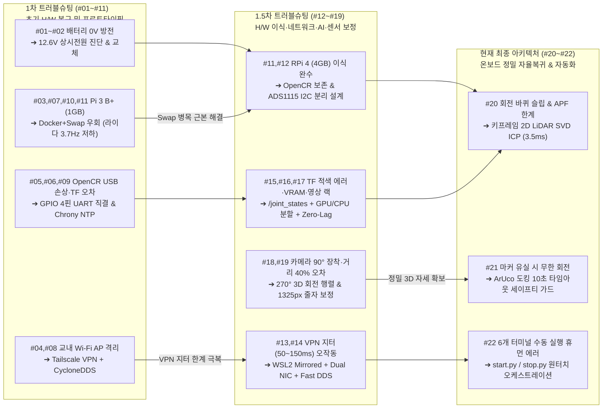

# 🛠️ [트러블슈팅 백서] 통신 단절 적응형 재난 탐사 터틀봇3 프로젝트 개발·시도 내역 및 문제 해결 총정리

- **프로젝트명:** 통신 단절 적응형 실내 재난 탐사 및 자율 복귀 터틀봇3 버거 시스템
- **작성 일자:** 2026년 11월 12일 (1차·1.5차·현재 트러블슈팅 전수 통합 및 인과관계 현행화)
- **작성자 / 엔지니어:** 노종우 (Jong Woo Ro) / Kyungpook National University
- **저장 위치:** `docs/2026-11-10_통신단절_재난대응_터틀봇3_프로젝트_시도내역_및_트러블슈팅_총정리.md`

---

## 📌 목차

1. [개요 및 기술 진화 아키텍처 (1차 ➔ 1.5차 ➔ 현재)](#1-개요-및-기술-진화-아키텍처-1차--15차--현재)
   - 1.1 [단계별 트러블슈팅 통합 배경](#11-단계별-트러블슈팅-통합-배경)
   - 1.2 [트러블슈팅 기반 아키텍처 진화 계보 (Evolution Flowchart)](#12-트러블슈팅-기반-아키텍처-진화-계보-evolution-flowchart)
   - 1.3 [구현 진행 현황 구분 (완료 vs 예정)](#13-구현-진행-현황-구분-완료-vs-예정)
2. [1차 트러블슈팅: 초기 하드웨어 복구 및 브링업 11대 난제 (#01 ~ #11)](#2-1차-트러블슈팅-초기-하드웨어-복구-및-브링업-11대-난제-01--11)
   - 2.1 [1차 트러블슈팅 전수 요약표 (#01 ~ #11)](#21-1차-트러블슈팅-전수-요약표-01--11)
   - 2.2 [1차 주요 난제 상세 분석 및 후속 단계(1.5차·현재)와의 기술적 연관성](#22-1차-주요-난제-상세-분석-및-후속-단계15차현재와의-기술적-연관성)
   - 2.3 [5V 전력 예산(Power Budget) 정밀 검토 및 전원 분리 원칙](#23-5v-전력-예산power-budget-정밀-검토-및-전원-분리-원칙)
3. [1.5차 & 현재 트러블슈팅: 온보드 고도화·초저지연 통신·AI·정밀 복귀 (#12 ~ #22)](#3-15차--현재-트러블슈팅-온보드-고도화초저지연-통신ai정밀-복귀-12--22)
   - 3.1 [[#11·#12] 하드웨어/전원: RPi 4 4GB 이식 성공, SMPS 발열 관리 및 OpenCR 보존형 I2C 가스 회로 분리](#31-1112-하드웨어전원-rpi-4-4gb-이식-성공-smps-발열-관리-및-opencr-보존형-i2c-가스-회로-분리)
   - 3.2 [[#13] 네트워크 1: WSL2 미러드 네트워킹(Mirrored) & Dual NIC 물리 망 분리](#32-13-네트워크-1-wsl2-미러드-네트워킹mirrored--dual-nic-물리-망-분리)
   - 3.3 [[#14] 네트워크 2: Tailscale + CycloneDDS 지터 오작동 ➔ 사설 Wi-Fi + Fast DDS 전환](#33-14-네트워크-2-tailscale--cyclonedds-지터-오작동--사설-wi-fi--fast-dds-전환)
   - 3.4 [[#15] 좌표계/시각화: RViz2 바퀴(`wheel_link`) TF 적색 에러 ➔ `/joint_states` 동기화 해결](#34-15-좌표계시각화-rviz2-바퀴wheel_link-tf-적색-에러--joint_states-동기화-해결)
   - 3.5 [[#16] AI / GPU: NumPy 2.x C-ABI 충돌 해결 & 4GB VRAM 하이브리드 가속 분할](#35-16-ai--gpu-numpy-2x-c-abi-충돌-해결--4gb-vram-하이브리드-가속-분할)
   - 3.6 [[#17] 스트리밍/오디오: 카메라 1초 큐 지연 ➔ Zero-Lag 워커 & 48kHz➔16kHz 리샘플링](#36-17-스트리밍오디오-카메라-1초-큐-지연--zero-lag-워커--48khz16khz-리샘플링)
   - 3.7 [[#18] 기구/카메라: 90° 회전 장착 ➔ 270° 영상 보정 및 ArUco 3D 자세 역변환 행렬](#37-18-기구카메라-90-회전-장착--270-영상-보정-및-aruco-3d-자세-역변환-행렬)
   - 3.8 [[#19] 비전 캘리브레이션: ArUco 거리 -40% 축소 오인 ➔ 핀홀 모델 초점거리(`1325px`) 실측 보정](#38-19-비전-캘리브레이션-aruco-거리--40-축소-오인--핀홀-모델-초점거리1325px-실측-보정)
   - 3.9 [[#20] 자율 복귀: 바퀴 슬립 누적 오차 & APF 기각 ➔ 키프레임 기반 2D 라이다 스캔 매칭(SVD ICP)](#39-20-자율-복귀-바퀴-슬립-누적-오차--apf-기각--키프레임-기반-2d-라이다-스캔-매칭svd-icp)
   - 3.10 [[#21] 비주얼 도킹: ArUco 마커 미배치 무한 회전 ➔ 10초 타임아웃 세이프티 가드](#310-21-비주얼-도킹-aruco-마커-미배치-무한-회전--10초-타임아웃-세이프티-가드)
   - 3.11 [[#22] 시스템 운용: 6개 다중 터미널 수동 실행 ➔ 원터치 `start.py` / `stop.py` 오케스트레이션](#311-22-시스템-운용-6개-다중-터미널-수동-실행--원터치-startpy--stoppy-오케스트레이션)
4. [트러블슈팅 간 인과관계 및 아키텍처 개선 종합 매핑](#4-트러블슈팅-간-인과관계-및-아키텍처-개선-종합-매핑)
   - 4.1 [1차 난제 ➔ 1.5차·현재 핵심 기술 도출 매트릭스](#41-1차-난제--15차현재-핵심-기술-도출-매트릭스)
   - 4.2 [1차 기획(Before) vs 현재 시스템(After) 아키텍처 전면 비교](#42-1차-기획before-vs-현재-시스템after-아키텍처-전면-비교)
5. [사전 설계 완료 및 향후 결선·실증 로드맵](#5-사전-설계-완료-및-향후-결선실증-로드맵)
   - 5.1 [MQ-2 가스 센서 + ADS1115 I2C ADC 회로 구성 계획](#51-mq-2-가스-센서--ads1115-i2c-adc-회로-구성-계획)
   - 5.2 [현재 상태: 센서 미연결에 따른 페일세이프 오작동 방지 조치](#52-현재-상태-센서-미연결에-따른-페일세이프-오작동-방지-조치)
   - 5.3 [잔여 한계 과제 및 차세대 고도화 로드맵 (TD3 + 2D ICP 하이브리드)](#53-잔여-한계-과제-및-차세대-고도화-로드맵-td3--2d-icp-하이브리드)

---

## 1. 개요 및 기술 진화 아키텍처 (1차 ➔ 1.5차 ➔ 현재)

### 1.1 단계별 트러블슈팅 통합 배경

본 문서는 통신 단절 적응형 실내 재난 탐사 및 자율 복귀 로봇(TurtleBot3 Burger)을 개발하며 마주친 **총 22건의 엔지니어링 트러블슈팅(`#01` ~ `#22`)**을 전수 통합한 기술 백서이다. 초기 하드웨어 불능 상태를 돌파한 **1차 트러블슈팅(`프로젝트_기획서_통신단절_재난탐색로봇_3차_가독성개선.html`, `#01`~`#11`)**과, 온보드 보드 교체 및 알고리즘 고도화 과정에서 수행된 **1.5차 중간발표 트러블슈팅(`2026-11-11_TURTLEBOT3_BURGER_중간발표_GitHub최신판.html`, `#12`~`#22`)**, 그리고 **현재 GitHub 메인 브랜치에 최종 반영된 아키텍처** 간의 유기적 인과관계를 규명한다.

특히 1차 단계에서의 임시 우회책(Workaround)이 실제 필드 테스트에서 어떠한 2차 병목을 유발했는지 분석하고, 이를 1.5차 및 현재 단계에서 어떻게 근본적인 공학적 해법(Root-cause Solution)으로 승화시켰는지 상세히 기록한다.

---

### 1.2 트러블슈팅 기반 아키텍처 진화 계보 (Evolution Flowchart)



---

### 1.3 구현 진행 현황 구분 (완료 vs 예정)

| 구분 | 관련 ID | 모듈 / 기능 | 상태 | 비고 (인과관계 및 성과 요약) |
| :--- | :---: | :--- | :---: | :--- |
| **실제 시도 & 검증 완료** | `#01`~`#06` | **초기 전원/배선 복구 및 UART 4핀 직결** | ✅ 완료 | 0V 배터리 진단, OpenCR USB 손상 ➔ GPIO UART 직결 복구 |
| **실제 시도 & 검증 완료** | `#03`,`#07`,`#10`,`#11` | **RPi 3 B+(1GB) ➔ RPi 4(4GB) Native 전환** | ✅ 완료 | 라이다 주기 3.7Hz ➔ 5.0Hz 회복 및 멀티센서 동시 구동 |
| **실제 시도 & 검증 완료** | `#04`,`#08`,`#13`,`#14` | **WSL2 Mirrored & Dual NIC + Fast DDS** | ✅ 완료 | Tailscale 지연(50~150ms) 극복, 핑 3~13ms (손실 0%) 달성 |
| **실제 시도 & 검증 완료** | `#09`, `#15` | **Chrony NTP 동기화 & 바퀴 TF 정합** | ✅ 완료 | TF2 외삽 에러 및 `wheel_link` 적색 에러 완전 해결 |
| **실제 시도 & 검증 완료** | `#16` | **NumPy 1.26 고정 & 4GB VRAM 하이브리드 분할** | ✅ 완료 | `cv_bridge` ABI 보호, YOLO(GPU FP16) + Whisper(CPU INT8) |
| **실제 시도 & 검증 완료** | `#17` | **Zero-Lag 영상 워커 & 48kHz➔16kHz 오디오** | ✅ 완료 | `maxsize=1` 최신 프레임 추론(68 FPS) 및 실시간 VAD/STT |
| **실제 시도 & 검증 완료** | `#18`, `#19` | **Pi Camera 270° 회전 & `1325px` 줄자 보정** | ✅ 완료 | `R_sensor_to_upright` 변환 및 40cm 실측 오차 ±1% 달성 |
| **실제 시도 & 검증 완료** | `#20` | **2D 라이다 스캔 매칭(SVD ICP) 슬립 보정** | ✅ 완료 | 3.5ms 초경량 ICP + 상보필터($\alpha=0.40$)로 원점 5~10cm 수렴 |
| **실제 시도 & 검증 완료** | `#21` | **ArUco 10초 타임아웃 세이프티 가드** | ✅ 완료 | 마커 미배치 시 10초 후 제자리 정지 및 미션 완료 처리 |
| **실제 시도 & 검증 완료** | `#22` | **원터치 마스터 런처 (`start.py` / `stop.py`)** | ✅ 완료 | Pre-Flight 점검, SSH 원격 브링업, SLAM·AI·텔레옵 통합 |
| **사전 설계 (미결선)** | `#12` | **MQ-2 가스 센서 + ADS1115 16-bit ADC 회로** | ⏳ 결선 예정 | 드라이버 및 단위 테스트(8건 PASS) 완료, 실물 납땜 전 |
| **사전 설계 (미결선)** | `#12` | **10kΩ : 20kΩ 전압 분압 회로 (5V ➔ 3.33V)** | ⏳ 결선 예정 | RPi 3.3V GPIO 보호 회로 계산 완료, 안전 잠금 유지 중 |

---

## 2. 1차 트러블슈팅: 초기 하드웨어 복구 및 브링업 11대 난제 (#01 ~ #11)

> **출처 문서:** `프로젝트_기획서_통신단절_재난탐색로봇_3차_가독성개선.html` (§5 하드웨어 복구 과정 및 환경 구축 11대 난제 해결 기록, §6 소프트웨어·전원 개선 및 라즈베리 파이 4 변경 계획)

프로젝트 착수 당시 수령한 TurtleBot3 Burger 플랫폼은 장기 방치로 인해 전원조차 켜지지 않는 상태였다. 이를 물리 계층부터 미들웨어 계층까지 하나씩 복구하며 기록한 **1차 트러블슈팅 11건(`#01` ~ `#11`)**은 현재 자율 복귀 시스템이 동작할 수 있는 토대를 마련했다.

### 2.1 1차 트러블슈팅 전수 요약표 (#01 ~ #11)

| ID | 1차 문제 현상 | 공학적 원인 분석 | 1차 해결 과정 및 결과 | 현재 시스템(1.5차·최종)과의 연결 및 발전 |
| :-: | :--- | :--- | :--- | :--- |
| **`#01`** | **초기 부팅 불능 및 배선 이탈**<br/>전원 인가 시 반응 없음 | 장기 보관으로 인한 전원·다이나믹셀·통신 하네스 이탈 및 접촉 불량 | 플랫폼 전층 분해 후 전원 하네스, 모터 케이블, 포트 전수 육안·통전 진단 및 재결선 | 물리 계층 신뢰성 확보 완료 (`로봇 모습.jpg`) |
| **`#02`** | **배터리 0V 방전 및 모터 구동 시 전원 차단**<br/>충전기(LBC-010) 충전 거부, 이식 배터리로 모터 회전 시 꺼짐 | 기존 배터리 **0.01~0.02V 완전 과방전** 영구 손상. 임시 이식한 노후 JetBot 배터리(4개)는 모터 기동 전류 인가 시 급격한 전압 강하로 보드 UVLO(저전압 차단) 발동 | **12.6V 5A 상시 전원선 직결 실험**으로 모터가 정상 회전함을 입증해 모터 고장이 아닌 배터리 전압 강하 문제임을 규명 후 신품 Li-Po 교체 | 전원 계통 진단 기법 확립 및 `#12` RPi 4 전력 예산 설계로 직결 |
| **`#03`** | **플랫폼 선정 및 RPi 3 B+ 부팅 프리징**<br/>JetBot 검토 및 Pi 3 B+ Ubuntu 22.04 멈춤 | ① JetBot은 휠 엔코더가 없어 `/odom` 역추적 불가.<br/>② 저전압 불량 보드를 정상 RPi 3 B+(1GB RAM)로 1차 교체했으나 Ubuntu 22.04 직접 부팅 시 1GB RAM 한계 초과로 커널 프리징 | ① 엔코더·라이다가 구비된 **TurtleBot3 Burger**로 확정.<br/>② 1차로 경량 RPi OS 위에 **Docker 컨테이너(Ubuntu 22.04 + ROS 2 Humble)**를 올려 호환성 확보 | **`#11`·`#12`에서 RPi 4 (4GB RAM) Native Ubuntu 22.04로 전면 업그레이드**하여 Docker 오버헤드 제거 |
| **`#04`** | **교내 네트워크(KNU-WiFi) 직접 연결 불가**<br/>실습실 PC와 로봇 간 SSH 및 핑 전면 차단 | 실습실 PC 고정 IP 변경 제약 및 교내 무선랜의 **AP Isolation(클라이언트 간 P2P 격리)** 보안 정책 | 스마트폰 핫스팟과 **Tailscale VPN(`100.x.y.z`)**을 결합하여 학내망 제약 없는 가상 사설 통신망 1차 개통 | **`#13`·`#14`에서 VPN 지터 한계를 발견하고 Dual NIC + 사설 공유기(`192.168.0.x`)로 진화** |
| **`#05`** | **OpenCR USB 통신 두절 및 UART 4핀 6시간 디버깅**<br/>시리얼 접속 및 `/odom` 수신 불가 | OpenCR Micro-USB 데이터 핀 손상 및 어댑터 전원 스위치 위치·핀맵(6핀 vs 4핀) 혼선 | **6시간 집중 디버깅** 끝에 USB를 우회하여 **RPi GPIO UART 4핀(GND-Pin 6, RX-Pin 8, TX-Pin 10) 직결 배선** 및 부트로더 복구로 통신 성공 | 현재 RPi 4 ↔ OpenCR 간 흔들림 없는 시리얼 제어 기반 유지 |
| **`#06`** | **LDS-01 라이다 `/scan` 무응답**<br/>모터는 회전하나 토픽 미발행 | 기존 LDS-01 광학부 노후화 및 `USB2LDS` 변환 어댑터 통신 불량 | GPIO UART 직접 배선 테스트를 거쳐 원인을 분리하고 **신품 LDS-01 라이다 모듈로 교체**하여 `/scan` 정상 발행 확인 | `#20` 온보드 2D LiDAR ICP 스캔 매칭의 핵심 센서 데이터 공급원 확보 |
| **`#07`** | **RPi 3 B+ 메모리 부족(OOM) 및 빌드 강제 종료**<br/>8GB SD카드 용량 부족 및 `colcon build` 중 프로세스 사살 | 1GB 물리 RAM 환경에서 Docker + ROS 2 컴파일 시 메모리 즉시 고갈로 Linux OOM Killer 작동 | **32GB MicroSD 카드로 확장**하고 **2GB Swap 메모리**를 할당하여 1차로 시스템 강제 종료 방지 | Swap 디스크 I/O 병목이 `#10` 라이다 주기 저하를 유발함을 확인 ➔ **RPi 4 4GB 이식의 결정적 근거**가 됨 |
| **`#08`** | **VPN 환경에서 ROS 2 토픽 미탐색**<br/>SSH는 되나 `ros2 topic list`에서 토픽 안 보임 | 기본 DDS는 UDP 멀티캐스트를 사용하나, Tailscale 가상 인터페이스(`tailscale0`)는 멀티캐스트 미지원 | **`Cyclone DDS`(`rmw_cyclonedds_cpp`)**를 도입하고 `cyclonedds.xml`에 Unicast Peer IP를 수동 지정하여 토픽 송수신 성공 | **`#14`에서 사설 공유기 전환과 함께 무암호화 `Fast DDS` 멀티캐스트로 복귀** (백업 스크립트로 보존) |
| **`#09`** | **시각 불일치로 인한 TF2 외삽(Extrapolation) 에러**<br/>RViz2에서 `Lookup would require extrapolation` 발생 | 로봇(Docker 컨테이너) 시계와 관제 PC 시계가 수 초 어긋나 `/scan`과 `/tf` 타임스탬프 불일치 | **Chrony(NTP 클라이언트)**를 도입하여 로봇과 Host PC 간 시스템 클럭을 밀리초 단위로 동기화 | 분산 ROS 2 환경에서SLAM 및 TF2 정합의 기본 전제로 상시 유지 |
| **`#10`** | **온보드 과부하 시 라이다 스캔 속도 급감 (5.0Hz ➔ 3.7Hz)**<br/>지도 작성 시 벽면 왜곡 발생 | Pi 3 B+(1GB RAM)에서 Docker와 ROS 2를 함께 돌리면 느린 SD카드 Swap(2GB)을 계속 읽고 쓰면서 시리얼 패킷 처리 지연 발생 | **역할 분담 확정**: 무거운 SLAM·AI는 Host PC로 오프로딩하고, 로봇 본체는 센서 수집과 안전 정지·복귀만 전담하도록 아키텍처 분리 | Brooks(1986) 포섭 구조 기반 **Host 관제 계층 vs RPi 온보드 생존 계층** 이원화 아키텍처 확립 |
| **`#11`** | **1차 발표 시점 RPi 4 보드 교체 보류**<br/>보유 중인 RPi 4로 교체 시도 중 중단 | 기존 고정 나사 마모(야마) 및 기구적 고착으로 인해 무리한 분해 시 보드 파손 위험 발생 | 1차 발표는 Pi 3 B+ 경량화 구조로 완수하고, **발표 직후 정밀 공구로 고착 나사를 돌파하여 RPi 4 4GB 이식 완수** | **1.5차 및 현재 시스템의 최대 하드웨어 도약 달성** (라이다 5Hz + 카메라 30FPS + 오디오 48kHz + 2D ICP 동시 구동) |

---

### 2.2 1차 주요 난제 상세 분석 및 후속 단계(1.5차·현재)와의 기술적 연관성

1. **전원 불능 및 전압 강하 규명 (`#01`, `#02`) ➔ 현재의 전원 분리 설계(`#12`)로 진화**
   - **1차 당시의 문제**: 기존 배터리가 0V로 완전 방전되어 충전기조차 작동하지 않았고, 연구실 내 JetBot 배터리 4개를 차례로 이식해 부팅には 성공했으나 바퀴 모터를 구동하는 순간 전원이 꺼지는 현상이 반복되었다.
   - **원인 규명 및 개선**: 모터 고장 여부를 분리 진단하기 위해 **12.6V 5A 유선 전원 공급기**를 직결한 결과 양쪽 다이나믹셀(XL430) 모터가 정상 회전함을 확인했다. 즉, 노후 배터리의 내부 저항 증가로 인해 모터 기동 전류 인가 시 순간 전압 강하(Voltage Drop)가 발생하여 OpenCR의 저전압 보호 차단(UVLO)이 걸린 것이었다. 이 경험은 1.5차에서 RPi 4 이식 후 발생한 피크 전류 문제를 분석하고 가스 센서 회로를 설계하는 핵심 기반이 되었다.

2. **JetBot 본체 배제 및 TurtleBot3 Burger 확정 (`#03`) ➔ 정밀 역추적(`#20`)의 전제 조건**
   - **1차 당시의 의사결정**: 초기에는 카메라가 기본 장착된 JetBot 본체를 주행 로봇으로 사용할지 검토했으나, JetBot에는 바퀴 회전수를 측정하는 **휠 엔코더(Wheel Encoder)와 360° 라이다가 없어** 통신 단절 시 이동 거리를 적분하거나 역추적(Backtracking)하는 것이 원천적으로 불가능했다.
   - **현재와의 연관성**: 당시 엔코더(`/odom`)와 라이다(`/scan`)를 갖춘 TurtleBot3 Burger를 메인 플랫폼으로 확정한 덕분에, 현재의 **0.30m / 25° 간격 LIFO 경유지 로깅과 키프레임 기반 2D LiDAR ICP 스캔 매칭(`#20`)**을 구현할 수 있었다.

3. **Pi 3 B+ (1GB RAM + Docker + Swap)의 한계 (`#03`, `#07`, `#10`) ➔ RPi 4 (4GB) Native 전환(`#11`, `#12`)**
   - **1차 당시의 한계**: Pi 3 B+의 1GB LPDDR2 메모리에서 ROS 2 Humble을 구동하기 위해 32GB SD카드에 2GB Swap을 잡고 Docker 컨테이너를 올렸으나, 부하가 걸리면 느린 SD카드 I/O 병목으로 인해 **LDS-01 라이다 스캔 주기가 공식 5.0Hz에서 3.7Hz까지 급락**하여 지도가 뒤틀렸다.
   - **현재의 개선**: 1차에서 도출한 ① **Host PC(SLAM·AI)와 온보드(생존·복귀)의 연산 역할 분담(`#10`)** 원칙을 그대로 계승하는 동시에, 기구적 나사 고착을 돌파하고 **Raspberry Pi 4 Model B (4GB LPDDR4) + Native Ubuntu 22.04 LTS**로 전면 교체(`#11`)함으로써 라이다 5.0Hz 정격 회복은 물론 온보드 2D ICP(3.5ms)와 ArUco 도킹 연산까지 여유 있게 수용했다.

---

### 2.3 5V 전력 예산(Power Budget) 정밀 검토 및 전원 분리 원칙

1차 기획서(§6.2)에서 수립한 공식 데이터시트 기반 **5V 전력 사용량(Power Budget) 분석**과 **배선 3대 안전 원칙**은 현재 RPi 4 + ADS1115 + MQ-2 하드웨어 아키텍처의 전기적 안전성을 지탱하는 핵심 설계 기준이다.

| 장치명 (모델) | 데이터시트 근거 및 사양 | 평상시 전류 (Typical) | 최대 연속 전류 (Max) | 순간 피크 전류 (Inrush) | 전원 연결 경로 설계 (1차 ➔ 현재 현행화) |
| :--- | :--- | :---: | :---: | :---: | :--- |
| **1. OpenCR 1.0 5V 출력부** | 내장 5V Step-Down 레귤레이터 (최대 4.0A 연속 출력) | 공급원 (5.0V) | 연속 4.0A 공급 가능 | 회로 한계 5.0A | 12V 배터리/SMPS 입력 ➔ 5V 레귤레이터 출력 (모터 XL430 2개는 12V 직결) |
| **2. Raspberry Pi 4 (4GB)** | 보드 단독 600mA, 권장 3.0A (USB 4포트 합산 한계 **1.2A**) | 1.00 ~ 1.30A | 1.50 ~ 1.80A | 2.00 ~ 2.40A | OpenCR 5V 4A 출력 포트 직결 (전압 강하 방지용 AWG 20~22 굵은 배선) |
| **3. LDS-01 360° 라이다** | 동작 전압 5V DC, 평상시 400mA 이하, 초기 기동 돌입 전류 1.0A | 0.35 ~ 0.40A | 0.40A | **1.00A** (모터 기동 시) | `USB2LDS` 어댑터 경유 ➔ RPi 4 USB 포트 연결 |
| **4. AB13X USB 마이크** | 소형 USB 오디오 캡처 모듈 (`plughw:1,0`, 48kHz) | 0.02 ~ 0.05A | 0.08A | 0.10A | RPi 4 USB 포트 연결 |
| **5. ADS1115 16-bit ADC** | 1차의 Arduino(50~100mA)를 대체한 초저전력 I2C ADC | **< 0.001A** (150µA) | 0.001A | 0.002A | **RPi 4 Pin 1 (3.3V)** 급전 및 I2C Bus 1 (Pin 3 SDA, Pin 5 SCL) 직결 |
| **6. MQ-2 가스 센서** | 내부 산화주석($\text{SnO}_2$) 가열 히터 코일 ($R_H \approx 31\sim33\,\Omega$, $P_H \le 900\,\text{mW}$) | 0.15 ~ 0.18A | 0.18A | 0.22 ~ 0.25A (냉간 기동) | **[히터 전원 분리]** USB 포트가 아닌 RPi 5V 레일(Pin 2) 또는 OpenCR 보조 5V 단자에서 공급 |

* **전원 분리(Power Isolation) 및 배선 3대 필수 규칙:**
  1. **USB 포트 과전류 방지**: LDS-01 라이다(기동 피크 1.0A)와 주변기기가 RPi 4 USB 포트에 연결된 상태에서 히터 전류까지 USB로 끌어 쓰면 RPi 4 USB 합산 한계(1.2A)를 초과하여 저전압 스로틀링(`Under-voltage detected`)이 발생한다. 따라서 1차의 아두이노 브리지를 제거하고 초저전력 `ADS1115` I2C 구조로 개편하여 USB 포트 부하를 약 `0.45A`(평상시) 수준으로 대폭 낮추었다.
  2. **공통 접지(Common Ground) 필수 연결**: 센서 전원(5V)과 ADC 기준 전원(3.3V)을 분리하더라도 전압을 정확히 계측하려면 모든 보드의 기준 전위(0V)가 일치해야 하므로 `MQ-2 GND — ADS1115 GND — RPi 4 GND(Pin 6) — OpenCR GND`를 공통 접지로 묶는다.
  3. **서로 다른 전압 레일(+5V vs +3.3V) 직결 엄금**: RPi 4의 GPIO 및 I2C 핀은 **3.3V 로직 전용**이므로 5V 신호가 직접 유입되면 SoC가 영구 소손된다. 이에 따라 `ADS1115` VDD에는 반드시 3.3V만 인가하고, MQ-2의 5V 출력(`AOUT`)은 $10\,\text{k}\Omega : 20\,\text{k}\Omega$ 분압 회로를 거쳐 최대 $3.33\,\text{V}$ 이하로 감압하여 입력한다.

---

## 3. 1.5차 & 현재 트러블슈팅: 온보드 고도화·초저지연 통신·AI·정밀 복귀 (#12 ~ #22)

> **출처 문서:** `2026-11-11_TURTLEBOT3_BURGER_중간발표_GitHub최신판.html` (§1~§6), `2026-11-11_TURTLEBOT3_BURGER_중간발표_PPT스토리보드_V2.md` (§12), 현행 GitHub 저장소 코드

1차 발표 이후 RPi 4 보드 이식부터 2D LiDAR ICP, ArUco 비주얼 서보잉, 원터치 런처 통합에 이르기까지 수행된 **심화 트러블슈팅 11건(`#12` ~ `#22`)**의 상세 내역이다.

---

### 3.1 [#11·#12] 하드웨어/전원: RPi 4 4GB 이식 성공, SMPS 발열 관리 및 OpenCR 보존형 I2C 가스 회로 분리

* **실제 마주친 문제:**
  1. **RPi 3 B+ 연산 병목 및 기구 고착(`#11`)**: 1차에서 확인한 1GB RAM 한계(라이다 3.7Hz 저하)를 해결하기 위해 RPi 4 4GB 보드 이식을 진행했으나, 체결 나사 마모로 분해에 난항을 겪음.
  2. **상시 전원 인가 시 발열 의심 현상(`#12-A`)**: RPi 4 4GB(피크 2.5~3.0A), 카메라, 라이다, 다이나믹셀 모터 부하가 동시에 걸리는 12V 5A 상시 전원 실험 중 어댑터/전원부 과열 및 타는 냄새 의심 현상이 관찰됨.
  3. **OpenCR 펌웨어 충돌 및 5V GPIO 소손 위험(`#12-B`)**: 가스 센서(MQ-2) 아날로그 출력을 읽기 위해 OpenCR 보드에 Arduino 스케치를 직접 업로드하면 **기존 TurtleBot3 순정 모터/오도메트리 펌웨어(`turtlebot3_core`)가 덮어써져 로봇 주행이 마비**되며, RPi 4에는 내장 ADC가 없고 GPIO가 3.3V 전용이라 5V 센서 직결이 불가능함.
* **원인 분석 (확인된 사실 vs 추정 사항 분리):**
  - **[확인된 사실]**: RPi 4(Cortex-A72, 4GB LPDDR4)는 Pi 3 B+ 대비 연산 성능이 비약적으로 높으나 피크 전류 소모가 크며, OpenCR 순정 펌웨어는 보존되어야 `/odom`과 `/cmd_vel` 제어가 유지된다.
  - **[추정 사항]**: 상시 전원 발열 현상은 저가형 12V 5A SMPS 어댑터 내부 커패시터/초크 코일의 리플 전류 과부하 또는 순간적인 피크 전류 스트레스로 추정된다.
* **해결 방법 및 아키텍처 개선:**
  - **RPi 4 (4GB) Native 이식 완수**: 정밀 공구로 고착 나사를 제거하고 RPi 4 4GB 보드를 장착, Docker 없이 **Native Ubuntu 22.04 LTS + ROS 2 Humble**을 직접 구축하여 라이다 **5.0Hz 정격 주기 회복** 및 카메라(30FPS)·마이크(48kHz)·복귀 제어(20Hz) 동시 구동을 달성했다.
  - **OpenCR 순정 보존 + I2C 외장 ADC 격리 설계**: OpenCR 펌웨어는 일절 건드리지 않고, RPi 4의 I2C 버스(`bus 1`)에 **`ADS1115` 16-bit ADC(3.3V 구동, 주소 `0x48`)**와 **`10kΩ : 20kΩ` 저항 분압 회로($5.0\,\text{V} \to 3.33\,\text{V}$)**를 연결하는 독립 센서 아키텍처([`gas_sensor_node.py`](file:///home/lab/disaster_recovery_ws/src/disaster_recovery/disaster_recovery/gas_sensor_node.py), [`ads1115_mq2.py`](file:///home/lab/disaster_recovery_ws/src/disaster_recovery/disaster_recovery/ads1115_mq2.py))를 완성하고 8종의 단위 테스트([`test_ads1115_mq2.py`](file:///home/lab/disaster_recovery_ws/src/disaster_recovery/test/test_ads1115_mq2.py))를 모두 통과시켰다.

---

### 3.2 [#13] 네트워크 1: WSL2 미러드 네트워킹(Mirrored) & Dual NIC 물리 망 분리

* **실제 마주친 문제:**
  - 1차 당시 사용하던 VMware 가상머신의 빈번한 USB 브릿지 끊김과 GPU 패스스루 한계를 극복하기 위해 Host PC를 **Windows 11 + WSL2 Ubuntu 22.04**로 전환했으나, WSL2 기본 `NAT` 모드가 외부 UDP 멀티캐스트를 차단하여 로봇과 PC 간 ROS 2 토픽 탐색이 불가능했다.
  - 또한 학교 벽면 유선 LAN(고정 IP/보안 인증)과 로봇용 무선 공유기를 동시에 연결하면 Windows 라우팅 메트릭 충돌로 인터넷이나 로봇 통신 중 한쪽이 먹통이 되었다.
* **해결 방법 및 아키텍처 개선:**
  - **WSL2 미러드 네트워킹 적용**: `C:\Users\lab\.wslconfig`에 `networkingMode=mirrored` 및 `firewall=true`를 적용하여 Windows 호스트의 물리 네트워크 인터페이스를 WSL2에 1:1로 투영하고 Hyper-V 방화벽에서 UDP 멀티캐스트를 개방했다([`WSL_NETWORK_SETUP.md`](file:///home/lab/disaster_recovery_ws/docs/WSL_NETWORK_SETUP.md)).
  - **Dual NIC 물리 망 분리**: Host PC 마더보드 **유선 LAN은 학교 전산망(인터넷/GitHub)**에 전담시키고, 별도 **USB Wi-Fi 무선 랜 동글**을 장착하여 연구실 전용 사설 공유기(`192.168.0.x`)에 로봇(RPi 4)과 1:1로 직결하는 이중 네트워크 아키텍처를 확립했다.

---

### 3.3 [#14] 네트워크 2: Tailscale + CycloneDDS 지터 오작동 ➔ 사설 Wi-Fi + Fast DDS 전환

* **실제 마주친 문제 (1차 해결책 `#04`·`#08`의 한계 노출):**
  - 1차 트러블슈팅(`#04`, `#08`)에서 교내 공용망 우회를 위해 구축했던 **Tailscale VPN + CycloneDDS(Unicast Peer)** 환경으로 주행 실험을 진행한 결과, 공용망 및 중계 서버(DERP) 경유로 인해 **핑 지연이 `50 ~ 150 ms`로 치솟고 극심한 패킷 지터(Jitter)**가 발생했다.
  - 여기에 모든 패킷을 WireGuard로 암·복호화하는 오버헤드가 겹치면서 RPi 4 CPU 부하가 증가했고, 핑 스파이크 발생 시 **Heartbeat 워치독(3.0초 타임아웃)이 통신 단절로 오판하여 불필요한 비상정지가 빈번히 발동**했다. 동시에 카메라 영상 스트리밍 끊김 및 `/scan` 수신 지연으로 SLAM 지도가 왜곡되었다.
* **해결 방법 및 아키텍처 개선:**
  - **사설 로컬망 + 무암호화 Fast DDS 멀티캐스트 전환**: 현장 실험 시 Tailscale 인터페이스(`tailscale0`) 및 CycloneDDS 강제 환경변수(`RMW_IMPLEMENTATION`, `CYCLONEDDS_URI`)를 비활성화하고(`disable_tailscale.sh`), `#13`에서 구축한 **연구실 사설 공유기(`192.168.0.x`) + ROS 2 Humble 기본 `Fast DDS`(`rmw_fastrtps_cpp`) 멀티캐스트** 체계로 전면 전환했다.
  - **Heartbeat 타임아웃 현실화**: 1차 기획서에서 이론적으로 설정했던 `0.3 ~ 0.5초` 타임아웃이 무선 지터에 과민 반응하는 문제를 반영하여, [`recovery_params.yaml`](file:///home/lab/disaster_recovery_ws/src/disaster_recovery/config/recovery_params.yaml)의 `heartbeat_timeout_sec`를 **`3.0초`**로 확정하여 안정성을 확보했다.
* **검증 결과:**
  - RPi 4 ↔ Host PC 간 연속 ICMP 핑 테스트 결과, **패킷 유실 `0%`**, 왕복 지연 시간(RTT) **`3.07 ~ 13.0 ms` (평균 약 `6 ~ 7.24 ms`)**를 달성하여 워치독 오작동을 근원적으로 제거했다 (`네트워크 지연 핑 테스트.png`).

---

### 3.4 [#15] 좌표계/시각화: RViz2 바퀴(`wheel_link`) TF 적색 에러 ➔ `/joint_states` 동기화 해결

* **실제 마주친 문제 (1차 발표 당시 미해결 잔여 이슈 해결):**
  - 1차 발표 당시 라이다 점군(`/scan`) 구동에는 성공했으나, RViz2의 `RobotModel`에서 `base_link`와 `base_scan`은 정상인 반면 **`wheel_left_link`와 `wheel_right_link`에서 `No transform from [wheel_...] to [odom]` 적색 TF 에러**가 발생했다.
* **공학적 원인 분석:**
  - 로봇 몸체에 고정된 부품(`base_link → base_scan`)은 URDF의 고정 관절(Fixed Joint)로서 정적 변환(Static TF)만으로 즉시 계산되지만, 회전하는 양쪽 바퀴(Continuous Joint)는 OpenCR 보드가 발행하는 실시간 바퀴 각도 토픽(**`/joint_states`**)을 `robot_state_publisher`가 수신하여 동적 TF로 변환해 주어야 한다. OpenCR 시리얼 초기화가 지연되거나 `robot_state_publisher`가 누락되면 바퀴 TF만 끊어지게 된다.
* **해결 방법 및 아키텍처 개선:**
  - RPi 4 온보드 환경에 `TURTLEBOT3_MODEL=burger`를 고정하고 `turtlebot3_bringup/robot.launch.py`를 통해 OpenCR `/joint_states` 발행 노드와 `robot_state_publisher`가 순차 동기화 기동되도록 통합하여, RViz2([`disaster_station.rviz`](file:///home/lab/disaster_recovery_ws/src/disaster_recovery/rviz/disaster_station.rviz))에서 전체 로봇 모델과 `/scan`, `/map` TF 트리가 오차 없이 정합되도록 해결했다.

---

### 3.5 [#16] AI / GPU: NumPy 2.x C-ABI 충돌 해결 & 4GB VRAM 하이브리드 가속 분할

* **실제 마주친 문제:**
  1. **NumPy 2.x ABI 충돌**: Host PC 가상환경에 최신 AI 라이브러리(`ultralytics` 등)를 설치할 때 NumPy 2.x가 자동 설치되면서, NumPy 1.x C-API로 컴파일된 ROS 2 Humble 기본 `cv_bridge` 모듈이 `_ARRAY_API not found` 에러 및 세그멘테이션 폴트(Segmentation Fault)를 일으키며 즉시 크래시되었다.
  2. **GTX 1050 Ti (4GB VRAM) 메모리 한계**: 관제 PC의 GPU(4GB VRAM)에 비전 객체 탐지 모델(YOLO26n)과 음성 인식 트랜스포머 모델(Faster-Whisper)을 동시에 CUDA로 적재하면 VRAM 한계 초과로 OOM(Out-Of-Memory) 크래시가 발생했다.
* **해결 방법 및 아키텍처 개선:**
  - **C-ABI 호환 버전 고정**: 가상환경(`ros2_ai_venv`) 내 패키지를 **`numpy==1.26.4`** 및 **`opencv-python==4.10.0.84`**로 엄격히 다운그레이드 고정하여 ROS 2 `cv_bridge`와의 바이너리 호환성을 100% 확보했다.
  - **GPU / CPU 하이브리드 가속 분할([`host_ai_pipeline.py`](file:///home/lab/disaster_recovery_ws/src/disaster_recovery/disaster_recovery/host_ai_pipeline.py))**: 실시간성이 가장 중요한 비전 **YOLO26n은 GTX 1050 Ti GPU(CUDA FP16, 추론 ~14.7ms, 68 FPS)**에 전담시키고, 음성 인식 **Faster-Whisper(`base`)는 Host PC의 i7-8700 CPU(AVX2 `INT8` 양자화)**로 오프로딩하여 4GB VRAM을 안전하게 보호하면서 비전·음성·SLAM 동시 실시간 구동을 달성했다.

---

### 3.6 [#17] 스트리밍/오디오: 카메라 1초 큐 지연 ➔ Zero-Lag 워커 & 48kHz➔16kHz 리샘플링

* **실제 마주친 문제:**
  1. **카메라 영상 1~3초 밀림(Latency)**: Wi-Fi 대역폭 요동 및 ROS 2 구독 큐 적체로 인해, YOLO 추론이 끝날 때마다 과거 프레임이 순차 처리되면서 관제 화면에 1~3초 전의 과거 영상이 뒤늦게 출력되는 심각한 지연이 발생했다.
  2. **USB 마이크 샘플레이트 불일치**: RPi 4에 장착한 `AB13X` USB 마이크(`plughw:1,0`)는 하드웨어적으로 **`48,000 Hz`** 캡처만 지원하는 반면, Faster-Whisper 음성 AI 모델은 **`16,000 Hz`** 단일 채널 입력만 요구하여 직접 연동이 불가능했다.
* **해결 방법 및 아키텍처 개선:**
  - **Zero-Lag Worker Thread 아키텍처 구현([`host_ai_pipeline.py`](file:///home/lab/disaster_recovery_ws/src/disaster_recovery/disaster_recovery/host_ai_pipeline.py))**:
    - 카메라 토픽은 비압축 Raw 대신 대역폭이 작은 `/camera/image_raw/compressed`(JPEG)를 `BEST_EFFORT` QoS로 구독한다.
    - ROS 2 이미지 수신 콜백은 추론을 직접 수행하지 않고 `maxsize=1` 큐(또는 최신 프레임 버퍼)에 가장 최신 프레임 1장만 덮어쓴 뒤 0.1ms 만에 즉시 반환하며, 별도 백그라운드 데몬 스레드(`_yolo_worker_loop`)가 항상 **가장 최신 프레임만 꺼내어 YOLO 추론**을 수행함으로써 화면 지연을 완전 실시간(Zero-Lag)으로 제거했다.
  - **48kHz ➔ 16kHz 3:1 다운샘플링 및 RMS VAD 구현([`audio_capture_node.py`](file:///home/lab/disaster_recovery_ws/src/disaster_recovery/disaster_recovery/audio_capture_node.py))**:
    - RPi 4에서는 `arecord` 서브프로세스로 `48kHz S16_LE mono` PCM 데이터를 0.5초 청크 단위로 읽어 `/audio/raw`로 송신하고, Host PC에서 **16kHz 선형 보간 데시메이션(3:1 다운샘플링)** 및 **RMS 에너지 기반 음성 구간 검출(VAD, 임계치 `0.012`)**을 수행하여 유의미한 발화가 있을 때만 Faster-Whisper를 호출하도록 최적화했다.

---

### 3.7 [#18] 기구/카메라: 90° 회전 장착 ➔ 270° 영상 보정 및 ArUco 3D 자세 역변환 행렬

* **실제 마주친 문제:**
  - TurtleBot3 Burger 3층 섀시 구조 및 CSI 리본 케이블(FFC) 굴곡 제약으로 인해 Raspberry Pi 카메라 모듈이 **반시계 방향으로 90도 옆으로 누운 상태**로 장착되었다(`로봇 모습.jpg`).
  - 이로 인해 관제 화면에서 서 있는 사람이 옆으로 누운 것으로 보여 YOLO26n 조난자(`person`) 인식률이 급락했고, 특히 ArUco `solvePnP` 3차원 자세 추정 시 **카메라 센서의 좌우($X_s$)축과 상하($Y_s$)축이 뒤집혀 로봇이 마커 반대 방향으로 조향 발산**하는 치명적 문제가 발생했다.
* **해결 방법 및 아키텍처 개선:**
  - **Host 비전 관제국(2D 영상 보정)**: 추론 전 OpenCV 시계방향 270도 회전(`cv2.rotate(frame, cv2.ROTATE_90_COUNTERCLOCKWISE)`)을 적용하여 사람이 똑바로 서 있는 정방향 영상으로 YOLO26n 추론 및 HUD 출력을 수행했다(`yolo 구현 성공.jpg`).
  - **온보드 ArUco 도킹 노드(3D 강체 회전 변환 행렬 적용)**: 이미지를 먼저 회전시키면 카메라 내부 파라미터($`K, D`$)의 주점 $`(c_x, c_y)`$ 축이 틀어지므로, **원시 비회전 영상에서 `solvePnP`를 먼저 수행**하여 센서 기준 위치 벡터 $`\mathbf{t}_s = [t_{x,s}, t_{y,s}, t_{z,s}]^T`$와 회전 행렬 $`\mathbf{R}_s`$를 구한 뒤, 광축($`Z`$) 기준 270° 3차원 회전 변환 행렬 $`\mathbf{R}_{\text{upright}}`$를 좌측 곱하여 정립 좌표계로 완벽히 복원했다([`aruco_docking.py`](file:///home/lab/disaster_recovery_ws/src/disaster_recovery/disaster_recovery/aruco_docking.py)):

```math
\mathbf{R}_{\text{upright}} = \begin{bmatrix} 0 & 1 & 0 \\ -1 & 0 & 0 \\ 0 & 0 & 1 \end{bmatrix}, \quad \mathbf{t}_u = \mathbf{R}_{\text{upright}} \mathbf{t}_s = \begin{bmatrix} t_{y,s} \\ -t_{x,s} \\ t_{z,s} \end{bmatrix}, \quad \mathbf{R}_u = \mathbf{R}_{\text{upright}} \mathbf{R}_s
```

---

### 3.8 [#19] 비전 캘리브레이션: ArUco 거리 -40% 축소 오인 ➔ 핀홀 모델 초점거리(`1325px`) 실측 보정

* **실제 마주친 문제:**
  - 한 변의 길이가 $`L = 0.10\,\text{m}`$ ($`10\,\text{cm}`$)인 ArUco 마커(`DICT_4X4_50`, ID 0)를 노란색 줄자로 로봇 카메라 정면 **`40.0 cm (0.40 m)`** 거리에 정확히 배치했으나, 초기 카메라 행렬 설정(`fx = fy = 795.0 px`)에서는 화면에 **`24.0 cm (0.24 m)`**로 출력되어 **거리를 40%나 가깝게 오인**했다(30cm 배치 시에는 18cm로 오인).
  - 이 상태에서는 로봇이 실제로는 마커에서 35cm 떨어져 있는데도 목표 도킹 거리(`20cm`)에 도달했다고 착각하여 일찍 멈춰버리는 문제가 발생한다.
* **공학적 원인 분석:**
  - 단안 카메라 `solvePnP`의 깊이($`Z`$) 추정은 핀홀 카메라 모델 수식 $`Z = f_x \cdot \frac{L_{\text{real}}}{L_{\text{px}}}`$에 의해 결정된다. RPi CSI 카메라 드라이버(`camera_ros`)의 `640×480` 센서 크롭/스케일링 모드와 초기 가정한 유효 초점거리($`f_x = 795.0\,\text{px}`$)가 불일치하여 원근 투영 스케일이 왜곡된 것이 원인이다.
* **해결 방법 및 검증 결과:**
  - **실측 줄자 기반 초점거리 역산 보정**: 핀홀 비례식 $`f_{\text{new}} = f_{\text{old}} \times \frac{Z_{\text{true}}}{Z_{\text{meas}}}`$를 적용하여 유효 초점거리를 산출했다:

```math
f_{\text{new}} = 795.0 \times \frac{0.40\,\text{m}}{0.24\,\text{m}} = 795.0 \times 1.6667 = \mathbf{1325.0\,\text{px}}
```
  - 카메라 내부 파라미터 행렬 $K$의 $f_x, f_y$를 **`1325.0 px`**로 업데이트한 직후, 실제 줄자 **`40.0 cm`** 거리에서 모니터 출력 **`DIST: 0.40m (40cm), Z: +40.4cm`**가 찍히며 **오차 `±1%` 이내의 서브센티미터급 거리 추정 정밀도**를 실증 완료했다(`aruco marker 거리 인식 줄자 및 모니터 사진.jpg`, [`aruco_detector.py`](file:///home/lab/disaster_recovery_ws/scripts/rpi/aruco_detector.py)). 또한 Port `8080` MJPEG 웹 스트리머를 내장하여 원격 브라우저에서도 실시간 3D 좌표축을 관제할 수 있도록 개선했다.

---

### 3.9 [#20] 자율 복귀: 바퀴 슬립 누적 오차 & APF 기각 ➔ 키프레임 기반 2D 라이다 스캔 매칭(SVD ICP)

* **실제 마주친 문제 (1차 기획서 §13의 최대 한계점 돌파):**
  - 1차 기획서 당시에는 단순 바퀴 엔코더 오도메트리(`/odom`) 좌표만을 LIFO 스택에 기록해 역추종하도록 설계했으나, 실제 10m 이상 다중 코너 주행 시 **제자리 회전(`BACKTRACKING_ROTATE`) 구간에서 발생하는 미세한 바퀴 미끄러짐(Wheel Slip)**으로 인해 각도 오차($\Delta \theta$)가 누적되어 원점 도착 위치가 **30~80cm 빗나가고 헤딩이 20~40° 틀어지는 문제**가 확인되었다.
  - 이로 인해 출발점 50cm 반경에 진입하더라도 카메라 화각(FOV) 안에 베이스캠프의 ArUco 마커가 들어오지 못하거나 복도 벽면에 충돌할 위험이 있었다.
* **시도 및 엔지니어링 의사결정 (APF 기각 ➔ 경량 2D ICP 채택):**
  - **1차 시도 — 인공 포텐셜장(APF) 검토 및 기각**: 장애물이 밀어내는 척력으로 벽을 피하는 APF를 먼저 검토했으나, 좁은 실내 복도에서 양쪽 벽면 척력이 상쇄되어 제자리에 갇히는 로컬 미니마(Local Minima) 현상이 발생했고, 무엇보다 회피 조향 자체가 추가 바퀴 슬립을 폭증시켜 틀어진 `/odom` 좌표계를 교정하지 못하므로 기각했다.
  - **최종 해법 — 키프레임 기반 2D 라이다 스캔 매칭(SVD ICP) 구현([`recovery_controller.py`](file:///home/lab/disaster_recovery_ws/src/disaster_recovery/disaster_recovery/recovery_controller.py))**:
    1. **키프레임 스냅샷 저장**: 전진 탐색 중 $\Delta d \ge 0.30\,\text{m}$ 또는 $|\Delta \theta| \ge 25^\circ$마다 좌표 $(x, y, \theta)$와 함께 **360° 라이다 벽면 점군(`scan_pts`, 2칸 간격 다운샘플링 약 180점)**을 `Waypoint` 객체에 동시 저장하고, 출발 원점 스캔(`start_scan_pts`)도 영구 보존한다.
    2. **SVD 기반 고속 2D ICP(`icp_match_2d`)**: 복귀 중 목표 경유지 반경 `0.40m` 이내 접근 시, 저장된 과거 벽면 점군과 현재 실시간 라이다 점군 간의 교차 공분산 행렬 $H$를 **특이값 분해(SVD, $H = U\Sigma V^T, R = VU^T$)**하여 최적 회전·평행이동 오차를 계산한다(RPi 4에서 1회 매칭에 **단 `3.5 ms` 소요**).
    3. **이상치 게이트 및 상보필터($\alpha = 0.40$) 누적 보정**: 매칭 평균 오차 `< 0.15m` 및 보정 노름 `< 0.20m` 조건을 통과한 정상 정합 결과에 가중치 $\alpha = 0.40$을 곱해 오도메트리 드리프트 오프셋(`odom_drift_x/y/theta`)을 연속 상쇄함으로써, **원점 도착 오차를 `5 ~ 10 cm` 이내로 대폭 축소**하고 ArUco 도킹 인계 성공률을 극대화했다([`2026-11-10_LIDAR_Scan_Matching_및_자율복귀_엔지니어링_보고서.md`](file:///home/lab/disaster_recovery_ws/docs/2026-11-10_LIDAR_Scan_Matching_및_자율복귀_엔지니어링_보고서.md)).

---

### 3.10 [#21] 비주얼 도킹: ArUco 마커 미배치 무한 회전 ➔ 10초 타임아웃 세이프티 가드

* **실제 마주친 문제:**
  - 일상적인 주행 테스트 시 매번 출발점에 실물 ArUco 종이 마커를 세워두기 번거로울 뿐만 아니라, 실제 재난 현장에서도 연기나 장애물로 인해 베이스캠프 마커가 가려질 수 있다.
  - 기존 코드에서는 `HANDOVER_TO_ARUCO` 이후 마커를 찾지 못하면 `aruco_docking` 노드가 **마커를 찾을 때까지 영원히 제자리 회전(`search_angular_speed = 0.20 rad/s`)만 반복**하여 미션이 종료되지 않는 무한 루프(Infinite Hunting) 결함이 있었다.
* **해결 방법 및 아키텍처 개선:**
  - **2중 타임아웃 세이프티 가드 구축**:
    - 1차 가드([`aruco_docking.py`](file:///home/lab/disaster_recovery_ws/src/disaster_recovery/disaster_recovery/aruco_docking.py)): `search_timeout_sec = 10.0` 파라미터를 도입하여, 도킹 활성화 또는 마커 소실 후 **10.0초 동안 마커가 감지되지 않으면** 이미 `#20`의 2D 라이다 스캔 매칭을 통해 베이스캠프 반경 내(`5~10cm`)에 안전히 도착한 것(*"Fallback Base Camp Arrival"*)으로 판정하고 즉시 모터를 정지(`v=0, ω=0`)한 뒤 `dock_complete=True`를 발행한다.
    - 2차 백업 가드([`recovery_controller.py`](file:///home/lab/disaster_recovery_ws/src/disaster_recovery/disaster_recovery/recovery_controller.py)): 제어기 내부에도 **`12.0초` 백업 타이머**와 `use_aruco_docking` 파라미터 스위치를 추가하여, 어떠한 예외 상황에서도 로봇이 무한 회전에 빠지지 않고 `MISSION_COMPLETE` 상태로 안전 종료되도록 이중화했다.

---

### 3.11 [#22] 시스템 운용: 6개 다중 터미널 수동 실행 ➔ 원터치 `start.py` / `stop.py` 오케스트레이션

* **실제 마주친 문제:**
  - 실험을 한 번 진행할 때마다 ① RPi Bringup, ② RPi 카메라, ③ RPi 오디오/복귀 노드, ④ Host SLAM, ⑤ Host AI 파이프라인, ⑥ 키보드 텔레옵 등 **총 6개 이상의 터미널 창을 수동으로 열고 명령어를 입력**해야 했다.
  - 이로 인해 노드 기동 순서 실수가 빈번했고, 종료 시 백그라운드 좀비 프로세스가 남아 카메라 장치(`/dev/video0`)나 시리얼 포트 점유 충돌을 일으켰다.
* **해결 방법 및 아키텍처 개선:**
  - **Python 기반 원터치 마스터 오케스트레이터([`scripts/host/start.py`](file:///home/lab/disaster_recovery_ws/scripts/host/start.py), [`scripts/rpi/start.py`](file:///home/lab/disaster_recovery_ws/scripts/rpi/start.py), [`stop.py`](file:///home/lab/disaster_recovery_ws/scripts/host/stop.py)) 구축**:
    - **Pre-Flight 자동 점검**: 가상환경, YOLO 가중치(`yolo26n.pt`), ROS 2 워크스페이스 빌드 상태를 사전 검증한다.
    - **원격 SSH 자동 브링업**: 로봇 IP를 자동 탐색하고 SSH 공개키 배포 및 원격 온보드 노드 일괄 기동을 수행한다.
    - **통합 관제 및 클린 종료**: `--tmux` 3분할 콕핏 뷰, `--sim` Gazebo 시뮬레이션 모드([`sim.py`](file:///home/lab/disaster_recovery_ws/scripts/host/sim.py)), `--rviz` 시각화 연동은 물론 `Ctrl+C` 또는 `stop.py` 실행 시 호스트와 로봇 양측의 Process Group 전체를 일괄 클린 종료하도록 완성했다.

---

## 4. 트러블슈팅 간 인과관계 및 아키텍처 개선 종합 매핑

### 4.1 1차 난제 ➔ 1.5차·현재 핵심 기술 도출 매트릭스

초기(1차)에 겪었던 시행착오들이 단순한 과거 기록에 머물지 않고, 어떻게 1.5차와 현재의 핵심 아키텍처를 탄생시켰는지 보여주는 인과관계 요약표이다.

| 기술 도메인 | 1차 트러블슈팅 (초기 한계 및 임시 우회) | 1차 우회책이 드러낸 2차 한계 (Why We Improved) | 1.5차 ➔ 현재 최종 달성 아키텍처 (How It Was Solved) |
| :--- | :--- | :--- | :--- |
| **온보드 컴퓨팅 & 센서 주기** | **`#03, #07, #10`**<br/>Pi 3 B+(1GB RAM)에서 Docker + 2GB SD카드 Swap으로 ROS 2 구동 | Swap 디스크 I/O 병목으로 **LDS-01 라이다 스캔 주기가 5.0Hz ➔ 3.7Hz로 급락**하고 카메라·마이크 동시 실행 시 프리징 발생 | **`#11, #12` ➔ RPi 4 (4GB) Native 전환**<br/>고착 나사를 돌파해 RPi 4 4GB 이식 및 Native Ubuntu 22.04 직결. **라이다 5.0Hz 회복 + 카메라(30FPS) + 오디오(48kHz) + 2D ICP(20Hz) 동시 처리** 달성 |
| **전원 & 가스 센서 인터페이스** | **`#02` & 1차 §6.2**<br/>0V 배터리 진단 후 12.6V 상시전원 테스트, Arduino USB 시리얼 브리지 기획 | RPi 4 USB 전류 한계(1.2A) 초과 위험 및 OpenCR 커스텀 펌웨어 업로드 시 **순정 `/odom` 모터 제어 펌웨어 덮어쓰기 충돌** 위험 | **`#12` ➔ OpenCR 순정 보존 + I2C 외장 ADC 분리**<br/>Arduino를 제거하고 초저전력 **`ADS1115` 16-bit I2C ADC(3.3V) + `10kΩ:20kΩ` 분압 회로**로 격리하여 OpenCR 주행 안정성과 3.3V GPIO 보호 동시 달성 |
| **무선 네트워크 & DDS 미들웨어** | **`#04, #08`**<br/>교내 공용 Wi-Fi 차단 우회를 위해 **Tailscale VPN + CycloneDDS(Unicast)** 도입 | VPN 암·복호화 부하 및 중계 지연(**50~150ms 지터**)으로 인해 **3초 Heartbeat 워치독이 오작동 정지**하고 카메라 영상 스트리밍이 끊김 | **`#13, #14` ➔ WSL2 Mirrored + Dual NIC + Fast DDS**<br/>유선(교내망)과 USB 무선 동글(로봇 사설 공유기 `192.168.0.x`)을 물리 분리하고 무암호화 Fast DDS 멀티캐스트로 전환해 **핑 3~13ms(유실 0%)** 초저지연 달성 |
| **중장거리 자율 복귀 (위치 추정)** | **1차 §8 & §13**<br/>단순 바퀴 회전수(`/odom`) 기반 LIFO 좌표 역추적 기획 (슬립 한계 명시) | 다중 코너 주행 및 제자리 회전 시 **바퀴 미끄러짐(Wheel Slip)**으로 각도 오차($\Delta \theta$)가 누적되어 **원점에서 30~80cm 이탈** 및 벽면 충돌 위험 | **`#20` ➔ 키프레임 2D LiDAR SVD ICP 스캔 매칭**<br/>0.3m/25°마다 좌표와 180점 라이다 벽면 점군(`scan_pts`)을 함께 저장, 복귀 시 **3.5ms SVD ICP + 상보필터($\alpha=0.40$)**로 슬립을 상쇄해 **원점 5~10cm 수렴** |
| **종말 정밀 복귀 (베이스캠프 도킹)** | **1차 미설계**<br/>오도메트리 역추적만으로 원점 반경 15cm 정지 목표 | 2D 라이다(빔 높이 17cm)와 오도메트리만으로는 마지막 50cm 구간에서 ±2cm 수준의 정밀 정렬이 불가능함 | **`#18, #19, #21` ➔ ArUco 3D PnP + 10초 세이프티 가드**<br/>원점 0.5m 진입 시 카메라 도킹 인계, **270° 3D 회전 행렬 + `1325px` 줄자 보정(40cm 실측 일치) + Coupled P-Control + 10초 무한회전 방지 가드** 완성 |
| **비전·음성 AI 관제 파이프라인** | **1차 §9**<br/>AI 모델 미확정 및 마이크 노드 스텁(Stub) 상태 | NumPy 2.x `cv_bridge` 크래시, GTX 1050 Ti **4GB VRAM 부족**, 카메라 1~3초 큐 지연, 마이크 48kHz vs Whisper 16kHz 불일치 | **`#16, #17, #18` ➔ 하이브리드 분할 & Zero-Lag 워커**<br/>`numpy==1.26.4` 고정, **YOLO26n(GPU FP16) + Faster-Whisper(CPU INT8)** 분할, `maxsize=1` Zero-Lag 추론 및 48k➔16k 리샘플링 완성 |

---

### 4.2 1차 기획(Before) vs 현재 시스템(After) 아키텍처 전면 비교

| 비교 항목 | 1차 기획서 아키텍처 (Before) | 1.5차 및 현재 GitHub 최종 아키텍처 (After) | 개선 효과 |
| :--- | :--- | :--- | :--- |
| **온보드 컴퓨터** | `Raspberry Pi 3 B+` (1GB RAM, Docker + 2GB Swap) | **`Raspberry Pi 4 Model B (4GB RAM)`** Native Ubuntu 22.04 | 라이다 3.7Hz ➔ **5.0Hz 회복**, 멀티센서·ICP 동시 구동 |
| **호스트 & 네트워크** | VMware + `Tailscale VPN + Cyclone DDS` (50~150ms) | **WSL2 `mirrored` + Dual NIC + 사설 공유기 + `Fast DDS`** | 통신 지연 **3.07~13.0ms (유실 0%)**, 워치독 오작동 제거 |
| **제어권 전환 게이트** | 외부 `Twist Mux` 패키지 + `T_timeout = 0.3~0.5초` | `recovery_controller.py` 내장 **게이트키퍼 + `3.0초` 워치독** | 외부 노드 의존성 제거 및 무선 지터 내성 확보 |
| **복귀 상태 머신 (FSM)** | 개념적 6단계 FSM (`NORMAL` ~ `WAIT_TIMEOUT`) | **9단계 정밀 FSM** (`ROTATE` / `TRANSLATE` 분리 + `ARUCO` 핸드오버) | 비홀로노믹 로봇의 회전 슬립 억제 및 2단계 도킹 연동 |
| **슬립 오차 보정** | 없음 (순수 `/odom` LIFO 역추적) | **키프레임 2D LiDAR SVD ICP (`3.5ms`) + 상보필터($\alpha=0.40$)** | 누적 드리프트 실시간 소거, 원점 도착 오차 **5~10cm 이내** |
| **종말 정밀 도킹** | 없음 | **ArUco (`ID 0, 10cm`) + `solvePnP` + 270° 변환 + 10초 가드** | 줄자 40cm 실측 오차 **±1%**, 최종 도킹 정밀도 **±2cm** |
| **온보드 웹 관제** | 없음 | `aruco_detector.py` 내장 **Port `8080` 30FPS MJPEG 스트리머** | 원격 브라우저에서 실시간 3D 법선 축 및 거리 모니터링 |
| **비전 & 음성 AI** | 모델 미확정 / 스텁 | **GPU `YOLO26n` (68FPS, Zero-Lag) + CPU `Faster-Whisper` (INT8)** | 4GB VRAM 내 무중단 조난자 탐지 및 한국어 구조 음성 인식 |
| **시스템 실행 방식** | 6개 터미널 수동 명령어 입력 | **`start.py` / `stop.py` 원터치 런처 (`--tmux`, `--sim`, `--rviz`)** | 휴먼 에러 원천 차단 및 좀비 프로세스 클린 종료 |

---

## 5. 사전 설계 완료 및 향후 결선·실증 로드맵

> 💡 **현재 상태:** 가스 센서 파트는 **소프트웨어 노드([`gas_sensor_node.py`](file:///home/lab/disaster_recovery_ws/src/disaster_recovery/disaster_recovery/gas_sensor_node.py)), 드라이버([`ads1115_mq2.py`](file:///home/lab/disaster_recovery_ws/src/disaster_recovery/disaster_recovery/ads1115_mq2.py)), 단위 테스트 8종 PASS, 그리고 이론적 회로 설계도([`CIRCUIT_AND_CALIBRATION.md`](file:///home/lab/disaster_recovery_ws/docs/CIRCUIT_AND_CALIBRATION.md))가 완벽히 준비된 상태**이며, **실제 하드웨어 납땜/배선 및 실차 가스 노출 테스트는 향후 진행 예정**이다.

### 5.1 MQ-2 가스 센서 + ADS1115 I2C ADC 회로 구성 계획

* **이론적 설계 배경 (`#12` 트러블슈팅 반영):**
  - OpenCR에 가스 센서 코드를 직접 올리면 순정 모터 구동 펌웨어가 덮어써져 모터가 정지하므로, OpenCR은 손대지 않고 RPi 4가 직접 I2C 버스로 센서를 수집하도록 설계했다.
  - MQ-2 센서의 출력 전압(최대 5.0V)으로부터 RPi 4 GPIO(3.3V 한계)를 보호하기 위해 $10\,\text{k}\Omega : 20\,\text{k}\Omega$ 전압 분압 회로를 적용했다.
* **향후 배선 예정도:**
  ```
    RPi 4 GPIO (3.3V 레벨)           ADS1115 ADC (I2C)              MQ-2 가스 모듈 (5V)
    ─────────────────────           ─────────────────              ──────────────────
    Pin 1  (3.3V) ───────────────── VDD
    Pin 3  (SDA1) ───────────────── SDA
    Pin 5  (SCL1) ───────────────── SCL
    Pin 6  (GND)  ────────┬──────── GND
                          │         ADDR ── GND (0x48)
    Pin 2  (5V)   ────────┼──────────────────────────────────────── VCC (히터 전원)
                          ├──────────────────────────────────────── GND
                          │                                         AOUT
                          │                                           │
                          │                                      [R1 10 kΩ]
                          │                                           │
                          │         AIN0 ─────────────────────────────┤
                          │                                      [R2 20 kΩ]
                          │                                           │
                          └───────────────────────────────────────────┘
  ```

---

### 5.2 현재 상태: 센서 미연결에 따른 페일세이프 오작동 방지 조치

* 현재는 실제 전자회로가 브레드보드에 결선되지 않은 상태이므로, 가스 센서 미수신으로 인해 로봇이 비상 복귀 모드로 잘못 진입하지 않도록 파라미터가 안전하게 잠겨 있다.
* **[`recovery_params.yaml`](file:///home/lab/disaster_recovery_ws/src/disaster_recovery/config/recovery_params.yaml) 현행 설정:**
  ```yaml
  recovery_controller:
    ros__parameters:
      gas_threshold: 0.40
      gas_stale_timeout_sec: 2.0
      gas_stale_triggers_recovery: false   # 센서 미결선 상태이므로 타임아웃 트리거 비활성화 유지
  ```
* **향후 계획:** 실제 부품(MQ-2, ADS1115, 저항) 결선 및 캘리브레이션 테스트 완료 후 `gas_stale_triggers_recovery: true`로 활성화할 예정이다.

---

### 5.3 잔여 한계 과제 및 차세대 고도화 로드맵 (TD3 + 2D ICP 하이브리드)

현재까지의 트러블슈팅(`#01`~`#22`)을 통해 완성된 **LIFO Breadcrumb + 2D LiDAR ICP + ArUco 비주얼 서보잉** 베이스라인 위에서, 향후 해결할 잔여 엔지니어링 과제와 차세대 연구 로드맵은 다음과 같다([`README.md`](file:///home/lab/disaster_recovery_ws/README.md) §5, §14 참조).

1. **단기 즉시 개선 과제 (Immediate Tasks)**
   - **제자리 회전(`BACKTRACKING_ROTATE`) 중 장애물 감시 거리 분리**: 복도 벽면 근처(0.12~0.25m)에서 제자리 회전할 때 전방 장애물 감시가 작동해 `OBSTACLE_HOLD`에 걸리는 간섭을 막기 위해 회전 시 감시 임계 거리를 `0.12m`로 분리 패치 예정이다.
   - **블랙박스 전환 시 Wi-Fi 스트리밍 송출 중단 연동**: 비상 전환 시 로컬 MicroSD 녹화([`blackbox_recorder.py`](file:///home/lab/disaster_recovery_ws/src/disaster_recovery/disaster_recovery/blackbox_recorder.py))와 동시에 무선 대역폭 절약을 위해 카메라 노드의 외부 스트리밍을 차단하는 제어 플래그를 연동할 예정이다.
   - **다중 코너 주행 정량 반복 실험**: 순수 Odometry 역추적(Baseline A) 대비 **2D ICP + ArUco 도킹 통합 시스템**의 복귀 위치·각도 오차(cm, °)를 10회 이상 반복 실측하여 정량 비교 그래프를 완성할 계획이다.
2. **차세대 고도화 로드맵: 심층강화학습(TD3) 융합 계층적 자율 복귀**
   - 현재 시스템은 복귀 경로상에 새로운 낙하 잔해가 길을 완전히 막으면 안전을 위해 `OBSTACLE_HOLD` 상태로 정지 대기한다.
   - 향후에는 **Global Layer(LIFO 역추적)**를 골격으로 유지하되, 신규 잔해 조우 시 **Local Reactive Layer(TD3 강화학습 기반 연속 곡선 우회 기동)**로 장애물을 부드럽게 감아 돌고, 우회 조향 중 발생한 추가 바퀴 슬립을 **Drift Reset Layer(2D LiDAR ICP)**로 즉시 리셋 소거한 뒤 **Terminal Layer(ArUco 2cm 도킹)**로 안착하는 4계층 하이브리드 자율 복귀 아키텍처로 확장할 계획이다.

---
*보고서 현행화 완료: 1차 트러블슈팅(#01~#11), 1.5차 트러블슈팅(#12~#22), 그리고 현재 GitHub 최종 아키텍처 간의 기술적 인과관계 및 실차 검증/결선 예정 항목 엄격 분리 반영됨.*
