# 🛠️ [트러블슈팅 백서] 통신 단절 적응형 재난 탐사 터틀봇3 프로젝트 개발·시도 내역 및 문제 해결 총정리

- **프로젝트명:** 통신 단절 적응형 실내 재난 탐사 및 자율 복귀 터틀봇3 버거 시스템
- **작성 일자:** 2026년 11월 20일 (KST) (1차 `#01-#11` · 1.5차 `#12-#22` · 2·3차 로컬 A\*·이식성 `#23-#29` · 4차 V100 서버 5대 복귀 검증 & Dual-Track RL `#30-#36` · 5차 15종 150회 벤치마크 & Phase 2-B 최적화 `#37-#41` · 6차 Phase 3 2D LiDAR-단안 RGB 투영 시맨틱 SLAM E2E 및 3채널 Context-RL 통합 검증 `#42`)
- **작성자:** 노종우 (Jong Woo Ro) / Kyungpook National University
- **저장 위치:** `docs/2026-11-10_통신단절_재난대응_터틀봇3_프로젝트_시도내역_및_트러블슈팅_총정리.md`

---

## 📌 목차

1. [개요 및 기술 진화 아키텍처 (1차 ➔ 1.5차 ➔ 2·3·4차 V100 자율 복귀 검증)](#1-개요-및-기술-진화-아키텍처-1차--15차--234차-v100-자율-복귀-검증)
   - 1.1 [단계별 트러블슈팅 통합 배경](#11-단계별-트러블슈팅-통합-배경)
   - 1.2 [트러블슈팅 기반 아키텍처 진화 계보 (Evolution Flowchart)](#12-트러블슈팅-기반-아키텍처-진화-계보-evolution-flowchart)
   - 1.3 [구현 진행 현황 구분 (완료 vs 실물 결선·필드 예정)](#13-구현-진행-현황-구분-완료-vs-실물-결선필드-예정)
2. [1차 트러블슈팅: 초기 하드웨어 복구 및 브링업 11대 난제 (#01 ~ #11)](#2-1차-트러블슈팅-초기-하드웨어-복구-및-브링업-11대-난제-01--11)
   - 2.1 [1차 트러블슈팅 전수 요약표 (#01 ~ #11)](#21-1차-트러블슈팅-전수-요약표-01--11)
   - 2.2 [1차 주요 난제 상세 분석 및 후속 단계(1.5차·현재)와의 기술적 연관성](#22-1차-주요-난제-상세-분석-및-후속-단계15차현재와의-기술적-연관성)
   - 2.3 [5V 전력 예산(Power Budget) 정밀 검토 및 전원 분리 원칙](#23-5v-전력-예산power-budget-정밀-검토-및-전원-분리-원칙)
3. [1.5차 트러블슈팅: 온보드 고도화·초저지연 통신·AI·정밀 복귀 (#12 ~ #22)](#3-15차-트러블슈팅-온보드-고도화초저지연-통신ai정밀-복귀-12--22)
   - 3.1 [[#11·#12] 하드웨어/전원: RPi 4 4GB 이식 성공, SMPS 발열 관리 및 OpenCR 보존형 I2C 가스 회로 분리](#31-1112-하드웨어전원-rpi-4-4gb-이식-성공-smps-발열-관리-및-opencr-보존형-i2c-가스-회로-분리)
   - 3.2 [[#13] 네트워크 1: WSL2 미러드 네트워킹(Mirrored) & Dual NIC 물리 망 분리](#32-13-네트워크-1-wsl2-미러드-네트워킹mirrored--dual-nic-물리-망-분리)
   - 3.3 [[#14] 네트워크 2: Tailscale + CycloneDDS 지터 오작동 ➔ 사설 Wi-Fi + Fast DDS 전환](#33-14-네트워크-2-tailscale--cyclonedds-지터-오작동--사설-wi-fi--fast-dds-전환)
   - 3.4 [[#15] 좌표계/시각화: RViz2 바퀴(`wheel_link`) TF 적색 에러 ➔ `/joint_states` 동기화 해결](#34-15-좌표계시각화-rviz2-바퀴wheel_link-tf-적색-에러--joint_states-동기화-해결)
   - 3.5 [[#16] AI / GPU: NumPy 2.x C-ABI 충돌 해결 & 4GB VRAM 하이브리드 가속 분할](#35-16-ai--gpu-numpy-2x-c-abi-충돌-해결--4gb-vram-하이브리드-가속-분할)
   - 3.6 [[#17] 스트리밍/오디오: 카메라 1초 큐 지연 ➔ Zero-Lag 워커 & 48kHz➔16kHz 리샘플링](#36-17-스트리밍오디오-카메라-1초-큐-지연--zero-lag-워커--48khz16khz-리샘플링)
   - 3.7 [[#18] 기구/카메라: 90° 회전 장착 ➔ 270° 영상 보정 및 ArUco 3D 자세 역변환 행렬](#37-18-기구카메라-90-회전-장착--270-영상-보정-및-aruco-3d-자세-역변환-행렬)
   - 3.8 [[#19] 비전 캘리브레이션: ArUco 거리 -40% 축소 오인 ➔ 핀홀 모델 초점거리(`1325px`) 실측 보정](#38-19-비전-캘리브레이션-aruco-거리--40-축소-오인--핀홀-모델-초점거리1325px-실측-보정)
   - 3.9 [[#20] 자율 복귀: 바퀴 슬립 누적 오차 & APF 기각 ➔ 키프레임 기반 2D 라이다 스캔 매칭(SVD ICP)](#39-20-자율-복귀-바퀴-슬립-누적-오차--apf-기각--키프레임-기반-2d-라이다-스캔-매칭svd-icp)
   - 3.10 [[#21] 비주얼 도킹: ArUco 마커 미배치 무한 회전 ➔ 10초 타임아웃 세이프티 가드](#310-21-비주얼-도킹-aruco-마커-미배치-무한-회전--10초-타임아웃-세이프티-가드)
   - 3.11 [[#22] 시스템 운용: 6개 다중 터미널 수동 실행 ➔ 원터치 `start.py` / `stop.py` 오케스트레이션](#311-22-시스템-운용-6개-다중-터미널-수동-실행--원터치-startpy--stoppyth-오케스트레이션)
4. [2·3·4·5·6차 트러블슈팅: GPU 가속 · 로컬 2D A\* · V100 서버 복귀 검증 · Dual-Track RL · 시맨틱 SLAM (#23 ~ #42)](#4-234차-트러블슈팅-gpu-가속--로컬-2d-a--v100-서버-5대-복귀-검증--dual-track-rl-23--36)
   - 4.1 [[#23] AI·시각화 고도화: Whisper CUDA INT8 GPU 가속, YOLO 15 FPS 안정화 & RViz2 `RobotModel` 복원](#41-23-ai시각화-고도화-whisper-cuda-int8-gpu-가속-yolo-15-fps-안정화--rviz2-robotmodel-복원)
   - 4.2 [[#24] 붕괴 건물 15회 교착 규명: `BACKTRACKING_HYBRID` 회피 사각지대 & 다회차 `corr_y` 누적 해결](#42-24-붕괴-건물-15회-교착-규명-backtracking_hybrid-회피-사각지대--다회차-corr_y-누적-해결)
   - 4.3 [[#25] TD3 한계 해소: 메모리리스 U자 포켓 교착 ➔ `RollingLocalGrid` + 2D `A*` + 위상 지름길 전환](#43-25-td3-한계-해소-메모리리스-u자-포켓-교착--rollinglocalgrid--2d-a--위상-지름길-전환)
   - 4.4 [[#26] 다실 가옥(`house`) 오작동: 실내 벽 너머 단축 점프 차단 & 전방 밀착 zero-velocity unpin](#44-26-다실-가옥house-오작동-실내-벽-너머-단축-점프-차단--전방-밀착-zero-velocity-unpin)
   - 4.5 [[#27] 2D LiDAR 사각지대 & 협소 틈새 간섭: 저상 `cafe_table` 받침대(`_virtual_obstacles`)와 `0.04m` 격자](#45-27-2d-lidar-사각지대--협소-틈새-간섭-저상-cafe_table-받침대_virtual_obstacles와-004m-격자)
   - 4.6 [[#28] 5대 재난 A/B 벤치마크 안정화: `.partial.json` 원자적 체크포인트 & 빠른 지름길 판정 누락 수정](#46-28-5대-재난-ab-벤치마크-안정화-partialjson-원자적-체크포인트--빠른-지름길-판정-누락-수정)
   - 4.7 [[#29] V100 서버 이관 & 이식성 패치: 하드코딩 경로 제거 & `--gz-port` / `--ros-domain-id` 병렬 격리](#47-29-v100-서버-이관--이식성-패치-하드코딩-경로-제거--gz-port--ros-domain-id-병렬-격리)
   - 4.8 [[#30] Phase 1 최종 확정: 좁은 통로 `_virtual_obstacles` 폭·TTL 튜닝으로 5대 환경 `49/50 (98.0%)` 복귀 달성](#48-30-phase-1-최종-확정-좁은-통로-_virtual_obstacles-폭ttl-튜닝으로-5대-환경-4950-9800-복귀-달성)
   - 4.9 [[#31] 병렬 FastDDS `ROS_LOCALHOST_ONLY` 불일치 & `debris_utils.py` 도메인 유출·좀비 CPU 차단](#49-31-병렬-fastdds-ros_localhost_only-불일치--debris_utilspy-도메인-유출좀비-cpu-차단)
   - 4.10 [[#32] 헤드리스 V100 서버 Docker/`rclone` OAuth & 3D Gazebo+RViz2 캡처 race condition 3건 해결](#410-32-헤드리스-v100-서버-dockerrclone-oauth--3d-gazeborviz2-캡처-race-condition-3건-해결)
   - 4.11 [[#33] Phase 2 V100 RL 초기 `43%` 정체 해소: `max_steps`·`1.8m` Ego 격자·`nav_dist` 보상 & `atanh` 야코비안](#411-33-phase-2-v100-rl-초기-43-정체-해소-max_steps18m-ego-격자nav_dist-보상--atanh-야코비안)
   - 4.12 [[#34] PPO `v_loss` 기울기 고갈(Gradient Starvation) 해결 & 공유 백본 정규화(`ret_norm=25`)](#412-34-ppo-v_loss-기울기-고갈gradient-starvation-해결--공유-백본-정규화ret_norm25)
   - 4.13 [[#35] 이봉 분포(Bimodal distribution) 회피 앙상블 상쇄(`±0.6➔0`) 극복: 일치도 보존 선택적 DAgger 증류 & 3D 타이틀 보정](#bimodal-distribution-avoidance)
   - 4.14 [[#36] Track B(`real_tb3`) 개루프 불능 보정 & 공식 Gazebo 5대 환경 `proposed_rl` Sim-to-Sim `47/50` 입증](#414-36-track-breal_tb3-개루프-불능-보정--공식-gazebo-5대-환경-proposed_rl-sim-to-sim-4750-입증)
   - 4.15 [[#37] 13개 시나리오 130회 확장 벤치마크(`hard8` 신규 3월드 포함) & Phase 2-A/2-B 협로·포켓·동적 간섭 규명](#415-37-13개-시나리오-130회-확장-벤치마크hard8-신규-3월드-포함--phase-2-a2-b-협로포켓동적-간섭-규명)
   - 4.16 [[#38] Phase 2-B `v2_fixed` 비홀로노믹 기구학·FSM 안전 포락선(`min_side`, 곡률 클램프, 유한 TTL 래치)으로 `127/130 (97.69%)` 달성](#416-38-phase-2-b-v2_fixed-비홀로노믹-기구학fsm-안전-포락선min_side-곡률-클램프-유한-ttl-래치로-127130-9769-달성)
   - 4.17 [[#39] `dynamic_gauntlet` 위상 비결정론(`t_sim`) 규명 & Phase 2-B `v3_dynfix` (`DYNAMIC_HOLD`·Lockout TTL·슬루율 제한)로 130회 `129/130 (99.23%)` 및 동적 `10/10` 통과]([...])
   - 4.18 [[#40] `dynamic_crossfire_alley` 잔상 장벽(Ghost Barrier) & Open-Ray `occ` 분리 Carving으로 `0/10 ➔ 10/10` 복귀 달성](#418-40-dynamic_crossfire_alley-잔상-장벽ghost-barrier--open-ray-occ-분리-carving으로-010--1010-복귀-달성)
   - 4.19 [[#41] `smoke_lidar_corruption` 난반사 스파이크 & Layer-0 1D 각도 군집 필터로 150회 `149/150 (99.33%)` 달성](#419-41-smoke_lidar_corruption-난반사-스파이크--layer-0-1d-각도-군집-필터로-150회-149150-9933-달성)
   - 4.20 [[#42] Phase 3 2D LiDAR-단안 RGB 투영 시맨틱 SLAM E2E 및 3채널 Context-RL 회피 정책 통합 검증](#420-42-phase-3-2d-lidar-단안-rgb-투영-시맨틱-slam-e2e-및-3채널-context-rl-회피-정책-통합-검증)
5. [트러블슈팅 간 인과관계 및 아키텍처 개선 종합 매핑](#5-트러블슈팅-간-인과관계-및-아키텍처-개선-종합-매핑)
   - 5.1 [1차 ➔ 1.5차 ➔ 2·3·4·5·6차 핵심 기술 도출 매트릭스](#51-1차--15차--234차-핵심-기술-도출-매트릭스)
   - 5.2 [1차 기획(Before) vs Phase 2-B vs Phase 3 Proposed RL v3 아키텍처 전면 비교](#52-1차-기획before-vs-현재-시스템after-아키텍처-전면-비교)
   - 5.1 [1차 ➔ 1.5차 ➔ 2·3·4차 핵심 기술 도출 매트릭스](#51-1차--15차--234차-핵심-기술-도출-매트릭스)
   - 5.2 [1차 기획(Before) vs 현재 시스템(After) 아키텍처 전면 비교](#52-1차-기획before-vs-현재-시스템after-아키텍처-전면-비교)
6. [사전 설계 완료, 해소된 기존 과제, 및 향후 실물 결선·필드 로드맵](#6-사전-설계-완료-해소된-기존-과제-및-향후-실물-결선필드-로드맵)
   - 6.1 [MQ-2 가스 센서 + ADS1115 I2C ADC 회로 구성 계획](#61-mq-2-가스-센서--ads1115-i2c-adc-회로-구성-계획)
   - 6.2 [현재 상태: 센서 미연결에 따른 페일세이프 오작동 방지 조치](#62-현재-상태-센서-미연결에-따른-페일세이프-오작동-방지-조치)
   - 6.3 [기존 잔여 과제의 해소 현황 및 향후 실물 현장 실증 로드맵](#63-기존-잔여-과제의-해소-현황-및-향후-실물-현장-실증-로드맵)

---

## 1. 개요 및 기술 진화 아키텍처 (1차 ➔ 1.5차 ➔ 2·3·4차 V100 자율 복귀 검증)

### 1.1 단계별 트러블슈팅 통합 배경

본 문서는 통신 단절 적응형 실내 재난 탐사 및 자율 복귀 로봇(TurtleBot3 Burger)을 개발하며 마주친 **총 42건의 트러블슈팅(`#01` - `#42`)**을 전수 통합한 글이다.

- **1차 (`#01`~`#11`):** 장기 방치된 하드웨어 복구 및 초기 ROS 2 브링업 단계 (`프로젝트_기획서_통신단절_재난탐색로봇_3차_가독성개선.html`).
- **1.5차 (`#12`~`#22`):** RPi 4 4GB Native 이식, Dual NIC + Fast DDS, NumPy ABI/AI 파이프라인 분할, 카메라/ArUco 3D 보정, 2D LiDAR SVD ICP, 원터치 런처 구축 (`2026-11-11_TURTLEBOT3_BURGER_IMPROVEMENT_REPORT.md`).
- **2·3차 (`#23`~`#29`, 2026-11-12 ~ 11-14 오전):** Faster-Whisper CUDA INT8 및 YOLO 15 FPS 개선, Residual TD3 하이브리드 구현 및 메모리리스 교착 발견([붕괴 건물 15회 분석 보고서](./붕괴건물_15회_자율복귀_벤치마크_분석보고서.md)), `RollingLocalGrid` + 2D `A*` 전환 및 좁은 통로 가상 충돌체 튜닝, V100 서버 병렬 시뮬레이션 격리.
- **4차 (`#30`~`#36`, 2026-11-14 Tesla V100 서버 자율 복귀 검증):** `_virtual_obstacles` 폭/TTL 튜닝으로 **Phase 1 5대 환경 `49/50 (98.0%)`** 최종 달성([5대 환경 A/B 및 Sim-to-Sim 검증 보고서](./5대_재난환경_자율복귀_AB_및_V100_RL_Sim2Sim_검증보고서.md)), 헤드리스 3D 캡처 자동화, V100 32GB 8,847만 스텝 Dual-Track RL(Track A `sim`, Track B `real_tb3`) 학습 및 공식 Gazebo Zero-Shot Sim-to-Sim `47/50 (94.0%)` 달성.
- **5차 (`#37`~`#41`, 2026-11-15 15종 150회 확장 벤치마크 & Phase 2-B 최적화):** `u_pocket_trap`, `slip_chicane`, `dynamic_gauntlet`, `dynamic_crossfire_alley`, `smoke_lidar_corruption`을 포함한 15개 시나리오 × 10회(150회) 전수 벤치마크에서 잔상 장벽 Carving 및 Layer-0 각도 군집 필터를 구축하여 **`149/150 (99.33%)`** 복귀 완료.
- **6차 (`#42`, 2026-11-20 Phase 3 시맨틱 SLAM & 3채널 Context-RL 통합 검증):** 단안 RGB(YOLO26n) + LDS-01 2D LiDAR 투영 퓨전(선행 논문 수식 3 오타 정정, 270° CCW 역변환, 전경 클러스터링 필터) 기반 Cartographer `/map` 영구 시맨틱 오버레이 구축, 3채널($12\times 12\times 3$) 코스트맵 패치 및 Modality Dropout 기반 V100 Dual-Track 재학습(120 Unseen Holdout SR 99.2%, 추론 0.086ms), Gazebo E2E 저상 장애물(0% 충돌 vs Blind 접촉) & 가스 구역(0.258m vs 0.087m 이격) 사전 회피 실증 및 15개 시나리오 150회 비퇴행 벤치마크 **`144/150 (96.00%)`** 완주.

---

### 1.2 트러블슈팅 기반 아키텍처 진화 계보 (Evolution Flowchart)

```mermaid
flowchart LR
    subgraph P1["1차 트러블슈팅 (#01~#11)<br/>초기 H/W 복구 및 프로토타이핑"]
        T1["#01~#02 배터리 0V 방전<br/>➔ 12.6V 상시전원 진단 & 교체"]
        T2["#03,#07,#10,#11 Pi 3 B+ (1GB)<br/>➔ Docker+Swap 우회 (라이다 3.7Hz 저하)"]
        T3["#04,#08 교내 Wi-Fi AP 격리<br/>➔ Tailscale VPN + CycloneDDS"]
        T4["#05,#06,#09 OpenCR USB 손상·TF 오차<br/>➔ GPIO 4핀 UART 직결 & Chrony NTP"]
    end

    subgraph P15["1.5차 트러블슈팅 (#12~#22)<br/>H/W 이식 · 통신 · ICP · 런처"]
        M1["#11,#12 RPi 4 (4GB) 이식 완수<br/>➔ OpenCR 보존 & ADS1115 I2C 분리 설계"]
        M2["#13,#14 VPN 지터(50~150ms) 오작동<br/>➔ WSL2 Mirrored + Dual NIC + Fast DDS"]
        M3["#15~#19 TF·VRAM·90° 카메라·거리 -40%<br/>➔ /joint_states · Zero-Lag · 270° · 1325px"]
        F1["#20~#22 휠 슬립 · 무한 회전 · 6터미널<br/>➔ 2D SVD ICP · 10초 가드 · start/stop.py"]
    end

    subgraph P3["2·3차 트러블슈팅 (#23~#29)<br/>TD3 한계 해소 · 로컬 2D A* · 서버 이관"]
        R1["#23 Whisper CPU 부하 · YOLO FPS 저하<br/>➔ CUDA INT8 preload · YOLO 15FPS · RobotModel"]
        R2["#24~#25 붕괴건물 교착 & TD3 U자 포켓<br/>➔ reset_episode & RollingLocalGrid 2D A*+Shortcut"]
        R3["#26~#27 가옥 벽너머 점프 · 저상 받침대<br/>➔ 선행관측 + 전방 unpin + _virtual_obstacles(0.04m)"]
        R4["#28~#29 대용량 A/B 중단 · 경로 하드코딩<br/>➔ .partial.json & --gz-port/--ros-domain-id 격리"]
    end

    subgraph P4["4·5차 V100 & 150회 확장 (#30-#41)<br/>Phase 1 98.0% · Phase 2-B 99.33%"]
        S1["#30-#31 좁은 틈새 과차단 & 도메인 유출<br/>➔ ±0.03m/9s(98%) · ROS_LOCALHOST_ONLY · 좀비 차단"]
        S2["#32 헤드리스 3D 캡처 & rclone OAuth<br/>➔ RViz Panel strip & 지연 gzclient(1920x1080)"]
        S3["#33-#35 V100 RL 43% 정체·v_loss·앙상블 상쇄<br/>➔ nav_dist · ret_norm=25 · 선택적 DAgger 증류"]
        S4["#36 Track B 실물 잔차 캘리브레이션 & S2S<br/>➔ 88.47M스텝 · ONNX 0.036ms · Gazebo 48/50(96%)"]
        S5["#37-#41 15종 150회 Phase 2-B 안전포락선<br/>➔ 잔상 Carving & 각도 군집 필터 (149/150 = 99.33%)"]
    end

    subgraph P5["6차 Phase 3 시맨틱 SLAM & RL (#42)<br/>Layer 3 Semantic SLAM & 3-Channel Context-RL"]
        SEM1["#42 단안 RGB + 2D LiDAR 투영 퓨전<br/>➔ Eq.3 Y*fy 정정 · 270° CCW 역변환 · +0.25m 전경 클러스터링"]
        SEM2["#42 semantic_map_node 실시간 오버레이<br/>➔ 조난자·장애물·가스·음성 마커 & 4종 아티팩트 영구 보존"]
        SEM3["#42 V100 Dual-Track 3채널 Context-RL<br/>➔ 12x12x3 미니지도 · Modality Dropout 28% (`modality_dropout_prob = 0.28`) · Warm-Start (99.2%)"]
        SEM4["#42 Gazebo E2E & 150회 비퇴행 검증<br/>➔ 144/150 (96.0%) · 저상충돌 0% · 가스이격 0.258m (3배 확보)"]
    end

    T1 --> M1
    T2 -->|"Swap 병목 근본 해결"| M1
    T3 -->|"VPN 지터 한계 극복"| M2
    T4 --> M3
    M1 --> F1
    M2 --> F1
    M3 --> R1
    F1 -->|"TD3 한계 실증 및 대체"| R2
    R2 --> R3
    R3 --> R4
    R4 -->|"V100 서버 이관 실행"| S1
    S1 --> S2
    S2 --> S3
    S3 --> S4
    S4 --> S5
    S5 -->|"시맨틱 인지 & 3채널 확장"| SEM1
    SEM1 --> SEM2
    SEM2 --> SEM3
    SEM3 --> SEM4
```



---

### 1.3 구현 진행 현황 구분 (완료 vs 실물 결선·필드 예정)

| 구분 | 관련 ID | 모듈 / 기능 | 상태 | 비고 (인과관계 및 성과 요약) |
| :--- | :---: | :--- | :---: | :--- |
| **검증 완료** | `#01`~`#06` | **초기 전원/배선 복구 및 UART 4핀 직결** | ✅ 완료 | 0V 배터리 진단, OpenCR USB 손상 ➔ GPIO UART 직결 복구 |
| **검증 완료** | `#03`,`#07`,`#10`,`#11` | **RPi 3 B+(1GB) ➔ RPi 4(4GB) Native 전환** | ✅ 완료 | 라이다 주기 3.7Hz ➔ 5.0Hz 회복 및 멀티센서 동시 구동 |
| **검증 완료** | `#04`,`#08`,`#13`,`#14` | **WSL2 Mirrored & Dual NIC + Fast DDS** | ✅ 완료 | Tailscale 지연(50~150ms) 극복, 핑 3~13ms (손실 0%) 달성 |
| **검증 완료** | `#09`, `#15` | **Chrony NTP 동기화 & 바퀴 TF 정합** | ✅ 완료 | TF2 외삽 에러 및 `wheel_link` 적색 에러 완전 해결 |
| **검증 완료** | `#16`, `#23` | **NumPy 1.26 고정 & CUDA INT8 / YOLO 15 FPS · RobotModel** | ✅ 완료 | `cv_bridge` ABI 보호, YOLO 15FPS 안정화 + Whisper CUDA INT8(CPU 폴백) + `disaster_cartographer.rviz` |
| **검증 완료** | `#17` | **Zero-Lag 영상 워커 & 48kHz➔16kHz 오디오** | ✅ 완료 | `maxsize=1` 최신 프레임 추론 및 실시간 VAD/STT |
| **검증 완료** | `#18`, `#19` | **Pi Camera 270° 회전 & `1325px` 줄자 보정** | ✅ 완료 | `R_sensor_to_upright` 변환 및 40cm 실측 오차 ±1% 달성 |
| **검증 완료** | `#20`, `#21`, `#22` | **2D SVD ICP · ArUco 10초 가드 · `start.py`/`stop.py`** | ✅ 완료 | 3.5ms ICP + 상보필터($\alpha=0.40$), 원터치 오케스트레이션 |
| **검증 완료** | `#24`~`#26` | **`RollingLocalGrid` + 2D `A*` + 위상 지름길 + Unpin** | ✅ 완료 | `BACKTRACKING_HYBRID` 회피 전이, `reset_episode`, 벽 너머 단축 차단 |
| **검증 완료** | `#27`~`#31` | **Phase 1 서버 5대 환경 복귀 (`49/50 = 98.0%`) & 병렬 격리** | ✅ 완료 | `_virtual_obstacles` `±0.03m`/9s 튜닝, `maze` 10.7m 21s 복귀, FastDDS/`debris_utils` 도메인 격리 |
| **검증 완료** | `#32` | **헤드리스 3D Gazebo+RViz2 캡처 & `rclone` Google Drive 아카이빙** | ✅ 완료 | `gzclient` 지연 기동·RViz Panel 정리로 Phase 1·2 3D `.mp4`/`.png` 전수 녹화 |
| **검증 완료** | `#33`~`#36` | **Tesla V100 32GB Dual-Track RL & `proposed_rl` Sim-to-Sim** | ✅ 완료 | `8,847만 스텝`(392k 에피소드) 학습, `sim`/`real_tb3` ONNX(`0.036ms`), 공식 Gazebo Zero-Shot `47/50 (94.0%)` |
| **검증 완료** | `#37`~`#41` | **15종 150회 확장 벤치마크 & Phase 2-B 안전 포락선 (`v3_dynfix`)** | ✅ 완료 | 150회 비교(`Phase 2-B 149/150 = 99.33%`, `mean_t=103.70s`), 잔상 Carving & 각도 군집 필터 완료 |
| **검증 완료** | `#42` | **Phase 3 시맨틱 SLAM 코어 (`semantic_mapper_core.py`)** | ✅ 완료 | 단안 RGB + LDS-01 투영 퓨전, Eq.3 보정, 270° CCW 역변환, +0.25m 전경 클러스터링 (단위테스트 17/17 PASS) |
| **검증 완료** | `#42` | **Phase 3 시맨틱 SLAM 노드 (`semantic_map_node.py`)** | ✅ 완료 | `/semantic_map/markers`, `/semantic_map/cached_objects` 발행 및 `/semantic_map/save_map` 4종 아티팩트 보존 |
| **검증 완료** | `#42` | **Phase 3 V100 Dual-Track 3채널 Context-RL 재학습 & ONNX 증류** | ✅ 완료 | $12\times 12\times 3$ 미니지도, Modality Dropout (28%, `modality_dropout_prob = 0.28`), Warm-Start 99.2% Unseen SR, ORT 지연 0.086ms (`289.2 KB`) |
| **검증 완료** | `#42` | **Phase 3 제어기 통합 배선 (`recovery_controller.py` · `rl_context_policy.py`)** | ✅ 완료 | 통신 두절 시 시맨틱 캐시 유지 및 제로-시맨틱 안전 폴백, 파라미터 스위치 연동 (단위테스트 4/4 PASS) |
| **검증 완료** | `#42` | **Phase 3 Gazebo E2E 시맨틱 회피 & 150회 비퇴행 벤치마크** | ✅ 완료 | 저상 장애물 충돌 0% (0.380m) vs Blind 충돌, 가스 이격 0.258m (3배), 15종 150회 `144/150 (96.00%)` 완주 |
| **사전 설계 (미결선)** | `#12` | **MQ-2 가스 센서 + ADS1115 + `10kΩ:20kΩ` 분압 회로** | ⏳ 실물 결선 예정 | 드라이버 및 단위 테스트 8종 PASS, 안전 잠금(`gas_stale_triggers_recovery: false`) 유지 |

---

## 2. 1차 트러블슈팅: 초기 하드웨어 복구 및 브링업 11대 난제 (#01 ~ #11)

> **출처 문서:** `프로젝트_기획서_통신단절_재난탐색로봇_3차_가독성개선.html` (§5 하드웨어 복구 과정 및 환경 구축 11대 난제 해결 기록, §6 소프트웨��[...]

프로젝트 착수 당시 수령한 TurtleBot3 Burger 플랫폼은 장기 방치로 인해 전원조차 켜지지 않는 상태였다. 이를 물리 계층부터 미들웨어 계층까지 하나씩 �[...]

### 2.1 1차 트러블슈팅 전수 요약표 (#01 ~ #11)

| ID | 1차 문제 현상 | 원인 분석 | 1차 해결 과정 및 결과 | 현재 시스템(1.5차·최종)과의 연결 및 발전 |
| :-: | :--- | :--- | :--- | :--- |
| **`#01`** | **초기 부팅 불능 및 배선 이탈**<br/>전원 인가 시 반응 없음 | 장기 보관으로 인한 전원·다이나믹셀·통신 하네스 이탈 및 접촉 불량 | 플랫폼[...]
| **`#02`** | **배터리 0V 방전 및 모터 구동 시 전원 차단**<br/>충전기(LBC-010) 충전 거부, 이식 배터리로 모터 회전 시 꺼짐 | 기존 배터리 **0.01~0.02V 완전 과�[...]
| **`#03`** | **플랫폼 선정 및 RPi 3 B+ 부팅 프리징**<br/>JetBot 검토 및 Pi 3 B+ Ubuntu 22.04 멈춤 | ① JetBot은 휠 엔코더가 없어 `/odom` 역추적 불가.<br/>② 저전압 �[...]
| **`#04`** | **교내 네트워크(KNU-WiFi) 직접 연결 불가**<br/>실습실 PC와 로봇 간 SSH 및 핑 전면 차단 | 실습실 PC 고정 IP 변경 제약 및 교내 무선랜의 **AP Isolat[...]
| **`#05`** | **OpenCR USB 통신 두절 및 UART 4핀 6시간 디버깅**<br/>시리얼 접속 및 `/odom` 수신 불가 | OpenCR Micro-USB 데이터 핀 손상 및 어댑터 전원 스위치 위치�[...]
| **`#06`** | **LDS-01 라이다 `/scan` 무응답**<br/>모터는 회전하나 토픽 미발행 | 기존 LDS-01 광학부 노후화 및 `USB2LDS` 변환 어댑터 통신 불량 | GPIO UART 직접 배[...]
| **`#07`** | **RPi 3 B+ 메모리 부족(OOM) 및 빌드 강제 종료**<br/>8GB SD카드 용량 부족 및 `colcon build` 중 프로세스 죽음 | 1GB 물리 RAM 환경에서 Docker + ROS 2 컴파�[...]
| **`#08`** | **VPN 환경에서 ROS 2 토픽 미탐색**<br/>SSH는 되나 `ros2 topic list`에서 토픽 안 보임 | 기본 DDS는 UDP 멀티캐스트를 사용하나, Tailscale 가상 인터페이[...]
| **`#09`** | **시각 불일치로 인한 TF2 외삽(Extrapolation) 에러**<br/>RViz2에서 `Lookup would require extrapolation` 발생 | 로봇(Docker 컨테이너) 시계와 관제 PC 시계가 ��[...]
| **`#10`** | **온보드 과부하 시 라이다 스캔 속도 급감 (5.0Hz ➔ 3.7Hz)**<br/>지도 작성 시 벽면 왜곡 발생 | Pi 3 B+(1GB RAM)에서 Docker와 ROS 2를 함께 돌리면 느��[...]
| **`#11`** | **1차 발표 시점 RPi 4 보드 교체 보류**<br/>보유 중인 RPi 4로 교체 시도 중 중단 | 기존 고정 나사 마모(야마) 및 기구적 고착으로 인해 무리한 ��[...]

---

### 2.2 1차 주요 난제 상세 분석 및 후속 단계(1.5차·현재)와의 기술적 연관성

1. **전원 불능 및 전압 강하 규명 (`#01`, `#02`) ➔ 현재의 전원 분리 설계(`#12`)로 진화**
   - **1차 당시의 문제**: 기존 배터리가 0V로 완전 방전되어 충전기조차 작동하지 않았고, 연구실 내 JetBot 배터리 4개를 차례로 이식해 부팅에는 성공했�[...]
   - **원인 규명 및 개선**: 모터 고장 여부를 분리 진단하기 위해 **12.6V 5A 유선 전원 공급기**를 직결한 결과 양쪽 다이나믹셀(XL430) 모터가 정상 회전함�[...]

2. **JetBot 본체 배제 및 TurtleBot3 Burger 확정 (`#03`) ➔ 정밀 역추적(`#20`)의 전제 조건**
   - **1차 당시의 의사결정**: 초기에는 카메라가 기본 장착된 JetBot 본체를 주행 로봇으로 사용할지 검토했으나, JetBot에는 바퀴 회전수를 측정하는 **휠 [...]
   - **현재와의 연관성**: 당시 엔코더(`/odom`)와 라이다(`/scan`)를 갖춘 TurtleBot3 Burger를 메인 플랫폼으로 확정한 덕분에, 현재의 **0.30m / 25° 간격 LIFO 경유�[...]

3. **Pi 3 B+ (1GB RAM + Docker + Swap)의 한계 (`#03`, `#07`, `#10`) ➔ RPi 4 (4GB) Native 전환(`#11`, `#12`)**
   - **1차 당시의 한계**: Pi 3 B+의 1GB LPDDR2 메모리에서 ROS 2 Humble을 구동하기 위해 32GB SD카드에 2GB Swap을 잡고 Docker 컨테이너를 올렸으나, 부하가 걸리면 �[...]
   - **현재의 개선**: 1차에서 도출한 ① **Host PC(SLAM·AI)와 온보드(생존·복귀)의 연산 역할 분담(`#10`)** 원칙을 그대로 계승하는 동시에, 기구적 나사 고��[...]

---

### 2.3 5V 전력 예산(Power Budget) 정밀 검토 및 전원 분리 원칙

1차 기획서(§6.2)에서 수립한 공식 데이터시트 기반 **5V 전력 사용량(Power Budget) 분석**과 **배선 3대 안전 원칙**은 현재 RPi 4 + ADS1115 + MQ-2 하드웨어 아키��[...]

| 장치명 (모델) | 데이터시트 근거 및 사양 | 평상시 전류 (Typical) | 최대 연속 전류 (Max) | 순간 피크 전류 (Inrush) | 전원 연결 경로 설계 (1차 ➔ 현재 현행[...]
| :--- | :--- | :---: | :---: | :---: | :--- |
| **1. OpenCR 1.0 5V 출력부** | 내장 5V Step-Down 레귤레이터 (최대 4.0A 연속 출력) | 공급원 (5.0V) | 연속 4.0A 공급 가능 | 회로 한계 5.0A | 12V 배터리/SMPS 입력 ➔ 5[...]
| **2. Raspberry Pi 4 (4GB)** | 보드 단독 600mA, 권장 3.0A (USB 4포트 합산 한계 **1.2A**) | 1.00 ~ 1.30A | 1.50 ~ 1.80A | 2.00 ~ 2.40A | OpenCR 5V 4A 출력 포트 직결 (전압 강하 ��[...]
| **3. LDS-01 360° 라이다** | 동작 전압 5V DC, 평상시 400mA 이하, 초기 기동 돌입 전류 1.0A | 0.35 ~ 0.40A | 0.40A | **1.00A** (모터 기동 시) | `USB2LDS` 어댑터 경유 ➔ [...]
| **4. AB13X USB 마이크** | 소형 USB 오디오 캡처 모듈 (`plughw:1,0`, 48kHz) | 0.02 ~ 0.05A | 0.08A | 0.10A | RPi 4 USB 포트 연결 |
| **5. ADS1115 16-bit ADC** | 1차의 Arduino(50~100mA)를 대체한 초저전력 I2C ADC | **< 0.001A** (150µA) | 0.001A | 0.002A | **RPi 4 Pin 1 (3.3V)** 급전 및 I2C Bus 1 (Pin 3 SDA, Pin 5 SCL)[...]
| **6. MQ-2 가스 센서** | 내부 산화주석($\text{SnO}_2$) 가열 히터 코일 ($R_H \approx 31\sim33\,\Omega$, $P_H \le 900\,\text{mW}$) | 0.15 ~ 0.18A | 0.18A | 0.22 ~ 0.25A (냉간 기동) [...]

* **전원 분리(Power Isolation) 및 배선 3대 필수 규칙:**
  1. **USB 포트 과전류 방지**: LDS-01 라이다(기동 피크 1.0A)와 주변기기가 RPi 4 USB 포트에 연결된 상태에서 히터 전류까지 USB로 끌어 쓰면 RPi 4 USB 합산 한��[...]
  2. **공통 접지(Common Ground) 필수 연결**: 센서 전원(5V)과 ADC 기준 전원(3.3V)을 분리하더라도 전압을 정확히 계측하려면 모든 보드의 기준 전위(0V)가 일치[...]
  3. **서로 다른 전압 레일(+5V vs +3.3V) 직결 엄금**: RPi 4의 GPIO 및 I2C 핀은 **3.3V 로직 전용**이므로 5V 신호가 직접 유입되면 SoC가 영구 소손된다. 이에 따��[...]

---

## 3. 1.5차 트러블슈팅: 온보드 고도화·초저지연 통신·AI·정밀 복귀 (#12 ~ #22)

> **출처 문서:** `2026-11-11_TURTLEBOT3_BURGER_중간발표_GitHub최신판.html` (§1~§6), `2026-11-11_TURTLEBOT3_BURGER_중간발표_PPT스토리보드_V2.md` (§12), 현행 GitHub 저장소 ��[...]

1차 발표 이후 RPi 4 보드 이식부터 2D LiDAR ICP, ArUco 비주얼 서보잉, 원터치 런처 통합에 이르기까지 수행된 **심화 트러블슈팅 11건(`#12` ~ `#22`)**의 상세 내[...]

---

### 3.1 [#11·#12] 하드웨어/전원: RPi 4 4GB 이식 성공, SMPS 발열 관리 및 OpenCR 보존형 I2C 가스 회로 분리

* **실제 마주친 문제:**
  1. **RPi 3 B+ 연산 병목 및 기구 고착(`#11`)**: 1차에서 확인한 1GB RAM 한계(라이다 3.7Hz 저하)를 해결하기 위해 RPi 4 4GB 보드 이식을 진행했으나, 체결 나사 �[...]
  2. **상시 전원 인가 시 발열 의심 현상(`#12-A`)**: RPi 4 4GB(피크 2.5~3.0A), 카메라, 라이다, 다이나믹셀 모터 부하가 동시에 걸리는 12V 5A 상시 전원 실험 중 [...]
  3. **OpenCR 펌웨어 충돌 및 5V GPIO 소손 위험(`#12-B`)**: 가스 센서(MQ-2) 아날로그 출력을 읽기 위해 OpenCR 보드에 Arduino 스케치를 직접 업로드하면 **기존 Turt[...]
* **원인 분석 (확인된 사실 vs 추정 사항 분리):**
  - **[확인된 사실]**: RPi 4(Cortex-A72, 4GB LPDDR4)는 Pi 3 B+ 대비 연산 성능이 비약적으로 높으나 피크 전류 소모가 크며, OpenCR 순정 펌웨어는 보존되어야 `/odom[...]
  - **[추정 사항]**: 상시 전원 발열 현상은 저가형 12V 5A SMPS 어댑터 내부 커패시터/초크 코일의 리플 전류 과부하 또는 순간적인 피크 전류 스트레스로 �[...]
* **해결 방법 및 아키텍처 개선:**
  - **RPi 4 (4GB) Native 이식 완수**: 정밀 공구로 고착 나사를 제거하고 RPi 4 4GB 보드를 장착, Docker 없이 **Native Ubuntu 22.04 LTS + ROS 2 Humble**을 직접 구축하여 라[...]
  - **OpenCR 순정 보존 + I2C 외장 ADC 격리 설계**: OpenCR 펌웨어는 일절 건드리지 않고, RPi 4의 I2C 버스(`bus 1`)에 **`ADS1115` 16-bit ADC(3.3V 구동, 주소 `0x48`)**와 **`[...]

---

### 3.2 [#13] 네트워크 1: WSL2 미러드 네트워킹(Mirrored) & Dual NIC 물리 망 분리

* **실제 마주친 문제:**
  - 1차 당시 사용하던 VMware 가상머신의 빈번한 USB 브릿지 끊김과 GPU 패스스루 한계를 극복하기 위해 Host PC를 **Windows 11 + WSL2 Ubuntu 22.04**로 전환했으나, W[...]
  - 또한 학교 벽면 유선 LAN(고정 IP/보안 인증)과 로봇용 무선 공유기를 동시에 연결하면 Windows 라우팅 메트릭 충돌로 인터넷이나 로봇 통신 중 한쪽이 �[...]
* **해결 방법 및 아키텍처 개선:**
  - **WSL2 미러드 네트워킹 적용**: `C:\Users\lab\.wslconfig`에 `networkingMode=mirrored` 및 `firewall=true`를 적용하여 Windows 호스트의 물리 네트워크 인터페이스를 WSL2�[...]
  - **Dual NIC 물리 망 분리**: Host PC 마더보드 **유선 LAN은 학교 전산망(인터넷/GitHub)**에 전담시키고, 별도 **USB Wi-Fi 무선 랜 동글**을 장착하여 연구실 전��[...]

---

### 3.3 [#14] 네트워크 2: Tailscale + CycloneDDS 지터 오작동 ➔ 사설 Wi-Fi + Fast DDS 전환

* **실제 마주친 문제 (1차 해결책 `#04`·`#08`의 한계 노출):**
  - 1차 트러블슈팅(`#04`, `#08`)에서 교내 공용망 우회를 위해 구축했던 **Tailscale VPN + CycloneDDS(Unicast Peer)** 환경으로 주행 실험을 진행한 결과, 공용망 및 �[...]
  - 여기에 모든 패킷을 WireGuard로 암·복호화하는 오버헤드가 겹치면서 RPi 4 CPU 부하가 증가했고, 핑 스파이크 발생 시 **Heartbeat 워치독(3.0초 타임아웃)��[...]
* **해결 방법 및 아키텍처 개선:**
  - **사설 로컬망 + 무암호화 Fast DDS 멀티캐스트 전환**: 현장 실험 시 Tailscale 인터페이스(`tailscale0`) 및 CycloneDDS 강제 환경변수(`RMW_IMPLEMENTATION`, `CYCLONEDDS_[...]
  - **Heartbeat 타임아웃 현실화**: 1차 기획서에서 이론적으로 설정했던 `0.3 ~ 0.5초` 타임아웃이 무선 지터에 과민 반응하는 문제를 반영하여, [`recovery_param[...]
* **검증 결과:**
  - RPi 4 ↔ Host PC 간 연속 ICMP 핑 테스트 결과, **패킷 유실 `0%`**, 왕복 지연 시간(RTT) **`3.07 ~ 13.0 ms` (평균 약 `6 ~ 7.24 ms`)**를 달성하여 워치독 오작동을 근[...] 

---

### 3.4 [#15] 좌표계/시각화: RViz2 바퀴(`wheel_link`) TF 적색 에러 ➔ `/joint_states` 동기화 해결

* **실제 마주친 문제 (1차 발표 당시 미해결 잔여 이슈 해결):**
  - 1차 발표 당시 라이다 점군(`/scan`) 구동에는 성공했으나, RViz2의 `RobotModel`에서 `base_link`와 `base_scan`은 정상인 반면 **`wheel_left_link`와 `wheel_right_link`에��[...]
* **공학적 원인 분석:**
  - 로봇 몸체에 고정된 부품(`base_link → base_scan`)은 URDF의 고정 관절(Fixed Joint)로서 정적 변환(Static TF)만으로 즉시 계산되지만, 회전하는 양쪽 바퀴(Contin[...]
* **해결 방법 및 아키텍처 개선:**
  - RPi 4 온보드 환경에 `TURTLEBOT3_MODEL=burger`를 고정하고 `turtlebot3_bringup/robot.launch.py`를 통해 OpenCR `/joint_states` 발행 노드와 `robot_state_publisher`가 순차 동기�[...]

---

### 3.5 [#16] AI / GPU: NumPy 2.x C-ABI 충돌 해결 & 4GB VRAM 하이브리드 가속 분할

* **실제 마주친 문제:**
  1. **NumPy 2.x ABI 충돌**: Host PC 가상환경에 최신 AI 라이브러리(`ultralytics` 등)를 설치할 때 NumPy 2.x가 자동 설치되면서, NumPy 1.x C-API로 컴파일된 ROS 2 Humble �[...]
  2. **GTX 1050 Ti (4GB VRAM) 메모리 한계**: 관제 PC의 GPU(4GB VRAM)에 비전 객체 탐지 모델(YOLO26n)과 음성 인식 트랜스포머 모델(Faster-Whisper)을 동시에 CUDA로 적재[...]
* **해결 방법 및 아키텍처 개선:**
  - **C-ABI 호환 버전 고정**: 가상환경(`ros2_ai_venv`) 내 패키지를 **`numpy==1.26.4`** 및 **`opencv-python==4.10.0.84`**로 엄격히 다운그레이드 고정하여 ROS 2 `cv_bridge`�[...]
  - **GPU / CPU 하이브리드 가속 분할([`host_ai_pipeline.py`](../src/disaster_recovery/disaster_recovery/host_ai_pipeline.py))**: 실시간성이 가장 중요한 비전 **YOLO26n은 GTX 1050 [...]

---

### 3.6 [#17] 스트리밍/오디오: 카메라 1초 큐 지연 ➔ Zero-Lag 워커 & 48kHz➔16kHz 리샘플링

* **실제 마주친 문제:**
  1. **카메라 영상 1~3초 밀림(Latency)**: Wi-Fi 대역폭 요동 및 ROS 2 구독 큐 적체로 인해, YOLO 추론이 끝날 때마다 과거 프레임이 순차 처리되면서 관제 화면[...]
  2. **USB 마이크 샘플레이트 불일치**: RPi 4에 장착한 `AB13X` USB 마이크(`plughw:1,0`)는 하드웨어적으로 **`48,000 Hz`** 캡처만 지원하는 반면, Faster-Whisper 음성 A[...]
* **해결 방법 및 아키텍처 개선:**
  - **Zero-Lag Worker Thread 아키텍처 구현([`host_ai_pipeline.py`](../src/disaster_recovery/disaster_recovery/host_ai_pipeline.py))**:
    - 카메라 토픽은 비압축 Raw 대신 대역폭이 작은 `/camera/image_raw/compressed`(JPEG)를 `BEST_EFFORT` QoS로 구독한다.
    - ROS 2 이미지 수신 콜백은 추론을 직접 수행하지 않고 `maxsize=1` 큐(또는 최신 프레임 버퍼)에 가장 최신 프레임 1장만 덮어쓴 뒤 0.1ms 만에 즉시 반환�[...]
  - **48kHz ➔ 16kHz 3:1 다운샘플링 및 RMS VAD 구현([`audio_capture_node.py`](../src/disaster_recovery/disaster_recovery/audio_capture_node.py))**:
    - RPi 4에서는 `arecord` 서브프로세스로 `48kHz S16_LE mono` PCM 데이터를 0.5초 청크 단위로 읽어 `/audio/raw`로 송신하고, Host PC에서 **16kHz 선형 보간 데시메이�[...]

---

### 3.7 [#18] 기구/카메라: 90° 회전 장착 ➔ 270° 영상 보정 및 ArUco 3D 자세 역변환 행렬

* **실제 마주친 문제:**
  - TurtleBot3 Burger 3층 섀시 구조 및 CSI 리본 케이블(FFC) 굴곡 제약으로 인해 Raspberry Pi 카메라 모듈이 **반시계 방향으로 90도 옆으로 누운 상태**로 장착되[...]
  - 이로 인해 관제 화면에서 서 있는 사람이 옆으로 누운 것으로 보여 YOLO26n 조난자(`person`) 인식률이 급락했고, 특히 ArUco `solvePnP` 3차원 자세 추정 시 **[...]
* **해결 방법 및 아키텍처 개선:**
  - **Host 비전 관제국(2D 영상 보정)**: 추론 전 OpenCV 시계방향 270도 회전(`cv2.rotate(frame, cv2.ROTATE_90_COUNTERCLOCKWISE)`)을 적용하여 사람이 똑바로 서 있는 정방[...]
  - **온보드 ArUco 도킹 노드(3D 강체 회전 변환 행렬 적용)**: 이미지를 먼저 회전시키면 카메라 내부 파라미터($`K, D`$)의 주점 $`(c_x, c_y)`$ 축이 틀어지므��[...]

```math
\mathbf{R}_{\text{upright}} = \begin{bmatrix} 0 & 1 & 0 \\ -1 & 0 & 0 \\ 0 & 0 & 1 \end{bmatrix}, \quad \mathbf{t}_u = \mathbf{R}_{\text{upright}} \mathbf{t}_s = \begin{bmatrix} t_{y,s} \\ -t_{x,s} \\ ...
```

---

### 3.8 [#19] 비전 캘리브레이션: ArUco 거리 -40% 축소 오인 ➔ 핀홀 모델 초점거리(`1325px`) 실측 보정

* **실제 마주친 문제:**
  - 한 변의 길이가 $`L = 0.10\,\text{m}`$ ($`10\,\text{cm}`$)인 ArUco 마커(`DICT_4X4_50`, ID 0)를 노란색 줄자로 로봇 카메라 정면 **`40.0 cm (0.40 m)`** 거리에 정확히 배��[...]
  - 이 상태에서는 로봇이 실제로는 마커에서 35cm 떨어져 있는데도 목표 도킹 거리(`20cm`)에 도달했다고 착각하여 일찍 멈춰버리는 문제가 발생한다.
* **공학적 원인 분석:**
  - 단안 카메라 `solvePnP`의 깊이($`Z`$) 추정은 핀홀 카메라 모델 수식 $`Z = f_x \cdot \frac{L_{\text{real}}}{L_{\text{px}}}`$에 의해 결정된다. RPi CSI 카메라 드라이버[...]
* **해결 방법 및 검증 결과:**
  - **실측 줄자 기반 초점거리 역산 보정**: 핀홀 비례식 $`f_{\text{new}} = f_{\text{old}} \times \frac{Z_{\text{true}}}{Z_{\text{meas}}}`$를 적용하여 유효 초점거리를 산�[...]

```math
f_{\text{new}} = 795.0 \times \frac{0.40\,\text{m}}{0.24\,\text{m}} = 795.0 \times 1.6667 = \mathbf{1325.0\,\text{px}}
```
  - 카메라 내부 파라미터 행렬 $K$의 $f_x, f_y$를 **`1325.0 px`**로 업데이트한 직후, 실제 줄자 **`40.0 cm`** 거리에서 모니터 출력 **`DIST: 0.40m (40cm), Z: +40.4cm`**�[...]

---

### 3.9 [#20] 자율 복귀: 바퀴 슬립 누적 오차 & APF 기각 ➔ 키프레임 기반 2D 라이다 스캔 매칭(SVD ICP)

* **실제 마주친 문제 (1차 기획서 §13의 핵심 한계점 해소):**
  - 1차 기획서 당시에는 단순 바퀴 엔코더 오도메트리(`/odom`) 좌표만을 LIFO 스택에 기록해 역추종하도록 설계했으나, 실제 10m 이상 다중 코너 주행 시 **[...]
  - 이로 인해 출발점 50cm 반경에 진입하더라도 카메라 화각(FOV) 안에 베이스캠프의 ArUco 마커가 들어오지 못하거나 복도 벽면에 충돌할 위험이 있었다.
* **시도 및 엔지니어링 의사결정 (APF 기각 ➔ 경량 2D ICP 채택):**
  - **1차 시도 — 인공 포텐셜장(APF) 검토 및 기각**: 장애물이 밀어내는 척력으로 벽을 피하는 APF를 먼저 검토했으나, 좁은 실내 복도에서 양쪽 벽면 척�[...]
  - **최종 해법 — 키프레임 기반 2D 라이다 스캔 매칭(SVD ICP) 구현([`recovery_controller.py`](../src/disaster_recovery/disaster_recovery/recovery_controller.py))**:
    1. **키프레임 스냅샷 저장**: 전진 탐색 중 $\Delta d \ge 0.30\,\text{m}$ 또는 $|\Delta \theta| \ge 25^\circ$마다 좌표 $(x, y, \theta)$와 함께 **360° 라이다 벽면 점군([...]**
    2. **SVD 기반 고속 2D ICP(`icp_match_2d`)**: 복귀 중 목표 경유지 반경 `0.40m` 이내 접근 시, 저장된 과거 벽면 점군과 현재 실시간 라이다 점군 간의 교차 공[...]
    3. **이상치 게이트 및 상보필터($\alpha = 0.40$) 누적 보정**: 매칭 평균 오차 `< 0.15m` 및 보정 노름 `< 0.20m` 조건을 통과한 정상 정합 결과에 가중치 $\alpha[...]$

---

### 3.10 [#21] 비주얼 도킹: ArUco 마커 미배치 무한 회전 ➔ 10초 타임아웃 세이프티 가드

* **실제 마주친 문제:**
  - 일상적인 주행 테스트 시 매번 출발점에 실물 ArUco 종이 마커를 세워두기 번거로울 뿐만 아니라, 실제 재난 현장에서도 연기나 장애물로 인해 베이��[...]
  - 기존 코드에서는 `HANDOVER_TO_ARUCO` 이후 마커를 찾지 못하면 `aruco_docking` 노드가 **마커를 찾을 때까지 영원히 제자리 회전(`search_angular_speed = 0.20 rad/s`)�[...]
* **해결 방법 및 아키텍처 개선:**
  - **2중 타임아웃 세이프티 가드 구축**:
    - 1차 가드([`aruco_docking.py`](../src/disaster_recovery/disaster_recovery/aruco_docking.py)): `search_timeout_sec = 10.0` 파라미터를 도입하여, 도킹 활성화 또는 마커 소실 ��[...]
    - 2차 백업 가드([`recovery_controller.py`](../src/disaster_recovery/disaster_recovery/recovery_controller.py)): 제어기 내부에도 **`12.0초` 백업 타이머**와 `use_aruco_docking` ��[...]

---

### 3.11 [#22] 시스템 운용: 6개 다중 터미널 수동 실행 ➔ 원터치 `start.py` / `stop.py` 오케스트레이션

* **실제 마주친 문제:**
  - 실험을 한 번 진행할 때마다 ① RPi Bringup, ② RPi 카메라, ③ RPi 오디오/복귀 노드, ④ Host SLAM, ⑤ Host AI 파이프라인, ⑥ 키보드 텔레옵 등 **총 6개 이상[...]
  - 이로 인해 노드 기동 순서 실수가 빈번했고, 종료 시 백그라운드 좀비 프로세스가 남아 카메라 장치(`/dev/video0`)나 시리얼 포트 점유 충돌을 일으켰��[...]
* **해결 방법 및 아키텍처 개선:**
  - **Python 기반 원터치 마스터 오케스트레이터([`scripts/host/start.py`](../scripts/host/start.py), [`scripts/rpi/start.py`](../scripts/rpi/start.py), [`stop.py`](../scripts/host/stop.py), [`scripts/rpi/stop.py`](../scripts/rpi/stop.py))**:
    - **Pre-Flight 자동 점검**: 가상환경, YOLO 가중치(`yolo26n.pt`), ROS 2 워크스페이스 빌드 상태를 사전 검증한다.
    - **원격 SSH 자동 브링업**: 로봇 IP를 자동 탐색하고 SSH 공개키 배포 및 원격 온보드 노드 일괄 기동을 수행한다.
    - **통합 관제 및 클린 종료**: `--tmux` 3분할 콕핏 뷰, `--sim` Gazebo 시뮬레이션 모드([`sim.py`](../scripts/host/sim.py)), `--rviz` 시각화 연동은 물론 `Ctrl+C` 또는 `[...]`

---

## 4. 2·3·4차 트러블슈팅: GPU 가속 · 로컬 2D A\* · V100 서버 5대 복귀 검증 · Dual-Track RL (#23 ~ #36)

> **출처 문서 & 커밋:** [`CHANGELOG.md`](../CHANGELOG.md), [`붕괴건물_15회_자율복귀_벤치마크_분석보고서.md`](./붕괴건물_15회_자율복귀_벤치마크_분석보고서.md),[...]

1.5차 트러블슈팅(`#12~#22`)으로 **LIFO + 2D SVD ICP + ArUco + `start.py`/`stop.py`** 베이스라인을 완성한 뒤, 실제 시뮬레이션·대규모 A/B 벤치마크·서버 이관 과정�[...]

---

### 4.1 [#23] AI·시각화 고도화: Whisper CUDA INT8 GPU 가속, YOLO 15 FPS 안정화 & RViz2 `RobotModel` 복원

* **실제 마주친 문제:**
  1. 1.5차(`#16`)에서는 GTX 1050 Ti(4 GB) VRAM 보호를 위해 Faster-Whisper를 CPU(`i7-8700`)로 돌렸으나, `cartographer_node`·Gazebo와 함께 기동할 때 `host_ai_pipeline`이 CPU `40.[...]`
  2. YOLO 프레임 상한을 높여도 실제 출력 FPS가 떨어지는 병목이 존재했고, Cartographer 전용 RViz 뷰에 로봇 외형(`/robot_description`)이 표시되지 않았다.
  3. `sim.py` 기본 렌더링이 소프트웨어 렌더링으로 실행돼 Gazebo GUI 부하가 컸다.
* **해결 방법 및 아키텍처 개선 (`0871c58`, `b212688`, `dde535c`, `f1966bf`):**
  - **Whisper CUDA INT8 GPU 전환 + 자동 폴백 ([`host_ai_pipeline.py`](../src/disaster_recovery/disaster_recovery/host_ai_pipeline.py)):** `_preload_nvidia_cuda_libs()`로 pip `cuBLAS`/`cuDNN`을[...]
  - **YOLO 15 FPS 병목 5종 제거 ([`host_ai_pipeline.py`](../src/disaster_recovery/disaster_recovery/host_ai_pipeline.py)):** `yolo_max_fps`(기본 `15.0`) 도입과 함께 ① `infer_interval` ��[...]
  - **RViz2 `RobotModel` & WSLg D3D12 가속:** [`disaster_cartographer.rviz`](../src/disaster_recovery/config/disaster_cartographer.rviz)를 추가하고, `sim.py`에서 `MESA_D3D12_DEFAULT_ADAPTER_N[...]

---

### 4.2 [#24] 붕괴 건물 15회 교착 규명: `BACKTRACKING_HYBRID` 회피 사각지대 & 다회차 `corr_y` 누적 해결

* **실제 마주친 문제 (구 로드맵 `TD3` 구현 직후 드러난 결함):**
  - 기존 §5.3 로드맵대로 **Regulated Pure Pursuit + Residual TD3 DRL ONNX (`recovery_td3.onnx`, `~101 KB`)** 기반 `BACKTRACKING_HYBRID` 4계층 복귀를 구현하여 단순 지하 터널(20[...]
* **공학적 원인 분석 ([15회 보고서 §5.2](./붕괴건물_15회_자율복귀_벤치마크_분석보고서.md#52-실패-회차-전수-분석-01-06-07-12)):**
  1. **상태 머신 사각지대 & 최소 전진 강제:** `LOCAL_TD3_AVOIDANCE` 전이 조건에 `[BACKTRACKING_ROTATE, BACKTRACKING_TRANSLATE]`만 들어가 있어 정작 실주행 상태인 `BACKT[...]
  2. **다회차 리셋 시 `SE(2)` 오프셋 미초기화:** 벤치마크 리셋이 Gazebo 모델 좌표만 `(0, -4)`로 옮기고 제어기 내부 `corr_x/corr_y/corr_th`와 `/odom` 누적 상태를[...]
* **해결 방법:**
  - [`recovery_controller.py`](../src/disaster_recovery/disaster_recovery/recovery_controller.py)에 **`/recovery/reset_episode` 서비스(`cb_reset_episode`, `reset_corr_on_episode`)** 를 도입해 [...]

---

### 4.3 [#25] TD3 한계 해소: 메모리리스 U자 포켓 교착 ➔ `RollingLocalGrid` + 2D `A*` + 위상 지름길 전환

* **실제 마주친 문제:**
  - `#24` 패치 이후에도, 5대 재난환경 고정 시드 A/B 벤치마크([`ab_disaster_benchmark.py`](../scripts/host/ab_disaster_benchmark.py))를 돌린 결과 **메모리리스(Memoryless) 1[...]
* **공학적 원인 분석:**
  - 현재 LiDAR 프레임 1장만 보고 즉각 좌/우 열린 틈으로 조향하는 반응형 RL/VFH 정책은 **"왼쪽으로 돌았다가 스택 상의 원래 목표점 방향으로 다시 끌려[...]
* **해결 방법 및 성능 도약 ([5대 환경 A/B 보고서](./재난환경_자율복귀_알고리즘_원리_해설_및_보고서.md), `f1966bf`):**
  - **제안 Layer-2 아키텍처([`local_grid_planner.py`](../src/disaster_recovery/disaster_recovery/local_grid_planner.py)) 신규 구축:**
    1. **`RollingLocalGrid`**: 로봇 주변 로컬 점유 격자에 매 스캔 ray-carving, 시간 감쇠(`0.88`), C-space 안전 팽창, start-guard를 적용해 벽·낙석의 기하 구조를 단�[...]
    2. **`astar_2d` (8방향 코너 끼임 방지 A\*)**: U자 포켓과 연쇄 낙석 앞에서도 1~2 m 앞에서 우회 궤적을 사전에 산출한다.
    3. **비파괴 위상 지름길(`ProposedRecoveryPlanner` Shortcut) + `ESCAPE` 기동**: 지나온 `waypoint_stack`에서 로컬 격자상 직접 도달 가능한 더 기지 쪽 웨이포인트로[...]
  - **50쌍(100회) A/B 대조 실험 검증(11-13 기준):** `collapsed` **`50% → 90%`**, `collapsed_heavy` **`20% → 100% (10/10)`**, `tunnel` **`90% → 100% (10/10)`**, 전체 50쌍 **`72.0% ��[...]

---

### 4.4 [#26] 다실 가옥(`house`) 오작동: 실내 벽 너머 단축 점프 차단 & 전방 밀착 zero-velocity unpin

* **실제 마주친 문제 (`house` 경로 심화 시나리오):**
  - 초기 얕은 경로를 넘어서 실제 방과 방 사이를 깊게 탐사하는 업그레이드 `HOUSE_ROUTES`를 적용하자, 복귀 중 로봇이 **인접한 다른 방(벽 너머)에 있던 [...]
* **공학적 원인 분석:**
  - 복귀(`BACKTRACKING_*`) 시점에만 로컬 격자를 채우면 **진입(`NORMAL_TELEOP`) 중에 지나온 방 벽면 정보가 격자에 없어** 벽 반대편을 미관측(Free 가정) 공간��[...]
* **해결 방법 (`f1966bf`):**
  - **진입 중 선행 관측 누적([`recovery_controller.py`](../src/disaster_recovery/disaster_recovery/recovery_controller.py)):** `NORMAL_TELEOP` 주행 중에도 `local_planner.observe(...)`를[...]
  - **벽 너머 단축 차단 · 10초 쿨다운 · 전방 Unpin([`local_grid_planner.py`](../src/disaster_recovery/disaster_recovery/local_grid_planner.py)):** 실내 벽 관통 단축 가드와 **`[...]

---

### 4.5 [#27] 2D LiDAR 사각지대 & 협소 틈새 간섭: 저상 `cafe_table` 받침대(`_virtual_obstacles`)와 `0.04m` 격자

* **실제 마주친 문제:**
  - `house` 월드 남동쪽 방에 배치된 `cafe_table`은 중앙 기둥·하단 받침대 일부가 **TurtleBot3 2D LiDAR 빔 높이(`z = 0.17 m`) 아래에 위치**해 `/scan`에는 빈 공간으[...]
* **1차 패치 및 검증 결과 (`f1966bf`, `7de5747`, 2026-11-14 `house` 재검증):**
  - 로컬 격자를 **`6.0 m` 범위 · `0.04 m` 고해상도 · `0.085 m` 팽창 반경**으로 정밀화하고, `stuck_by_disp`(정체 감지) 시 차체 전방 접촉 위치를 LiDAR 없이도 점[...]
  - `house` `--reuse-baseline` 재검증(`task-1314`) 결과 **`#07`의 남동쪽 방 `cafe_table` 저상 받침대 걸림은 완전히 탈출 성공**하며 `7/10 (70.0%)`을 기록했다.
* **새로 드러난 트레이드오프 (서버 Phase 1 튜닝 과제):**
  - 반면 실패 3건(`#04`, `#05`, `#07`)이 모두 **좁은 복도(`y ∈ [-0.10, +0.85]`) 내 낙석 옆 `~0.28 m` 틈새**에서 발생했다. 좁은 틈을 스칠 때 `stuck_by_disp`가 감지��[...]

---

### 4.6 [#28] 5대 재난 A/B 벤치마크 안정화: `.partial.json` 원자적 체크포인트 & 빠른 지름길 판정 누락 수정

* **실제 마주친 문제:**
  1. `house #02` 회차에서 로봇이 지름길(`1.244 m`)을 타고 **`9.39 cm` 오차(`MISSION_COMPLETE`)로 실제 복귀**했음에도, 상태 전환이 너무 빨라 벤치마크 하네스의 `[...]
  2. Gazebo `gzserver`가 50쌍(100회) 장시간 헤드리스 연속 실행 중 물리/시계(`0s`) 정지나 중단이 발생하면 처음부터 10회를 다시 돌려야 하는 비효율이 컸다.
* **해결 방법 (`f1966bf`):**
  - [`ab_disaster_benchmark.py`](../scripts/host/ab_disaster_benchmark.py)의 상태 판정 마일스톤 추적을 보강해 초단시간 지름길 복귀 시 `MISSION_COMPLETE` 누락을 차단했다[...]
  - 매 회차 종료 시 `.partial.json` **원자적 체크포인트** 저장과 `--resume` · `--reuse-baseline` CLI 옵션을 추가해 Baseline 결과를 보존한 채 Proposed 개선 빌드만 ��[...]

---

### 4.7 [#29] V100 서버 이관 & 이식성 패치: 하드코딩 경로 제거 & `--gz-port` / `--ros-domain-id` 병렬 격리

* **실제 마주친 문제:**
  1. 로컬 개발 경로(`/home/lab/disaster_recovery_ws`, `/home/lab/.gazebo/models`)가 Launch, YAML, 제어기, 벤치마크/플롯 스크립트 7개 파일에 하드코딩되어 있어 컨테이�[...]
  2. 기존 벤치마크 정리 로직이 `killall -9 gzserver gzclient`처럼 전역 프로세스 사살을 사용해, **서버(20스레드)에서 5대 재난 시나리오를 동시 병렬 실행하�[...]
* **해결 방법 및 검증 (`bbe1d5a`):**
  - **전역 동적 경로 탐색 전환:** [`ab_disaster_benchmark.py`](../scripts/host/ab_disaster_benchmark.py), [`debris_utils.py`](../scripts/host/debris_utils.py), [`plot_ab_comparison.py`](../scripts/host/plot_ab_comparison.py) 등 7개 경로 참조를 모두 `repo_root` 기반으로 교체.
  - **워커별 포트/도메인 완전 격리:** `--gz-port`(`GAZEBO_MASTER_URI`), `--ros-domain-id`(`ROS_DOMAIN_ID`) CLI 플래그와 `/proc/<pid>/environ`을 검사해 **자기 워커 포트·도��[...]

---

### 4.8 [#30] Phase 1 최종 확정: 좁은 통로 `_virtual_obstacles` 폭·TTL 튜닝으로 5대 환경 `49/50 (98.0%)` 복귀 달성

* **실제 마주친 문제 (`#27` 후속 서버 튜닝):**
  - `#27`에서 저상 `cafe_table` 받침대 탈출을 위해 도입한 `_virtual_obstacles` 가상 접촉 장벽(`±0.08 m` 3점 삽입 · 팽창 후 `~0.33 m` · `22 s` TTL)이 `house` 맵의 좁��[...]
* **해결 방법 및 검증 (`49/50 = 98.0%` 최종 확정):**
  - [`local_grid_planner.py`](../src/disaster_recovery/disaster_recovery/local_grid_planner.py)의 가상 접촉 장벽 폭을 **`단일 점 / ±0.03 m` (`lat = [-0.03, 0.0, +0.03]`), 수명 `TTL = 9.[...]`로 낮춰** `house`의 약한 틈새를 열어주고, 좁은 복도 과차단을 완화했다.
  - 서버 Phase 1 최종 병렬 A/B 재측정 결과: **`collapsed 10/10 (8.30 cm)`**, **`collapsed_heavy 10/10 (8.05 cm)`**, **`house 9/10 (104.09 s)`**, **`tunnel 10/10 (8.17 cm)`**, **`maze 10/10 [...]

---

### 4.9 [#31] 병렬 FastDDS `ROS_LOCALHOST_ONLY` 불일치 & `debris_utils.py` 도메인 유출·좀비 CPU 차단

* **실제 마주친 문제 (V100 서버 병렬 워커 운영 중 발견):**
  1. **부모/자식 FastDDS 스코프 불일치:** [`ab_disaster_benchmark.py`](../scripts/host/ab_disaster_benchmark.py)의 `launch_stack()`은 하위 `gzserver`와 `recovery_controller` 셸에 `ROS[...]
  2. **손자 프로세스 도메인 유출 & 좀비 CPU 점유:** [`debris_utils.py`](../scripts/host/debris_utils.py) 내부 명령 문자열에 `ROS_DOMAIN_ID=0`이 하드코딩되어 다른 도메[...]
* **해결 방법:**
  - `ab_disaster_benchmark.py` `main()` 시작부(`rclpy.init()` 이전)에 `os.environ["ROS_LOCALHOST_ONLY"] = "1"`을 강제 통일했다.
  - `debris_utils.py`가 현재 환경 `ROS_DOMAIN_ID`를 상속하도록 수정하고, `os.setsid` + `os.killpg(..., SIGKILL)`로 타임아웃 손자 프로세스까지 즉시 회수하며 `tempfile`[...]

---

### 4.10 [#32] 헤드리스 V100 서버 Docker/`rclone` OAuth & 3D Gazebo+RViz2 캡처 race condition 3건 해결

* **실제 마주친 문제 (인프라·3D 시각 증거 의무화 수행 중):**
  1. **Docker/클라우드 동기화 제약:** 호스트 Docker credential helper(`desktop.exe`) WSL잔재, 컨테이너 루트 `ffmpeg` 미설치, 헤드리스 CLI Google Drive OAuth 및 [`sync_to_gd[...]
  2. **RViz2 헤드리스 크래시 및 검은 `gzclient` Race Condition:** [`record_3d_evidence.py`](../scripts/host/record_3d_evidence.py)로 3D Gazebo+RViz2를 동시 녹화(`1920×1080`)할 때 ��[...]
* **해결 방법:**
  - Docker CLI config를 WSL 임시 백업, 컨테이너 내 `ffmpeg` 및 공식 `rclone v1.76.0` OAuth 연동·`--filter "- *.partial.json"` 선행 필터를 반영했다.
  - `record_3d_evidence.py`에서 `Panels`/`QMainWindow State` 제거, `Virtual Camera View` `Enabled: false`, 그리고 **`disaster_world.launch.py gui:=false`로 `gzserver` 및 `/odom`·`/scan` 준�[...]

---

### 4.11 [#33] Phase 2 V100 RL 초기 `43%` 정체 해소: `max_steps`·`1.8m` Ego 격자·`nav_dist` 보상 & `atanh` 야코비안

* **실제 마주친 문제 (V100 1차 학습 정체 진단):**
  - [`train_phase2_v100.py`](../scripts/host/train_phase2_v100.py)와 [`rl_procedural_env.py`](../scripts/host/rl_procedural_env.py) 초기 프로토타입에서 Teacher 성공률이 **`43%` 부근에[...]
* **공학적 원인 분석 4가지:**
  1. **에피소드 길이 부족:** 우회 포함 복귀에 `200~280` 스텝이 필요한 `collapsed_debris`에서 `max_steps=200`으로 잘려 복귀 보상을 보지 못했다.
  2. **코스트맵 해상도 한계:** `12×12` Ego 격자 스팬이 `2.4 m`(`20 cm/cell`)라 `0.176 m` 반경 로봇의 좁은 틈새(`0.35 m`)가 1~2칸 단위로 뭉개졌다.
  3. **유클리드 보상 함정(Local Minimum):** 장애물 너머 목표까지의 직선 유클리드 거리만 줄이면 플러스 보상을 주니, 정책이 벽/기둥에 코를 박고 버티는[...]
  4. **TanhNormal 수치 불안전:** `atanh` 경계(`±1`) 클램핑 및 Jacobian 보정 누락으로 분산(`std`)이 조기 붕괴했다.
* **해결 방법:**
  - `max_steps=320`, `PATCH_SPAN_M = 1.8 m`(`15 cm/cell`), **지오데식 BFS 최단경로 거리(`nav_dist`)** 기반 밀집 진행도 보상 도입, `atanh(clip(u, ±0.999))` + 대수 Jacobian 보��[...]

---

### 4.12 [#34] PPO `v_loss` 기울기 고갈(Gradient Starvation) 해결 & 공유 백본 정규화(`ret_norm=25`)

* **실제 마주친 문제 (`53%` 천장 및 공유 백본 기울기 독식):**
  - `#33` 보완 후에도 Teacher Unseen 성공률이 **`53%`에서 더 오르지 않고** 정책 엔트로피와 조향 분산이 답보했다.
* **공학적 원인 분석:**
  - 복귀 보너스(`+75`) + 시간/진행도 누적으로 **실제 리턴 $R_t$가 `+100`에 달했으나**, 가치 클리핑(`v_clipped`)이 정규화 없이 `±0.5` 폭만 허용하면서 **`0.5 *[...]`**
* **해결 방법 (`train_phase2_v100.py`):**
  - 가치 타깃 정규화 **`ret_norm = 25.0`** 도입 (`returns / 25.0`), 정규화 스케일 클리핑 **`v_clip_n = 0.40`**, 가치 손실 계수 **`0.35`**, 기울기 클립 **`clip_grad_norm_(1[...]
  - **결과:** V100 `300 updates`(`1,474만` 스텝/시드) 학습에서 Track A(`sim`) Teacher 최고 Unseen 성공률이 **`83.3%`** (`71.7%` / `78.3%`)까지 도약했다.

---

<a id="bimodal-distribution-avoidance"></a>
### 4.13 [#35] 이봉 분포(Bimodal distribution) 회피 앙상블 상쇄(`±0.6➔0`) 극복: 일치도 보존 선택적 DAgger 증류 & 3D 타이틀 보정

* **실제 마주친 문제 (Teacher `83.3%` ➔ 초기 Student `55%` 급락):**
  1. 3개 시드(`101, 202, 303`) Teacher는 각각 우수한 성능을 보였으나, [`distill_ensemble_to_onnx`](../scripts/host/train_phase2_v100.py)에서 3개 Teacher 행동의 **단순 산술평[...]
  2. 동시에 3D 시각화 영상에서 `ax3d.set_title(...)` 기본 중앙 정렬이 3D 박스 좌측 밖으로 잘리는 시각 결함이 발견되었다.
* **공학적 원인 분석 (Mode Averaging Cancellation):**
  - 정면 장애물을 만났을 때 Seed 101은 **좌회피(`ω = +0.60`)**, Seed 202는 **우회피(`ω = -0.60`)**를 각각 정답으로 선택한다. 두 유효 해를 평균하면 **`ω = 0.0`**이 되어 회피 행동이 상쇄된다. 이는 서로 다른 두 회피 방향에 대응하는 **이봉 분포(Bimodal distribution)**의 출력을 단순 평균한 데서 발생한다.
* **해결 방법 (`Agreement-Preserving Selective Ensemble Distillation`):**
  - 3개 Teacher를 `best_unseen_sr` 내림차순으로 정렬(Lead Teacher = 0번)한 뒤, 스텝별 각속도 표준편차 `w_std < 0.18`인 합의 구간에서는 가중 평균을 사용하고, **`[...]
  - **결과:** Track A Student ONNX(`231.6 KB`) **Unseen `75.0%`**(`collapsed_debris 93.3%`, `tight_corridor 93.3%`), CPU 지연 **`0.036 ms`**(`p99 0.0531 ms`) 달성 및 Track B Student ONNX(`231.6[...]

---

### 4.14 [#36] Track B(`real_tb3`) 개루프 불능 보정 & 공식 Gazebo 5대 환경 `proposed_rl` Sim-to-Sim `47/50` 입증

* **실제 마주친 문제 (실물 Track B 수렴 불가 & Gazebo Sim-to-Sim 통합):**
  1. 초기 `REAL_TB3_TRACK` 도메인 무작위화가 **개루프(Open-Loop) 오도메트리 `odom_scale = (0.86, 1.14)` (`±14%`), `odom_yaw_bias = (-0.075, +0.075)`** 로 설정되어 있어, `2.7[...]`
  2. 증류 완료된 `sim_policy_student.onnx`를 실제 ROS 2 `recovery_controller.py`에 연결해 Phase 1 `proposed`의 안전성과 조화시키는 Sim-to-Sim 통합 아키텍처가 필요했다.
* **해결 방법 및 최종 실증:**
  - `REAL_TB3_TRACK`([`rl_procedural_env.py`](../scripts/host/rl_procedural_env.py))를 **2D ICP 정합 이후 잔여 물리 노이즈**(`odom_scale=(0.95, 1.05)`, `odom_yaw_bias=(-0.030, 0.030)`, `sl[...]
  - [`recovery_controller.py`](../src/disaster_recovery/disaster_recovery/recovery_controller.py)에 `recovery_strategy == 'proposed_rl'` 분기를 신설해 초기 `"ASTAR_TRACK"` 중 **`0.70 * RL + [...]`
  - **공식 Gazebo 5대 환경(미학습 순수 Zero-Shot Sim-to-Sim 50쌍) 실증 결과:** Phase 2 v1.0 **`47/50 (94.0%)`** ➔ **Phase 2-A `48/50 (96.0%)`** 달성(`collapsed 10/10` 평균 **`98.0[...]

---

### 4.15 [#37] 13개 시나리오 130회 확장 벤치마크(`hard8` 신규 3월드 포함) & Phase 2-A/2-B 협로·포켓·동적 간섭 규명

* **실제 마주친 문제 (13개 시나리오 × 10회 = 130회 확장 평가 중 발견):**
  - 기존 기본 5종(`collapsed`, `collapsed_heavy`, `tunnel`, `house`, `maze`)에 고난도 5종(`*_hard`) 및 극한 비정형 3종(`u_pocket_trap`, `slip_chicane`, `dynamic_gauntlet`)을 추가��[...]
    - **Baseline:** `77/130 (59.23%)` (`mean_t=185.48s`, `succ_t=128.47s`, `succ_len=15.21m`)
    - **Phase 1 (`proposed`):** `129/130 (99.23%)` (`mean_t=109.92s`, `succ_t=108.63s`, `succ_len=14.56m`, 유일 실패 `house #07`)
    - **Phase 2-A (`proposed_rl` v1):** `123/130 (94.62%)` (`mean_t=113.05s`, `succ_t=103.10s`, 실패 7건: `collapsed_heavy #02`, `house #04`, `house_hard #03,#07`, `u_pocket_trap #10`, `dynamic_gau[...]
    - **Phase 2-B (기존):** `126/130 (96.92%)` (`mean_t=105.11s`, `succ_t=98.27s`, `succ_len=13.86m`, 실패 4건: `house #07`, `house_hard #08`, `dynamic_gauntlet #02,#09`)
  - Phase 1은 통과했으나 Phase 2-A/2-B에서 실패한 사례들을 교차 분석한 결과 ① `left_min + right_min` 합산 게이팅이 한쪽 벽 밀착(`min_side < 0.19m`)을 감지하지 �[...]

---

### 4.16 [#38] Phase 2-B `v2_fixed` 비홀로노믹 기구학·FSM 안전 포락선(`min_side`, 곡률 클램프, 유한 TTL 래치)으로 `127/130 (97.69%)` 달성

* **실제 마주친 문제 (초기 수정안의 비홀로노믹 기구학·FSM 설계 결함 4건 교정):**
  1. **각속도 단독 클램핑 시 회전 반경 팽창(Understeer):** 벽면 근접 시 $\omega = \omega_{\text{cmd}}$만 고정하고 $v_{\text{blend}} > v_{\text{cmd}}$를 허용하면 회전 ��[...]
  2. **제자리 회전 중 전방 거리 미분(`df_dt`) 왜곡:** 로봇 회전 각속도가 클 때($|\omega| \ge 0.35\,\text{rad/s}$) 정적 벽면 모서리가 전방 섹터로 진입하며 $df/d[...]
  3. **LiDAR 사각지대 래치 무한 고정 위험:** 이전 스캔값을 자기 참조로 덮어쓰면 자유 공간 복귀 후에도 영구 장애물로 고착된다.
  4. **상태 문자열 비교 불일치:** `"ESCAPE"` 전이 감지를 `escape_count` 에지 트리거로 수행해야 누락이 없다.
* **해결 방법 및 130회 전수 재검증 (`v2_fixed`):**
  - [`recovery_controller.py`](../src/disaster_recovery/disaster_recovery/recovery_controller.py), [`rl_context_policy.py`](../src/disaster_recovery/disaster_recovery/rl_context_policy.py), [`local_gr[...]
  - **130회 재검증 결과:** **`127/130 (97.69%)`** (`mean_t=100.88s`, `succ_t=96.46s`, Phase 1 `108.63s` 대비 **-11.2% 단축**), `house_hard` **`10/10 (94.7s vs Phase 1 133.9s)`**, `tunnel` `9[...]

---

### 4.17 [#39] `dynamic_gauntlet` 위상 비결정론(`t_sim`) 규명 & Phase 2-B `v3_dynfix` (`DYNAMIC_HOLD`·Lockout TTL·슬루율 제한)로 130회 `129/130 (99.23%)` 및 동적 `10/10` 통과

* **실제 마주친 문제 (`dynamic_gauntlet` 10회 연속 실행 시 `#01, #02` 실패 vs 단독 리플레이 `85.4s` 복귀 괴리):**
  1. **Gazebo `/reset_world` 클럭 비초기화 & 동적 장애물 위상 비결정론:** `ab_disaster_benchmark.py`에서 동적 장애물(`dyn_obs_1`, `dyn_obs_2`)은 시뮬레이션 클럭 $t_{\te[...]
  2. **정적 A\* 후진 탈출과 `_rl_lockout_anchor` 구석 고착:** 정면 돌진하는 동적 장애물로 인해 2D 정적 A\* 경로가 순간 소멸하며 후진 `ESCAPE`가 반복 발동되�[...]
* **해결 방법 및 130회 전수 재검증 (`v3_dynfix`):**
  - [`recovery_controller.py`](../src/disaster_recovery/disaster_recovery/recovery_controller.py)에 ① 급접근(`0.03 <= dt_f <= 0.50`, `max(|last_cmd_w|, |actual_w|) < 0.35`, `df_dt < -0.25`, `0.2[...]
  - **13개 시나리오 × 10회 (130회) 전수 재검증 결과 ([`phase2b_comparison_summary.txt`](./phase2b_comparison_summary.txt)):**
    - **`dynamic_gauntlet`:** 기존 실패 회차 `#01`과 `#02`를 포함해 **`10/10 (100.0%)` 전 회차 복귀**(`mean_t=135.5s`, `succ_len=18.79m`)를 달성해 Baseline(`152.5s`) 및 Phase 1(`1[...]
    - **`house` & `house_hard`:** 기존 모든 모델에서 1건씩 남던 `house`까지 **`10/10 (mean_t=113.0s, len=14.52m, fails=[])`** 로 통과하고 `house_hard` 또한 **`10/10 (mean_t=114.5s[...]
    - **130회 종합:** **`129/130 (99.23%)`** (`mean_t=105.72s`, `succ_t=104.45s`, `succ_len=14.35m`, 유일 실패 `collapsed_hard #09` 1건)을 달성하여 Phase 1(`129/130 = 99.23%`, `mean_t=109[...]

---

### 4.18 [#40] `dynamic_crossfire_alley` 잔상 장벽(Ghost Barrier) & Open-Ray `occ` 분리 Carving으로 `0/10 ➔ 10/10` 복귀 달성

* **실제 마주친 문제 (`#14 dynamic_crossfire_alley`에서 `Phase 1` `0/10`, `Phase 2-A` `1/10` 저성능 기록):**
  1. **점유 격자 잔상(가짜 벽) 문제:** `x = 2.3 m, 5.2 m, 8.2 m` 3연속 게이트 앞을 교차 횡단(`v_y = ±0.36 cos(0.95 t)`)하는 동적 장애물 2기(`dyn_obs_1`, `dyn_obs_2`)가 [...]
  2. **가상 열린 광선(`3.48 m`)의 `latest_scan_pts` 오염 부작용:** 초기 해결 시도에서 `~np.isfinite(rr) | (rr > 3.45)` 광선을 `latest_scan_pts`에 직접 삽입해 Ray-Carving��[...]
* **해결 방법 및 검증 (`0/10 ➔ 10/10`, 평균 `79.3 s`):**
  - [`local_grid_planner.py`](../src/disaster_recovery/disaster_recovery/local_grid_planner.py)의 `RollingLocalGrid.update_scan(..., raw_ranges=...)`에 `raw_ranges` 인자를 분리 전달하고, [`[...]
  - `Phase 2-B` 전용으로 ① **시공간 지수 감쇠(`0.955`)**, ② 단일 틱 히트 레이 **Ray-Carving(`carve_decay=0.25`)**, ③ 최대 사거리(`> 3.45 m`) 광선 96샘플(`3.40 m`)은 *[...]

---

### 4.19 [#41] `smoke_lidar_corruption` 난반사 스파이크 & Layer-0 1D 각도 군집 필터로 150회 `149/150 (99.33%)` 달성

* **실제 마주친 문제 (`#15 smoke_lidar_corruption`에서 `Baseline`·`Phase 1`·`Phase 2-A` 모두 `0/10` 실패):**
  1. **연기·분진 LiDAR 단발 스파이크의 영향:** 복귀 중 `smoke_noise_prob=0.14` 조건으로 `0.18–0.68 m` 근거리 스파이크와 `6%` 결측(`inf`)이 주입되면, 반사형 제[...]
* **해결 방법 및 150회 전수 재검증 (`149/150 = 99.33%`):**
  - [`recovery_controller.py`](../src/disaster_recovery/disaster_recovery/recovery_controller.py)의 `cb_scan` 직후에 **LiDAR 각도 이웃 검사 필터(`_despike_lidar_ranges`)** 를 배치했다[...]
  - **15개 시나리오 × 10회 = 150회 최종 비교 결과 ([`phase2b_comparison_summary.txt`](./phase2b_comparison_summary.txt)):**
    - `Baseline`: **`80/150 (53.33%)`**, `mean_t=193.05s` (`#14` `3/10`, `#15` `0/10`)
    - `Phase 1 (A*)`: **`129/150 (86.00%)`**, `mean_t=128.60s` (`#14` `0/10`, `#15` `0/10`)
    - `Phase 2-A`: **`124/150 (82.67%)`**, `mean_t=130.92s` (`#14` `1/10`, `#15` `0/10`)
    - **`Phase 2-B (v3_dynfix` 최종)**: **`149/150 (99.33%)`**, **`mean_t=103.70s`** (`succ_t=102.58s`, `succ_len=13.93m`, `#14` **`10/10`**, `#15` **`10/10`**, 15종 중 14종 `10/10`, 3D 영상: [[...]

---

### 4.20 [#42] Phase 3 2D LiDAR-단안 RGB 투영 시맨틱 SLAM E2E 및 3채널 Context-RL 회피 정책 통합 검증

* **실제 마주친 문제 (LiDAR 평면 사각지대, 단일 채널 RL 한계, 투영 수식 오류 및 센서 융합 결함):**
  1. **2D LiDAR 높이 사각지대(Blindspot)와 저상 장애물 충돌:** LDS-01은 로봇 상단($z \approx 12\,\text{cm}$) 수평 평면만 2D로 스캔하므로 바닥에 낙하한 파이프·벽돌·낮은 잔해 등 저상 장애물(`low obstacle`)을 감지하지 못하고 맹목 충돌하는 치명적 한계가 존재했다. 실제 Gazebo A/B 시험에서 `use_semantic_rl_policy=false`(Blind) 정책은 $0.2485\,\text{m}$에서 저상 장애물과 충돌하고 $0.0869\,\text{m}$에서 가스 위험 구역을 침범하여 최종 오차 $0.5455\,\text{m}$로 복귀 실패를 기록했다.
  2. **선행 논문(이은원·김진현, 2025) 투영 공식의 오류 및 90° 카메라 장착 왜곡:** 선행 논문 수식 (3)의 $X \cdot f_y$ 오타를 $Y \cdot f_y$ ($v = (Y \cdot f_y)/Z + c_y$)로 바로잡아야 했으며, TurtleBot3 Burger의 기구 구조상 90° 시계방향 회전 장착된 Pi Camera 영상을 수평 좌표계로 변환하기 위해 $270^\circ$ CCW 역변환(`unrotate_point`, `unrotate_bbox_xyxy`) 행렬 정합이 필수적이었다.
  3. **원거리 배경 벽면 LiDAR 포인트 매칭(투영 불일치) 결함:** 단안 바운딩 박스 중심 영역으로 2D LaserScan 포인트를 투영할 때, 전경 객체 뒤편의 배경 벽 포인트가 함께 투영되어 객체 깊이가 수 미터로 왜곡되는 문제가 발생했다. 이를 해결하기 위해 최소 깊이 클러스터링($Z \le \min(Z) + 0.25\,\text{m}$) 및 중앙 70% 가로 폭 한정 샘플링 알고리즘을 설계했다.
  4. **단일 채널 로컬 코스트맵의 한계 및 통신 단절 시 시맨틱 정보 유실(Catastrophic Forgetting):** Phase 2-B는 $12\times 12$ 1채널 2D LiDAR 점유 격자만 입력받으므로 시각/가스 정보를 고려할 수 없었다. 3채널($12\times 12\times 3$: Ch0 2D LiDAR, Ch1 Low obstacle, Ch2 Gas/Audio hazard)로 확장할 때, 통신 단절로 Host PC의 시맨틱 토픽 수신이 중단되더라도 기존 정책의 복귀 성능이 붕괴하지 않도록 Modality Dropout (28% 확률로 Ch1/Ch2 제로 마스킹, `modality_dropout_prob = 0.28`) 및 Teacher Warm-Start 학습을 도입했다.

* **해결 방법 및 아키텍처 구현:**
  - **시맨틱 매핑 코어 엔진 ([`semantic_mapper_core.py`](../src/disaster_recovery/disaster_recovery/semantic_mapper_core.py)):** Pure-Python/NumPy/OpenCV 기반으로 `CameraIntrinsics.from_fov`, $270^\circ$ 회전 역변환, `LidarProjectionDepth` ($+0.25\,\text{m}$ 전경 필터링), `GroundPlaneFallback` (지면 레이캐스팅 광선 역추적), Alg. 1/2 다중 관측 결합 및 수명 관리(TTL)를 구현했다 (단위 테스트 17/17 PASS, [`test_semantic_mapper.py`](../src/disaster_recovery/test/test_semantic_mapper.py)).
  - **ROS 2 관제 매핑 노드 ([`semantic_map_node.py`](../src/disaster_recovery/disaster_recovery/semantic_map_node.py)):** `/detection/objects`와 `/scan`, `/map` TF를 수신하여 RViz2용 `/semantic_map/markers`와 온보드 제어기용 `/semantic_map/cached_objects`를 발행하며, `/semantic_map/save_map` 서비스 호출 시 `raw_map.png`, `raw_map.yaml`, `semantic_objects.json`, `semantic_map_overlay.png` 4종 아티팩트를 영구 보존한다.
  - **3채널 시계열 Context-RL V100 재학습 ([`rl_procedural_env.py`](../scripts/host/rl_procedural_env.py), [`train_phase2_v100.py`](../scripts/host/train_phase2_v100.py)):** Phase 2-B 체크포인트로부터 Teacher Warm-Start 미세조정을 수행하여 Modality Dropout (28%, `modality_dropout_prob = 0.28`) 하에서도 120개 Unseen Holdout 시드 전수 평가에서 **Unseen SR `99.2%`**, **Base-6 SR `98.9%`**, **Dropout Fallback SR `99.2%`**, **Semantic-2 SR `100.0%`**, **Low-Obstacle Contact-Free `100.0%`** 를 달성하고 경량 ONNX 모델(`sim_policy_student_semantic_v3.onnx`, `real_tb3_policy_student_semantic_v3.onnx`, 289.2 KB, CPU 추론 지연 0.086~0.087 ms)로 증류 완료했다.
  - **온보드 복귀 제어기 연동 ([`recovery_controller.py`](../src/disaster_recovery/disaster_recovery/recovery_controller.py), [`rl_context_policy.py`](../src/disaster_recovery/disaster_recovery/rl_context_policy.py)):** `use_semantic_rl_policy` 파라미터 스위치를 추가하고, 통신 단절 시에도 마지막으로 수신된 시맨틱 객체 캐시(`SemanticObjectCache`)를 유지하며 시맨틱 토픽 부재 시 제로-시맨틱 안전 폴백(Ch1/Ch2 = 0)으로 기존 Phase 2-B 제어 거동을 완벽히 보장하도록 배선했다 (단위 테스트 4/4 PASS, [`test_semantic_controller.py`](../src/disaster_recovery/test/test_semantic_controller.py)).

* **정량 검증 및 3D 증거 결과:**
  1. **15대 재난 시나리오 × 10회 = 150회 비퇴행 벤치마크 ([`phase3_semantic_v3`](../benchmark_results/phase3_semantic_v3/)):**
     - **Proposed RL v3 (`sim_policy_student_semantic_v3.onnx`)**: **`144/150 (96.00%)`** 완주 (Baseline `80/140 = 57.14%` 대비 +38.86%p 압도)
     - `collapsed`: 10/10 (100.0%, err=8.29cm, time=102.84s) | base 5/10
     - `collapsed_hard`: 10/10 (100.0%, err=8.47cm, time=137.91s) | base 4/10
     - `collapsed_heavy`: 9/10 (90.0%, err=8.32cm, time=112.33s) | base 2/10
     - `collapsed_heavy_hard`: 10/10 (100.0%, err=8.50cm, time=137.18s) | base 0/10
     - `dynamic_crossfire_alley`: 7/10 (70.0%, err=8.22cm, time=103.84s) | base 3/10
     - `dynamic_gauntlet`: 10/10 (100.0%, err=8.27cm, time=128.21s) | base 10/10
     - `house`: 9/10 (90.0%, err=8.67cm, time=113.77s) | base 9/10
     - `house_hard`: 9/10 (90.0%, err=8.61cm, time=136.63s) | base 6/10
     - `maze`: 10/10 (100.0%, err=8.10cm, time=21.25s) | base 9/10
     - `maze_hard`: 10/10 (100.0%, err=8.28cm, time=24.41s) | base 9/10
     - `slip_chicane`: 10/10 (100.0%, err=8.29cm, time=134.29s) | base 1/10
     - `smoke_lidar_corruption`: 10/10 (100.0%, err=7.95cm, time=76.38s)
     - `tunnel`: 10/10 (100.0%, err=8.06cm, time=82.59s) | base 9/10
     - `tunnel_hard`: 10/10 (100.0%, err=8.12cm, time=107.76s) | base 9/10
     - `u_pocket_trap`: 10/10 (100.0%, err=7.99cm, time=97.68s) | base 4/10
  2. **Gazebo 시맨틱 회피 A/B 결정론적 실증 ([`semantic_avoidance_ab.json`](../benchmark_results/phase3_semantic_v3/semantic_avoidance_ab.json)):**
     - `use_semantic_rl_policy=false` (Blind): **FAIL** (`final_error_m=0.5455m`, timeout `70.04s`, `low_obstacle_collision=True` 충돌거리 `0.2485m`, `gas_zone_violated=True` 침범거리 `0.0869m`).
     - `use_semantic_rl_policy=true` (Proposed RL v3): **PASS** (`final_error_m=0.2401m`, 주행시간 `47.82s`, `low_obstacle_collision=False` 안전마진 `0.3799m`, `min_gas_zone_dist_m=0.2577m` — **가스 구역 이격 거리 약 3배 향상**).
  3. **3D 영상 및 스냅샷 증거 검수 완료:**
     - 1080p H.264 영상 3종: `/hdd/evidence/phase3_semantic/phase3_semantic_slam_e2e.mp4`, `phase3_semantic_avoidance_ab.mp4`, `phase3_nonreg_dynamic_gauntlet_t01.mp4`
     - 시맨틱 맵 오버레이 및 현장 사진: [`docs/images/evidence/phase3_gazebo_semantic_map_overlay.png`](images/evidence/phase3_gazebo_semantic_map_overlay.png), [`docs/images/evidence/phase3_semantic_avoidance_aware.png`](images/evidence/phase3_semantic_avoidance_aware.png), [`docs/images/evidence/phase3_semantic_avoidance_blind.png`](images/evidence/phase3_semantic_avoidance_blind.png)

---

## 5. 트러블슈팅 간 인과관계 및 아키텍처 개선 종합 매핑

### 5.1 1차 ➔ 1.5차 ➔ 2·3·4·5·6차 핵심 기술 도출 매트릭스

초기(1차)부터 최신 4차 V100 서버 검증 및 Phase 2-B, 그리고 Phase 3 시맨틱 SLAM & 3채널 Context-RL 단계까지 시행착오들이 어떻게 현재 아키텍처로 수렴했는지 정리한 인과관계 요약표이다.

| 기술 도메인 | 초기 한계 및 임시 우회 | 후속 단계에서 드러난 심화 한계 (Why We Improved) | 최종 달성 아키텍처 (How It Was Solved) |
| :--- | :--- | :--- | :--- |
| **온보드 컴퓨팅 & 센서 주기** | **`#03, #07, #10`**<br/>Pi 3 B+(1GB) Docker + 2GB Swap | Swap 디스크 I/O 병목으로 **LDS-01 라이다 5.0Hz ➔ 3.7Hz 급락** | **`#11, #12` ➔ RPi 4 4GB Native 전환**, 5.0Hz 안정화 및 경량 ONNX(`0.086ms`) 온보드 추론 보장 |
| **전원 & 가스 센서 인터페이스** | **`#02` & 1차 §6.2**<br/>0V 배터리 진단, Arduino 브리지 기획 | USB 1.2A 초과 위험 및 OpenCR `/odom` 펌웨어 덮어쓰기 충돌 | **`#12` ➔ OpenCR 보존 & ADS1115 I2C 10k:20k 분압 회로 분리** 설계 |
| **무선 네트워크 & DDS** | **`#04, #08`**<br/>Tailscale VPN + CycloneDDS(Unicast) | **50~150ms 지터**로 3초 Heartbeat 워치독 오작동 및 영상 끊김 | **`#13, #14` ➔ WSL2 Mirrored + Dual NIC + Fast DDS**, 핑 3~13ms (손실 0%) |
| **자율 복귀 전역·지역 회피 (Layer 2)** | **1차 LIFO ➔ `#24` Hybrid TD3**<br/>단순 LIFO, 이후 Pure Pursuit + 메모리리스 TD3 | 코너 슬립, **TD3 U자 포켓 교착** (`collapsed` 11/15 실패), 벽 너머 단축 점프 | **`#25~#27, #40, #41` ➔ `RollingLocalGrid (0.04m) + 2D A*` + 위상 지름길 + Open-Ray Carving + Layer-0 각도 필터** (Phase 2-B 15종 `149/150 = 99.33%`) |
| **시계열 적응 Dual-Track RL & 3채널 확장** | **규칙/기하 A* 단독** (`#30`) ➔ 1채널 RL | 초기 RL 43% 정체, 앙상블 상쇄, **2D LiDAR 사각지대 저상 장애물 충돌 및 가스 침범** | **`#33~#36, #42` ➔ 3채널($12\times 12\times 3$) 미니지도 + Modality Dropout + Teacher Warm-Start Dual-Track RL** (`sim`/`real_tb3` ONNX 289.2KB, 150회 `144/150 = 96.0%`) |
| **종말 정밀 도킹 (Layer 4)** | **1차 미설계** | 2D 라이다와 오도메트리만으로 마지막 50cm ±2cm 정렬 불가 | **`#18, #19, #21` ➔ ArUco 3D PnP + 10초 가드**<br/>**270° 영상 보정 + 초점거리 `1325px` 실측**, 도킹 정밀도 ±2cm |
| **비전·음성 AI 관제 & 시맨틱 SLAM** | **1차 §9 ➔ `#16` CPU 분할**<br/>YOLO(GPU) + Whisper(CPU INT8) | NumPy 2.x 크래시, 영상 큐 밀림, Cartographer 2D 지도 상 조난자·위험 위치 미표시 | **`#17, #23, #42` ➔ GPU Zero-Lag YOLO26n + Whisper CUDA INT8 + `semantic_map_node` (단안-LiDAR 투영 퓨전, Eq.3 보정, 4종 영구 아티팩트 오버레이)** |
| **시뮬레이션·3D 증거·격리 인프라** | **수동 6터미널 ➔ `#22, #28, #29`** | FastDDS `ROS_LOCALHOST_ONLY` 불일치, 좀비 CPU, 헤드리스 캡처 레이스 컨디션 | **`ab_disaster_benchmark.py` (완전 격리) · `record_3d_evidence.py` (1080p 30 FPS) · `semantic_avoidance_ab.json`** 전수 검증 |

---

### 5.2 1차 기획(Before) vs Phase 2-B vs Phase 3 Proposed RL v3 아키텍처 전면 비교

| 비교 항목 | 1차 기획서 아키텍처 (Before) | Phase 2-B 아키텍처 (`v3_dynfix`) | Phase 3 Proposed RL v3 아키텍처 (최신 달성) | 개선 및 검증 효과 |
| :--- | :--- | :--- | :--- | :--- |
| **온보드 컴퓨터 & 추론** | `RPi 3 B+` (1GB RAM, Swap) | `RPi 4 Model B` (4GB RAM) Native | **`RPi 4 Model B` (4GB RAM)** Native + 3-Ch ONNX (`0.086 ms`) | 라이다 5.0Hz 회복, 3채널 실시간 엣지 추론 달성 |
| **호스트·학습 인프라** | VMware + Tailscale VPN (50~150ms) | WSL2 mirrored + Tesla V100 32GB | **WSL2 mirrored + Dual NIC + Fast DDS + Tesla V100 32GB** | 실시간 15 FPS AI 관제 및 3채널 대규모 Warm-Start RL |
| **복귀 제어 레이어** | 순수 LIFO 백트래킹 단독 | `RollingLocalGrid (0.04m)` + 1채널 RL 블렌딩 | **`RollingLocalGrid` + 3채널 Context-RL (`sim_policy_student_semantic_v3.onnx`)** | 통신 단절 시에도 시맨틱 캐시 유지 및 제로 폴백 보장 |
| **시맨틱 매핑 (SLAM)** | 없음 (단순 2D Cartographer) | 없음 (Cartographer 점유 격자만 유지) | **단안 RGB + LDS-01 투영 퓨전 (`semantic_map_node`)** | 조난자·장애물·가스·음성 4종 영구 마커 및 오버레이 보존 |
| **저상 장애물 충돌 방지** | 불가 (2D LiDAR 사각지대로 맹목 충돌) | 불가 (LiDAR 높이 이하 장애물 미인지) | **사전 인식 및 우회 회피 기동 (0% 충돌, 마진 `0.380 m`)** | Baseline/Phase 2-B의 Blind 충돌(`0.248 m` 접촉) 완벽 극복 |
| **가스 위험 구역 이격** | 불가 (가스 누출점 관통 복귀) | 불가 (농도 임계 초과 시 복귀만 트리거) | **가스 누출 반경 사전 회피 (최소 이격 `0.258 m`)** | Blind 주행(`0.087 m` 침범) 대비 **약 3배 안전 마진 확보** |
| **15대 150회 복귀 성공률** | `80/150 (53.33%)` | `149/150 (99.33%)` | **`144/150 (96.00%)`** (Baseline 57.1% 대비 +38.9%p) | 극단적 환경(잔해·연기·험지) 전반에서 높은 비퇴행 신뢰성 입증 |
| **3D 증거 및 아티팩트** | 없음 | 30 FPS MP4 / GIF 9종 | **1080p MP4 3종 + 시맨틱 맵핑 4종 아티팩트 + 스냅샷 6종** | 육안 검수 완료, 완전한 연구 재현성 확보 |

---

## 6. 사전 설계 완료, 해소된 기존 과제, 및 향후 실물 결선·필드 로드맵

> 💡 **현재 상태:** 가스 센서 파트는 **소프트웨어 노드([`gas_sensor_node.py`](../src/disaster_recovery/disaster_recovery/gas_sensor_node.py)), 드라이버([`ads1115_mq2.py`](../src/disaster_recovery/disaster_recovery/ads1115_mq2.py))와 함께 설계 완료였으나 실제 PCB 결선은 아직 미완료이다.**

### 6.1 MQ-2 가스 센서 + ADS1115 I2C ADC 회로 구성 계획

* **이론적 설계 배경 (`#12` 트러블슈팅 반영):**
  - OpenCR에 가스 센서 코드를 직접 올리면 순정 모터 구동 펌웨어가 덮어써져 모터가 정지하므로, OpenCR은 손대지 않고 RPi 4가 직접 I2C 버스로 센서를 수집하도록 분리 설계했다.
  - MQ-2 센서의 출력 전압(최대 5.0V)으로부터 RPi 4 GPIO(3.3V 한계)를 보호하기 위해 $10\,\text{k}\Omega : 20\,\text{k}\Omega$ 전압 분압 회로를 적용했다.
* **향후 배선 예정도:**
  ```
    RPi 4 GPIO (3.3V 레벨)           ADS1115 ADC (I2C)              MQ-2 가스 모듈 (5V)
    ─────────────────────           ─────────────────              ──────────────────
    Pin 1  (3.3V) ───────────────── VDD
    Pin 3  (SDA1) ───────────────── SDA
    Pin 5  (SCL1) ───────────────── SCL
    Pin 6  (GND)  ────────┬──────── GND
                          │         ADDR ── GND (0x48)
    Pin 2  (5V)   ────────┼──────────────────────────────────────── VCC (히터 전원)
                          ├──────────────────────────────────────── GND
                          │                                         AOUT
                          │                                           │
                          │                                      [R1 10 kΩ]
                          │                                           │
                          │         AIN0 ─────────────────────────────┤
                          │                                      [R2 20 kΩ]
                          │                                           │
                          └───────────────────────────────────────────┘
  ```

---

### 6.2 현재 상태: 센서 미연결에 따른 페일세이프 오작동 방지 조치

* 현재는 실제 전자회로가 브레드보드에 결선되지 않은 상태이므로, 가스 센서 미수신으로 인해 로봇이 비상 복귀 모드로 잘못 진입하지 않도록 파라미터를 보수적으로 설정했다.
* **[`recovery_params.yaml`](../src/disaster_recovery/config/recovery_params.yaml) 현행 설정:**
  ```yaml
  recovery_controller:
    ros__parameters:
      gas_threshold: 0.40
      gas_stale_timeout_sec: 2.0
      gas_stale_triggers_recovery: false   # 센서 미결선 상태이므로 타임아웃 트리거 비활성화 유지
  ```
* **향후 계획:** 실제 부품(MQ-2, ADS1115, 저항) 결선 및 캘리브레이션 테스트 완료 후 `gas_stale_triggers_recovery: true`로 활성화할 예정이다.

---

### 6.3 기존 잔여 과제의 해소 현황 및 향후 실물 현장 실증 로드맵

초기(11-12) 백서 §5.3과 서버 이관 단계(11-14 오전), 그리고 차세대 고도화 단계(11-19)에 계획했던 핵심 과제들은 **Phase 1·2·2-A·2-B 및 Phase 3 시맨틱 SLAM & 3채널 RL 완성**으로 전수 달성되었으며, 이제 최종 단계는 **실물 하드웨어 결선 및 현장 실증**으로 수렴한다.

1. **V100 서버 및 Gazebo Phase 1·2·2-B·3 목표 전수 완료 내역 (`2026-11-20` 기준):**
   - **5대 재난환경 및 15종 150회 Phase 2-B 확정 ➔ ✅ `149/150 (99.33%)` 복귀 달성:** 잔상 Carving 및 1D 각도 군집 필터로 극한 연기·동적 환경 전수 통과.
   - **V100 32GB Dual-Track 대규모 RL (Phase 2 & 2-A) ➔ ✅ `8,847만 스텝` 완료 & Sim-to-Sim `48/50 (96.0%)`:** Track A/B 모델 증류.
   - **Phase 3 시맨틱 SLAM 코어 & 관제 노드 구축 ➔ ✅ E2E 검증 및 4종 아티팩트 보존:** 단안 RGB + 2D LiDAR 투영 퓨전, Eq.3 보정, 270° CCW 역변환, 조난자·위험 구역 실시간 마커 `/map` 오버레이 저장 완료.
   - **Phase 3 V100 Dual-Track 3채널 RL 재학습 ➔ ✅ Unseen SR `99.2%` & 150회 비퇴행 `144/150 (96.00%)` 완주:** Modality Dropout 기반 폴백 보장, 저상 장애물 충돌 0회(`0.380 m` 마진) 및 가스 구역 3배 우회(`0.258 m`) 실증 완료.

2. **향후 실물 현장(RPi 4 온보드) 최종 검증 및 마감 과제:**
   - **Track B `real_tb3_policy_student_semantic_v3.onnx` 실물 주행 필드 실증:** RPi 4 4GB 온보드(`recovery_strategy:=proposed_rl`, `use_semantic_rl_policy:=true`, `context_rl_onnx_path:=real_tb3_policy_student_semantic_v3.onnx`)로 실제 마루 바닥 및 장애물 환경에서 실차 복귀 시험 수행.
   - **MQ-2 가스 센서 + ADS1115 PCB 납땜 및 실차 장착:** 브레드보드 분압 회로를 만능기판(PCB)으로 납땜 고정하고 가스 라이터 테스트를 통해 실물 MQ-2 ADC 전압 및 `/gas/level` 알람 임계치 실측 캘리브레이션.
   - **실물 블랙박스 녹화 연동 검증:** 통신 두절 비상 전환 시 온보드 MicroSD에 주행 로그(`.csv`)와 Pi Camera H.264 영상(`.mp4`)이 끊김 없이 원자적으로 보존되는지 최종 확인.

---
*보고서 현행화 완료: 1차(`#01-#11`) · 1.5차(`#12-#22`) · 2·3차 로컬 A*(`#23-#29`) · 4차 Tesla V100 서버 Phase 1 `98%` · Dual-Track `88.47M` 스텝 RL & Phase 2-A Sim-to-Sim `96%` · 5차 15종 150회 Phase 2-B `99.33%` · 6차 Phase 3 시맨틱 SLAM E2E & 3채널 Context-RL 150회 `96.00%` 완주 (2026-11-20 KST)*
