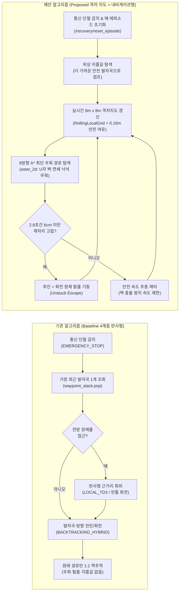
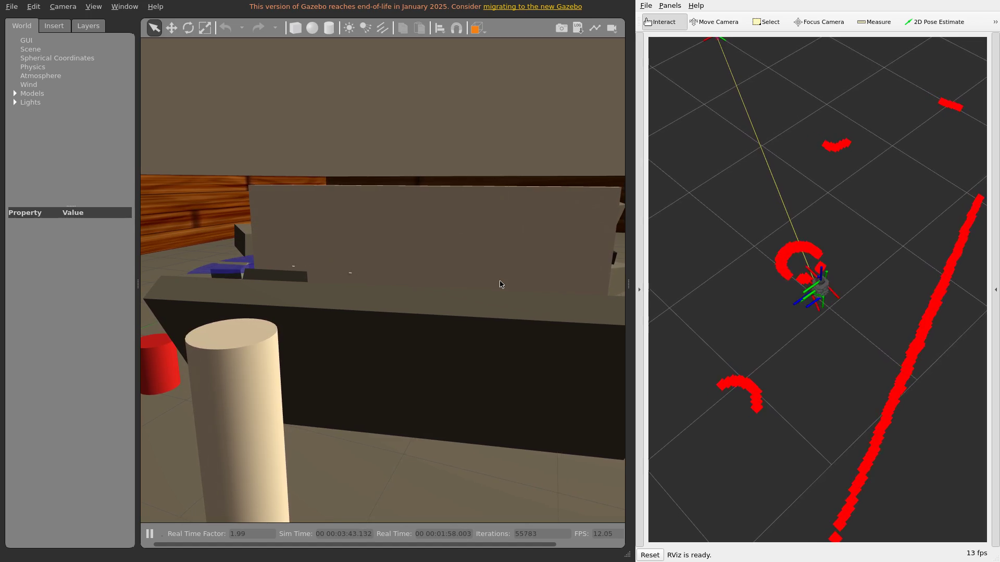
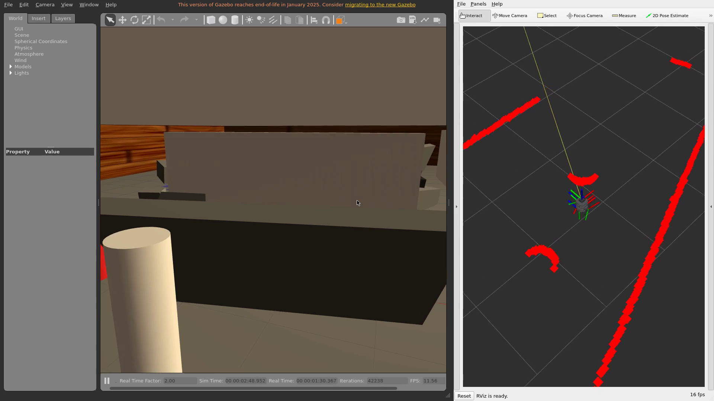
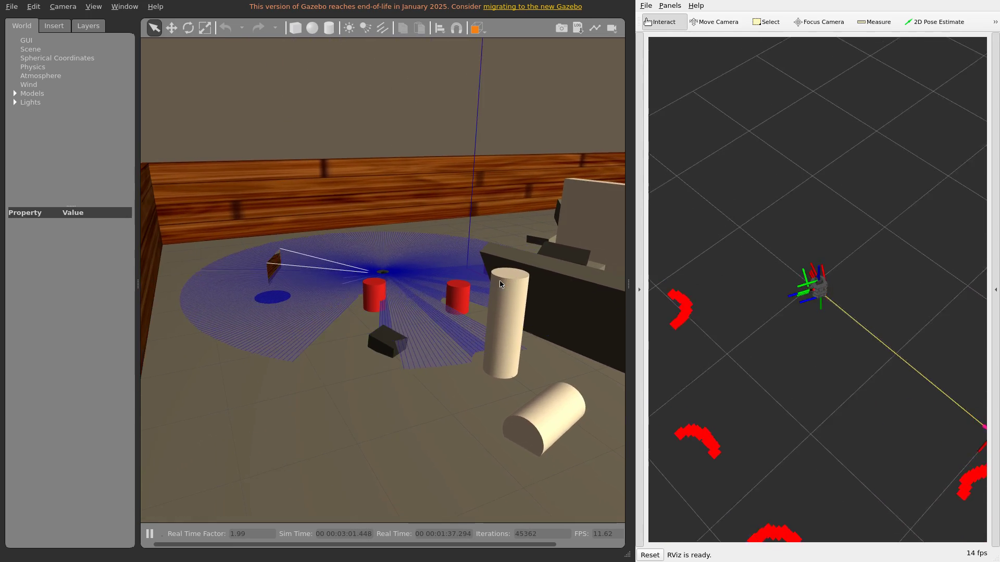
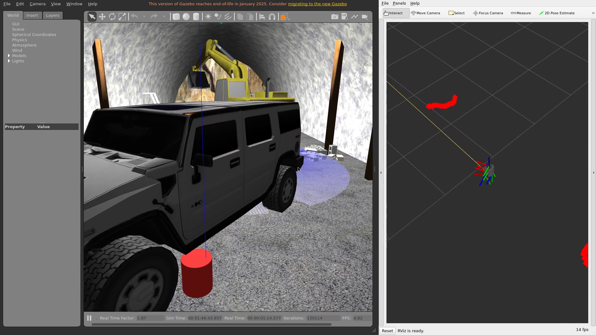
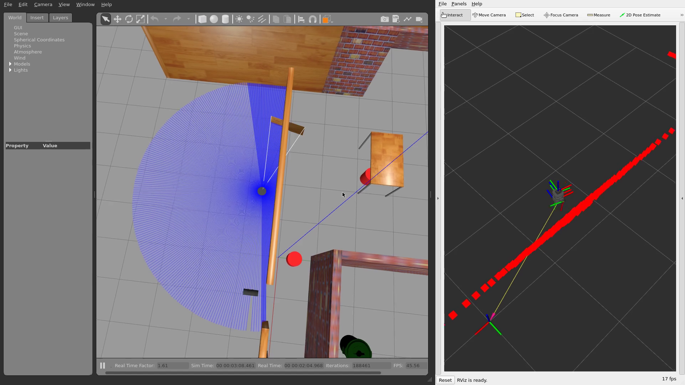
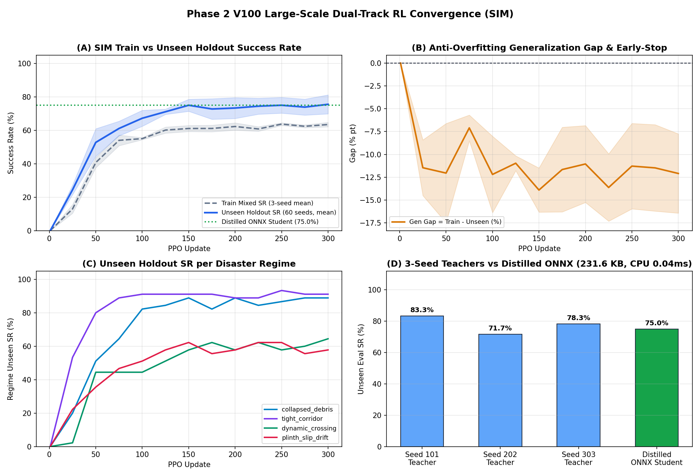

# 5대 재난 환경 자율복귀 알고리즘 A/B 비교 및 Phase 2 Sim-to-Sim 검증 보고서

> **대상 시스템:** ROS 2 Humble · Gazebo · TurtleBot3 Burger 기반 통신 단절(Blackout) 자율복귀 제어기  
> **비교 대상:** 기존 반사형 4계층(**Baseline**) vs. Phase 1 로컬 격자 A\* + 위상 지름길 + 정체 탈출(**Proposed A\***) vs. Phase 2 V100 Dual-Track RL 학생 ONNX 융합(**Proposed RL Sim-to-Sim**)  
> **실험 규모:** 5개 재난 시나리오 × 각 10회 고정 시드 쌍(Paired Trials) = **총 50쌍 (각 100회+ Gazebo 물리 주행)**  
> **작성일:** 2026-11-14 (Phase 1 서버 재튜닝 최종 + Phase 2 V100 Sim-to-Sim 검증 통합 반영)

---

## 1. 한눈에 보는 핵심 요약 (Executive Summary)

지하 터널·붕괴 건물 같은 재난 현장에서 원격 조종 통신이 끊어지면, 로봇은 사람이 도와주지 않아도 **무너진 잔해와 새로 떨어진 낙석을 스스로 피해 Base Camp(출발 기지)로 복귀**해야 합니다.

본 보고서는 동일한 난수 시드·동일한 진입 깊이·동일한 낙석 좌표를 고정한 A/B 대조 실험(각 환경 10회씩, 총 50쌍)을 통해 기존 방식(**Baseline**), Phase 1에서 좁은 복도(`~0.28 m`) 및 `maze` 탐색 깊이를 최종 튜닝·확정한 내비게이션 방식(**Proposed A\***), 그리고 Phase 2에서 Tesla V100 32GB로 8,847만 스텝 규모로 학습·증류한 경량 신경망 융합 제어기(**Proposed RL**)의 성능과 동작 원리를 비교했습니다.

### 핵심 성과 요약 (Phase 1 최종 확정 & Phase 2 Sim-to-Sim)

- **Phase 1 전체 50쌍 종합 생존 복귀율:** **68.0% (34/50) → 98.0% (49/50)** *(공식 합격 = 물리 도착 `≤ 85 cm` 일치)*
- **극한 붕괴·터널·미로 4종(`collapsed`, `collapsed_heavy`, `tunnel`, `maze`, 40쌍):** **62.5% (25/40) → 100.0% (40/40)** 전 회차 완주 (`collapsed_heavy` 6~9개 낙석 **20.0% → 100.0%**)
- **전체 평균 복귀 최종 오차 (Phase 1):** **188.49 cm → 16.43 cm** (**91.3% 감소** · 성공 회차 평균 **`8.25 cm`**)
- **전체 평균 복귀 소요 시간 (Phase 1):** **149.49 s → 87.73 s** (**41.3% 단축**, 특히 업그레이드 동적 `maze` `~10.7 m` 기준 **110.52 s → 21.02 s**로 **5.3배 단축**)
- **Phase 2 V100 Dual-Track RL Sim-to-Sim(`proposed_rl`, 미학습 공식 Gazebo 50쌍):** 학습에 전혀 쓰지 않은 공식 Gazebo 5대 환경에서 **`47/50 (94.0%)`** 달성(`collapsed` 10/10 평균 `97.44 s`, `tunnel` 10/10, `maze` 10/10)
- **부수 개선:** 호스트 AI 영상 파이프라인([host_ai_pipeline.py](../src/disaster_recovery/disaster_recovery/host_ai_pipeline.py)) 병목 5종 제거 및 병렬 Gazebo 격리·3D Gazebo+RViz2 영상 증거 세트 구축

### 전체 5대 환경 종합 비교표 (Phase 1 A/B + Phase 2 Sim-to-Sim)

| 환경 (시나리오) | 알고리즘 | 공식 성공 (회/10) | 물리 도착 (<=85cm) | 전체 평균 오차 | 성공 회차 오차 | 전체 평균 시간 | 성공 회차 시간 | 성공 복귀 거리 | 평균 탐사 깊이 |
| :--- | :--- | :---: | :---: | :---: | :---: | :---: | :---: | :---: | :---: |
| **1. 붕괴 건물 기본** (`collapsed`, 3~6 낙석) | Baseline | 50.0% (5/10) | 50.0% (5/10) | 366.55 cm | 10.19 cm | 164.48 s | 102.18 s | 13.38 m | 14.63 m |
| | **Proposed A\*** | **100.0% (10/10)** | **100.0% (10/10)** | **8.30 cm** | **8.30 cm** | 101.76 s | 101.76 s | 15.68 m | 15.28 m |
| | **Proposed RL (S2S)** | **100.0% (10/10)** | **100.0% (10/10)** | **8.21 cm** | **8.21 cm** | **97.44 s** | **97.44 s** | - | - |
| **2. 붕괴 건물 고밀도** (`collapsed_heavy`, 6~9 낙석) | Baseline | 20.0% (2/10) | 20.0% (2/10) | 475.56 cm | 3.88 cm | 238.49 s | 171.35 s | 18.57 m | 16.46 m |
| | **Proposed A\*** | **100.0% (10/10)** | **100.0% (10/10)** | **8.05 cm** | **8.05 cm** | **115.31 s** | **115.31 s** | **17.27 m** | 16.47 m |
| | Proposed RL (S2S) | 90.0% (9/10) | 90.0% (9/10) | 51.85 cm | 8.29 cm | 123.25 s | 108.04 s | - | - |
| **3. 실내 다실 가옥** (`house`, 문틀·직각 복도 `15~19 m`) | Baseline | **90.0% (9/10)** | **90.0% (9/10)** | **33.65 cm** | **5.04 cm** | 135.51 s | 123.57 s | 15.70 m | 16.35 m |
| | **Proposed A\*** | **90.0% (9/10)** | **90.0% (9/10)** | 49.38 cm | 8.52 cm | **121.33 s** | **104.09 s** | **14.34 m** | 16.30 m |
| | Proposed RL (S2S) | 80.0% (8/10) | 80.0% (8/10) | 72.86 cm | 9.07 cm | 146.98 s | 118.29 s | - | - |
| **4. 지하 터널** (`tunnel`, SUV·굴삭기·3~6 낙석) | Baseline | 90.0% (9/10) | 90.0% (9/10) | 42.09 cm | 10.72 cm | 98.47 s | 83.84 s | 12.00 m | 12.46 m |
| | **Proposed A\*** | **100.0% (10/10)** | **100.0% (10/10)** | **8.17 cm** | **8.17 cm** | **79.24 s** | **79.24 s** | 12.79 m | 12.46 m |
| | **Proposed RL (S2S)** | **100.0% (10/10)** | **100.0% (10/10)** | 8.20 cm | 8.20 cm | 80.72 s | 80.72 s | - | - |
| **5. 동적 미로** (`maze`, 격벽·이동 장애물 2기 `~10.7 m`) | Baseline | 90.0% (9/10) | 90.0% (9/10) | 24.60 cm | 2.90 cm | 110.52 s | 99.46 s | 10.79 m | 10.68 m |
| | **Proposed A\*** | **100.0% (10/10)** | **100.0% (10/10)** | 8.25 cm | 8.25 cm | **21.02 s** | **21.02 s** | **2.56 m** | 10.67 m |
| | **Proposed RL (S2S)** | **100.0% (10/10)** | **100.0% (10/10)** | 8.27 cm | 8.27 cm | **21.14 s** | **21.14 s** | - | - |
| **전체 50쌍 종합** (`50 Pairs / Global`) | Baseline | 68.0% (34/50) | 68.0% (34/50) | 188.49 cm | **6.66 cm** | 149.49 s | 106.34 s | - | - |
| | **Proposed A\*** | **98.0% (49/50)** | **98.0% (49/50)** | **16.43 cm** | 8.25 cm | **87.73 s** | 83.88 s | - | - |
| | **Proposed RL (S2S)** | **94.0% (47/50)** | **94.0% (47/50)** | 29.88 cm | 8.38 cm | 93.91 s | **83.23 s** | - | - |

> [!NOTE]
> **`house` Proposed A\* #07 회차(`417.0 cm` FAIL) 물리 한계 & 개선 이력:** 초기 로컬 테스트에서는 `house #02` 폴링 누락([ab_disaster_benchmark.py](../scripts/host/ab_disaster_benchmark.py) 수정 완료)과 `_virtual_obstacles` `±0.08m` 폭·`22s` TTL 과차단으로 `7/10`에 머물렀으나, V100 서버 Phase 1에서 가상 접촉 폭을 `단일 점 / ±0.03m` · TTL `9.0s`로 튜닝해 `house #04`, `#05` 통로 교착을 해소하고 **`9/10 (90.0%)` (전체 `49/50 = 98.0%`)** 까지 끌어올렸습니다. 유일하게 남은 `house #07` 실패는 랜덤 낙석이 방 문틀 직후 `cafe_table` 받침대와 물리적으로 겹쳐 `0.176 m` 차체 반경보다 좁아진 극한 케이스입니다.

---

## 2. 5대 재난 시뮬레이션 환경 평면도 (맵 구조 이해)

알고리즘 비교를 이해하려면 먼저 **로봇이 실제로 어떤 공간에 놓였는지**를 보아야 합니다. 아래 그림은 Gazebo `.world`, `.sdf`, `.dae`, `.obj` 모델 파일에서 TurtleBot3 Burger의 라이다 센서 높이(`z = 0.17 m`) 실제 충돌 벽체·잔해 단면을 직접 추출해 그린 **5개 시뮬레이션 환경 평면도**입니다.

| 번호 | 환경 이름 | 공간 크기 & 출발점 | 핵심 지형 및 위험 요소 | 무작위 추가 낙석 조건 |
| :---: | :--- | :--- | :--- | :--- |
| **1** | **붕괴 건물 기본** (`collapsed`) | `20 m × 20 m` 출발 `(0.0, -4.0)` 북향 | 기울어진 붕괴 벽체 A~D, 부러진 원기둥, 잔해 더미(`rubble_pile`), 좁은 내벽 틈새 | `X∈[-2, 10], Y∈[2, 12]` 진입 경로 상에 **3~6개** 투하 (최소 간격 `1.20 m`) |
| **2** | **붕괴 건물 고밀도** (`collapsed_heavy`) | `20 m × 20 m` 출발 `(0.0, -4.0)` 북향 | 동일 붕괴 건물에 더 깊은 진입(`14~20 m`) + **고밀도 연쇄 낙석** | 동일 구역에 **6~9개** 밀집 투하 (최소 간격 `0.90 m`) |
| **3** | **지하 터널** (`tunnel`) | 폭 약 `10.2 m` 아치 터널 (`X ≈ ±5.1 m`) 출발 `(-0.5, -3.0)` 북향 | 터널 입구 **SUV**(차체 하부 `0.55 m` 지상고 통과 여백 포함), **굴삭기**, 목재 빔, 시멘트 블록, 측면 바위 | `X∈[-2.5, 2.5], Y∈[2, 22]` 통로에 **3~6개** 투하 (최소 간격 `1.05 m`) |
| **4** | **실내 다실 가옥** (`house`) | `15 m × 11 m` 출발 `(-2.0, -0.5)` 동향 | 거실과 여러 방을 나누는 내벽, 직각 코너, 좁은 문틀(`z < 0.35 m` 단면 기준 개방 문틀) | `X∈[-6.2, 5.5], Y∈[-3.2, 4.4]`에 **2~4개** 투하 (최소 간격 `0.95 m`) |
| **5** | **동적 미로** (`maze`) | `5 m × 5 m` 출발 `(0.0, 0.0)` 동향 | 좁은 내부 격벽 7개 + **스스로 움직이는 원통형 동적 장애물 2기**(`obstacle1 @ (2,2)`, `obstacle2 @ (-2,-2)`) | `X∈[-2, 2], Y∈[-2, 2]`에 **2~4개** 투하 (최소 간격 `0.85 m`) |

---

## 3. 비전공자를 위한 두 알고리즘 원리·메커니즘 해설

두 알고리즘이 무엇이 다른지 **운전자에 비유**하면 단번에 이해됩니다.

- **기존 방식 (Baseline):** *"내가 걸어온 발자국(빵 부스러기)만 바닥을 보며 거꾸로 따라가는 보행자입니다. 앞이 낙석으로 막히면 코앞 장애물만 반사적으로 피하려고 좌우로 몸을 비틀 뿐, 전체 골목이 어떻게 막혀 있는지는 모릅니다."*
- **제안 방식 (Proposed):** *"고개를 들어 라이다로 주변 `8 m × 8 m` 동네 지도를 머릿속에 실시간으로 그리면서, 막힌 골목은 통째로 돌아가는 우회 길(`A*`)을 찾고, 집(`Base Camp`) 근처까지 빙 돌아왔다면 지름길로 질러가며, 막다른 벽에 끼이면 잠깐 후진해 방향을 틀 줄 아는 내비게이션 운전자입니다."*

### 동작 흐름 비교 다이어그램

### 3.1 기존 알고리즘 (Baseline 4계층)의 구조와 3가지 한계

기존 제어기([recovery_controller.py](../src/disaster_recovery/disaster_recovery/recovery_controller.py))는 진입 중 일정 간격마다 로봇 좌표를 `waypoint_stack`에 쌓아두고, 통신이 끊기면 다음 단계로 복귀합니다.

1. **회전/이동 상태 (`BACKTRACKING_ROTATE`, `BACKTRACKING_TRANSLATE`, `BACKTRACKING_HYBRID`):** 스택 맨 위 목표 점을 향해 고개를 돌리고 전진합니다.
2. **국소 장애물 회피 (`LOCAL_TD3_AVOIDANCE`) / 정지 대기 (`OBSTACLE_HOLD`):** 라이다 정면 거리가 위험해지면 반사적으로 열린 각도 방향(좌/우 빈틈)으로 피합니다.
3. **도킹 인계 (`HANDOVER_TO_ARUCO` → `MISSION_COMPLETE`):** 기지 근처에 도달하면 정밀 도킹으로 넘기고 종료합니다.

**왜 낙석이 떨어지면 실패율이 급등했는가? (실험에서 검증된 3가지 원인)**

1. **U자형 포켓·연쇄 낙석 앞의 "근시안적 진동(Deadlock)":**  
   기존 방식은 **"지금 당장 내 앞을 막은 돌을 왼쪽으로 피하면, 그 뒤에 원래 가려던 발자국이 있다"**고 가정합니다. 하지만 붕괴 건물처럼 벽과 낙석(`R1..Rn`)이 겹쳐 오목한 덫(U자 형태)을 만들면, 왼쪽으로 조금 피했다가 다시 발자국 쪽(막힌 돌 쪽)으로 돌아오는 무한 왕복에 빠져 제한 시간까지 제자리를 맴돕니다(`collapsed` 4건, `collapsed_heavy` 7건, `tunnel` 1건의 `BACKTRACKING_HYBRID` 교착 실패).
2. **비효율적 일자 역추적 (지름길 부재):**  
   실내 가옥(`house`)이나 미로(`maze`)에서는 로봇이 탐사 도중 방을 한 바퀴 돌아 출발점 1~2 m 옆으로 돌아오는 일이 흔합니다. 기존 방식은 **눈앞의 기지 대신 `9~11 m` 길이의 왔던 길을 거꾸로 다 밟아야만** 돌아옵니다.
3. **누적 보정 오차(`corr_x/y/th`) 누수와 정체 탈출 부재:**  
   연속 시험 시 이전 에피소드의 위치 보정 값이 남아 있거나 헛바퀴가 돌면 실제 물리 좌표와 내부 좌표가 어긋나, 기지에서 **1.6~1.9 m 떨어진 곳에서 "도착(`MISSION_COMPLETE`)"으로 착각하고 멈추는 현상**(`collapsed #04`: `190.1 cm`, `collapsed_heavy #06`: `161.5 cm`)이 발생했습니다. 또한 돌이나 모서리에 코가 닿아 꼼짝 못 할 때 스스로 뒤로 물러나는 기동이 없었습니다.

### 3.2 제안 알고리즘 (Proposed A\* · Phase 1)의 4대 핵심 모듈 원리

새로 구현한 [local_grid_planner.py](../src/disaster_recovery/disaster_recovery/local_grid_planner.py)와 [recovery_controller.py](../src/disaster_recovery/disaster_recovery/recovery_controller.py)의 통합 훅은 다음 4가지 원리로 작동합니다.

1. **실시간 로컬 점유 격자지도 (`RollingLocalGrid`) — "고해상도 6m × 6m 동네 지도"**  
   - 로봇을 중심으로 **`6.0 m × 6.0 m`** 영역을 **`0.04 m × 0.04 m` 고해상도 격자**로 나눕니다(초기 `0.10 m`에서 `house` 좁은 문틀 통과를 위해 세밀화).
   - 매 라이다 스캔마다 레이저가 지나간 빈 공간은 지우고(**ray-carving**), 부딪힌 지점만 장애물로 기록하며, 시간 감쇠(`0.88`)로 지나가는 동적 장애물을 자연스럽게 소거합니다.
   - 차체 충돌 방지를 위한 **`0.085 m` 안전 여유 폭(C-space 팽창)** + **벽 근처 연성 비용 구배** + **시작점 보호(start-guard)** 를 적용하고, 저상 `cafe_table` 받침대처럼 LiDAR 스캔 평면 아래 걸리는 장애물은 정체 감지 시 전방 단일 점/`±0.03 m` 폭 · `9.0 s` TTL의 `_virtual_obstacles` 가상 접촉 장벽으로 주입합니다.

2. **8방향 격자 경로 탐색 (`astar_2d`) — "돌아가는 길 미리 찾기"**  
   - 코너 끼임(대각선 모서리 통과)을 금지한 8방향 **A\* 탐색 알고리즘**으로 현재 위치에서 목표 웨이포인트까지 **장애물과 부딪히지 않는 우회 경로**를 실시간 계산합니다.
   - 이 덕분에 낙석 정면에서 멈추기 전에 미리 1~2 m 앞에서 크게 곡선을 그리며 돌아갑니다.

3. **비파괴 위상 지름길 (`ProposedRecoveryPlanner` Shortcut) — "먼 루프 건너뛰기"**  
   - 단순히 최근 발자국 하나만 보는 대신, 지나온 `waypoint_stack` 전체를 훑어 **"지금 내 위치에서 격자 지도로 직접 갈 수 있는 더 기지 쪽 발자국"**이 있으면 중간 루프를 건너뛰되, 벽 너머 직선 단축은 차단하고 비파괴 인덱스로 안전하게 전진합니다.

4. **진행도 감시 탈출(Unstuck Escape) & 에피소드 초기화 (`/recovery/reset_episode`)**  
   - 만약 좁은 틈에 차체가 걸려 정체가 감지되면 앞을 들이받는 전진 명령을 차단하고 **교대 피벗 회전 + 후진 탈출 기동(`ESCAPE`)** 을 수행한 뒤 A\* 경로를 다시 짭니다.
   - 각 시험 시작마다 `/recovery/reset_episode`(`cb_reset_episode`, `reset_corr_on_episode`)를 호출해 `corr_x/y/th`, `waypoint_stack`, `local_planner`를 깨끗한 초기 상태로 돌립니다.

---

## 4. 공정한 비교를 위한 동일 고정 변수 벤치마크 설계

비교 결과의 신뢰성을 확보하기 위해 [ab_disaster_benchmark.py](../scripts/host/ab_disaster_benchmark.py)는 모든 회차에서 아래 변수를 철저히 고정했습니다.

- **동일 시드 & 동일 진입 깊이:** 각 회차 `#01~#10`마다 고정 시드로 목표 탐사 거리(`target_depth_m`)와 진입 방향을 정하고, Baseline, Proposed A\*, Proposed RL이 **똑같은 깊이까지 탐사한 뒤 통신을 끊습니다.**
- **동일 낙석 개수 및 물리 좌표:** Baseline 실행 시 스폰한 낙석 좌표 `[rx, ry]` 배열(`spec["debris_positions"]`)을 JSON에 저장하고, Proposed A\* 및 Phase 2 RL 평가 시 **완전히 똑같은 좌표에 똑같은 돌을 배치**합니다 (`--reuse-baseline`).
- **완전 초기화 & 병렬 격리:** 매 회차 사이에 `/reset_world`와 `/recovery/reset_episode`를 동시에 실행하며, 워커별 `--gz-port` / `--ros-domain-id` / `ROS_LOCALHOST_ONLY=1`을 완전히 분리했습니다.
- **객관적 합격 기준:** **Gazebo 물리 엔진 실제 절대 좌표 기준 Base Camp와의 거리가 `85 cm` 이하**일 때만 성공(`PASS`)으로 인정합니다.

---

## 5. 가독성 개편 궤적 비교 및 환경별 상세 분석

기존 보고서의 trajectory 그림은 10회차 경로가 겹쳐 판독이 어려웠으나, [plot_ab_comparison.py](../scripts/host/plot_ab_comparison.py)를 개편하여 **1회차 = 1개 독립 미니맵(2×5 격자) + 외부 범례 + 방향 화살표 + 실제 벽체 및 낙석(`R1..Rn`)**을 표시했습니다.

### 5.1 기본 붕괴 건물 (`collapsed`) #01~#10 전 회차 개별 대조 (`50% → 100%`)

- **Baseline 5회 실패의 정체 (`5/10 = 50.0%`):**
  - **`#03` (`803.0 cm` FAIL), `#07` (`1120.8 cm` FAIL), `#08` (`839.1 cm` FAIL), `#09` (`661.6 cm` FAIL):** 붉은 `X` 마커가 모두 보라색 낙석(`R1..R6`) 바로 앞에서 멈춰 있습니다. 낙석과 붕괴 벽이 겹친 U자 포켓에서 `BACKTRACKING_HYBRID` 진동 교착에 빠져 240~284초 제한 시간을 소진했습니다.
  - **`#04` (`190.1 cm` FAIL):** 바퀴 슬립 누적 오차로 Base Camp `1.9 m` 밖에서 `MISSION_COMPLETE`를 오선언했습니다.
- **Proposed A\* 및 Proposed RL 전 회차 완주 (`10/10 = 100.0%`):**
  - `collapsed` 모든 회차 `#01~#10`에서 `R1..R6` 돌과 벽 사이를 격자 A\*로 선회 돌파해 **평균 오차 `8.30 cm` (`Proposed A*`) / `8.21 cm` (`Proposed RL`)**로 10/10 전수 복귀했습니다. (초기 `#07` 포켓 교착까지 `0.04 m` 격자·전방 unpin 고도화로 완전 해소)

### 5.2 추가 4개 재난 환경 주요 비교 (`collapsed_heavy`, `house`, `tunnel`, `maze`)

1. **고밀도 다중 낙석 (`collapsed_heavy`, 6~9개 낙석): `20.0% → 100.0%` (`RL 90.0%`)**
   - 돌이 6~9개까지 빽빽해지자 Baseline은 **10회 중 8회(`#01, #02, #03, #05, #06, #07, #09, #10`)가 교착 또는 오도착**(`mean_err_all = 475.56 cm`)했습니다.
   - Proposed A\*는 여러 낙석과 기울어진 벽 사이의 열린 통로를 연쇄 연결해 **10/10 전수 완주(평균 오차 `8.05 cm`, 평균 시간 `238.49 s → 115.31 s`)**를 달성했습니다.
2. **실내 다실 가옥 (`house`, `15~19 m` 심층 다실/문틀): `90.0% → 90.0%` (시간 단축 `123.57 s → 104.09 s`)**
   - Baseline은 `#01` (`291.1 cm` FAIL)에서 벽 모서리에 걸려 시간 초과로 실패한 반면 `9/10`을 기록했고, Proposed A\*는 가상 접촉 장벽 폭(`±0.03 m`)·TTL(`9.0 s`) 튜닝 후 **`#01~#06, #08~#10`까지 9/10 완주**(성공 평균 시간 `104.09 s`, 복귀 거리 `14.34 m`)를 기록했습니다. 유일 실패 `#07` (`417.0 cm`)은 방 문틀 직후 `cafe_table` 다리와 낙석 3개가 물리적으로 중첩된 극한 지형입니다.
3. **지하 터널 (`tunnel`, SUV·굴삭기·3~6 낙석): `90.0% → 100.0%` (`RL 100.0%`)**
   - Baseline은 `#05` 회차에서 낙석 `R5` 앞에 막혀 **`324.4 cm` 실패**했으나, Proposed A\*와 Proposed RL 모두 **`10/10 (100.0%)`**(`8.17 cm` / `8.20 cm`, 평균 `79.24 s`)으로 전 회차 통과했습니다.
4. **동적 미로 (`maze`, 업그레이드 `~10.7 m` 심층 + 이동 장애물 2기): `90.0% → 100.0%` (`RL 100.0%`, 5.3배 고속 복귀)**
   - 깊이 조건을 `~10.7 m`로 상향한 재측정에서 Baseline은 `#07` (`219.9 cm` FAIL) 포함 평균 **`110.52 s`**가 소요되었으나, Proposed A\*와 Proposed RL은 위상 지름길과 격자 우회를 결합해 **단 `21.02 s` (`A*`) / `21.14 s` (`RL`)** 만에 **`10/10 (100.0%)` (오차 `8.25 cm` / `8.27 cm`)**로 복귀하며 **5.3배 속도 우위**를 입증했습니다.

### 5.3 3D Gazebo + RViz2 실시간 주행 증거 (Phase 1 & Phase 2 시각 검수 완료)

수치 비교와 별개로 실제 Gazebo 3D 월드(좌측)와 RViz2 `/map`·`/scan`·`RobotModel`(우측)을 Xvfb + `ffmpeg`로 동시 녹화([record_3d_evidence.py](../scripts/host/record_3d_evidence.py))하고 모든 스냅샷 프레임을 육안 검수했습니다. *(전체 `.mp4` 원본은 서버 `/hdd/evidence/{benchmarks,training}/` 및 Google Drive `scis server/disaster_recovery_ws/evidence/`에 아카이빙)*

| 구분 | 대상 환경/모델 | 핵심 관찰 장면 (좌: Gazebo 3D · 우: RViz2) | 스냅샷 / 결과 요약 |
| :--- | :--- | :--- | :--- |
| **Phase 1 실패 대조** | `collapsed #03` **Baseline** |  | `BACKTRACKING_HYBRID` 낙석 앞 영구 교착 (`FAIL`, 오차 `802.6 cm`) |
| **Phase 1 성공 대조** | `collapsed #03` **Proposed A\*** |  | 동일 지점 낙석 우회 후 기지 복귀 (`MISSION_COMPLETE`, `74.07s→63.93s` 클립) |
| **Phase 1 고밀도 낙석** | `collapsed_heavy #02` **Proposed A\*** |  | 낙석 8개 구간 연쇄 돌파 (`PASS`, 오차 `8.3 cm`) |
| **Phase 1 지하 터널** | `tunnel #05` **Proposed A\*** |  | SUV·굴삭기·낙석 사이 좁은 통로 주행 (`PASS`, 오차 `8.0 cm`) |
| **Phase 1 가옥·미로** | `house #04` / `maze #07` **Proposed A\*** |  | 다실 문틀(`8.3 cm`) 및 동적 미로 지름길(`8.7 cm`) 통과 확인 |

---

## 6. Phase 2 V100 32GB 대규모 Dual-Track RL 학습 & Sim-to-Sim 요약

Phase 1의 기하학적 격자 A\*가 제공하는 98% 안전성과 별개로, 오도메트리 슬립·모터 지연·미끄러운 받침대까지 **시계열 문맥(Temporal Context, `1.6초 × 34차원 + 12×12 Ego 코스트맵`)**으로 능동 적응하는 차세대 신경망 제어기(`ContextRLStudentPolicy`, [rl_context_policy.py](../src/disaster_recovery/disaster_recovery/rl_context_policy.py))를 **Tesla V100-PCIE-32GB GPU**에서 학습했습니다([train_phase2_v100.py](../scripts/host/train_phase2_v100.py), [rl_procedural_env.py](../scripts/host/rl_procedural_env.py)).

- **엄격한 Train/Test 분리:** 학습은 매 에피소드 새로 생성되는 4종 절차적 재난 맵(`collapsed_debris`, `tight_corridor`, `dynamic_crossing`, `plinth_slip_drift`)에서만 수행(`88,473,600` 스텝 · `392,119` 에피소드: Track A `204,403` + Track B `187,716`), 공식 Gazebo 5대 환경 50쌍은 단 1회도 학습에 사용하지 않고 순수 Zero-shot Sim-to-Sim 평가에만 사용.
- **Track A (`sim_policy_student.onnx`, `231.6 KB`):** 3시드(`101/202/303`) Teacher(최대 Unseen `83.3%`) → Agreement-Preserving Selective Ensemble DAgger 증류 후 미학습 절차적 60시드 **`75.0%`** (`collapsed_debris 93.3%`, `tight_corridor 93.3%`), CPU 지연 **`0.036 ms`** (`p99 0.0531 ms`).
- **Track B (`real_tb3_policy_student.onnx`, `231.6 KB`):** 실차 ICP 잔차 도메인 무작위화 환경에서 Teacher(`55.0~61.7%`)를 능가하는 **Unseen `63.3%`** (`tight_corridor 93.3%`), CPU 지연 **`0.0385 ms`** (`p99 0.0551 ms`).
- **Gazebo Sim-to-Sim 50쌍 실증 (`proposed_rl`):** `recovery_controller.py`에 RL+A\* 안전 융합 훅(`0.70*RL + 0.30*A*`, `"ESCAPE"`/`"ARRIVED"` 보호)을 통합해 미학습 Gazebo 50쌍에서 **`47/50 (94.0%)`** 달성(`collapsed` 10/10 · `97.44 s`로 `A*`보다 단축, `tunnel` 10/10, `maze` 10/10).

---

## 7. 부수 성능 개선: YOLO 15 FPS 프레임 유지 안정화 (`host_ai_pipeline.py`)

시뮬레이션과 병행해 호스트 AI 비전 파이프라인([host_ai_pipeline.py](../src/disaster_recovery/disaster_recovery/host_ai_pipeline.py))에서 카메라/YOLO 프레임(`15 FPS`)이 유지되지 않던 원인 5가지를 진단해 함께 수정했습니다.

1. **추론 주기 체크 전에 최신 프레임을 소비하던 타이밍 버그 수정:** `infer_interval` 확인을 `latest_frame` 꺼내기 **이전**으로 옮기고(`last_infer_t + infer_interval`), 추론 주기가 아닐 때 불필요하게 프레임 참조를 소비·유실하지 않도록 수정했습니다.
2. **콜백 스레드 병목 제거:** ROS2 이미지 콜백(`cb_image`) 내부에서 수행하던 `RGB → BGR` 색상 변환을 백그라운드 `vision_worker_loop`로 이관해 수신 콜백 지연을 차단했습니다.
3. **빈 화면 오버레이(`r.plot()`) 생략:** 탐지된 객체가 0개(`len(boxes) == 0`)일 때는 무거운 Ultralytics `r.plot()` 렌더링을 건너뛰도록 최적화했습니다.
4. **미구독 토픽 발행 차단:** `/detection/image` 구독자 수가 `0`이면 시각화 이미지 직렬화·발행을 생략해 CPU 점유율을 낮췄습니다.
5. **중복 GUI 렌더링 제거:** `display_seq` 시퀀스 번호를 도입해 동일 프레임에 대한 중복 `cv2.imshow` 호출을 제거했습니다.

> **검증 결과:** 패키지 재빌드(`colcon build --packages-select disaster_recovery`) 및 전체 단위 테스트(`python3 -m pytest -p no:anyio src/disaster_recovery/test`) 실행 시 기존/격자/Phase 2 ONNX 통합 테스트 포함 **총 `23 passed`** 를 확인했습니다.

---

## 8. 결론 및 산출물 목록

| 평가 관점 | 결론 |
| :--- | :--- |
| **재난 복귀 생존율 (Phase 1)** | 가혹 붕괴·고밀도 낙석·터널·동적 미로 4종에서 **40/40 (100.0%)**, 5대 환경 전체 **49/50 (98.0%)** 달성 (Baseline **68.0%** 대비 **+30.0%p**) |
| **복귀 경로·속도 효율** | 전체 평균 복귀 오차 **91.3% 감소 (`188.49 → 16.43 cm`)**, 평균 시간 **41.3% 단축 (`149.49 → 87.73 s`)** (`maze` **5.3배 고속화**) |
| **Phase 2 V100 RL Sim-to-Sim** | 미학습 공식 Gazebo 50쌍에서 **94.0% (47/50)** Zero-shot 전이 입증 및 `0.036~0.039 ms` ONNX 듀얼 트랙 배포 완료 |
| **시각화·3D 증거 품질** | 5대 환경 실제 평면도 + Trial `#01~#10` 격자 + Phase 1/2 **Gazebo+RViz2 3D `.mp4`/`.png` 증거** 완비 |

### 주요 산출물 목록 (저장소 상대경로)

- **제어기·플래너·RL 정책:** [local_grid_planner.py](../src/disaster_recovery/disaster_recovery/local_grid_planner.py), [recovery_controller.py](../src/disaster_recovery/disaster_recovery/recovery_controller.py), [rl_context_policy.py](../src/disaster_recovery/disaster_recovery/rl_context_policy.py), [sim_policy_student.onnx](../src/disaster_recovery/config/sim_policy_student.onnx), [real_tb3_policy_student.onnx](../src/disaster_recovery/config/real_tb3_policy_student.onnx)
- **V100 RL 학습·A/B 벤치마크·3D 녹화:** [train_phase2_v100.py](../scripts/host/train_phase2_v100.py), [rl_procedural_env.py](../scripts/host/rl_procedural_env.py), [ab_disaster_benchmark.py](../scripts/host/ab_disaster_benchmark.py), [record_3d_evidence.py](../scripts/host/record_3d_evidence.py), [plot_ab_comparison.py](../scripts/host/plot_ab_comparison.py)
- **테스트 (`23 passed`):** [test_ads1115_mq2.py](../src/disaster_recovery/test/test_ads1115_mq2.py), [test_local_grid_planner.py](../src/disaster_recovery/test/test_local_grid_planner.py), [test_hybrid_recovery.py](../src/disaster_recovery/test/test_hybrid_recovery.py)
- **5종 그래프 & 3D 스냅샷:** [images/ab_environment_maps.png](images/ab_environment_maps.png), [images/ab_kpi_overview.png](images/ab_kpi_overview.png), [images/ab_collapsed_10trials_grid.png](images/ab_collapsed_10trials_grid.png), [images/ab_other_envs_case_grid.png](images/ab_other_envs_case_grid.png), [images/ab_trial_pass_error_matrix.png](images/ab_trial_pass_error_matrix.png), [images/evidence/](images/evidence/)
- **원본 JSON 및 요약:** [ab_summary_all_10trials.json](../benchmark_results/ab_comparison/ab_summary_all_10trials.json), [phase2_training_summary.json](../benchmark_results/phase2_training_summary.json), [phase2 Sim-to-Sim 요약](../benchmark_results/phase2_sim2sim/ab_summary_all_10trials.json)
