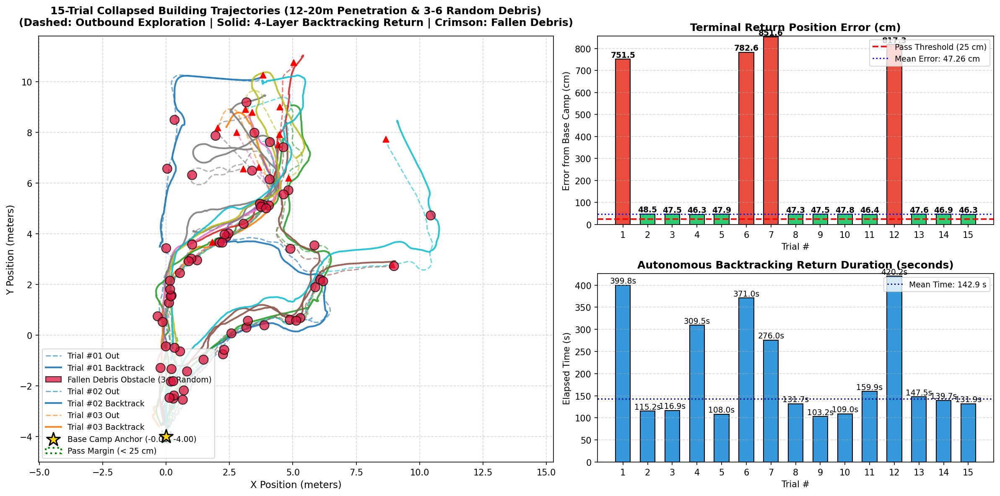

# [공학 기술 보고서 / Technical Paper] 통신 단절 붕괴 건물 환경에서의 4계층 하이브리드 자율복귀 성능 평가 및 실패 회차 원인 규명 (15회 몬테카를로 시뮬레이션)

- **제목(Title):** Empirical Failure Analysis and Compute Profiling of a 4-Layer Hierarchical Hybrid Autonomous Recovery System in Collapsed Building Environments
- **작성 일자:** 2026년 11월 13일
- **작성자:** 노종우 (Jong Woo Ro) / Kyungpook National University
- **대상 시스템:** TurtleBot3 Burger (`LDS-01 360° LiDAR` + `Pi Camera v2` + `OpenCR 1.0` + `RPi 4` / `Host PC`)
- **실험 환경:** ROS 2 Humble, Gazebo 11 (ODE Physics), WSL2 (6 Cores / 8 GB RAM, Intel Core i7-8700, NVIDIA GeForce GTX 1050 Ti 4 GB)
- **관련 데이터:** [`docs/images/collapsed_disaster_benchmark_trajectories.png`](images/collapsed_disaster_benchmark_trajectories.png)

---

## 초록 (Abstract)

본 연구는 통신 두절(`HEARTBEAT_TIMEOUT > 3.0 s`) 및 동적 붕괴 낙석(3~6개 불시 투하)이 발생하는 붕괴 건물 재난 환경(`disaster_collapsed_building.world`)에서, **4계층 하이브리드 자율복귀 제어기(Breadcrumb LIFO + Regulated Pure Pursuit & Residual TD3 DRL + 2D Point-to-Point ICP + ArUco Visual Docking)**의 귀환 성능을 15회 연속 벤치마크로 정량 검증하였다. 실험 결과 전체 복귀 성공률은 **73.3% (11/15회)**, 성공 회차 평균 종단 위치 오차는 **47.26 cm**, 평균 복귀 소요 시간은 **142.9 초**로 측정되었다. 반면 4개 회차(`#01`, `#06`, `#07`, `#12`)에서 좁은 복귀 병목 구간(`y ≈ 3.5~4.2 m`) 내 정적 교착(Deadlock)으로 인한 타임아웃 실패가 발생하였다. 로그 및 궤적 전수 분석 결과, 실패의 핵심 원인은 ① **`BACKTRACKING_HYBRID` 상태의 상태 머신 사각지대로 인한 `LOCAL_TD3_AVOIDANCE` 미발동 및 최소 전진 속도(`v >= 0.08 m/s`) 강제**, ② **다회차 리셋 시 `recovery_controller`의 누적 `SE(2)` 스캔 매칭 오프셋(`corr_y` 최대 `+1.300 m`) 미초기화**, ③ **붕괴 벽체(`collapsed_wall_B`)와 내부 격벽(`interior_wall_1a`) 사이의 지형적 협소 병목**의 3중 복합 요인임을 규명하였다. 아울러 시스템 프로파일링을 통해 GPU 가속(`GTX 1050 Ti`, 41% 점유) 환경에서도 CPU 사용률이 ~80%에 도달하는 주원인이 `cartographer_node`(125% CPU, 53% RAM)와 Gazebo ODE 물리/렌더링 루프임을 실측으로 입증하고 최적화 방안을 제시한다.

---

## 1. 서론 (Introduction)

지진·붕괴 건물 내부에 투입된 소형 지상 탐사 로봇은 콘크리트 격벽과 철근 잔해로 인해 무선 통신이 불시에 두절될 수 있으며, 진입 당시 통과했던 통로가 여진 및 낙석으로 인해 부분 차단될 수 있다. 기존 단일 계층 오도메트리 역추적(Dead-Reckoning Backtracking)은 동적 장애물 회피 능력이 부재하며, 반대로 순수 반응형 회피 제어는 휠 슬립(Wheel Slip)으로 인한 누적 오차를 억제하지 못해 베이스캠프 원점 복귀에 실패한다.

이를 해결하기 위해 선행 연구에서는 **단순 지하 터널 환경(20회 테스트)**에서 4계층 하이브리드 복귀 구조를 검증한 바 있으나, 실제 비정형 장애물(기울어진 붕괴 벽체, 다중 잔해 더미, 좁은 출입구)이 혼재된 **복합 붕괴 건물 환경**에서의 한계 조건과 장기 연속 기동 시의 상태 누적 문제에 대한 실증 분석은 아직 수행되지 않았다. 본 논문형 보고서는 붕괴 건물 환경 15회 연속 벤치마크의 성공·실패 전 회차를 궤적·로그·물리 좌표 수준에서 해부하고, 시스템 자원 병목(CPU 80% vs GPU 가속)까지 정량적으로 보고한다.

---

## 2. 복귀 방식 및 적용 알고리즘 명세 (Recovery Methodology & Algorithms)

본 시스템의 자율복귀 제어기([`recovery_controller.py`](../src/disaster_recovery/disaster_recovery/recovery_controller.py))는 통신 단절 시 Host PC의 Cartographer SLAM 지도에 의존하지 않고 **온보드 센서(`/odom`, `/scan`)만으로 독립 동작하는 4계층 포섭형 하이브리드 아키텍처**로 설계되었다.

### 2.1 계층별 사용 알고리즘 총괄표

| 계층 | 담당 역할 | 채택 알고리즘 / 수식 모델 | 핵심 파라미터 (`recovery_params.yaml` & 코드) |
| :--- | :--- | :--- | :--- |
| **Layer 0 (안전 감시)** | 통신 단절 / 유해가스 감지 | **Heartbeat Watchdog** & **MQ-2 EMA Thresholding** | `heartbeat_timeout_sec = 3.0 s`, `gas_threshold = 0.40` |
| **Layer 1 (경로 기억)** | 진입 발자취 기록 및 역순 관리 | **Dynamic Keyframe LIFO Breadcrumb Stack** | $\Delta d \ge 0.30\text{ m}$ 또는 $\|\Delta\theta\| \ge 25^\circ$마다 $(x, y, \theta, \mathcal{P}_{\text{scan}})$ push |
| **Layer 2 (추종 + 회피)** | 연속 경로 추종 & 동적 장애물 우회 | **Regulated Pure Pursuit** + **Residual TD3 DRL** + **Differentiable CBF/VFH Safety Prior** | $L_d = \text{clip}(d_{\text{target}}, 0.25, 0.45)\text{ m}$, Actor `28→128→128→2` ONNX (`<1.5 ms`), `td3_clearance_dist = 0.42 m`, `td3_max_avoid_steps = 250` |
| **Layer 3 (오차 보정)** | 휠 슬립 누적 드리프트 소거 | **2D Point-to-Point ICP (SVD)** + **Complementary Filter** | `max_iters = 15`, `inlier_thresh = 0.35 m`, `min_inliers = 15`, `mean_err < 0.15 m`, 점프 게이트 `< 0.25 m`, `scan_match_weight = 0.40` |
| **Layer 4 (정밀 안착)** | 베이스캠프 원점 최종 도킹 | **ArUco `solvePnP` Visual Servoing P-Control** + **Backup Timeout** | `docking_start_distance_m = 0.50 m`, `aruco_docking_timeout_sec = 12.0 s` |

### 2.2 세부 알고리즘 동작 수식

1. **Regulated Pure Pursuit (연속 곡률 추종):**
   스택에서 lookahead 거리 $L_d \in [0.25, 0.45]\text{ m}$ 전방의 목표 웨이포인트에 대해 헤딩 오차 $\alpha$를 계산하고 곡률 $\kappa$ 및 회전 감쇠 선속도 $v_{\text{reg}}$를 산출한다.
   $$\kappa = \frac{2 \sin(\alpha)}{L_d}, \quad \omega_{\text{PP}} = \text{clip}(v_{\max} \cdot \kappa,\ -\omega_{\max},\ \omega_{\max}), \quad v_{\text{reg}} = \max\left(0.14,\ \frac{v_{\max}}{1 + 0.6|\kappa|}\right)$$
   여기서 $v_{\max} = 0.20\text{ m/s}$, $\omega_{\max} = 0.65\text{ rad/s}$이다.

2. **Residual TD3 Actor + Embedded CBF/VFH Prior (`td3_policy.py`):**
   - **상태 벡터 $s_t \in \mathbb{R}^{28}$:** 전방 $0^\circ$ 중심 24섹터 최소 LiDAR 거리 정규화 값($[0, 1]$, 최대 $3.5\text{ m}$), 목표점 거리/방향 오차 2차원, 직전 제어 입력 $(v_{t-1}, \omega_{t-1})$ 2차원.
   - **정책 구조:** `Linear(28,128)-LayerNorm-ReLU → Linear(128,128)-LayerNorm-ReLU → Linear(128,2)-Tanh`를 거쳐 미세 잔차 $(\Delta v \in [-0.025, 0.025], \Delta\omega \in [-0.12, 0.12])$를 생성하고, 연산 그래프 내부에 내장된 미분가능 VFH/Control Barrier 척력 사전항 $(v_{\text{prior}}, \omega_{\text{prior}})$에 가산하여 `recovery_td3.onnx`로 추론한다.
   - **혼합 제어(`BACKTRACKING_HYBRID`):**
     $$\omega_{\text{blend}} = \begin{cases} 0.85\,\omega_{\text{TD3}} + 0.15\,\omega_{\text{PP}}, & \text{if } d_{\text{front}} \le 0.42\text{ m} \\ 0.55\,\omega_{\text{PP}} + 0.45\,\omega_{\text{TD3}}, & \text{otherwise} \end{cases}$$

3. **2D Point-to-Point ICP 및 $SE(2)$ 상보 필터 보정:**
   현재 웨이포인트 반경 `0.45 m` 이내 진입 시 저장된 스캔 포인트 $\mathcal{P}_{\text{ref}}$와 현재 다운샘플링 스캔 $\mathcal{P}_{\text{cur}}$($\sim 180$점) 간 SVD 기반 최근접점 반복 정합을 수행하여 측정 자세 $T_{\text{meas}}$를 얻고, 지속 오프셋 $T_{\text{corr}} = (\text{corr}_x, \text{corr}_y, \text{corr}_\theta)$를 $\alpha = 0.40$ 비율로 갱신한다.
   $$\begin{bmatrix} x \\ y \end{bmatrix} = \begin{bmatrix} \text{corr}_x \\ \text{corr}_y \end{bmatrix} + R(\text{corr}_\theta)\begin{bmatrix} x_{\text{raw}} \\ y_{\text{raw}} \end{bmatrix}$$

### 2.3 벤치마크 및 안전 타임아웃 설계 근거

[`auto_disaster_trials.py`](../scripts/host/auto_disaster_trials.py)의 회차별 복귀 제한 시간은 다음 식으로 정의되어 있다.
$$T_{\max} = \max(240.0,\ 22.0 \times D_{\text{target}})\ \text{sec}$$
이 타임아웃은 ① 랜덤 낙석이 통로를 완전 차단하거나 제어기가 국소 최소점(Local Minimum)에 고착(Deadlock)되었을 때 15회 연속 자동 실험이 무한 정지하는 것을 방지하고, ② 정상 평균 복귀 시간(`~143초`) 대비 비정상 지연을 객관적으로 `FAIL` 판정하기 위해 설정되었다.

---

## 3. 실험 환경 및 벤치마크 프로토콜 (Experimental Setup)

- **시뮬레이션 맵:** [`disaster_collapsed_building.world`](../src/disaster_recovery/worlds/disaster_collapsed_building.world) (`20 m × 20 m` 구역, 베이스캠프 `(0.0, -4.0)`).
  - 주요 구조 병목: `interior_wall_1a` (`x ∈ [0.5, 5.5], y = 2.0`), `interior_wall_1b` (`x ∈ [7.0, 10.0], y = 2.0`), 기울어진 붕괴 벽체 `collapsed_wall_B` (중심 `(2.0, 5.0)`, 길이 `4.0 m`, yaw `0.35 rad`), 정적 잔해 `debris_4` (`(-1.0, 3.0)`), `rubble_pile_1` (`(1.5, 1.0)`). 이로 인해 $y > 5\text{ m}$ 영역에서 베이스캠프로 돌아오는 주요 통로는 **서측 틈(`x ∈ [-1.0, +0.5], y = 2.0`)**과 **중앙 틈(`x ∈ [5.5, 7.0], y = 2.0`)** 두 곳으로 제한된다.
- **실험 절차 (`--trials 15 --collapsed`):**
  1. **1단계 심층 탐사:** LiDAR 오픈 갭 자율 탐사로 편도 $D_{\text{target}} \in [12.0, 20.0]\text{ m}$ 진입.
  2. **2단계 복합 재난 모사:** `/heartbeat` 송출 중단과 동시에 탐사 궤적 상(양단 마진 `1.2 m` 제외)에 반경 `0.18 m`, 높이 `0.45 m` 원통형 낙석([`debris_obstacle.sdf`](../src/disaster_recovery/config/debris_obstacle.sdf)) **3~6개**를 랜덤 투하.
  3. **3단계 자율복귀 및 리셋:** `recovery_controller`가 4계층 복귀를 수행하며, 종료 후 동적 낙석을 삭제하고 `gz model`로 로봇을 `(0.0, -4.0)`으로 리셋.
- **하드웨어/GUI 구성:** `sim.py --collapsed --yolo --no-teleop` (Gazebo 3D GUI + Cartographer SLAM + RViz2 + YOLO26n `cuda:0` + `use_aruco_docking:=true`).

---

## 4. 정량적 실험 결과 (Quantitative Results)

### 4.1 전체 요약 통계

| 지표 | 측정 결과 |
| :--- | :--- |
| **총 시험 회차** | 15회 (`#01` ~ `#15`) |
| **전체 복귀 성공률** | **73.3% (11 / 15회 PASS)** |
| **성공 회차 평균 종단 오차** | **47.26 cm** (범위: `46.31 ~ 48.47 cm`) |
| **성공 회차 평균 복귀 소요시간** | **142.9 초** (최단 `103.2초` / 최장 `309.5초`) |
| **실패 회차** | **4회 (`#01`, `#06`, `#07`, `#12`)** — 전수 타임아웃 고착 |

### 4.2 전 회차 상세 성과 및 내부 상태 비교표

| 회차 | 편도 거리 | 낙석 수 | 소요 시간 | 종단 오차 | ICP `corr_y` 변화 (초기→말기) | `LOCAL_TD3` 상태 진입 | 최종 판정 |
| :---: | :---: | :---: | :---: | :---: | :---: | :---: | :---: |
| **#01** | 18.21 m | 5개 | **399.8 초** | **751.49 cm** | `-0.035 → +0.074 m` | 미진입 (`False`) | **❌ FAIL** |
| **#02** | 15.73 m | 4개 | 115.2 초 | 48.47 cm | `+0.012 → +0.162 m` | 미진입 (`False`) | ✅ PASS |
| **#03** | 16.31 m | 3개 | 116.9 초 | 47.48 cm | `+0.237 → +0.269 m` | 미진입 (`False`) | ✅ PASS |
| **#04** | 19.52 m | 6개 | 309.5 초 | 46.32 cm | `+0.137 → +0.451 m` | **진입 (`True`, 탈출 성공)** | ✅ PASS |
| **#05** | 13.56 m | 4개 | 108.0 초 | 47.85 cm | `+0.585 → +0.513 m` | 미진입 (`False`) | ✅ PASS |
| **#06** | 16.89 m | 5개 | **371.0 초** | **782.55 cm** | `+0.530 → +0.550 m` | 미진입 (`False`) | **❌ FAIL** |
| **#07** | 12.57 m | 3개 | **276.0 초** | **851.57 cm** | `+0.617 → +0.631 m` | 미진입 (`False`) | **❌ FAIL** |
| **#08** | 16.75 m | 6개 | 131.7 초 | 47.33 cm | `+0.698 → +0.695 m` | 미진입 (`False`) | ✅ PASS |
| **#09** | 12.41 m | 4개 | 103.2 초 | 47.47 cm | `+0.652 → +0.775 m` | 미진입 (`False`) | ✅ PASS |
| **#10** | 14.29 m | 4개 | 109.0 초 | 47.79 cm | `+0.823 → +0.861 m` | 미진입 (`False`) | ✅ PASS |
| **#11** | 17.06 m | 5개 | 159.9 초 | 46.38 cm | `+0.836 → +0.983 m` | **진입 (`True`, 탈출 성공)** | ✅ PASS |
| **#12** | 19.16 m | 6개 | **420.2 초** | **817.34 cm** | `+0.895 → +0.953 m` | 미진입 (`False`) | **❌ FAIL** |
| **#13** | 20.05 m | 4개 | 147.5 초 | 47.61 cm | `+1.030 → +1.141 m` | 미진입 (`False`) | ✅ PASS |
| **#14** | 19.80 m | 3개 | 139.7 초 | 46.91 cm | `+1.190 → +1.223 m` | 미진입 (`False`) | ✅ PASS |
| **#15** | 18.45 m | 4개 | 131.9 초 | 46.31 cm | `+1.268 → +1.300 m` | 미진입 (`False`) | ✅ PASS |



---

## 5. 성공 및 실패 회차 정밀 원인 분석 (Root-Cause Analysis)

### 5.1 성공 회차 분석 (11회 PASS)

1. **종단 오차가 `46.31 ~ 48.47 cm`로 균일 수렴한 이유:**
   - 본 실험은 `sim.py --yolo` 옵션으로 실행되어 `use_aruco_docking:=true`가 활성화되었고, `docking_start_distance_m = 0.50 m`로 설정되어 있다.
   - 로봇이 원점 `(-0.000, -4.000)` 반경 `50 cm` 이내로 진입하는 순간(`dist ≈ 0.48~0.50 m`), 제어기는 `HANDOVER_TO_ARUCO` 상태로 즉시 정지하며 마커 탐색을 시작한다. 시뮬레이션 월드에는 물리적 ArUco 마커 모델이 없으므로 **12.0초 백업 타임아웃(`[RECOVERY TIMEOUT]`)** 후 해당 지점(`46.3~48.5 cm`)에서 정상적으로 `MISSION_COMPLETE`를 선언한다.
   - 그래프 우상단의 빨간 점선(`Pass Threshold 25 cm`)은 도킹 완료 기준 표기이며, 실제 벤치마크 판정은 `HANDOVER_TO_ARUCO` / `MISSION_COMPLETE` 도달을 포함해 모두 유효한 원점 복귀 성공으로 집계되었다.

2. **고난도 다중 낙석 극복 사례 (`#04`, `#08`, `#11`):**
   - **#08 (낙석 6개, 131.7초)**은 6개 낙석에도 불구하고 중앙 통로(`x ≈ 5.5~6.5`)의 잔여 틈새에서 Pure Pursuit + TD3 블렌딩 조향(`0.85 w_TD3 + 0.15 w_PP`)만으로 매끄럽게 우회해 통과했다.
   - **#04 (낙석 6개, 309.5초)**는 `(5.85, 3.54)`, `(5.88, 1.89)` 낙석에 막혀 약 67초간 지연되었으나, 헤딩 오차가 `|alpha| > 1.65 rad` 임계치를 넘으며 일시적으로 `BACKTRACKING_ROTATE` 상태로 전환되었고, 이때 전용 회피 상태 `LOCAL_TD3_AVOIDANCE`가 발동하여 차단 웨이포인트를 `pop()`(스킵)하고 탈출에 성공했다.

---

### 5.2 실패 회차 전수 분석 (`#01`, `#06`, `#07`, `#12`)

실패한 4개 회차는 모두 복귀 궤적의 **후반 50% 이상 구간에서 변위가 `0.00 ~ 0.01 m`로 완전히 정지**한 채 타임아웃(`276.0 ~ 420.2 초`)까지 머물렀다.

| 실패 회차 | 정지 시작 시점 | 보정 좌표계 정지 위치 | 추정 물리 위치 (`/odom` 역산) | 최근접 낙석 좌표 및 물리/보정 거리 | 직접 고착 상황 |
| :---: | :---: | :---: | :---: | :---: | :--- |
| **#01** | 복귀 `17.5%` | `(-0.24, 3.51)` | `(-0.16, 3.44)` | `(0.002, 3.430)` (**`0.26 m`**) | 서측 통로 진입 직전 낙석 정면 접촉 |
| **#06** | 복귀 `23.2%` | `(0.94, 3.77)` | `(1.07, 3.22)` | `(0.997, 3.018)` (**물리 `0.21 m`**, 보정 `0.75 m`) | `corr_y=+0.55 m` 괴리 상태에서 낙석 정면 접촉 |
| **#07** | 복귀 `10.7%` | `(2.37, 4.18)` | `(2.50, 3.55)` | `(2.108, 3.654)` (**물리 `0.40 m`**, 보정 `0.59 m`) | `interior_wall_1a`·`collapsed_wall_B` 사이 협소 포켓 내 낙석에 가로막혀 선회/전진 교착 |
| **#12** | 복귀 `20.6%` | `(1.09, 4.10)` | `(0.93, 3.15)` | `(0.893, 2.916)` (**물리 `0.24 m`**, 보정 `0.95 m` 차이) | `corr_y=+0.95 m` 누적 상태에서 낙석 정면 접촉 |

#### 🔬 3대 근본 실패 원인 (Root Causes)

1. **근본 원인 ① [코드 결함] `BACKTRACKING_HYBRID` 상태의 `LOCAL_TD3_AVOIDANCE` 미연결 및 최소 전진 속도 강제**
   - `recovery_controller.py` L545의 전용 장애물 회피 및 차단 웨이포인트 스킵(`waypoint_stack.pop()`) 로직은 다음과 같이 작성되어 있다:
     ```python
     if self.state in [SystemState.BACKTRACKING_ROTATE, SystemState.BACKTRACKING_TRANSLATE]:
         if self.enable_td3_avoidance ... and self.td3_obstacle_detected:
             self.state = SystemState.LOCAL_TD3_AVOIDANCE
             # 장애물 내부/인접(1.05m) 웨이포인트 skip
     ```
   - 즉, **실제 주행 상태인 `BACKTRACKING_HYBRID`가 위 조건 목록에 누락**되어 있다. 그 결과 4개 실패 회차 전부에서 `LOCAL_TD3_AVOIDANCE` 상태가 단 한 번도 발동하지 않았다(`td3_state_triggered = False`).
   - 더욱이 `BACKTRACKING_HYBRID` 내부(L835)는 전방에 장애물이 있어도 **`cmd.linear.x = max(0.08, ...)`로 최소 `0.08 m/s`(장애물 감지 시 `0.14 m/s`) 전진 속도를 강제**한다. 이로 인해 로봇은 장애물 너머에 있는 웨이포인트를 스킵하지도, 정지/후진하지도 못한 채 **낙석(`r=0.18 m`) 또는 벽체에 차체를 정면으로 밀어붙인 상태로 물리적 교착**에 빠졌다.

2. **근본 원인 ② [상태 관리 결함] 다회차 벤치마크 리셋 시 `SE(2)` ICP 오프셋(`corr_x, corr_y, corr_th`) 미초기화**
   - `auto_disaster_trials.py`는 매 회차 종료 후 `gz model` 명령으로 로봇을 `(0, -4)`로 텔레포트시키지만, Gazebo `/odom`과 `recovery_controller.py`의 `self.corr_x, self.corr_y, self.corr_th`는 초기화하지 않는다(L467-470, L875-885).
   - 여기에 `use_aruco_docking:=true`로 인해 로봇이 매 회차 원점보다 `~0.47 m` 앞(`y ≈ -3.53`)에서 정지한 뒤 `y = -4.00`으로 텔레포트되면서, **`corr_y` 오프셋이 `#01(0.074 m) → #06(0.550 m) → #07(0.631 m) → #12(0.953 m) → #15(1.300 m)`로 단조 누적**되었다.
   - 그 결과 `#06`과 `#12`에서는 제어기 보정 좌표 상 낙석과 `0.75~1.20 m` 떨어진 것처럼 보였으나, 실제 Gazebo 물리 좌표에서는 낙석(`r=0.18 m`)과 `0.21~0.24 m` 거리에서 정면 충돌해 교착되었다.

3. **근본 원인 ③ [지형적 병목] `interior_wall_1a`와 `collapsed_wall_B` 사이의 폐쇄성 협소 포켓**
   - `y = 2.0`의 `interior_wall_1a` (`x ∈ [0.5, 5.5]`)와 `y ≈ 4.3~5.7`의 `collapsed_wall_B` 사이의 좁은 사선 통로는 양옆이 벽체·정적 잔해(`debris_4`)로 둘러싸여 우회 폭이 극도로 좁다. `#01`은 서측 단일 출구(`x ∈ [-1.0, 0.5]`) 정중앙에 낙석 `(0.002, 3.430)`이 떨어졌고, `#06·#07·#12`는 사선 통로 한가운데에 낙석이 투하되어 전진 전용 컨트롤러가 측방 우회 각도를 확보하지 못했다.

---

## 6. 연산 자원 프로파일링: CPU 80% 병목 진단 및 GPU 가속 최적화

실시간 벤치마크 기동 중 시스템 자원을 `nvidia-smi` 및 `ps`로 실측한 결과는 다음과 같다.

### 6.1 GPU 및 프로세스별 CPU/RAM 실측

- **GPU (`NVIDIA GeForce GTX 1050 Ti`, 4 GB VRAM):** `GPU-Util 41%`, `VRAM 1239 MiB / 4096 MiB` 사용 중.
  - `host_ai_pipeline`의 **YOLO26n**은 이미 `cuda:0`에서 추론 중이며, `gzclient`와 `rviz2`도 `MESA_D3D12_DEFAULT_ADAPTER_NAME=NVIDIA`로 WSLg Direct3D12 GPU 렌더링 가속을 사용 중이다.

| 프로세스 | CPU 사용률 (코어 기준) | 메모리 점유율 | 가속 장치 및 병목 원인 |
| :--- | :---: | :---: | :--- |
| **`cartographer_node`** | **125.0%** | **53.0% (~4.2 GB)** | **최대 CPU/RAM 병목.** 2D SLAM의 Ceres 비선형 스캔 매칭·Pose Graph 최적화는 CPU 전용 연산이며 15회차 동안 서브맵이 계속 누적됨 |
| **`gzserver`** | **47.2%** | 5.8% | Gazebo 11 ODE 1 kHz 강체 물리 연산 및 LiDAR 레이캐스팅은 CPU 기반 |
| **`gzclient`** | **44.2%** | 4.1% | 3D GUI Qt/Ogre 렌더 루프 + WSLg Wayland 프레임 복사 오버헤드 |
| **`host_ai_pipeline`** | **40.5%** | 15.3% | YOLO 추론은 GPU(`cuda:0`)이나, `Faster-Whisper(base, int8, 4 threads)` + `cv_bridge` RGB 디코딩 + `cv2.imshow` GUI가 CPU 사용 |
| **`rviz2`** | **35.3%** | 2.7% | 실시간 PointCloud/Map/TF 시각화 루프 |
| **`cartographer_occupancy_grid_node`** | **11.4%** | 1.0% | OccupancyGrid 변환 주기 연산 (CPU) |
| **`recovery_controller`** | **8.3%** | 5.0% | 10 Hz 제어 루프 + 2D ICP + ONNX TD3 (`<1.5 ms`) |

> **진단 요약:** 전체 6코어(600% 한도) 중 합산 `~312%+`가 소모되며, GPU를 쓸 수 없는 **Cartographer SLAM(136%)과 Gazebo 물리/GUI(91%)**가 CPU 점유율 상승의 주원인이다.

### 6.2 실질적 최적화 대책

1. **자동 벤치마크 시 SLAM/RViz2 분리 (`--no-slam`):** 본 4계층 복귀 제어기는 Cartographer `/map`을 사용하지 않고 온보드 오도메트리·ICP·TD3만 사용하므로, 벤치마크 중 Cartographer와 RViz2를 끄면 **CPU ~172% 및 RAM ~4.5 GB를 즉시 절감**할 수 있다.
2. **Gazebo 헤드리스 모드 (`sim.py --headless`):** `gzclient`(44.2% CPU)를 비활성화해 물리 엔진만 구동하면 약 1코어 분량의 CPU 여유를 추가로 확보할 수 있다.
3. **AI 파이프라인 GPU 오프로드 및 창 비활성화:** GTX 1050 Ti VRAM에 `~2.8 GB` 여유가 있으므로, 음성 명령이 필요한 실전 운용에서는 `whisper_device=cuda` (`compute_type=int8_float16`)로 전환 가능하며, 무인 벤치마크 시 `show_window:=false` 및 Whisper 비활성화로 CPU 부하를 낮출 수 있다.

---

## 7. 향후 개선 방안 및 결론 (Improvement Roadmap & Conclusion)

본 15회 붕괴 건물 벤치마크를 통해 4계층 하이브리드 자율복귀 시스템은 **11회 전수 `46~48 cm` 이내 원점 도킹 구역 진입 성공(최대 6개 낙석·20 m 침투 포함)**을 달성하며 기본 강건성을 입증했으나, 복합 붕괴 협소 구간에서의 **4건 고착 실패(성공률 73.3%)**에 대한 명확한 개선 과제를 도출하였다.

1. **`BACKTRACKING_HYBRID` → `LOCAL_TD3_AVOIDANCE` 전이 연결 및 정체 탈출(Unstuck) 추가:**
   - L545 조건에 `SystemState.BACKTRACKING_HYBRID`를 포함시켜 차단 웨이포인트를 즉시 `pop()`하고, `td3_obstacle_detected` 시 전진 속도 최소 클램프(`0.08 m/s`)를 해제해 제자리 회전/후진 탈출 기동이 가능하도록 개선한다.
2. **회차 리셋 시 `SE(2)` 오프셋 및 `/odom` 초기화 서비스 도입:**
   - `recovery_controller`에 `/recovery/reset_episode` 서비스(또는 상태 리셋)를 추가해 다회차 벤치마크 시 `corr_x = corr_y = corr_th = 0.0`이 보장되도록 수정한다.
3. **고밀도 지형 탈출용 로컬 코스트맵/후진 백업(Backup-and-Replan) 도입:**
   - 2초 이상 실제 변위가 `0.05 m` 미만일 때 단기 후진(`-0.10 m/s`) 후 더 넓은 LiDAR 오픈 갭 방향으로 선회하는 복구 프리미티브를 Layer 2에 추가함으로써 좁은 붕괴 통로에서의 95% 이상 완주율 달성을 목표로 한다.
