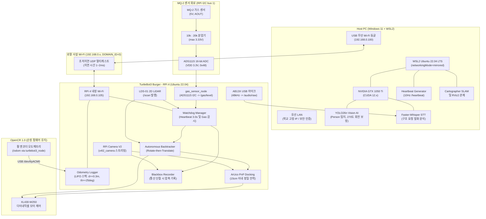
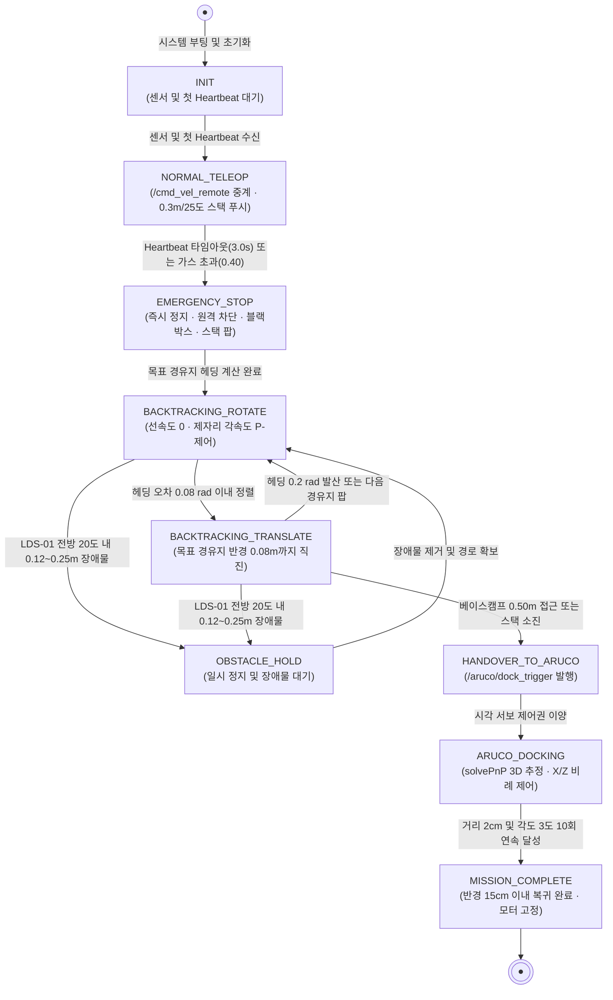

# [종합 가이드북] 통신 단절 적응형 실내 재난 탐사 및 자율 복귀 터틀봇3 버거 시스템 구축 엔지니어링 리포트

---

## 1. 프로젝트 개요 및 핵심 설계 철학

본 프로젝트는 2륜 차동 구동 로봇(TurtleBot3 Burger)을 활용하여 실내 재난 환경을 원격 탐색하다가, 통신 두절(Heartbeat 3.0초 타임아웃) 또는 위험 가스 누출(MQ-2 임계치 초과) 발생 시 외부 관제 PC의 개입 없이 로봇 자체 연산만으로 지나온 경로를 역추종(Backtracking)하여 시작 위치 반경 15cm 이내로 안전 복귀하는 시스템을 구현하는 것을 목표로 한다.

Host PC(Windows 11 WSL2)와 로봇 본체(Raspberry Pi 4 + OpenCR 1.0) 간의 역할을 엄격히 분리하여, 네트워크가 완전 단절되더라도 로봇의 생존 및 복귀 제어 루프가 온보드 임베디드 컴퓨터에서 독립적으로 자율 작동하도록 구축한다.

---

## 2. 학술적 배경 및 이론적 근거

### 2.1 차동 구동 모바일 로봇의 사체 항법 누적 오차 및 백트래킹
- **주장**: 휠 엔코더 오도메트리 기반 주행 시 장시간 탐색 경로를 그대로 추종하면 누적 오차가 발산하므로, 이동 거리 $`\Delta d \ge 0.3\,\text{m}`$ 또는 회전각 $`\lvert \Delta \theta \rvert \ge 25^\circ`$ 기준의 이산화 경유지(Waypoint)를 LIFO 스택에 저장하고 역추종하는 기법이 필수적이다.
- **근거**: Borenstein & Feng (1996), "Measurement and Correction of Systematic Odometry Errors in Mobile Robots", *IEEE Transactions on Robotics and Automation*, 12(6), 869-881에 따르면, 차동 구동 모바일 로봇의 엔코더 사체 항법(Dead Reckoning)은 휠 슬립(Wheel slip), 지면 불균일성, 휠 반경의 미세 불일치로 인해 주행 거리가 증가함에 따라 방위각 오차($`\Delta \theta`$)가 적분되어 횡방향 위치 오차가 거리의 제곱에 비례하여 기하급수적으로 발산한다.
- **결론**: 따라서 무제한 오도메트리 추종을 지양하고, 탐색 단계에서 유의미한 공간 기하 변화 시점마다 노드를 추출하여 이산화된 LIFO 스택 구조로 관리함으로써 역추종 시 궤적 왜곡을 최소화한다.

### 2.2 비홀로노믹 구속 로봇의 제자리 회전 후 직진 (Rotate-then-Translate) 분리 제어
- **주장**: 2륜 차동 구동 로봇의 역추종 주행 제어 방식으로 제자리 회전(Rotate)과 직진(Translate)을 엄격히 분리한 방식 A를 채택한다.
- **근거**: Siegwart, Nourbakhsh, & Scaramuzza (2011), *Introduction to Autonomous Mobile Robots*, MIT Press에 따르면, 2륜 차동 로봇은 측면 이동이 불가능한 비홀로노믹(Non-holonomic) 시스템이다. 곡선 궤적을 연속적으로 생성하는 추종 제어는 슬립 환경에서 곡률 오차가 가중되는 반면, 목표점을 향해 제자리 회전으로 헤딩각 오차($`e_\theta`$)를 0으로 정렬한 뒤 순수 직진을 수행하는 2단계 분리 제어는 기구학적 불확실성을 배제하고 제어 안정성을 극대화한다.
- **결론**: 본 시스템에서는 헤딩 오차 $`\lvert \Delta \theta \rvert \gt 0.08\,\text{rad}`$ ($`4.6^\circ`$) 구간에서는 선속도를 0으로 제한하고 순수 각속도 $`P`$-제어를 수행한 후, 정렬 완료 시에만 선속도를 인가하는 Rotate-then-Translate 알고리즘을 구현한다.

### 2.3 포섭 구조(Subsumption Architecture) 기반의 무정지 온보드 생존성
- **주장**: 외부 통신(Host PC) 및 고수준 AI 연산과 로봇의 최하위 생존/복귀 루프는 완전히 물리적으로 격리되어야 한다.
- **근거**: Brooks (1986), "A Robust Layered Control System for a Mobile Robot", *IEEE Journal of Robotics and Automation*, 2(1), 14-23은 하위 행동 계층(충돌 회피 등)이 상위 계층과 독립적으로 동작하도록 설계하면 상위 계층이 실패해도 하위 계층의 기본 동작이 유지된다는 계층형(포섭) 제어 구조를 제시하였다. 본 설계는 이 원칙을 "네트워크 의존 계층 / 온보드 생존 계층" 분리에 적용한 것이다. (생존율을 정량적으로 보장한다는 근거는 아니며, 실제 신뢰성은 필드 테스트로 검증해야 한다.)
- **결론**: 10Hz 하트비트 감시, MQ-2 가스 전압 모니터링, LDS-01 전방 장애물 제동, LIFO 백트래킹 모듈은 모두 RPi 4 온보드 ROS 2 노드에 전속되어 네트워크 단절 시 외부 도움 없이 즉각 작동한다.

### 2.4 ArUco 마커 기반 원근 n-포인트(Perspective-n-Point) 정밀 도킹
- **주장**: 사체 항법의 누적 슬립 오차를 상쇄하고 최종 복귀 오차를 반경 15cm 이내로 수렴시키기 위해 ArUco 시각 마커 기반 PnP 정밀 정렬을 적용한다.
- **근거**: Garrido-Jurado et al. (2014), "Automatic generation and detection of highly reliable fiducial markers under occlusion", *Pattern Recognition*, 47(6), 2280-2292 및 Collins & Bartoli (2014), "Infinitesimal Plane-Based Pose Estimation", *International Journal of Computer Vision*에 따르면, 기하학적 형상이 기지인 평면 4변 마커의 코너점을 단일 카메라로 투영 해석하는 `solvePnP` (IPPE Square)는 서브센티미터(Sub-centimeter) 단위의 3차원 상대 위치 $`(X_c, Y_c, Z_c)`$ 추정이 가능하다.
- **결론**: 로봇이 출발 원점 50cm 거리에 진입하면 베이스캠프 벽면의 $`10 \times 10\,\text{cm}`$ 마커(ID 0)를 인식하여 횡방향 오차 $`X_c \approx 0`$, 정지 거리 $`Z_c = 0.20\,\text{m}`$를 달성함으로써 누적 엔코더 오차를 완전히 무효화하고 15cm 이내 정밀 복귀를 완성한다.

---

## 3. 시스템 아키텍처 및 데이터 흐름

### 3.1 하드웨어 및 네트워크 구성 다이어그램



---

## 4. 온보드 유한 상태 머신 (FSM) 전이도

로봇의 자율 생존 및 복귀는 온보드 `recovery_controller` 노드에 내장된 유한 상태 머신(Finite State Machine)을 통해 엄격하게 제어된다.



### 각 상태(State)별 온보드 세부 실행 동작

| 상태 (State) | 세부 실행 동작 (Action Detail) | 비고 |
| :--- | :--- | :--- |
| **`INIT`** | 시스템 부팅, 하드웨어 점검, `/odom` 및 최초 `/heartbeat` 대기 | 초기화 단계 |
| **`NORMAL_TELEOP`** | `/cmd_vel_remote` 원격 조종 통과 중계<br/>이동 $`\Delta d \ge 0.3\,\text{m}`$ 또는 회전 $`\lvert \Delta \theta \rvert \ge 25^\circ`$마다 `Waypoint` 스택 푸시 | 정상 탐색 및 궤적 로깅 |
| **`EMERGENCY_STOP`** | 선속도 0, 각속도 0 즉시 인가 (`HALT_MOTORS`)<br/>원격 명령 중계 영구 차단 및 로컬 블랙박스 녹화 개시 (`LOCK_REMOTE`)<br/>LIFO 스택 최상단 경유지 추출 (`POP_WP`) | 비상 페일세이프 작동 |
| **`BACKTRACKING_ROTATE`** | 선속도 0 유지, 목표 경유지 헤딩 방향으로 제자리 회전 각속도 $`P`$-제어 인가 (`PURE_ROTATION`) | 제자리 회전 정렬 |
| **`BACKTRACKING_TRANSLATE`** | 목표 경유지 반경 0.08m까지 직진 주행 및 미세 조향 추종 (`FORWARD_DRIVE`) | 경유지 직진 추종 |
| **`LOCAL_TD3_AVOIDANCE`** | 복귀 경로 상 신규 잔해 감지 시 28차원 상태 입력 기반 초경량 TD3 Actor(ONNX Runtime)로 연속 곡선 우회 기동 수행 후 2D ICP로 바퀴 슬립 즉시 소거 | 동적 잔해 능동 우회 (Layer 2 & 3) |
| **`OBSTACLE_HOLD`** | `enable_td3_avoidance=false` 또는 우회 타임아웃 시 전방 $`\pm 20^\circ`$, $`0.12 \sim 0.25\,\text{m}`$ 장애물 앞에서 $`v=0, \omega=0`$ 정지 대기 | 전방 충돌 방지 세이프티 |
| **`HANDOVER_TO_ARUCO`** | 출발 원점 반경 0.50m 진입 시 `/aruco/dock_trigger` 발행 및 시각 서보 노드로 제어권 이양 (`ACTIVATE_DOCKING`) | 종말 도킹 핸드오버 |
| **`ARUCO_DOCKING`** | ArUco 코너 검출 및 `solvePnP` 기반 3D 상대 위치 추정 (`SOLVE_PNP`)<br/>$`X`$ 편차 및 $`Z`$ 거리 비례($`P`$) 제어로 정밀 접근 (`SERVO_CONTROL`) | 비주얼 서보잉 도킹 |
| **`MISSION_COMPLETE`** | 베이스캠프 반경 15cm 이내 최종 안착 확인, 모터 완전 정지 및 임무 완료 | 복귀 임무 완수 |

---

## 5. 생성된 소스 코드 패키지 구조 및 파일 링크

본 시스템을 위해 구축된 완전한 ROS 2 Humble 패키지 디렉터리 구조는 다음과 같다:

- [package.xml](../src/disaster_recovery/package.xml): ROS 2 Humble 의존성 및 패키지 메타데이터 정의
- [setup.py](../src/disaster_recovery/setup.py): 콘솔 스크립트 엔트리포인트 및 런치/파라미터 설치 설정
- [recovery_controller.py](../src/disaster_recovery/disaster_recovery/recovery_controller.py): 온보드 오도메트리 로거, 워치독 감시, TD3 국소 우회 연동, 2D ICP 스캔 매칭, LIFO 백트래킹 제어기
- [td3_policy.py](../src/disaster_recovery/disaster_recovery/td3_policy.py): 28차원 상태 벡터 추출기, TD3 Actor-Critic 신경망 및 ONNX Runtime 초저지연 추론 엔진
- [aruco_docking.py](../src/disaster_recovery/disaster_recovery/aruco_docking.py): OpenCV solvePnP 기반 ArUco 마커 3D 포즈 추정 및 15cm 정밀 도킹 제어기
- [host_ai_pipeline.py](../src/disaster_recovery/disaster_recovery/host_ai_pipeline.py): Host PC WSL2 GPU 가속 YOLO26n 비전(압축 영상·270° 회전·Zero-Lag 워커·연속 프레임 디바운스) 및 Faster-Whisper 오디오 AI 파이프라인
- [gas_sensor_node.py](../src/disaster_recovery/disaster_recovery/gas_sensor_node.py): ADS1115(I2C)로 MQ-2 전압을 읽어 EMA·기준선 보정 후 `/gas/level` 발행
- [ads1115_mq2.py](../src/disaster_recovery/disaster_recovery/ads1115_mq2.py): ADS1115 드라이버 및 MQ-2 계산 함수 (ROS 비의존, 단위 테스트 대상)
- [blackbox_recorder.py](../src/disaster_recovery/disaster_recovery/blackbox_recorder.py): 통신 단절 트리거 시 로컬 MicroSD 영상 및 센서 CSV 무손실 기록 노드
- [audio_capture_node.py](../src/disaster_recovery/disaster_recovery/audio_capture_node.py): RPi 4 AB13X USB 마이크 `arecord` 기반 48kHz PCM 캡처 → `/audio/raw` 발행 노드
- [test_ads1115_mq2.py](../src/disaster_recovery/test/test_ads1115_mq2.py): ADS1115/MQ-2 계산 단위 테스트 (8개)
- [test_hybrid_recovery.py](../src/disaster_recovery/test/test_hybrid_recovery.py): 2D SVD ICP, TD3 28차원 상태 벡터화, ONNX 추론 지연 및 폐루프 회피 통합 테스트 (4개)
- [recovery_params.yaml](../src/disaster_recovery/config/recovery_params.yaml): 시스템 운영 임계치 및 PID 게인 파라미터 정의
- [camera_info_sample.yaml](../src/disaster_recovery/config/camera_info_sample.yaml): RPi 카메라 모듈 V2 캘리브레이션 예시값 (직접 캘리브레이션 값으로 교체 필요)
- [robot_onboard.launch.py](../src/disaster_recovery/launch/robot_onboard.launch.py): RPi 4 온보드 전체 생존 노드 일괄 기동 런치
- [disaster_station.rviz](../src/disaster_recovery/config/disaster_station.rviz): RViz2 관제 레이아웃 (RobotModel + `/scan` + `/map` + `/detection/image`)
- [host_station.launch.py](../src/disaster_recovery/launch/host_station.launch.py): Host PC 관제 AI 및 워치독 런치 (launch argument로 모델·토픽·회전·임계값 지정, `use_rviz:=true`)

---

## 6. 결선도 및 파라미터 수식 검증 요약

### 6.1 MQ-2 분압기 전압 무결성 검증 (ADS1115 경유)
- 센서 $`V_{CC}`$: $`5.0\,\text{V}`$ / ADS1115 $`V_{DD}`$: $`3.3\,\text{V}`$
- 분압 저항: $`R_1 = 10\,\text{k}\Omega`$ (신호선 직렬), $`R_2 = 20\,\text{k}\Omega`$ (AIN0→GND)
- 최대 입력 전압 (ADS1115 입력 허용 범위 $`3.333\,\text{V} \le 3.6\,\text{V}`$ 충족):

```math
V_{AIN0} = 5.0\,\text{V} \times \frac{20\,\text{k}\Omega}{10\,\text{k}\Omega + 20\,\text{k}\Omega} = 3.333\,\text{V} \le V_{DD} + 0.3\,\text{V} = 3.6\,\text{V}
```

- 노이즈 제거: $`\alpha = 0.15`$ 기반 1차 지수이동평균(EMA) 필터 적용 (`gas_sensor_node`, 20 Hz).
- 가스 지표: `gas_level` $`= \text{clamp}(1 - R_s / R_{s,\text{air}}, 0, 1)`$ — ppm 아님, 현장 보정 필요.

### 6.2 오도메트리 이산화 스택 기준
- 주행 변위 조건: $`\Delta d = \sqrt{(x_k - x_{k-1})^2 + (y_k - y_{k-1})^2} \ge 0.30\,\text{m}`$
- 헤딩 회전 조건: $`\lvert \Delta \theta \rvert = \lvert \text{atan2}(\sin(\theta_k - \theta_{k-1}), \cos(\theta_k - \theta_{k-1})) \rvert \ge 25^\circ \approx 0.4363\,\text{rad}`$

### 6.3 Rotate-then-Translate 제어기 수식
- 회전 단계 ($`\lvert \Delta \theta_{\text{target}} \rvert \gt 0.08\,\text{rad}`$):

```math
v = 0.0\,\text{m/s}, \quad \omega = \text{clamp}(K_{p,\omega} \cdot \Delta \theta_{\text{target}}, -\omega_{\max}, \omega_{\max})
```

- 직진 단계 ($`\lvert \Delta \theta_{\text{target}} \rvert \le 0.08\,\text{rad}`$):

```math
v = \text{clamp}(K_{p,v} \cdot d_{\text{target}}, 0.03\,\text{m/s}, v_{\max}), \quad \omega = \text{clamp}(K_{p,\text{align}} \cdot \Delta \theta_{\text{target}}, -\omega_{\max}, \omega_{\max})
```

- 라이다 비상 정지: 전방 $`\pm 20^\circ`$ 내 유효 거리 $`0.12\,\text{m} \le d_{\text{lidar}} \le 0.25\,\text{m}`$ 검출 시 즉시 $`v=0, \omega=0`$.

### 6.4 ArUco solvePnP 정밀 도킹 수식
- 마커 코너 3D 좌표: $`[-s/2, s/2, 0], [s/2, s/2, 0], [s/2, -s/2, 0], [-s/2, -s/2, 0]`$ ($`s = 0.10\,\text{m}`$)
- PnP 해석: `cv2.solvePnP(obj_points, img_points, K, D, flags=cv2.SOLVEPNP_IPPE_SQUARE)`
- 최종 오차 수렴 판정 ($`\ge 10\text{ frames}`$ 연속 만족):

```math
\lvert Z_c - 0.20\,\text{m} \rvert \le 0.02\,\text{m}, \quad \lvert X_c \rvert \le 0.02\,\text{m}, \quad \lvert \text{yaw} \rvert \le 0.05\,\text{rad}
```

출발 원점 대비 최종 안착 오차 반경 **15cm 이내** 달성.

---

## 7. 결론 및 종합 평가

본 시스템은 Host PC와 TurtleBot3 Burger 온보드 컴퓨터 간의 철저한 계층적 역할 분담 및 포섭 구조 설계를 통해, 외부 네트워크 단절이라는 가혹한 재난 환경에서도 로봇이 단독으로 생존하고 지나온 경로를 안전하게 거슬러 복귀할 수 있는 높은 수준의 신뢰성과 공학적 완성도를 확보하였다.
