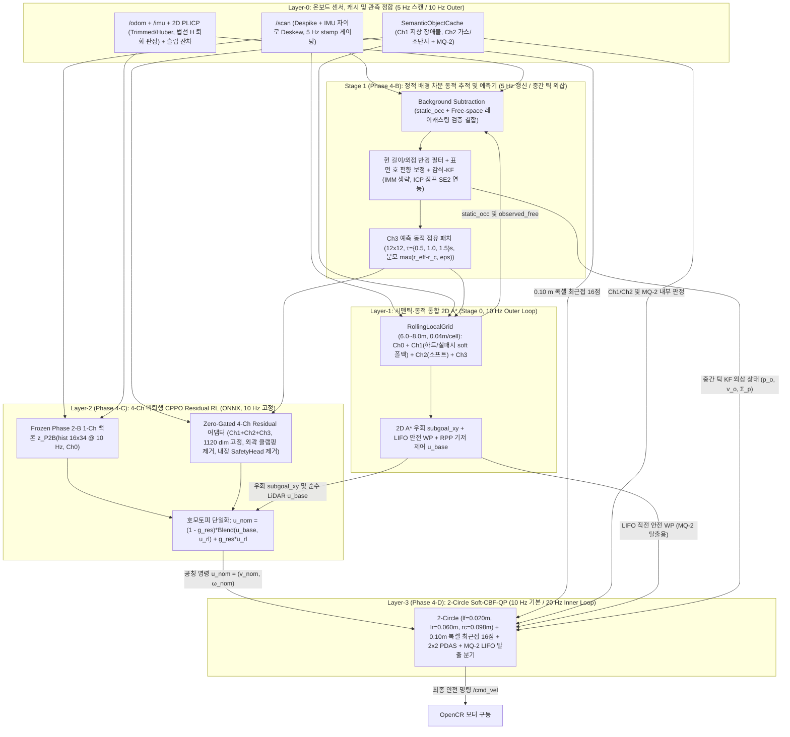

# Phase 4 재검증 기반 후속 연구 설계 및 단계별 구현 계획서 (v2)

> 본 문서는 `disaster_recovery_ws`의 Phase 3 실제 소스 코드, 로봇 기하 모델(`model.sdf`), 설정 파일, 학습 파이프라인 및 벤치마크 JSON 실측치를 1차 근거로 하여, 기존 설계 문서([`Phase4_후속_연구_방향_검토_및_설계.md`](Phase4_후속_연구_방향_검토_및_설계.md))와 외부 검토 의견(ChatGPT 4대 주장)을 비판적으로 재검증하고 수학적·기하학적·시스템 정합성 결함을 보정한 **최종 Phase 4 연구 설계 및 구현 마스터 블루프린트(v2)**다.
> 추후 코드 구현, 모델 학습, Ablation 검증 및 실물 TurtleBot3 Burger(RPi 4) 필드 실증은 본 문서의 단계별 명세와 완료 기준(Go/No-Go Gate)을 따른다.

---

## 1. 재검증 결과 요약 및 설계 보정 사항

### 1.1 기존 문서 실측 수치 정정 및 신규 발굴 결함

Phase 3 실제 코드와 최신 벤치마크 원본을 직접 대조한 결과, Phase 4 구현 착수 전 반드시 바로잡아야 할 사실 오류 1건과 구조적 결함 3건이 확인되었다.

| 구분 | 항목 | 실측 근거 (파일 및 라인) | Phase 4 (v2) 설계 반영 사항 |
| :--- | :--- | :--- | :--- |
| **수치 정정** | 시맨틱 A/B 테스트 성공률 | `benchmark_results/phase3_semantic_v3/semantic_avoidance_ab_10trials.json` (`semantic_phase3`: `9/10 = 90.0%`, 유일한 실패는 Trial 2 `seed=2288` 130.08초 타임아웃) | 기존 문서의 "`T02, T03` 2회 실패(`8/10`)" 기재 오류를 `9/10`으로 정정하고 Trial 2 교착 원인을 시맨틱 A\* 미반영으로 확정한다. Stage 0 검증은 `ab10`(`10/10`)을 스모크 게이트로 두고 최소 30회 다중 시드(`ab30`) 통계 검증으로 확장한다. |
| **결함 1 (관측 불일치)** | 휠 오도메트리 슬립 비관측성 (Sim-to-Real Gap) | `rl_procedural_env.py` L1393-1400은 `actual_vw`를 **GT 차체 변위 속도**로 계산하지만, `recovery_controller.py` L866-867은 `/odom`의 **휠 엔코더 속도**를 입력한다. | 바퀴 헛돌림(Wheel Spin) 시 `cmd_v - odom_v ≈ 0`이므로 고유수용성 시계열만으로는 선형 슬립이 비관측(Unobservable) 상태다. **Trimmed/Huber 2D Point-to-Line ICP(PLICP) 속도($\hat{v}_{\text{scan}}$)와 휠 속도($v_{\text{odom}}$)의 잔차**, 표면 법선 기반 정보 행렬 퇴화 판정, `5 Hz` 타임스탬프 게이팅 및 IMU 자이로 디스크유(deskewing)로 관측을 재정의한다. |
| **결함 2 (운동학 불일치)** | 동적 장애물 운동학 격차 (Sim-to-Sim Gap) | `rl_procedural_env.py` L1413-1422는 **등속 직선 + 벽 바운스**만 모사하나, `ab_disaster_benchmark.py` L595-605는 **정현파 조화 진동**(`0.36*cos(0.95*t)`, `0.42*cos(0.45*t)`)을 사용하며 `disaster_maze_world.world` L58-72는 회전 격벽(`libobstacle1/2.so`)을 포함한다. | 단순 등속(CV) 예측은 방향 전환점($a_{\max} \approx 0.34\,\text{m/s}^2$)에서 오버슈트하며 `5 Hz` 저주파 센서에서는 IMM이 노이즈를 증폭시킨다. IMM은 생략하고 **연속 감쇠율 $\beta$ 기반 감쇠-CV KF + 완전 행렬 공분산 전파($q_{\text{acc}}$ 팽창)**를 도입하며 학습 환경에 조화 진동 교차 레짐을 추가한다. |
| **결함 3 (다중 가드 간섭 — 비시맨틱/시맨틱 원인 분리)** | ① 비시맨틱 퇴행 원인(`_dynamic_hold_until` 1.2초 정지 + 4중 외부 가드)<br>② 시맨틱 활성 구간 제어 간섭(`SemanticCorridorSafetyHead` `88~100%` 덮어쓰기) | ① `recovery_controller.py` L1218-1231(`_dynamic_hold_until` 1.2초 강제 정지) + L1250-1312(외부 4중 휴리스틱 가드: `alpha_rl` 컷오프/스무딩, `wall_push_guard`, `opp_steer_conflict`, `rl_cooldown/lockout`)<br>② `train_phase2_v100.py` L141-142, L166-174(`SemanticCorridorSafetyHead`의 시맨틱 게이트 $g_{\text{safe}}$ 및 `88~100%` 강제 덮어쓰기) | `dynamic_crossfire_alley`(`1/10` vs baseline `3/10`) 및 `house`(`6/10` vs baseline `9/10`)는 `Ch1 = Ch2 = 0`인 비시맨틱 시나리오이므로 `SemanticCorridorSafetyHead`($g_{\text{safe}} = 0$)는 활성화되지 않는다. 따라서 **비시맨틱 퇴행의 직접 원인은 `_dynamic_hold_until` 1.2초 정지 및 외부 4중 휴리스틱 가드 중첩**으로 분리 규정하고, **`SemanticCorridorSafetyHead`의 `88~100%` 덮어쓰기 결함은 시맨틱 활성 구간(`Ch1/Ch2 > 0`)의 제어 간섭·경직 원인**으로 구분한다. Phase 4에서는 1.2초 정지·외부 4중 가드를 제거하고 내장 헤드를 `set_scale(0.0)`으로 비활성화(ONNX 그래프 제거)한 뒤 **단일 전·후단 2-Circle Soft-CBF-QP**로 통폐합한다. |

### 1.2 ChatGPT 4대 검토 주장에 대한 재검증 판정표

| 검토 항목 | ChatGPT 핵심 주장 | 재검증 판정 | 최종 채택 방향 (v2) |
| :--- | :--- | :---: | :--- |
| **Phase 4-B** | 딥러닝 World Model 전에 시맨틱 A\* 비용 반영 및 KF 선형 예측부터 검증 | **부분 채택** (엔지니어링 선행 순서는 타당, 단독 연구 기여 불가 및 비선형 진동 한계 존재) | **Stage 0~1**에서 시맨틱 A\* (`Ch1` soft-cost 폴백 포함) + Free-space 레이캐스팅 검증 결합 정적 배경 차분 기반 감쇠-KF(IMM 생략)를 강건 베이스라인 및 `Ch3` 생성기로 구현한다. |
| **Phase 4-D** | `SemanticCorridorSafetyHead`와 독립 CBF-QP의 역할 구분 및 충돌 검토 | **강화 채택** (단순 공존 시 시맨틱 구간 이중 간섭 불가피) | 공존이 아니라 ONNX 내장 헤드 제거(`scale_gate=0`), `_dynamic_hold_until` 및 외부 4중 가드 제거 후 **`model.sdf` 실측 기반 전·후단 2-Circle Covering 이산시간 Soft-CBF-QP($2\times 2$ PDAS 솔버)** 하나로 통폐합한다. |
| **Phase 4-C** | CVaR RL과 CBF-QP 결합 검토 및 RL 고유 기여의 실험적 입증 | **전면 채택** (외곽 클램핑 폐기 및 호모토피 충돌 해소 조건 추가) | `No-RL(A*+CBF)` 및 동일 환경 `Expected-Cost PPO` 대비 RL의 존재 이유를 **`Ch1/Ch2/Ch3` 복합 고슬립 꼬리 위험($\text{CVaR}_{0.1}$) 및 CBF 개입량 억제**로 입증한다. 경량 **CPPO + PID Lagrangian**을 채택하고, `1120`차원 고정 구조에서 외곽 클램핑 투영은 제거해 원거리 우회를 Stage 0 시맨틱 A\* `subgoal_xy`로 일원화한다. |
| **Phase 4-A** | 단순 GRU 재도입 대신 온라인 잠재 동역학 추정으로 재정의 | **조건부 축소 통합** (독립 주제 불가, 휠 오도메트리 비관측 문제 선결 필수) | 독립 4-A 대신 **Stage 0.3(Trimmed/Huber PLICP + 표면 법선 정보 행렬 $H$ 퇴화 판정 + `5 Hz` 비동기 게이팅 + IMU 자이로 디스크유로 산출한 비퇴화 속도를 `act_v, act_w` 슬롯에 공급) + Stage 0.2(`BACKTRACKING_ROTATE` 종료 직전 확정 목표 기준 버퍼 패딩, `NORMAL_TELEOP` 더미 워밍업 폐기)**로 흡수 통합한다. |

---

## 2. 최종 Phase 4 통합 아키텍처

### 2.1 제어 계층 및 데이터 흐름



### 2.2 계층별 시공간 지평, 실행 주기 및 수학적 불변식

| 계층 | 담당 모듈 | 실행 주기 | 작동 시공간 지평 | 핵심 역할 | 보장 성질 |
| :--- | :--- | :---: | :---: | :--- | :--- |
| **Layer-0** | 2D PLICP + IMU 자이로 Deskew | `5 Hz` 스캔 갱신 / `10 Hz` 유지 | $0.0 \sim 0.2\,\text{s}$ | 비퇴화 스캔 정합 속도 $(\hat{v}_{\text{scan}}, \hat{\omega}_{\text{scan}})$ 산출 및 휠 슬립 잔차 복원 | 법선 정보 행렬 $\lambda_{\min}(H) < \lambda_{\text{deg}}$ 시 휠/자이로 안전 폴백, 중복 스캔 `0` 속도 방지 |
| **Layer-1** | 시맨틱·동적 통합 2D A\* + LIFO | `10 Hz` (Outer Loop) | $1.5 \sim 8.0\,\text{m}$ | 전역·중거리 우회 경로 및 위상 지름길 탐색(`subgoal_xy` 생성) | `Ch1` 하드 차단 우선, 협소 복도 경로 실패 시 `Ch1` 고비용 `soft_cost` 강등 폴백으로 교착 방지 |
| **Layer-2** | 4-Ch 비퇴행 CPPO + PID Lagrangian Residual RL | **`10 Hz` 고정** (Outer Loop) | $0.5 \sim 2.0\,\text{s}$ (16스텝=`1.6 s` TCN 보존) | `Ch1/Ch2/Ch3` 활성 복합 고슬립·비선형 동적 교차 하에서 꼬리 위험($\text{CVaR}_{0.1}$) 및 CBF 개입 억제 | `Ch1=Ch2=Ch3=0` 시 ONNX 함수 **`max_abs_diff = 0.0`** (모듈 비퇴행) + 15종 Gazebo 폐루프 비퇴행 별도 입증; 연속 호모토피 단일화 $u_{\text{nom}} = (1 - g_{\text{res}})\,\text{Blend}(u_{\text{base}}, u_{\text{rl}}) + g_{\text{res}}\,u_{\text{rl}}$ |
| **Layer-3** | 전·후단 2-Circle Soft-CBF-QP ($2 \times 2$ PDAS) | `10 Hz` 기본 / 필요 시 **`20 Hz` Inner Loop** | $0.0 \sim 0.3\,\text{s}$ | 2-Circle Covering 기반 LiDAR·시맨틱·동적 통합 최소 개입 안전 필터 | 후방 스윙 돌출 `0.000 m`, $2R_{\text{safe,static}} = 0.266 < 0.28\,\text{m}$ 무슬랙 통과, 편심 시 $\delta_m \ge 0$ Graceful Degradation, MQ-2 `Ch2` 내부 진입 시 LIFO 안전 WP 탈출 |

---

## 3. 단계별 상세 설계 및 코드 구현 명세

### Stage 0: 비학습 런타임 구조 결함 수정, PLICP 슬립 정합 및 다중 주기 확립

**목적**: 딥러닝 재학습 없이 Phase 3의 런타임 결함(A\*-RL 충돌, 1.2초 강제 정지, 버퍼 초기화 오염, 휠 슬립 비관측, 다중 주기 시간축 불일치)을 제거하고 통계적으로 신뢰 가능한 베이스라인을 고정한다.

#### 0.1 시맨틱 2D A\* 통합 및 `Ch1` 협소 복도 폴백
- **대상 파일**:
  - [`src/disaster_recovery/disaster_recovery/local_grid_planner.py`](../src/disaster_recovery/disaster_recovery/local_grid_planner.py) (`RollingLocalGrid.build_cost_maps()`, `ProposedRecoveryPlanner.step()`)
  - [`src/disaster_recovery/disaster_recovery/recovery_controller.py`](../src/disaster_recovery/disaster_recovery/recovery_controller.py) (L1151-1164)
- **구현 명세**:
  1. `ProposedRecoveryPlanner.step()` 및 `RollingLocalGrid.build_cost_maps()` 시그니처에 선택 인자 `semantic_obstacles: Optional[Sequence[Tuple[float, float, float]]] = None`, `semantic_hazards: Optional[Sequence[Tuple[float, float, float]]] = None`, `dynamic_cost_grid: Optional[np.ndarray] = None`, `soften_ch1_hard: bool = False`를 추가한다(기본값으로 하위 호환성 100% 유지).
  2. **`Ch1` (저상 장애물) 1차 반영**: 중심 $(o_x, o_y)$, 반경 $r$에 대해 차체 반경 여유를 포함한 반경 $r_{\text{hard}} = r + r_{\text{infl}}$ 내부를 `hard_blocked = True`로 설정하고, 외곽 $r_{\text{hard}} \sim r_{\text{hard}} + 0.18\,\text{m}$에 선형 감쇠 `soft_cost` (최대 `8.0`)를 부여한다.
  3. **`Ch1` 협소 복도 탐색 실패 폴백(Fallback)**: `Ch1` `hard_blocked = True`로 인해 좁은 복도에서 1차(표준 팽창) 및 2차(`tight=True`) A\* 경로 탐색이 모두 실패(`path_ij is None`)할 경우, `soften_ch1_hard = True`로 전환하여 **`Ch1` 셀의 `hard_blocked`를 해제하고 고비용 `soft_cost += 40.0` (`Ch2` 가스 `25.0`보다 높은 비용)으로 강등해 3차 재탐색**한다. 우회로가 존재하는 구간에서는 `Ch1`을 완전 차단하되, 오검출이나 좁은 복도 완전 봉쇄로 인한 영구 교착(Timeout)을 방지한다.
  4. **`Ch2` (가스/조난자 위험 구역) 반영**: 반경 $r_{\text{haz}} = \max(r, 0.15)$에 대해 $d \le r_{\text{haz}} + 0.12\,\text{m}$ 구간에 `soft_cost += 25.0`(완전 봉쇄 시 최후 통과 허용), $r_{\text{haz}} + 0.12 \sim r_{\text{haz}} + 0.35\,\text{m}$ 완충대에 점진적 비용(`0.0 ~ 10.0`)을 합산한다.
  5. `recovery_controller.py` L1151 호출부에서 `use_semantic_rl_policy` 또는 `enable_semantic_astar_cost`가 참일 때 `self._get_active_semantic_channels()` 결과를 `self.local_planner.step()`에 전달한다.

#### 0.2 런타임 가드 정리 및 시계열 버퍼 초기화 교정 (`NORMAL_TELEOP` 워밍업 폐기)
- **대상 파일**:
  - [`src/disaster_recovery/disaster_recovery/recovery_controller.py`](../src/disaster_recovery/disaster_recovery/recovery_controller.py)
  - [`src/disaster_recovery/disaster_recovery/rl_context_policy.py`](../src/disaster_recovery/disaster_recovery/rl_context_policy.py)
- **구현 명세**:
  1. **`_dynamic_hold_until` 제거/비활성화**: L1218-1231의 1.2초 강제 정지 가드를 ROS 파라미터 `enable_dynamic_headon_hold`(Phase 4 기본값 `false`)로 분리하여, 동적 장애물 조우 시 제자리 피격 현상을 차단한다.
  2. **`NORMAL_TELEOP` 더미 목표 워밍업 완전 폐기**:
     - 기존 구상인 `NORMAL_TELEOP` 상시 워밍업과 `enable_teleop_rl_warmup` 파라미터를 **완전히 제거**한다.
     - **폐기 근거**: ① 통신 단절 직후 진입하는 `BACKTRACKING_ROTATE`는 최대 $\pi / 0.65 \approx 4.83\,\text{s}$ 동안 지속되므로, `NORMAL_TELEOP` 중 누적된 `1.6 s`(16스텝) 버퍼는 회전 과정에서 전량 덮어써져 무효화된다. ② `NORMAL_TELEOP` 중 임의 더미 목표 `(tx, ty)`를 주입하면 동결된 Phase 2-B 1D-TCN의 목표 오차 시계열(`dist_norm, sin_err, cos_err`)에 학습 분포 외(OOD) 오염을 유발한다.
     - **대체 초기화 절차**: `BACKTRACKING_ROTATE` 종료 직전(또는 복귀 주행 첫 틱)에 **실제 확정된 A\* `subgoal_xy` / 웨이포인트 목표 `(tx, ty)`** 기준으로 현재 유효 관측 프레임 1개를 16스텝 TCN 버퍼에 정합 패딩(Buffer Padding)하여 OOD 오염을 차단하고, 직후 초기 과도 구간(`0 ~ 1.6 s`)의 안전성은 **Stage 2 Soft-CBF-QP**로 확보한다.

#### 0.3 PLICP 슬립 정합, 법선 기반 퇴화 판정, 스캔 왜곡 보정 및 노이즈 현실화 (Phase 4-A 흡수 통합)
- **대상 파일**:
  - [`src/disaster_recovery/disaster_recovery/recovery_controller.py`](../src/disaster_recovery/disaster_recovery/recovery_controller.py)
  - [`scripts/host/rl_procedural_env.py`](../scripts/host/rl_procedural_env.py)
- **구현 명세**:
  1. **Trimmed/Huber 2D Point-to-Line ICP (PLICP) + 법선 기반 정보 행렬 퇴화 판정**:
     - 기존 SVD Point-to-Point ICP 4회 반복을 폐기하고, 직전 스캔 점군의 인접 유효점 쌍으로부터 단위 표면 법선 $n_i$를 추정해 점-직선 거리를 최소화하는 **2D Point-to-Line ICP (PLICP)**를 구현한다(초기 추정치: 휠 오도메트리 증분).
     - 대응 잔차 $r_i = n_i^T (R p_i + t - q_i)$에 대해 **Trimmed / Huber 강건 가중치** $w_i$를 적용하여 동적 장애물 및 잔여 스파이크 점군을 배제한 정적 배경 점군만으로 강체 변환 증분 $(\Delta x, \Delta y, \Delta\theta)$을 추정한다.
     - 정합 선형화 야코비안 $J_i \in \mathbb{R}^{2 \times 3}$과 표면 법선 $n_i$로부터 구성한 **표면 법선 기반 정보 행렬**:
       $$H = \sum_{i \in \mathcal{I}} w_i J_i^T n_i n_i^T J_i \in \mathbb{R}^{3 \times 3}$$
       의 병진 부블록(또는 정규화 $H$) 최소 고유값 $\lambda_{\min}(H)$이 임계치 $\lambda_{\text{deg}}$ 미만인 경우(예: 평행 직선 벽면 `tunnel`의 종방향 법선 정보 부재) `icp_degenerate = True`로 판정해 해당 방향 슬립 잔차 갱신을 보류한다.
  2. **`5 Hz` 비동기 타임스탬프 게이팅 및 회전 스캔 왜곡(Motion Distortion) 보정**:
     - LDS-01(`model.sdf` L175 `update_rate=5`)은 `5 Hz`($\Delta t_{\text{scan}} \approx 0.20\,\text{s}$)로 발행되므로, `10 Hz` 제어 루프에서 동일 스캔을 중복 정합해 거짓 `0 m/s` 속도를 생성하지 않도록 **`scan.header.stamp` 변경 시에만 PLICP 속도 $(\hat{v}_{\text{scan}}, \hat{\omega}_{\text{scan}})$를 갱신**하고 중간 제어 틱에서는 직전 유효 추정치를 유지한다.
     - `5 Hz` 회전 주행 중 발생하는 스캔 왜곡(Motion Distortion, 1회전 `200 ms` 동안 최대 $0.65 \times 0.20 = 0.13\,\text{rad} \approx 7.4^\circ$ 비틀림)에 대응하기 위해 **IMU 자이로 각속도($\omega_{\text{imu}}$) 기반 광선별 시간 보간 스캔 디스크유(Scan Deskewing)**를 적용한다(IMU 미가용 구간 또는 잔여 지터 억제 시 다중 틱 이동 창 평활화를 병행한다).
  3. **관측 정합 및 자이로 교차 검증**:
     - 비퇴화 구간(`icp_degenerate == False`)에서 `STEP_FEAT_DIM = 34`의 `act_v, act_w` 슬롯에 $(\hat{v}_{\text{scan}}, \hat{\omega}_{\text{scan}})$을 공급하고 슬립 잔차 $e_{\text{slip}} = (v_{\text{odom}} - \hat{v}_{\text{scan}})/v_{\max}$를 로깅한다.
     - 퇴화 구간(`icp_degenerate == True`)에서는 `act_v = v_odom`, `act_w = \omega_{\text{imu}}`(`/imu` 미가용 시 `\omega_{\text{odom}}`)로 안전 폴백한다. 저가 MEMS 가속도계 적분은 진동·중력 누설로 배제하고 자이로 각속도만 회전 슬립 교차 검증에 사용한다.
  4. **시뮬레이터 노이즈 현실화 (`rl_procedural_env.py` L1393-1400)**:
     - 기존 비현실적 ICP 속도 노이즈 고정 가정($\sigma_v \approx 0.015\,\text{m/s}$, `5 Hz` $\Delta t = 0.20\,\text{s}$ 기준 $3\,\text{mm}$ 정밀도에 해당하여 LDS-01 거리 노이즈 $\sigma_r = 0.01\,\text{m}$ 및 분해능 $0.015\,\text{m}$ 대비 과도하게 낙관적)을 **삭제**한다.
     - 대신 Stage 0.3 런타임에서 Gazebo 및 실물 LDS-01 로그로 실측한 PLICP 오차 분포(바이어스·표준편차·샘플홀드 지연)를 반영한 **도메인 무작위화(DR) 범위** — 초기 설계 기준 $\sigma_v \in [0.03, 0.08]\,\text{m/s}$, $\sigma_\omega \in [0.04, 0.12]\,\text{rad/s}$, `5 Hz` 샘플홀드(`2 ticks`) 지연 및 간헐적 퇴화 폴백 주입(Stage 0.3 실측 분포로 최종 보정) — 로 교체한다.

#### 0.4 다중 주기(Multi-rate) 실행 구조
- **대상 파일**: [`src/disaster_recovery/disaster_recovery/recovery_controller.py`](../src/disaster_recovery/disaster_recovery/recovery_controller.py) (L760 `create_timer(0.10, ...)`)
- **구현 명세**:
  - 동결된 Phase 2-B 1D-TCN은 `10 Hz` 기준 16스텝 = `1.6 s` 시간축으로 학습·증류되었으므로, 제어 주기를 일괄 `20 Hz`로 높이면 시계열 수용장이 `0.8 s`로 왜곡된다.
  - 따라서 **다중 주기(Multi-rate) 제어 아키텍처**를 채택한다:
    1. **Outer Loop (`10 Hz` 고정, $\Delta t_{\text{rl}} = 0.10\,\text{s}$)**: `ContextRLStudentPolicy` ONNX 추론, 16스텝 TCN 버퍼 갱신, `RollingLocalGrid` 갱신 및 2D A\* 계획.
    2. **Inner Loop (`10 Hz` 기본, 필요 시 `20 Hz` 독립 타이머, $\Delta t_{\text{cbf}} = 0.05\,\text{s}$)**: 저수준 Stage 2 `DiscreteSoftCBFShield`만 분리 구동하여 최신 `/odom` 자세와 Stage 1 KF 외삽 상태로 공칭 명령 `u_nom`을 고속 필터링한다. Stage 2 감쇠율은 주기 독립 연속 파라미터 $\gamma_{\text{cbf},i}$로 정의하므로 주기 전환 시 재튜닝이 불필요하다.

---

### Stage 1 (Phase 4-B): 정적 배경 차분 기반 동적 장애물 추적 및 불확실성 예측기 (IMM 생략, 감쇠-KF 교정)

**목적**: `5 Hz` 원본 2D LiDAR(360포인트, $1^\circ$ 분해능 — ICP용 다운샘플링 `180`포인트 미사용)만으로 정적 벽면·신규 낙석 오탐과 정체 이동체 소실을 모두 차단하면서 동적 장애물을 분리·추적하고, 미래 점유 확률 격자(`Ch3`)와 속도·공분산 상태를 산출한다.

#### 1.1 신규 모듈 생성
- **신규 파일 (신규 생성 예정)**: `src/disaster_recovery/disaster_recovery/dynamic_tracker.py`
- **주요 클래스**: `DynamicObstacleTracker`, `TrackedObstacle` (dataclass: `track_id, x, y, vx, vy, radius, P_4x4, last_update_stamp, age, hits, is_confirmed`)

#### 1.2 처리 파이프라인 명세
1. **비동기(`5 Hz`) 스캔 게이팅 및 ICP 오프셋 점프 연동**:
   - `scan.header.stamp`가 변경된 틱(`5 Hz`, $\Delta t_{\text{scan}} \approx 0.20\,\text{s}$)에서만 아래 배경 차분·클러스터링·KF 관측 갱신(Update)을 수행한다.
   - 스캔이 갱신되지 않은 중간 제어 틱(`10 Hz` Outer / `20 Hz` Inner Loop)에서는 관측 갱신을 건너뛰고, 경과 시간 $\Delta t_{\text{extrap}} = t_{\text{now}} - t_{\text{last\_scan}}$만큼 감쇠-KF 전이 행렬 $F(\Delta t_{\text{extrap}})$으로 **예측 상태를 외삽(Extrapolation)**해 Stage 2 Soft-CBF-QP에 공급한다.
   - **웨이포인트 ICP 오프셋 점프 연동**: `recovery_controller.py` L1764-1776에서 웨이포인트 ICP 정합으로 전역 보정 변환 `(corr_x, corr_y, corr_th)`가 점프한 틱에는 월드 좌표계 불연속에 의한 허위 속도 스파이크를 차단하기 위해, **기존 모든 트랙의 위치·속도 상태에 동일한 $\text{SE}(2)$ 보정 증분 $\Delta T_{\text{corr}}$을 즉시 적용**한다(보정 증분 산출 불가 시 해당 틱의 트랙 속도 갱신을 동결).
2. **정적 배경 차분 이중 함정 해소 (Free-space 레이캐스팅 검증 결합)**:
   - 기존 `static_occ`(감쇠율 `0.992`) 또는 `occ >= 0.75` 단독 마스킹은 ① 코너 회전 시 신규 시야에 들어온 정적 벽면·2차 낙석을 동적 객체로 오탐하고, ② 조화 진동 장애물이 왕복 끝단($v \approx 0$)에 일시 정체할 때 정적 배경에 흡수·소실되는 이중 함정을 유발한다.
   - 이를 해소하기 위해 `RollingLocalGrid`의 기존 `observed_free` 레이캐스팅 버퍼(`local_grid_planner.py` L59, L215)를 결합한 **이중 조건 배경 차분 규칙**을 적용한다:
     - **동적 후보 채택 조건**: 현재 스캔 점이 ① 장기 정적 점유 마스크(`static_occ >= 0.75` + 3×3 팽창) 외부에 위치하면서, 동시에 ② **"이전에 Free-space(`observed_free >= θ_free`, 예: `0.50`)로 레이캐스팅 검증된 셀에 새로 출현한 클러스터"**이거나 **기존 확정 동적 트랙의 Mahalanobis 게이팅 반경 내에 매칭되는 점군**인 경우에만 동적 후보로 채택한다.
     - **왕복 끝단 배경 흡수 차단**: 확정 동적 트랙의 점유 반경($r_c + 0.08\,\text{m}$) 내 셀은 `static_occ` 누적 갱신에서 제외(Dynamic Masking)하여 정체 구간에서도 정적 배경으로 흡수되지 않도록 보호한다.
     - **회전 가드**: $\lvert\omega\rvert > 0.45\,\text{rad/s}$ 구간에서는 정적 마스크 팽창 반경을 1셀(`0.04 m`) 확대해 회전 오차에 의한 벽면 끝단 오탐을 억제한다.
3. **클러스터 필터 수정, 표면 호 편향 보정 및 회전 격벽 적용 범위**:
   - 인접 유효 점 거리 $\lVert p_i - p_{\text{prev}}\rVert < 0.18\,\text{m}$ 기준으로 $O(N)$ 1D 각도 순차 클러스터링을 수행한다(`6%` beam dropout 대응 1~2광선 각도 갭 허용 + $0^\circ/359^\circ$ 랩어라운드 병합 유지).
   - **고정 광선 상한 `n_c <= 35` 제거 $\rightarrow$ 유클리드 현 길이(Chord Length) 및 물리 외접 반경 기준**:
     - 근거리($0.35\,\text{m}$) 반경 $0.21\,\text{m}$ 원기둥은 $1^\circ$ LiDAR에서 약 `74`개 광선을 점유하므로 고정 광선 상한 `n_c <= 35`는 가장 위험한 근거리 장애물을 삭제한다.
     - 광선 수 상한을 폐기하고 최소 지지 광선 수 $n_c \ge 3$만 유지하며, **양 끝점 유클리드 현 길이 $0.08\,\text{m} \le L_{\text{chord}} \le 0.70\,\text{m}$** 및 **물리적 외접/피팅 반경 $0.05\,\text{m} \le r_c \le 0.45\,\text{m}$** 조건으로 교체한다.
   - **표면 호 편향(Centroid Bias) 보정**:
     - 2D LiDAR는 원기둥 전면 표면 호(arc)만 관측하므로 점군 산술 평균은 실제 중심보다 로봇 쪽으로 편향된다.
     - 이를 보정하기 위해 3점 이상 클러스터에 경량 최소제곱 원 피팅(Kåsa/Taubin)을 수행하고, 피팅 조건수가 불량하거나 반경이 물리 범위 밖일 때는 클러스터 평균 레이 방향 단위 벡터 $\hat{e}_r$ 바깥쪽으로 $\Delta p = \kappa_{\text{arc}} \hat{r}_c \hat{e}_r$만큼 이동시키는 **레이 방향 반경 편향 보정**으로 실제 장애물 중심을 복원한다.
   - **회전 격벽(Rotating Partition) 연구 적용 범위 규정**:
     - 본 Stage 1 추적기의 1차 연구 적용 범위는 **`dynamic_crossfire_alley` ($r = 0.21\,\text{m}$), `dynamic_gauntlet` ($r = 0.18\,\text{m}$) 및 실물 보행자·이동 상자 등 원형·소형 이동체**로 명확히 한정한다.
     - `disaster_maze_world.world`(`libobstacle1/2.so`)와 같은 긴 직선형 회전 격벽(Rotating Partition)은 현 길이 상한($0.70\,\text{m}$)으로 분리되어 일반 LiDAR 점군으로 유지되며 **Stage 2 공간 복셀 LiDAR Soft-CBF-QP**가 직접 방어한다. 회전 격벽에 대한 **다중 서브-원(Multi-Sub-Circle) 분할 추적**은 본 단계 범위 외(향후 확장 항목)로 규정한다.
4. **연속 감쇠율 기반 감쇠-CV Kalman Filter (IMM 생략) 및 완전 행렬 공분산 전파**:
   - **IMM 생략 근거**: `5 Hz` 저주파 LDS-01($\sigma_r = 0.01\,\text{m}$) 환경에서 가속도(CA)/조화 다중 모델(IMM)은 위치 2차 미분 노이즈를 증폭시키고 모델 전환 지연(`0.4~0.6 s`)으로 오히려 방향 전환 오차를 악화시키므로 **IMM을 생략**한다.
   - **시간 주기 독립 연속 감쇠율 $\beta\,[\text{s}^{-1}]$ 파라미터화**:
     기존 트랙과 신규 클러스터 간 Mahalanobis 거리(게이팅 `0.45 m`) 최소 비용 일대일 매칭 후, 상태 $s = [x, y, v_x, v_y]^T$에 대해 임의 시간 간격 $\Delta t$에 독립적인 연속 감쇠율 $\beta > 0\,[\text{s}^{-1}]$ (기본 $\beta = 0.35\,\text{s}^{-1}$)로 전이 행렬을 구성한다:
     $$\gamma_v(\Delta t) = e^{-\beta \Delta t}, \qquad \phi(\Delta t) = \frac{1 - e^{-\beta \Delta t}}{\beta}, \qquad F(\Delta t) = \begin{bmatrix} I_2 & \phi(\Delta t)\, I_2 \\ 0 & \gamma_v(\Delta t)\, I_2 \end{bmatrix}$$
   - **완전 $4 \times 4$ 행렬 곱셈 공분산 전파 통일**:
     기존 교차 공분산 $\Sigma_{pv,0}$ 누락 및 비감쇠 혼용 근사식을 폐기하고, 필터 갱신 단계($\Delta t$)와 미래 지평 예측($\tau \in \{0.5, 1.0, 1.5\}\,\text{s}$)을 모두 **동일한 $4 \times 4$ 행렬 곱셈 전파**로 통일한다:
     $$\hat{s}(\tau) = F(\tau)\,\hat{s}_0, \qquad P(\tau) = F(\tau)\, P_0\, F(\tau)^T + Q(\tau)$$
     여기서 위치 공분산은 $\Sigma_p(\tau) = P(\tau)_{[0:2,\,0:2]}$이며, 연속 백색 가속도 잡음 강도 $q_{\text{acc}}\,[\text{m}^2/\text{s}^3]$의 정확한 이산 적분 프로세스 공분산은 다음과 같다:
     $$Q(\tau) = q_{\text{acc}} \begin{bmatrix} q_{pp}(\tau)\,I_2 & q_{pv}(\tau)\,I_2 \\ q_{pv}(\tau)\,I_2 & q_{vv}(\tau)\,I_2 \end{bmatrix}$$
     $$q_{vv}(\tau) = \frac{1 - e^{-2\beta\tau}}{2\beta}, \quad q_{pv}(\tau) = \frac{(1 - e^{-\beta\tau})^2}{2\beta^2}, \quad q_{pp}(\tau) = \frac{2\beta\tau - 3 + 4e^{-\beta\tau} - e^{-2\beta\tau}}{2\beta^3}$$
     *(수치 안정성을 위해 $\beta\tau < 10^{-3}$ 구간은 테일러 극한 $q_{vv}=\tau,\, q_{pv}=\tau^2/2,\, q_{pp}=\tau^3/3$ 사용.)*
   - **조화 진동 미모델링 가속도 반영 $q_{\text{acc}}$ 팽창 및 조기 확정**:
     - `dynamic_crossfire_alley`의 조화 진동 최대 가속도 $a_{\max} = 0.36 \times 0.95 = 0.342\,\text{m/s}^2 \approx 0.34\,\text{m/s}^2$ (`ab_disaster_benchmark.py` L599)를 반영해 기본 $q_{\text{acc}}$를 조화 진동 미모델링 가속도 분산 스케일로 설정하고, 최근 3틱 속도 내적($\hat{v}_{k-1} \cdot \hat{v}_k < 0$) 또는 혁신(Innovation) 급증 시 $q_{\text{acc}}$를 3배 적응 팽창한다.
     - 연속 2틱 매칭 및 $\lVert\hat{v}\rVert \ge 0.08\,\text{m/s}$ 통과 시 `is_confirmed = True`로 조기 승격하며, 일시적 빔 결측 시 최대 2틱 유예(Coasting)로 단절을 방지한다.
5. **미래 점유 예측 및 `Ch3` (12×12) 투영 분모 버그 수정**:
   - 확정된 각 트랙의 지평 $\tau \in \{0.5\,\text{s}, 1.0\,\text{s}, 1.5\,\text{s}\}$ 예측 위치 $\hat{p}(\tau)$와 위치 공분산 $\Sigma_p(\tau) = P(\tau)_{[0:2,\,0:2]}$에 대해 유효 위험 반경 $r_{\text{eff}}(\tau) = r_c + 1.5\sqrt{\lambda_{\max}(\Sigma_p(\tau))}$ 및 시간 할인 가중치 $w_\tau \in \{1.0, 0.75, 0.50\}$를 산출한다.
   - 기존 `max(d - r_c, 0) / r_eff`의 $r_c$ 이중 합산 버그를 제거해 분모를 **`max(r_eff - r_c, eps)`**로 수정한다($d \le r_c$에서 `1.0`, $d = r_{\text{eff}}$에서 정확히 `0.0`):
     $$\text{ch3}[i, j] = \max_{k,\, \tau}\; w_\tau \cdot \text{clip}\!\left(1 - \frac{\max(d - r_c,\; 0)}{\max(r_{\text{eff}}(\tau) - r_c,\; \varepsilon)},\; 0,\; 1\right), \qquad \varepsilon = 10^{-3}\,\text{m}$$
   - 동일 예측 반경을 `RollingLocalGrid` A\*에도 `soft_cost`로 투영한다.
   - **FDE 게이트 현실화 근거**: `crossfire` 조화 진동($V_{\max}=0.36\,\text{m/s}, \omega=0.95\,\text{rad/s}$)에 대한 감쇠-CV 모델($\beta=0.35\,\text{s}^{-1}$)의 $\tau = 1.0\,\text{s}$ 방향 전환점 예측 오차 이론 하한은 **$0.159\,\text{m}$** (평균 $0.101\,\text{m}$)이며 여기에 `5 Hz` 센서·호 보정 노이즈가 더해진다. 따라서 Stage 1 게이트는 **주 평가 지평 $\tau = 0.5\,\text{s}$ (이론 최악 $0.043\,\text{m}$ $\to$ 게이트 FDE $\le 0.12\,\text{m}$, ADE $\le 0.09\,\text{m}$)**와 **장기 지평 $\tau = 1.0\,\text{s}$ (게이트 FDE $\le 0.24\,\text{m}$, ADE $\le 0.16\,\text{m}$)**를 병기한다.

---

### Stage 2 (Phase 4-D): 전·후단 2-Circle Covering Soft-CBF-QP Safety Shield ($2 \times 2$ PDAS 솔버)

**목적**: 비시맨틱 퇴행 원인인 `_dynamic_hold_until` 1.2초 정지 및 외부 4중 휴리스틱 가드와 시맨틱 활성 구간의 내장 `SemanticCorridorSafetyHead`(`88~100%` 덮어쓰기)를 제거하고, `model.sdf` 실측 차체 기하를 완전 포괄하는 **단일 전·후단 2-Circle Soft-CBF-QP 안전 필터**로 통폐합한다.

#### 2.1 신규 모듈 생성 및 기존 가드 교체
- **신규 파일 (신규 생성 예정)**: `src/disaster_recovery/disaster_recovery/cbf_safety_shield.py`
- **주요 클래스**: `DiscreteSoftCBFShield`, `BatchSoftCBFShield` (PyTorch 배치 학습 연동용)
- **기존 모듈 변경**:
  1. ONNX 추론 시 `SemanticCorridorSafetyHead`를 `set_scale(0.0)`으로 비활성화(Phase 4 신규 ONNX 그래프에서 완전 제거)하여 순수 공칭 행동 $u_{\text{nom}} = (v_{\text{nom}}, \omega_{\text{nom}})$을 출력한다.
  2. `recovery_controller.py`의 `_dynamic_hold_until`(L1218-1231), `wall_push_guard`(L1300-1306), `opp_steer_conflict`(L1304-1309) 및 `alpha_rl` 강제 컷오프 가드를 `enable_cbf_safety_shield: true`일 때 비활성화하고 최종 출력단에 `DiscreteSoftCBFShield.filter(...)`를 단일 배치한다.

#### 2.2 기하 모델 실측 및 전·후단 2-Circle Covering 수치 도출
1. **저장소 SDF 실측 차체 치수** ([`src/disaster_recovery/models/turtlebot3_burger/model.sdf`](../src/disaster_recovery/models/turtlebot3_burger/model.sdf), `base_footprint` 차축 중심 $(0, 0)$ 기준):
   - **`base_collision`** (L23-30): `<pose>-0.032 0 0.070</pose>`, `<box><size>0.140 0.140 0.140</size></box>` $\Rightarrow$ 수평 점유 영역 $x \in [-0.102,\; +0.038]\,\text{m},\; y \in [-0.070,\; +0.070]\,\text{m}$ (후방 코너 $(-0.102, \pm 0.070)$의 차축 중심 거리 $0.1237\,\text{m}$).
   - **`wheel_left_collision` / `wheel_right_collision`** (L222-229, L284-291): `<pose>0 ±0.080 0.023 -1.57 0 0</pose>`, `<cylinder><radius>0.033</radius><length>0.018</length></cylinder>` $\Rightarrow$ 수평 점유 영역 $x \in [-0.033,\; +0.033]\,\text{m},\; y \in [\pm 0.071,\; \pm 0.089]\,\text{m}$ (차체 최대 폭 $0.178\,\text{m}$, 반폭 $0.089\,\text{m}$).
   - **`lidar_sensor_collision`** (L146-154): `<pose>-0.020 0 0.161</pose>`, $r = 0.0508\,\text{m}$ 및 **`caster_back_link`** (L331-349): $(-0.081, 0)$, $r = 0.005\,\text{m}$.
   - **기존 단일 전방 원($l = +0.08\,\text{m}, R = 0.15\,\text{m}$) 결함**: 공칭 원판($r = 0.105\,\text{m}$) 기준 후단 돌출 $0.035\,\text{m}$, 실제 `model.sdf` 후단 코너 $(-0.102, \pm 0.070)$ 기준으로는 거리 $\sqrt{0.182^2 + 0.070^2} = 0.1950\,\text{m}$로 **$0.045\,\text{m}$가 무방비 돌출**되며, $2R = 0.30\,\text{m} > 0.28\,\text{m}$로 협소 문틀 통과와도 모순이다.
2. **전·후단 2-Circle Covering 확정 파라미터 및 포괄 증명**:
   차축 중심 $(x, y, \theta)$ 기준 전·후단 2개 원 중심을 다음과 같이 정의한다:
   $$p_f = \begin{bmatrix} x + l_f \cos\theta \\ y + l_f \sin\theta \end{bmatrix}, \qquad p_r = \begin{bmatrix} x - l_r \cos\theta \\ y - l_r \sin\theta \end{bmatrix}$$
   - **확정 수치**: **$l_f = 0.020\,\text{m}$, $l_r = 0.060\,\text{m}$, $r_{\text{circle}} = 0.098\,\text{m}$**
   - **충돌체 100% 포괄 검증** (모든 충돌체 경계점의 두 중심 최소 거리 상한 $= 0.09758\,\text{m} < 0.098\,\text{m}$):
     - 전방 차체 코너 $(+0.038, \pm 0.070) \to p_f$: $\sqrt{0.018^2 + 0.070^2} = 0.0723\,\text{m}$
     - 전방 바퀴 외곽 $(+0.033, \pm 0.089) \to p_f$: $\sqrt{0.013^2 + 0.089^2} = 0.0899\,\text{m}$
     - 바퀴 외곽 중점 $(-0.020, \pm 0.089) \to p_f, p_r$ (최악 경계점): $\sqrt{0.040^2 + 0.089^2} = 0.09758\,\text{m} < 0.098\,\text{m}$
     - 후방 바퀴 외곽 $(-0.033, \pm 0.089) \to p_r$: $\sqrt{0.027^2 + 0.089^2} = 0.0930\,\text{m}$
     - 후방 차체 코너 $(-0.102, \pm 0.070) \to p_r$: $\sqrt{0.042^2 + 0.070^2} = 0.0816\,\text{m}$
     - `lidar_sensor_collision` 최악점 $\le 0.0647\,\text{m}$, `caster_back_link` 최악점 $\le 0.0260\,\text{m}$
   - **후방 스윙 돌출 `0.000 m`**을 달성하며, 두 원 모두 비영 오프셋($l_k \in \{+l_f, -l_r\}$)을 가져 제어 입력 $u = [v, \omega]^T$에 대해 상대 차수 1을 만족한다:
     $$\dot{p}_k = J_k(\theta)\, u = \begin{bmatrix} \cos\theta & -l_k \sin\theta \\ \sin\theta & l_k \cos\theta \end{bmatrix} \begin{bmatrix} v \\ \omega \end{bmatrix}, \qquad k \in \{f, r\},\; l_f = +0.020\,\text{m},\; l_r = 0.060\,\text{m}\;(l_k = -l_r)$$
   - *(센서 프레임 정합)*: `hls_lfcd_lds` 광선 원점은 `base_footprint` 기준 `(-0.032, 0, 0.171)` (`model.sdf` L174, L406)이므로, 스캔 점군 $(x_s, y_s)$를 차축 좌표계 $(x_b = x_s - 0.032, y_b = y_s)$로 정렬한 뒤 $p_f, p_r$ 거리를 평가한다.
3. **정적 안전 반경 $R_{\text{safe}}$ 및 $0.28\,\text{m}$ 협소 문틀 여유·Soft 슬랙 작동 조건**:
   - 정적 LiDAR 표면 점: $r_{o,i} = 0.015\,\text{m}$ (LDS-01 거리 분해능 $0.015\,\text{m}$, `model.sdf` L188) + $m_{\text{pad}} = 0.020\,\text{m}$ (LDS-01 가우시안 거리 노이즈 $2\sigma = 2 \times 0.01\,\text{m}$, `model.sdf` L193)
   - 정적 안전 반경:
     $$R_{\text{safe,static}} = r_{\text{circle}} + r_{o,i} + m_{\text{pad}} = 0.098 + 0.015 + 0.020 = 0.133\,\text{m}$$
   - **$0.28\,\text{m}$ 문틀 통과 수치 검증**:
     $$2 R_{\text{safe,static}} = 0.266\,\text{m} < 0.280\,\text{m}$$
     - 정면 중심 진입 시 총 여유 **$0.014\,\text{m}$ ($7\,\text{mm}$/측)**이 확보되어 **슬랙 $\delta = 0$인 엄격 Feasible 통과**가 가능하다.
     - 방위각 오차 $\phi$가 있을 때 전·후단 원 중심의 횡방향 투영 폭은 $(l_f + l_r)\lvert\sin\phi\rvert = 0.080\lvert\sin\phi\rvert$이므로, 중심 기준 $\lvert\phi\rvert \le \arcsin(0.014 / 0.080) \approx 10.1^\circ$ 이내에서는 $\delta = 0$을 유지한다.
     - 편심 진입, $\lvert\phi\rvert > 10.1^\circ$, 또는 실물 보수 패딩($m_{\text{pad}} = 0.025\,\text{m} \Rightarrow 2R_{\text{safe}} = 0.276\,\text{m}$, 여유 $4\,\text{mm}$) 하에서 양측 벽 제약이 동시 충돌할 때만 Soft 슬랙 $\delta_m > 0$이 작동하여 교착(Infeasibility) 없이 중심선으로 복원·통과한다(실제 차체 최대 폭 $0.178\,\text{m}$ 대비 물리 여유 $0.102\,\text{m}$).

#### 2.3 통합 제약 집합, 보수성 순서 역전 교정, $\epsilon_{\text{inter}}$ 및 예외·한계 명세
1. **공간 복셀 다운샘플링 기반 통합 장애물 제약 집합 (8섹터 압축 폐기)**:
   - 기존 LiDAR 8섹터($45^\circ$) 대표점 압축은 협소 문틀 모서리 및 동일 섹터 내 복수 기둥을 누락하므로 폐기한다.
   - 대신 반경 $1.2\,\text{m}$ 이내 유효 LiDAR 점군에 **`0.10 m` 공간 복셀 필터(Spatial Voxel Downsampling)**를 적용한 뒤 **2-Circle 기준 최근접 최대 16점**을 추출하고, 여기에 `Ch1` 저상 장애물, `Ch2` 가스 구역, Stage 1 확정 동적 객체(중간 틱 KF 외삽 상태)를 합쳐 원형 장애물 집합 $\mathcal{O}_t$를 구성한다.
   - 각 장애물 $i \in \mathcal{O}_t$와 원 $k \in \{f, r\}$ 쌍 $m = (i, k)$에 대한 방벽 함수는 다음과 같다:
     $$h_m(p_k, p_{o,i}) = \lVert p_k - p_{o,i}\rVert^2 - R_{\text{safe},i}^2, \qquad R_{\text{safe},i} = r_{\text{circle}} + r_{o,i} + m_{\text{pad},i}$$
     - 정적 LiDAR 점: $r_{o,i} = 0.015\,\text{m},\; m_{\text{pad}} = 0.020\,\text{m}$ ($R_{\text{safe}} = 0.133\,\text{m}$).
     - 동적 장애물: 불확실성 패딩 $m_{\text{pad},i} = 0.04 + 1.2\sqrt{\lambda_{\max}(\Sigma_{p,i})}$.
     - `Ch1` 저상 장애물 / `Ch2` 가스 구역: 캐시 반경 $r_{o,i}$ + 안전 마진 $m_{\text{pad}} = 0.05\,\text{m}$.
2. **연속 감쇠율 $\gamma_{\text{cbf}}$ 파라미터화 및 보수성 순서 역전 교정**:
   - 이산 방벽 부등식 $h_m(x_{k+1}) \ge (1 - \alpha_i(\Delta t)) h_m(x_k) - \delta_m \Delta t$에서 **$\alpha_i$가 작을수록 더 이르게·보수적으로 감속·회피**한다.
   - 따라서 제어 주기 $\Delta t$에 무관한 연속시간 감쇠율 $\gamma_{\text{cbf},i}\,[\text{s}^{-1}]$을 다음과 같이 올바른 보수성 순서로 재설계한다:
     $$\gamma_{\text{cbf,dynamic}} < \gamma_{\text{cbf,static}} \le \gamma_{\text{cbf,gas}}$$
     $$\alpha_i(\Delta t) = 1 - e^{-\gamma_{\text{cbf},i}\,\Delta t} \implies \alpha_{\text{dynamic}}(\Delta t) < \alpha_{\text{static}}(\Delta t) \le \alpha_{\text{gas}}(\Delta t)$$
     - 기본값: $\gamma_{\text{cbf,dynamic}} = 3.0\,\text{s}^{-1}$ ($\Delta t=0.1\,\text{s}$ 시 $\alpha \approx 0.259$, $\Delta t=0.05\,\text{s}$ 시 $\alpha \approx 0.139$), $\gamma_{\text{cbf,static}} = 6.0\,\text{s}^{-1}$ ($\alpha \approx 0.451 / 0.259$), $\gamma_{\text{cbf,gas}} = 8.0\,\text{s}^{-1}$ ($\alpha \approx 0.551 / 0.330$).
3. **강인 이산 CBF 부등식 및 $\epsilon_{\text{inter}}$ 명시 정의**:
   각 제약 $m = (i, k)$에 대해 시간 변화율 단위($[\text{m}^2/\text{s}]$)의 선형 부등식 $a_m^T u - \delta_m \le b_m$을 구성한다:
   $$\underbrace{-2 (p_k - p_{o,i})^T J_k(\theta)}_{a_m^T}\, u - \delta_m \le \underbrace{\frac{\alpha_i(\Delta t)}{\Delta t} h_m(x_k) - 2 (p_k - p_{o,i})^T \hat{v}_{o,i} - \epsilon_{\text{dt,slip},m}}_{b_m}$$
   여기서 $\epsilon_{\text{dt,slip},m} = 2\lVert p_k - p_{o,i}\rVert \Delta v_{\text{slip}} + \epsilon_{\text{inter},m} > 0$이며, 2차 변위 항 $+\lVert \Delta p_{\text{rel}}\rVert^2 \ge 0$을 제외한 **비홀로노믹 회전 곡률 2차 오차항($p_{\text{rel}}^T \cdot \frac{1}{2}\dot{J}_k(\theta) u \Delta t^2$)과 장애물 최대 가속도($\lvert a_{o,\max,i}\rvert$) 기반 스텝 간 오차 마진 $\epsilon_{\text{inter},m}\,[\text{m}^2/\text{s}]$**을 다음과 같이 명시 정의한다:
   $$\epsilon_{\text{inter},m} = \lVert p_k - p_{o,i}\rVert \left(\lvert v_{\max}\omega_{\max}\rvert + \lvert l_k\rvert \omega_{\max}^2 + \lvert a_{o,\max,i}\rvert\right)\Delta t$$
   (정적 장애물 $\lvert a_{o,\max,i}\rvert = 0$, 동적 장애물 조화 진동 실측 상한 포함 $\lvert a_{o,\max,i}\rvert = 0.40\,\text{m/s}^2$).
4. **구동기 물리 권한 한계 명시 및 역할 배분**:
   - `dynamic_crossfire_alley` ($0.36\,\text{m/s}$) 및 `dynamic_gauntlet` ($0.42\,\text{m/s}$)의 동적 장애물 속도는 TurtleBot3 Burger 최대 선속도($v_{\max} = 0.20\,\text{m/s}$, 실물 $0.15\,\text{m/s}$)의 $1.8 \sim 2.1$배이다.
   - 따라서 1스텝 근시안적 Soft-CBF-QP만으로는 정면 고속 접근 장애물에 대해 **물리적 피격 회피 불가 구간(UCS)**이 존재한다. 본 설계는 **선제 회피·타이밍 조절·측면 대기 역할을 Stage 1 (`0.5~1.5 s` 예측 `Ch3` + A\* 동적 비용) 및 Stage 3 (CPPO 다단계 정책)에 명확히 배분**하고, Stage 2 Soft-CBF-QP는 근접 안전 경계 유지 및 최후 충돌 완화를 담당한다.
5. **온보드 MQ-2 `Ch2` 내부($h_m < 0$) LIFO 탈출 예외 분기**:
   - 온보드 MQ-2 감지(`recovery_controller.py` L912-920)로 로봇 현재 위치에 `Ch2` 구역이 등록되어 $h_m < 0$ (특히 중심 근접 $p_k - p_{o,i} \approx 0$) 상태에 진입하면, 일반 외측 반발 CBF 부등식은 구배 방향 불명확 또는 전방 폭주 발산을 유발할 수 있다.
   - **예외 분기**: 로봇이 `Ch2` 내부($h_m < 0$)에 있을 때는 해당 `Ch2` 원형 반발 제약을 일시 비활성화하고, **LIFO 스택의 직전 안전(비오염) 웨이포인트 $w_{\text{safe}}$ 방향을 향한 단조 접근 탈출 방향**으로 공칭 목표를 강제 전환(또는 탈출 방향 반공간 제약 부여)한다. 이때 LiDAR·`Ch1`·동적 장애물 Soft-CBF 제약은 그대로 유지하여 충돌 없이 가스 구역을 이탈한다.

#### 2.4 Soft-Constrained QP 및 순수 NumPy $2 \times 2$ PDAS 솔버 확정
1. **원 문제 및 입력 제약 집합 $\mathcal{U}$ (`v_min` 명시)**:
   $$\min_{u \in \mathcal{U},\; \delta \ge 0}\; \frac{1}{2}(u - u_{\text{nom}})^T Q (u - u_{\text{nom}}) + \frac{1}{2}\sum_{m=1}^{M} p_{\delta,m}\,\delta_m^2 \qquad \text{s.t.}\quad a_m^T u - \delta_m \le b_m$$
   - **입력 제약 집합 $\mathcal{U}$**:
     $$\mathcal{U} = \left\{ (v, \omega) \mid v_{\min} \le v \le v_{\max},\; -\omega_{\max} \le \omega \le \omega_{\max} \right\}$$
     시뮬레이션 기본값은 `rl_context_policy.py` L43과 일치하는 **$v_{\min} = -0.10\,\text{m/s}$, $v_{\max} = 0.20\,\text{m/s}$, $\omega_{\max} = 0.65\,\text{rad/s}$**이며(`cbf_v_min: -0.10`), 실물 보수 프로필(`recovery_params_real.yaml`)은 $v_{\min} = -0.08\,\text{m/s}$, $v_{\max} = 0.15\,\text{m/s}$, $\omega_{\max} = 0.55\,\text{rad/s}$를 적용한다.
   - 가중 행렬 $Q = \text{diag}(w_v, w_\omega)$, 우선순위별 슬랙 페널티 $p_{\delta,m}$: **동적 장애물(`5000`) $>$ 정적 LiDAR·`Ch1`(`2000`) $>$ `Ch2` 가스 구역(`400`)**.
2. **슬랙 해석적 소거 기반 순수 NumPy $2 \times 2$ PDAS (Semismooth Newton) + 1D 선탐색 (PGD 폐기)**:
   - 기존 15회 1차 NumPy PGD는 조건수 $\kappa \sim 10^4$에서 수렴 실패하므로 폐기한다.
   - 외부 C 패키지(`daqp`/`osqp`) 의존성 없이, 각 제약 $m$의 최적 슬랙을
     $$\delta_m^*(u) = \max\!\left(0,\; a_m^T u - b_m\right)$$
     로 **해석적 소거**하면 원 문제는 $u \in \mathcal{U} \subset \mathbb{R}^2$에 대한 강볼록 조각별 이차 최소화 문제로 축소된다:
     $$\min_{u \in \mathcal{U}}\; \Phi(u) = \frac{1}{2}(u - u_{\text{nom}})^T Q (u - u_{\text{nom}}) + \frac{1}{2}\sum_{m=1}^{M} p_{\delta,m}\,\max\!\left(0,\; a_m^T u - b_m\right)^2$$
   - 이를 **순수 NumPy $2 \times 2$ Primal-Dual Active Set (PDAS / Semismooth Newton) + Armijo 1D 선탐색**으로 풀이한다:
     - 1차 검사에서 $u_{\text{nom}} \in \mathcal{U}$가 모든 제약을 만족($\mathcal{A} = \emptyset$)하면 0회 반복 즉시 반환한다.
     - 활성 집합 $\mathcal{A} = \{m \mid a_m^T u - b_m > 0\}$와 박스 경계 활성 집합에 대해 일반화 헤시안 $H_{\mathcal{A}} = Q + \sum_{m \in \mathcal{A}} p_{\delta,m} a_m a_m^T \in \mathbb{R}^{2\times 2}$의 역행렬을 **닫힌 형식 $2\times 2$ 공식(Cramer's rule)**으로 직접 풀어 뉴턴 방향 $\Delta u$를 구하고, $\mathcal{U}$ 투영 + 1D 선탐색으로 단조 하강을 보장한다(통상 2~6회, 최대 15회 상한).
     - **필수 검증 게이트**: 조건수 $\kappa = 10^4$ ($p_\delta / \min(w_v, w_\omega) = 10^4$) 스트레스 단위 테스트에서 KKT 잔차 $\le 10^{-6}$ 및 기준 볼록 해석해 대비 오차 $\le 10^{-5}$ 통과를 필수 게이트로 지정한다.
   - GPU 학습 연동용 `BatchSoftCBFShield`도 동일 슬랙 소거 + 배치 $2 \times 2$ PDAS로 구현해 Stage 3 학습 시 `apply_safety_shield`로 사용한다.

---

### Stage 3 (Phase 4-C & 4-A 통합): 4채널 비퇴행 CPPO + PID Lagrangian Residual RL

**목적**: `A* + RPP + Soft-CBF-QP (M2)` 및 동일 환경 `Expected-Cost Lagrangian PPO (M3)`가 극복하지 못하는 **고슬립 꼬리 위험(`real_tb3` TEST 가스 침범 26.7%)**, **고속 비선형 동적 교차**, **CBF 급개입 정체**를 다단계 위험 민감 정책으로 해결하고 RL 및 CVaR의 고유 기여를 입증한다.

#### 3.1 학습 환경 고도화 (`scripts/host/rl_procedural_env.py`)
1. **4채널 패치 확장 (`PATCH_CHANNELS = 4`, 외곽 클램핑 제거)**:
   - `Ch0`(LiDAR), `Ch1`(저상 장애물), `Ch2`(가스/조난자), `Ch3`(동적 장애물 미래 예측, Stage 1의 $H=\{0.5, 1.0, 1.5\}\,\text{s}$ 및 분모 `max(r_eff - r_c, eps)` 수식과 100% 일치).
   - 평탄 입력 차원: `16 * 34 + 4 * 12 * 12 = 544 + 576 = 1120` (`STEP_FEAT_DIM = 34` 불변, Frozen Phase 2-B 백본 호환).
   - **`Ch2/Ch3` 외곽 클램핑 투영(`0.15~0.35`) 완전 제거**: 패치 반경 $0.9\,\text{m}$ 바깥 장애물을 테두리 셀에 투영하면 원거리에서도 `res_gate`가 조기 포화(`1.0`)되고 근·원거리 장애물이 겹치는 관측 모호성이 발생한다. 따라서 `Ch1/Ch2/Ch3`는 순수 에고 패치($1.8 \times 1.8\,\text{m}$) 내부만 투영하며, $0.9\,\text{m}$ 바깥 원거리 우회는 **Stage 0 시맨틱·동적 2D A\*가 제공하는 우회 `subgoal_xy`**(학습 시 우회 `nav_wp` 목표 각도 반영)로 일원화한다.
2. **조화 진동 교차 레짐 & `Ch3`/PLICP 도메인 무작위화 주입**:
   - `dynamic_crossing` 레짐의 50% 에피소드에서 Gazebo `ab_disaster_benchmark.py`와 동일한 **정현파 왕복 가감속($v(t) = V_{\max}\cos(\omega t + \phi)$)** 및 양방향 교차 협공(Crossfire)을 적용한다.
   - **학습 환경 `Ch3` 도메인 무작위화**: 배포 시 `5 Hz` 추적기의 지연·추정 오차·차폐와 정합시키기 위해 `Ch3` 생성 파이프라인에 ① **`0.2 ~ 0.4 s` 확정 지연 (2~4 제어 틱 지연 버퍼)**, ② **추정 속도 노이즈**($\sigma_{v_o} \in [0.05, 0.12]\,\text{m/s}$), ③ **차폐·결측 트랙 드롭아웃**(10~20% 확률)을 주입한다.
   - **PLICP 속도 노이즈 DR**: Stage 0.3에 따라 실측 PLICP 오차 분포 기반 노이즈($\sigma_v \in [0.03, 0.08]\,\text{m/s}$, $\sigma_\omega \in [0.04, 0.12]\,\text{rad/s}$, `5 Hz` 샘플홀드)를 `act_v, act_w`에 주입한다.
3. **순수 물리 안전 비용 $c_t$와 CBF 개입 보상 페널티 분리**:
   - 안전 제약 비용 $c_t \ge 0$에서 CBF 개입량과 슬랙 항을 분리 제거하여 **$c_t$를 순수 물리 위반 비용으로 순화**한다:
     $$c_t = w_{\text{col}}\mathbb{I}(\text{collision}) + w_{\text{low}}\mathbb{I}(\text{hit\_low}) + w_{\text{gas}}\,\text{pen\_depth}_{\text{gas}} + w_{\text{dyn}}\max(0, 0.28 - d_{\text{dyn}})$$
   - CBF 개입량 및 슬랙 억제는 **보상 함수 페널티**로 분리해 보상 $r_t$에서 차감한다:
     $$r_t^{\text{total}} = r_t^{\text{nav}} - w_{\text{cbf}}\lVert u_{\text{cbf}} - u_{\text{rl}} \rVert_W^2 - w_{\text{slack}}\sum_m \delta_m^2$$

#### 3.2 4채널 비퇴행 아키텍처, 호모토피 단일화 및 비퇴행 구분 (`train_phase2_v100.py`, `rl_context_policy.py`)
1. `FrozenBackboneSemanticTeacher` 및 `FrozenBackboneSemanticStudent`의 `patch_channels`를 `4`까지 확장한다(`sem_channels = 3`: `Ch1, Ch2, Ch3`), 내장 `sem_safety_head`는 Phase 4 Student ONNX 그래프에서 제거(`scale_gate = 0.0`)한다.
2. **호모토피 충돌 방지 단일 확정 규칙 (`Blend(u_base, u_rl)` 정리)**:
   - 배포 시 A\* 기저 제어 $u_{\text{base}}$와 RL 제어 $u_{\text{rl}}$을 선형 블렌딩하면 장애물 앞에서 좌/우 우회 위상이 상쇄되는 호모토피 충돌이 발생한다.
   - **확정 규칙 (연속 보간 기반 호모토피 단일화)**: **A\*는 우회 `subgoal_xy`만 제공하고, 불리언 하드 스위칭 대신 `res_gate`($g_{\text{res}} = \text{clip}((\text{ch123\_peak} - 10^{-4})/0.04,\, 0.0,\, 1.0)$)를 이용한 연속 보간으로 공칭 명령을 산출한다:**
     $$u_{\text{nom}} = (1 - g_{\text{res}}) \cdot \text{Blend}(u_{\text{base}}, u_{\text{rl}}) + g_{\text{res}} \cdot u_{\text{rl}}$$
     **`Ch1 = Ch2 = Ch3 = 0`($g_{\text{res}} = 0$)인 순수 LiDAR 구간에서는 Phase 2-B 기존 블렌딩 `Blend(u_base, u_rl)`(`alpha_rl`)을 100% 유지하며, `Ch1/Ch2/Ch3` 활성 구간에서는 $g_{\text{res}} \to 1$로 연속 수렴해 불연속 토크 스파이크 없이 `u_nom = u_rl`로 제어 출력을 단일화한다.**
3. **모듈 단위 비퇴행 vs 폐루프 비퇴행 구분 명시**:
   - **모듈 단위 비퇴행**: `Ch1 = Ch2 = Ch3 = 0`에서 `res_gate = clip((ch123_peak - 1e-4) / 0.04, 0.0, 1.0) = 0`이므로 4-Ch ONNX 함수 출력이 Phase 2-B 1-Ch ONNX와 **`max_abs_diff == 0.0`**임을 단위 테스트로 보장한다.
   - **폐루프 비퇴행**: Stage 0.3의 `act_v, act_w` 입력 소스 변경(PLICP 속도)과 Stage 2 Soft-CBF-QP 결합은 폐루프 시스템 역학을 변경하므로 ONNX 함수 동일성만으로 시스템 비퇴행을 단정하지 않는다. 시스템 수준의 비퇴행은 **15종 Gazebo(150회) 폐루프 벤치마크(기존 100% 달성 7종 시나리오 무퇴행 유지)**로 별도 실증한다.

#### 3.3 경량 CPPO + PID Lagrangian 학습 알고리즘 (`train_phase2_v100.py`)
1. **`QuantileCostCritic` 제거 및 Rockafellar-Uryasev 변분 정식화 기반 CPPO 채택**:
   - `QuantileCostCritic`($N_q = 16$, Pinball Loss)을 폐기하고, On-policy PPO에 수학적으로 정합하며 경량인 **CPPO (Rockafellar-Uryasev 변분 보조 스칼라 $\nu$ + 꼬리 에피소드 가중 + PID Lagrangian)**로 교체한다.
   - 에피소드 누적 안전 비용 $G_C$의 상위 $\alpha = 0.1$ 꼬리 위험에 대한 변분 표현:
     $$\text{CVaR}_{\alpha}(G_C) = \min_{\nu \in \mathbb{R}}\left\{\nu + \frac{1}{\alpha}\mathbb{E}\!\left[(G_C - \nu)_+\right]\right\}$$
   - 매 롤아웃 배치마다 보조 스칼라 $\nu$를 확률적 경사 규칙(또는 배치 경험적 $(1 - \alpha)$-분위수 EMA 추정)으로 갱신한다:
     $$\nu \leftarrow \nu - \eta_\nu \left(1 - \frac{1}{\alpha}\,\hat{P}(G_C > \nu)\right)$$
2. **Critic 학습 분리, 꼬리 가중 및 비용 어드밴티지 독립 `std` 정규화 제거**:
   - **보상 Critic $V_R(s)$**: 전체 롤아웃 샘플(100%)로 표준 GAE/TD 타깃을 학습한다.
   - **경량 스칼라 비용 Critic $V_C(s)$ 및 꼬리 에피소드 가중**: 비용 어드밴티지 $A_C(s_t, a_t)$는 $V_C(s)$ 기반 GAE로 산출하되, 정책 경사 결합 시에는 **에피소드 누적 비용이 $G_C > \nu$인 꼬리 에피소드 구간에만 활성화**한다:
     $$A_C^{\text{cvar}}(s_t, a_t) = \frac{1}{\alpha}\,\mathbb{I}(G_C > \nu)\, A_C(s_t, a_t)$$
   - **비용 어드밴티지 독립 표준편차 정규화 제거**: 비용이 `0`에 수렴하는 후반부에 미세 노이즈를 $\sigma_C \approx 0$으로 나누어 정책 경사가 폭발하는 현상을 막기 위해, 보상 어드밴티지 $\tilde{A}_R$만 배치 표준편차로 정규화하고 **$A_C^{\text{cvar}}$에는 독립 `std` 정규화를 적용하지 않는다**(고정 스케일 상수 $s_C$만 사용):
     $$A_{\text{total}}(s_t, a_t) = \frac{\tilde{A}_R(s_t, a_t) - \lambda \cdot \left(A_C^{\text{cvar}}(s_t, a_t) / s_C\right)}{1 + \lambda}$$
3. **PID Lagrangian 쌍대 변수 $\lambda$ 갱신**:
   - 실측 꼬리 초과량 $\Delta_k = \widehat{\text{CVaR}}_{0.1}(G_C) - d_{\text{thresh}}$에 대해 진동·오버슈트를 억제하는 PID Lagrangian을 적용한다(초기 25% 업데이트 $d_{\text{thresh}}$ 선형 완화 커리큘럼 병행):
     $$I_k = \text{clip}\!\left(I_{k-1} + \Delta_k,\; 0,\; I_{\max}\right), \quad D_k = \max(0,\; \Delta_k - \Delta_{k-1}), \quad \lambda_k = \text{clip}\!\left(K_P \max(0, \Delta_k) + K_I I_k + K_D D_k,\; 0.0,\; \lambda_{\max}\right)$$
4. **Markovian 배포 정책 제한 가정의 정직한 명시**:
   - 엄밀한 동적 일관성 CVaR 최적해는 누적 비용 $y_t$를 상태에 증강한 비마르코프 정책 $\pi(a \mid s, y_t)$를 요구하나, 본 연구는 `1120`차원 고정 Edge ONNX 및 Phase 2-B 백본 호환성을 위해 $y_t$ 확장을 배제하고 배포 Actor를 **Markovian 정책 $\pi(a \mid s)$**로 제한한다. 이는 이론적 비마르코프 최적해 대비 **보수적 준최적해**를 허용하는 실용적 근사임을 명시한다.
5. **CBF OFF $\rightarrow$ CBF-in-the-loop 전환 시 Value Shock 방지 절차**:
   - 학습 초기(0~60% 업데이트)는 CBF OFF로 실제 충돌·침범 비용에 직접 노출하고, 후반부(60~100%)에 `BatchSoftCBFShield`를 결합(CBF-in-the-loop)한다.
   - 전환 직후 전이 역학 변화로 인한 **Value Shock**을 방지하기 위해 ① **Actor를 $N_{\text{reheat}} \in [5, 10]$ 업데이트 동안 동결하고 $V_R, V_C$ Critic만 재예열(Re-warming)**하며, ② **$\lambda$와 적분항 $I_k$를 감쇠 완화/재초기화(예: $\lambda \leftarrow 0.3\lambda, I_k \leftarrow 0.3 I_k$)하고 $\nu$를 전환 직후 배치 경험 분위수로 재초기화**한 뒤 공동 학습을 재개한다.
6. **꼬리 위험 보존 DAgger 증류 및 ONNX 추출**:
   - 균등 샘플링 DAgger는 최악 10% 꼬리 위험 상태의 비중을 희석시키므로, **꼬리 위험 상태($G_C > \nu$ 또는 $c_t > 0$·근접 위험 구간)에 가중 리샘플링을 적용하는 Cost-weighted DAgger**로 `FrozenBackboneSemanticStudent`를 증류하고, 필요 시 증류된 Student Actor에 **직접 CVaR 미세조정(Direct CVaR Fine-tuning)**을 수행한 뒤 ONNX(`sim_policy_student_phase4.onnx` / `real_tb3_policy_student_phase4.onnx`)를 추출한다. Critic·$\nu$·$\lambda$는 학습 시에만 사용되므로 런타임 추가 연산은 `0.0 ms`이며, 실제 RPi 4 ONNX 추론 시간은 Stage 4 실측으로 확정한다.

---

### Stage 4 (Phase 4-E): 파라미터 체계, 단위 테스트 및 실차 통합

#### 4.1 신규 ROS 2 파라미터 명세
[`recovery_params.yaml`](../src/disaster_recovery/config/recovery_params.yaml) 및 [`recovery_params_real.yaml`](../src/disaster_recovery/config/recovery_params_real.yaml)의 `recovery_controller.ros__parameters`에 다음 플래그를 추가한다(기본값은 Phase 3 하위 호환 유지, Phase 4 프로필에서 활성화; `enable_teleop_rl_warmup`은 폐기).

```yaml
    # Phase 4 (v2) Extensions (all default-safe for Phase 3 backward compatibility)
    # Stage 0: Semantic A* (+ Ch1 soft fallback), guard cleanup, PLICP slip, multi-rate
    enable_semantic_astar_cost: false      # Stage 0.1: Ch1/Ch2 cost injection into RollingLocalGrid
    semantic_ch1_soft_fallback_cost: 40.0  # Stage 0.1: soft_cost downgrade if Ch1 hard_blocked fails A*
    enable_dynamic_headon_hold: true       # Stage 0.2: set false in Phase 4 to remove 1.2s freeze guard
    enable_lidar_slip_residual: false      # Stage 0.3: 2D Trimmed/Huber PLICP (5 Hz stamp-gated)
    enable_scan_deskew_imu: true           # Stage 0.3: IMU gyro motion-distortion deskewing for 5 Hz scan
    plicp_degeneracy_eig_thresh: 0.05      # Stage 0.3: min eigenvalue threshold of normal info matrix H

    # Stage 1: Free-space-verified static diff + continuous damped-CV KF (IMM omitted)
    enable_dynamic_tracker: false          # Stage 1: 5 Hz update / intermediate-tick KF extrapolation
    dynamic_damping_beta_s: 0.35           # Stage 1: continuous velocity damping β [s^-1], γ_v = exp(-β·Δt)
    dynamic_predict_horizons_s: [0.5, 1.0, 1.5]

    # Stage 2: Front/Rear 2-Circle Covering Soft-CBF-QP (pure NumPy 2x2 PDAS solver)
    enable_cbf_safety_shield: false        # Stage 2: replaces 4x heuristic guards & internal SafetyHead
    cbf_inner_loop_hz: 10.0                # Stage 0.4/2: 10.0 default, optionally 20.0 (RL/TCN fixed at 10 Hz)
    cbf_front_offset_m: 0.020              # Stage 2: front circle offset +l_f (from model.sdf)
    cbf_rear_offset_m: 0.060               # Stage 2: rear circle offset -l_r (from model.sdf)
    cbf_circle_radius_m: 0.098             # Stage 2: covering circle radius r_circle (0.000 m rear protrusion)
    cbf_v_min: -0.10                       # Stage 2: linear velocity lower bound v_min in U (real_tb3: -0.08)
    cbf_gamma_dynamic_s: 3.0               # Stage 2: continuous decay γ_dyn [s^-1] (most conservative)
    cbf_gamma_static_s: 6.0                # Stage 2: continuous decay γ_static [s^-1] (α = 1 - exp(-γ·Δt))
    cbf_gamma_gas_s: 8.0                   # Stage 2: continuous decay γ_gas [s^-1] (γ_dyn < γ_static <= γ_gas)
    cbf_lidar_voxel_m: 0.10                # Stage 2: spatial voxel downsampling cell size (replaces 8-sector)
    cbf_lidar_max_points: 16               # Stage 2: nearest voxelized LiDAR constraint points
    cbf_enable_mq2_lifo_escape: true       # Stage 2: LIFO safe-WP escape branch when inside Ch2 (h < 0)

    # Stage 3: 4-channel non-regressive CPPO + PID Lagrangian student ONNX
    phase4_rl_onnx_path: ""                # Stage 3: 4-ch CPPO student ONNX (homotopy unified when Ch1/2/3 > 0)
```

#### 4.2 단위 테스트 계획 (`src/disaster_recovery/test/`)
기존 6개 단위 테스트(`test_local_grid_planner.py`, `test_semantic_controller.py`, `test_semantic_rl_env.py`, `test_semantic_mapper.py`, `test_hybrid_recovery.py`, `test_ads1115_mq2.py`)의 100% 회귀 통과를 유지하면서 `test_local_grid_planner.py`에 `Ch1` soft-cost 폴백 테스트를 추가하고 다음 3개 테스트 파일을 신규 작성한다:
1. `test_dynamic_tracker.py` *(신규 생성 예정)*:
   - Free-space 검증 결합 정적 배경 차분: 코너 회전 시 신규 벽면·낙석 오탐 `0%` 검증 + 조화 진동 왕복 끝단 정체 시 정적 배경 미흡수 검증.
   - 근거리 원기둥($n_c > 35$ 광선) 현 길이/외접 반경 필터 통과 및 표면 호 편향 보정 오차 검증.
   - `5 Hz` `scan.header.stamp` 비동기 게이팅, 중간 틱 KF 외삽, 웨이포인트 ICP 오프셋 점프 시 트랙 $\text{SE}(2)$ 동기화(허위 속도 스파이크 `0`) 검증.
   - 완전 행렬 공분산 전파($P = F P F^T + Q$), `Ch3` 분모 `max(r_eff - r_c, eps)` 경계 정합, 정현파 왕복 예측 오차($\tau = 0.5\,\text{s}$ FDE $\le 0.12\,\text{m}$, $\tau = 1.0\,\text{s}$ FDE $\le 0.24\,\text{m}$) 검증.
2. `test_cbf_safety_shield.py` *(신규 생성 예정)*:
   - `model.sdf` 실측 2-Circle Covering($l_f=0.020, l_r=0.060, r_{\text{circle}}=0.098$) 후방 스윙 포괄 검증 및 안전 집합 내부 개입량 `||u* - u_nom|| == 0` 검증.
   - 보수성 순서($\gamma_{\text{dynamic}} < \gamma_{\text{static}} \le \gamma_{\text{gas}}$) 및 `10 Hz`/`20 Hz` 다중 주기 변환 일관성 검증, `v_min` 제약 준수 검증.
   - `0.28 m` 협소 문틀 정면 통과($\delta = 0$) 및 편심 진입 시 Soft 슬랙 Feasibility 검증, `0.10 m` 복셀 최근접 16점 다운샘플링 검증.
   - 온보드 MQ-2 감지 `Ch2` 내부($h < 0$) 진입 시 발산 방지 및 LIFO 직전 안전 웨이포인트 탈출 분기 검증.
   - **필수 게이트**: 조건수 $\kappa = 10^4$ 스트레스 케이스에서 순수 NumPy $2 \times 2$ PDAS + Armijo 1D 선탐색 솔버의 KKT 잔차 $\le 10^{-6}$ 및 기준 해석해 오차 $\le 10^{-5}$ 검증.
3. `test_phase4_cvar_env.py` *(신규 생성 예정)*:
   - 4채널 패치(`1120` dim, 외곽 클램핑 미존재), `Ch3` 도메인 무작위화(`0.2~0.4 s` 지연·속도 노이즈·차폐 드롭아웃) 및 PLICP 속도 노이즈 DR 검증.
   - 순수 물리 위반 비용 $c_t$와 CBF 개입 보상 페널티 분리 검증.
   - `Ch1=Ch2=Ch3=0` 시 Phase 2-B 1-Ch ONNX 대비 **`max_abs_diff == 0.0`** 모듈 단위 비퇴행 검증.
   - CPPO 보조 변수 $\nu$ 갱신, 꼬리 에피소드($G_C > \nu$) 가중(비용 어드밴티지 독립 `std` 정규화 미적용), PID Lagrangian $\lambda$ 갱신, CBF 전환 시 Critic 재예열 및 $\lambda$ 완화 단위 검증.

---

## 4. 학술 논문 검증용 Ablation Matrix 및 완료 기준 (Go/No-Go Gate)

### 4.1 핵심 5자 Ablation 실험 설계 (RL 무용론 방어 및 공정 비교 구조)

논문 심사에서 **"A\* + RPP + CBF-QP만으로 충분하지 않은가?"** 및 **"CVaR가 Expected-Cost 대비 단순히 더 보수적일 뿐 아닌가?"** 라는 두 핵심 반론을 정량적으로 돌파하기 위해 다음 모델군을 동일 시드·동일 15종 Gazebo 월드 + `ab30` 시맨틱 A/B + **복합 스트레스 벤치마크** + Holdout `real_tb3`에서 비교한다.

| 모델 ID | 구성 요소 | 학술적 비교 역할 |
| :---: | :--- | :--- |
| **M0** | Phase 3 Option 2 (현행 3-Ch PPO + 내장 `SafetyHead` + 4중 외부 가드 + 1.2초 정지) | 기존 베이스라인 (개선 전 기준점) |
| **M1** | **Stage 0 + 1**: 시맨틱·동적 A\* (`Ch1` 폴백) + RPP (No RL, No CBF) | 순수 고전 경로 계획기의 한계 측정 |
| **M2** | **Stage 0 + 1 + 2**: 시맨틱·동적 A\* + RPP + 2-Circle Soft-CBF-QP (**No RL**) | **최강 고전+안전제어 대조군 (RL 무용론 검증 핵심)** |
| **M3** | **Stage 0 + 1 + 2** + **4-Ch Expected-Cost Lagrangian PPO** (정현파 레짐 + `Ch3`/PLICP DR + CBF-in-the-loop, `M4`와 완전 동일 환경) | **공정 대조군 (환경·입력·아키텍처 통일, CVaR vs 기댓값 비용 효과 순수 분리)** |
| *(M3-legacy)* | *(선택 참고군)* Stage 0 + 1 + 2 + Phase 3 3-Ch Std-PPO (`scale_gate=0`) + Soft-CBF-QP | Phase 3 구버전 정책에 Stage 2 CBF만 결합한 참고치 |
| **M4** | **Full Phase 4 (v2)**: 4-Ch **CPPO + PID Lagrangian** + 동적 예측(`Ch3`) + 2-Circle Soft-CBF-QP | **최종 제안 아키텍처** |

### 4.2 핵심 증명 가설 및 공정 비교 기준 (M4 vs M2, M3)
- **M4 vs M2 (`No RL`)**: 단순 정적 환경에서는 M2도 높은 성공률을 보일 수 있으나, **`Ch1 + Ch2 + Ch3 + 고슬립` 복합 스트레스 환경** 및 **비선형 동적 교차(`crossfire`, `gauntlet`)**에서 근시안적 1스텝 M2는 고속 장애물 구동기 한계와 슬립 지연으로 CBF 급개입(`intervention_rate`)·꼬리 충돌·타임아웃이 급증하는 반면, 다단계 선제 제어를 수행하는 M4가 **더 낮은 CBF 개입량 $\lVert u_{\text{cbf}} - u_{\text{nom}}\rVert$**, **더 짧은 복귀 시간**, **더 높은 엄격 무위반 성공률**을 달성함을 입증한다.
- **M4 vs M3 (`Expected-Cost PPO` — $\text{CVaR}_{0.1} \ge \mathbb{E}[G_C]$ 단순 보수성 반론 방어)**:
  - $\text{CVaR}_{0.1}(G_C) \ge \mathbb{E}[G_C]$ 성질로 인해 동일 $d_{\text{thresh}}$ 비교는 `M4`가 단순히 더 보수적인 제약을 푼다는 반론에 취약하다.
  - 이를 방어하기 위해 `M3`의 비용 임계치 $d_{\text{thresh}}$를 다중 스윕(보정)하여 **성공률-비용 파레토 프론티어(Pareto Frontier)**를 구축하고, **`M4`와 동일한 평균 성공률(또는 동일한 평균 비용 $\mathbb{E}[G_C]$) 구간에서 `M4`가 최악 10% 꼬리 비용($\text{CVaR}_{0.1}(G_C)$)과 `real_tb3` 가스 침범률에서 통계적으로 유의미한 우위**를 달성함을 공정 입증한다.

### 4.3 단계별 정량 합격 기준 (Go / No-Go Gate)

| 단계 | 핵심 평가 벤치마크 | Phase 3 현행 실측 | Phase 4 (v2) 합격 기준 (Gate) |
| :--- | :--- | :---: | :--- |
| **Stage 0** | 시맨틱 A/B 엄격 무위반 성공률 (`ab10` 스모크 + `ab30` 본 검증) | `ab10`: `9/10 (90.0%)` (Trial 2 타임아웃) | **빠른 스모크(`ab10`)**: `10/10 (100.0%)` (타임아웃·위반 0건)<br>**본 통계 검증(`ab30`, $N \ge 30$)**: **`>= 28/30 (93.3%)`** (교착 타임아웃 0건) |
| **Stage 1** | 동적 추적기 정현파 예측 오차(ADE/FDE) & 정적 오탐/배경 미흡수 | 미구현 | **주 지평 $\tau = 0.5\,\text{s}$**: FDE **$\le 0.12\,\text{m}$**, ADE **$\le 0.09\,\text{m}$**<br>**장기 지평 $\tau = 1.0\,\text{s}$**: FDE **$\le 0.24\,\text{m}$**, ADE **$\le 0.16\,\text{m}$**<br>회전 중 정적 벽 오탐률 **$\le 3\%$**, 왕복 끝단 배경 미흡수 통과 |
| **Stage 2** | Gazebo `#7 house`, `#8 house_hard` 엄격 무충돌 성공률 & PDAS 검증 | `6/10 (60.0%)`, `6/10 (60.0%)` | 각 **`>= 9/10 (90.0%)`**, 안전 구간 오개입률 **$\le 3\%$**, 2-Circle $0.28\,\text{m}$ 문틀 통과, **$2 \times 2$ PDAS 조건수 $\kappa = 10^4$ 단위 테스트(KKT 잔차 $\le 10^{-6}$) 통과** |
| **Stage 2~3** | Gazebo `#5 dynamic_crossfire_alley`, `#6 dynamic_gauntlet` | `1/10 (10.0%)`, `3/10 (30.0%)` | `#5` **`>= 7/10 (70.0%)`**, `#6` **`>= 7/10 (70.0%)`** (엄격 무충돌 기준) |
| **Stage 3** | V100 Holdout `real_tb3` 가스 무침범률 · 비퇴행 · `M3` vs `M4` 파레토 | Val `66.7%` / Test `73.3%` (침범 `26.7%`), diff `0.0` | Gas-Free **`>= 85.0%`**, 모듈 비퇴행(`Ch1=Ch2=Ch3=0`) **`max_abs_diff == 0.0`**, 동일 평균 성공률/비용 구간 `M3` 대비 최악 10% 꼬리 비용·가스 침범률 유의 우위 |
| **Stage 4 (Gazebo)** | 기존 Gazebo 15종(150회) 종합 & **폐루프 비퇴행** | `119/150 (79.3%)` | **`>= 138/150 (92.0%)`** 및 기존 100% 달성 7종 **폐루프 무퇴행 유지** |
| **Stage 4 (복합 스트레스)** | **신설 복합 스트레스 벤치마크 (`Ch1 + Ch2 + Ch3 + 고슬립` 동시 활성, $N \ge 30$)** | 미수행 | `M4` 엄격 무위반 성공률 **`>= 80.0%`**, `M2(No RL)` 대비 CBF 개입량 유의 감소 및 `M3(Expected-Cost PPO)` 대비 최악 10% 꼬리 비용 유의 감소 |
| **Stage 4 (실물 RPi 4)** | 실물 TurtleBot3 Burger (RPi 4) 연산 예산 & 현장 실증 게이트 | 미수행 | **연산 예산 이원화**: Phase 4 핵심 파이프라인(PLICP + 동적 추적 + ONNX + $2 \times 2$ PDAS) **`<= 10.0 ms`**, 격자 갱신·2D A\* 포함 전체 제어 틱 **`<= 30.0 ms` (p99 `<= 50.0 ms`)**<br>**필드 시험**: ① Wi-Fi 단절 복귀 연속 10회 성공, ② **실제 이동체(보행자/이동 상자) 교차 10회** (엄격 무충돌 `>= 8/10`), ③ **저마찰 슬립 노면 + 시맨틱 구역 `M2` vs `M4` 비교 시험** (`M4` 우위 확인) |

---

## 5. 추후 구현 착수 체크리스트 및 리스크 대응

### 5.1 구현 실행 순서 (권장 작업 단위)

- [ ] **Step 0-1**: `local_grid_planner.py`에 `Ch1/Ch2` 시맨틱 비용 주입 및 `Ch1` A\* 탐색 실패 시 고비용 `soft_cost` (`+= 40.0`) 강등 폴백 구현, `test_local_grid_planner.py` 단위 테스트 추가.
- [ ] **Step 0-2**: `recovery_controller.py`에 `enable_semantic_astar_cost`, `enable_dynamic_headon_hold` 반영 및 `BACKTRACKING_ROTATE` 종료 직전 확정 목표 `(tx, ty)` 기준 16스텝 버퍼 패딩 구현(`NORMAL_TELEOP` 더미 워밍업 미도입) → `ab10` 스모크 (`10/10`) 및 `ab30` 다중 시드 통계 평가 수행.
- [ ] **Step 0-3**: `recovery_controller.py`에 Trimmed/Huber 2D PLICP + 표면 법선 정보 행렬($H$) 최소 고유값 퇴화 판정 + `5 Hz` `scan.header.stamp` 비동기 게이팅 + IMU 자이로 스캔 디스크유 + Multi-rate(`10 Hz` RL 고정 / `10~20 Hz` Inner CBF) 골격 구현 및 실측 PLICP 오차 분포 프로파일링.
- [ ] **Step 1-1**: `dynamic_tracker.py` *(신규 생성 예정)* (Free-space 레이캐스팅 검증 결합 배경 차분 + 확정 트랙 정적 맵 마스킹 + 현 길이/외접 반경 클러스터 필터 + 표면 호 편향 보정 + 연속 감쇠율 $\beta$ 감쇠-CV KF + $4 \times 4$ 행렬 공분산 전파 + ICP 점프 $\text{SE}(2)$ 연동 + `Ch3` 분모 `max(r_eff - r_c, eps)` 수정; IMM 생략) 구현 및 `test_dynamic_tracker.py` ($\tau = 0.5\,\text{s}/1.0\,\text{s}$ FDE 게이트) 통과.
- [ ] **Step 1-2**: `local_grid_planner.py` 및 `recovery_controller.py`에 `Ch3` 동적 예측 비용 및 중간 틱 KF 외삽 상태 연동 → **M1 베이스라인** Gazebo `#5, #6` 측정.
- [ ] **Step 2-1**: `cbf_safety_shield.py` *(신규 생성 예정)* (`model.sdf` 실측 2-Circle Covering $l_f=0.020, l_r=0.060, r_{\text{circle}}=0.098$ + 연속 감쇠율 $\gamma_{\text{dyn}} < \gamma_{\text{static}} \le \gamma_{\text{gas}}$ + $\epsilon_{\text{inter}}$ + `cbf_v_min` + `0.10 m` 복셀 최근접 16점 + 온보드 MQ-2 `Ch2` 내부 LIFO 탈출 분기 + 슬랙 소거 기반 순수 NumPy $2 \times 2$ PDAS + Armijo 1D 선탐색) 구현 및 `test_cbf_safety_shield.py` (조건수 $\kappa = 10^4$ 단위 테스트 포함) 통과.
- [ ] **Step 2-2**: `recovery_controller.py`에 Soft-CBF-QP 연결, 기존 1.2초 정지·4중 휴리스틱 가드 비활성화 및 연속 호모토피 단일화(`u_nom = (1 - g_res) * Blend(u_base, u_rl) + g_res * u_rl`) 연결 → **M2 (`No-RL + CBF`)** (및 필요 시 참고군 `M3-legacy`) Gazebo `#5, #6, #7, #8` 측정.
- [ ] **Step 3-1**: `rl_procedural_env.py` 4채널(`Ch3`, 외곽 클램핑 제거) 확장, 조화 진동 교차 레짐, 실측 기반 PLICP 속도 노이즈 DR, `Ch3` `0.2~0.4 s` 확정 지연·속도 노이즈·차폐 드롭아웃 DR, 순수 물리 위반 비용 $c_t$와 CBF 개입 보상 페널티 분리, 배치 $2 \times 2$ PDAS `BatchSoftCBFShield` 연동 (`test_phase4_cvar_env.py` 통과).
- [ ] **Step 3-2**: `train_phase2_v100.py`에 경량 **CPPO (Rockafellar-Uryasev $\nu$ + 꼬리 에피소드 가중, 비용 어드밴티지 독립 `std` 정규화 제거) + PID Lagrangian + CBF 전환 시 Critic 재예열/$\lambda$ 완화** 구현, 동일 4-Ch 환경에서 **M3 (Expected-Cost Lagrangian PPO, $d_{\text{thresh}}$ 파레토 스윕)** 및 **M4 (CPPO)** V100 3-seed 학습, **Cost-weighted DAgger** 증류(필요 시 Student 직접 CVaR 미세조정) 및 ONNX 추출 (`max_abs_diff == 0.0` 모듈 단위 비퇴행 검증).
- [ ] **Step 4-1**: **M0~M4** Gazebo 15종(150회, 폐루프 비퇴행 확인) + `ab30` 시맨틱 A/B + **복합 스트레스(`Ch1 + Ch2 + Ch3 + 고슬립`) Gazebo 벤치마크** 실행 및 `M3` vs `M4` 파레토 공정 비교 통계 표/그래프 생성.
- [ ] **Step 4-2**: 실물 TurtleBot3 Burger(RPi 4 + LDS-01 + OpenCR + IMX219 + MQ-2) 온보드 연산 지연 프로파일링(핵심 파이프라인 `<= 10.0 ms`, 전체 제어 틱 `<= 30.0 ms`, p99 `<= 50.0 ms`) 및 현장 실증(Wi-Fi 단절 복귀 연속 10회 + **실제 이동체 교차 10회** + **저마찰 슬립 노면 + 시맨틱 구역 `M2` vs `M4` 비교 시험**) 수행.

### 5.2 주요 기술 리스크 및 사전 대응책

| 리스크 | 발생 징후 | 사전 대응 설계 (v2) |
| :--- | :--- | :--- |
| **정적 배경 차분 이중 함정 (신규 벽 오탐 / 왕복 끝단 흡수)** | 코너 회전 시 신규 벽면·2차 낙석이 `Ch3`에 동적 오탐되거나, 왕복 끝단 정체 장애물이 정적 맵에 흡수되어 소실 | "이전에 `observed_free`로 레이캐스팅 검증된 셀에 새로 출현" 조건을 결합해 신규 벽 오탐을 차단하고, 확정 동적 트랙 반경 내 셀은 `static_occ` 누적에서 제외하며 $\lvert\omega\rvert > 0.45\,\text{rad/s}$ 시 정적 팽창을 1셀 확대한다. |
| **협소 문틀 CBF 교착, 후방 스윙 충돌 및 솔버 불수렴** | `#7 house`, `#8 house_hard` 문틀 앞 $v \to 0$ 정지, 회전 중 후단 모서리 접촉, 고조건수($\kappa \sim 10^4$) 제약에서 진동 | `model.sdf` 실측 2-Circle Covering($l_f=0.020, l_r=0.060, r_{\text{circle}}=0.098$, 후방 돌출 `0.000 m`, $2R_{\text{safe,static}}=0.266 < 0.28\,\text{m}$)을 적용하고, 순수 NumPy $2 \times 2$ PDAS + Armijo 1D 선탐색으로 $\kappa = 10^4$ 조건에서 정확 수렴 및 편심 시 Soft 슬랙 Graceful Degradation을 보장한다. |
| **고속 동적 장애물 구동기 한계 및 MQ-2 `Ch2` 내부 발산** | $0.36 \sim 0.42\,\text{m/s}$ 정면 접근 장애물에 1스텝 CBF만으로 회피 실패, 온보드 MQ-2 `Ch2` 내부($h < 0$) 진입 시 전방 폭주 | 선제 회피·타이밍 조절은 Stage 1(`Ch3`+A\*)과 Stage 3(CPPO)에 배분해 UCS 진입을 예방하고, 온보드 MQ-2 `Ch2` 내부 진입 시에는 해당 `Ch2` 반발 제약을 비활성화하고 LIFO 직전 안전 웨이포인트 방향 탈출 예외 분기를 작동시킨다. |
| **CPPO $\lambda$ 진동, 꼬리 노이즈 폭주 및 CBF 전환 Value Shock** | 학습 중반 $\lambda$ 발산·과보수화, 비용 0 수렴 구간 기울기 폭발, CBF-in-the-loop 투입 직후 정책 붕괴 | PID Lagrangian(적분 상한·초기 25% 커리큘럼)으로 진동을 억제하고, 비용 어드밴티지 독립 `std` 정규화를 제거하며, CBF 전환 직후 Actor를 $5 \sim 10$ 업데이트 동결해 Critic($V_R, V_C$)을 재예열하고 $\lambda / I_k$ 감쇠 완화 및 $\nu$ 재초기화를 수행한다. |
| **호모토피 충돌 및 `5 Hz` 스캔 왜곡·RPi 4 연산 예산 압박** | `Ch1/2/3` 앞 A\*-RL 방향 상쇄 충돌, 회전 중 PLICP 오차 급증, RPi 4 제어 틱 지연 초과 | `u_nom = (1 - g_res) * Blend(u_base, u_rl) + g_res * u_rl` 연속 보간 단일화로 불연속 스파이크 없이 호모토피 충돌을 원천 차단한다. `5 Hz` `scan.header.stamp` 게이팅 + IMU 자이로 디스크유를 적용하고, RL/TCN(`10 Hz` 고정)과 CBF Inner Loop(`10~20 Hz`)를 다중 주기 분리하며 핵심 파이프라인 `<= 10.0 ms`, 전체 제어 틱 `<= 30.0 ms`(p99 `<= 50.0 ms`) 예산으로 실측 관리한다. |
