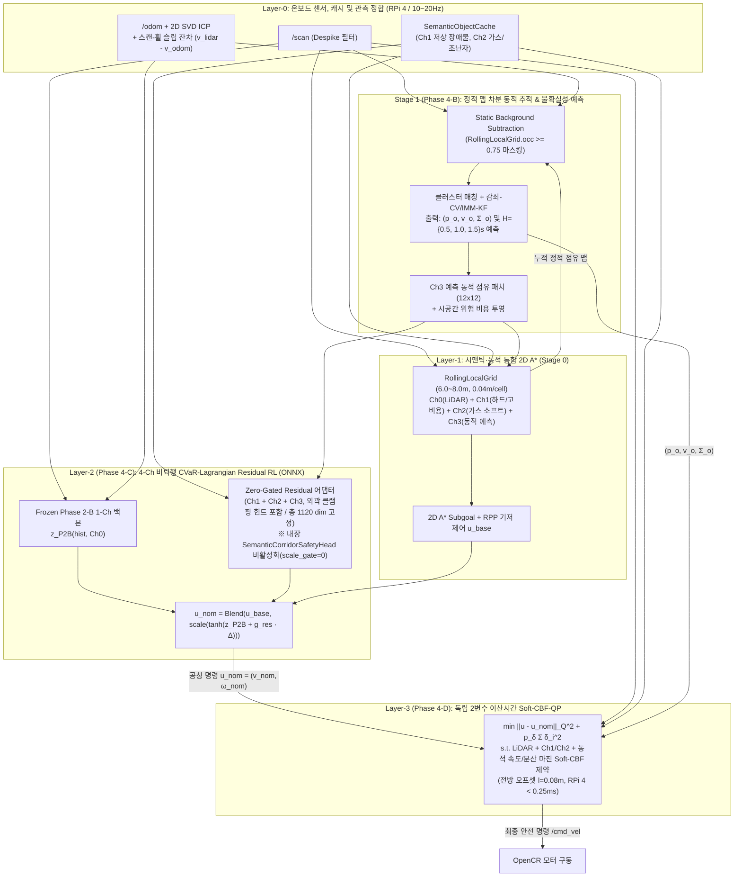

# Phase 4 재검증 기반 후속 연구 설계 및 단계별 구현 계획서

> 본 문서는 `disaster_recovery_ws`의 Phase 3 실제 소스 코드, 설정 파일, 학습 파이프라인 및 벤치마크 JSON 실측치를 1차 근거로 하여, 기존 설계 문서([`Phase4_후속_연구_방향_검토_및_설계.md`](Phase4_후속_연구_방향_검토_및_설계.md))와 외부 검토 의견(ChatGPT 4대 주장)을 비판적으로 재검증한 뒤 도출한 **최종 Phase 4 연구 설계 및 구현 마스터 블루프린트**다.
> 추후 코드 구현, 모델 학습, Ablation 검증 및 실물 TurtleBot3 Burger(RPi 4) 필드 실증은 본 문서의 단계별 명세와 완료 기준(Go/No-Go Gate)을 따른다.

---

## 1. 재검증 결과 요약 및 설계 보정 사항

### 1.1 기존 문서 실측 수치 정정 및 신규 발굴 결함

Phase 3 실제 코드와 최신 벤치마크 원본을 직접 대조한 결과, Phase 4 구현 착수 전 반드시 바로잡아야 할 사실 오류 1건과 구조적 결함 3건이 확인되었다.

| 구분 | 항목 | 실측 근거 (파일 및 라인) | Phase 4 설계 반영 사항 |
| :--- | :--- | :--- | :--- |
| **수치 정정** | 시맨틱 A/B 테스트 성공률 | `benchmark_results/phase3_semantic_v3/semantic_avoidance_ab_10trials.json` (`semantic_phase3`: `9/10 = 90.0%`, 유일한 실패는 Trial 2 `seed=2288` 130.08초 타임아웃) | 기존 문서의 "`T02, T03` 2회 실패(`8/10`)" 기재 오류를 `9/10`으로 정정하고 Trial 2 교착 원인을 시맨틱 A\* 미반영으로 확정한다. |
| **결함 1 (관측 불일치)** | 휠 오도메트리 슬립 비관측성 (Sim-to-Real Gap) | `rl_procedural_env.py` L1393-1400은 `actual_vw`를 **GT 차체 변위 속도**로 계산하지만, `recovery_controller.py` L861-862는 `/odom`의 **휠 엔코더 속도**를 입력한다. | 바퀴 헛돌림(Wheel Spin) 시 `cmd_v - odom_v ≈ 0`이므로 고유수용성 시계열만으로는 선형 슬립이 비관측(Unobservable) 상태다. **2D LiDAR 연속 스캔 정합 속도($\hat{v}_{\text{lidar}}$)와 휠 속도($v_{\text{odom}}$)의 잔차**로 관측을 재정의한다. |
| **결함 2 (운동학 불일치)** | 동적 장애물 운동학 격차 (Sim-to-Sim Gap) | `rl_procedural_env.py` L1413-1422는 **등속 직선 + 벽 바운스**만 모사하나, `ab_disaster_benchmark.py` L576-587은 **정현파 조화 진동**(`0.36*cos(0.95*t)`, `0.42*cos(0.45*t)`) 및 회전 격벽을 사용한다. | 단순 등속(CV) 선형 예측은 방향 전환점에서 오버슈트한다. 감쇠 속도·불확실성 분산 팽창 예측기를 도입하고 학습 환경에 조화 진동 교차 레짐을 추가한다. |
| **결함 3 (다중 가드 간섭)** | 내장 `88~100%` 덮어쓰기 및 자살 정지 가드 | `train_phase2_v100.py` L166-174(`SemanticCorridorSafetyHead`가 시맨틱 감지 시 공칭 RL 출력을 `88~100%` 강제 덮어씀) + `recovery_controller.py` L1213-1226(`_dynamic_hold_until` 1.2초 정지) 및 4중 가드 중첩 | `dynamic_crossfire_alley`(`1/10`) 및 `house`(`6/10`)에서 오히려 `baseline`(`3/10`, `9/10`)보다 퇴행한 직접 원인이다. 내장 헤드를 `set_scale(0.0)`으로 끄고 외부 가드를 **단일 Soft-CBF-QP**로 통폐합하며 1.2초 정지 가드를 제거한다. |

### 1.2 ChatGPT 4대 검토 주장에 대한 재검증 판정표

| 검토 항목 | ChatGPT 핵심 주장 | 재검증 판정 | 최종 채택 방향 |
| :--- | :--- | :---: | :--- |
| **Phase 4-B** | 딥러닝 World Model 전에 시맨틱 A\* 비용 반영 및 KF 선형 예측부터 검증 | **부분 채택** (엔지니어링 선행 순서는 타당, 단독 연구 기여 불가 및 비선형 진동 한계 존재) | **Stage 0~1**에서 시맨틱 A\* + 정적 맵 차분 기반 감쇠-KF/분산 예측기를 **강건 베이스라인 및 `Ch3` 생성기**로 구현한다. |
| **Phase 4-D** | `SemanticCorridorSafetyHead`와 독립 CBF-QP의 역할 구분 및 충돌 검토 | **강화 채택** (단순 공존 시 이중 간섭 불가피) | 공존이 아니라 ONNX 내장 헤드 비활성화(`scale_gate=0`) 및 외부 4중 가드를 **전방 오프셋 2D Soft-CBF-QP 하나로 통폐합**한다. |
| **Phase 4-C** | CVaR RL과 CBF-QP 결합 검토 및 RL 고유 기여의 실험적 입증 | **전면 채택** (시야 병목 해소 조건 추가) | `No-RL(A*+CBF)` 대비 RL의 존재 이유를 **`Ch1/Ch2/Ch3` 복합 고슬립 꼬리 위험($\text{CVaR}_{0.1}$) 및 CBF 개입량 억제**로 입증하며, `1120`차원 고정 구조 내 `Ch2/Ch3` 외곽 클램핑 투영과 시맨틱 A\* `subgoal`로 시야 병목을 보완한다. |
| **Phase 4-A** | 단순 GRU 재도입 대신 온라인 잠재 동역학 추정으로 재정의 | **조건부 축소 통합** (독립 주제 불가, 휠 오도메트리 비관측 문제 선결 필수) | 독립 4-A 대신 **Stage 0.3(비퇴화 LiDAR ICP 속도를 기존 `act_v, act_w` 슬롯에 공급 + 자이로 교차 검증) + `NORMAL_TELEOP` 상시 워밍업**으로 흡수 통합한다. |

---

## 2. 최종 Phase 4 통합 아키텍처

### 2.1 제어 계층 및 데이터 흐름



### 2.2 계층별 시공간 지평 및 수학적 불변식

| 계층 | 담당 모듈 | 작동 시공간 지평 | 핵심 역할 | 보장 성질 |
| :--- | :--- | :---: | :--- | :--- |
| **Layer-1** | 시맨틱·동적 통합 2D A\* + LIFO | $1.5 \sim 8.0\,\text{m}$ | 전역/중거리 우회 경로 및 위상 지름길 탐색 (`subgoal_xy` 생성) | `Ch1/Ch2` 구역 관통 경로 원천 차단 |
| **Layer-2** | 4-Ch CVaR-Lagrangian Residual RL | $0.5 \sim 2.0\,\text{s}$ | `Ch1/Ch2/Ch3` 활성 복합 고슬립·비선형 동적 교차 하에서 꼬리 위험과 CBF 급개입을 예방하는 선제적 궤적 제어 | `Ch1=Ch2=Ch3=0` 시 Phase 2-B와 **`max_abs_diff = 0.0`** 비퇴행 보장 |
| **Layer-3** | 전방 오프셋 2D Soft-CBF-QP | $0.0 \sim 0.3\,\text{s}$ | LiDAR·시맨틱·동적 장애물 통합 최소 개입 Soft-CBF 안전 필터 | Feasible 영역 안전 집합 유지 및 내부 개입량 `0`, 협소 문틀 교착 시 $\delta_i \ge 0$로 Graceful Degradation |

---

## 3. 단계별 상세 설계 및 코드 구현 명세

### Stage 0: 비학습 런타임 구조 결함 수정 및 Engineering Baseline 확립

**목적**: 딥러닝 재학습 없이 Phase 3의 명백한 런타임 결함(A\*-RL 충돌, 1.2초 정지 자살, 콜드 스타트, 슬립 비관측)을 제거하고 정량 베이스라인을 고정한다.

#### 0.1 시맨틱 2D A\* 통합
- **대상 파일**:
  - [`src/disaster_recovery/disaster_recovery/local_grid_planner.py`](../src/disaster_recovery/disaster_recovery/local_grid_planner.py) (`RollingLocalGrid.build_cost_maps()`, `ProposedRecoveryPlanner.step()`)
  - [`src/disaster_recovery/disaster_recovery/recovery_controller.py`](../src/disaster_recovery/disaster_recovery/recovery_controller.py) (L1146-1159)
- **구현 명세**:
  1. `ProposedRecoveryPlanner.step()` 및 `RollingLocalGrid.build_cost_maps()` 시그니처에 선택 인자 `semantic_obstacles: Optional[Sequence[Tuple[float, float, float]]] = None`, `semantic_hazards: Optional[Sequence[Tuple[float, float, float]]] = None`, `dynamic_cost_grid: Optional[np.ndarray] = None`을 추가한다 (기본값 `None`으로 하위 호환성 100% 유지).
  2. **`Ch1` (저상 장애물) 반영**: 중심 $(o_x, o_y)$, 반경 $r$에 대해 차체 반경 여유를 포함한 반경 $r_{\text{hard}} = r + r_{\text{infl}}$ 내부를 `hard_blocked = True`로 설정하고, 외곽 $r_{\text{hard}} \sim r_{\text{hard}} + 0.18\,\text{m}$에 선형 감쇠 `soft_cost` (최대 `8.0`)를 부여한다.
  3. **`Ch2` (가스/조난자 위험 구역) 반영**: 반경 $r_{\text{haz}} = \max(r, 0.15)$에 대해 $d \le r_{\text{haz}} + 0.12\,\text{m}$ 구간에 높은 통과 비용(`soft_cost += 25.0`, 우회로가 전혀 없는 완전 봉쇄 시에만 최후 통과 허용)을, $r_{\text{haz}} + 0.12 \sim r_{\text{haz}} + 0.35\,\text{m}$ 완충대에 점진적 비용(`0.0 ~ 10.0`)을 합산한다.
  4. `recovery_controller.py` L1146 호출부에서 `use_semantic_rl_policy` 또는 신규 파라미터 `enable_semantic_astar_cost`가 참일 때 `self._get_active_semantic_channels()` 결과를 `self.local_planner.step()`에 전달한다.

#### 0.2 런타임 가드 정리 및 시계열 버퍼 콜드 스타트 제거
- **대상 파일**: [`src/disaster_recovery/disaster_recovery/recovery_controller.py`](../src/disaster_recovery/disaster_recovery/recovery_controller.py)
- **구현 명세**:
  1. **`_dynamic_hold_until` 제거 또는 파라미터 비활성화**: L1213-1226의 1.2초 강제 정지 가드를 ROS 파라미터 `enable_dynamic_headon_hold` (Phase 4 기본값 `false`)로 분리하여 동적 장애물 조우 시 제자리 피격 현상을 차단한다.
  2. **`NORMAL_TELEOP` 상시 워밍업**: L1070-1080에서 `self.local_planner.observe()` 호출 직후, `self.context_rl_policy is not None`이면 현재 스캔·속도·시맨틱 캐시로 `self.context_rl_policy.observe(...)`를 매 틱(10 Hz) 호출한다. 단, `NORMAL_TELEOP` 중 목표 좌표 `(tx, ty)`는 최근 기록된 직전 웨이포인트(또는 현재 위치 전방 $1.0\,\text{m}$)를 넣어 통신 단절 전환 첫 스텝부터 1.6초 물리 이력이 채워져 있도록 한다.

#### 0.3 LiDAR-Wheel 슬립 잔차 관측 정합 (Phase 4-A 흡수 통합)
- **대상 파일**:
  - [`src/disaster_recovery/disaster_recovery/recovery_controller.py`](../src/disaster_recovery/disaster_recovery/recovery_controller.py)
  - [`scripts/host/rl_procedural_env.py`](../scripts/host/rl_procedural_env.py)
- **구현 명세**:
  1. **런타임 연속 스캔 속도 추정 및 퇴화 감지**: `recovery_controller.py`에 직전 스캔 점군(`_prev_scan_pts`)과 현재 스캔 점군(`latest_scan_pts`) 간의 경량 2D ICP(최대 4회 반복, 초기 추정치로 휠 오도메트리 증분 제공)를 수행해 **실제 차체 이동 속도 추정치 $(\hat{v}_{\text{scan}}, \hat{\omega}_{\text{scan}})$** 를 산출한다. 단, 평행 직선 벽면(`tunnel` 등)에서의 **기하학적 퇴화(Geometric Degeneracy)** 시 휠 오도메트리 초기값에 고착되는 함정을 막기 위해, 대응점 공분산/헤시안의 최소 고유값 비율 기반 퇴화 플래그(`icp_degenerate`)를 산출하여 퇴화 구간에서는 슬립 잔차 갱신을 보류한다.
  2. **관측 정합 및 자이로 교차 검증**: 비퇴화 구간(`icp_degenerate == False`)에서는 기존 `STEP_FEAT_DIM = 34`의 `act_v, act_w` 슬롯에 $(\hat{v}_{\text{scan}}, \hat{\omega}_{\text{scan}})$을 공급하고 슬립 잔차 $e_{\text{slip}} = (v_{\text{odom}} - \hat{v}_{\text{scan}})/v_{\max}$를 진단·로깅한다. 퇴화 구간(`icp_degenerate == True`)에서는 `act_v = v_odom`, `act_w = \omega_{\text{imu}}` (실물 `/imu` 미가용 시 `\omega_{\text{odom}}`)로 안전 폴백한다. 실물 로봇에서는 온보드 `/imu` 자이로 각속도($\omega_{\text{imu}}$)와의 잔차로 회전 슬립을 교차 검증한다(저가 MEMS 가속도계 적분은 저속 진동·중력 누설로 배제).
  3. **시뮬레이터 정합**: `rl_procedural_env.py` L1393-1400의 `v_meas, w_meas`에 현실적인 ICP 추정 노이즈($\sigma_v \approx 0.015\,\text{m/s}, \sigma_\omega \approx 0.03\,\text{rad/s}$)를 추가하여 학습-배포 간 관측 분포를 일치시킨다.

---

### Stage 1 (Phase 4-B): 정적 맵 차분 기반 동적 장애물 추적 및 불확실성 예측기

**목적**: $5\sim 10\,\text{Hz}$ 원본 2D LiDAR(360포인트, $1^\circ$ 분해능 — ICP용 다운샘플링 `180`포인트 미사용)만으로 정적 벽면 오탐 없이 동적 장애물을 분리·추적하고, 조화 진동/방향 전환을 고려한 미래 점유 확률 격자(`Ch3`)와 속도·공분산 벡터를 실시간(`< 0.3 ms` RPi 4) 산출한다.

#### 1.1 신규 모듈 생성
- **신규 파일**: `src/disaster_recovery/disaster_recovery/dynamic_tracker.py`
- **주요 클래스**: `DynamicObstacleTracker`, `TrackedObstacle` (dataclass: `track_id, x, y, vx, vy, radius, cov_2x2, age, hits, is_confirmed`)

#### 1.2 처리 파이프라인 명세
1. **정적 배경 차분 (Static Background Subtraction)**:
   - 현재 스캔 점군 $P_t = \{p_i\}$를 월드/오도메트리 좌표계로 변환한다.
   - `RollingLocalGrid`에서 정적 점유 누적도 `static_occ` (감쇠율 `0.992`의 별도 장기 정적 버퍼 또는 `occ >= 0.75`의 3x3 팽창 마스크)에 걸리는 점들을 정적 벽면/낙석으로 제거한다.
   - 추가 가드: 로봇 회전 속도 $\lvert\omega\rvert > 0.45\,\text{rad/s}$ 구간에서는 팽창 반경을 1셀(`0.04 m`) 넓혀 회전 오차에 의한 벽면 끝단 오탐을 억제한다.
2. **유클리드 클러스터링 (1D 각도 순차 분할)**:
   - 남은 동적 후보 점군에 대해 인접 유효 점 거리 $\lVert p_i - p_{\text{prev}}\rVert < 0.18\,\text{m}$ 기준으로 $O(N)$ 순차 클러스터링을 수행한다. 이때 `6%` beam dropout에 의한 클러스터 분할을 막기 위해 **최대 1~2개 연속 결측(invalid range) 광선을 건너뛰는 각도 갭 허용(Gap Tolerance)**을 적용하고, 분할 완료 후 첫 클러스터와 마지막 클러스터의 끝점 거리가 임계치 이내이면 하나로 합치는 **$0^\circ / 359^\circ$ 랩어라운드 병합(Wrap-around Merge)**을 수행한다.
   - 점 개수 $3 \le n_c \le 35$, 외접 반경 $0.05 \le r_c \le 0.45\,\text{m}$ 조건을 만족하는 클러스터만 유효 동적 객체 후보로 채택한다 (긴 벽면 파편 배제).
3. **데이터 연관 (Data Association) 및 감쇠-속도 Kalman Filter**:
   - 기존 트랙 예측 위치와 신규 클러스터 중심 간 Mahalanobis 거리(게이팅 임계치 `0.45 m`) 기반 최소 비용 일대일 매칭을 수행한다 (트랙 수 $\le 8$이므로 $O(M^3)$ 경량 매칭으로 `< 0.05 ms`).
   - 상태 벡터 $s_k = [x, y, v_x, v_y]^T$에 대해 감쇠 계수 $\gamma_v \in (0.92, 0.98)$를 포함한 선형 전이 모델 $F(\Delta t)$를 적용한다:
     $$s_{k|k-1} = \begin{bmatrix} I_2 & \Delta t\, I_2 \\ 0 & \gamma_v I_2 \end{bmatrix} s_{k-1}, \quad P_{k|k-1} = F P_{k-1} F^T + Q(\Delta t)$$
   - **비선형 왕복 운동 대응**: 최근 3틱 속도 내적($\hat{v}_{k-1} \cdot \hat{v}_k < 0$) 또는 잔차 혁신(Innovation) 급증 감지 시 프로세스 잡음 $Q_v$를 3배 팽창(Adaptive Process Noise)하여 조화 진동 장애물의 방향 전환 지점에서 오버슈트를 즉시 억제한다.
   - **저주파($5\,\text{Hz}$) 확정 지연 및 단절 대응**: 연속 2틱 매칭 및 추정 속력 $\lVert \hat{v} \rVert \ge 0.08\,\text{m/s}$ 통과 시 `is_confirmed = True`로 조기 승격하며, 일시적 빔 결측(dropout) 시 최대 2틱 유예(Coasting)를 두어 트랙 단절을 방지한다.
4. **미래 점유 예측 및 `Ch3` (12×12) 투영**:
   - 확정된 각 동적 트랙에 대해 지평 $\tau \in \{0.5\,\text{s}, 1.0\,\text{s}, 1.5\,\text{s}\}$의 예측 중심 및 공분산을 계산한다:
     $$\hat{p}(\tau) = \hat{p}_0 + \frac{1 - \gamma_v^{\tau/\Delta t}}{1 - \gamma_v} \Delta t\,\hat{v}_0, \quad \Sigma(\tau) = \Sigma_{p,0} + \tau^2 \Sigma_{v,0} + q_{\text{acc}} \frac{\tau^3}{3} I_2$$
   - 각 지평의 유효 위험 반경 $r_{\text{eff}}(\tau) = r_c + 1.5 \sqrt{\lambda_{\max}(\Sigma(\tau))}$와 시간 할인 가중치 $w_\tau \in \{1.0, 0.75, 0.50\}$를 적용해:
     - `RollingLocalGrid` A\*에는 `soft_cost`로 투영하고,
     - 4채널 RL 입력용 $12\times 12$ 에고 패치 **`Ch3`** 에는 `ch3[i, j] = max_k max_τ w_τ * clip(1 - max(d - r_c, 0) / r_eff, 0, 1)`로 투영한다.

---

### Stage 2 (Phase 4-D): 전방 오프셋 2변수 이산시간 Soft-CBF-QP Safety Shield

**목적**: ONNX 내부의 경험적 `SemanticCorridorSafetyHead` (`88~100%` 강제 덮어쓰기)와 외부 4중 휴리스틱 가드를 제거하고, 정적 LiDAR + 시맨틱 캐시(`Ch1/Ch2`) + 동적 장애물 속도/분산을 통합 제약으로 푸는 **단일 최소 개입 안전 필터**로 통폐합한다.

#### 2.1 신규 모듈 생성 및 기존 가드 교체
- **신규 파일**: `src/disaster_recovery/disaster_recovery/cbf_safety_shield.py`
- **주요 클래스**: `DiscreteSoftCBFShield`
- **기존 모듈 변경**:
  1. ONNX 추론 시 `SemanticCorridorSafetyHead`를 `set_scale(0.0)`으로 비활성화한 모델(또는 Phase 4 신규 ONNX)을 사용해 순수 공칭 행동 $u_{\text{nom}} = (v_{\text{nom}}, \omega_{\text{nom}})$을 출력한다.
  2. `recovery_controller.py`의 `wall_push_guard`(L1295-1301), `opp_steer_conflict`(L1299-1304), `_dynamic_hold_until`(L1213-1226)을 `enable_cbf_safety_shield: true`일 때 비활성화하고 최종 출력단에 `DiscreteSoftCBFShield.filter(...)`를 단일 배치한다.

#### 2.2 수학적 정식화 (차동 구동 상대 차수 문제 해결)
1. **전방 오프셋 기준점 (Control Point Shift)**:
   로봇 중심 $(x, y, \theta)$ 대신 전방 오프셋 $l = 0.08\,\text{m}$ 지점 $p_l = [x + l\cos\theta,\; y + l\sin\theta]^T$를 정의하면, $p_l$의 속도는 제어 입력 $u = [v, \omega]^T$에 대해 1차 선형 관계를 갖는다(상대 차수 1 확보):
   $$\dot{p}_l = J(\theta)\, u = \begin{bmatrix} \cos\theta & -l\sin\theta \\ \sin\theta & l\cos\theta \end{bmatrix} \begin{bmatrix} v \\ \omega \end{bmatrix}$$
2. **통합 장애물 제약 집합 구성**:
   매 제어 틱에서 반경 $1.2\,\text{m}$ 이내의 위험 요소를 원형 제약 $i \in \mathcal{O}_t$ (최대 $M_{\max} = 16$개: 최근접 LiDAR 섹터 대표점 8개 + `Ch1` 저상 장애물 + `Ch2` 가스 구역 + `DynamicObstacleTracker` 확정 동적 객체)로 수집한다.
   각 제약 $i$의 방벽 함수(Barrier Function)는 다음과 같다:
   $$h_i(p_l, p_{o,i}) = \lVert p_l - p_{o,i} \rVert^2 - \left(r_{\text{robot}} + r_{o,i} + m_{\text{pad}, i}\right)^2$$
   - 정적 LiDAR 점: $r_{o,i} = 0.02\,\text{m}$, $m_{\text{pad}} = 0.025\,\text{m}$ (차체 반경 $r_{\text{robot}} = 0.105\,\text{m}$ 기준, 총 안전 반경 $0.15\,\text{m}$ — 협소 문틀 $0.28\sim 0.35\,\text{m}$ 통과 가능).
   - 동적 장애물: 불확실성 패딩 $m_{\text{pad}, i} = 0.04 + 1.2\sqrt{\lambda_{\max}(\Sigma_{p,i})}$ 적용.
   - `Ch1` 저상 장애물 / `Ch2` 가스 구역: 각각 캐시된 반경 $r_{o,i}$ + 안전 마진 $0.05\,\text{m}$ 적용.
3. **동적 속도·이산시간·슬립 마진이 포함된 강인 이산 CBF 부등식**:
   무차원 이산 감쇠율 $\alpha_i \in (0, 1]$ ($h_i(x_{k+1}) \ge (1 - \alpha_i) h_i(x_k) - \delta_i \Delta t$)을 제어 주기 $\Delta t$로 나누어 시간 변화율 단위($[\text{m}^2/\text{s}]$)로 통일한 부등식을 구성한다:
   $$-2 (p_l - p_{o,i})^T J(\theta)\, u - \delta_i \le \frac{\alpha_i}{\Delta t} h_i(x_k) - 2 (p_l - p_{o,i})^T \hat{v}_{o,i} - \epsilon_{\text{dt,slip}}$$
   여기서 $\hat{v}_{o,i}$는 정적 장애물일 때 $0$, 동적 장애물일 때 Stage 1 KF가 추정한 속도 벡터이며, 슬랙 $\delta_i \ge 0$과 보수적 마진 $\epsilon_{\text{dt,slip}} = 2\lVert p_l - p_{o,i}\rVert \Delta v_{\text{slip}} + \epsilon_{\text{inter}} > 0$은 모두 $[\text{m}^2/\text{s}]$ 단위로 통일한다(2차 변위 항 $+\lVert \Delta p_{\text{rel}}\rVert^2 \ge 0$은 양수 항이며, 실제 위험 요인은 슬립 속도 외란 상한 $\Delta v_{\text{slip}}$과 스텝 간 현 침범 오차 $\epsilon_{\text{inter}}$다).
   *(주: 슬랙 $\delta_i > 0$이 활성화되는 협소 문틀 등에서는 엄밀한 전방 불변성이 완화되므로, 본 모듈의 학술적 역할은 "Feasible 영역 내 안전 집합 유지 및 교착 시 Graceful Degradation을 제공하는 최소 개입 Soft-CBF-QP 안전 필터"로 정의한다.)*
4. **Soft-Constrained 2변수 QP (협소 문틀 교착 방지)**:
   $$\min_{u \in \mathcal{U},\; \delta \ge 0} \; \frac{1}{2} (u - u_{\text{nom}})^T Q (u - u_{\text{nom}}) + \frac{1}{2} \sum_{i} p_{\delta, i}\, \delta_i^2$$
   - $\mathcal{U} = \{ (v, \omega) \mid v_{\min} \le v \le v_{\max},\; -\omega_{\max} \le \omega \le \omega_{\max} \}$, 가중 행렬 $Q = \text{diag}(w_v, w_\omega)$ (조향 수정보다 선속도 감속 선호도를 조절 가능).
   - 우선순위별 슬랙 페널티 $p_{\delta, i}$: **동적 장애물(`5000`) $>$ 정적 LiDAR·Ch1(`2000`) $>$ Ch2 가스 구역(`400`)** 순으로 설정하여, 불가피한 협소 문틀(`house_hard`) 양측 벽 제약 동시 활성화 시에도 해가 공집합(Infeasible)이 되지 않고 최적 중심선을 통과하도록 보장한다.
5. **경량 실시간 솔버 구현 (RPi 4 목표 `< 0.25 ms`)**:
   - 외부 무거운 QP 라이브러리 의존성을 피하기 위해, $u \in \mathbb{R}^2$의 2변수 + 대각 슬랙 구조를 활용한 **순수 NumPy Dual Projected Gradient / Active-Set 닫힌 해 솔버**를 구현한다 (최대 15회 반복, 1차 검사에서 $u_{\text{nom}}$이 모든 제약을 만족하면 반복 0회 `< 0.02 ms` 즉시 반환).
   - **GPU 학습 연동용 PyTorch 배치 버전**(`BatchSoftCBFShield`)도 동일 수식으로 `cbf_safety_shield.py` 또는 `train_phase2_v100.py`에 구현해 Stage 3 학습 시 `apply_safety_shield`로 직접 사용한다.

---

### Stage 3 (Phase 4-C & 4-A 통합): 4채널 비퇴행 CVaR-Lagrangian Residual RL

**목적**: `A* + RPP + Soft-CBF-QP (No RL)` 베이스라인이 해결하지 못하는 **고슬립 꼬리 위험(`real_tb3` TEST 가스 침범 26.7%)**, **비선형 동적 교차**, **CBF 급개입에 의한 정체**를 선제적 다단계 RL 정책으로 극복하고, RL의 고유한 학술적 기여를 입증한다.

#### 3.1 학습 환경 고도화 (`scripts/host/rl_procedural_env.py`)
1. **4채널 패치 확장 (`PATCH_CHANNELS = 4`)**:
   - `Ch0`: 2D LiDAR 점유 (`12x12`)
   - `Ch1`: 저상 장애물 (`12x12`)
   - `Ch2`: 가스/조난자 위험 구역 (`12x12`)
   - `Ch3`: 동적 장애물 미래 예측 점유 (`12x12`, Stage 1의 $H=\{0.5, 1.0, 1.5\}\,\text{s}$ 투영 수식과 100% 일치)
   - 평탄 입력 차원: `16 * 34 + 4 * 12 * 12 = 544 + 576 = 1120` (기존 1-Ch `688`, 3-Ch `976`과 자동 차원 감지 호환).
2. **시야 병목 해소 (에고 패치 $1.8\,\text{m}$ 한계 보완)**:
   - 기존 `STEP_FEAT_DIM = 34`는 Frozen Phase 2-B 백본의 입력 호환을 위해 **절대 변경하지 않는다**.
   - 대신 4채널 잔차 어댑터(`sem_res_mlp` / `sem_res_head`)가 더 넓은 거리에서 시맨틱/동적 위험에 대비할 수 있도록 `Ch2/Ch3`의 패치 외곽 경계 클램핑 투영(패치 반경 $0.9\,\text{m}$ 바깥 $0.9\sim 2.0\,\text{m}$에 있는 가스·동적 장애물의 방향을 패치 테두리 셀에 약한 신호 `0.15~0.35`로 힌트 투영)을 적용하거나, Stage 0 시맨틱 A\*가 제공하는 우회 `subgoal`을 목표 각도로 학습 시 반영한다.
3. **조화 진동 교차 레짐 추가 (Sim-to-Sim 격차 해소)**:
   - `dynamic_crossing` 레짐의 50% 에피소드에서 동적 원기둥이 등속 바운스 대신 Gazebo `ab_disaster_benchmark.py`와 동일한 **정현파 왕복 가감속($v(t) = V_{\max}\cos(\omega t + \phi)$)** 및 양방향 교차 협공(Crossfire)으로 움직이도록 확장한다.
4. **별도 안전 비용(Cost) 채널 반환**:
   - `env.step()`의 `info` 딕셔너리에 스텝별 비음수 안전 비용 $c_t \ge 0$을 명시적으로 산출해 반환한다:
     $$c_t = w_{\text{col}}\mathbb{I}(\text{collision}) + w_{\text{low}}\mathbb{I}(\text{hit\_low}) + w_{\text{gas}}\,\text{pen\_depth}_{\text{gas}} + w_{\text{dyn}}\max(0, 0.28 - d_{\text{dyn}}) + w_{\text{cbf}}\lVert u_{\text{cbf}} - u_{\text{rl}} \rVert_W^2 + w_{\text{slack}}\sum_i \delta_i^2$$

#### 3.2 4채널 비퇴행 아키텍처 확장 (`train_phase2_v100.py`, `rl_context_policy.py`)
1. `FrozenBackboneSemanticTeacher` 및 `FrozenBackboneSemanticStudent`의 `patch_channels`를 `4`까지 지원하도록 확장한다 (`self.sem_channels = patch_channels - 1 = 3`: `Ch1, Ch2, Ch3`).
2. **수학적 비퇴행 불변식 유지**:
   - `ch123_peak = aligned_patch[:, 1:, :, :].abs().max()`로부터 `res_gate = clip((ch123_peak - 1e-4) / 0.04, 0.0, 1.0)`을 계산한다.
   - `Ch1 = Ch2 = Ch3 = 0`인 순수 LiDAR 환경(Phase 3에서 이미 `90~100%` 달성한 `slip_chicane`, `smoke_lidar_corruption` 등)에서는 `res_gate = 0`이 되어 **Phase 2-B 1-Ch ONNX와 `max_abs_diff = 0.0` (비트 수준 동일)** 을 유지한다. 따라서 4-C CVaR-RL의 적용 범위는 **`Ch1/Ch2/Ch3`가 활성화된 복합 고슬립·동적 교차 구간**으로 한정한다.
   - `sem_safety_head`는 Phase 4 Student ONNX 그래프에서 제거(`scale_gate = 0.0`)하고 런타임 Stage 2 Soft-CBF-QP에 전담시킨다.
   - **CBF 신용 할당 왜곡 방지**: 학습 초기 업데이트에서는 CBF를 비활성화해 실제 충돌/침범 비용에 직접 노출시킨 뒤, 후반부 CBF-in-the-loop 파인튜닝 시 개입량 $\lVert u_{\text{cbf}} - u_{\text{rl}} \rVert_W^2$과 슬랙 $\sum \delta_i^2$을 대리 안전 비용으로 결합한다.

#### 3.3 Quantile CVaR-Lagrangian PPO 학습 알고리즘 (`train_phase2_v100.py`)
1. **분포형 비용 Critic (Quantile Cost Critic)**:
   - 기존 보상 Critic $V_R(s)$ 외에 $N_q = 16$개 분위수 $\tau_j = \frac{j - 0.5}{N_q}$ ($j=1,\dots,16$)를 출력하는 비용 Critic $Z_C(s) \in \mathbb{R}^{N_q}$를 추가한다.
   - 누적 할인 비용 $G_C = \sum_{k=0}^{T-t} \gamma^k c_{t+k}$에 대해 Quantile Huber Loss(Pinball Loss)로 $Z_C(s)$를 학습한다.
2. **하위 $\alpha = 0.1$ CVaR (상위 10% 최악 비용 꼬리) 추정 및 어드밴티지 결합**:
   - 각 상태에서 최악 $\alpha = 0.1$ 꼬리(비용은 클수록 위험하므로 상위 10% 분위수 $j \in \{\lceil (1-\alpha)N_q \rceil, \dots, N_q\}$)의 평균으로 $\widehat{\text{CVaR}}_{\alpha}(s)$를 계산한다.
   - 롤아웃 배치에서 에피소드별 누적 비용의 상위 10% 꼬리 샘플에 집중 가중을 두는 CVaR 비용 어드밴티지 $A_C^{\text{cvar}}$를 계산하고, 쌍대 변수(Lagrange Multiplier) $\lambda \ge 0$를 결합해 PPO 정책 경사를 갱신한다:
     $$A_{\text{total}}(s_t, a_t) = \frac{\tilde{A}_R(s_t, a_t) - \lambda \cdot \tilde{A}_C^{\text{cvar}}(s_t, a_t)}{1 + \lambda}$$
3. **쌍대 변수 $\lambda$ 자동 갱신 및 커리큘럼**:
   - 매 업데이트마다 배치 내 에피소드 비용의 실측 $\widehat{\text{CVaR}}_{0.1}(G_C)$와 목표 임계치 $d_{\text{thresh}}$의 차이로 $\lambda$를 갱신한다:
     $$\lambda \leftarrow \text{clip}\left(\lambda + \eta_\lambda \left(\widehat{\text{CVaR}}_{0.1}(G_C) - d_{\text{thresh}}\right),\; 0.0,\; \lambda_{\max}\right)$$
   - 초기 과보수화(학습 붕괴) 방지를 위해 처음 25% 업데이트 동안 $d_{\text{thresh}}$를 선형 완화(Warm-up Curriculum)한다.
4. **런타임 오버헤드 `0.0 ms` 보장**:
   - Quantile Cost Critic과 $\lambda$는 V100 학습 시에만 사용되며, DAgger 증류 후 추출되는 `sim_policy_student_phase4.onnx` / `real_tb3_policy_student_phase4.onnx`에는 Actor 경로만 포함된다 (예상 RPi 4 CPU 추론 지연 `~0.14 ms`).

---

### Stage 4 (Phase 4-E): 파라미터 체계, 단위 테스트 및 실차 통합

#### 4.1 신규 ROS 2 파라미터 명세
[`recovery_params.yaml`](../src/disaster_recovery/config/recovery_params.yaml) 및 [`recovery_params_real.yaml`](../src/disaster_recovery/config/recovery_params_real.yaml)의 `recovery_controller.ros__parameters`에 다음 플래그를 추가한다 (기본값은 Phase 3 하위 호환 유지, Phase 4 프로필에서 활성화):

```yaml
    # Phase 4 Extensions (all default-safe for Phase 3 backward compatibility)
    enable_semantic_astar_cost: false     # Stage 0: Ch1/Ch2 cost injection into RollingLocalGrid
    enable_dynamic_headon_hold: true      # Stage 0: set false in Phase 4 to remove 1.2s freeze guard
    enable_teleop_rl_warmup: false        # Stage 0: continuously observe() in NORMAL_TELEOP
    enable_lidar_slip_residual: false     # Stage 0: scan-to-scan ICP velocity vs wheel odom
    enable_dynamic_tracker: false         # Stage 1: static-diff + damped-KF dynamic predictor & Ch3
    dynamic_predict_horizons_s: [0.5, 1.0, 1.5]
    enable_cbf_safety_shield: false       # Stage 2: 2-var discrete Soft-CBF-QP (replaces heuristics)
    cbf_control_point_offset_m: 0.08      # Forward offset l for non-holonomic relative degree 1
    cbf_alpha_static: 0.65                # Dimensionless discrete decay rate α ∈ (0,1] (converted via α/Δt)
    cbf_alpha_dynamic: 0.85               # Dimensionless discrete decay rate α ∈ (0,1] (dynamic obstacles)
    cbf_alpha_gas: 0.45                   # Dimensionless discrete decay rate α ∈ (0,1] (Ch2 gas zones)
    phase4_rl_onnx_path: ""               # Stage 3: 4-ch CVaR-Lagrangian student ONNX
```

#### 4.2 단위 테스트 계획 (`src/disaster_recovery/test/`)
기존 6개 단위 테스트(`test_local_grid_planner.py`, `test_semantic_controller.py`, `test_semantic_rl_env.py`, `test_semantic_mapper.py`, `test_hybrid_recovery.py`, `test_ads1115_mq2.py`)의 100% 회귀 통과를 유지하면서 다음 3개 테스트 파일을 신규 작성한다:
1. `test_dynamic_tracker.py`: 정적 벽면 회전 시 오탐률 `0%` 검증, 정현파 왕복 장애물 추적 오차(ADE/FDE) 및 방향 전환 시 분산 팽창 검증, **$5\,\text{Hz}$ 저주파 구동 시 2틱 확정 지연 및 빔 결측(dropout) 트랙 단절 스트레스 테스트**, 처리 지연 `< 0.5 ms` 검증.
2. `test_cbf_safety_shield.py`: 안전 집합 내부 개입량 `||u* - u_nom|| == 0` 검증, 접근 장애물 앞 감속/회피 불변성 검증, `0.28 m` 협소 문틀 양측 제약 동시 활성 시 해 존재(Feasibility) 검증, 1틱 풀이 시간 `< 0.3 ms` 검증.
3. `test_phase4_cvar_env.py`: 4채널 패치(`1120` dim) 형상 및 `Ch1=Ch2=Ch3=0` 시 Phase 2-B 1-Ch ONNX 대비 **`max_abs_diff == 0.0`** 수학적 비퇴행 검증, Quantile CVaR 손실 및 $\lambda$ 단조 갱신 단위 검증.

---

## 4. 학술 논문 검증용 Ablation Matrix 및 완료 기준 (Go/No-Go Gate)

### 4.1 핵심 5자 Ablation 실험 설계 (RL 무용론 방어 구조)

논문 심사에서 **"A\* + RPP + CBF-QP만으로 충분하지 않은가?"** 라는 핵심 반론을 정량적으로 돌파하기 위해 다음 5개 모델을 동일 시드/동일 15종 Gazebo 월드 + 시맨틱 A/B + Holdout `real_tb3`에서 비교한다.

| 모델 ID | 구성 요소 | 학술적 비교 역할 |
| :---: | :--- | :--- |
| **M0** | Phase 3 Option 2 (현행 3-Ch PPO + 내장 `SafetyHead` + 4중 가드) | 기존 베이스라인 (개선 전 기준점) |
| **M1** | **Stage 0 + 1**: 시맨틱·동적 A\* + RPP (No RL, No CBF) | 순수 고전 경로 계획기의 한계 측정 |
| **M2** | **Stage 0 + 1 + 2**: 시맨틱·동적 A\* + RPP + 2D Soft-CBF-QP (**No RL**) | **가장 강력한 고전+안전제어 대조군 (RL 무용론 검증 핵심)** |
| **M3** | **Stage 0 + 1 + 2** + Phase 3 Standard PPO (`scale_gate=0`) + Soft-CBF-QP | 평균 보상 RL + CBF 결합군 (CVaR 효과 분리 검증) |
| **M4** | **Full Phase 4**: 4-Ch `CVaR-Lagrangian PPO` + 동적 예측(`Ch3`) + Soft-CBF-QP | **최종 제안 아키텍처** |

### 4.2 핵심 증명 가설 (M4 vs M2, M3)
- **M4 vs M2 (`No RL`)**: 정적/단순 환경에서는 M2도 높은 성공률을 보일 수 있으나, **`Ch1/Ch2/Ch3`가 활성화된 복합 고슬립(`real_tb3` 가스+고슬립) + 비선형 동적 교차(`crossfire`, `gauntlet`)** 조건에서 근시안적 M2는 CBF 급개입 횟수(`intervention_rate`)와 꼬리 충돌률/타임아웃이 급증하는 반면, 다단계 선제 제어를 수행하는 M4가 **더 낮은 CBF 개입량 $\lVert u_{\text{cbf}} - u_{\text{nom}}\rVert$**, **더 짧은 복귀 시간**, **더 높은 무충돌 성공률**을 달성함을 입증한다.
- **M4 vs M3 (`Std PPO`)**: 평균 성공률이 유사하더라도 **최악 하위 10% 꼬리 지표(Worst-10% CVaR 비용 및 `real_tb3` 가스 침범률)** 에서 M4가 통계적으로 유의미한 우위를 가짐을 입증한다.

### 4.3 단계별 정량 합격 기준 (Go / No-Go Gate)

| 단계 | 핵심 평가 벤치마크 | Phase 3 현행 실측 | Phase 4 합격 기준 (Gate) |
| :--- | :--- | :---: | :--- |
| **Stage 0** | `semantic_avoidance_ab_10trials` 엄격 무위반 성공률 | `9/10 (90.0%)` (Trial 2 타임아웃) | **`10/10 (100.0%)`** (타임아웃 0건, 저상/가스 위반 0건) |
| **Stage 1** | 동적 추적기 $1.0\,\text{s}$ 예측 오차(ADE/FDE) & 정적 오탐률 | 미구현 | ADE/FDE **$\le 0.14\,\text{m}$**, 회전 중 정적 벽 오탐률 **$\le 3\%$**, CPU 지연 **$\le 0.30\,\text{ms}$** |
| **Stage 2** | Gazebo `#7 house`, `#8 house_hard` 엄격 무충돌 성공률 | `6/10 (60.0%)`, `6/10 (60.0%)` | 각 **`>= 9/10 (90.0%)`**, QP 풀이 지연 **$\le 0.25\,\text{ms}$**, 안전 구간 오개입률 **$\le 3\%$** |
| **Stage 2~3** | Gazebo `#5 dynamic_crossfire_alley`, `#6 dynamic_gauntlet` | `1/10 (10.0%)`, `3/10 (30.0%)` | `#5` **`>= 7/10 (70.0%)`**, `#6` **`>= 7/10 (70.0%)`** (엄격 무충돌 기준) |
| **Stage 3** | V100 Holdout `real_tb3` `gas_hazard_free_rate` & 비퇴행 오차 | Val `66.7%` / Test `73.3%` (침범 `26.7%`), diff `0.0` | Gas-Free **`>= 85.0%`**, `Ch1=Ch2=Ch3=0` **`max_abs_diff == 0.0`** |
| **Stage 4** | Gazebo 15종(150회) 종합 엄격 무충돌 성공률 | `119/150 (79.3%)` | **`>= 138/150 (92.0%)`** (기존 100% 7종 무퇴행 유지) |
| **Stage 4** | 실물 TurtleBot3 Burger (RPi 4) 온보드 실증 | 미수행 | 총 연산 지연(추적+ONNX+CBF) **`<= 2.0 ms`** (`10~20 Hz` 안정 유지), Wi-Fi 단절 복귀 연속 10회 성공 |

---

## 5. 추후 구현 착수 체크리스트 및 리스크 대응

### 5.1 구현 실행 순서 (권장 작업 단위)

- [ ] **Step 0-1**: `local_grid_planner.py`에 `Ch1/Ch2` 시맨틱 비용 주입 구현 및 `test_local_grid_planner.py` 단위 테스트 추가.
- [ ] **Step 0-2**: `recovery_controller.py`에 `enable_semantic_astar_cost`, `enable_dynamic_headon_hold`, `enable_teleop_rl_warmup` 파라미터 반영 및 `semantic_avoidance_ab_10trials` 재측정 (`10/10` 게이트 확인).
- [ ] **Step 0-3**: `recovery_controller.py`에 연속 스캔 매칭 속도($\hat{v}_{\text{scan}}, \hat{\omega}_{\text{scan}}$) 추정기 및 휠 슬립 잔차 로깅 추가.
- [ ] **Step 1-1**: `dynamic_tracker.py` (Static Background Subtraction + 1D 클러스터링 + 감쇠-KF + 분산 팽창 + `Ch3` 생성) 구현 및 `test_dynamic_tracker.py` 통과.
- [ ] **Step 1-2**: `local_grid_planner.py` 및 `recovery_controller.py`에 동적 예측 비용 연동 → **M1 베이스라인** Gazebo `#5, #6` 측정.
- [ ] **Step 2-1**: `cbf_safety_shield.py` (전방 오프셋 $l=0.08\,\text{m}$ 2변수 이산시간 Soft-CBF-QP 순수 NumPy 솔버) 구현 및 `test_cbf_safety_shield.py` 통과.
- [ ] **Step 2-2**: `recovery_controller.py`에 Soft-CBF-QP 연결 및 기존 4중 휴리스틱 가드 분기 처리 → **M2(`No-RL + CBF`)** 및 **M3(`Phase 3 Std-PPO(scale_gate=0) + CBF`)** Gazebo `#5, #6, #7, #8` 측정.
- [ ] **Step 3-1**: `rl_procedural_env.py` 4채널(`Ch3`) 확장, 조화 진동 교차 레짐 추가, 안전 비용 $c_t$ 및 배치 Soft-CBF-QP 쉴드 연동 (`test_phase4_cvar_env.py` 통과).
- [ ] **Step 3-2**: `train_phase2_v100.py`에 `QuantileCostCritic` + $\text{CVaR}_{0.1}$-Lagrangian PPO + 4채널 `FrozenBackboneSemanticTeacher/Student` 구현 및 V100 3-seed 학습·DAgger ONNX 추출 (`max_abs_diff == 0.0` 검증).
- [ ] **Step 4-1**: **M4 (Full Phase 4)** Gazebo 15종(150회) + 시맨틱 A/B 전체 벤치마크 및 5자 Ablation 통계 표/그래프 생성.
- [ ] **Step 4-2**: 실물 TurtleBot3 Burger(RPi 4 + LDS-01 + OpenCR + IMX219 + MQ-2 배선 점검) 온보드 지연 프로파일링 및 Wi-Fi 단절 자율 복귀 필드 테스트 수행.

### 5.2 주요 기술 리스크 및 사전 대응책

| 리스크 | 발생 징후 | 사전 대응 설계 |
| :--- | :--- | :--- |
| **회전 시 정적 벽면의 동적 오인** | 로봇 제자리 회전 중 `Ch3`에 허위 장애물이 생성되어 급정지 | Static Background Subtraction 팽창 반경을 $\lvert\omega\rvert$에 비례 확장하고, 2틱 연속 매칭(및 2틱 유예 Coasting) + 최소 속력($\ge 0.08\,\text{m/s}$) 임계치 통과 트랙만 확정한다. |
| **협소 문틀 CBF 교착 (Freezing)** | `#7 house`, `#8 house_hard` 문틀 앞에서 $v \to 0$ 정지 | 슬랙 변수 $\delta_i \ge 0$ 기반 Soft-CBF-QP와 차체 최소 여유 반경($0.15\,\text{m}$)을 적용하고, 양측 벽 대칭 제약 시 선속도 하한 유지 가중치 $Q$를 튜닝한다. |
| **CVaR-Lagrangian $\lambda$ 발산** | 학습 중반 $\lambda \to \lambda_{\max}$로 치솟아 로봇이 제자리 정지(과보수화) | $\lambda$ 상한 클리핑($\lambda_{\max} = 5.0$), 초기 25% 업데이트 $d_{\text{thresh}}$ 선형 커리큘럼, 정체 페널티(`stall_pen`) 유지를 병행한다. |
| **RPi 4 제어 루프 지연 초과** | 2D ICP + 동적 추적 + ONNX + QP 합산 지연이 `10 Hz` 예산을 압박 | 모든 모듈은 순수 NumPy 벡터화 연산 및 1-thread ONNX Runtime(`ORT_ENABLE_ALL`)을 사용하며, CBF-QP는 무위반 시 조기 종료(Early Exit) 경로를 둔다. |
