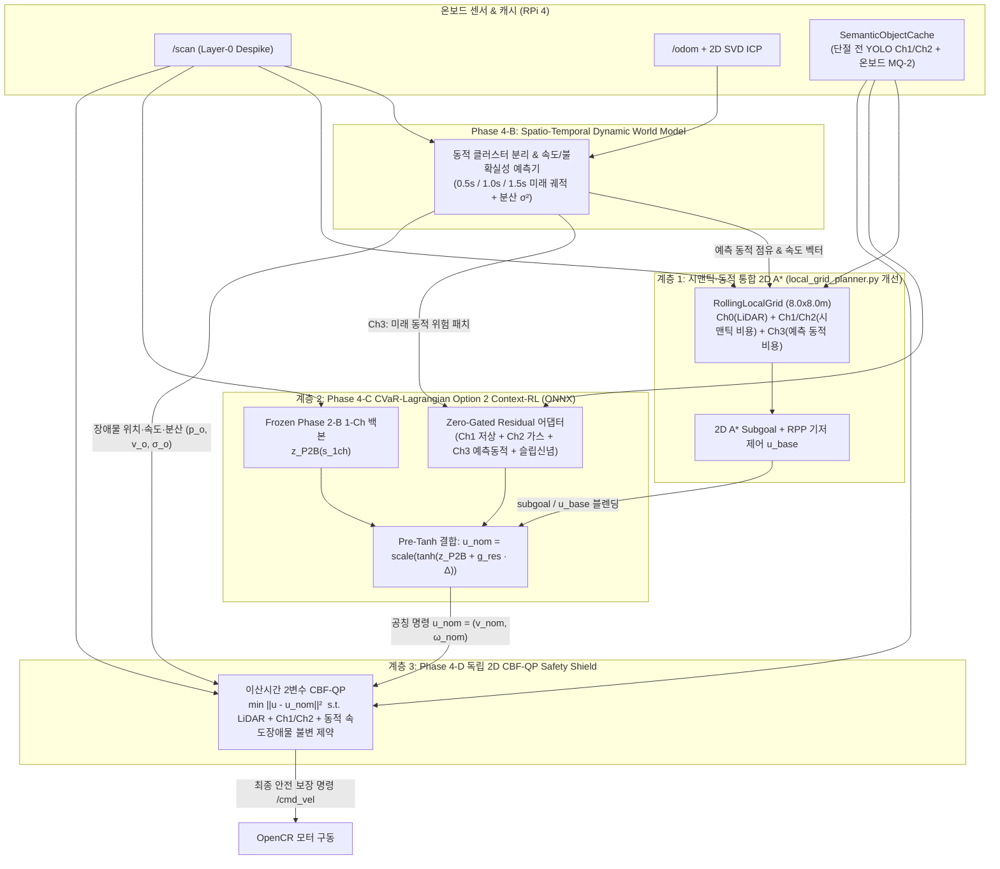

# Phase 4 후속 연구 방향 기술 검토 및 연구 설계 보고서

> 본 보고서는 `disaster_recovery_ws` 저장소의 실제 소스 코드, 설정 파일, ONNX 아티팩트, 벤치마크 결과 JSON을 직접 대조하여 작성한 기술 검토 문서다. 코드 수정·재학습·시뮬레이션 실행 없이 연구 타당성, 알고리즘 충돌, 실험 설계 및 학술적 기여도만 분석한다.

---

## 1. 현재 Phase 3 기술 구조 분석

### 1.1 실제 구현 상태 대조 (코드·아티팩트 실측 기준)

| 기능 항목 | 실제 구현 코드 및 위치 | 상태 구분 | 비고 (실제 코드 대조 결과) |
| :--- | :--- | :---: | :--- |
| 통신 단절 워치독 및 자율 복귀 상태 머신 | [`recovery_controller.py`](../src/disaster_recovery/disaster_recovery/recovery_controller.py) | **구현 완료 · 시뮬 검증 완료** | `/heartbeat` 3.0초 타임아웃 시 `EMERGENCY_STOP` → `BACKTRACKING_ROTATE` → `BACKTRACKING_HYBRID` 전환 |
| LIFO 기반 경로 역추적 및 위상 지름길 | [`recovery_controller.py`](../src/disaster_recovery/disaster_recovery/recovery_controller.py), [`local_grid_planner.py`](../src/disaster_recovery/disaster_recovery/local_grid_planner.py) | **구현 완료 · 시뮬 검증 완료** | $\Delta d \ge 0.30\,\text{m}$ 또는 $\lvert\Delta\theta\rvert \ge 25^\circ$ 간격 LIFO 기록 및 `observed_free` 기반 비파괴 지름길 점프 |
| `RollingLocalGrid` 및 2D A\* 로컬 경로 계획 | [`local_grid_planner.py`](../src/disaster_recovery/disaster_recovery/local_grid_planner.py) | **구현 완료 · 시뮬 검증 완료** | $8.0\times 8.0\,\text{m}$ 격자(해상도 $0.04\,\text{m}$), 동적 잔상 빠른 소거(`carve_decay=0.25`), `ESCAPE` 후진 탈출 포함. **단, 2D LiDAR만 반영하며 시맨틱 객체(`Ch1/Ch2`)는 A\* 격자에 반영하지 않음** |
| Regulated Pure Pursuit (RPP) 경로 추종 | [`recovery_controller.py`](../src/disaster_recovery/disaster_recovery/recovery_controller.py) | **구현 완료 · 시뮬 검증 완료** | 곡률 $\kappa = 2\sin\alpha / L_d$ 기반 선속도 감속 및 조향 계산 |
| TD3 기반 국소 회피 및 Residual RL | [`td3_policy.py`](../src/disaster_recovery/disaster_recovery/td3_policy.py), [`recovery_td3.onnx`](../src/disaster_recovery/config/recovery_td3.onnx) | **구현 완료 (레거시 계층)** | 28차원 상태 입력 MLP + 내장 VFH/Control Barrier Prior (`99.1 KB`). 현재는 `baseline` 전략 또는 `LOCAL_TD3_AVOIDANCE` 폴백에서만 사용되며 주력 `proposed_rl` 경로에서는 `ContextRLStudentPolicy`로 대체됨 |
| 2D LiDAR SVD ICP 오도메트리 보정 | [`recovery_controller.py`](../src/disaster_recovery/disaster_recovery/recovery_controller.py) | **구현 완료 · 시뮬 검증 완료** | 경유지 $0.45\,\text{m}$ 이내 진입 시 SVD 2D ICP 정합 후 상보필터($\alpha=0.40$)로 SE(2) 누적 드리프트 보정 |
| **GRU 시계열 문맥 Teacher & 1D-TCN Student (Context-RL)** | [`rl_context_policy.py`](../src/disaster_recovery/disaster_recovery/rl_context_policy.py), [`train_phase2_v100.py`](../scripts/host/train_phase2_v100.py) | **구현 완료 · 시뮬 검증 완료** | Teacher(`TemporalContextActorCritic`)는 이미 **16스텝(1.6초) GRU 인코더**를 사용 중이며, 엣지 배포용 Student(`DistilledEdgeStudent`)는 이를 **16스텝 1D-TCN**으로 증류한 정적 형상 ONNX 모델임 |
| 시맨틱 3채널 Context-RL & Zero-Gated Residual (Option 2) | [`train_phase2_v100.py`](../scripts/host/train_phase2_v100.py), [`sim_policy_student_semantic_v3.onnx`](../src/disaster_recovery/config/sim_policy_student_semantic_v3.onnx) | **구현 완료 · 시뮬 검증 완료** | 동결 Phase 2-B 1-Ch 백본 + `pre-tanh` Zero-Gated 잔차 어댑터 + 후단 `SemanticCorridorSafetyHead` (`Ch1=Ch2=0`에서 `max_abs_diff = 0.0`) |
| 단안 RGB-2D LiDAR 투영 시맨틱 SLAM & `SemanticObjectCache` | [`semantic_mapper_core.py`](../src/disaster_recovery/disaster_recovery/semantic_mapper_core.py), [`semantic_map_node.py`](../src/disaster_recovery/disaster_recovery/semantic_map_node.py) | **구현 완료 · 시뮬 검증 완료** | Host PC에서 YOLO26n 박스와 2D LiDAR 전경 클러스터(`+0.25m`)를 융합해 `/semantic_map/cached_objects`로 로봇 온보드 캐시에 실시간 백업 |
| Hard Safety Barrier (`SemanticCorridorSafetyHead`) | [`train_phase2_v100.py`](../scripts/host/train_phase2_v100.py) | **구현 완료 · 시뮬 검증 완료** | 25-ray 코리더 비용 평가(`Softmax`) + 전방 중앙 3광선 위험 장벽(`hard_sem`) 기반 후단 블렌딩 쉴드(ONNX 그래프 내부 내장). **엄밀한 CBF-QP가 아닌 미분 가능 소프트/준하드 반사 제어기임** |
| 비전/음성 AI 관제 및 ArUco 도킹 | [`host_ai_pipeline.py`](../src/disaster_recovery/disaster_recovery/host_ai_pipeline.py), [`aruco_docking.py`](../src/disaster_recovery/disaster_recovery/aruco_docking.py) | **구현 완료 · 부분 실차 검증** | YOLO26n(270° 회전 보정) 및 Faster-Whisper 실차 연동 확인; ArUco `solvePnP` 도킹(+10초 타임아웃 가드) 구현 완료 |
| MQ-2 + ADS1115 가스 센서 | [`gas_sensor_node.py`](../src/disaster_recovery/disaster_recovery/gas_sensor_node.py), [`ads1115_mq2.py`](../src/disaster_recovery/disaster_recovery/ads1115_mq2.py) | **드라이버 구현 · 하드웨어 미결선** | I2C 드라이버 및 단위 테스트 8개 통과 상태이나 실제 로봇 배선 전이므로 `recovery_params.yaml`에서 `gas_stale_triggers_recovery: false`로 비활성화됨 |
| 실물 TurtleBot3 Burger 온보드 자율 복귀 필드 테스트 | [`recovery_params_real.yaml`](../src/disaster_recovery/config/recovery_params_real.yaml), [`FIELD_TEST_CHECKLIST.md`](FIELD_TEST_CHECKLIST.md) | **미수행 (계획 단계)** | `real_tb3` 트랙 ONNX 추출까지 완료되었으나 실물 RPi 4 주행 복귀 및 추론 지연 실측은 아직 수행되지 않음 |

---

### 1.2 핵심 알고리즘과 데이터 흐름

현재 Phase 3(`proposed_rl` + `use_semantic_rl_policy:=true`)의 런타임 제어 파이프라인은 다음과 같이 동작한다.

1. **센서 전처리 (Layer-0)**:
   - `/scan` 수신 시 `_despike_lidar_ranges()`로 고립된 단일 광선 연기·분진 노이즈를 제거한다.
   - `/odom` 수신 시 최신 ICP 보정 오프셋(`corr_x, corr_y, corr_th`)을 합성해 로봇 위치 $(x, y, \theta)$를 갱신한다.
2. **전역/국소 기하 경로 계획 (Layer-1 & Layer-2a)**:
   - `RollingLocalGrid.update_scan()`이 $8.0\times 8.0\,\text{m}$ 점유 격자를 갱신하고, `LocalGridAStarPlanner.plan_step()`이 LIFO 스택 상단 경유지(또는 위상 지름길 경유지)까지 2D A\* 부분 목표점(`subgoal_xy`)을 산출한다.
   - Regulated Pure Pursuit(RPP)가 `subgoal_xy`를 추종하는 기저 속도 $(v_{\text{cmd}}, \omega_{\text{cmd}})$를 계산한다.
3. **3채널 Context-RL 추론 (Layer-2b)**:
   - `ContextRLStudentPolicy.predict()`가 과거 16스텝(1.6초) 시계열 특징(`16×34 = 544`차원)과 $1.8\times 1.8\,\text{m}$ 에고 패치(`3×12×12 = 432`차원: `Ch0` LiDAR, `Ch1` 저상 장애물, `Ch2` 가스·조난자)를 합친 `976`차원 벡터를 단일 ONNX 모델에 입력해 $(v_{\text{rl}}, \omega_{\text{rl}})$을 추론한다.
4. **Clearance-Gated 블렌딩 및 후단 가드 (Layer-2c)**:
   - `compute_rl_blend_weight()`가 전방·측면 여유 거리와 시맨틱 근접도(`sem_prox`)로부터 혼합 가중치 $\alpha_{\text{rl}} \in [0, 0.82]$를 계산해 RPP와 RL을 블렌딩한다.

---

### 1.3 기존 안전 제어 구조

현재 시스템의 안전 장치는 **4중으로 중첩**되어 있으나, 모두 **무기억(memoryless)·단일 스텝 반응형**이다.

1. **ONNX 내부 `SemanticCorridorSafetyHead`**: 25개 광선($\phi \in [-1.55, 1.55]\,\text{rad}$)에 대해 LiDAR 코리더 비용과 `Ch1/Ch2` 가우시안 커널 비용을 평가해 `Softmax` 가중 평균 조향각 $\phi_{\text{opt}}$를 구하고, $g_{\text{safe}}$ 및 전방 위험 장벽 `hard_sem`으로 잔차 어댑터 출력을 보정한다.
2. **Clearance-Gate & Slew-Rate Limiter**: $d_{\text{front}} < 0.24\,\text{m}$ 또는 $\min(d_{\text{left}}, d_{\text{right}}) < 0.17\,\text{m}$이면 $\alpha_{\text{rl}} = 0$으로 강제 차단해 순수 A\*+RPP 제어로 복귀한다.
3. **벽면 밀착 및 반대 조향 억제 가드**: 측면 벽이 $0.32\,\text{m}$ 이내일 때 벽 쪽으로 조향하는 RL 명령을 차단한다.
4. **동적 장애물 정면 급접근 일시 정지 (`_dynamic_hold_until`)**: $\dot{d}_{\text{front}} < -0.25\,\text{m/s}$이고 $0.20 \le d_{\text{front}} \le 0.55\,\text{m}$이면 1.2초간 정지($v=0, \omega=0$)한다.

---

### 1.4 현재 확인되는 기술적 한계 (실제 벤치마크 실패 사례 근거)

| 순위 | 실제 실패 시나리오 (실측 성적) | 코드 및 로그에서 확인된 근본 원인 |
| :-: | :--- | :--- |
| **1** | **동적 장애물 교차·협공 시나리오 참패** · `#5 dynamic_crossfire_alley`: 엄격 무충돌 **`1/10 (10.0%)`** (도착 `7/10`) · `#6 dynamic_gauntlet`: 엄격 무충돌 **`3/10 (30.0%)`** (도착 `8/10`) | `RollingLocalGrid`는 동적 장애물의 과거 잔상을 지울 뿐(`carve_decay=0.25`), **이동 속도 벡터 $(\dot{x}, \dot{y})$나 미래 점유 궤적을 전혀 추정하지 않는다.** `_dynamic_hold_until`(1.2초 정지)은 장애물이 로봇을 향해 계속 다가올 때 오히려 그 자리에서 충돌을 당하게 만든다. |
| **2** | **A\* 로컬 플래너와 시맨틱 RL 간 경로 충돌** · Gazebo `ab10`: `T02`, `T03` **130초 타임아웃 실패** (`8/10 = 80.0%`) | `RollingLocalGrid`는 2D LiDAR만 입력받으므로 저상 장애물(`Ch1`)과 가스 구역(`Ch2`)을 빈 공간으로 취급한다. 그 결과 **A\*는 위험 구역 한가운데로 `subgoal_xy`를 찍고, RL은 이를 피하려 반대로 꺾으면서** 벽면 근접 시 $\alpha_{\text{rl}} \to 0$으로 리셋되어 교착에 빠진다. |
| **3** | **고슬립 환경(`real_tb3`) 잔여 가스 침범 및 시야 한계** · `real_tb3` Holdout `Gas Hazard-Free`: **`60.0%` (40.0% 침범)** | 에고 패치 크기가 $1.8\times 1.8\,\text{m}$(전방 반경 $0.9\,\text{m}$)에 불과해 반경 $0.55\,\text{m}$ 가스 구역을 발견했을 때는 이미 제동·선회 여유 거리가 부족하다. 표준 PPO는 고슬립 꼬리 위험에서 가스 경계 스침을 감수하고 목표 도달 보상을 챙기는 방향으로 수렴한다. |
| **4** | **협소 다중 방 구조(`house`, `house_hard`) 스침 충돌** · `#7 house`: 엄격 무충돌 **`6/10`** (도착 `10/10`) · `#8 house_hard`: 엄격 무충돌 **`6/10`** (도착 `9/10`) | 폭 $0.28\sim 0.35\,\text{m}$ 문틀 통과 시 `SemanticCorridorSafetyHead`와 RPP 간 조향 전환 과정에서 차체 반경($0.138\,\text{m}$)이 문틀 모서리를 스치는 현상(`lidar_collision_steps >= 4`)이 발생한다. |

---

## 2. Phase 4-A ~ 4-D 기술 타당성 평가

### 2.1 Phase 4-A: GRU 기반 POMDP 정책 — **조건부 기각 (기존 구현과 80% 중복, 재정의 필수)**

- **판정**: 단순 "MLP/TD3를 단기 GRU로 확장"하는 형태의 Phase 4-A는 이미 Phase 2-B/3에 구현되어 있으므로 신규 연구 가치가 없으며, 반드시 **"장기 에피소드 신념 상태 또는 슬립·잠재 지형 파라미터 추정(RMA 스타일 Latent Adaptation)"** 으로 재정의하거나 제외해야 한다.
- **근거**: Kaelbling et al. (1998, *Artificial Intelligence*) 및 Kumar et al. (2021, *RSS*)의 이론과 실제 코드 [`rl_context_policy.py`](../src/disaster_recovery/disaster_recovery/rl_context_policy.py) 대조 결과, Teacher는 이미 16스텝(1.6초) GRU를 사용 중이고 Student는 1D-TCN으로 증류되어 있다.
- **유효한 재정의**: (a) 단절 직전 `NORMAL_TELEOP` 구간 상시 `observe()` 워밍업(콜드 스타트 방지), (b) 노면 마찰계수 $\mu$ 및 휠 슬립 비대칭 계수 $(\eta_L, \eta_R)$의 명시적 잠재 추정기 $\hat{z}_t = f_{\text{GRU}}(h_t)$로 한정.
- **난이도 / 부하 / 실물성**: 중 / RPi 4 CPU `< 0.25 ms` / 실물 검증 가능(슬립 패드 트랙).

### 2.2 Phase 4-B: 동적 장애물 미래 예측 World Model — **최우선 채택 권장 (현재 최대 실패 원인 직격)**

- **판정**: `#5 dynamic_crossfire_alley (10%)`와 `#6 dynamic_gauntlet (30%)` 실패의 직접 원인이 동적 장애물 궤적 미예측이므로, **경량 시공격자/객체 궤적 예측 World Model(`Ch3: Predicted Dynamic Occupancy`)** 은 기술적·학술적 타당성이 가장 높다.
- **근거**: Ha & Schmidhuber (2018, *NeurIPS*), Hafner et al. (2020, *ICLR*) 기반 경량 Spatio-Temporal 예측기.
- **입출력 및 지평**: 최근 $K=8$스텝(0.8초) 에고 보정 LiDAR 스캔/클러스터로부터 $H = \{0.5\,\text{s}, 1.0\,\text{s}, 1.5\,\text{s}\}$ 미래 위치·속도 및 불확실성 분산 $\hat{\sigma}_{\text{dyn}}^2$를 예측해 `Ch3` 및 `RollingLocalGrid` A\*에 주입한다($2.0\,\text{s}$ 이후는 패치 반경 이탈 및 분산 급증으로 실효성 낮음).
- **난이도 / 부하 / 실물성**: 중~상 / RPi 4 ONNX `< 0.6 ms` / 실물 검증 가능(보행자/이동 로봇 교차 주행).

### 2.3 Phase 4-C: Risk-Sensitive RL — **채택 권장 (Lagrangian Constrained PPO + Critic CVaR 구조)**

- **판정**: 평균 보상 최적화 대신 하위 10% 최악 꼬리 위험(고슬립, 가스 경계 침범)을 억제하는 **CVaR-Lagrangian PPO**는 학술적 설득력이 매우 높다.
- **근거**: Chow et al. (2017, *JMLR*), Achiam et al. (2017, *ICML*), Ray et al. (2019, *OpenAI*).
- **차별점**: 단순 Reward Penalty는 쉬운 시드의 전진 보상이 드문 가스 침범 페널티를 압도하지만, CVaR-Lagrangian은 비용 분위수 Critic과 쌍대 변수 $\lambda$를 통해 $\text{CVaR}_{0.1}(C) \le d_{\text{thresh}}$를 강제한다.
- **난이도 / 부하 / 실물성**: 중 / **런타임 추론 부하 증가 `0.0 ms`**(학습 시에만 비용 Critic 사용) / 실물 적용성 매우 높음.

### 2.4 Phase 4-D: 독립 Safety Shield (CBF) — **조건부 채택 (ONNX 내장 Soft Shield를 외부 이산시간 CBF-QP로 분리·대체)**

- **판정**: ONNX 내부의 경험적 `SemanticCorridorSafetyHead`를 제거하거나 학습 가이드로 축소하고, **`recovery_controller.py` 최종단에서 LiDAR + 시맨틱 캐시 + 예측 동적 장애물을 통합 제약으로 푸는 2변수 이산시간 CBF-QP** 로 정식화한다.
- **근거**: Ames et al. (2017, *IEEE TAC*). 차동 구동 로봇의 상대 차수 문제를 해결하기 위해 전방 오프셋 기준점($l \approx 0.08\,\text{m}$) 또는 Velocity Obstacle CBF로 선형 부등식 제약 $A_{\text{cbf}}[v, \omega]^T \le b_{\text{cbf}}$를 구성한다.
- **난이도 / 부하 / 실물성**: 중 / 2변수 QP는 순수 NumPy 닫힌 해로 RPi 4 **`< 0.15 ms`** / 실물 검증 가능.

---

## 3. 대안 알고리즘 비교

### 3.1 시계열 문맥/신념 인코더: GRU vs LSTM vs Transformer vs 1D-TCN

| 비교 항목 | 1D-TCN (현재 Student) | GRU (현재 Teacher / 후보) | LSTM | Causal Transformer |
| :--- | :--- | :--- | :--- | :--- |
| **기억 지평** | 고정 수용장 (1.6초) | 은닉 상태 피드백 시 무한 지평 | 이중 상태 무한 지평 | 컨텍스트 창 $L$ 고정 |
| **RPi 4 지연** | **`0.12 ms`** (최고속) | **`~0.22 ms`** | `~0.28 ms` | `0.8 ~ 2.5 ms` |
| **ONNX 배포** | 완전 무상태 `(1, 976)` | `h_in -> h_out` 관리 필요 | `h_in, c_in` 관리 필요 | 매 스텝 창 재연산 |
| **판정** | 단기 제어용 **유지** | **장기 슬립/위상 신념용 채택** | 기각 | **기각** |

### 3.2 위험 민감형 RL: CVaR vs CPO vs PPO-Lagrangian

| 비교 항목 | PPO-Lagrangian (RCPO) | Quantile CVaR-PPO + Lagrangian | CPO |
| :--- | :--- | :--- | :--- |
| **기존 V100 결합성** | **매우 높음** (비용 Critic + $\lambda$ 추가) | **높음** (Pinball Loss 분위수 Critic) | **낮음** (Fisher 역행렬 CG, 불안정) |
| **꼬리 위험 억제** | 평균 제약($\mathbb{E}[C] \le d$) 한계 | **매우 우수** (하위 5~10% 집중 억제) | 평균 제약 한계 |
| **판정** | 기본 프레임워크 **채택** | **CVaR + PPO-Lagrangian 결합 채택** | **기각** |

### 3.3 안전 필터: 2D CBF-QP vs 기존 `SemanticCorridorSafetyHead`

| 비교 항목 | 기존 `SemanticCorridorSafetyHead` | 제안: 전방 오프셋 2D CBF-QP |
| :--- | :--- | :--- |
| **안전 보장** | 없음 (25-ray Softmax 경험적 가중합) | 이산시간 제어 불변성 **명시적 보장** |
| **정상 주행 간섭** | $g_{\text{safe}}>0$에서 공칭 속도 `88~100%` 덮어씀 | 안전 집합 내부에서 **개입량 `0` ($u^* = u_{\text{nom}}$)** |
| **동적 장애물 확장** | 정적 거리 커널만 존재 | $\nabla_{x_o}h \cdot \hat{v}_{\text{obs}}$ 항으로 **World Model 속도 직접 반영** |
| **권장 역할** | RL 학습 중 탐색 가이드로 축소 | **최종 제어기 출력단 독립 Safety Shield 채택** |

### 3.4 World Model 후보 구조 비교

| 후보 구조 | 입력 → 출력 | RPi 4 지연 | 판정 |
| :--- | :--- | :---: | :---: |
| **1) 객체 클러스터 칼만/GRU 궤적 예측기** | 동적 클러스터 이력 → 미래 궤적·속도·분산 $(\hat{x}, \hat{y}, \hat{v}, \hat{\sigma})$ | **`< 0.15 ms`** | **1순위 채택** |
| **2) 2D 격자 ConvGRU** | $8\times 12\times 12$ 시퀀스 → 미래 $3\times 12\times 12$ 위험 격자(`Ch3`) | `~0.45 ms` | 보조/비교군 |
| **3) 이미지 생성형 World Model (Dreamer류)** | RGB + LiDAR 잠재 전이 | `> 15 ms` | **기각** |

---

## 4. 권장 통합 아키텍처

- **우선순위 계층**: `1순위` 비상 정지 $>$ `2순위` **2D CBF-QP Safety Shield** $>$ `3순위` **CVaR-Lagrangian Option 2 RL + RPP 블렌딩** $>$ `4순위` **시맨틱·동적 통합 2D A\* + LIFO**.
- **비퇴행 보존**: 4채널(`Ch0~Ch3`) 확장 시에도 `Ch1=Ch2=Ch3=0`이면 $g_{\text{res}}=0$으로 Phase 2-B 1-Ch 백본과 `max_abs_diff = 0.0`을 유지한다.

---

## 5. 단계별 연구 로드맵

| 단계 | 핵심 과업 | 선행 조건 | 완료 기준 | 예상 난제 및 해결책 | 핵심 평가 지표 |
| :--- | :--- | :--- | :--- | :--- | :--- |
| **Step 1** (시맨틱 A\* + **4-B** World Model) | · `RollingLocalGrid`에 `Ch1/Ch2` 비용 주입 · LiDAR 동적 클러스터 추적 및 $0.5\sim 1.5\,\text{s}$ 미래 궤적·분산(`Ch3`) 구현 | Phase 3 Option 2 베이스라인 고정 | · $1.0\,\text{s}$ 예측 오차 ADE/FDE $\le 0.12\,\text{m}$ · Gazebo `ab10` 타임아웃(`T02, T03`) 해소 | 회전 시 정적 벽면 오인 → ICP/오도메트리 SE(2) 정합 후 정적 맵 차분 | · ADE/FDE · `#5 crossfire`, `#6 gauntlet` 충돌률 |
| **Step 2** (**4-D** 독립 2D CBF-QP Shield) | · 전방 오프셋($l=0.08\,\text{m}$) 2변수 이산시간 CBF-QP 구현 · 산발적 휴리스틱 가드 통합 | Step 1 동적 장애물 위치·속도 출력 | · RPi 4 QP 풀이 지연 $\le 0.30\,\text{ms}$ · 안전 구간 오개입률 $\le 5\%$ | 협소 문틀(`house_hard`) 좌우 제약 동시 활성 교착 → 이완 변수 $\delta \ge 0$ 포함 Soft-CBF | · 제약 위반 횟수 · 개입량 $\lVert u^* - u_{\text{nom}}\rVert$ |
| **Step 3** (**4-C & 4-A** CVaR-Lagrangian RL) | · 비용 분위수 Critic + $\lambda$ 자동 갱신 PPO 학습 · 상시 `observe()` 워밍업 및 슬립 잠재 적응 | Step 1(`Ch3`) + Step 2(CBF 개입량 피드백) | · `Ch1=Ch2=Ch3=0` `max_abs_diff = 0.0` · `TEST_SEEDS` `real_tb3` Gas-Free $\ge 85\%$ | $\lambda$ 급등 과보수화 → $d_{\text{thresh}}$ 커리큘럼 완화 | · 평균 성공률 vs **Worst-10% CVaR 비용** |
| **Step 4** (**4-E** Gazebo & 실차 통합 검증) | · Gazebo 15종(150회) + `ab10` Ablation · 실물 TurtleBot3 Burger RPi 4 온보드 실증 | Step 1~3 ONNX 배포 및 I2C/카메라 점검 | · RPi 4 제어 루프 $20\,\text{Hz}$ 유지 · 실차 단절 복귀 10회 연속 실증 | 실물 슬립·Wi-Fi 지터 → `recovery_params_real.yaml` 보정 및 블랙박스 로깅 | · RPi 4 CPU/지연 분포 · 실차 복귀 오차(cm) |

---

## 6. 핵심 토론 질문 답변 요약 및 논문 기여도

1. **4개 모두 결합 가치**: 백화점식 나열은 피하고, **"예측형 동적·시맨틱 위험 인지(4-B) + 위험 제약 RL(4-C)과 CBF 안전 필터(4-D)의 계층적 결합"** 으로 압축해야 학술적 가치가 극대화된다.
2. **구조적 충돌**: A\*의 시맨틱 미인지, 내장/외부 이중 안전 쉴드 충돌, CVaR-RL과 CBF의 이중 과보수화가 주요 충돌 지점이다.
3. **Phase 3 구조 유지 여부**: Frozen 백본 + Zero-Gated Residual 구조는 `max_abs_diff = 0.0`을 보장하는 핵심 자산이므로 유지하되 4채널(`Ch3`)로 확장하고 후단 쉴드만 CBF-QP로 교체한다.
4. **결합 순서**: `시맨틱 A* + World Model(4-B)` → `CBF-QP(4-D)` → `CVaR-Lagrangian RL(4-C)` 순이 타당하다.
5. **역할 분리**: 장기($1.5\sim 8\,\text{m}$) A\*, 단기 예측($0.5\sim 1.5\,\text{s}$) World Model + CVaR-RL, 즉각 불변 장벽($0\sim 0.3\,\text{s}$) CBF-QP로 시공간 지평을 분리한다.
6. **타깃 실패 사례**: `#5 crossfire (10%)`, `#6 gauntlet (30%)`, `real_tb3` 가스 침범(`40%`), `ab10` A\*-RL 타임아웃(`20%`).
7. **실물 검증 범위**: Wi-Fi 단절 전환, 캐싱된 저상·가상가스 회피, 보행자/로봇 교차 회피, 슬립 패드 ICP+ArUco 도킹, RPi 4 추론 지연 실측까지 가능(고농도 유독가스·실제 붕괴 분진은 시뮬로 한정).
8. **핵심 논문 기여**: 통신 단절 시 저사양 엣지 로봇에서 시맨틱 캐시 + 온보드 동적 예측 + 비퇴행 CVaR-RL + 초경량 2D CBF-QP를 결합한 생존 귀환 아키텍처.
9. **제외 요소**: 단순 LSTM/Transformer 교체, 이미지 생성형 World Model, 2차 미분 CPO.
10. **집중 전략**: 핵심 두 축(4-B + 4-C/D)에 집중한 단일 완결 시스템 논문(IEEE RA-L / IROS / 로봇학회 논문지) 권장.

---

## 7. 최종 권고안 및 비판적 반론 (Red-Team Analysis)

- **반드시 진행**: (1) `RollingLocalGrid` A\*에 `Ch1/Ch2` 통합, (2) 경량 동적 클러스터 궤적 예측기(`Ch3`), (3) CVaR-Lagrangian Option 2 RL + 2변수 2D CBF-QP, (4) 실물 RPi 4 필드 실증.
- **제외**: Transformer, Dreamer류 생성형 World Model, CPO, 단순 GRU→LSTM 교체.
- **최우선 검증 가설 (Day-1)**: 딥러닝 재학습 전에 `RollingLocalGrid` A\*에 시맨틱(`Ch1/Ch2`) 및 선형 외삽 동적 비용만 먼저 넣어 `ab10` 타임아웃(`T02, T03`)과 `crossfire`가 얼마나 개선되는지 측정한다.
- **연구 제목 후보 3개**:
  1. *Non-Regressive Risk-Sensitive Reinforcement Learning with Spatio-Temporal Hazard Prediction and Control Barrier Safety Filtering for Autonomous Disaster Retrotraverse under Communication Blackout*
  2. *Hierarchical Autonomous Recovery for Resource-Constrained Disaster Robots via Semantic Caching, CVaR-Constrained Residual RL, and Discrete-Time CBF Shielding*
  3. *Robust Retrotraverse Control for Communication-Denied Mobile Robots Using Frozen-Backbone Residual Policies and Predictive Safety Shields under Dynamic and Slip Uncertainties*

### 가장 큰 실패 가능성 및 반론
1. **RL 무용론 반론**: A\* + CBF-QP만으로 충분하다면 `A* + RPP + CBF-QP (No RL)` 대비 RL의 존재 이유를 슬립·연기 노이즈·연속 곡률 제어 성능으로 입증해야 한다.
2. **2D LiDAR Data Association 실패**: $5\,\text{Hz}$ 저해상도 스캔에서 로봇 고속 회전 시 정적 벽면을 동적 장애물로 오인해 허위 `Ch3` 위험을 뿌릴 수 있다.
3. **협소 문틀(`house_hard`) CBF-QP 교착**: 좌우 벽 제약이 동시에 활성화될 때 해가 공집합이 되는 Freezing Robot Problem을 막기 위해 이완 변수 $\delta_i \ge 0$ 기반 Soft-Constrained Directional CBF-QP가 필수다.
