# 🤖 단계별 자율복귀 알고리즘 및 강화학습(RL) 기법 총정리 (`Baseline` → `Phase 4`)

> **목적:** `disaster_recovery_ws` 프로젝트가 **초기 프로토타입(`Baseline`)에서 `Phase 1` → `Phase 2` → `Phase 2-A` → `Phase 2-B (Clean 150-Trial 감사[AUD-01-AUD-05 이상 0건, same_debris=150/150] 기준 엄격 무충돌 96/150 = 64.00% / 물리 도착 140/150 = 93.33%; 과거 Legacy 충돌 허용 기록 149/150 = 99.33%, 원본 JSON 미보관)` → `Phase 3 Option 2 (시맨틱 SLAM & 3채널 Frozen-Backbone Residual RL, Clean 150-Trial 엄격 무충돌 96/150 = 64.00% / 물리 도착 141/150 = 94.00% 완전 비퇴행, 개선 out_wps 하네스 시맨틱 10-Trial A/B 엄격 무위험 10/10 = 100.0% · 38.26 s [초판 구 하네스 9/10 · 23.07 s], comp5 37.4 s PASS [초판 12.06 s]; 구버전 아카이브 Phase 3 v3 Warm-Start 엄격 87/150 = 58.00%)` → `Phase 4 (Step B-4 100-Trial 89/100 = 89.0% · 도착 94/100 = 94.0%, Option 1 Gate 1 31/40 = 77.5% · 충돌 6/40, Gate 2 59/60 = 98.3% · 충돌 0/60, 시맨틱 phase4_sim 10/10 · phase4_real 10/10 [mq2=0, 동적 오탐 0], CBF-QP 평균 0.407 ms)`까지** 어떤 주행 알고리즘과 강화학습(RL) 기법을 거쳐 진화했는지 한눈에 정리한 기술 해설서다.

---

<!-- TOC:BEGIN -->
## 📑 목차

- [1. 한눈에 보는 단계별 비교표](#1-한눈에-보는-단계별-비교표)
- [2. 단계별 알고리즘 및 강화학습 상세 해설](#2-단계별-알고리즘-및-강화학습-상세-해설)
  - [2.1 Baseline (초기 LIFO + Phase 1.5 Residual TD3)](#21-baseline-초기-lifo-phase-15-residual-td3)
  - [2.2 Phase 1 (Proposed A* — 로컬 점유 격자 + 위상 지름길)](#22-phase-1-proposed-a-로컬-점유-격자-위상-지름길)
  - [2.3 Phase 2 (v1.0 — V100 대규모 Recurrent PPO & ONNX 증류)](#23-phase-2-v10-v100-대규모-recurrent-ppo-onnx-증류)
  - [2.4 Phase 2-A (Clearance-Gated Blending — 재학습 없는 제어 고도화)](#24-phase-2-a-clearance-gated-blending-재학습-없는-제어-고도화)
  - [2.5 Phase 2-B (v3_dynfix — 적응형 안전 포락선 & Layer-0 인지 필터)](#25-phase-2-b-v3_dynfix-적응형-안전-포락선-layer-0-인지-필터)
  - [2.6 Phase 3 (구현·시뮬 검증 완료) — 논문 기반 시맨틱 맵핑 & 3채널 Semantic-Aware RL](#26-phase-3-구현시뮬-검증-완료-논문-기반-시맨틱-맵핑-3채널-semantic-aware-rl)
  - [2.7 Phase 4 (구현·시뮬 검증 완료) — 4-Ch CPPO · 2-Circle Soft CBF-QP · CV+Harmonic IMM · 2D 시공간 회피](#27-phase-4-구현시뮬-검증-완료-4-ch-cppo-2-circle-soft-cbf-qp-cvharmonic-imm-2d-시공간-회피)

<!-- TOC:END -->

---

## 1. 한눈에 보는 단계별 비교표

| 단계 | 핵심 제어·탐색 알고리즘 | 사용된 강화학습(RL) 기법 | 입력 데이터 | 주요 정량 성공률 | 한계 및 다음 단계 이유 |
| :--- | :--- | :--- | :--- | :---: | :--- |
| **Baseline** *(초기 + Phase 1.5)* | LIFO 역추적 + Pure Pursuit + 2D SVD ICP + ArUco 도킹 | **TD3** (Twin Delayed DDPG) + 미분 가능 Control Barrier / VFH Prior 잔차 결합 | `28차원` 벡터 (24섹터 LiDAR + 목표 + 직전 속도) | **Clean 엄격 `2.00% (3/150)` / 도착 `59.33% (89/150)`** *(50쌍 `68.0% 34/50`; 과거 Legacy 150회 `53.33% 80/150`, 원본 미보관)* | 지도(A\*) 없이 앞만 보고 피하다 U자 함정·고밀도 낙석에서 막힘 (`coll=136 [debris=69, lidar=136]`) |
| **Phase 1** *(`Proposed A*`)* | `RollingLocalGrid(6.0m×6.0m, 0.04m)` + **2D `A*`** + 비파괴 위상 지름길 + 내부 서브모드 `ESCAPE` + 가상 접촉 장벽 | **RL 미사용** (순수 기하·그래프 탐색) | `6.0m × 6.0m` 로컬 격자 지도 (팽창 `0.085m/0.095m`) | **50쌍 `98.0% (49/50)`** *(과거 Legacy 150회 `86.00% 129/150`, 원본 미보관)* | 정적 13종(`129/130`)은 강인하나 동적 장애물 잔상(`#14 0/10`)·연기 난반사(`#15 0/10`)에서 실패 |
| **Phase 2** *(v1.0)* | Phase 1 플래너 + **고정 비율 RL 블렌딩** (`0.70·RL + 0.30·A*`) | **Recurrent PPO (GRU+CNN)** + **PLR** + **Dual-Track Domain Randomization** + **3-Seed DAgger ONNX 증류 (`1D-TCN+2D-CNN`)** | `688차원` (1.6초 시계열 `16×34` + `12×12` 코스트맵) | **50쌍 `94.0% (47/50)`** *(`house 8/10` [`#04, #07`], `collapsed_heavy 9/10` [`#06`])* | 좁은 문틀(`house`)에서 RL과 `A*`가 상충해 `#04` 추가 진동 실패 및 `#03, #09` 지체 유발 |
| **Phase 2-A** | Phase 1 플래너 + **Clearance-Gated RL 블렌딩** (`compute_rl_blend_weight`) | *(재학습 없음)* Phase 2 ONNX 모델 그대로 사용, 추론 문맥(`observe`) 연속성 보강 | `688차원` (동일) | **50쌍 `96.0% (48/50)`** *(과거 Legacy 150회 `82.67% 124/150`, 원본 미보관)* | `house #07` 복구(`9/10`, `98.22 s`)했으나 편측 근접(`#04`)·동적 잔상(`#14`)·연기 잡음(`#15`)에 취약 |
| **Phase 2-B** *(`phase2b_strict_clean`)* | **Layer-0 연기 스파이크 필터** + **Open-Ray Carving** + `BACKTRACKING_HYBRID` 내부 서브모드 **`DYNAMIC_HOLD`** + 곡률 보존 클램프 + Lockout TTL | V100 커리큘럼 재학습 ONNX + **비대칭 측면 게이팅(`min_side`) & 슬루율 제한 안전 포락선** | `688차원` (동일 + `15틱` 사각지대 래치) | **Clean 엄격 `64.00% (96/150)` / 도착 `93.33% (140/150)`** *(과거 Legacy `99.33% 149/150`, 원본 미보관)* | 라이다 높이(`z ≈ 0.171 m`) 아래 **저상 장애물**과 **가스·조난자 보호 구역**을 선제 우회 불가 (개선 하네스 `ab10` Blind `2/10`, 초판 `0/10`) |
| **Phase 3** *(Option 2 완료, `phase3_option2_clean`)* | 논문 기반 **Host 시맨틱 맵(`semantic_map_node`)** + RPi 4 `SemanticObjectCache` + 연속 `sem_prox` 게이팅 | **Option 2 (`frozen_residual`: 동결 1-Ch 백본 + Zero-Gated Residual + 25-ray Shield)** + **Modality Dropout (28%)** + **DAgger 증류 (`*_semantic_v3.onnx`, `415.0 KB`, `0.121-0.124 ms`)** | **`976차원`** (시계열 `16×34` + **3채널 `12×12` 미니맵**) | **Clean 엄격 `64.00% (96/150)` / 도착 `94.00% (141/150)`** *시맨틱 A/B **`10/10 (38.26 s)`**¹* | `Ch1=Ch2=0` `max_abs_diff=0.0` 완전 비퇴행 + 시맨틱 위반 `0회`; 근접 `alpha_rl=0` 구간 로컬 플래너 `lidar_collision` 53건·동적 교차 측면 회피 부재 (`crossfire 0/10`) |
| **Phase 4** *(`Step B-4` + Option 1 완료)* | **2-Circle Soft CBF-QP** (`0.407 ms`) + **5 Hz/10 Hz CV+Harmonic IMM & 정적 벽체 공선성 필터** + **기하 조건부 3-Way 시공간 분기** (`CrossingLaneScheduler` · 축방향 스윕/시맨틱 A\*) + **`Step A-2` 순수 관측 2분기 2D ICP** | **4-Ch CPPO (`frozen_residual`, `Ch0-Ch3`)** V100 Dual-Track (`66.36M` steps/track) + DAgger 증류 (`Sim v4.4` `574.2 KB` / `Real TB3 v3` `403.8 KB`, `Ch1=Ch2=Ch3=0` `max_abs_diff=0.0`) | **`1120차원`** (시계열 `16×34` + **4채널 `12×12` 미니맵 [`Ch3` IMM 동적 예측]**) | **`Step B-4` 100-Trial `89/100 (89.0%)`** (도착 `94/100`) **Option 1 Gate 1 `31/40 (77.5%)`** (충돌 `6/40`) **Gate 2 `59/60 (98.3%)`** (충돌 `0/60`) **시맨틱 Sim/Real `10/10` (`mq2=0`, 오탐 `0`)** | 실물 RPi 4 필드 미수행, `dynamic_gauntlet` 전역 `t_sim` 위상 분산, 비주기·의도 기반 보행자 한계, 로봇 속도 대비 `2.8-3.0배` 초고속 장애물 물리 한계 |

> **단계별 합격 판정 기준 및 각주 안내:**
> - ¹ **Phase 3 시맨틱 A/B 개선 `out_wps` 하네스 동기화:** 최신 개선 Outbound 경유지(`out_wps`, `10/10` 도달) 하네스 기준 `semantic_phase3 10/10 (100.0%, 38.26 s, 오차 3.51 cm)` vs `blind_phase2b 2/10 (20.0%, 56.91 s)`이며, 초판 구 하네스 기록(`semantic_phase3 9/10 · 23.07 s` vs Blind `0/10 · 67.79 s`, `comp5 12.06 s`)과 구분해 병기한다.
> - **50쌍(`Phase 1` - `Phase 2-A`) 및 과거 Legacy 150회 아카이브:** Gazebo 절대 좌표 기준 기지 종말 거리 **`terminal_error_cm <= 85.0 cm`** 도달 여부를 합격 기준으로 적용했다(단, 성공 회차 실제 평균 오차는 `8.14-9.07 cm`).
> - **최신 Clean 150-Trial (`phase2b_strict_clean` / `phase3_option2_clean`) 및 Phase 4 (`stepB4_*` / `opt1_fix_*`):** **① 기지 도착(`terminal_error_cm <= 25.0 cm`)** 과 **② 전 구간 무충돌(`not debris_collision` [`min_debris_dist_m >= 0.265 m`] ∧ `not lidar_collision` [`scan_all_min <= 0.121 m` 누적 4스텝 미만])** 을 동시에 충족하는 **Strict Pass**와 단순 물리 도착(**Arrival `<= 25.0 cm`**)을 분리 집계했다.
> - **구버전 `Phase 3 v3 Warm-Start`(`phase3_semantic_v3/`)와의 차이:** `Phase 3 v3 Warm-Start`(엄격 `87/150 = 58.00%`, 도착 `143/150 = 95.33%`)는 단일 3-Ch 네트워크 전체 미세조정 구버전의 별도 아카이브이며, 동일 시드·클린 감사 3자 비교는 **Baseline(`3/150 = 2.00%`) vs Phase 2-B Strict Clean(`96/150 = 64.00%`) vs Phase 3 Option 2 Clean(`96/150 = 64.00%`)** 간에 성립한다. 최신 Option 2 ONNX는 기존 런치·파라미터 드롭인 호환을 위해 `*_semantic_v3.onnx` 파일명을 유지하되 내부 아키텍처는 `frozen_residual` Option 2다.

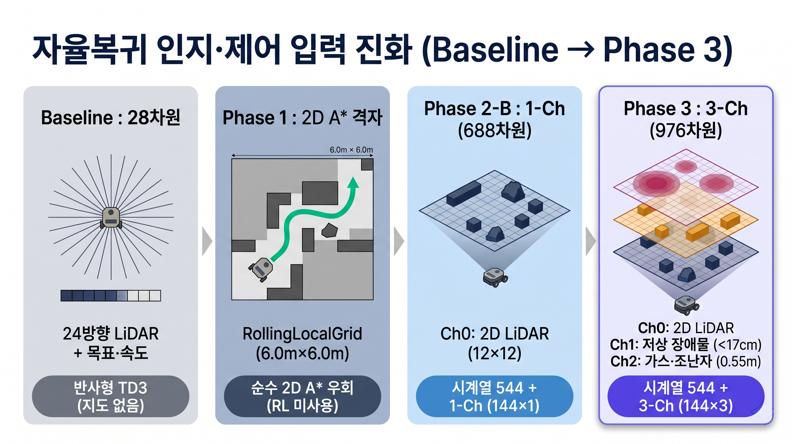

---

## 2. 단계별 알고리즘 및 강화학습 상세 해설

### 2.1 Baseline (초기 LIFO + Phase 1.5 Residual TD3)
- **코드 위치:** [recovery_controller.py](../src/disaster_recovery/disaster_recovery/recovery_controller.py), [td3_policy.py](../src/disaster_recovery/disaster_recovery/td3_policy.py), [train_td3.py](../scripts/host/train_td3.py)
- **전역/복귀 방식:**
  - 탐색 중 `0.30 m` 이동 또는 `25°` 회전할 때마다 위치와 라이다 스캔을 **LIFO 스택(빵 부스러기)** 에 저장하고, 통신이 끊기면 저장한 역순으로 되돌아간다.
  - 경유지 `45 cm` 이내에서는 **SVD 기반 2D ICP**로 바퀴 미끄럼 오차를 보정(상보필터 `α = 0.40`)하고, 출발지 `0.5 m` 이내에서는 **ArUco 마커 + `solvePnP`** 로 정밀 도킹한다.
- **사용된 강화학습 기법 — Residual TD3:**
  - **알고리즘:** 연속 행동 공간(`v ∈ [0.03, 0.15]`, `ω ∈ [-0.60, 0.60]`)용 오프-폴리시(Off-Policy) 액터-크리틱 알고리즘인 **TD3 (Twin Delayed Deep Deterministic Policy Gradient)**.
  - **구조적 특징 (`TD3Actor`):** 순수 신경망(`28→128→128→2` MLP + LayerNorm)만 믿지 않고, 계산 그래프 안에 **미분 가능한 제어 장벽 / VFH 반발력 사전식(Prior)** 을 내장한 뒤 신경망은 그 위에 작은 **잔차(Residual: `Δv ∈ ±0.025`, `Δω ∈ ±0.12`)** 만 더하도록 설계했다.
- **왜 한계가 있었나:** 현재 시점의 28차원 벡터만 보는 **반사형(Reactive) 제어**라서, U자 막다른 골목이나 촘촘한 낙석 더미를 만나면 전체 우회 길을 찾지 못하고 제자리를 맴돌거나 충돌·타임아웃이 빈발했다(과거 Legacy 150회 성공률 `53.33% [80/150]`, Clean 150회 엄격 무충돌 `2.00% [3/150]` · 도착 `59.33% [89/150]`).

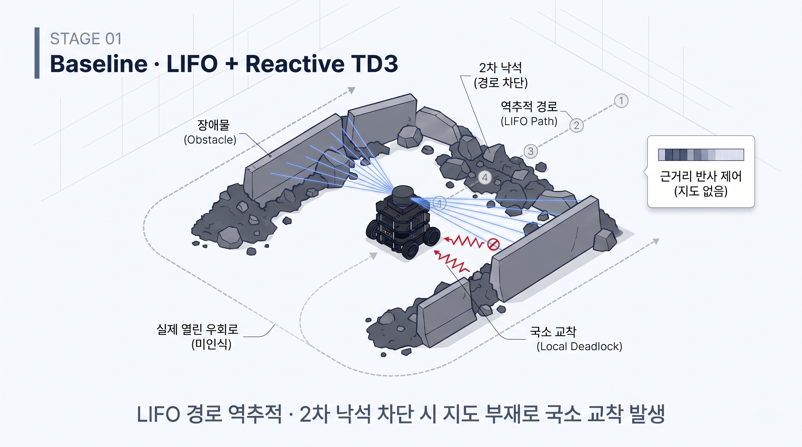

---

### 2.2 Phase 1 (`Proposed A*` — 로컬 점유 격자 + 위상 지름길)
- **코드 위치:** [local_grid_planner.py](../src/disaster_recovery/disaster_recovery/local_grid_planner.py)
- **RL 사용 여부:** **강화학습을 사용하지 않은** 순수 기하·탐색 기반 제어기다.
- **핵심 알고리즘 4가지:**
  1. **`RollingLocalGrid` (런타임 `6.0 m × 6.0 m`, 해상도 `0.04 m`, 팽창 반경 시뮬 `0.085 m` / 실차 `0.095 m`; 클래스 기본값은 `8.0 m`) + `2D A*`**: 로봇 주변의 실시간 점유 격자 지도를 그리면서, 막힌 구간을 통째로 돌아가는 최단 안전 경로(`A*`)를 실시간으로 찾는다.
  2. **비파괴 위상 지름길 (`_plan_topological_astar`)**: 지나온 발자국 중 출발지에 더 가까운 지점이 이미 관찰된 자유 공간(`observed_free`)으로 안전하게 연결되어 있으면 중간 경로를 건너뛰어 지름길로 직결한다.
  3. **`ESCAPE` 후진 탈출 (`BACKTRACKING_HYBRID` 내부 플래너 서브모드)**: 정체 감시(Progress Watchdog)가 일정 시간 이동 정지를 감지하면 안전 방향으로 후진 후 회전해 갇힘을 탈출한다.
  4. **`_virtual_obstacles` (가상 접촉 장벽)**: 라이다에 안 찍히는 낮은 받침대(`cafe_table` 등)에 부딪혀 헛바퀴가 돌면, 차체 앞 접촉 지점에 가상 장애물(`±0.03 m`, TTL `9.0 s`)을 심어 `A*`가 그 지점을 우회하게 만든다.
- **성과와 한계:** 정적 환경 13종에서는 과거 Legacy(충돌 허용 `<= 85 cm`) 기준 **`99.23% (129/130)`** 를 달성했으나, 움직이는 장애물 잔상이 격자에 남는 `#14`(`0/10`)와 연기 난반사 `#15`(`0/10`)에서는 꼼짝없이 막혔다.

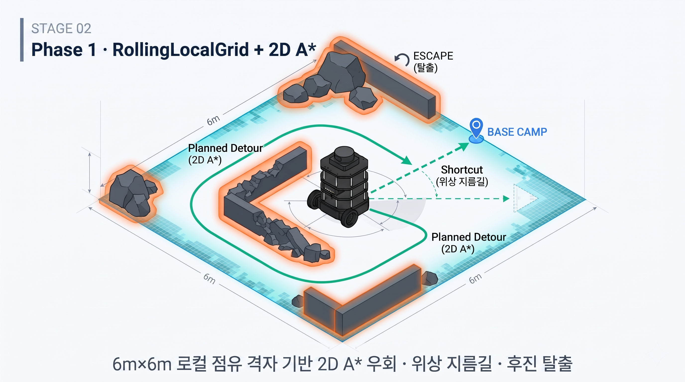

---

### 2.3 Phase 2 (v1.0 — V100 대규모 Recurrent PPO & ONNX 증류)
- **코드 위치:** [rl_context_policy.py](../src/disaster_recovery/disaster_recovery/rl_context_policy.py), [rl_procedural_env.py](../scripts/host/rl_procedural_env.py), [train_phase2_v100.py](../scripts/host/train_phase2_v100.py)
- **핵심 강화학습 기법 4가지 (단순 MLP에서 시공간 적응형 RL로 도약):**
  1. **Teacher 네트워크 — `TemporalContextActorCritic` (Recurrent PPO):**
     - **시간 문맥 (`GRU`)**: 최근 `1.6초(16틱 @ 10 Hz)` 동안의 `34차원` 피처(24섹터 LiDAR + 목표 극좌표 + 명령 속도 vs 실제 이동 속도 + 추적 오차)를 **GRU**에 통과시켜 "바퀴가 미끄러지고 있는지", "안 보이는 낮은 턱에 걸렸는지", "장애물이 움직이는지"를 암묵적으로 추론한다.
     - **공간 문맥 (`2D-CNN`)**: 로봇 중심 `1.8 m × 1.8 m` 영역을 `12 × 12` 격자로 만든 로컬 코스트맵을 **2D CNN**으로 처리해 주변 좁은 틈과 기둥 배치를 공간적으로 이해한다.
     - **학습 알고리즘:** GPU 병렬 시뮬레이터(`768`개 동시 환경) 기반의 **PPO (Proximal Policy Optimization)** + squashed `tanh` 가우시안 야코비안(Jacobian) 보정.
  2. **Dual-Track Domain Randomization (`sim` / `real_tb3`):**
     - Gazebo 시뮬용 `sim` 트랙과 실차의 심한 바퀴 오돔 편향·슬립·모터 데드존·제어 지연(`act_lag`)·라이다 결측을 모사한 `real_tb3` 트랙을 분리 학습했다.
  3. **PLR (Prioritized Level Replay) & Zero-Leakage Early Stopping:**
     - 실패한 어려운 절차적 맵 시드(`hard_seeds`, 최대 2,000개)를 `25%` 확률로 다시 꺼내 집중 훈련하고, 학습에 전혀 안 쓴 홀드아웃 시드(`10000..10089`)의 성공률을 기준으로 과적합 전에 조기 종료했다.
  4. **3-Seed 앙상블 + Selective DAgger ONNX 증류 (`DistilledEdgeStudent`):**
     - RPi 4 CPU에서 무거운 GRU를 돌리지 않고 **`< 1.5 ms`** (x86 단일 스레드 CPU 실측 `0.036~0.039 ms`, RPi 4 온보드 실측 예정)에 실행하기 위해, 3개 시드 Teacher의 합의를 **`1D-TCN + 2D-CNN + MLP`** 구조의 정적 학생 모델(`231.6 KB` ONNX)로 **DAgger 모방학습 증류**했다.
- **한계:** `0.70 · RL + 0.30 · A*` 고정 비율로 섞다 보니, 좁은 문틀(`house 8/10`, 실패 `#04, #07`)에서 RL의 측면 여유 확보 성향과 `A*`의 문틀 정밀 관통 명령이 상충해 Phase 1 `A*` 공통 실패인 `#07`(`463.3 cm`) 외에 `#04`(`192.7 cm`) 추가 진동 실패 및 통과 회차(`#03, #09`) 문틀 앞 지체가 발생했다(`collapsed_heavy #06` 실패 1건은 복귀 전 Outbound `6.05 m` 조기 정지에 기인).

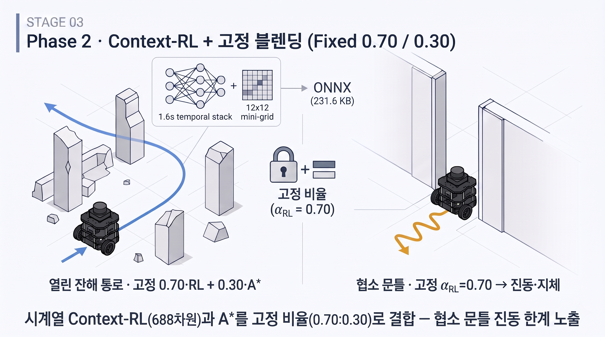

---

### 2.4 Phase 2-A (Clearance-Gated Blending — 재학습 없는 제어 고도화)
- **코드 위치:** [recovery_controller.py](../src/disaster_recovery/disaster_recovery/recovery_controller.py#L366-L391) (`compute_rl_blend_weight`)
- **RL 변경:** 신경망(ONNX) 재학습 없이, **상황에 따라 RL 비중(`alpha_rl`)을 조절하는 게이트**만 추가했다.
- **동작 원리 및 성과:**
  - `ProposedRecoveryPlanner`가 계산한 전방 여유(`front_min`), 좌우 합계(`side_clearance`), 협소 통과 여부(`used_tight_pass`)를 보고, **좁은 문틀(`used_tight_pass=True`, `front_min < 0.28 m`, `side_clearance < 0.62 m`)에서는 `alpha_rl = 0.0` (순수 `A*` 정밀 관통)** 으로 양보하고, **열린 잔해 통로(`front_min >= 0.45 m`, `side_clearance >= 0.85 m`)에서는 최대 `0.70`까지 부드럽게 RL 가속**을 허용한다.
  - `ContextRLStudentPolicy.observe()`를 예측(`predict`)과 분리해, `ESCAPE`·제자리 회전 중에도 16스텝 시계열 버퍼가 끊기지 않고 계속 갱신되도록 했다.
  - 그 결과 50쌍에서 **`47/50 → 48/50 (96.0%)`** 로 향상되었고, `house`에서 `#07`을 복구해 **`8/10 → 9/10`** (통과 평균 시간 `118.29 s → 98.22 s`)을 달성했다(Phase 2-A에서 잔여 실패로 남은 `house #04` `[4]`는 넓은 복도 편측 근접 사례로 Phase 2-B에서 최종 해결).

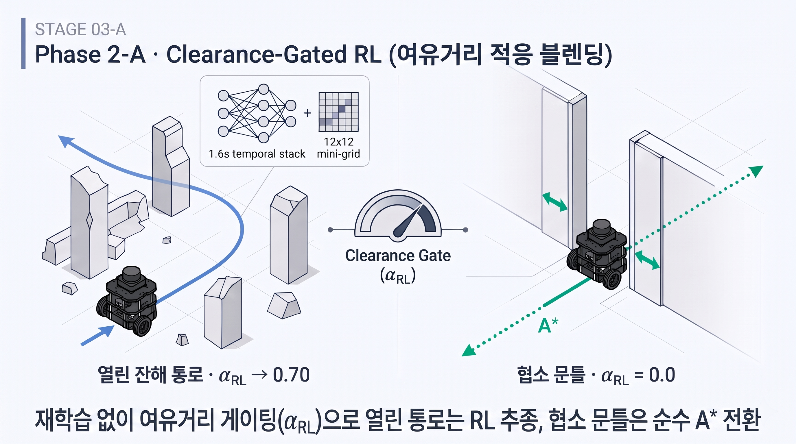

---

### 2.5 Phase 2-B (`v3_dynfix` — 적응형 안전 포락선 & Layer-0 인지 필터)
- **코드 위치:** [recovery_controller.py](../src/disaster_recovery/disaster_recovery/recovery_controller.py#L1078-L1099) (`_despike_lidar_ranges`), [recovery_controller.py](../src/disaster_recovery/disaster_recovery/recovery_controller.py#L1390-L1470) (`DYNAMIC_HOLD` 및 안전 포락선), [local_grid_planner.py](../src/disaster_recovery/disaster_recovery/local_grid_planner.py#L144-L232) (`update_scan`)
- **RL 모델:** V100 커리큘럼 재학습된 `ContextRLStudent` ONNX(`Phase 2-B` 보상함수에 속도 보너스·게이트 통과 보너스 강화) + 2단계 물리·센서 안전 래퍼 결합.
- **핵심 추가 기법 3가지:**
  1. **Layer-0 연기/분진 스파이크 필터 (`_despike_lidar_ranges`):** `±3°` 7-광선 이웃을 검사해, 연속된 벽체/바위가 아닌 `2.20 m` 이내 고립 헛점(연기 난반사)만 배경값(`75%` 분위수)으로 치환한다 (`#15`: Legacy `0/10 → 10/10`, Clean 엄격 `8/10` · 도착 `10/10`).
  2. **동적 잔상 고속 소거 (Open-Ray Carving & 감쇠):** 비관측 셀 감쇠(`0.955`) + 히트/개방 광선 경로 점유 소거(`carve_decay=0.25`)를 `self.occ`에만 적용하고 `observed_free`와 ICP 점군은 보존해, 지나간 이동 장애물 잔상을 즉시 지운다 (`#14`: Legacy `0/10 → 10/10`; 단, Clean 엄격 기준은 횡단 동적 스침으로 엄격 `0/10` · 도착 `5/10` [`Phase 3 Option 2 Clean` 도착 `7/10`]).
  3. **비홀로노믹 안전 제어 (`BACKTRACKING_HYBRID` 내부 서브모드 `DYNAMIC_HOLD` & 곡률 보존 클램프):**
     - 직진(`|ω| < 0.35 rad/s`) 중 전방 장애물이 빠르게 돌진(`df/dt < -0.25 m/s`, `0.20 <= front_min <= 0.55 m`)하면 무리하게 후진하다 구석에 몰리지 않도록 **1.2초 일시 대기(`DYNAMIC_HOLD` 내부 서브모드, `front_min < 0.20 m` 시 즉시 해제)** 한다.
     - 조향 충돌 시 선속도를 `v_cmd` 이하로 함께 제한해 회전 반경 팽창(Understeer)을 막고, **`compute_rl_blend_weight` 내 비대칭 측면 선형 게이팅(`min_side < 0.19 m`에서 목표 `alpha_rl = 0.0`, `0.19 <= min_side < 0.32 m` 선형 감쇠)** 과 **`alpha_rl` 슬루율 제한(`|Δα| <= 0.15/step`, 단 `front_min < 0.24 m` 또는 `min_side < 0.17 m` 도달 시 슬루 지연을 우회해 즉시 `alpha_rl = 0.0` 차단)**, 초근접 사각지대 유한 래치(`_near_latch_ttl = 15틱`), `ESCAPE` 4.5s 쿨다운 및 7.0s Lockout TTL을 적용해 `house #04`까지 해소했다.
- **최종 성과:** **15개 시나리오 150회 Clean 감사(`phase2b_strict_clean`, `AUD-01~AUD-05` 이상 `0건`) 기준 엄격 무충돌 `96/150 (64.00%, 평균 79.72 s, 오차 9.05 cm)` / 물리 도착 `140/150 (93.33%, 전체 평균 109.00 s)`** 달성 (과거 Legacy 충돌 허용 기록 `149/150 = 99.33%`, 평균 `103.70 s`, 원본 JSON 미보관).

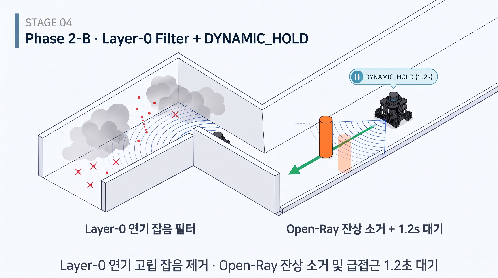

---

### 2.6 Phase 3 (구현·시뮬 검증 완료) — 논문 기반 시맨틱 맵핑 & 3채널 Semantic-Aware RL
- **상세 보고서 및 코드 위치:** [차세대_고도화_시맨틱_SLAM_및_RL_재학습_계획.md](./차세대_고도화_시맨틱_SLAM_및_RL_재학습_계획.md) · [재난환경_자율복귀_알고리즘_원리_해설_및_보고서.md §6.4](./재난환경_자율복귀_알고리즘_원리_해설_및_보고서.md#64-phase-3-구현검증-완료-논문-기반-2d-시맨틱-slam-3채널-semantic-aware-rl) · [semantic_mapper_core.py](../src/disaster_recovery/disaster_recovery/semantic_mapper_core.py) · [semantic_map_node.py](../src/disaster_recovery/disaster_recovery/semantic_map_node.py) · [train_phase2_v100.py](../scripts/host/train_phase2_v100.py)
- **외부 인식 레이어 & 통신 단절 캐시 (`semantic_mapper_core.py`, `semantic_map_node.py`, `SemanticObjectCache`):**
  - 선행 논문(이은원·김진현, 2025)을 변형 적용해 Host PC에 `semantic_map_node`를 구축했다.
  - 추가 Depth 카메라 없이 **YOLO26n 단안 박스 + LDS-01 2D LiDAR(`/scan`) 투영 퓨전**(수식 3 `X·f_y → Y·f_y` 오타 정정 · 270° CCW 역변환 · 가로 중앙 70% 내 `+0.25 m` 전경 클러스터링)으로 물체의 지도 좌표를 계산하고, 논문 `Algorithm 1`(다중 프레임 승격 & TTL)·`Algorithm 2`(2D 맵 오버레이 4종 원자적 저장)를 구현했다.
  - 통신 연결 중(Outbound) 탐지된 조난자(`r=0.55 m`)·저상 장애물(`Ch1`, `r=0.22 m`)·가스(`Ch2`, `r=0.55 m`)를 `/semantic_map/cached_objects`로 온보드 `SemanticObjectCache`에 백업하며, 통신 단절 후(Return)에는 캐시 영속 유지 및 온보드 MQ-2(`/gas/level`, `cb_gas()`) 실시간 가스 좌표 추가로 독립 회피한다.
- **강화학습(RL) 확장 아키텍처 (Option 1 vs Option 2) 및 검증 결과:**
  1. **입력 확장 (`688 → 976`차원):** 기존 `1채널(12×12)` 로컬 패치를 **3채널 `(3, 12, 12)`** 로 확장했다.
     - `Ch 0`: 2D LiDAR 점유 맵 (기존과 동일)
     - `Ch 1`: 라이다 높이(`z ≈ 0.171 m`) 아래 저상 장애물 마커 점유도 (부딪히기 전 **사전 회피** 목적)
     - `Ch 2`: 가스 위험 구역(`GAS_HAZARD`, 반경 `0.55 m`) 및 조난자 보호 반경(`SURVIVOR`)

  2. **Option 2 (`frozen_residual`) 비퇴행 아키텍처 채택:** 초기 단일 3-Ch 네트워크 전체 미세조정 구버전(`Phase 3 v3 Warm-Start`)은 공유 백본 가중치 변형으로 비시맨틱 150회 엄격 무충돌 성적이 `58.00% (87/150)`로 퇴행했다. 이를 해결하기 위해 Dual-ONNX 스위칭(Option 1, 패치 경계 불연속으로 기각) 대신, 단일 ONNX 내부에 **① 동결된 Phase 2-B 1-Ch 백본 + ② Pre-Tanh Zero-Gated Residual 어댑터(`g_res`) + ③ 후단 25-ray `SemanticCorridorSafetyHead` 하드 배리어(`g_safe`)** 를 직렬 결합한 **Option 2 (`--arch frozen_residual`)** 를 채택했다. `Ch1=Ch2=0`일 때 `g_res = g_safe = 0`으로 잔차·쉴드가 완전 소거되어 **Phase 2-B와 부동소수점 오차 없이 동일한 출력(`non_regression_max_abs_diff = 0.0`)** 을 보장한다.

     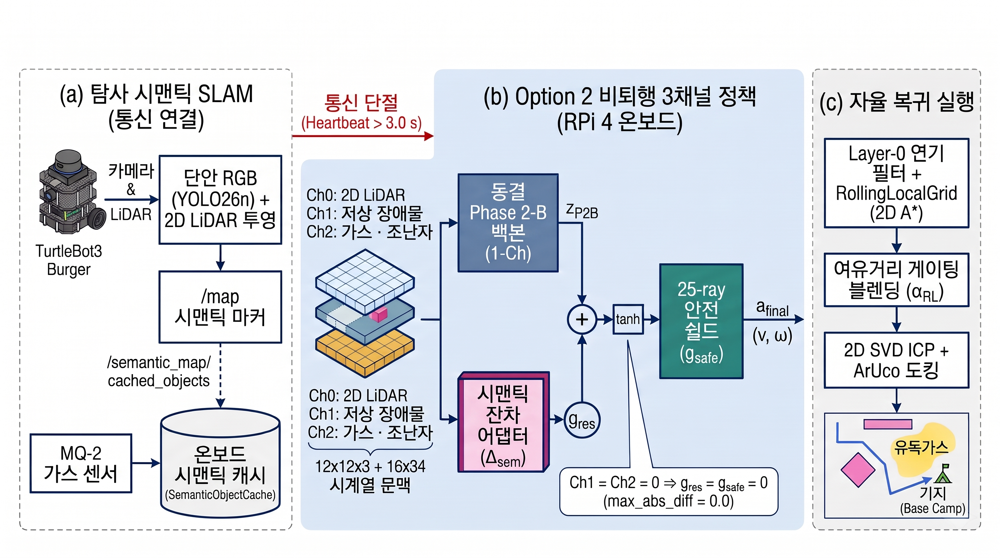

  3. **Modality Dropout (`28%`) 및 독립 시드 분리(`VAL`/`TEST`) V100 학습:** 훈련의 `28%`에서 `Ch 1·2`를 제로 마스킹하고, 체크포인트 선정(`VAL_SEEDS = 10000..10119`)과 최종 평가(`TEST_SEEDS = 20000..20119`)를 독립 시드 풀로 분리해 선택 편향을 제거했다([`phase3_option2_training_summary.json`](../benchmark_results/phase3_option2_training_summary.json)). 배포된 `sim`/`real_tb3_policy_student_semantic_v3.onnx`(**`415.0 KB`**, 기존 런치 드롭인 호환을 위해 파일명 유지, x86 단일 스레드 CPU 지연 **`0.121–0.124 ms`**)는 120개 Unseen Holdout 기준 **`TEST 94.2% / VAL 95.0%`** (`real_tb3` TEST `Sem-2 90.0%`, `Low-Obs CF 93.3%`, `Gas-Free 73.3%`)를 달성했다.
  4. **Gazebo 시맨틱 회피 10-Trial A/B 및 동일 맵(`comp5`) 실증:**
     - **10-Trial 시맨틱 A/B ([`semantic_avoidance_ab_10trials.json`](../benchmark_results/phase3_semantic_v3/semantic_avoidance_ab_10trials.json)):** 개선된 Outbound 경유지(`out_wps`, `10/10` 도달) 하네스 기준 `blind_phase2b`(도착 `9/10`, 무충돌 `6/10`, 엄격 무위험 `2/10 [20.0%]`, 위반 `low/wall/gas = 4/2/5`, 평균 `56.91 s`, 오차 `28.40 cm`) 대비 **`semantic_phase3`는 도착·무충돌·엄격 무위험 모두 `10/10 (100.0%)`, 위반 `0/0/0`, 평균 최소 이격 `low=0.5838 m / gas=0.8196 m`, 평균 복귀 시간 `38.26 s`, 평균 종말오차 `3.51 cm`** 를 달성했다(양측 Fisher **`p = 7.14×10⁻⁴`**; 초판 구 하네스 기록은 Blind `0/10 [67.79 s]` vs `semantic_phase3 9/10 [23.07 s]`, 초기 구버전 `v3` 1회 [`semantic_avoidance_ab.json`](../benchmark_results/phase3_semantic_v3/semantic_avoidance_ab.json)의 가스 침범 한계를 Option 2에서 완전 해소).
     - **동일 맵 비교 ([`comp5_semantic_rescue.json`](../benchmark_results/phase3_semantic_v3/comp5_semantic_rescue.json)):** 2차 붕괴 3D 낙석이 퇴로를 막고 저상 장애물 2개·유독가스가 배치된 동일 `/map`에서 `Baseline`부터 `Phase 2-B`까지가 모두 저상 충돌 및 미도착(`135.0 s`)으로 실패한 반면, **`Phase 3 (Option 2)`(`low=0.449 m`, `gas=0.888 m`, `37.4 s`, 오차 `7.64 cm`; 초판 구 하네스 기록 `12.06 s`, `low=0.480 m`, `gas=1.016 m`)와 `Phase 4`(`low=0.543 m`, `gas=0.787 m`, `min_scan=0.127 m`, 오차 `8.03 cm`)만이 저상·가스·벽체 무위반 복귀(`PASS`)** 에 성공했다.
  5. **Clean 150-Trial 엄격 무충돌 비퇴행 검증 및 잔여 병목 분석 ([`phase3_option2_clean/`](../benchmark_results/phase3_option2_clean/)):**
     - **완전 비퇴행 입증:** 동일 잔해 시드(`same_debris=150/150`) 및 무결성 감사(`AUD-01`-`AUD-05` 이상 `0건`) 조건에서 **Phase 3 Option 2 Clean은 엄격 무충돌 `96/150 (64.00%, 평균 81.57 s, 오차 9.08 cm)` / 물리 도착 `141/150 (94.00%, 전체 평균 106.97 s)`** 을 기록해 **Phase 2-B Strict Clean(`96/150 = 64.00%` / 도착 `140/150 = 93.33%`)과 정확히 동일한 Strict Pass**를 달성했다(시나리오별 미세 차이는 `max_abs_diff = 0.0` 동일 정책 실행 간 Gazebo 물리 비결정성에 기인한 차이로 해석된다).

     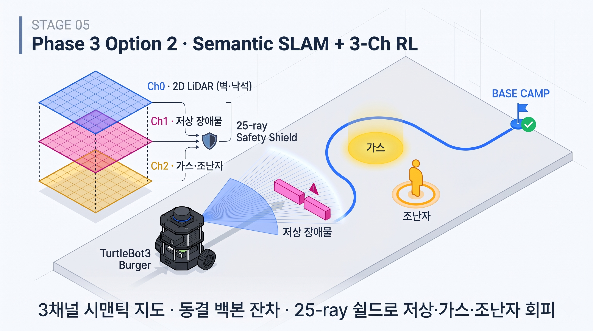

     - **사실 기반 잔여 병목 (Known Bottlenecks):** ① 도착률(`93.33-94.00%`) 대비 Strict Pass(`64.00%`) 격차의 주원인은 기지 도착 후 복귀 중 스침 충돌로 판정된 45건이며, 전체 충돌 54건 중 **53건이 `lidar_collision`(`min_scan_m = 0.120 m`, `scan_all_min <= 0.121 m` 4스텝 이상)** 이다(`debris_collision`은 8건). ② 협소·근접 구간(`used_tight_pass == True`, `front_min < 0.28 m`/`0.24 m`, `side_clearance < 0.62 m`, `min_side < 0.19 m`/`0.17 m`)에서 `alpha_rl = 0.0` 게이팅으로 제어가 공통 로컬 플래너(`local_grid_planner.py`, `tight_radius_m = 0.058 m`)에 수렴하며, ③ `DYNAMIC_HOLD`가 정면 급접근에만 반응해 `dynamic_crossfire_alley`(두 모델 모두 Strict Pass `0/10`) 등 교차 동적 장애물 측면 회피가 부재했다.
     - **해소 연결:** 위 근접 스침 충돌 및 동적 교차·왕복 회피 병목은 **아래 [`§2.7 Phase 4`](#27-phase-4-구현시뮬-검증-완료-4-ch-cppo-2-circle-soft-cbf-qp-cvharmonic-imm-2d-시공간-회피)에서 2-Circle Soft CBF-QP · CV+Harmonic IMM · 기하 조건부 3-Way 시공간 라우터 · 순수 관측 2분기 ICP 통합으로 해소·검증 완료** 했다(설계 배경: [Phase4_후속_연구_방향_검토_및_설계.md](./Phase4_후속_연구_방향_검토_및_설계.md), [Phase4_재검증_연구설계_및_구현계획.md](./Phase4_재검증_연구설계_및_구현계획.md)).

<strong>참고 아카이브: Phase 3 시점 초기 Phase 4 개념 로드맵 도식 펼쳐보기</strong>

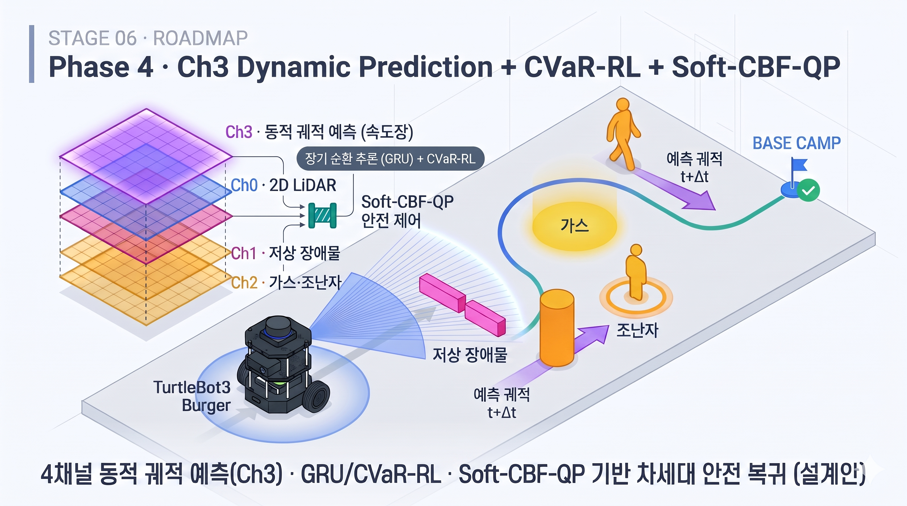

---

### 2.7 Phase 4 (구현·시뮬 검증 완료) — 4-Ch CPPO · 2-Circle Soft CBF-QP · CV+Harmonic IMM · 2D 시공간 회피
- **코드 및 벤치마크 위치:** [cbf_safety_shield.py](../src/disaster_recovery/disaster_recovery/cbf_safety_shield.py) · [dynamic_tracker.py](../src/disaster_recovery/disaster_recovery/dynamic_tracker.py) · [recovery_controller.py](../src/disaster_recovery/disaster_recovery/recovery_controller.py) · [local_grid_planner.py](../src/disaster_recovery/disaster_recovery/local_grid_planner.py) · [rl_context_policy.py](../src/disaster_recovery/disaster_recovery/rl_context_policy.py) · [`stepB4_gate1_sim/`](../benchmark_results/stepB4_gate1_sim/) · [`stepB4_gate2_sim/`](../benchmark_results/stepB4_gate2_sim/) · [`opt1_fix_sim_crossfire/`](../benchmark_results/opt1_fix_sim_crossfire/) · [`phase4_semantic/`](../benchmark_results/phase4_semantic/)

Phase 4는 Phase 3 Clean 150-Trial 감사에서 확인된 근접 `lidar_collision`(53건)과 동적 교차·왕복 장애물 시공간 회피 부재(`dynamic_crossfire_alley 0/10`)를 해소하고, 시맨틱 회피·연기 LiDAR 오염·U자 함정까지 단일 RPi 4 온보드 폐루프로 통합한 최종 제어 단계다.

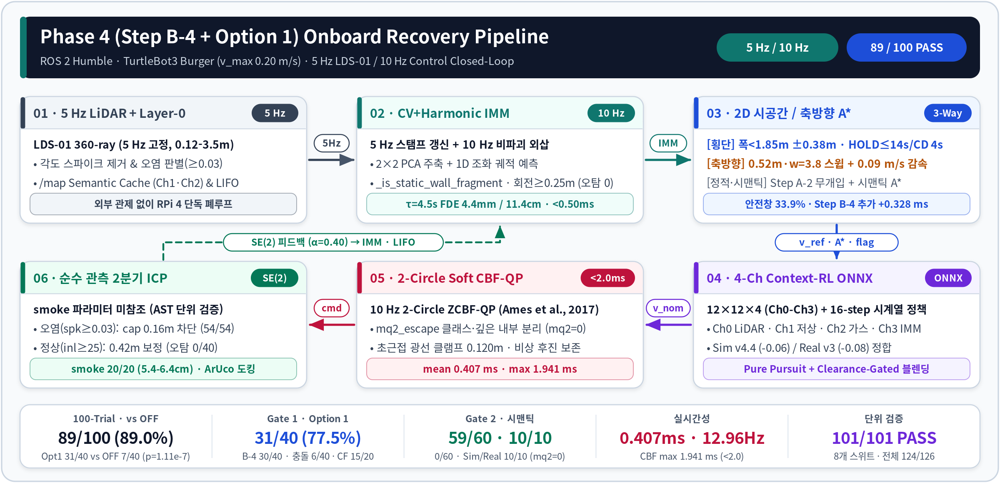

#### Phase 4 핵심 5대 기술 축

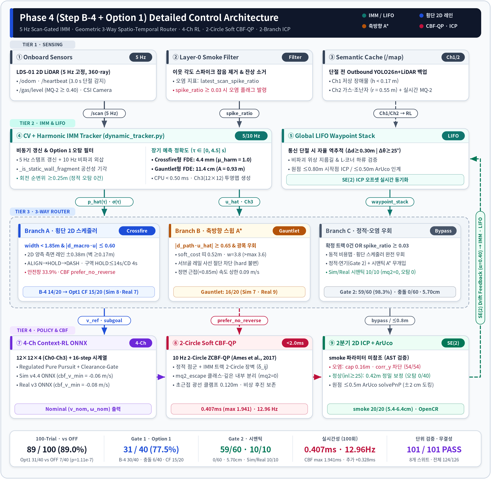

1. **4-Ch Context-RL (`1120`차원) 및 V100 Dual-Track CPPO 학습 (`rl_context_policy.py`, `train_phase2_v100.py`):**
   - 관측 공간을 `12×12×4 = 576`셀 Ego 코스트맵(`Ch0` 2D LiDAR, `Ch1` 저상 장애물, `Ch2` 가스/조난자, **`Ch3` 동적 장애물 미래 예측 투영**) + `544`차원 시계열 스칼라(`16×34`) = **`1120`차원**으로 확장했다.
   - `frozen_residual` 구조로 비시맨틱·비동적(`Ch1=Ch2=Ch3=0`) 환경에서 기준 백본과 수치적으로 완전히 일치하는 비퇴행(`non_regression_max_abs_diff = 0.0`)을 유지한다.
   - Tesla V100 32GB에서 각 트랙당 3시드 × `22.12M` = **`66.36M` steps** 학습 후 DAgger 증류로 트랙별 `cbf_v_min` 정합 ONNX를 추출했다([`phase4_cppo_v4_4_full_training_summary.json`](../benchmark_results/phase4_cppo_v4_4_full_training_summary.json), [`phase4_cppo_v3_training_summary.json`](../benchmark_results/phase4_cppo_v3_training_summary.json)):
     - **`Sim v4.4`** (`sim_policy_student_phase4.onnx`, `cbf_v_min = -0.06 m/s`, `574.2 KB`, x86 CPU `0.091 ms / p95 0.102 ms`): `TEST` Unseen SR `91.5%` (CBF OFF) / `87.3%` (CBF ON), Safe SR `86.0% / 86.8%`, Low-Obs CF **`98.0%`**.
     - **`Real TB3 v3`** (`real_tb3_policy_student_phase4.onnx`, `cbf_v_min = -0.08 m/s`, `403.8 KB`, x86 CPU `0.062 ms / p95 0.069 ms`): `TEST` Unseen SR `80.5% / 74.5%`, Safe SR `73.0% / 71.8%`, Low-Obs CF `80.0%`.
   - 복귀 개시 시 로봇 후방에 이미 위치한 조난자(`cos <= -0.35`)의 방향 가중치 `dir_w`를 `0`으로 선형 감쇠해 불필요한 `sem_prox` 포화와 명목 일관성 가드 해제를 차단한다.

2. **2-Circle Soft CBF-QP 실시간 안전 차폐 (`cbf_safety_shield.py`):**
   - Ames et al. (2017)의 **연속시간 제어 장벽 함수(Zeroing CBF, ZCBF)** 를 TurtleBot3 Burger 전·후 2-원 커버링($i \in \{f, r\}$, 반경 $r_c = 0.098\,\text{m}$, $l_f = +0.020\,\text{m}$, $l_r = -0.060\,\text{m}$)으로 정식화해 **10 Hz 제어 주기**($\Delta t = 0.1\,\text{s}$, $\gamma_j \Delta t \in \{0.3, 0.6, 0.8\} < 1$)로 매 스텝 적용한다.
   - 각 커버링 원 중심·차동구동 속도 및 동적 장애물 속도항 $\dot{o}_j(t)$를 포함한 장벽 시간 미분은 다음과 같다:

     $$
     p_i(x) = \begin{bmatrix} x_r + l_i \cos\theta \\ y_r + l_i \sin\theta \end{bmatrix}, \qquad \dot{p}_i(x, u) = \begin{bmatrix} v\cos\theta - l_i\omega\sin\theta \\ v\sin\theta + l_i\omega\cos\theta \end{bmatrix}
     $$

     $$
     h_{ij}(x, t) = \bigl\lVert p_i(x) - o_j(t) \bigr\rVert^2 - r_{\text{safe},j}^2, \qquad \dot{h}_{ij}(x, u, t) = 2\bigl(p_i(x) - o_j(t)\bigr)^\top\bigl(\dot{p}_i(x, u) - \dot{o}_j(t)\bigr)
     $$

   - 두 원 간 완화 변수를 공유하지 않고 각 $(i, j)$ 제약 행마다 독립 완화 변수 $\delta_{ij} \ge 0$($p_{\delta,fj} = 2\,p_{\delta,rj}$)을 부여한 Soft CBF-QP를 푼다:

     $$
     \min_{u = (v, \omega),\; \delta_{ij} \ge 0} \; w_v (v - v_{\text{ref}})^2 + w_\omega (\omega - \omega_{\text{ref}})^2 + \sum_{i \in \{f, r\}} \sum_j p_{\delta,ij}\,\delta_{ij}^2
     $$

     $$
     \text{s.t.} \quad \dot{h}_{ij}(x, u, t) + \gamma_j\,h_{ij}(x, t) \ge -\delta_{ij}, \qquad v \in [v_{\min}, v_{\max}], \qquad |\omega| \le \omega_{\max}
     $$

   - 감쇠율 계층 $\gamma_{\text{dyn}} = 3.0 < \gamma_{\text{static}} = 6.0 \le \gamma_{\text{gas}} = 8.0\,\text{s}^{-1}$ (코드 구현에서는 주기 불변 계수 $\tilde{\gamma}_j(\Delta t) = (1 - e^{-\gamma_j \Delta t})/\Delta t$ 및 스텝 간 곡률·슬립 여유항 $\varepsilon_{\Delta t,\text{slip},ij}$ 반영), 가중치 $w_v = 1.0, w_\omega = 0.05$, 0.10 m 복셀 16점 다운샘플링, Pure-NumPy $2\times 2$ PDAS(Semismooth Newton) + Armijo 선탐색으로 **`Step B-4` 100-Trial 실측 `cbf_mean = 0.407 ms` / `cbf_max = 1.941 ms` (`< 2.0 ms`)** 를 달성했다.
   - `prefer_no_reverse`로 협소 교차 `HOLD`/`DASH` 중 안전 영역($h \ge 0$)의 불필요 후진을 억제하되 장벽 침범($h < 0$) 시 비상 후진을 100% 보존한다.
   - **`mq2_escape` 예외 분기:** `GAS_HAZARD` 클래스 전용(`person`/`AUDIO_DISTRESS` 제외)이면서 $h_{\min} < 0$ 침범 시 ① 로컬 MQ-2 실측 가스 구역 $d < h_r$ 또는 ② 캐시된 원격 가스 구역 깊은 내부 $d < \mathrm{clip}\bigl(h_r - r_c - m_{\text{sem}},\; 0.50\,h_r,\; 0.75\,h_r\bigr)$ ($h_r = 0.55\,\text{m}$, $r_c = 0.098\,\text{m}$, $m_{\text{sem}} = 0.05\,\text{m}$)일 때만 발동하며 외곽 패딩 구간에서는 일반 Ch2 반발을 유지하고, `_select_safe_lifo_waypoint`가 가스 구역 현(chord) 관통을 금지한다.
   - `_apply_near_ray_latch`가 LDS-01 초근접 양수 반환($0 < r < 0.120\,\text{m}$)을 `0/inf/nan` 드롭아웃과 분리해 `0.120 m`로 클램프·래치하고, `cb_reset_episode`가 트래커·CBF·스케줄러·시맨틱 캐시를 원자적으로 초기화한다.

3. **5 Hz/10 Hz CV+Harmonic IMM & Option 1 정적 벽체 조각 공선성 필터 (`dynamic_tracker.py`):**
   - Blom & Bar-Shalom (1988) IMM을 등속(CV) + 1D 조화왕복(Harmonic) 2-모델로 경량화하고, `scan.header.stamp` 전진 시(5 Hz)만 관측 갱신하며 중간 틱(10 Hz)은 내부 상태를 변형하지 않고 비파괴 외삽한다.
   - **Option 1 정적 벽체 조각 공선성 필터(`_is_static_wall_fragment`) & 회전 순변위 게이트:** 사선 광선 카빙으로 벽체에서 분리된 조각을 양단 정적 인접성·공분산 평탄도(`spread_ratio < 0.008`)·연장 현 길이로 기각하고, 회전 가드 활성 시 트랙 확정 요구 순변위를 `max(confirm_min_disp_m, 0.25 m)`로 상향해 정적 시맨틱 월드 동적 오탐을 **`2 → 0건`** 으로 완전 제거했다.
   - 5 Hz 잡음 LiDAR 기준 $\tau = 4.5\,\text{s}$ 장기 예측 FDE **`4.4 mm`** (`crossfire`형, $A=0.38\,\text{m}, \omega=0.95\,\text{rad/s}$) / **`11.4 cm`** (`gauntlet`형, $A=0.93\,\text{m}, \omega=0.45\,\text{rad/s}$), 매 틱 `< 0.50 ms` 이내로 수렴한다(`test_dynamic_tracker.py` `14/14 PASS`).

4. **기하 조건부 3-Way 시공간 회피 분리 (`CrossingLaneScheduler` + 축방향 스윕/시맨틱 A\*):**
   - 월드 좌표·시나리오명 하드코딩 없이 동적 장애물 주축 $\hat{u}$, 진행 방향($\hat{d}_{\text{path}}, \hat{d}_{\text{macro}}$), 로컬 격자 개구부 폭만으로 3분기한다(Fiorini & Shiller, 1998):
     - **1순위 (Branch A — 협소 횡단 `CrossingLaneScheduler`):** 좌·우 벽 검출 & 개구부 폭 `< 1.85 m`, $|\hat{d}_{\text{path}}\cdot\hat{u}| \le 0.55$, $|\hat{d}_{\text{macro}}\cdot\hat{u}| \le 0.60$ 시 최우선 분기하여 벽 이격 $\ge 0.17\,\text{m}$ 양측 측면 레인($y = \pm 0.38\,\text{m}$)을 따라 `ALIGN → HOLD(안전창 33.9%, 최악 대기 2.19 s) → DASH`를 수행한다. Option 1에서 구역 반경 `0.85 m` 누적 HOLD 상한 `14.0 s` 및 쿨다운 `4.0 s`를 도입해 기아를 차단했다.
     - **2순위 (Branch B — 광폭 축방향 스윕 A\*):** $|\hat{d}_{\text{path}}\cdot\hat{u}| \ge 0.65$ (진폭 $\ge 0.06\,\text{m}$) 시 반폭 $r_{\text{track}} + 0.34 \approx 0.52\,\text{m}$, 가중치 `w_band = 3.8 (> max_soft 3.6)`의 연성 비용맵을 부과해 측면 안전 차선으로 이탈시키며, 정면 근접(`d_dyn < 0.85 m`, `closing > 0.25 m/s`) 시 선속도를 `0.09 m/s`로 제한한다(IMM+스케줄러+축방향 비용맵 총 추가 지연 `0.3283 ms`).
     - **3순위 (Branch C — 정적·오염 우회 및 시맨틱 A\*):** 확정 동적 트랙 `0건` 또는 `spike_ratio >= 0.03` 시 동적 분기를 완전 우회해 Gate 2 정적·연기 회귀를 차단하며, 시맨틱 미션에서는 CLI로 `enable_semantic_astar_cost:=true`를 주입한다(기본 `false`).

5. **`Step A-2` 순수 관측 2분기 2D LiDAR SVD ICP (`recovery_controller.py`):**
   - 시뮬레이션 파라미터 `smoke_lidar_noise_prob` 참조를 완전히 제거(AST 단위 테스트 검증)하고, 시작 앵커(`is_start_match`)에서 순수 관측 지표(`spike_ratio >= 0.03` / `icp_inlier_ratio < 0.65` / `icp_mean_err > 0.08 m`)만으로 2분기한다: 오염 스캔은 보수 가드(`0.12 m / 0.16 m`, `corr_y` 차단 → 오염 차단 `54/54`), 정상 고품질 스캔(`inliers >= 25`)은 `0.38 m / 0.42 m` 및 `corr_y` 허용(30 cm 드리프트 흡수 `0/40` 오탐).

#### Phase 4 정량 검증 요약 (`Step B-4` · Option 1 · 시맨틱 4-모드 · Fisher 정확 검정)

| 평가 세트 | 핵심 성과 (Strict Pass / Hazard-Free) | 대조군 및 양측 Fisher 정확 검정 `p` |
| :--- | :---: | :--- |
| **`Step B-4` 100-Trial 통합** (5대 맵 × Sim/Real) | **`89/100 (89.0%)`** · 도착 `94/100` · 충돌 `8/100` Pass 평균 `88.12 s` · 오차 `6.31 cm` | `cbf_mean 0.407 ms`, `cbf_max 1.941 ms (< 2.0 ms)`, `ctrl_hz_min 12.959 Hz` |
| **Gate 1 동적 40-Trial (`Step B-4` → Option 1)** | `Step B-4` `30/40 (75.0%, 충돌 8/40)` **Option 1 `31/40 (77.5%, 충돌 6/40)`** (`CF 15/20`, `GN 16/20`) | Ablation OFF `7/40 (17.5%, 충돌 30/40)` 대비 **`p = 3.93×10⁻⁷`** (`Step B-4`) / **`p = 1.11×10⁻⁷`** (Option 1) Phase 3 Option 2 `4/20 (20.0%)` 대비 **`p = 7.53×10⁻⁵`** |
| **Gate 2 강건성 60-Trial (`Step B-4`)** | **`59/60 (98.3%)`** · 충돌 **`0/60`** `smoke 20/20` · `u_pocket 20/20` · Pass 오차 **`5.70 cm`** | Phase 3 Option 2 `22/30 (73.3%, 충돌 8/30)` 대비 **`p = 5.17×10⁻⁴`** |
| **시맨틱 10-Trial 4-모드 공정 비교** (개선 `out_wps` 하네스) | **`phase4_sim 10/10` (`38.92 s`, `3.50 cm`)** **`phase4_real 10/10` (`38.35 s`, `3.54 cm`)** `semantic_phase3 10/10` (`38.26 s`, `3.51 cm`) `low/wall/gas = 0/0/0` · `mq2 = 0` · `max_dyn = 0` | `blind_phase2b 2/10 (20.0%, 56.91 s)` 대비 개별 시맨틱 비교 양측 Fisher **`p = 7.14×10⁻⁴`** (`phase4_sim + phase4_real 20/20` 통합 탐색적 비교 시 `p = 7.69×10⁻⁶`, 동일 시드 공유) |
| **단위 테스트 (핵심 8스위트 / 전체 10스위트)** | 핵심 **`101/101 PASS`** (전체 `124/126 passed`) | 구버전 학습/환경 테스트 2건 실패 (`test_phase4_cvar_env.py`, `test_semantic_rl_env.py`) |

- **Phase 4 잔여 한계 (5항목):**
  1. **실물 TurtleBot3 Burger (RPi 4) 필드 실증 미수행:** Gazebo 11 시뮬레이션 및 x86 CPU 지연(`0.062-0.091 ms`, CBF `0.407 ms`)까지만 검증 완료; RPi 4 4GB 온보드 지연 실측 및 현장 주행 미수행.
  2. **`dynamic_gauntlet` 전역 `t_sim` 비초기화 표본 분산:** 에피소드 간 전역 시뮬레이션 시각 위상이 리셋되지 않아 동일 시드에서도 초기 동적 기둥 위상에 따른 표본 분산 존재.
  3. **CV+Harmonic IMM의 비주기·의도 기반 보행자 한계:** 등속(CV) 및 1D 조화왕복(Harmonic) 모델 기반이므로 급정지·급선회·사회적 상호작용을 포함한 보행자 예측에 한계 존재.
  4. **로봇 최대 속도 대비 `2.8-3.0배` 초고속 장애물 물리 한계:** 버거 최대 선속도(`0.15-0.20 m/s`) 대비 `2.8-3.0배` 이상 접근 시 기구학·제동 거리 제약으로 물리적 회피 한계 발생.
  5. **하드웨어·운용 잔여 항목:** 출발지 정면 벽 ArUco 기하 가정, MQ-2 실물 미결선(`gas_stale_triggers_recovery: false`), 블랙박스 Wi-Fi 스트리밍 차단 미구현, 통신 단절 후 신규 등장 조난자 Host YOLO 비전 탐지 불가(단절 전 온보드 캐시 유지 + 온보드 MQ-2 실시간 감지만 동작).

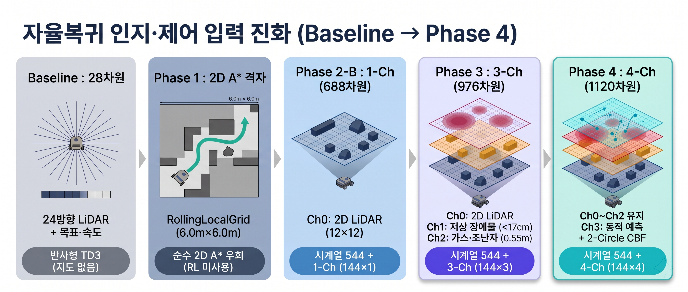
